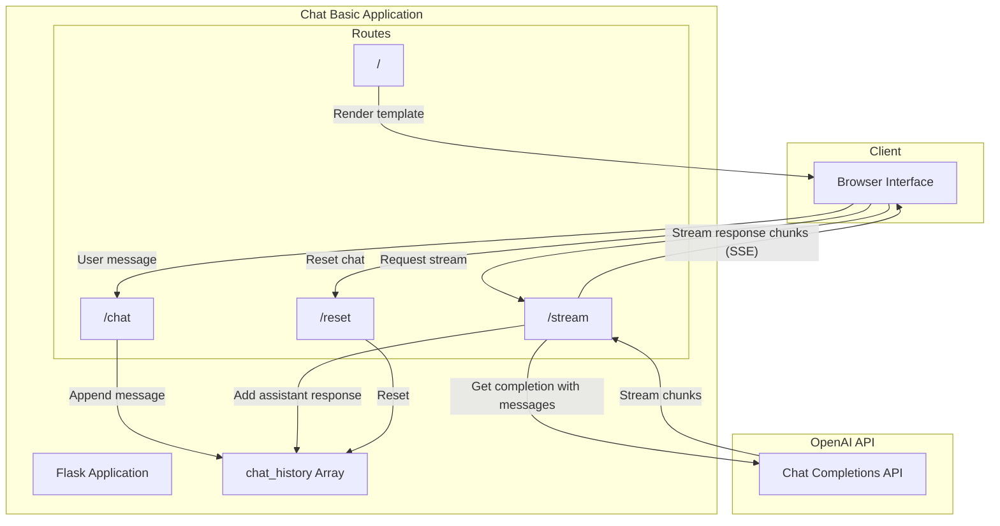
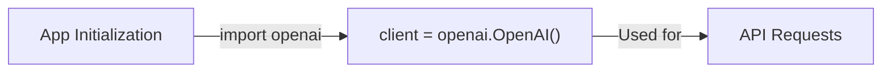
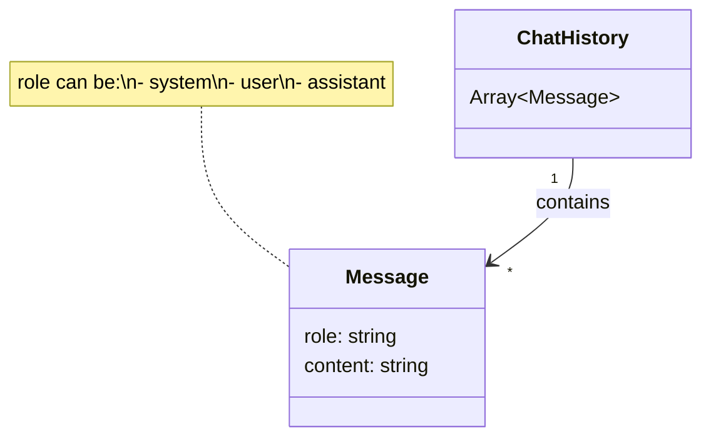
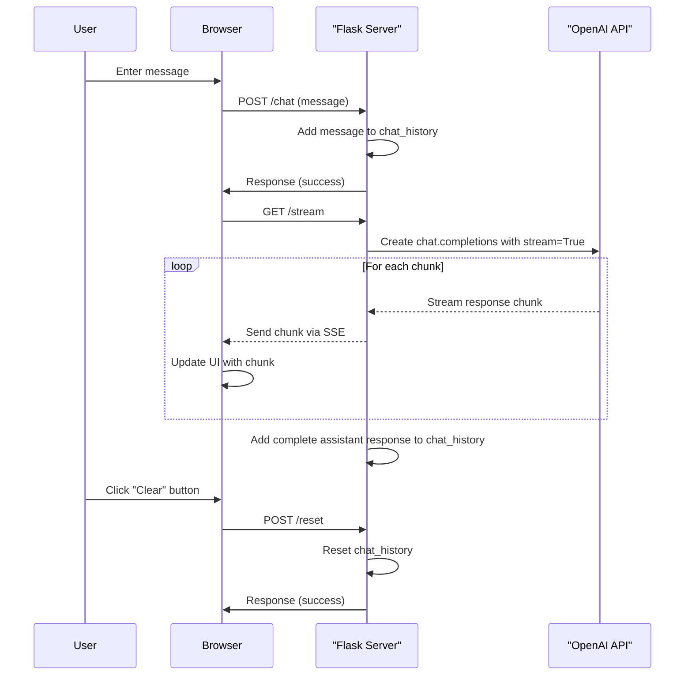
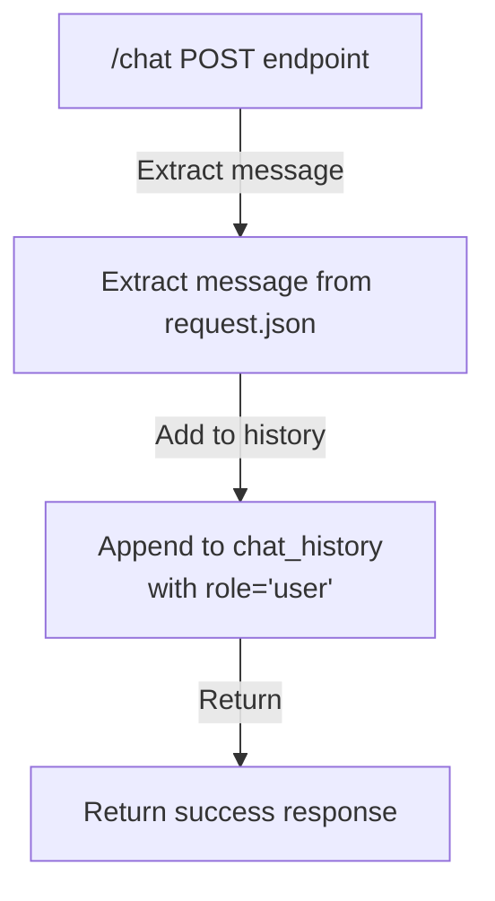
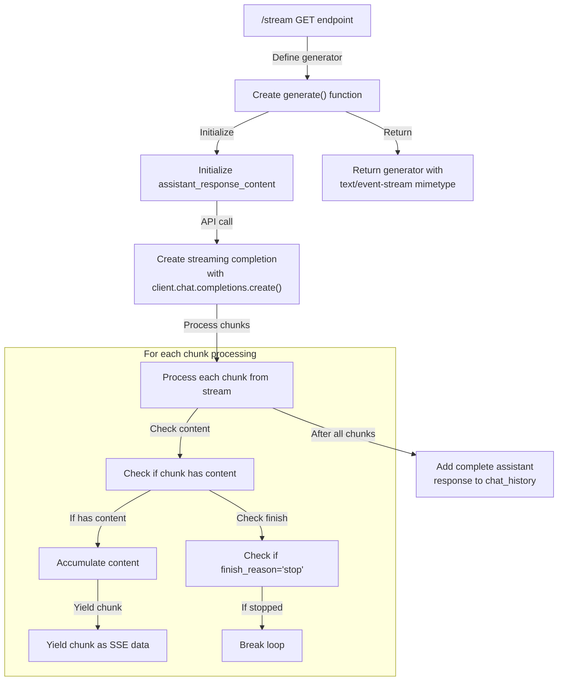
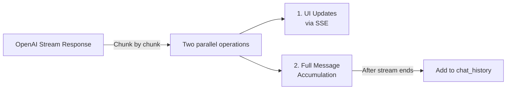
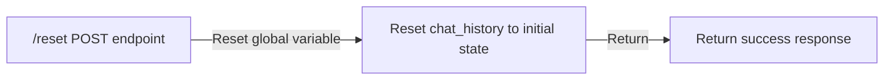

<!-- source: DeepWiki mcp.deepwiki.com · repo openai/openai-quickstart-python · page 4.2 Chat Completions API Implementation · fetched 2026-10-26 -->

# Chat Completions API Implementation

<details>
<summary>Relevant source files</summary>

The following files were used as context for generating this wiki page:

- [examples/assistant-basic/assistant.py](examples/assistant-basic/assistant.py)
- [examples/chat-basic/app.py](examples/chat-basic/app.py)

</details>


## Purpose and Scope

This document explains how the Chat Completions API is implemented in the OpenAI quickstart Python repository, focusing specifically on the Chat Basic application. It details the code structure, API integration patterns, and streaming implementation used to create a simple chat interface with OpenAI's models. For information about the Assistant API implementation, see [Assistant API Implementation](#4.1).

## Application Overview

The Chat Basic application demonstrates a minimalist implementation of OpenAI's Chat Completions API within a Flask web application. It allows users to interact with OpenAI's models through a browser interface with real-time streaming responses.



Sources: [examples/chat-basic/app.py:11-62]()

## Chat Completions API Integration

The application integrates with the OpenAI API through the Python client library. The key implementation points include:

1. Client initialization
2. Message history management
3. API request configuration
4. Streaming response handling

### Client Setup

The application initializes the OpenAI client once at startup:



Sources: [examples/chat-basic/app.py:9-11]()

### Chat History Management

Messages are stored in a simple in-memory array following the required format for the Chat Completions API:



The application initializes the chat history with a system message that defines the assistant's behavior:

Sources: [examples/chat-basic/app.py:15-17]()

## Request-Response Flow

The application implements a request-response pattern with real-time streaming for a responsive user experience:



Sources: [examples/chat-basic/app.py:25-62]()

## Key Implementation Components

### 1. Flask Routes

The application defines several key routes to handle different aspects of the chat interaction:

| Route       | Method | Purpose                                            |
|-------------|--------|---------------------------------------------------|
| `/`         | GET    | Renders the chat interface with current chat history |
| `/chat`     | POST   | Receives and stores user messages                  |
| `/stream`   | GET    | Streams AI responses using Server-Sent Events      |
| `/reset`    | POST   | Resets the chat history to initial state           |

Sources: [examples/chat-basic/app.py:20-62]()

### 2. User Message Handling

When a user submits a message, it's processed by the `/chat` route:



Sources: [examples/chat-basic/app.py:25-29]()

### 3. Streaming Implementation

The core of the application is the streaming implementation in the `/stream` route:



Sources: [examples/chat-basic/app.py:32-55]()

### 4. API Request Configuration

The request to the OpenAI API is configured with these key parameters:

```
model: "gpt-3.5-turbo"
messages: chat_history
stream: True
```

This configuration enables the streaming capability and provides the full conversation context to the API.

Sources: [examples/chat-basic/app.py:37-40]()

## Implementation Details

### Stream Processing Logic

The stream processing logic deserves special attention as it's the most complex part of the implementation:

1. The application creates a generator function that processes the streaming response
2. For each chunk received from the API:
   - It checks if the chunk contains content
   - If it does, it accumulates the content and yields it as an SSE data event
   - It checks if the stream has completed
3. After the stream completes, it adds the full assistant response to the chat history

The key insight is how the implementation handles both the incremental UI updates and the final message storage:



Sources: [examples/chat-basic/app.py:34-53]()

### Chat History Reset

The application provides a simple way to reset the conversation through the `/reset` endpoint:



Sources: [examples/chat-basic/app.py:58-62]()

## Comparison with Assistant API

Unlike the Assistant API implementation ([see #4.1](#4.1)), the Chat Completions API:

1. Requires manual management of conversation history
2. Does not have built-in thread management
3. Is more lightweight and direct
4. Requires client-side handling of streaming responses

The key difference is that with Chat Completions, the application is responsible for maintaining the conversation state and processing the responses, while the Assistant API provides more built-in functionality for managing conversations and files.

Sources: [examples/chat-basic/app.py:15-17](), [examples/chat-basic/app.py:50-52]()

## Summary

The Chat Basic application demonstrates a clean, efficient implementation of the OpenAI Chat Completions API with streaming responses. The implementation follows these key principles:

1. Maintain a properly formatted conversation history
2. Stream responses for a better user experience
3. Process responses in chunks to update the UI in real-time
4. Store the complete response for conversation context

This implementation provides a solid foundation for building more complex chat applications with the OpenAI API.

---

