<!-- source: DeepWiki mcp.deepwiki.com · repo openai/openai-quickstart-python · page 5 Best Practices and Tips · fetched 2026-10-26 -->

# Best Practices and Tips

<details>
<summary>Relevant source files</summary>

The following files were used as context for generating this wiki page:

- [README.md](README.md)
- [examples/assistant-basic/assistant.py](examples/assistant-basic/assistant.py)
- [examples/assistant-flask/app.py](examples/assistant-flask/app.py)
- [examples/chat-basic/app.py](examples/chat-basic/app.py)

</details>


This page provides guidance on best practices and tips for using the OpenAI API effectively in your applications, drawing from patterns demonstrated throughout the OpenAI quickstart repository. For specific implementation details of example applications, see [OpenAI API Integration Patterns](#4).

## API Key Management and Security

Proper handling of API keys is crucial for security and should follow these best practices:

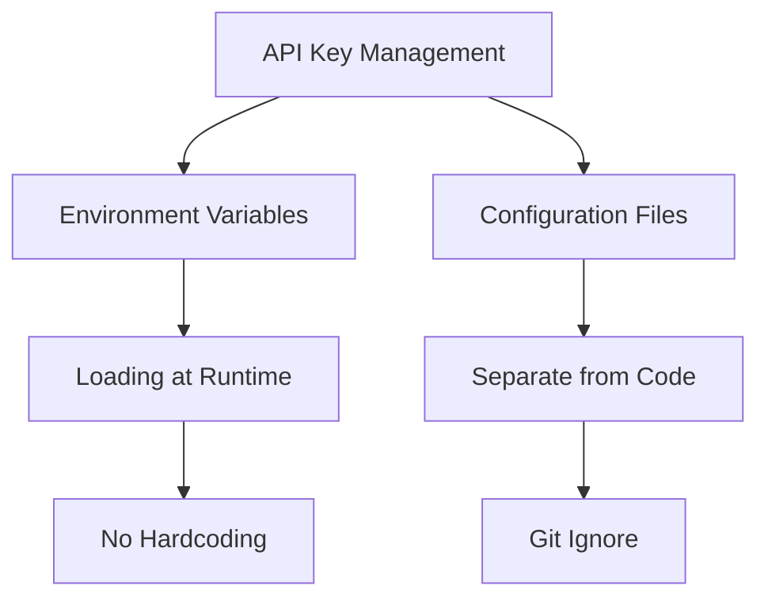

Sources: [README.md:57-63](), [examples/assistant-flask/app.py:6-8](), [examples/chat-basic/app.py:9-11](), [examples/assistant-basic/assistant.py:3-4]()

### Implementation Recommendations

| Recommendation | Description | Example |
|----------------|-------------|---------|
| Environment Variables | Store API keys in environment variables | Using `.env` files with the `python-dotenv` package |
| Separate Configuration | Keep configuration separate from code | `.env.example` template provided in repo |
| Never Hardcode | Don't hardcode API keys in source code | All examples use the client without explicit keys |
| Secure Storage | Secure API keys properly in production | Not demonstrated but essential in production |

The repository follows these practices by:

1. Creating a `.env` file from the `.env.example` template
2. Adding the OpenAI API key to this file
3. Automatically loading the key through the OpenAI client
4. Including `.env` in `.gitignore` to prevent accidental commits

## Efficient API Usage

Optimizing API usage reduces costs and improves performance:

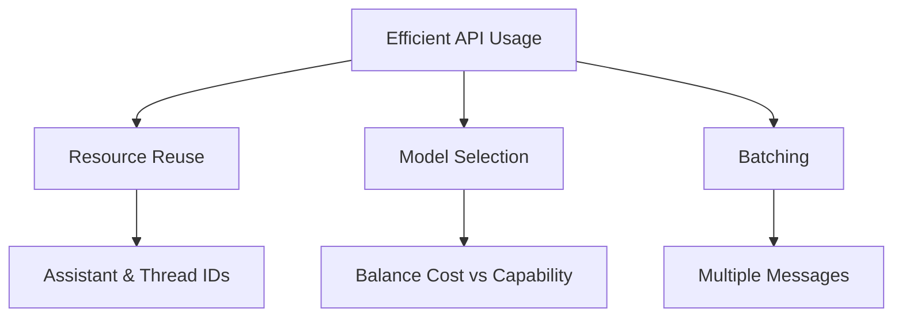

Sources: [examples/assistant-flask/app.py:14-15](), [examples/assistant-flask/app.py:113-139]()

### Resource Management Pattern

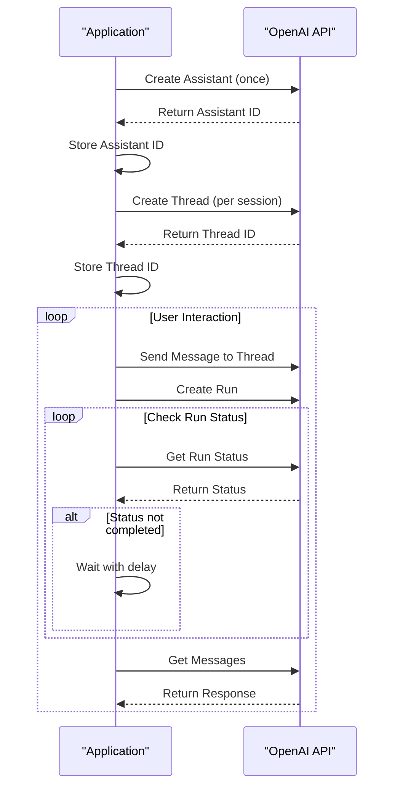

Sources: [examples/assistant-flask/app.py:113-139](), [examples/assistant-flask/app.py:147-182]()

The Assistant applications demonstrate efficient resource use by:

1. Creating assistants once and reusing them across sessions
2. Managing threads appropriately for conversation context
3. Storing IDs to avoid redundant creation calls

For example, the Assistant Flask application maintains assistant and thread IDs as global variables and initializes them during application startup:

```python
# Initialize globally
assistant_id = ""
thread_id = ""

# Initialize once at startup
@app.before_request
def initialize():
    app.before_request_funcs[None].remove(initialize)
    create_assistant()
    create_thread()
```

Sources: [examples/assistant-flask/app.py:14-15](), [examples/assistant-flask/app.py:197-201]()

## Error Handling

Robust error handling ensures your application remains stable when interacting with the API:

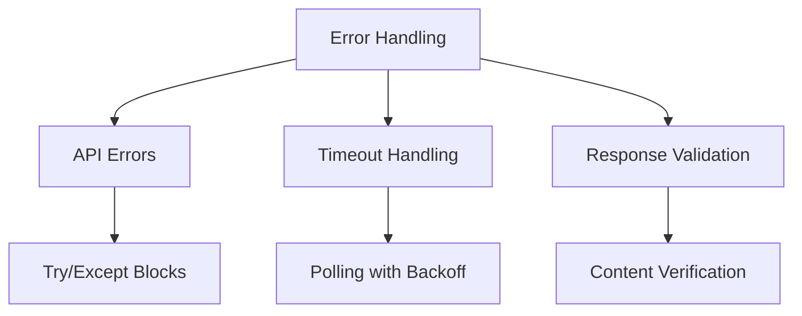

Sources: [examples/assistant-flask/app.py:162-164](), [examples/assistant-basic/assistant.py:67-71](), [examples/assistant-flask/app.py:168-182]()

### Content Validation Pattern

Always validate responses before processing them:

```python
# Example from Assistant Flask app
text_content = None
for content in response.content:
    if content.type == "text":
        text_content = content.text.value
        break  # Exit once we find text content

if text_content:
    chat_history.append({"role": "assistant", "content": text_content})
    return jsonify(success=True, message=text_content)
else:
    return jsonify(success=False, message="No text content found")
```

Sources: [examples/assistant-flask/app.py:168-182]()

### Long-Running Operations

The Assistant API operations are often asynchronous and require proper polling:

| Approach | Implementation | Pros | Cons |
|----------|---------------|------|------|
| Simple Polling | Fixed delay between status checks | Easy to implement | May waste time or make too many requests |
| Exponential Backoff | Increasing delays between checks | More efficient | More complex to implement |
| Webhook (Production) | API calls back when complete | Most efficient | Not demonstrated in quickstart examples |

The examples use simple polling with a fixed delay:

```python
# Wait for run completion with fixed delay polling
while run.status != "completed":
    time.sleep(0.5)  # 500ms delay
    run = client.beta.threads.runs.retrieve(thread_id=thread_id, run_id=run.id)
```

Sources: [examples/assistant-flask/app.py:162-164](), [examples/assistant-basic/assistant.py:67-71]()

## Performance Optimization

Optimize performance to improve user experience:

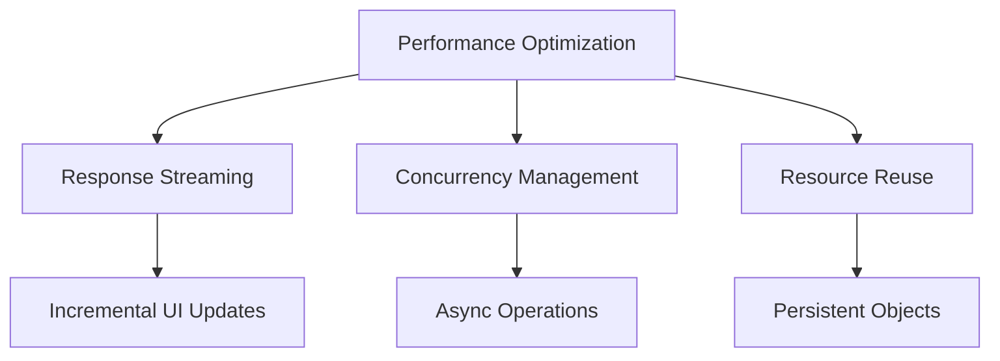

Sources: [examples/chat-basic/app.py:32-55](), [examples/assistant-flask/app.py:113-139]()

### Response Streaming

Streaming responses provides a more responsive user experience:

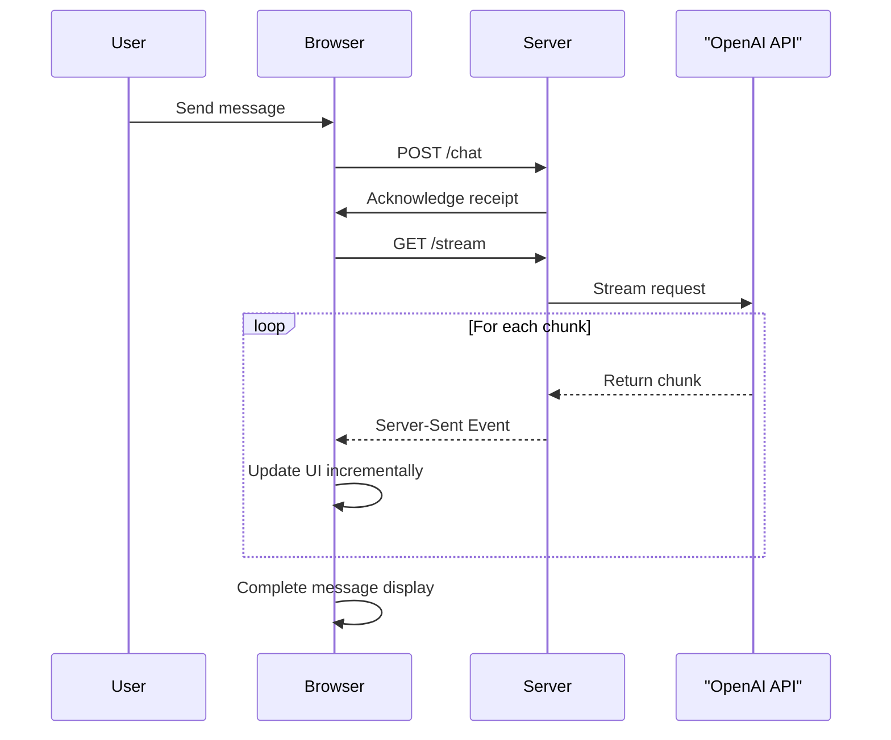

Sources: [examples/chat-basic/app.py:32-55]()

The Chat Basic application demonstrates streaming with Server-Sent Events (SSE):

```python
def generate():
    assistant_response_content = ""
    with client.chat.completions.create(
        model="gpt-3.5-turbo",
        messages=chat_history,
        stream=True,
    ) as stream:
        for chunk in stream:
            if chunk.choices[0].delta and chunk.choices[0].delta.content:
                assistant_response_content += chunk.choices[0].delta.content
                yield f"data: {chunk.choices[0].delta.content}\n\n"
```

Sources: [examples/chat-basic/app.py:34-46]()

## Context Management

Managing conversation context effectively is important for coherent interactions:

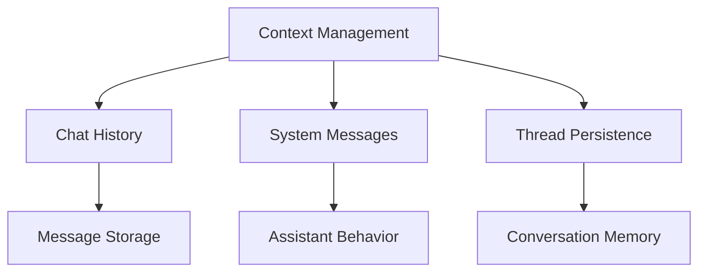

Sources: [examples/assistant-flask/app.py:16-19](), [examples/chat-basic/app.py:15-17]()

### Message History Patterns

Both examples initialize chat history with a system message:

```python
chat_history = [
    {"role": "system", "content": "You are a helpful assistant."},
]
```

Sources: [examples/assistant-flask/app.py:16-19](), [examples/chat-basic/app.py:15-17]()

The repository demonstrates two distinct approaches to message history:

| Approach | Implementation | Used In |
|----------|---------------|---------|
| Client-side chat history | Array of message objects | Both examples for UI display |
| OpenAI Thread API | Server-side persistence | Assistant examples for API context |

### Session Reset Pattern

All examples provide a way to reset the conversation:

```python
@app.route("/reset", methods=["POST"])
def reset_chat():
    global chat_history
    chat_history = [{"role": "system", "content": "You are a helpful assistant."}]
    
    global thread_id
    thread_id = ""
    create_thread()
    return jsonify(success=True)
```

Sources: [examples/assistant-flask/app.py:185-193](), [examples/chat-basic/app.py:58-62]()

## File Management

When using the Assistant API with files, follow these practices:

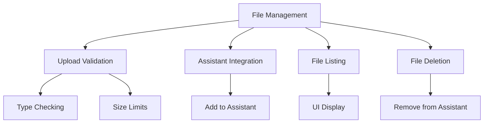

Sources: [examples/assistant-flask/app.py:11](), [examples/assistant-flask/app.py:22-23](), [examples/assistant-flask/app.py:26-58](), [examples/assistant-flask/app.py:82-92](), [examples/assistant-flask/app.py:95-110]()

### File Validation Pattern

The Assistant Flask application validates file types before processing:

```python
ALLOWED_EXTENSIONS = {"txt", "pdf", "png", "jpg", "jpeg", "gif", "csv"}

def allowed_file(filename):
    return "." in filename and filename.rsplit(".", 1)[1].lower() in ALLOWED_EXTENSIONS
```

Sources: [examples/assistant-flask/app.py:11](), [examples/assistant-flask/app.py:22-23]()

### File Upload and Attachment Pattern

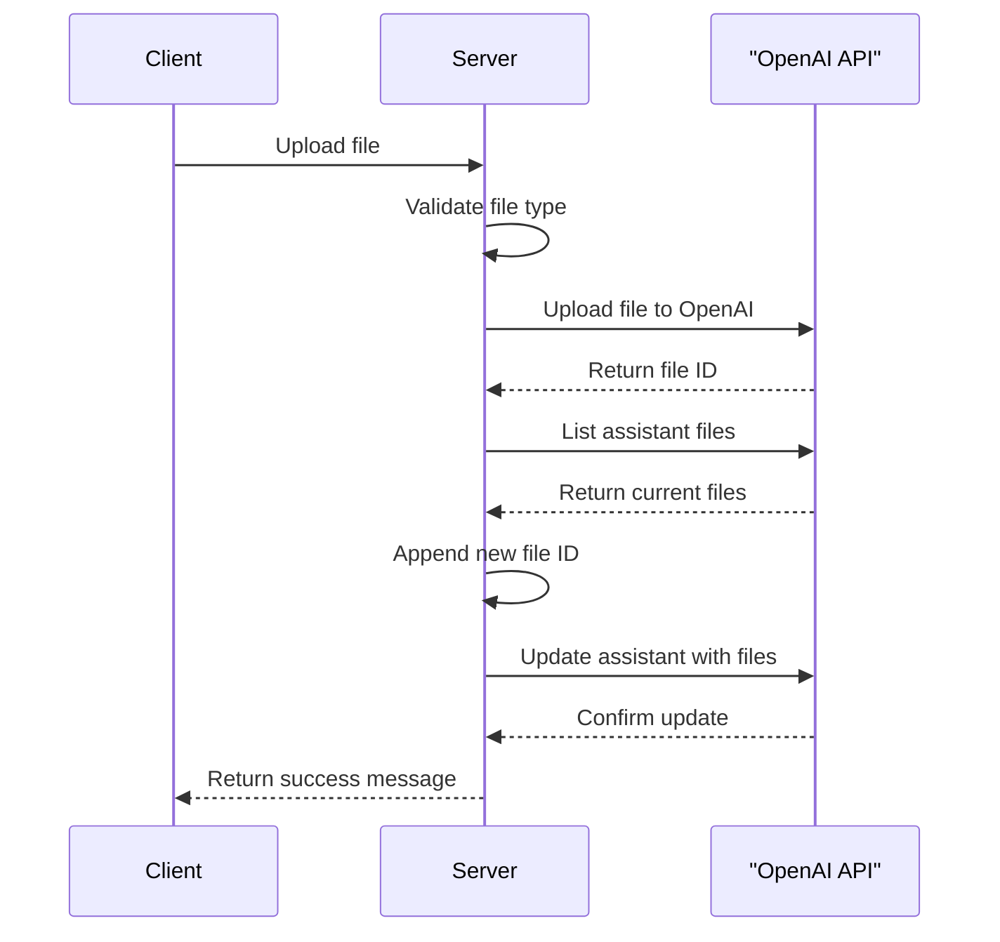

Sources: [examples/assistant-flask/app.py:26-58]()

## Debugging Tips

Effective debugging strategies for OpenAI API applications:

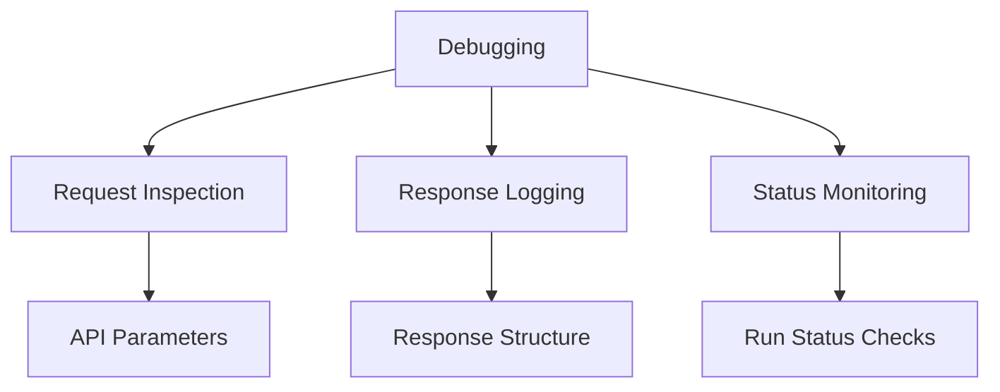

Sources: [examples/assistant-flask/app.py:88](), [examples/assistant-flask/app.py:99]()

### Debugging Techniques

| Technique | Purpose | Example in Repository |
|-----------|---------|----------------------|
| Parameter Logging | Verify correct API usage | Logging assistant files [app.py:99]() |
| Response Inspection | Understand returned data | Printing deletion status [app.py:88]() |
| Status Monitoring | Track asynchronous operations | Run status polling [app.py:162-164]() |
| Error Capturing | Handle API errors gracefully | Response validation [app.py:168-182]() |

## Advanced Implementation Patterns

More sophisticated patterns for advanced applications:

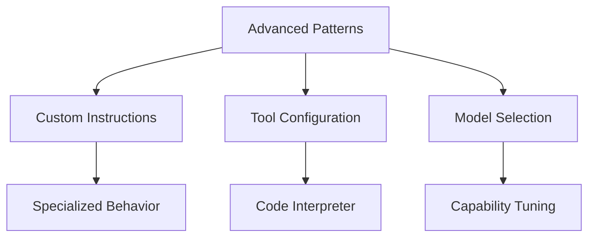

Sources: [examples/assistant-flask/app.py:116-120]()

### Assistant Configuration

The Assistant Flask application demonstrates custom configuration:

```python
my_assistant = client.beta.assistants.create(
    instructions="You are a helpful assistant. If asked about math or computing problems, write and run code to answer the question.",
    name="MyQuickstartAssistant",
    model="gpt-3.5-turbo",
    tools=[{"type": "code_interpreter"}],
)
```

Sources: [examples/assistant-flask/app.py:116-120]()

### Model Selection Guidance

| Model | Use Case | Considerations |
|-------|----------|---------------|
| gpt-3.5-turbo | General purpose, cost-effective | Good balance of capability and cost |
| gpt-4 | Complex reasoning, higher accuracy | More expensive, potentially slower |
| gpt-4-turbo | Advanced capabilities, faster responses | Best for production applications |

All examples use gpt-3.5-turbo, which is appropriate for demonstrations and many production use cases.

Sources: [examples/assistant-flask/app.py:119](), [examples/chat-basic/app.py:38]()

## Conclusion

Following these best practices will help you build robust, efficient, and user-friendly applications with the OpenAI API. The patterns demonstrated in this repository provide a solid foundation for both simple and complex implementations.

Remember to:
- Secure your API keys
- Optimize resource usage
- Handle errors gracefully
- Implement proper context management
- Validate all inputs and outputs
- Choose appropriate models for your use case
- Provide good user feedback

For specific implementation examples, refer to the different application examples in the repository, which demonstrate these practices in context.

Sources: [README.md:1-79](), [examples/assistant-flask/app.py:1-205](), [examples/chat-basic/app.py:1-62](), [examples/assistant-basic/assistant.py:1-79]()