# Page: Overview

# Overview

<details>
<summary>Relevant source files</summary>

The following files were used as context for generating this wiki page:

- [README.md](README.md)
- [requirements.txt](requirements.txt)

</details>


## Purpose and Scope

The OpenAI Python Quickstart repository serves as a practical introduction to integrating OpenAI's APIs into Python applications. This repository contains multiple example applications that demonstrate different OpenAI API endpoints (chat, assistants, etc.) with varying complexity levels.

This overview provides a high-level understanding of the repository structure, example applications, and integration patterns. For detailed setup instructions, see [Setup and Configuration](#2). For in-depth explanations of the individual example applications, see [Example Applications](#3).

## Repository Structure

The repository is organized with configuration files at the root level and example applications in separate directories.

**Repository Structure Diagram**
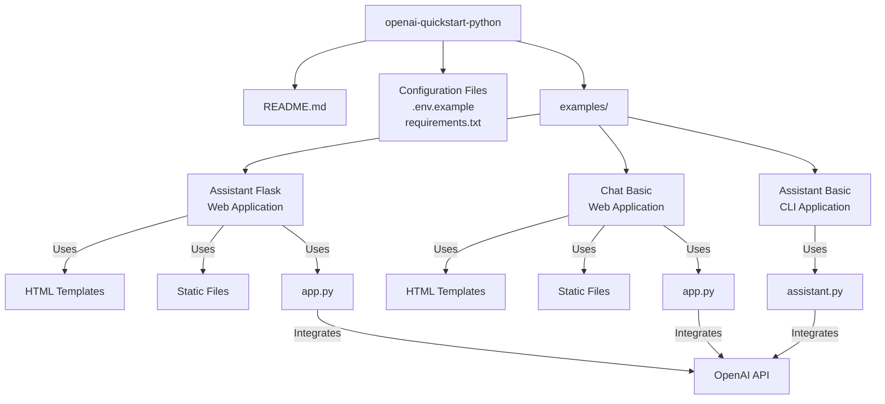

Sources: [README.md:3-3]()

## Example Applications

The repository includes three main example applications, each showcasing different OpenAI API integration approaches:

**Example Applications and API Integration**
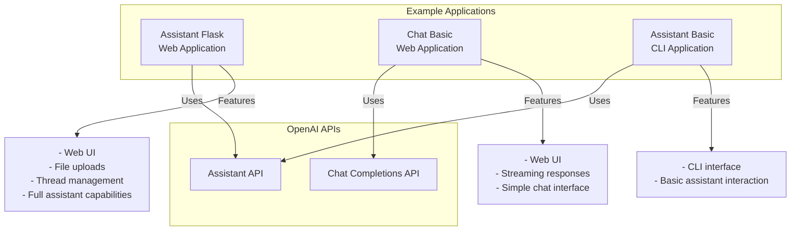

Sources: [README.md:3-3]()

### Assistant Flask Application

The most comprehensive example in the repository, demonstrating a full-featured web application integrating with OpenAI's Assistant API. This application includes file uploads, thread management, and a complete chat interface.

### Chat Basic Application

A simpler web implementation focusing on the Chat Completions API, featuring server-sent events for streaming responses and a basic chat interface.

### Assistant Basic Application

A command-line implementation showing Assistant API usage without a web interface, providing a simpler demonstration of the core functionality.

## Basic OpenAI API Integration

All examples in the repository rely on the OpenAI Python SDK to interact with the API. Here's how a basic API request is structured:

```python
from openai import OpenAI
client = OpenAI()

completion = client.chat.completions.create(
  model="gpt-3.5-turbo",
  messages=[
    {"role": "system", "content": "You are a helpful assistant."},
    {"role": "user", "content": "Hello!"}
  ]
)

print(completion.choices[0].message)
```

Sources: [README.md:9-22]()

## Core Dependencies

The repository relies on several key Python packages:

| Dependency | Version | Purpose |
|------------|---------|---------|
| openai | 1.11.1 | Official OpenAI Python SDK |
| Flask | 3.0.2 | Web application framework |
| httpx | 0.26.0 | HTTP client (used by OpenAI SDK) |
| pydantic | 2.6.1 | Data validation |
| Jinja2 | 3.1.3 | Template engine for Flask |

Sources: [requirements.txt:1-21]()

## Setup Process

The repository includes detailed setup instructions in the README:

**Setup Flow Diagram**
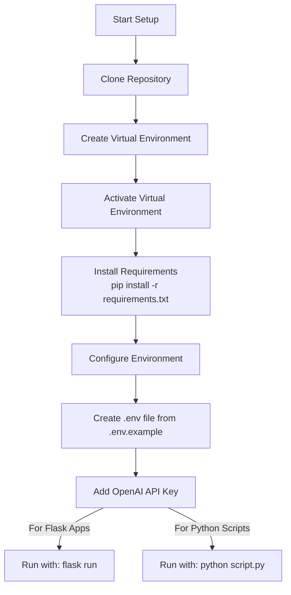

Sources: [README.md:24-79]()

## Data Flow in Applications

The applications follow specific data flow patterns when interacting with the OpenAI API. Here's how the Flask-based applications typically handle requests:

**Data Flow Diagram**
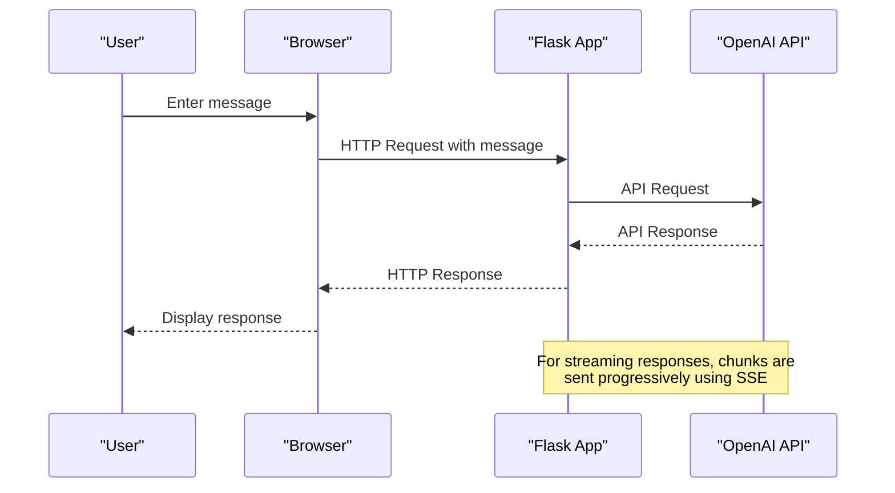

Sources: [README.md:67-73]()

## Conclusion

The OpenAI Quickstart Python repository provides practical examples for developers looking to integrate OpenAI's APIs into their applications. From simple CLI applications to more complex web interfaces with file handling capabilities, the examples demonstrate various integration patterns and use cases.

For detailed instructions on setting up the environment and running the examples, refer to [Setup and Configuration](#2). For more information about each example application, see [Example Applications](#3).

---

# Page: Setup and Configuration

# Setup and Configuration

<details>
<summary>Relevant source files</summary>

The following files were used as context for generating this wiki page:

- [.env.example](.env.example)
- [.gitignore](.gitignore)
- [README.md](README.md)
- [requirements.txt](requirements.txt)

</details>


This page provides instructions for setting up the development environment for the OpenAI quickstart Python repository. It covers environment setup, dependency installation, API key configuration, and application execution processes.

For information about using the example applications after setup, see [Example Applications](#3).

## Prerequisites

Before proceeding with the setup, ensure you have:

- Python installed (from Python.org)
- Git installed for repository cloning
- An OpenAI API key from the OpenAI platform

Sources: [README.md:24-26]()

## Repository Structure

The repository contains configuration files that need to be properly set up:

| File | Purpose |
|------|---------|
| `.env.example` | Template for environment variables |
| `.env` | Your local environment configuration (created during setup) |
| `requirements.txt` | Python dependencies |

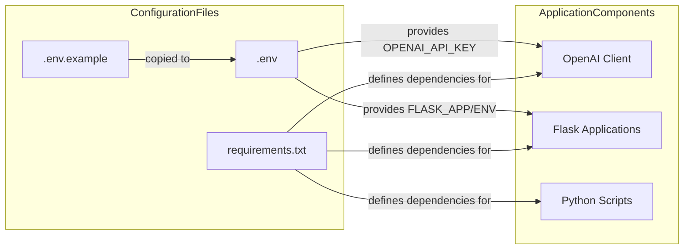

Sources: [.env.example](), [.gitignore:18](), [requirements.txt]()

## Setup Process

The following diagram illustrates the complete setup workflow:

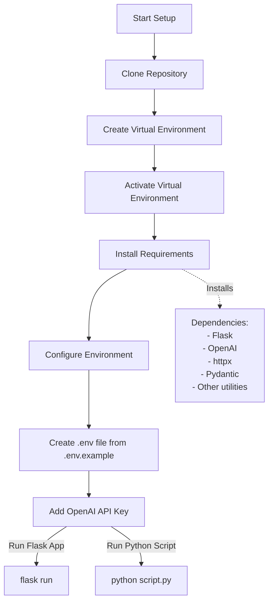

Sources: [README.md:24-79]()

### 1. Clone the Repository

```bash
git clone https://github.com/openai/openai-quickstart-python.git
cd openai-quickstart-python
```

Sources: [README.md:28]()

### 2. Create and Activate a Virtual Environment

**For macOS/Linux:**
```bash
python -m venv venv
source venv/bin/activate
```

**For Windows:**
```bash
python -m venv venv
.\venv\Scripts\activate
```

The virtual environment (`venv/`) is excluded from version control in the `.gitignore` file to keep the repository clean.

Sources: [README.md:36-49](), [.gitignore:1]()

### 3. Install Dependencies

Install all required packages using pip:

```bash
pip install -r requirements.txt
```

The `requirements.txt` file includes these key dependencies:

| Dependency | Version | Purpose |
|------------|---------|---------|
| `openai` | 1.11.1 | Python SDK for OpenAI API |
| `Flask` | 3.0.2 | Web framework for the example applications |
| `httpx` | 0.26.0 | HTTP client used by the OpenAI SDK |
| `pydantic` | 2.6.1 | Data validation for API responses |
| `Jinja2` | 3.1.3 | Template engine for Flask applications |

Sources: [README.md:51-55](), [requirements.txt:1-21]()

## Environment Configuration

### Setting Up Environment Variables

1. Create an environment file by copying the example:

```bash
cp .env.example .env
```

2. Edit the `.env` file to configure the required variables:

```
FLASK_APP=app
FLASK_ENV=development
OPENAI_API_KEY=your-api-key-here
```

Sources: [README.md:57-61](), [.env.example:1-5]()

### API Key Configuration

The `OPENAI_API_KEY` environment variable is used to authenticate with the OpenAI API. The OpenAI Python SDK will automatically read this environment variable when you create a client instance:

```python
from openai import OpenAI
client = OpenAI()  # Automatically uses OPENAI_API_KEY from environment
```

**Important**: Keep your API key private and never commit it to version control. The `.env` file is included in `.gitignore` to prevent accidental exposure.

Sources: [README.md:63](), [.env.example:4-5](), [.gitignore:18](), [README.md:9-12]()

## Runtime Environment

The following diagram illustrates how the configuration components are used at runtime:

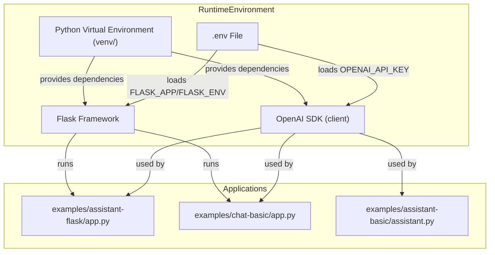

Sources: [README.md:9-22](), [README.md:65-79]()

## Running the Applications

The repository contains multiple example applications that can be run in different ways.

### Flask Applications

For Flask-based examples (assistant-flask and chat-basic):

```bash
flask run
```

This command starts a development server that makes the application available at http://localhost:5000.

Sources: [README.md:67-73]()

### Python Script Applications

For standalone Python scripts (like assistant-basic):

```bash
python examples/assistant-basic/assistant.py
```

Sources: [README.md:75-79]()

## Troubleshooting Common Issues

| Issue | Solution |
|-------|----------|
| **Invalid API Key** | Verify your API key is correctly copied to `.env` file |
| **ModuleNotFoundError** | Ensure virtual environment is activated and requirements are installed |
| **Flask app not found** | Check that `FLASK_APP=app` is set in `.env` |
| **Permission denied** | On Unix systems, you may need to add execute permission: `chmod +x path/to/script.py` |
| **File upload errors** | The `uploads` directory is excluded in `.gitignore`, create it manually if needed |

Sources: [.gitignore:19](), [.env.example:1-5]()

## Next Steps

After successful setup and configuration, you can explore the different example applications. Each demonstrates different functionalities of the OpenAI API:

- For detailed information about the example applications, see [Example Applications](#3)
- For API integration patterns used in the examples, see [OpenAI API Integration Patterns](#4)

---

# Page: Example Applications

# Example Applications

<details>
<summary>Relevant source files</summary>

The following files were used as context for generating this wiki page:

- [README.md](README.md)
- [examples/assistant-basic/assistant.py](examples/assistant-basic/assistant.py)
- [examples/assistant-flask/app.py](examples/assistant-flask/app.py)
- [examples/chat-basic/app.py](examples/chat-basic/app.py)

</details>


## Purpose and Scope

This document provides an overview of the three example applications included in the OpenAI quickstart repository. These applications demonstrate different approaches to integrate with OpenAI's APIs, showcasing various implementation patterns and use cases. For setup instructions and environment configuration, see [Setup and Configuration](#2).

## Overview of Example Applications

The repository includes three distinct example applications that demonstrate different ways to interact with OpenAI's APIs:

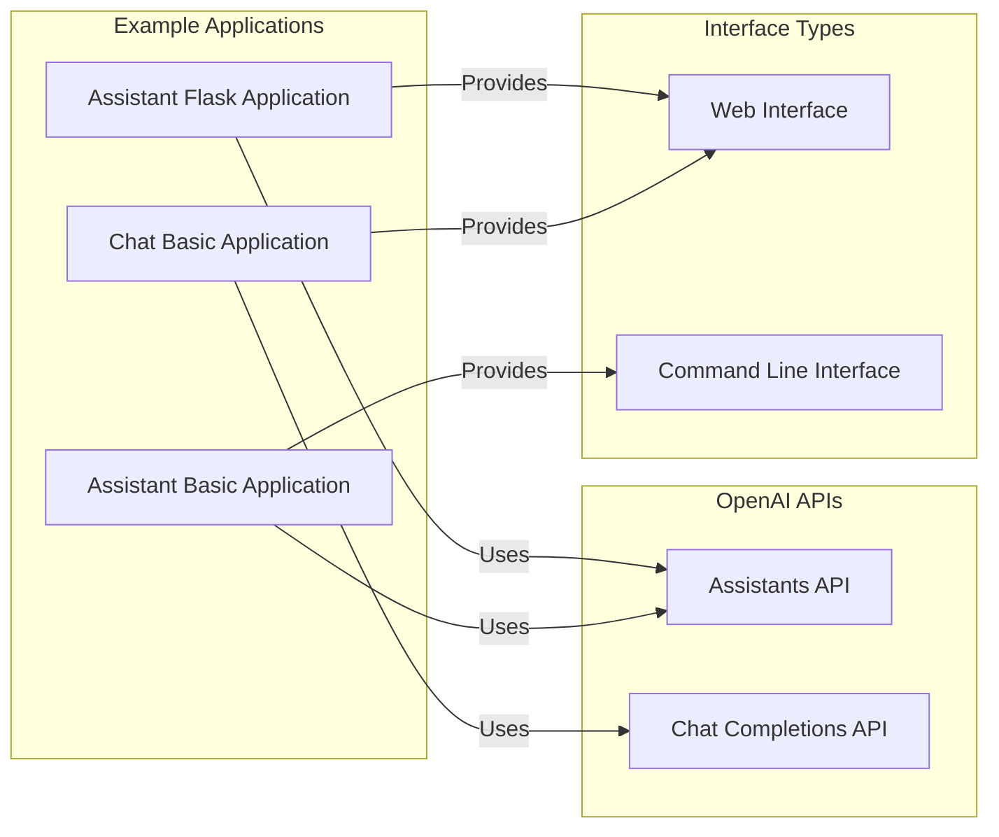

Sources: [README.md:3-3](), [examples/assistant-flask/app.py](), [examples/chat-basic/app.py](), [examples/assistant-basic/assistant.py]()

| Application | API Used | Interface | Key Features |
|-------------|----------|-----------|--------------|
| Assistant Flask | Assistants API | Web | File uploads, threaded conversations, code interpreter |
| Chat Basic | Chat Completions API | Web | Streaming responses, simple interface |
| Assistant Basic | Assistants API | Command Line | Basic assistant functionality in terminal |

Sources: [examples/assistant-flask/app.py](), [examples/chat-basic/app.py](), [examples/assistant-basic/assistant.py]()

## Assistant Flask Application

The Assistant Flask Application is the most comprehensive example, demonstrating a full-featured web interface for the OpenAI Assistants API.

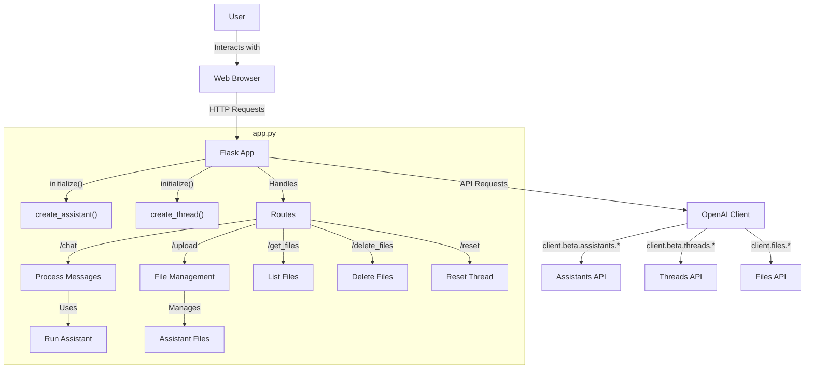

Sources: [examples/assistant-flask/app.py:1-206]()

Key features:
- Creates and manages an OpenAI Assistant with code interpreter capabilities
- Supports file uploads and attaches them to the assistant
- Manages threaded conversations for context retention
- Provides a web interface for user interaction
- Implements file management (upload, list, delete)

Implementation highlights:
- Initializes an assistant and thread on startup [examples/assistant-flask/app.py:196-201]()
- Handles file uploads and associates them with the assistant [examples/assistant-flask/app.py:26-58]()
- Processes chat messages and runs the assistant [examples/assistant-flask/app.py:147-182]()
- Retrieves and manages files [examples/assistant-flask/app.py:95-110]()
- Resets conversation threads [examples/assistant-flask/app.py:185-193]()

## Chat Basic Application

The Chat Basic Application demonstrates a simpler implementation using the Chat Completions API with streaming responses.

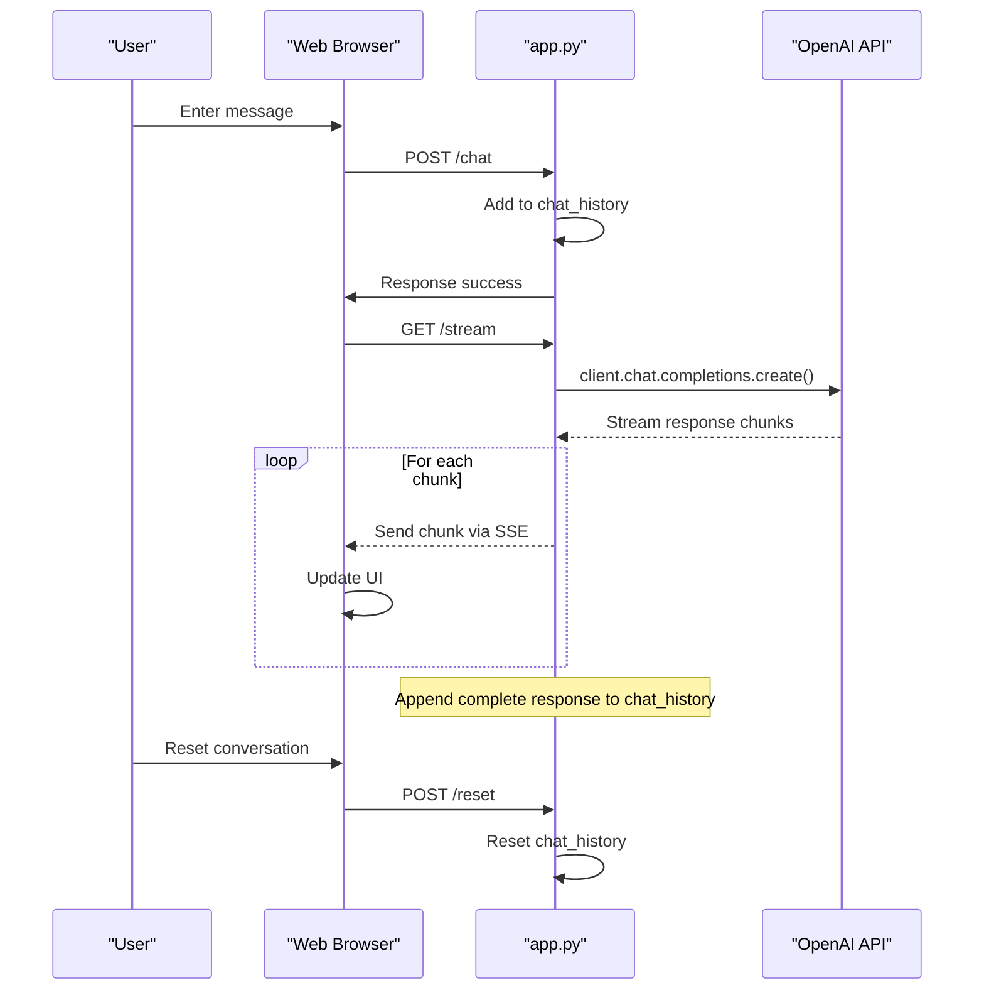

Sources: [examples/chat-basic/app.py:1-63]()

Key features:
- Uses the Chat Completions API instead of Assistants API
- Implements streaming responses using Server-Sent Events (SSE)
- Maintains a simple chat history
- Provides a clean, minimal web interface

Implementation highlights:
- Initializes chat history with a system message [examples/chat-basic/app.py:15-17]()
- Handles chat messages and adds them to history [examples/chat-basic/app.py:25-29]()
- Streams responses from the Chat Completions API [examples/chat-basic/app.py:32-55]()
- Resets chat history [examples/chat-basic/app.py:58-62]()

## Assistant Basic Application

The Assistant Basic Application provides a command-line interface for interacting with the OpenAI Assistants API.

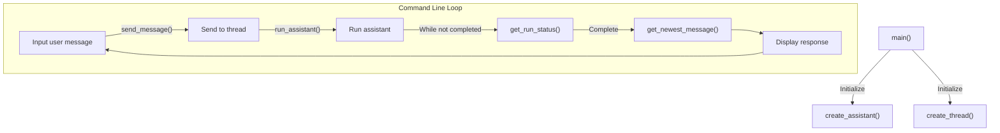

Sources: [examples/assistant-basic/assistant.py:1-80]()

Key features:
- Demonstrates Assistants API usage in a command-line interface
- Uses a simple loop for continuous conversation
- Shows basic thread and assistant management
- Includes status checking while waiting for assistant responses

Implementation highlights:
- Creates an assistant and thread [examples/assistant-basic/assistant.py:9-28]()
- Sends user messages to the thread [examples/assistant-basic/assistant.py:31-37]()
- Runs the assistant and checks run status [examples/assistant-basic/assistant.py:40-54]()
- Retrieves and displays responses [examples/assistant-basic/assistant.py:47-49]()
- Implements a command loop for conversation [examples/assistant-basic/assistant.py:61-75]()

## Code Structure Comparison

The following diagram shows the key code structure and class relationships across all three examples:

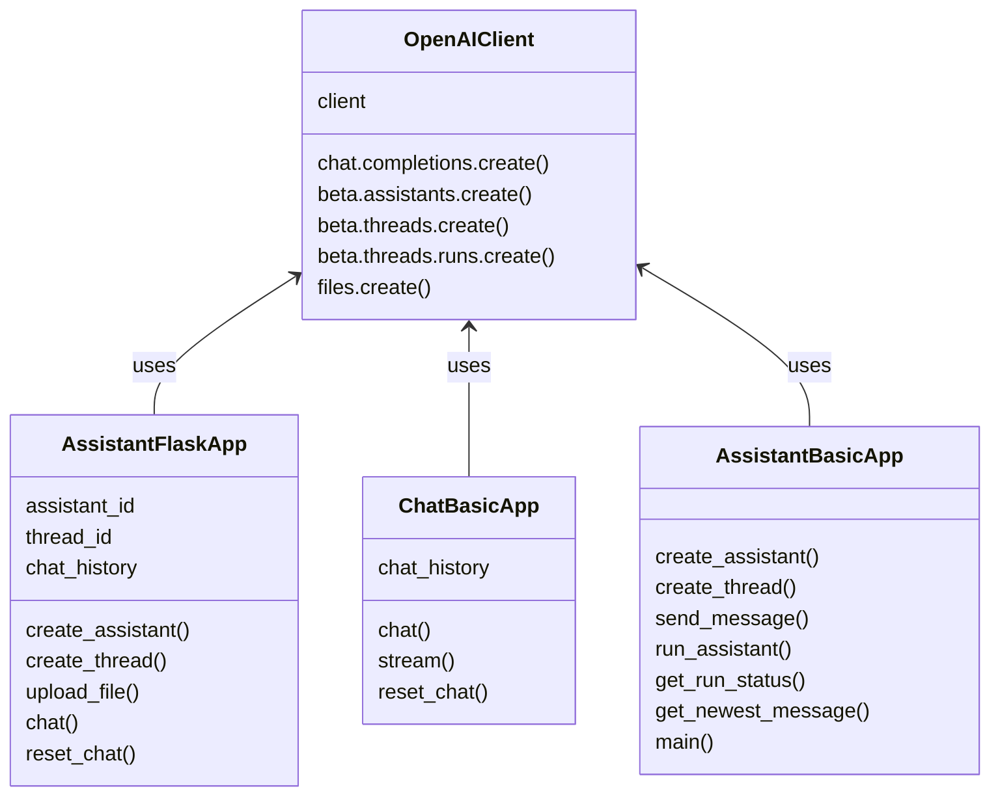

Sources: [examples/assistant-flask/app.py](), [examples/chat-basic/app.py](), [examples/assistant-basic/assistant.py]()

## Implementation Differences

Understanding the differences between these examples helps in choosing the right approach for your application:

| Feature | Assistant Flask | Chat Basic | Assistant Basic |
|---------|----------------|------------|----------------|
| API Used | Assistants API | Chat Completions API | Assistants API |
| Interface | Web (Flask) | Web (Flask) | Command Line |
| Streaming | No | Yes (SSE) | No |
| File Handling | Yes | No | No |
| Thread Management | Yes | No (simple array) | Yes |
| Code Interpreter | Yes | No | No |
| Implementation Complexity | High | Medium | Low |

Sources: [examples/assistant-flask/app.py](), [examples/chat-basic/app.py](), [examples/assistant-basic/assistant.py]()

## Example Use Cases

Each example is suited for different scenarios:

1. **Assistant Flask Application**
   - Full-featured AI assistant web applications
   - Applications requiring file upload and analysis
   - Use cases requiring code interpreter capabilities
   - Projects needing persistent context across conversations

2. **Chat Basic Application**
   - Simple chatbot interfaces
   - Applications where streaming responses improve user experience
   - Projects with minimal setup requirements
   - Use cases where the Chat Completions API is sufficient

3. **Assistant Basic Application**
   - Command-line tools and utilities
   - Scripts and automation requiring AI assistance
   - Testing and prototyping Assistants API integration
   - Simple applications without a web interface

Sources: [README.md](), [examples/assistant-flask/app.py](), [examples/chat-basic/app.py](), [examples/assistant-basic/assistant.py]()

For more detailed information about each application, refer to their respective pages:
- [Assistant Flask Application](#3.1)
- [Chat Basic Application](#3.2)
- [Assistant Basic Application](#3.3)

---

# Page: Assistant Flask Application

# Assistant Flask Application

<details>
<summary>Relevant source files</summary>

The following files were used as context for generating this wiki page:

- [examples/assistant-flask/app.py](examples/assistant-flask/app.py)
- [examples/assistant-flask/templates/index.html](examples/assistant-flask/templates/index.html)

</details>


This document describes the Assistant Flask Application, which is a comprehensive web application that demonstrates how to integrate with OpenAI's Assistant API. The application features a chat interface with file upload capabilities, allowing users to interact with an OpenAI Assistant that has code interpreter capabilities.

For information about the simpler command-line implementation, see [Assistant Basic Application](#3.3). For details about the chat application using the Chat Completions API, see [Chat Basic Application](#3.2).

## Overview

The Assistant Flask Application showcases a full-featured implementation of OpenAI's Assistant API within a web application context. It demonstrates:

- Creating and managing an OpenAI Assistant with code interpreter capabilities
- Managing conversation threads
- Uploading and attaching files to the Assistant
- Building a responsive chat interface

Sources: [examples/assistant-flask/app.py]()

## System Architecture

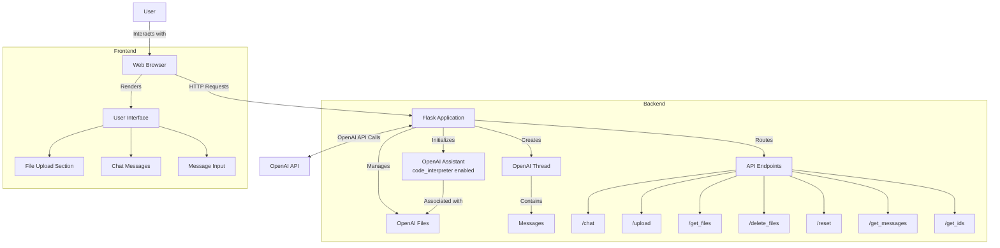

Sources: [examples/assistant-flask/app.py:1-204](), [examples/assistant-flask/templates/index.html:1-342]()

## Backend Implementation

The backend is built using Flask and interacts with the OpenAI API to manage the Assistant, Thread, and file operations.

### Initialization Process

When the application starts, it:

1. Creates an OpenAI client
2. Initializes a new Assistant or retrieves an existing one
3. Creates a new conversation Thread or retrieves an existing one

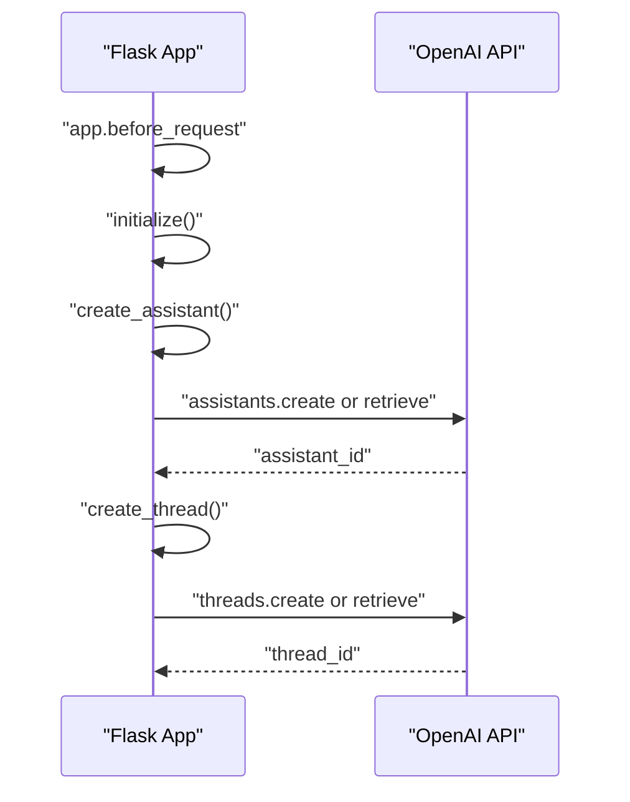

Sources: [examples/assistant-flask/app.py:113-140](), [examples/assistant-flask/app.py:196-201]()

### Key API Endpoints

| Endpoint | Method | Purpose |
|----------|--------|---------|
| `/` | GET | Renders the main application interface |
| `/chat` | POST | Sends user messages to the Assistant and returns the response |
| `/upload` | POST | Handles file uploads and attaches them to the Assistant |
| `/delete_files` | POST | Removes files from the Assistant |
| `/get_files` | GET | Retrieves the list of files attached to the Assistant |
| `/get_messages` | GET | Fetches the conversation history |
| `/get_ids` | GET | Returns the current Assistant and Thread IDs |
| `/reset` | POST | Resets the conversation and creates a new Thread |

Sources: [examples/assistant-flask/app.py:26-193]()

### Chat Processing Flow

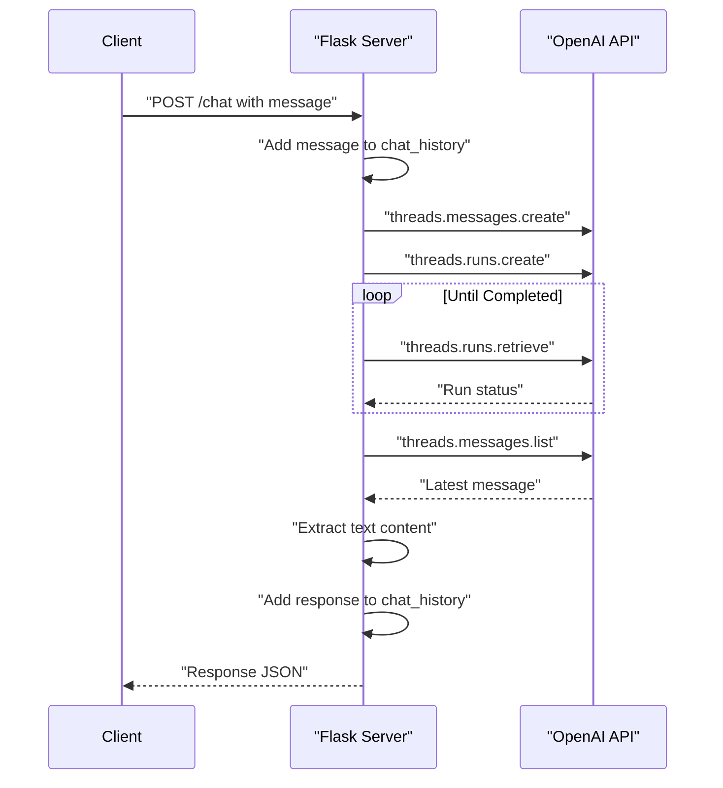

Sources: [examples/assistant-flask/app.py:147-182]()

### File Management

The application allows users to:
1. Upload files (limiting to specific file types)
2. Attach files to the Assistant
3. View the list of attached files
4. Delete files from the Assistant

Files are processed through OpenAI's Files API and then attached to the Assistant using the Assistants API.

Sources: [examples/assistant-flask/app.py:22-110]()

## Frontend Implementation

The frontend is a single-page web application built with HTML, CSS, and JavaScript that provides a clean interface for chatting with the Assistant and managing files.

### User Interface Components

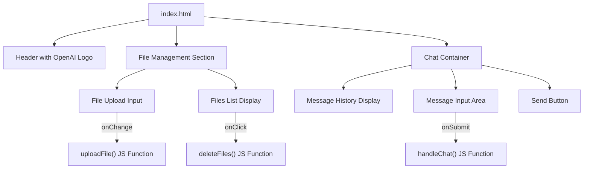

Sources: [examples/assistant-flask/templates/index.html:10-81]()

### Client-Side Functionality

The frontend JavaScript handles:

1. Sending and receiving messages
2. Uploading and deleting files
3. Displaying chat history
4. Managing UI updates and state
5. Showing typing indicators while waiting for responses

Key JavaScript functions include:
- `populateFiles()` - Updates the file list display
- `deleteFiles()` - Removes files from the Assistant
- Event listeners for file uploads and message submissions

Sources: [examples/assistant-flask/templates/index.html:81-340]()

## Data Flow

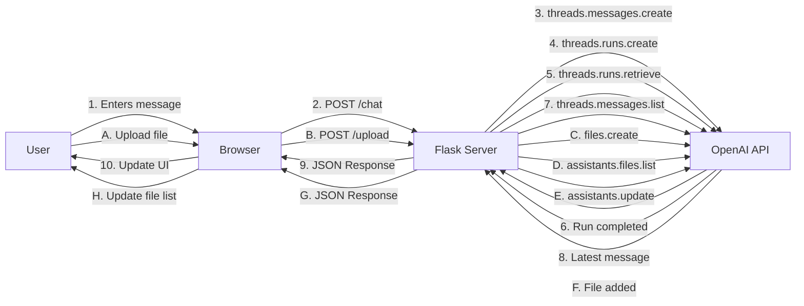

Sources: [examples/assistant-flask/app.py:147-182](), [examples/assistant-flask/app.py:26-58](), [examples/assistant-flask/templates/index.html:213-262]()

## Usage Examples

### Starting a Chat Session

When a user accesses the application:
1. The Flask server initializes an Assistant and Thread
2. The browser loads the UI with any existing chat history
3. The user can start sending messages to the Assistant

### File Upload Process

1. User selects a file through the file upload interface
2. Browser sends the file to the server via the `/upload` endpoint
3. The server uploads the file to OpenAI's Files API
4. The server attaches the file to the Assistant using the Assistants API
5. The browser updates to show the file in the list

### Messaging Flow

1. User enters a message and submits it
2. Message is displayed in the UI
3. Message is sent to the server via `/chat` endpoint
4. Server adds the message to the Assistant's Thread
5. Server creates a Run to process the message
6. Server polls the Run status until completion
7. Server retrieves the Assistant's response
8. Response is returned to the browser and displayed in the UI

## Implementation Details

### Assistant Configuration

The application creates an Assistant with the following configuration:

```python
# Assistant creation with code interpreter
my_assistant = client.beta.assistants.create(
    instructions="You are a helpful assistant. If asked about math or computing problems, write and run code to answer the question.",
    name="MyQuickstartAssistant",
    model="gpt-3.5-turbo",
    tools=[{"type": "code_interpreter"}],
)
```

Sources: [examples/assistant-flask/app.py:116-121]()

### File Type Restrictions

The application limits file uploads to specific file types:

```python
ALLOWED_EXTENSIONS = {"txt", "pdf", "png", "jpg", "jpeg", "gif", "csv"}
```

Sources: [examples/assistant-flask/app.py:11]()

## Summary

The Assistant Flask Application demonstrates a complete implementation of OpenAI's Assistant API in a web application context. It showcases how to create and manage Assistants, Threads, and Files, as well as how to build a responsive user interface for interacting with the Assistant. The application's architecture provides a solid foundation for building more complex AI-powered chat applications with file handling capabilities.

Sources: [examples/assistant-flask/app.py](), [examples/assistant-flask/templates/index.html]()

---

# Page: Application Architecture

# Application Architecture

<details>
<summary>Relevant source files</summary>

The following files were used as context for generating this wiki page:

- [examples/assistant-flask/app.py](examples/assistant-flask/app.py)

</details>


This document details the server-side architecture, endpoints, and backend logic of the Assistant Flask application. For information about the user interface implementation, see [User Interface](#3.1.2). For details on how file management is implemented, see [File Management](#3.1.3).

## Overview

The Assistant Flask application is a web-based implementation that demonstrates the OpenAI Assistants API capabilities. It is built using Flask as the web framework and integrates directly with OpenAI's Python SDK to create and manage assistants, threads, messages, and files.

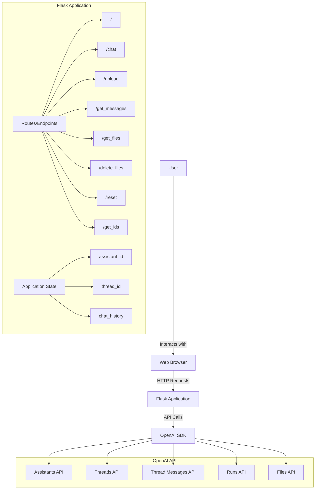

Sources: [examples/assistant-flask/app.py:1-205]()

## Core Components

The application architecture consists of the following core components:

| Component | Description | Implementation |
|-----------|-------------|----------------|
| Flask Application | Web server that handles HTTP requests | [app.py:10]() |
| OpenAI Client | Interface to the OpenAI API | [app.py:6-8]() |
| Application State | Global variables storing application state | [app.py:14-19]() |
| Route Handlers | Functions to handle HTTP endpoints | [app.py:26-193]() |
| Initialization | Setup executed before the first request | [app.py:197-201]() |

Sources: [examples/assistant-flask/app.py:1-205]()

## Application State

The application maintains three key pieces of state:

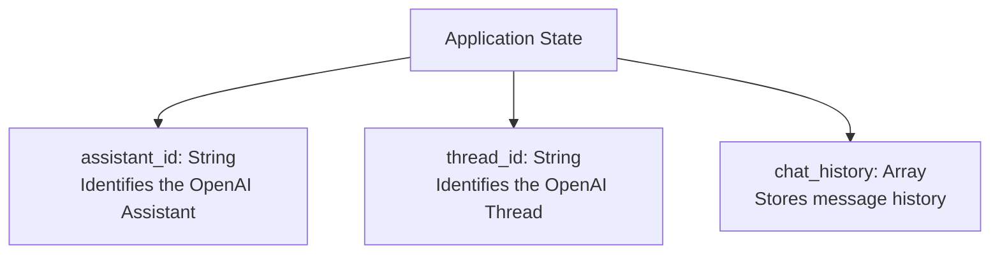

Sources: [examples/assistant-flask/app.py:14-19]()

## Route Structure

The application exposes several HTTP endpoints to handle different aspects of the chat interface:

| Route | Method | Purpose | Implementation |
|-------|--------|---------|----------------|
| `/` | GET | Renders the main chat interface | [app.py:142-144]() |
| `/chat` | POST | Processes user messages and gets assistant responses | [app.py:147-182]() |
| `/upload` | POST | Handles file uploads to the assistant | [app.py:26-58]() |
| `/get_ids` | GET | Returns the current assistant and thread IDs | [app.py:61-63]() |
| `/get_messages` | GET | Retrieves message history from the thread | [app.py:66-79]() |
| `/delete_files` | POST | Removes files from the assistant | [app.py:82-92]() |
| `/get_files` | GET | Lists files attached to the assistant | [app.py:95-110]() |
| `/reset` | POST | Resets the conversation and creates a new thread | [app.py:185-193]() |

Sources: [examples/assistant-flask/app.py:26-193]()

## OpenAI Integration

The application creates and manages OpenAI resources upon initialization:

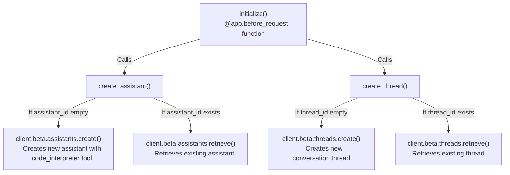

Sources: [examples/assistant-flask/app.py:113-139](), [examples/assistant-flask/app.py:197-201]()

## Chat Flow

The most important functionality is the chat flow, which integrates with OpenAI's Assistants API:

```mermaid
sequenceDiagram
    participant Client as "Web Client"
    participant Server as "Flask Server"
    participant OpenAI as "OpenAI API"
    
    Client->>Server: POST /chat with user message
    Note over Server: Add message to chat_history
    
    Server->>OpenAI: threads.messages.create(thread_id, role="user", content=message)
    Server->>OpenAI: threads.runs.create(thread_id, assistant_id)
    
    loop Until run.status == "completed"
        Server->>OpenAI: threads.runs.retrieve(thread_id, run_id)
        OpenAI-->>Server: Run status
        Note over Server: Sleep 0.5 seconds if not completed
    end
    
    Server->>OpenAI: threads.messages.list(thread_id)
    OpenAI-->>Server: Latest messages including assistant response
    
    Note over Server: Extract text content from response
    Note over Server: Add response to chat_history
    
    Server-->>Client: JSON response with assistant message
```

Sources: [examples/assistant-flask/app.py:147-182]()

## File Management Architecture

The application allows users to upload files and attach them to the OpenAI Assistant:

```mermaid
flowchart TD
    UploadRoute["/upload endpoint"] -->|"Receives"| FileUpload["File upload request"]
    
    FileUpload -->|"Validates"| FileValidation["allowed_file()
    Checks file extension"]
    
    FileValidation -->|"If valid"| SecureFilename["secure_filename()
    Sanitizes filename"]
    
    SecureFilename -->|"Uploads to OpenAI"| CreateFile["client.files.create()
    Uploads file to OpenAI"]
    
    CreateFile -->|"Gets existing files"| ListFiles["client.beta.assistants.files.list()
    Lists assistant's files"]
    
    ListFiles -->|"Combines IDs"| UpdateAssistant["client.beta.assistants.update()
    Updates assistant with new file list"]
    
    DeleteFilesRoute["/delete_files endpoint"] -->|"Deletes file"| DeleteFile["client.beta.assistants.files.delete()
    Removes file from assistant"]
    
    GetFilesRoute["/get_files endpoint"] -->|"Requests files"| RetrieveFiles["client.beta.assistants.files.list()
    Gets all assistant files"]
```

Sources: [examples/assistant-flask/app.py:26-58](), [examples/assistant-flask/app.py:82-110]()

## Reset Functionality

The application provides a way to reset the conversation:

```mermaid
flowchart TD
    ResetRoute["/reset endpoint"] -->|"Resets"| ChatHistory["chat_history
    Reset to initial system message"]
    
    ResetRoute -->|"Clears"| ThreadId["thread_id
    Set to empty string"]
    
    ThreadId -->|"Triggers"| NewThread["create_thread()
    Creates new conversation thread"]
```

Sources: [examples/assistant-flask/app.py:185-193]()

## Application Initialization

The application uses Flask's before_request hook to initialize the OpenAI resources:

```mermaid
flowchart TD
    AppStart["Application Start"] -->|"Registers"| BeforeRequest["@app.before_request
    initialize()"]
    
    BeforeRequest -->|"Executes once"| RemoveHook["Remove initialize from before_request_funcs"]
    
    BeforeRequest -->|"Creates"| Assistant["create_assistant()
    Creates or retrieves assistant"]
    
    BeforeRequest -->|"Creates"| Thread["create_thread()
    Creates or retrieves thread"]
```

Sources: [examples/assistant-flask/app.py:197-201]()

## Code Structure Mapping

This diagram maps the main application concepts to their implementations in the codebase:

```mermaid
classDiagram
    class FlaskApplication {
        app: Flask instance
        client: OpenAI client
        assistant_id: string
        thread_id: string
        chat_history: list
    }
    
    class Endpoints {
        "/"
        "/chat"
        "/upload"
        "/get_ids"
        "/get_messages"
        "/delete_files"
        "/get_files"
        "/reset"
    }
    
    class HelperFunctions {
        allowed_file()
        create_assistant()
        create_thread()
        initialize()
    }
    
    class OpenAIResources {
        Assistant
        Thread
        Messages
        Runs
        Files
    }
    
    FlaskApplication --> Endpoints : exposes
    Endpoints --> HelperFunctions : uses
    HelperFunctions --> OpenAIResources : manages
```

Sources: [examples/assistant-flask/app.py:1-205]()

## Request-Response Flow

The following diagram illustrates the typical request-response flow through the application:

```mermaid
flowchart LR
    Client["Web Client"] -->|"HTTP Request"| Routes["Flask Routes"]
    
    Routes -->|"/"| IndexRoute["index()
    Renders HTML template"]
    
    Routes -->|"/chat"| ChatRoute["chat()
    Processes messages"]
    
    Routes -->|"/upload"| UploadRoute["upload_file()
    Handles file uploads"]
    
    Routes -->|"Other routes"| OtherRoutes["Other endpoint handlers"]
    
    ChatRoute -->|"Calls"| OpenAIClient["OpenAI SDK Client"]
    UploadRoute -->|"Calls"| OpenAIClient
    OtherRoutes -->|"Calls"| OpenAIClient
    
    OpenAIClient -->|"API Requests"| OpenAIAPI["OpenAI API"]
    
    OpenAIAPI -->|"Responses"| OpenAIClient
    OpenAIClient -->|"Processed Data"| Routes
    Routes -->|"HTTP Response"| Client
```

Sources: [examples/assistant-flask/app.py:26-193]()

## Summary

The Assistant Flask application is built on a Flask backend that integrates with OpenAI's Assistants API. It maintains state through global variables for the assistant and thread IDs, exposes HTTP endpoints to handle user interactions, and manages the flow of messages between the user and the OpenAI Assistant. The architecture supports file uploading and management, allowing users to share files with the assistant for analysis and reference.

---

# Page: User Interface

# User Interface

<details>
<summary>Relevant source files</summary>

The following files were used as context for generating this wiki page:

- [examples/assistant-flask/static/icon.png](examples/assistant-flask/static/icon.png)
- [examples/assistant-flask/static/main.css](examples/assistant-flask/static/main.css)
- [examples/assistant-flask/templates/index.html](examples/assistant-flask/templates/index.html)

</details>


This document details the frontend components, styling, and user interactions in the Assistant Flask application, a web-based interface that demonstrates OpenAI's Assistant API capabilities. For information on the server-side implementation, see [Application Architecture](#3.1.1), and for details on how files are handled, see [File Management](#3.1.3).

## Layout Structure

The Assistant Flask application interface is divided into two main sections within a flexbox-based layout:

```mermaid
graph TD
    MainContent["Main Content div (line 14)"] --> FileUpload["File Upload Section div (line 15)"]
    MainContent --> ChatContainer["Chat Container div (line 52)"]
    
    FileUpload --> Header["Header with OpenAI logo"]
    FileUpload --> FilesList["Files List"]
    FileUpload --> UploadButton["File Upload Button"]
    
    ChatContainer --> Messages["Messages Display Area"]
    ChatContainer --> InputContainer["Message Input Container"]
```

Sources:
- [examples/assistant-flask/templates/index.html:14-80]()
- [examples/assistant-flask/static/main.css:352-358]()

The HTML structure maintains a clear separation between the file management area and the conversation interface. The main content div uses flexbox to arrange these elements side by side, creating a modern chat application layout.

## Component Hierarchy

The following diagram illustrates the detailed hierarchy of UI components:

```mermaid
graph TD
    Body["body"] --> UploadBanner["upload-banner div"]
    Body --> MainContent["main-content div"]
    
    MainContent --> FileSection["file-upload-section div"]
    MainContent --> ChatSection["chat-container div"]
    
    FileSection --> Header["header div"]
    FileSection --> FilesList["filesList div"]
    FileSection --> CenteredText["centered-text div"]
    FileSection --> FileInput["file-upload input"]
    FileSection --> UploadLabel["file-upload-btn label"]
    
    ChatSection --> MessagesDiv["messages div"]
    ChatSection --> InputContainer["message-input-container div"]
    
    MessagesDiv --> MessageElements["User & Assistant messages"]
    InputContainer --> Form["Form (action='/chat')"]
    Form --> TextArea["textarea"]
    Form --> ButtonGroup["button-group div"]
    ButtonGroup --> SendButton["send-btn button"]
```

Sources:
- [examples/assistant-flask/templates/index.html:11-80]()
- [examples/assistant-flask/static/main.css:49-145]()

## Message Display System

Messages are rendered in the chat interface with distinct styling based on the sender:

| Feature | User Messages | Assistant Messages |
|---------|--------------|-------------------|
| Alignment | Right-aligned | Left-aligned |
| CSS Class | `user-message` | `assistant-message` |
| Background | Light gray (#f7f7f8) | Light green (#ebfaeb) |
| Label | "User" | "Assistant" |
| DOM Structure | Role div + message div | Role div + message div |

```mermaid
graph TD
    MessagesContainer["messages div"] --> UserMsgRole["message-role user div"]
    MessagesContainer --> UserMsg["user-message div"]
    MessagesContainer --> AssistantMsgRole["message-role div"]
    MessagesContainer --> AssistantMsg["assistant-message div"]
    
    UserMsgRole --> URoleLabel["'User' label"]
    AssistantMsgRole --> ARoleLabel["'Assistant' label"]
    UserMsg --> UMessageContent["User message content"]
    AssistantMsg --> AMessageContent["Assistant message content"]
```

Sources:
- [examples/assistant-flask/templates/index.html:53-66]()
- [examples/assistant-flask/static/main.css:64-82]()
- [examples/assistant-flask/static/main.css:285-294]()

## File Management Interface

The file management section displays uploaded files and provides controls for file operations:

```mermaid
graph TD
    FileSection["file-upload-section div"] --> FileHeader["Header div"]
    FileSection --> FilesList["filesList div"]
    FileSection --> PlaceholderText["centered-text div"]
    FileSection --> FileInput["file-upload input"]
    FileSection --> UploadLabel["file-upload-btn label"]
    
    FilesList --> FilesPlaceholder["filesPlaceholder p"]
    FilesList --> FilesDivider["filesDivider hr"]
    FilesList --> FileEntries["file-entry div (multiple)"]
    
    FileEntries --> FileIcon["File icon svg"]
    FileEntries --> FileID["File ID span"]
    FileEntries --> DeleteIcon["Delete icon svg"]
```

Files are represented with:
- Document icon SVG (lines 140-143)
- File ID text display
- Delete icon with click handler to remove files

When no files are present, a centered SVG icon and explanatory text appear, encouraging users to upload files for the code interpreter.

Sources:
- [examples/assistant-flask/templates/index.html:15-51]()
- [examples/assistant-flask/templates/index.html:108-163]()
- [examples/assistant-flask/static/main.css:309-317]()
- [examples/assistant-flask/static/main.css:371-396]()

## User Interaction Flow

This sequence diagram illustrates the typical user journey through the interface:

```mermaid
sequenceDiagram
    participant User as "User"
    participant UI as "User Interface"
    participant Server as "Server (Flask)"
    
    User->>UI: Types message in textarea
    User->>UI: Clicks send button
    UI->>UI: Appends user message to chat
    UI->>UI: Displays typing indicator
    UI->>Server: POST /chat with message
    Server->>Server: Processes message through Assistant API
    Server-->>UI: Returns assistant response
    UI->>UI: Removes typing indicator
    UI->>UI: Displays assistant message
    
    User->>UI: Clicks "Attach files" button
    UI->>UI: Opens file selector
    User->>UI: Selects file(s)
    UI->>Server: POST /upload with file data
    Server-->>UI: Returns success/error message
    UI->>UI: Displays upload banner
    UI->>Server: GET /get_files
    Server-->>UI: Returns updated file list
    UI->>UI: Updates file list display
```

Sources:
- [examples/assistant-flask/templates/index.html:165-211]() (Initial loading)
- [examples/assistant-flask/templates/index.html:213-262]() (File upload handling)
- [examples/assistant-flask/templates/index.html:263-339]() (Message handling)

## Styling System

The application's visual design is implemented through a comprehensive CSS framework:

| Component | CSS Classes | Key Properties |
|-----------|-------------|----------------|
| Main Layout | `main-content`, `file-upload-section`, `chat-container` | Flexbox, height:100vh |
| Message Bubbles | `user-message`, `assistant-message` | Border-radius, padding, max-width:80% |
| Message Input | `message-input-container`, `textarea` | Position:relative, resize:vertical |
| Buttons | `send-btn`, `file-upload-btn` | Background:#10a37f, border-radius:4px |
| File Display | `file-entry`, `file-icon` | Display:flex, justify-content:space-between |
| Notifications | `upload-banner`, `typing-indicator` | Position:fixed, animation |

Custom fonts are loaded from OpenAI's CDN:
- ColfaxAI Regular and Bold (lines 1-17)

The UI uses a primarily white background with accent colors for interactive elements and messaging.

Sources:
- [examples/assistant-flask/static/main.css:1-396]()

## Frontend JavaScript Components

Client-side JavaScript handles several critical aspects of the interface:

```mermaid
graph TD
    ClientJS["JavaScript (index.html)"] --> EventHandlers["Event Handlers"]
    ClientJS --> DOMManipulation["DOM Manipulation"]
    ClientJS --> AJAXCommunication["AJAX Communication"]
    
    EventHandlers --> FormSubmit["Form Submit (lines 263-339)"]
    EventHandlers --> FileUpload["File Upload (lines 213-262)"]
    EventHandlers --> FileDelete["File Delete (lines 82-107)"]
    
    DOMManipulation --> MessageDisplay["Message Display"]
    DOMManipulation --> FilesListUpdate["Files List Update"]
    DOMManipulation --> TypingIndicator["Typing Indicator"]
    
    AJAXCommunication --> ChatEndpoint["POST /chat"]
    AJAXCommunication --> UploadEndpoint["POST /upload"]
    AJAXCommunication --> GetFilesEndpoint["GET /get_files"]
    AJAXCommunication --> DeleteFilesEndpoint["POST /delete_files"]
    AJAXCommunication --> GetMessagesEndpoint["GET /get_messages"]
```

Key JavaScript functions include:
- `deleteFiles()` - Removes files via API call (lines 82-107)
- `populateFiles()` - Updates file list display (lines 108-163)
- Event handlers for message submission and file uploads (lines 213-339)
- Dynamic message rendering with typing indicators (lines 322-335)

Sources:
- [examples/assistant-flask/templates/index.html:81-340]()

## API Integration Points

The frontend connects to the Flask backend through these key endpoints:

| Endpoint | Method | Purpose | Implementation |
|----------|--------|---------|---------------|
| `/chat` | POST | Send user message and receive assistant response | Lines 263-339 |
| `/upload` | POST | Upload files to the assistant | Lines 213-262 |
| `/get_files` | GET | Retrieve current file list | Lines 206-210 |
| `/delete_files` | POST | Remove a file from the assistant | Lines 82-107 |
| `/get_messages` | GET | Load existing chat history | Lines 167-191 |
| `/get_ids` | GET | Retrieve assistant and thread IDs | Lines 193-204 |

All API requests use fetch() with appropriate JSON handling for a seamless single-page application experience.

Sources:
- [examples/assistant-flask/templates/index.html:81-211]() (API endpoints and handlers)

## Responsive Design Features

The application adapts to different screen sizes through:
- Percentage-based sizing (`chat-container` width:70%, max-width:600px)
- Flexible layouts using CSS flexbox (`display:flex`, `flex-direction`)
- Relative width calculations (`width:calc(100% - 20px)`)
- Overflow handling for scrollable content areas (`overflow-y:auto`)

These features ensure the interface remains usable across desktop and mobile devices.

Sources:
- [examples/assistant-flask/static/main.css:26-35]() (Body styling)
- [examples/assistant-flask/static/main.css:49-62]() (Chat container)
- [examples/assistant-flask/static/main.css:352-365]() (Main content layout)

## Special UI Elements

Several specialized UI components enhance the user experience:

1. **Typing Indicator** - Shows animated dots when the assistant is generating a response (lines 164-190)
2. **Upload Banner** - Temporary notification that appears after file operations (lines 11-13, 230-256)
3. **File Icons** - SVG graphics that represent document types (lines 140-143)
4. **Delete Controls** - Interactive elements for file management (lines 149-155)

These elements provide visual feedback and improve the application's usability.

Sources:
- [examples/assistant-flask/static/main.css:164-190]() (Typing indicator)
- [examples/assistant-flask/static/main.css:202-212]() (Upload banner)
- [examples/assistant-flask/templates/index.html:230-256]() (Banner implementation)

The user interface design balances visual simplicity with functional completeness, creating an accessible demonstration of the OpenAI Assistant API's capabilities within a web application context.

---

# Page: File Management

# File Management

<details>
<summary>Relevant source files</summary>

The following files were used as context for generating this wiki page:

- [examples/assistant-flask/app.py](examples/assistant-flask/app.py)
- [examples/assistant-flask/templates/index.html](examples/assistant-flask/templates/index.html)

</details>


## Purpose and Scope

This document details the file management system implemented in the Assistant Flask application. It covers the upload, display, and deletion of files that can be used by the OpenAI Assistant API's code interpreter. The file management functionality allows users to attach various document types to their conversation, enabling the AI assistant to process and analyze this data.

For information about the overall application architecture, see [Application Architecture](#3.1.1). For details about the user interface beyond file management, see [User Interface](#3.1.2).

## File Management Architecture

The file management system consists of backend routes that handle file operations and frontend components that allow users to interact with these files. Below is an architecture diagram showing the key components:

```mermaid
flowchart TD
    subgraph "Frontend Components"
        UI["UI Components"]
        UI --> FileUpload["File Upload Button"]
        UI --> FilesList["Files List Display"]
        UI --> DeleteButton["Delete File Button"]
        
        JSFunctions["JavaScript Functions"]
        JSFunctions --> PopulateFiles["populateFiles()"]
        JSFunctions --> DeleteFiles["deleteFiles()"]
        JSFunctions --> EventHandlers["Event Handlers"]
    end
    
    subgraph "Backend Routes"
        Routes["Flask Routes"]
        Routes --> UploadRoute["/upload (POST)"]
        Routes --> GetFilesRoute["/get_files (GET)"]
        Routes --> DeleteFilesRoute["/delete_files (POST)"]
    end
    
    subgraph "OpenAI API"
        OpenAIAPI["OpenAI API"]
        OpenAIAPI --> FilesAPI["Files API"]
        OpenAIAPI --> AssistantFilesAPI["Assistant Files API"]
    end
    
    FileUpload -->|"Sends file via FormData"| UploadRoute
    DeleteButton -->|"Sends fileId"| DeleteFilesRoute
    FilesList -->|"Requests file list"| GetFilesRoute
    
    UploadRoute -->|"Create file"| FilesAPI
    UploadRoute -->|"Update assistant"| AssistantFilesAPI
    GetFilesRoute -->|"List files"| AssistantFilesAPI
    DeleteFilesRoute -->|"Delete file"| AssistantFilesAPI
```

Sources: [examples/assistant-flask/app.py:26-110](), [examples/assistant-flask/templates/index.html:15-51](), [examples/assistant-flask/templates/index.html:82-162]()

## Supported File Types

The application restricts the types of files that can be uploaded to ensure compatibility with the OpenAI Assistant API's code interpreter.

```python
ALLOWED_EXTENSIONS = {"txt", "pdf", "png", "jpg", "jpeg", "gif", "csv"}
```

This whitelist helps maintain security and ensures that only files that can be processed by the code interpreter are uploaded.

Sources: [examples/assistant-flask/app.py:11](), [examples/assistant-flask/app.py:22-23]()

## Backend Implementation

### File Upload Endpoint

The backend handles file uploads through the `/upload` route, which:

1. Validates that a file was provided in the request
2. Checks if the file has an allowed extension
3. Uploads the file to OpenAI's servers using the Files API
4. Associates the file with the Assistant by adding its ID to the Assistant's file list
5. Returns a success or failure message to the client

```mermaid
sequenceDiagram
    participant Client
    participant Server as "Flask Server"
    participant OpenAI as "OpenAI API"
    
    Client->>Server: POST /upload with file
    Server->>Server: Validate file type
    alt Valid file
        Server->>OpenAI: Upload file to OpenAI Files API
        OpenAI-->>Server: Return file ID
        Server->>OpenAI: Get current assistant files
        OpenAI-->>Server: Return file list
        Server->>OpenAI: Update assistant with new file ID
        OpenAI-->>Server: Confirm update
        Server-->>Client: Return success message
    else Invalid file
        Server-->>Client: Return error message
    end
```

Sources: [examples/assistant-flask/app.py:26-58]()

### File Listing Endpoint

The `/get_files` endpoint retrieves all files associated with the current Assistant:

1. Calls the OpenAI Assistant Files API to list files
2. Formats the file data for frontend consumption
3. Returns a JSON array of file objects with ID, object type, and creation timestamp

Sources: [examples/assistant-flask/app.py:95-110]()

### File Deletion Endpoint

The `/delete_files` endpoint removes a file from the Assistant:

1. Receives a file ID from the client
2. Uses the OpenAI Assistant Files API to delete the file association
3. Returns a success or failure message based on the deletion result

Sources: [examples/assistant-flask/app.py:82-92]()

## Frontend Implementation

### UI Components

The frontend includes several components for file management:

| Component | Purpose | HTML Location |
|-----------|---------|---------------|
| File Upload Section | Contains upload button and visual elements | Lines 15-51 |
| Files List | Displays uploaded files with delete options | Lines 23-24 |
| Upload Status Banner | Shows success/failure messages | Lines 11-13 |

Sources: [examples/assistant-flask/templates/index.html:15-51](), [examples/assistant-flask/templates/index.html:11-13](), [examples/assistant-flask/templates/index.html:23-24]()

### File Display and Management

The frontend uses JavaScript to handle file operations:

1. `populateFiles()` function renders the list of files in the UI
2. `deleteFiles()` function sends delete requests to the server
3. Event listeners capture file upload events and form submissions

```mermaid
flowchart TD
    DOMContentLoaded["DOMContentLoaded Event"] -->|"Triggers"| InitialFileLoad["Initial File Loading"]
    InitialFileLoad -->|"Calls"| GetFiles["/get_files API Call"]
    GetFiles -->|"Returns data to"| PopulateFiles["populateFiles() Function"]
    
    FileUploadChange["File Input Change Event"] -->|"Triggers"| UploadProcess["File Upload Process"]
    UploadProcess -->|"FormData with file"| UploadAPI["/upload API Call"]
    UploadAPI -->|"On success"| ShowBanner["Show Success Banner"]
    UploadAPI -->|"Then refreshes files"| RefreshGetFiles["/get_files API Call"]
    RefreshGetFiles -->|"Returns data to"| PopulateFiles
    
    DeleteClick["Delete Icon Click"] -->|"Triggers"| DeleteProcess["File Deletion Process"]
    DeleteProcess -->|"fileId JSON payload"| DeleteAPI["/delete_files API Call"]
    DeleteAPI -->|"On success"| RemoveFileUI["Remove File from UI"]
    DeleteAPI -->|"Then refreshes files"| RefreshGetFiles
```

Sources: [examples/assistant-flask/templates/index.html:108-162](), [examples/assistant-flask/templates/index.html:82-107](), [examples/assistant-flask/templates/index.html:213-262]()

## File Upload Flow

The following diagram illustrates the complete flow of file upload, from user action to association with the OpenAI Assistant:

```mermaid
sequenceDiagram
    participant User
    participant Browser
    participant Flask as "Flask Server"
    participant OpenAI as "OpenAI API"
    
    User->>Browser: Click "Attach files" button
    Browser->>User: Open file selection dialog
    User->>Browser: Select file
    Browser->>Browser: Capture file in change event
    Browser->>Browser: Create FormData with file
    Browser->>Flask: POST /upload with FormData
    
    Flask->>Flask: Check if file type is allowed
    
    alt File type allowed
        Flask->>OpenAI: Upload file to OpenAI (client.files.create)
        OpenAI-->>Flask: Return file object with ID
        
        Flask->>OpenAI: Get current assistant files (client.beta.assistants.files.list)
        OpenAI-->>Flask: Return current file IDs
        
        Flask->>Flask: Add new file ID to list
        Flask->>OpenAI: Update assistant with new file list (client.beta.assistants.update)
        OpenAI-->>Flask: Confirm assistant update
        
        Flask-->>Browser: Return success JSON response
        Browser->>Browser: Display success banner
        Browser->>Flask: GET /get_files to refresh file list
        Flask->>OpenAI: List assistant files
        OpenAI-->>Flask: Return updated file list
        Flask-->>Browser: Return file list JSON
        Browser->>Browser: Call populateFiles() to update UI
    else File type not allowed
        Flask-->>Browser: Return error JSON response
        Browser->>Browser: Display error banner
    end
```

Sources: [examples/assistant-flask/templates/index.html:213-262](), [examples/assistant-flask/app.py:26-58]()

## File Display Implementation

When files are successfully attached to the Assistant, they appear in the UI with the following structure:

1. File icon (document symbol)
2. File ID display
3. Delete icon for removing the file

The application uses JavaScript to dynamically generate these elements based on the response from the `/get_files` endpoint.

```mermaid
flowchart TD
    FilesList["Files List Container"] -->|"Contains"| FilesPlaceholder["Files Placeholder Text"]
    FilesList -->|"Contains"| FileDivider["Horizontal Divider"]
    FilesList -->|"Contains"| FileEntries["File Entry Elements"]
    
    FileEntries -->|"For each file"| FileEntry["File Entry"]
    
    FileEntry -->|"Contains"| LeftIcon["Left Icon (Document)"]
    FileEntry -->|"Contains"| FileID["File ID Span"]
    FileEntry -->|"Contains"| RightIcon["Right Icon (Delete)"]
    
    RightIcon -->|"Click event"| DeleteFileFunction["deleteFiles() Function"]
```

Sources: [examples/assistant-flask/templates/index.html:108-162]()

## Integration with Chat Interface

The file management system integrates with the chat interface, allowing the AI assistant to access and process uploaded files. When files are attached to the Assistant:

1. The OpenAI Assistant API includes them in the context for the code interpreter
2. The assistant can analyze, manipulate, and reference these files in its responses
3. If code interpreter is enabled, the assistant can perform operations on the files (e.g., data analysis on CSV files, image processing on image files)

This integration enables more powerful AI capabilities beyond simple text conversations.

Sources: [examples/assistant-flask/app.py:40-52](), [examples/assistant-flask/app.py:147-182]()

## Limitations and Considerations

- The application supports a limited set of file types as defined in `ALLOWED_EXTENSIONS`
- There's no limit on file size implemented in the application code, though OpenAI's API has its own limits
- Files are stored on OpenAI's servers, not locally
- File uploads are tied to the specific Assistant instance defined by `assistant_id`
- When resetting a chat thread, files remain attached to the Assistant

Sources: [examples/assistant-flask/app.py:11](), [examples/assistant-flask/app.py:40-52](), [examples/assistant-flask/app.py:185-193]()

---

# Page: Chat Basic Application

# Chat Basic Application

<details>
<summary>Relevant source files</summary>

The following files were used as context for generating this wiki page:

- [examples/assistant-basic/assistant.py](examples/assistant-basic/assistant.py)
- [examples/chat-basic/app.py](examples/chat-basic/app.py)
- [examples/chat-basic/templates/index.html](examples/chat-basic/templates/index.html)

</details>


The Chat Basic Application is a minimalist web interface that demonstrates how to implement real-time streaming with OpenAI's Chat Completions API. This example focuses specifically on creating a simple chat interface where AI responses appear progressively as they're generated.

For a more comprehensive example using the Assistants API with features like file uploads, see [Assistant Flask Application](#3.1).

## System Architecture

```mermaid
graph TD
    subgraph "Chat Basic Application"
        Flask["Flask App (app.py)"] -->|"renders"| IndexHTML["index.html"]
        Flask -->|"maintains"| ChatHistory["chat_history array"]
        Flask -->|"calls"| OpenAIAPI["client.chat.completions.create()"]
        
        IndexHTML -->|"POST /chat"| Flask
        IndexHTML -->|"GET /stream"| Flask
        IndexHTML -->|"POST /reset"| Flask
        
        OpenAIAPI -->|"streaming response"| Flask
        Flask -->|"Server-Sent Events"| IndexHTML
    end
    
    User -->|"interacts with"| IndexHTML
```

The application consists of a Flask server that maintains chat state, interfaces with OpenAI's API, and serves a web interface using Server-Sent Events (SSE) for streaming responses.

Sources:
- [examples/chat-basic/app.py]()
- [examples/chat-basic/templates/index.html]()

## Server-Side Implementation

### Flask Application Setup

```mermaid
classDiagram
    class app {
        +client: OpenAI
        +chat_history: List
        +index(): render_template
        +chat(): jsonify
        +stream(): Response
        +reset_chat(): jsonify
    }
    
    class chat_history {
        +role: String
        +content: String
    }
    
    app --> chat_history : maintains
```

The Flask application initializes the OpenAI client and establishes a global `chat_history` array with an initial system message that sets the assistant's behavior.

```python
client = openai.OpenAI()
app = Flask(__name__)
chat_history = [
    {"role": "system", "content": "You are a helpful assistant."},
]
```

Sources: [examples/chat-basic/app.py:1-17]()

### Route Handlers

The application defines four HTTP endpoints:

| Route | Method | Function | Purpose |
|-------|--------|----------|---------|
| `/` | GET | `index()` | Renders HTML template with chat history |
| `/chat` | POST | `chat()` | Adds user messages to chat history |
| `/stream` | GET | `stream()` | Streams AI responses via SSE |
| `/reset` | POST | `reset_chat()` | Resets chat history to initial state |

Sources: [examples/chat-basic/app.py:20-62]()

### Streaming Implementation

The core functionality of the application is implemented in the `stream()` route handler:

```mermaid
sequenceDiagram
    participant Flask as "stream() function"
    participant Generate as "generate() inner function"
    participant OpenAI as "OpenAI API"
    participant Client as "Web Browser"
    
    Flask->>Generate: Call generate()
    Generate->>OpenAI: client.chat.completions.create(stream=True)
    
    loop For each chunk
        OpenAI-->>Generate: chunk.choices[0].delta.content
        Generate->>Generate: assistant_response_content += content
        Generate-->>Client: yield "data: content\n\n"
    end
    
    OpenAI-->>Generate: finish_reason="stop"
    Generate->>Generate: Add full response to chat_history
    Flask-->>Client: Return Response(stream_with_context())
```

The implementation uses Flask's `stream_with_context` to wrap a generator function that:
1. Calls OpenAI's API with `stream=True`
2. Processes and yields each content chunk as it arrives
3. Accumulates the complete response
4. Adds the full response to chat history after completion

Sources: [examples/chat-basic/app.py:32-55]()

## Client-Side Implementation

### HTML Structure

```mermaid
graph TD
    IndexHTML["index.html"] --> Header[".header div"]
    IndexHTML --> ChatContainer[".chat-container div"]
    IndexHTML --> InputContainer[".message-input-container div"]
    
    ChatContainer --> MessageRole[".message-role div"]
    ChatContainer --> MessageContent[".user-message/.assistant-message div"]
    
    InputContainer --> Form["form"]
    Form --> Textarea["textarea"]
    Form --> SendButton["button#send-btn"]
```

The client interface consists of a header with the OpenAI logo, a container for displaying messages, and an input area for sending new messages.

Sources: [examples/chat-basic/templates/index.html:1-41]()

### JavaScript Functionality

The client-side JavaScript handles three main tasks:

1. **Message Submission**

```mermaid
sequenceDiagram
    participant Form as "form element"
    participant JS as "Submit Event Handler"
    participant Server as "Flask Server"
    
    Form->>JS: addEventListener("submit")
    JS->>JS: preventDefault()
    JS->>JS: Get message text
    JS->>JS: Create and append user message divs
    JS->>JS: Clear input field
    JS->>Server: fetch("/chat", POST)
    Server-->>JS: {success: true}
    JS->>JS: Create assistant message placeholder
    JS->>JS: Connect to /stream endpoint
```

Sources: [examples/chat-basic/templates/index.html:43-92]()

2. **Response Streaming**

```mermaid
sequenceDiagram
    participant JS as "JavaScript"
    participant EventSource as "EventSource"
    participant Server as "Flask Server"
    
    JS->>EventSource: new EventSource("/stream")
    EventSource->>Server: Connect to SSE stream
    
    loop For each chunk
        Server-->>EventSource: "data: content\n\n"
        EventSource->>JS: onmessage event
        JS->>JS: Update assistant message div
        JS->>JS: Scroll to bottom
    end
    
    Server-->>EventSource: End of stream
    EventSource->>JS: onerror event
    JS->>EventSource: close()
```

The JavaScript uses the `EventSource` API to establish a connection to the stream endpoint and incrementally update the UI as chunks arrive.

Sources: [examples/chat-basic/templates/index.html:94-113]()

3. **Chat Reset**

```mermaid
sequenceDiagram
    participant Button as "#clear-btn"
    participant JS as "Click Event Handler"
    participant DOM as "DOM"
    participant Server as "Flask Server"
    
    Button->>JS: addEventListener("click")
    JS->>DOM: Clear chat container
    JS->>DOM: Create initial system message
    JS->>Server: fetch("/reset", POST)
    Server-->>JS: {success: true}
    JS->>JS: Log success message
```

Sources: [examples/chat-basic/templates/index.html:119-140]()

## Data Flow

The complete data flow through the application:

```mermaid
sequenceDiagram
    actor User
    participant Browser as "Web Browser"
    participant Server as "Flask Server"
    participant OpenAI as "OpenAI API"
    
    User->>Browser: Enter message and submit
    Browser->>Server: POST /chat {message}
    Server->>Server: Add to chat_history
    Server-->>Browser: {success: true}
    
    Browser->>Server: GET /stream
    Server->>OpenAI: chat.completions.create(stream=True)
    
    loop For each chunk
        OpenAI-->>Server: Content chunk
        Server-->>Browser: SSE data event
        Browser->>Browser: Update UI
        Browser->>User: Display incremental response
    end
    
    OpenAI-->>Server: End of stream
    Server->>Server: Add full response to chat_history
    Server-->>Browser: End of stream
```

This diagram shows how user input flows through the system and how the streaming response is handled from the API to the user interface.

Sources:
- [examples/chat-basic/app.py:25-55]()
- [examples/chat-basic/templates/index.html:43-113]()

## Key Implementation Patterns

### Server-Sent Events (SSE)

The application uses Server-Sent Events to stream content from the server to the client:

```mermaid
graph TD
    subgraph "Server-Side"
        StreamRoute["/stream route"] --> StreamContext["stream_with_context()"]
        StreamContext --> Generator["generator function"]
        Generator --> YieldData["yield 'data: content\n\n'"]
        Generator -->|"API call"| OpenAI["OpenAI Streaming API"]
    end
    
    subgraph "Client-Side"
        EventSource["new EventSource('/stream')"] --> OnMessage["eventSource.onmessage"]
        OnMessage --> UpdateUI["Update DOM"]
        EventSource --> OnError["eventSource.onerror"]
        OnError --> CloseConnection["eventSource.close()"]
    end
    
    YieldData -->|"SSE protocol"| EventSource
```

This pattern enables real-time, chunk-by-chunk display of AI responses, creating a more interactive user experience.

Sources:
- [examples/chat-basic/app.py:32-55]()
- [examples/chat-basic/templates/index.html:94-113]()

### Chat History Management

The chat history follows this lifecycle:

```mermaid
graph TD
    Init["Initialize chat_history with system message"] -->|"User sends message"| AddUser["Add user message"]
    AddUser -->|"Stream response"| StreamChunks["Stream response chunks"]
    StreamChunks -->|"Stream complete"| AddAssistant["Add assistant message"]
    
    AddAssistant -->|"New message"| AddUser
    AddAssistant -->|"Reset"| Reset["Reset to initial state"]
    Reset --> Init
```

This pattern ensures that each message has proper context from the conversation history, while allowing for state reset when needed.

Sources:
- [examples/chat-basic/app.py:15-17]()
- [examples/chat-basic/app.py:27-28]()
- [examples/chat-basic/app.py:51-53]()
- [examples/chat-basic/app.py:58-62]()

## Summary

The Chat Basic Application demonstrates a minimalist yet effective implementation of an OpenAI-powered chat interface with real-time streaming responses. Key technical features include:

1. Server-side streaming using Flask's `stream_with_context` and the OpenAI streaming API
2. Client-side handling of streamed responses using the `EventSource` API
3. Conversation state management through a server-side chat history array
4. Dynamic DOM updates to display the conversation

This example provides a foundation for developers looking to implement AI chat interfaces with streaming capabilities in their own applications.

For more advanced implementations like the Assistants API with file handling, see [Assistant Flask Application](#3.1) or [Assistant Basic Application](#3.3).

---

# Page: Streaming Responses

# Streaming Responses

<details>
<summary>Relevant source files</summary>

The following files were used as context for generating this wiki page:

- [examples/assistant-basic/assistant.py](examples/assistant-basic/assistant.py)
- [examples/chat-basic/app.py](examples/chat-basic/app.py)
- [examples/chat-basic/templates/index.html](examples/chat-basic/templates/index.html)

</details>


This document explains how the Chat Basic application implements streaming responses using Server-Sent Events (SSE) to display OpenAI's API responses incrementally as they are generated. For information about the complete Chat Basic application, see [Chat Basic Application](#3.2).

## Introduction to Streaming

Streaming responses allow the application to display text generated by the OpenAI API in real-time, as it's being produced, rather than waiting for the entire response to be completed. This creates a more interactive and responsive user experience, as users can see the AI assistant "thinking" and composing its response progressively.

The Chat Basic application demonstrates a complete implementation of streaming responses through:
1. Server-side streaming using Flask's streaming capabilities
2. OpenAI API streaming mode
3. Client-side handling with Server-Sent Events (SSE)

Sources: [examples/chat-basic/app.py:32-55]()

## Implementation Architecture

```mermaid
graph TD
    subgraph "Client Browser"
        UI["UI Elements"]
        ESC["EventSource Connection"]
        Handler["Message Handler"]
    end
    
    subgraph "Flask Application"
        ChatRoute["/chat Endpoint"]
        StreamRoute["/stream Endpoint"]
        Generator["stream_with_context Generator"]
        ChatHistory["chat_history Array"]
    end
    
    subgraph "OpenAI API"
        OAIC["client.chat.completions.create"]
        Stream["stream=True Parameter"]
    end
    
    UI -->|"1. Send Message"| ChatRoute
    ChatRoute -->|"2. Store Message"| ChatHistory
    ChatRoute -->|"3. Return Success"| UI
    UI -->|"4. Create EventSource"| ESC
    ESC -->|"5. Connect to"| StreamRoute
    StreamRoute -->|"6. Create"| Generator
    Generator -->|"7. Request with History"| OAIC
    OAIC -->|"8. Configure"| Stream
    Stream -->|"9. Yield Chunks"| Generator
    Generator -->|"10. Yield Data Events"| ESC
    ESC -->|"11. onmessage Events"| Handler
    Handler -->|"12. Update DOM"| UI
    Generator -->|"13. Store Complete Response"| ChatHistory
```

Sources: [examples/chat-basic/app.py:32-55](), [examples/chat-basic/templates/index.html:94-113]()

## Server-Side Implementation

### Flask Stream Route

The Flask application implements streaming through a dedicated `/stream` endpoint that establishes a Server-Sent Events connection:

```mermaid
flowchart TD
    A["@app.route('/stream')"] --> B["stream() Function"]
    B --> C["generate() Inner Function"]
    C --> D["client.chat.completions.create\n(stream=True)"]
    D --> E["Iterate through Stream Chunks"]
    E --> F{{"chunk has content?"}}
    F -->|"Yes"| G["Accumulate Content"]
    G --> H["yield 'data: content'"]
    H --> E
    F -->|"No/Complete"| I["Store Complete Response\nin chat_history"]
    J["Return Response with\nstream_with_context"]
```

The core implementation is found in the `/stream` route in `app.py`:

1. A generator function creates a streaming context
2. The OpenAI client is configured to stream responses
3. As chunks arrive, they're formatted as SSE events
4. The complete response is accumulated and stored in chat history
5. Flask's `stream_with_context` ensures the connection is properly maintained

Key technical details:
- Uses `mimetype="text/event-stream"` to define the proper content type for SSE
- Each data chunk is formatted according to the SSE protocol (`data: [content]\n\n`)
- Checks for `finish_reason="stop"` to detect end of stream

Sources: [examples/chat-basic/app.py:32-55]()

### OpenAI API Integration

The application uses OpenAI's streaming capability by setting `stream=True` in the API request:

```python
with client.chat.completions.create(
    model="gpt-3.5-turbo",
    messages=chat_history,
    stream=True,
) as stream:
    # Process stream chunks
```

This configuration tells OpenAI to send the response in chunks as they are generated, rather than waiting for the complete response.

Sources: [examples/chat-basic/app.py:37-41]()

## Client-Side Implementation

The frontend handles streaming responses using the EventSource API, which is specifically designed for Server-Sent Events:

```mermaid
sequenceDiagram
    participant User
    participant Form as Form Element
    participant ChatContainer as Chat Container
    participant EventSource as EventSource API
    participant Server as /stream Endpoint
    
    User->>Form: Submit message
    Form->>Server: POST /chat (message)
    Server-->>Form: Success response
    Form->>ChatContainer: Add user message
    Form->>EventSource: new EventSource("/stream")
    EventSource->>Server: GET /stream
    
    loop For each chunk
        Server-->>EventSource: data: [text chunk]
        EventSource->>ChatContainer: onmessage event
        ChatContainer->>ChatContainer: Append text
    end
    
    EventSource->>EventSource: Close on error/completion
```

Key components of the client-side implementation:

1. **EventSource Connection**: After submitting a message and receiving a success response, the client establishes an EventSource connection to `/stream`

2. **Message Handling**: The `onmessage` event handler processes each chunk:
   - Appends new text to the existing message
   - Handles formatting issues (adds spaces after punctuation if needed)
   - Auto-scrolls to keep the latest content visible

3. **Error Handling**: The `onerror` handler closes the connection if an error occurs

Sources: [examples/chat-basic/templates/index.html:94-113]()

## Complete Data Flow

Here's the complete flow of data through the system when a user sends a message:

```mermaid
sequenceDiagram
    participant User
    participant Client as Browser Client
    participant Flask as Flask Server
    participant OpenAI as OpenAI API
    
    User->>Client: Enter message
    Client->>Flask: POST /chat (message)
    Note over Flask: Save message to chat_history
    Flask->>Client: Return success JSON
    
    Client->>Client: Display user message
    Client->>Flask: GET /stream
    
    Flask->>OpenAI: chat.completions.create(stream=True)
    
    loop For each response chunk
        OpenAI-->>Flask: Yield content chunk
        Flask-->>Client: SSE event: "data: [chunk]"
        Client->>Client: Append chunk to UI
    end
    
    Note over Flask: Save complete response to chat_history
    Client->>Client: Complete message display
    Client->>Client: Close EventSource connection
```

Sources: [examples/chat-basic/app.py:25-55](), [examples/chat-basic/templates/index.html:72-115]()

## Code Details

### Server-Side Streaming Logic

The core streaming logic in `app.py` consists of:

1. Creating a generator function that yields SSE-formatted chunks
2. Accumulating the complete response
3. Storing the result in chat history after streaming completes

Key code details:
- The `generate()` inner function yields chunks in the SSE format
- The accumulated response is stored in chat history only after streaming completes
- Content is only sent if it exists (`chunk.choices[0].delta.content`)

Sources: [examples/chat-basic/app.py:34-53]()

### Client-Side EventSource Handling

The frontend JavaScript creates an EventSource connection and processes events:

```javascript
// Open a connection to receive streamed responses
const eventSource = new EventSource("/stream");
eventSource.onmessage = function (event) {
  // Process the chunk and update UI
};
eventSource.onerror = function () {
  eventSource.close();
};
```

The client also performs text formatting to ensure the chunks display properly, handling cases where punctuation might need spaces after them.

Sources: [examples/chat-basic/templates/index.html:94-113]()

## Technical Considerations

### Performance Implications

Streaming responses provide several advantages:

1. **Perceived Responsiveness**: Users see content immediately rather than waiting for complete responses
2. **Reduced Time-to-First-Byte**: First content appears much faster
3. **Efficient Resource Use**: Content processing can begin before transmission completes

### Server Memory Management

The Flask implementation uses `stream_with_context` to ensure that:
- The request context is preserved throughout the streaming process
- Memory is managed efficiently as chunks are yielded
- The connection is properly handled even if the client disconnects

Sources: [examples/chat-basic/app.py:55]()

### Browser Compatibility

Server-Sent Events are supported in all modern browsers. The implementation uses standard `EventSource` API without requiring polyfills or special configurations.

## Implementation Differences from Assistant Examples

The streaming implementation in the Chat Basic example differs from the Assistant examples in the repository:

| Feature | Chat Basic Streaming | Assistant Applications |
|---------|---------------------|------------------------|
| API Used | Chat Completions API | Assistants API |
| Stream Mechanism | Server-Sent Events | Polling for status |
| Response Time | Immediate streaming | Wait for completion |
| Implementation | Direct stream handling | Run and check status |

For information about the complete Chat Basic application UI, see [User Interface](#3.2.2).

Sources: [examples/chat-basic/app.py:32-55](), [examples/assistant-basic/assistant.py:57-75]()

---

# Page: User Interface

# User Interface

<details>
<summary>Relevant source files</summary>

The following files were used as context for generating this wiki page:

- [examples/chat-basic/static/icon.png](examples/chat-basic/static/icon.png)
- [examples/chat-basic/static/main.css](examples/chat-basic/static/main.css)
- [examples/chat-basic/templates/index.html](examples/chat-basic/templates/index.html)

</details>


This document provides a detailed overview of the Chat Basic application's user interface components, layout, and interaction patterns. The Chat Basic app is a simple web implementation focusing on the Chat Completions API with streaming responses. For information about the Assistant Flask application interface, see [User Interface for Assistant Flask](#3.1.2).

## 1. UI Overview

The Chat Basic application provides a minimalist chat interface that enables users to interact with OpenAI's chat completions API. The interface consists of a header, a scrollable chat container where messages appear, and a fixed message input area at the bottom of the screen.

```mermaid
graph TD
    subgraph "Chat Basic UI Structure"
        Header["Header Section"]
        ChatContainer["Chat Container"]
        InputContainer["Message Input Container"]
        
        Header --> ChatContainer
        ChatContainer --> InputContainer
    end
    
    subgraph "Message Types"
        UserMessage["User Message"]
        AssistantMessage["Assistant Message"]
        TypingIndicator["Typing Indicator"]
        
        ChatContainer --- UserMessage
        ChatContainer --- AssistantMessage
        ChatContainer --- TypingIndicator
    end
    
    subgraph "Input Components"
        TextArea["Text Area"]
        SendButton["Send Button"]
        
        InputContainer --- TextArea
        InputContainer --- SendButton
    end
```

Sources:
- [examples/chat-basic/templates/index.html:1-143]()
- [examples/chat-basic/static/main.css:1-318]()

## 2. UI Components

### 2.1 Header

The header is a simple bar at the top of the application that contains:
- The OpenAI logo (icon.png)
- "Demo" text indicating the application's purpose

The header is styled with a white background and centered content.

Sources:
- [examples/chat-basic/templates/index.html:11-17]()
- [examples/chat-basic/static/main.css:276-293]()

### 2.2 Chat Container

The chat container is the main content area where messages are displayed in chronological order. It has the following characteristics:

- Maximum width of 600px
- Centered on the page
- Padding at top and bottom
- Scrollable when content exceeds the visible area
- Bottom padding to ensure the latest messages aren't hidden behind the input area

Messages in the chat container are styled differently based on whether they're from the user or the assistant:

| Message Type | Alignment | Background Color | Style |
|-------------|-----------|------------------|-------|
| User | Right-aligned | Light gray (#f7f7f8) | Rounded corners, max-width 80% |
| Assistant | Left-aligned | Light green (#ebfaeb) | Rounded corners, max-width 80% |

Each message also displays a label ("User" or "Assistant") above the message content.

Sources:
- [examples/chat-basic/templates/index.html:18-29]()
- [examples/chat-basic/static/main.css:44-75]()
- [examples/chat-basic/static/main.css:295-304]()

### 2.3 Message Input Container

The input area is fixed at the bottom of the screen and contains:
- A text area for typing messages
- A send button with an upward arrow symbol (&#x2191;)

The input container has:
- White background
- Shadow separation from the chat content
- Fixed width matching the chat container (max-width 600px)

Sources:
- [examples/chat-basic/templates/index.html:30-41]()
- [examples/chat-basic/static/main.css:77-141]()
- [examples/chat-basic/static/main.css:306-317]()

### 2.4 Typing Indicator

When the assistant is generating a response, a typing indicator appears. This is implemented as a simple animation that displays dots (•, ••, •••) in sequence to indicate that the assistant is "typing."

Sources:
- [examples/chat-basic/static/main.css:160-186]()

## 3. Interaction Flow

The chat interface supports a streamlined conversation flow between the user and the assistant.

```mermaid
sequenceDiagram
    participant User
    participant UI as "Chat UI"
    participant Client as "JavaScript Client"
    participant Server as "Flask Server"
    participant OpenAI as "OpenAI API"
    
    User->>UI: Types message
    User->>UI: Clicks send button
    UI->>Client: Form submit event
    Client->>UI: Adds user message to chat
    Client->>Server: POST /chat (message)
    Server->>Server: Store message in history
    Server->>Client: Return success response
    
    Client->>Server: Connect to /stream
    Server->>OpenAI: Stream request to Chat API
    OpenAI-->>Server: Stream response chunks
    
    loop For each chunk
        Server-->>Client: Send chunk via SSE
        Client->>UI: Update assistant message with chunk
        UI->>UI: Auto-scroll to latest message
    end
```

Sources:
- [examples/chat-basic/templates/index.html:42-116]()

### 3.1 Sending Messages

1. The user types a message in the text area
2. The user clicks the send button or presses Enter
3. JavaScript captures the form submission event
4. The user's message is immediately added to the chat UI
5. The message is sent to the server via an AJAX POST request to `/chat`
6. After successful confirmation from the server, a connection is established to `/stream` for receiving the assistant's response

Sources:
- [examples/chat-basic/templates/index.html:42-78]()

### 3.2 Receiving Responses

1. The client opens an EventSource connection to `/stream`
2. The server streams response chunks from the OpenAI API
3. As each chunk arrives, it's appended to the assistant's message
4. The chat container automatically scrolls to keep the latest messages visible
5. The connection closes when the response is complete

Sources:
- [examples/chat-basic/templates/index.html:79-114]()

### 3.3 Chat History Management

The application code includes functionality for clearing the chat history, though the UI button for this feature may not be visible in the current implementation:

1. The event listener for a "clear-btn" element exists in the JavaScript
2. When triggered, it would clear all messages from the chat container
3. It would also send a POST request to `/reset` to clear the server-side chat history

Sources:
- [examples/chat-basic/templates/index.html:118-140]()

## 4. Styling and Visual Design

The Chat Basic application uses a clean, minimalist design with the following key style characteristics:

### 4.1 Typography

- Custom "ColfaxAI" font is used throughout the application
- Fallback to Helvetica and sans-serif fonts
- Font color is dark gray (#353740) for regular text
- Slightly darker color (#202123) for headings

### 4.2 Color Palette

| Element | Color | Purpose |
|---------|-------|---------|
| Body text | #353740 | Main text color |
| Headings | #202123 | Emphasis for titles |
| User messages | #f7f7f8 | Light gray background for user bubbles |
| Assistant messages | #ebfaeb | Light green background for assistant bubbles |
| Send button | #10a37f | Action button highlight |
| Message input border | #c5c5d2 | Subtle separation for input fields |

### 4.3 Layout and Spacing

- Content is centered with max-width of 600px
- Flexbox is used extensively for alignment and spacing
- Messages have padding (12px 16px) and margin (8px bottom)
- Input container has consistent padding (20px) around the form

Sources:
- [examples/chat-basic/static/main.css:1-318]()

## 5. Implementation Details

The user interface is implemented with a combination of HTML, CSS, and JavaScript:

```mermaid
graph TD
    subgraph "Frontend Implementation"
        HTMLTemplate["index.html<br>UI Structure"]
        CSS["main.css<br>Styling"]
        JS["JavaScript<br>Dynamic Behavior"]
        
        HTMLTemplate --> CSS
        HTMLTemplate --> JS
    end
    
    subgraph "JavaScript Functions"
        FormEvent["Form Submit<br>Event Handler"]
        MessageDisplay["Message Display<br>Logic"]
        SSE["Server-Sent Events<br>Connection"]
        TextProcessing["Text Processing<br>and Formatting"]
        
        JS --> FormEvent
        JS --> MessageDisplay
        JS --> SSE
        JS --> TextProcessing
    end
    
    subgraph "Server Endpoints"
        ChatEndpoint["/chat<br>Message Submission"]
        StreamEndpoint["/stream<br>Response Streaming"]
        ResetEndpoint["/reset<br>Clear History"]
        
        FormEvent --> ChatEndpoint
        ChatEndpoint --> SSE
        SSE --> StreamEndpoint
    end
```

Sources:
- [examples/chat-basic/templates/index.html:1-143]()
- [examples/chat-basic/static/main.css:1-318]()

### 5.1 HTML Structure

The HTML template defines the basic structure of the application, with sections for:
- The header with the OpenAI logo
- The chat container where messages appear
- The message input form fixed at the bottom

The initial chat history is rendered server-side using Jinja2 template syntax, where available messages from `chat_history` are iterated through and displayed.

Sources:
- [examples/chat-basic/templates/index.html:1-41]()

### 5.2 JavaScript Functionality

Client-side JavaScript handles:
1. Form submission for sending messages
2. Dynamically adding user messages to the UI
3. AJAX requests to send messages to the server
4. EventSource connections for streaming responses
5. Appending response chunks to the assistant's messages
6. Auto-scrolling to keep the latest messages visible
7. Text formatting logic to handle spaces and punctuation in the streamed response

The JavaScript also includes a feature to properly handle text formatting when concatenating streamed chunks, ensuring proper spacing after punctuation marks.

Sources:
- [examples/chat-basic/templates/index.html:42-140]()

### 5.3 CSS Implementation

The CSS provides:
1. Custom font definitions
2. Layout and positioning using flexbox
3. Styling for message bubbles and the input area
4. Animations for the typing indicator
5. Responsive adjustments for different screen sizes

The styling ensures that the interface maintains a consistent appearance and remains usable across different devices.

Sources:
- [examples/chat-basic/static/main.css:1-318]()

## 6. Responsive Design

While the application is primarily designed for desktop use, it includes some responsive features:

- The chat container and input form use percentage widths with max-width constraints
- The layout is centered, allowing it to adapt to different screen sizes
- Flexbox is used for layout, providing some inherent responsiveness
- The fixed input container ensures the input area is always accessible, even on smaller screens

Sources:
- [examples/chat-basic/static/main.css:26-103]()

## 7. Summary

The Chat Basic application provides a streamlined user interface focused on the core chat functionality. Its key strengths include:

1. Minimalist design that focuses on the conversation
2. Real-time streaming of responses using Server-Sent Events
3. Clear visual differentiation between user and assistant messages
4. Simple and intuitive interaction model

The application demonstrates a straightforward implementation of a chat interface that integrates with OpenAI's Chat Completions API, with an emphasis on streaming responses for a more interactive user experience.

Sources:
- [examples/chat-basic/templates/index.html:1-143]()
- [examples/chat-basic/static/main.css:1-318]()

---

# Page: Assistant Basic Application

# Assistant Basic Application

<details>
<summary>Relevant source files</summary>

The following files were used as context for generating this wiki page:

- [examples/assistant-basic/assistant.py](examples/assistant-basic/assistant.py)
- [examples/chat-basic/app.py](examples/chat-basic/app.py)

</details>


## Purpose and Scope

This document covers the Assistant Basic Application, a command-line interface (CLI) implementation that demonstrates the fundamental usage of OpenAI's Assistant API. This minimal example shows how to create an assistant, manage a conversation thread, and handle message exchanges without the complexity of a web interface. For web-based implementations, see [Assistant Flask Application](#3.1) or [Chat Basic Application](#3.2).

## Architecture Overview

The Assistant Basic Application is structured as a simple Python script that interacts directly with the OpenAI API. Unlike the web-based examples, this application runs entirely in the terminal and demonstrates the core functionality of the Assistant API in a minimal implementation.

```mermaid
graph TD
    subgraph "Assistant Basic Application"
        Client["OpenAI Client"]
        Assistant["Assistant Creation/Retrieval"]
        Thread["Thread Management"]
        Messages["Message Handling"]
        RunHandling["Run Creation/Status Checking"]
        CLI["Command Line Interface"]
    end

    CLI -->|"User Input"| Messages
    Messages -->|"Send to Thread"| Thread
    Thread -->|"Process with"| RunHandling
    RunHandling -->|"Uses"| Assistant
    Client ----> Assistant
    Client ----> Thread
    Client ----> Messages
    Client ----> RunHandling
```

Sources: [examples/assistant-basic/assistant.py:1-79]()

## Core Components

The Assistant Basic Application consists of several key functions that handle different aspects of the interaction with OpenAI's Assistant API:

### Client Initialization

The application starts by initializing the OpenAI client:

```mermaid
graph LR
    Start["Application Start"] --> InitClient["Initialize OpenAI Client"]
    InitClient --> CreateAssistant["Create/Retrieve Assistant"]
    CreateAssistant --> CreateThread["Create/Retrieve Thread"]
```

Sources: [examples/assistant-basic/assistant.py:1-4]()

### Assistant and Thread Management

The application creates or retrieves an assistant and a thread, which are the two primary resources needed for using the Assistant API:

| Function | Purpose | Source |
|----------|---------|--------|
| `create_assistant()` | Creates a new assistant or retrieves an existing one | [assistant.py:9-19]() |
| `create_thread()` | Creates a new thread or retrieves an existing one | [assistant.py:22-28]() |

Sources: [examples/assistant-basic/assistant.py:9-28]()

### Message and Run Management

These functions handle sending messages, running the assistant, and retrieving responses:

| Function | Purpose | Source |
|----------|---------|--------|
| `send_message()` | Sends a user message to a thread | [assistant.py:31-37]() |
| `run_assistant()` | Creates a run to process messages with an assistant | [assistant.py:40-44]() |
| `get_newest_message()` | Retrieves the most recent message in a thread | [assistant.py:47-49]() |
| `get_run_status()` | Checks the status of a run | [assistant.py:52-54]() |

Sources: [examples/assistant-basic/assistant.py:31-54]()

## Execution Flow

The application follows a sequential execution pattern for handling conversations with the OpenAI Assistant:

```mermaid
sequenceDiagram
    participant User
    participant App as "Assistant Basic App"
    participant OpenAI as "OpenAI API"
    
    Note over App: Application Startup
    App->>OpenAI: create_assistant()
    OpenAI-->>App: Assistant Object
    App->>OpenAI: create_thread()
    OpenAI-->>App: Thread Object
    
    loop Conversation Loop
        User->>App: Enter message
        App->>OpenAI: send_message(thread_id, message)
        OpenAI-->>App: Message Object
        App->>OpenAI: run_assistant(thread_id, assistant_id)
        OpenAI-->>App: Run Object
        
        loop Check Run Status
            App->>OpenAI: get_run_status(thread_id, run_id)
            OpenAI-->>App: Run Status
            Note over App: Sleep 1 second if not completed
        end
        
        App->>OpenAI: get_newest_message(thread_id)
        OpenAI-->>App: Assistant's Response
        App->>User: Display response
    end
```

Sources: [examples/assistant-basic/assistant.py:57-76]()

## Main Loop Implementation

The `main()` function implements the core conversation loop that:
1. Creates an assistant and a thread
2. Repeatedly prompts the user for input
3. Sends the user message to the thread
4. Initiates a run to process the message
5. Polls for run completion
6. Retrieves and displays the assistant's response

The loop continues until the user enters "exit" to terminate the conversation.

```mermaid
graph TD
    Start["Start main()"] --> CreateAssistant["Create Assistant"]
    CreateAssistant --> CreateThread["Create Thread"]
    CreateThread --> EnterLoop["Enter Conversation Loop"]
    
    EnterLoop --> GetInput["Get User Input"]
    GetInput --> ExitCheck{"Input = 'exit'?"}
    
    ExitCheck -->|"Yes"| End["End Program"]
    ExitCheck -->|"No"| SendMessage["Send Message to Thread"]
    
    SendMessage --> CreateRun["Create Assistant Run"]
    CreateRun --> CheckStatus["Check Run Status"]
    CheckStatus --> StatusComplete{"Status = 'completed'?"}
    
    StatusComplete -->|"No"| Wait["Wait 1 second"] --> CheckStatus
    StatusComplete -->|"Yes"| GetResponse["Get Assistant Response"]
    
    GetResponse --> DisplayResponse["Display Response"]
    DisplayResponse --> GetInput
```

Sources: [examples/assistant-basic/assistant.py:57-79]()

## API Interaction Details

The application demonstrates several key interactions with the OpenAI Assistant API:

### Assistant Creation

The application creates an assistant with basic instructions and a model specification:

```python
my_assistant = client.beta.assistants.create(
    instructions="You are a helpful assistant.",
    name="MyQuickstartAssistant",
    model="gpt-3.5-turbo",
)
```

Sources: [examples/assistant-basic/assistant.py:11-15]()

### Thread and Message Management

The application creates a thread to hold the conversation and adds messages to it:

```python
thread = client.beta.threads.create()  # Create a new thread
thread_message = client.beta.threads.messages.create(  # Add a message
    thread_id,
    role="user",
    content=message,
)
```

Sources: [examples/assistant-basic/assistant.py:24](), [examples/assistant-basic/assistant.py:32-36]()

### Run Creation and Monitoring

The application creates a run to process the conversation and monitors its status:

```python
run = client.beta.threads.runs.create(
    thread_id=thread_id, assistant_id=assistant_id
)
run_status = client.beta.threads.runs.retrieve(thread_id=thread_id, run_id=run_id).status
```

Sources: [examples/assistant-basic/assistant.py:41-43](), [examples/assistant-basic/assistant.py:53-54]()

## Usage Example

To use the Assistant Basic Application:

1. Ensure you have the OpenAI Python SDK installed
2. Set your OpenAI API key as an environment variable
3. Run the script with `python assistant.py`
4. Enter messages at the prompt
5. View the assistant's responses
6. Type "exit" to end the conversation

The application provides a simple polling mechanism with a visual indicator (`⏳`) to show that it's waiting for the assistant to respond.

Sources: [examples/assistant-basic/assistant.py:69-71]()

## Comparison with Other Example Applications

The Assistant Basic Application differs from the other examples in the repository in several ways:

| Feature | Assistant Basic | [Assistant Flask](#3.1) | [Chat Basic](#3.2) |
|---------|----------------|----------------------|--------------|
| Interface | Command-line | Web (Flask) | Web (Flask) |
| API Used | Assistant API | Assistant API | Chat Completions API |
| File Upload | No | Yes | No |
| Response Streaming | No | Yes | Yes |
| Complexity | Low | High | Medium |

While this example is minimal, it clearly demonstrates the core Assistant API workflow without the additional complexity of web frameworks or advanced features.

Sources: [examples/assistant-basic/assistant.py:1-79]()

---

# Page: OpenAI API Integration Patterns

# OpenAI API Integration Patterns

<details>
<summary>Relevant source files</summary>

The following files were used as context for generating this wiki page:

- [README.md](README.md)
- [examples/assistant-basic/assistant.py](examples/assistant-basic/assistant.py)
- [examples/assistant-flask/app.py](examples/assistant-flask/app.py)
- [examples/chat-basic/app.py](examples/chat-basic/app.py)

</details>


## Purpose and Scope

This document examines the different patterns and techniques for integrating with the OpenAI API as demonstrated in the OpenAI Quickstart Python repository. It compares implementation approaches across the example applications, highlighting key differences between Chat Completions API and Assistants API integration methods. For detailed information about the specific example applications themselves, see [Example Applications](#3).

## API Integration Overview

The repository demonstrates three distinct patterns for integrating with OpenAI's APIs, each with different architectures and user interaction models.

```mermaid
flowchart TD
    subgraph "OpenAI API Integration Patterns"
        direction TB
        
        A["Basic Request-Response Pattern"] 
        B["Streaming Response Pattern"]
        C["Asynchronous Assistant Pattern"]
        
        A --> |"Used by"| R["README Basic Example"]
        B --> |"Used by"| CB["Chat Basic Application"]
        C --> |"Used by"| AF["Assistant Flask Application"]
        C --> |"Used by"| AB["Assistant Basic Application"]
    end
```

Sources: [README.md:5-22](), [examples/chat-basic/app.py:32-55](), [examples/assistant-flask/app.py:147-182](), [examples/assistant-basic/assistant.py:31-55]()

## Basic Request-Response Pattern

The simplest integration pattern is a straightforward request-response model, where a single API call is made and a complete response is returned. This pattern is demonstrated in the basic example in the repository's README.

```mermaid
sequenceDiagram
    participant Client
    participant OpenAI as "OpenAI API"
    
    Client->>OpenAI: client.chat.completions.create()
    Note right of Client: Synchronous API request with<br/>model and messages array
    OpenAI-->>Client: Return completion response
    Client->>Client: Process response
```

Key implementation aspects:
- Synchronous API call that blocks until completion
- Simple error handling
- Complete response returned at once
- Low implementation complexity

Sources: [README.md:9-22]()

## Streaming Response Pattern

The Chat Basic application demonstrates a streaming response pattern, where the API returns chunks of the response as they're generated, allowing for a more interactive user experience.

```mermaid
sequenceDiagram
    participant Client
    participant Server as "Flask Server"
    participant SSE as "Server-Sent Events"
    participant OpenAI as "OpenAI API"
    
    Client->>Server: POST /chat (message)
    Server->>Server: Append to chat_history
    Server-->>Client: Success response
    Client->>Server: GET /stream
    Server->>OpenAI: client.chat.completions.create(stream=True)
    
    loop For each response chunk
        OpenAI-->>Server: Stream chunk
        Server-->>SSE: Yield chunk
        SSE-->>Client: Send chunk
        Client->>Client: Update UI incrementally
    end
    
    Server->>Server: Append complete response to chat_history
```

Key implementation aspects:
- Sets `stream=True` in the API request
- Uses Flask's `stream_with_context` and Server-Sent Events
- Accumulates the full response while streaming chunks
- Appends the complete message to chat history after streaming finishes

Sources: [examples/chat-basic/app.py:32-55]()

## Asynchronous Assistant Pattern

The Assistant applications use a more complex asynchronous pattern that involves creating persistent resources (assistants and threads) and polling for completion status.

```mermaid
flowchart TD
    subgraph "Assistants API Integration Pattern"
        direction TB
        
        A["Create/Retrieve Assistant"] --> B["Create/Retrieve Thread"]
        B --> C["Send Message to Thread"]
        C --> D["Create Run"]
        D --> E["Poll Run Status"]
        E -->|"not completed"| E
        E -->|"completed"| F["Retrieve Messages"]
        
        classDef entity fill:#f9f9f9,stroke:#333,stroke-width:1px;
        class A,B,C,D,E,F entity;
    end
```

This pattern is implemented with variations in both the Assistant Flask application and the Assistant Basic CLI application.

Sources: [examples/assistant-flask/app.py:113-193](), [examples/assistant-basic/assistant.py:9-76]()

## Integration Pattern Comparison

The following table compares key aspects of the integration patterns demonstrated in the repository:

| Feature | Basic Request | Chat Basic (Streaming) | Assistant Applications |
|---------|---------------|------------------------|------------------------|
| API Used | Chat Completions | Chat Completions | Assistants API |
| Response Style | Synchronous | Streaming | Asynchronous with polling |
| State Management | None | In-memory chat history | Persistent assistants and threads |
| Implementation Complexity | Low | Medium | High |
| User Experience | Basic | Interactive typing effect | Rich features (file uploads, code execution) |
| Resource Management | Stateless | Session-based | Persistent resources with IDs |

Sources: [README.md:9-22](), [examples/chat-basic/app.py:1-62](), [examples/assistant-flask/app.py:1-205](), [examples/assistant-basic/assistant.py:1-79]()

## Code-Level Integration Patterns

### Chat Completions API Integration

The Chat Completions API follows a more direct integration pattern, as shown in the Chat Basic application:

```mermaid
classDiagram
    class "OpenAI Client" {
        +chat.completions.create()
    }
    
    class "ChatHistory" {
        +Array of messages
        +System prompt
        +User messages
        +Assistant responses
    }
    
    class "StreamHandler" {
        +generate()
        +accumulate_content()
    }
    
    "OpenAI Client" -- "ChatHistory" : uses
    "StreamHandler" -- "OpenAI Client" : streams from
    "StreamHandler" -- "ChatHistory" : updates
```

Key implementation elements:
- Client initialization: `client = openai.OpenAI()`
- Message structure: `{"role": "user|assistant|system", "content": "message text"}`
- API call with streaming: `client.chat.completions.create(model="gpt-3.5-turbo", messages=chat_history, stream=True)`
- Response processing: Iterating through chunks with `for chunk in stream:`

Sources: [examples/chat-basic/app.py:9-55]()

### Assistants API Integration

The Assistants API requires a more complex integration pattern with multiple API resources:

```mermaid
classDiagram
    class "OpenAI Client" {
        +beta.assistants.create()
        +beta.assistants.retrieve()
        +beta.threads.create()
        +beta.threads.retrieve()
        +beta.threads.messages.create()
        +beta.threads.runs.create()
        +beta.threads.runs.retrieve()
        +beta.threads.messages.list()
    }
    
    class "Assistant" {
        +id
        +instructions
        +model
        +tools
        +files
    }
    
    class "Thread" {
        +id
        +messages
    }
    
    class "Run" {
        +id
        +status
        +assistant_id
        +thread_id
    }
    
    class "Message" {
        +id
        +role
        +content
        +thread_id
    }
    
    "OpenAI Client" -- "Assistant" : creates/manages
    "OpenAI Client" -- "Thread" : creates/manages
    "OpenAI Client" -- "Run" : creates/manages
    "OpenAI Client" -- "Message" : creates/retrieves
    "Assistant" -- "Run" : referenced by
    "Thread" -- "Run" : referenced by
    "Thread" -- "Message" : contains
```

Key implementation steps:
1. Create or retrieve an Assistant
2. Create or retrieve a Thread
3. Add a Message to the Thread
4. Create a Run to process the Thread with the Assistant
5. Poll the Run status until completed
6. Retrieve the latest Messages

Sources: [examples/assistant-flask/app.py:113-193](), [examples/assistant-basic/assistant.py:9-76]()

## Implementation Examples

### Basic Chat Completions Pattern

```python
# Initialize the OpenAI client
client = OpenAI()

# Make a Chat Completions API request
completion = client.chat.completions.create(
  model="gpt-3.5-turbo",
  messages=[
    {"role": "system", "content": "You are a helpful assistant."},
    {"role": "user", "content": "Hello!"}
  ]
)

# Process the response
print(completion.choices[0].message)
```

Sources: [README.md:9-22]()

### Streaming Response Pattern

In the Chat Basic application, a streaming response pattern is implemented with Server-Sent Events:

```mermaid
sequenceDiagram
    participant Browser as "Web Browser"
    participant Server as "Flask App"
    participant OpenAI as "OpenAI API"
    
    Browser->>Server: POST /chat with message
    Server->>Server: Store message in chat_history
    Server-->>Browser: Success response
    
    Browser->>Server: GET /stream
    Server->>OpenAI: client.chat.completions.create(stream=True)
    
    loop For each chunk
        OpenAI-->>Server: Deliver chunk
        Server-->>Browser: SSE: data: [chunk content]
        Browser->>Browser: Update UI with chunk
    end
    
    Server->>Server: Save complete response to chat_history
```

Key implementation code in the Flask app:
- The `/stream` route creates a streaming response
- Uses `stream_with_context` and a generator function
- Yields each chunk with the proper SSE format
- Accumulates the full response

Sources: [examples/chat-basic/app.py:32-55]()

### Assistants API Pattern

The Assistant applications demonstrate a more complex integration pattern:

```mermaid
sequenceDiagram
    participant Client
    participant Server as "Flask/CLI App"
    participant AssistantAPI as "OpenAI Assistants API"
    
    Client->>Server: Send message
    
    alt First interaction
        Server->>AssistantAPI: Create Assistant
        AssistantAPI-->>Server: Return assistant_id
        Server->>AssistantAPI: Create Thread
        AssistantAPI-->>Server: Return thread_id
    else Subsequent interaction
        Server->>Server: Use existing assistant_id and thread_id
    end
    
    Server->>AssistantAPI: Create Message in Thread
    AssistantAPI-->>Server: Confirm message created
    
    Server->>AssistantAPI: Create Run (assistant_id, thread_id)
    AssistantAPI-->>Server: Return run_id
    
    loop Until run.status == "completed"
        Server->>AssistantAPI: Check run status
        AssistantAPI-->>Server: Current run status
        Server->>Server: Wait (polling)
    end
    
    Server->>AssistantAPI: List messages in thread
    AssistantAPI-->>Server: Return messages
    
    Server->>Client: Return assistant's response
```

Sources: [examples/assistant-flask/app.py:147-193](), [examples/assistant-basic/assistant.py:57-76]()

## Best Practices

Based on the examples in the repository, here are some best practices for OpenAI API integration:

1. **Choose the appropriate API**:
   - Use Chat Completions API for simple conversational applications
   - Use Assistants API for applications requiring persistent state, file uploads, or specialized tools

2. **Implement proper error handling**:
   - The example applications could be improved with more robust error handling
   - Consider handling API rate limits, timeouts, and other potential failures

3. **Use streaming for better user experience**:
   - For chat applications, streaming responses provides a more responsive experience
   - Ensure you properly accumulate the full response while streaming

4. **Manage resources efficiently**:
   - With the Assistants API, store assistant_id and thread_id for reuse
   - Consider implementing cleanup routines for unused resources

5. **Structure your prompts effectively**:
   - Start with a clear system message
   - Maintain consistent message structure
   - Properly format user inputs and context

Sources: [README.md:9-22](), [examples/chat-basic/app.py:1-62](), [examples/assistant-flask/app.py:1-205](), [examples/assistant-basic/assistant.py:1-79]()

## Associated Code Entities

The following diagram maps the integration patterns to their specific code implementations:

```mermaid
flowchart TD
    subgraph "OpenAI API Integration Code Entities"
        direction TB
        
        Client["client = OpenAI()"] --> ChatAPI["client.chat.completions.create()"]
        Client --> AssistantAPI["client.beta.assistants.*"]
        Client --> ThreadAPI["client.beta.threads.*"]
        Client --> RunAPI["client.beta.threads.runs.*"]
        Client --> MessageAPI["client.beta.threads.messages.*"]
        
        ChatAPI --> BasicApp["README.md Basic Example"]
        ChatAPI --> StreamApp["chat-basic/app.py: /stream route"]
        
        AssistantAPI --> CreateAssistant["assistant-flask/app.py: create_assistant()"]
        AssistantAPI --> AssistantBasic["assistant-basic/assistant.py: create_assistant()"]
        
        ThreadAPI --> CreateThread["assistant-flask/app.py: create_thread()"]
        ThreadAPI --> ThreadBasic["assistant-basic/assistant.py: create_thread()"]
        
        RunAPI --> RunAssistant["assistant-flask/app.py: run and polling loop"]
        RunAPI --> RunBasic["assistant-basic/assistant.py: run_assistant() and polling loop"]
        
        MessageAPI --> SendMessage["assistant-flask/app.py: threads.messages.create()"]
        MessageAPI --> GetMessages["assistant-flask/app.py: threads.messages.list()"]
        
        classDef entity fill:#f9f9f9,stroke:#333,stroke-width:1px;
        class Client,ChatAPI,AssistantAPI,ThreadAPI,RunAPI,MessageAPI,BasicApp,StreamApp,CreateAssistant,AssistantBasic,CreateThread,ThreadBasic,RunAssistant,RunBasic,SendMessage,GetMessages entity;
    end
```

Sources: [README.md:9-22](), [examples/chat-basic/app.py:32-55](), [examples/assistant-flask/app.py:113-193](), [examples/assistant-basic/assistant.py:9-76]()

---

# Page: Assistant API Implementation

# Assistant API Implementation

<details>
<summary>Relevant source files</summary>

The following files were used as context for generating this wiki page:

- [examples/assistant-basic/assistant.py](examples/assistant-basic/assistant.py)
- [examples/assistant-flask/app.py](examples/assistant-flask/app.py)
- [examples/chat-basic/app.py](examples/chat-basic/app.py)

</details>


## Purpose and Scope

This document provides a detailed explanation of how the OpenAI Assistant API is implemented in the quickstart repository. It covers the core components, interaction patterns, and key functions used to create and manage assistants, threads, messages, runs, and files through the API. For information about the Chat Completions API implementation, see [Chat Completions API Implementation](#4.2).

## Core Components of the Assistant API

The Assistant API implementation is built around five key components:

```mermaid
graph TD
    A["Assistant"] --> T["Thread"]
    T --> M["Messages"]
    T --> R["Runs"]
    A --> F["Files"]
    R --> A
```

| Component | Purpose | Primary Operations |
|-----------|---------|-------------------|
| Assistant | An AI assistant with defined capabilities | Create, retrieve, update |
| Thread | Container for a conversation | Create, retrieve |
| Message | Individual messages within a thread | Create, list, retrieve |
| Run | Execution of an assistant on a thread | Create, retrieve, poll status |
| File | Documents provided to the assistant | Upload, list, delete |

Sources: [examples/assistant-flask/app.py:113-127](), [examples/assistant-flask/app.py:130-139](), [examples/assistant-basic/assistant.py:9-19]()

## Implementation Flow

The implementation follows a consistent pattern across both the web-based and CLI examples:

```mermaid
sequenceDiagram
    participant User
    participant App as "Application"
    participant AssistantAPI as "Assistant API"
    participant ThreadAPI as "Thread API"
    participant MessageAPI as "Message API"
    participant RunAPI as "Run API"
    
    App->>AssistantAPI: Create/retrieve assistant
    AssistantAPI-->>App: Return assistant_id
    
    App->>ThreadAPI: Create/retrieve thread
    ThreadAPI-->>App: Return thread_id
    
    User->>App: Send message
    App->>MessageAPI: Create message in thread
    MessageAPI-->>App: Confirm message creation
    
    App->>RunAPI: Create run (assistant_id, thread_id)
    RunAPI-->>App: Return run_id
    
    loop Until completed
        App->>RunAPI: Check run status
        RunAPI-->>App: Return current status
    end
    
    App->>MessageAPI: List messages to get response
    MessageAPI-->>App: Return messages (including assistant response)
    
    App->>User: Display assistant response
```

Sources: [examples/assistant-flask/app.py:147-182](), [examples/assistant-basic/assistant.py:57-75]()

## Assistant Creation and Management

Both implementations initialize an assistant either by creating a new one or retrieving an existing one by ID:

### Assistant-Flask Implementation

```mermaid
flowchart TD
    Start["Initialize"] --> CheckID{"assistant_id\nexists?"}
    CheckID -->|"No"| Create["Create assistant\nclient.beta.assistants.create()"]
    CheckID -->|"Yes"| Retrieve["Retrieve assistant\nclient.beta.assistants.retrieve()"]
    Create --> StoreID["Store assistant_id"]
    Retrieve --> StoreID
```

Sources: [examples/assistant-flask/app.py:113-127](), [examples/assistant-flask/app.py:197-201]()

The Flask application creates an assistant with:
- Instructions for behavior
- A name
- Model selection (gpt-3.5-turbo)
- Tools (code_interpreter)

The assistant is initialized during application startup via the `@app.before_request` decorator.

Sources: [examples/assistant-flask/app.py:113-127](), [examples/assistant-flask/app.py:197-201]()

## Thread Management

Threads serve as containers for conversations. Both implementations manage threads similarly:

```mermaid
flowchart TD
    Start["Initialize"] --> CheckID{"thread_id\nexists?"}
    CheckID -->|"No"| Create["Create thread\nclient.beta.threads.create()"]
    CheckID -->|"Yes"| Retrieve["Retrieve thread\nclient.beta.threads.retrieve()"]
    Create --> StoreID["Store thread_id"]
    Retrieve --> StoreID
    Reset["reset_chat()"] -->|"Reset thread"| EmptyID["Set thread_id to empty string"]
    EmptyID --> Create
```

Sources: [examples/assistant-flask/app.py:130-139](), [examples/assistant-flask/app.py:185-193](), [examples/assistant-basic/assistant.py:22-28]()

The Flask implementation also provides a reset functionality that clears the thread ID, creating a fresh thread for a new conversation.

## Message Handling

Messages represent user inputs and assistant responses within a thread:

### Sending Messages

```mermaid
flowchart TD
    UserInput["User submits message"] --> AppendChat["Append to chat_history"]
    AppendChat --> CreateMessage["Create message in thread\nclient.beta.threads.messages.create()"]
    CreateMessage --> CreateRun["Create run to process message"]
```

Sources: [examples/assistant-flask/app.py:147-156](), [examples/assistant-basic/assistant.py:31-37]()

### Retrieving Messages

```mermaid
flowchart TD
    RunComplete["Run completed"] --> ListMessages["List messages in thread\nclient.beta.threads.messages.list()"]
    ListMessages --> ProcessResponse["Extract message content"]
    ProcessResponse --> DisplayResponse["Display response to user"]
```

Sources: [examples/assistant-flask/app.py:166-178](), [examples/assistant-basic/assistant.py:47-49](), [examples/assistant-flask/app.py:66-79]()

## Run Management

Runs trigger the assistant to process the conversation in a thread:

```mermaid
sequenceDiagram
    participant App
    participant RunAPI as "Runs API"
    
    App->>RunAPI: Create run (thread_id, assistant_id)
    RunAPI-->>App: Return run with status="queued"
    
    loop Until status="completed"
        App->>App: Wait (sleep)
        App->>RunAPI: Retrieve run status
        RunAPI-->>App: Return updated status
    end
```

Sources: [examples/assistant-flask/app.py:158-164](), [examples/assistant-basic/assistant.py:40-44](), [examples/assistant-basic/assistant.py:52-54]()

The run creation and monitoring pattern is similar in both implementations, using a polling approach to check run status until completion.

## File Integration

The Assistant-Flask implementation includes full file management capabilities:

```mermaid
flowchart TD
    UserUpload["User uploads file"] --> ValidateFile["Validate file type"]
    ValidateFile --> UploadFile["Upload file\nclient.files.create()"]
    UploadFile --> GetCurrentFiles["List current assistant files\nclient.beta.assistants.files.list()"]
    GetCurrentFiles --> AppendFileID["Append new file ID to existing files"]
    AppendFileID --> UpdateAssistant["Update assistant\nclient.beta.assistants.update()"]
    
    GetFiles["GET /get_files"] --> ListAssistantFiles["List assistant files\nclient.beta.assistants.files.list()"]
    ListAssistantFiles --> ReturnFileList["Return file information"]
    
    DeleteFile["DELETE /delete_files"] --> DeleteAssistantFile["Delete file\nclient.beta.assistants.files.delete()"]
```

Sources: [examples/assistant-flask/app.py:26-58](), [examples/assistant-flask/app.py:82-92](), [examples/assistant-flask/app.py:95-110]()

The file management includes:
- Uploading files and attaching them to the assistant
- Listing files associated with the assistant
- Deleting files from the assistant

## Implementation Comparison

The repository includes two distinct implementations of the Assistant API:

| Feature | Assistant-Flask | Assistant-Basic |
|---------|----------------|----------------|
| Interface | Web UI | Command Line |
| File Management | ✓ (Upload, list, delete) | ✗ |
| Thread Management | ✓ (Create, reset) | ✓ (Create only) |
| Message Handling | ✓ | ✓ |
| Run Management | ✓ | ✓ |
| Reset Functionality | ✓ | ✗ |
| Integration with UI | Interactive web interface | Simple text I/O |

```mermaid
graph TD
    subgraph "Assistant API Implementations"
        AF["Assistant-Flask"]
        AB["Assistant-Basic"]
    end
    
    subgraph "Common Features"
        Assistant["Assistant Creation"]
        Thread["Thread Management"]
        Message["Message Handling"]
        Run["Run Management"]
    end
    
    subgraph "Flask-Only Features"
        FileManagement["File Management"]
        WebUI["Web Interface"]
        Reset["Reset Functionality"]
    end
    
    AF --> Assistant
    AF --> Thread
    AF --> Message
    AF --> Run
    AF --> FileManagement
    AF --> WebUI
    AF --> Reset
    
    AB --> Assistant
    AB --> Thread
    AB --> Message
    AB --> Run
```

Sources: [examples/assistant-flask/app.py](), [examples/assistant-basic/assistant.py]()

## Key API Endpoints in the Flask Implementation

The Assistant-Flask application exposes several endpoints to interact with the Assistant API:

| Endpoint | Method | Purpose |
|----------|--------|---------|
| `/chat` | POST | Send a message to the assistant |
| `/upload` | POST | Upload a file to associate with the assistant |
| `/get_files` | GET | List files associated with the assistant |
| `/delete_files` | POST | Delete a file from the assistant |
| `/reset` | POST | Reset the conversation thread |
| `/get_messages` | GET | Retrieve messages from the current thread |
| `/get_ids` | GET | Get the current assistant and thread IDs |

Sources: [examples/assistant-flask/app.py:26-58](), [examples/assistant-flask/app.py:61-63](), [examples/assistant-flask/app.py:66-79](), [examples/assistant-flask/app.py:82-92](), [examples/assistant-flask/app.py:95-110](), [examples/assistant-flask/app.py:147-182](), [examples/assistant-flask/app.py:185-193]()

This comprehensive implementation demonstrates the full capabilities of the OpenAI Assistant API, providing both a reference architecture and a working example for developers looking to integrate this technology into their own applications.

---

# Page: Chat Completions API Implementation

# Chat Completions API Implementation

<details>
<summary>Relevant source files</summary>

The following files were used as context for generating this wiki page:

- [examples/assistant-basic/assistant.py](examples/assistant-basic/assistant.py)
- [examples/chat-basic/app.py](examples/chat-basic/app.py)

</details>


## Purpose and Scope

This document explains how the Chat Completions API is implemented in the OpenAI quickstart Python repository, focusing specifically on the Chat Basic application. It details the code structure, API integration patterns, and streaming implementation used to create a simple chat interface with OpenAI's models. For information about the Assistant API implementation, see [Assistant API Implementation](#4.1).

## Application Overview

The Chat Basic application demonstrates a minimalist implementation of OpenAI's Chat Completions API within a Flask web application. It allows users to interact with OpenAI's models through a browser interface with real-time streaming responses.

```mermaid
flowchart TD
    subgraph "Client"
        Browser["Browser Interface"]
    end
    
    subgraph "Chat Basic Application"
        FlaskApp["Flask Application"]
        ChatHistory["chat_history Array"]
        
        subgraph "Routes"
            IndexRoute["/"]
            ChatRoute["/chat"]
            StreamRoute["/stream"]
            ResetRoute["/reset"]
        end
    end
    
    subgraph "OpenAI API"
        ChatCompletionsAPI["Chat Completions API"]
    end
    
    Browser -->|"User message"| ChatRoute
    Browser -->|"Request stream"| StreamRoute
    Browser -->|"Reset chat"| ResetRoute
    IndexRoute -->|"Render template"| Browser
    
    ChatRoute -->|"Append message"| ChatHistory
    StreamRoute -->|"Get completion with messages"| ChatCompletionsAPI
    ChatCompletionsAPI -->|"Stream chunks"| StreamRoute
    StreamRoute -->|"Stream response chunks (SSE)"| Browser
    StreamRoute -->|"Add assistant response"| ChatHistory
    ResetRoute -->|"Reset"| ChatHistory
```

Sources: [examples/chat-basic/app.py:11-62]()

## Chat Completions API Integration

The application integrates with the OpenAI API through the Python client library. The key implementation points include:

1. Client initialization
2. Message history management
3. API request configuration
4. Streaming response handling

### Client Setup

The application initializes the OpenAI client once at startup:

```mermaid
flowchart LR
    AppInitialization["App Initialization"] -->|"import openai"| ClientSetup["client = openai.OpenAI()"]
    ClientSetup -->|"Used for"| APIRequests["API Requests"]
```

Sources: [examples/chat-basic/app.py:9-11]()

### Chat History Management

Messages are stored in a simple in-memory array following the required format for the Chat Completions API:

```mermaid
classDiagram
    class Message {
        role: string
        content: string
    }
    
    class ChatHistory {
        Array~Message~
    }
    
    ChatHistory "1" --> "*" Message : contains
    
    note for Message "role can be:\n- system\n- user\n- assistant"
```

The application initializes the chat history with a system message that defines the assistant's behavior:

Sources: [examples/chat-basic/app.py:15-17]()

## Request-Response Flow

The application implements a request-response pattern with real-time streaming for a responsive user experience:

```mermaid
sequenceDiagram
    participant User
    participant Browser
    participant FlaskServer as "Flask Server"
    participant OpenAIAPI as "OpenAI API"
    
    User->>Browser: Enter message
    Browser->>FlaskServer: POST /chat (message)
    FlaskServer->>FlaskServer: Add message to chat_history
    FlaskServer->>Browser: Response (success)
    
    Browser->>FlaskServer: GET /stream
    FlaskServer->>OpenAIAPI: Create chat.completions with stream=True
    
    loop For each chunk
        OpenAIAPI-->>FlaskServer: Stream response chunk
        FlaskServer-->>Browser: Send chunk via SSE
        Browser->>Browser: Update UI with chunk
    end
    
    FlaskServer->>FlaskServer: Add complete assistant response to chat_history
    
    User->>Browser: Click "Clear" button
    Browser->>FlaskServer: POST /reset
    FlaskServer->>FlaskServer: Reset chat_history
    FlaskServer->>Browser: Response (success)
```

Sources: [examples/chat-basic/app.py:25-62]()

## Key Implementation Components

### 1. Flask Routes

The application defines several key routes to handle different aspects of the chat interaction:

| Route       | Method | Purpose                                            |
|-------------|--------|---------------------------------------------------|
| `/`         | GET    | Renders the chat interface with current chat history |
| `/chat`     | POST   | Receives and stores user messages                  |
| `/stream`   | GET    | Streams AI responses using Server-Sent Events      |
| `/reset`    | POST   | Resets the chat history to initial state           |

Sources: [examples/chat-basic/app.py:20-62]()

### 2. User Message Handling

When a user submits a message, it's processed by the `/chat` route:

```mermaid
flowchart TD
    ChatEndpoint["/chat POST endpoint"] -->|"Extract message"| GetMessage["Extract message from request.json"]
    GetMessage -->|"Add to history"| AppendMessage["Append to chat_history\nwith role='user'"]
    AppendMessage -->|"Return"| ReturnSuccess["Return success response"]
```

Sources: [examples/chat-basic/app.py:25-29]()

### 3. Streaming Implementation

The core of the application is the streaming implementation in the `/stream` route:

```mermaid
flowchart TD
    StreamEndpoint["/stream GET endpoint"] -->|"Define generator"| GenerateFunction["Create generate() function"]
    GenerateFunction -->|"Initialize"| InitResponse["Initialize assistant_response_content"]
    InitResponse -->|"API call"| StreamCreate["Create streaming completion\nwith client.chat.completions.create()"]
    StreamCreate -->|"Process chunks"| ProcessChunks["Process each chunk from stream"]
    
    subgraph "For each chunk processing"
        ProcessChunks -->|"Check content"| CheckContent["Check if chunk has content"]
        CheckContent -->|"If has content"| AccumulateContent["Accumulate content"]
        AccumulateContent -->|"Yield chunk"| YieldData["Yield chunk as SSE data"]
        CheckContent -->|"Check finish"| CheckFinish["Check if finish_reason='stop'"]
        CheckFinish -->|"If stopped"| BreakLoop["Break loop"]
    end
    
    ProcessChunks -->|"After all chunks"| AddToHistory["Add complete assistant\nresponse to chat_history"]
    
    GenerateFunction -->|"Return"| ReturnResponse["Return generator with\ntext/event-stream mimetype"]
```

Sources: [examples/chat-basic/app.py:32-55]()

### 4. API Request Configuration

The request to the OpenAI API is configured with these key parameters:

```
model: "gpt-3.5-turbo"
messages: chat_history
stream: True
```

This configuration enables the streaming capability and provides the full conversation context to the API.

Sources: [examples/chat-basic/app.py:37-40]()

## Implementation Details

### Stream Processing Logic

The stream processing logic deserves special attention as it's the most complex part of the implementation:

1. The application creates a generator function that processes the streaming response
2. For each chunk received from the API:
   - It checks if the chunk contains content
   - If it does, it accumulates the content and yields it as an SSE data event
   - It checks if the stream has completed
3. After the stream completes, it adds the full assistant response to the chat history

The key insight is how the implementation handles both the incremental UI updates and the final message storage:

```mermaid
flowchart LR
    OpenAIStream["OpenAI Stream Response"] -->|"Chunk by chunk"| TwoOperations["Two parallel operations"]
    TwoOperations --> UIUpdate["1. UI Updates\nvia SSE"]
    TwoOperations --> MessageAccumulation["2. Full Message\nAccumulation"]
    MessageAccumulation -->|"After stream ends"| ChatHistory["Add to chat_history"]
```

Sources: [examples/chat-basic/app.py:34-53]()

### Chat History Reset

The application provides a simple way to reset the conversation through the `/reset` endpoint:

```mermaid
flowchart LR
    ResetEndpoint["/reset POST endpoint"] -->|"Reset global variable"| ResetHistory["Reset chat_history to initial state"]
    ResetHistory -->|"Return"| ReturnSuccess["Return success response"]
```

Sources: [examples/chat-basic/app.py:58-62]()

## Comparison with Assistant API

Unlike the Assistant API implementation ([see #4.1](#4.1)), the Chat Completions API:

1. Requires manual management of conversation history
2. Does not have built-in thread management
3. Is more lightweight and direct
4. Requires client-side handling of streaming responses

The key difference is that with Chat Completions, the application is responsible for maintaining the conversation state and processing the responses, while the Assistant API provides more built-in functionality for managing conversations and files.

Sources: [examples/chat-basic/app.py:15-17](), [examples/chat-basic/app.py:50-52]()

## Summary

The Chat Basic application demonstrates a clean, efficient implementation of the OpenAI Chat Completions API with streaming responses. The implementation follows these key principles:

1. Maintain a properly formatted conversation history
2. Stream responses for a better user experience
3. Process responses in chunks to update the UI in real-time
4. Store the complete response for conversation context

This implementation provides a solid foundation for building more complex chat applications with the OpenAI API.

---

# Page: Best Practices and Tips

# Best Practices and Tips

<details>
<summary>Relevant source files</summary>

The following files were used as context for generating this wiki page:

- [README.md](README.md)
- [examples/assistant-basic/assistant.py](examples/assistant-basic/assistant.py)
- [examples/assistant-flask/app.py](examples/assistant-flask/app.py)
- [examples/chat-basic/app.py](examples/chat-basic/app.py)

</details>


This page provides guidance on best practices and tips for using the OpenAI API effectively in your applications, drawing from patterns demonstrated throughout the OpenAI quickstart repository. For specific implementation details of example applications, see [OpenAI API Integration Patterns](#4).

## API Key Management and Security

Proper handling of API keys is crucial for security and should follow these best practices:

```mermaid
flowchart TD
    A["API Key Management"] --> B["Environment Variables"]
    A --> C["Configuration Files"]
    B --> D["Loading at Runtime"]
    C --> E["Separate from Code"]
    D --> F["No Hardcoding"]
    E --> G["Git Ignore"]
```

Sources: [README.md:57-63](), [examples/assistant-flask/app.py:6-8](), [examples/chat-basic/app.py:9-11](), [examples/assistant-basic/assistant.py:3-4]()

### Implementation Recommendations

| Recommendation | Description | Example |
|----------------|-------------|---------|
| Environment Variables | Store API keys in environment variables | Using `.env` files with the `python-dotenv` package |
| Separate Configuration | Keep configuration separate from code | `.env.example` template provided in repo |
| Never Hardcode | Don't hardcode API keys in source code | All examples use the client without explicit keys |
| Secure Storage | Secure API keys properly in production | Not demonstrated but essential in production |

The repository follows these practices by:

1. Creating a `.env` file from the `.env.example` template
2. Adding the OpenAI API key to this file
3. Automatically loading the key through the OpenAI client
4. Including `.env` in `.gitignore` to prevent accidental commits

## Efficient API Usage

Optimizing API usage reduces costs and improves performance:

```mermaid
flowchart TD
    A["Efficient API Usage"] --> B["Resource Reuse"]
    B --> C["Assistant & Thread IDs"]
    A --> D["Model Selection"]
    D --> E["Balance Cost vs Capability"]
    A --> F["Batching"]
    F --> G["Multiple Messages"]
```

Sources: [examples/assistant-flask/app.py:14-15](), [examples/assistant-flask/app.py:113-139]()

### Resource Management Pattern

```mermaid
sequenceDiagram
    participant App as "Application"
    participant API as "OpenAI API"
    
    App->>API: Create Assistant (once)
    API-->>App: Return Assistant ID
    App->>App: Store Assistant ID
    
    App->>API: Create Thread (per session)
    API-->>App: Return Thread ID
    App->>App: Store Thread ID
    
    loop User Interaction
        App->>API: Send Message to Thread
        App->>API: Create Run
        loop Check Run Status
            App->>API: Get Run Status
            API-->>App: Return Status
            Alt Status not completed
                App->>App: Wait with delay
            end
        end
        App->>API: Get Messages
        API-->>App: Return Response
    end
```

Sources: [examples/assistant-flask/app.py:113-139](), [examples/assistant-flask/app.py:147-182]()

The Assistant applications demonstrate efficient resource use by:

1. Creating assistants once and reusing them across sessions
2. Managing threads appropriately for conversation context
3. Storing IDs to avoid redundant creation calls

For example, the Assistant Flask application maintains assistant and thread IDs as global variables and initializes them during application startup:

```python
# Initialize globally
assistant_id = ""
thread_id = ""

# Initialize once at startup
@app.before_request
def initialize():
    app.before_request_funcs[None].remove(initialize)
    create_assistant()
    create_thread()
```

Sources: [examples/assistant-flask/app.py:14-15](), [examples/assistant-flask/app.py:197-201]()

## Error Handling

Robust error handling ensures your application remains stable when interacting with the API:

```mermaid
flowchart TD
    A["Error Handling"] --> B["API Errors"]
    A --> C["Timeout Handling"]
    A --> D["Response Validation"]
    B --> E["Try/Except Blocks"]
    C --> F["Polling with Backoff"]
    D --> G["Content Verification"]
```

Sources: [examples/assistant-flask/app.py:162-164](), [examples/assistant-basic/assistant.py:67-71](), [examples/assistant-flask/app.py:168-182]()

### Content Validation Pattern

Always validate responses before processing them:

```python
# Example from Assistant Flask app
text_content = None
for content in response.content:
    if content.type == "text":
        text_content = content.text.value
        break  # Exit once we find text content

if text_content:
    chat_history.append({"role": "assistant", "content": text_content})
    return jsonify(success=True, message=text_content)
else:
    return jsonify(success=False, message="No text content found")
```

Sources: [examples/assistant-flask/app.py:168-182]()

### Long-Running Operations

The Assistant API operations are often asynchronous and require proper polling:

| Approach | Implementation | Pros | Cons |
|----------|---------------|------|------|
| Simple Polling | Fixed delay between status checks | Easy to implement | May waste time or make too many requests |
| Exponential Backoff | Increasing delays between checks | More efficient | More complex to implement |
| Webhook (Production) | API calls back when complete | Most efficient | Not demonstrated in quickstart examples |

The examples use simple polling with a fixed delay:

```python
# Wait for run completion with fixed delay polling
while run.status != "completed":
    time.sleep(0.5)  # 500ms delay
    run = client.beta.threads.runs.retrieve(thread_id=thread_id, run_id=run.id)
```

Sources: [examples/assistant-flask/app.py:162-164](), [examples/assistant-basic/assistant.py:67-71]()

## Performance Optimization

Optimize performance to improve user experience:

```mermaid
flowchart TD
    A["Performance Optimization"] --> B["Response Streaming"]
    A --> C["Concurrency Management"]
    A --> D["Resource Reuse"]
    B --> E["Incremental UI Updates"]
    C --> F["Async Operations"]
    D --> G["Persistent Objects"]
```

Sources: [examples/chat-basic/app.py:32-55](), [examples/assistant-flask/app.py:113-139]()

### Response Streaming

Streaming responses provides a more responsive user experience:

```mermaid
sequenceDiagram
    participant User
    participant Browser
    participant Server
    participant API as "OpenAI API"
    
    User->>Browser: Send message
    Browser->>Server: POST /chat
    Server->>Browser: Acknowledge receipt
    Browser->>Server: GET /stream
    Server->>API: Stream request
    
    loop For each chunk
        API-->>Server: Return chunk
        Server-->>Browser: Server-Sent Event
        Browser->>Browser: Update UI incrementally
    end
    
    Browser->>Browser: Complete message display
```

Sources: [examples/chat-basic/app.py:32-55]()

The Chat Basic application demonstrates streaming with Server-Sent Events (SSE):

```python
def generate():
    assistant_response_content = ""
    with client.chat.completions.create(
        model="gpt-3.5-turbo",
        messages=chat_history,
        stream=True,
    ) as stream:
        for chunk in stream:
            if chunk.choices[0].delta and chunk.choices[0].delta.content:
                assistant_response_content += chunk.choices[0].delta.content
                yield f"data: {chunk.choices[0].delta.content}\n\n"
```

Sources: [examples/chat-basic/app.py:34-46]()

## Context Management

Managing conversation context effectively is important for coherent interactions:

```mermaid
flowchart TD
    A["Context Management"] --> B["Chat History"]
    A --> C["System Messages"]
    A --> D["Thread Persistence"]
    B --> E["Message Storage"]
    C --> F["Assistant Behavior"]
    D --> G["Conversation Memory"]
```

Sources: [examples/assistant-flask/app.py:16-19](), [examples/chat-basic/app.py:15-17]()

### Message History Patterns

Both examples initialize chat history with a system message:

```python
chat_history = [
    {"role": "system", "content": "You are a helpful assistant."},
]
```

Sources: [examples/assistant-flask/app.py:16-19](), [examples/chat-basic/app.py:15-17]()

The repository demonstrates two distinct approaches to message history:

| Approach | Implementation | Used In |
|----------|---------------|---------|
| Client-side chat history | Array of message objects | Both examples for UI display |
| OpenAI Thread API | Server-side persistence | Assistant examples for API context |

### Session Reset Pattern

All examples provide a way to reset the conversation:

```python
@app.route("/reset", methods=["POST"])
def reset_chat():
    global chat_history
    chat_history = [{"role": "system", "content": "You are a helpful assistant."}]
    
    global thread_id
    thread_id = ""
    create_thread()
    return jsonify(success=True)
```

Sources: [examples/assistant-flask/app.py:185-193](), [examples/chat-basic/app.py:58-62]()

## File Management

When using the Assistant API with files, follow these practices:

```mermaid
flowchart TD
    A["File Management"] --> B["Upload Validation"]
    A --> C["Assistant Integration"]
    A --> D["File Listing"]
    A --> E["File Deletion"]
    B --> F["Type Checking"]
    B --> G["Size Limits"]
    C --> H["Add to Assistant"]
    D --> I["UI Display"]
    E --> J["Remove from Assistant"]
```

Sources: [examples/assistant-flask/app.py:11](), [examples/assistant-flask/app.py:22-23](), [examples/assistant-flask/app.py:26-58](), [examples/assistant-flask/app.py:82-92](), [examples/assistant-flask/app.py:95-110]()

### File Validation Pattern

The Assistant Flask application validates file types before processing:

```python
ALLOWED_EXTENSIONS = {"txt", "pdf", "png", "jpg", "jpeg", "gif", "csv"}

def allowed_file(filename):
    return "." in filename and filename.rsplit(".", 1)[1].lower() in ALLOWED_EXTENSIONS
```

Sources: [examples/assistant-flask/app.py:11](), [examples/assistant-flask/app.py:22-23]()

### File Upload and Attachment Pattern

```mermaid
sequenceDiagram
    participant Client
    participant Server
    participant API as "OpenAI API"
    
    Client->>Server: Upload file
    Server->>Server: Validate file type
    Server->>API: Upload file to OpenAI
    API-->>Server: Return file ID
    Server->>API: List assistant files
    API-->>Server: Return current files
    Server->>Server: Append new file ID
    Server->>API: Update assistant with files
    API-->>Server: Confirm update
    Server-->>Client: Return success message
```

Sources: [examples/assistant-flask/app.py:26-58]()

## Debugging Tips

Effective debugging strategies for OpenAI API applications:

```mermaid
flowchart TD
    A["Debugging"] --> B["Request Inspection"]
    A --> C["Response Logging"]
    A --> D["Status Monitoring"]
    B --> E["API Parameters"]
    C --> F["Response Structure"]
    D --> G["Run Status Checks"]
```

Sources: [examples/assistant-flask/app.py:88](), [examples/assistant-flask/app.py:99]()

### Debugging Techniques

| Technique | Purpose | Example in Repository |
|-----------|---------|----------------------|
| Parameter Logging | Verify correct API usage | Logging assistant files [app.py:99]() |
| Response Inspection | Understand returned data | Printing deletion status [app.py:88]() |
| Status Monitoring | Track asynchronous operations | Run status polling [app.py:162-164]() |
| Error Capturing | Handle API errors gracefully | Response validation [app.py:168-182]() |

## Advanced Implementation Patterns

More sophisticated patterns for advanced applications:

```mermaid
flowchart TD
    A["Advanced Patterns"] --> B["Custom Instructions"]
    A --> C["Tool Configuration"]
    A --> D["Model Selection"]
    B --> E["Specialized Behavior"]
    C --> F["Code Interpreter"]
    D --> G["Capability Tuning"]
```

Sources: [examples/assistant-flask/app.py:116-120]()

### Assistant Configuration

The Assistant Flask application demonstrates custom configuration:

```python
my_assistant = client.beta.assistants.create(
    instructions="You are a helpful assistant. If asked about math or computing problems, write and run code to answer the question.",
    name="MyQuickstartAssistant",
    model="gpt-3.5-turbo",
    tools=[{"type": "code_interpreter"}],
)
```

Sources: [examples/assistant-flask/app.py:116-120]()

### Model Selection Guidance

| Model | Use Case | Considerations |
|-------|----------|---------------|
| gpt-3.5-turbo | General purpose, cost-effective | Good balance of capability and cost |
| gpt-4 | Complex reasoning, higher accuracy | More expensive, potentially slower |
| gpt-4-turbo | Advanced capabilities, faster responses | Best for production applications |

All examples use gpt-3.5-turbo, which is appropriate for demonstrations and many production use cases.

Sources: [examples/assistant-flask/app.py:119](), [examples/chat-basic/app.py:38]()

## Conclusion

Following these best practices will help you build robust, efficient, and user-friendly applications with the OpenAI API. The patterns demonstrated in this repository provide a solid foundation for both simple and complex implementations.

Remember to:
- Secure your API keys
- Optimize resource usage
- Handle errors gracefully
- Implement proper context management
- Validate all inputs and outputs
- Choose appropriate models for your use case
- Provide good user feedback

For specific implementation examples, refer to the different application examples in the repository, which demonstrate these practices in context.

Sources: [README.md:1-79](), [examples/assistant-flask/app.py:1-205](), [examples/chat-basic/app.py:1-62](), [examples/assistant-basic/assistant.py:1-79]()