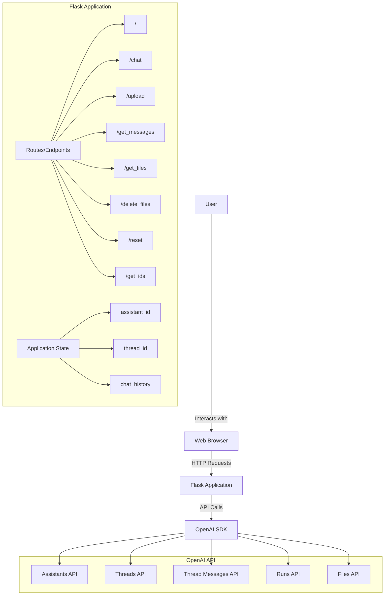
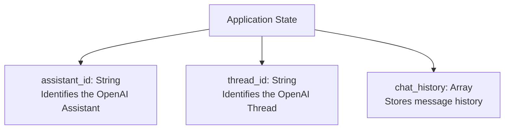
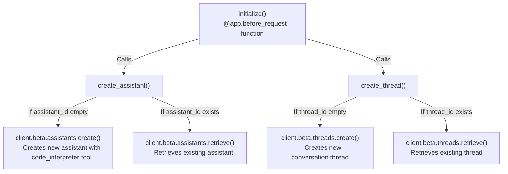
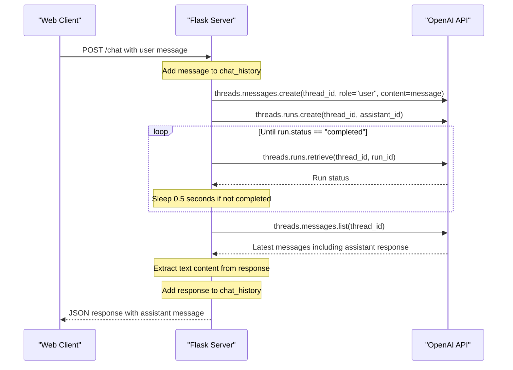
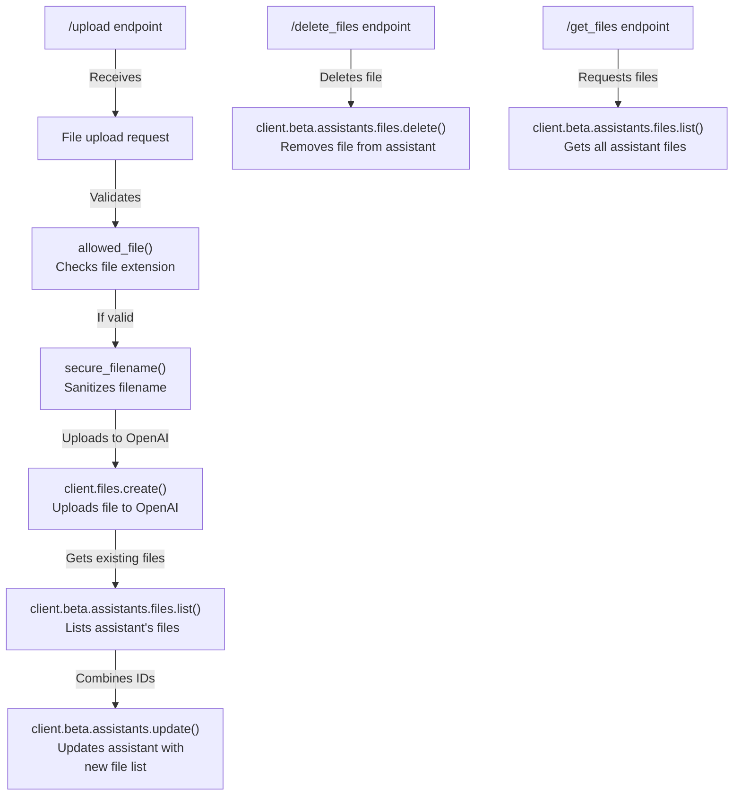
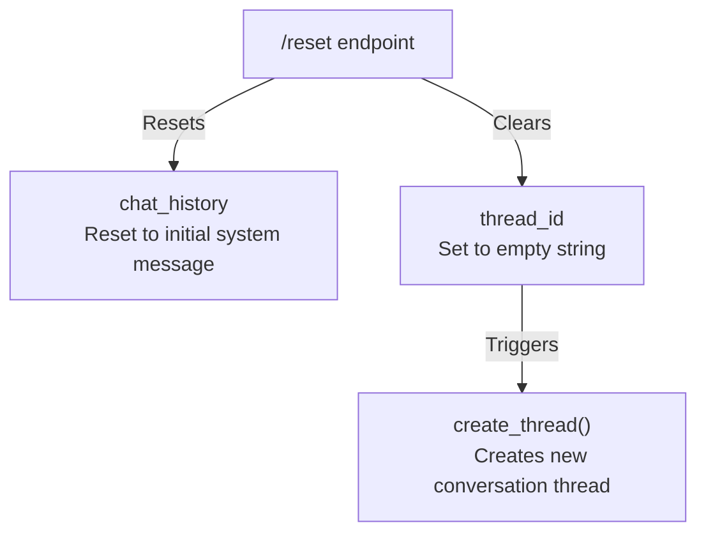
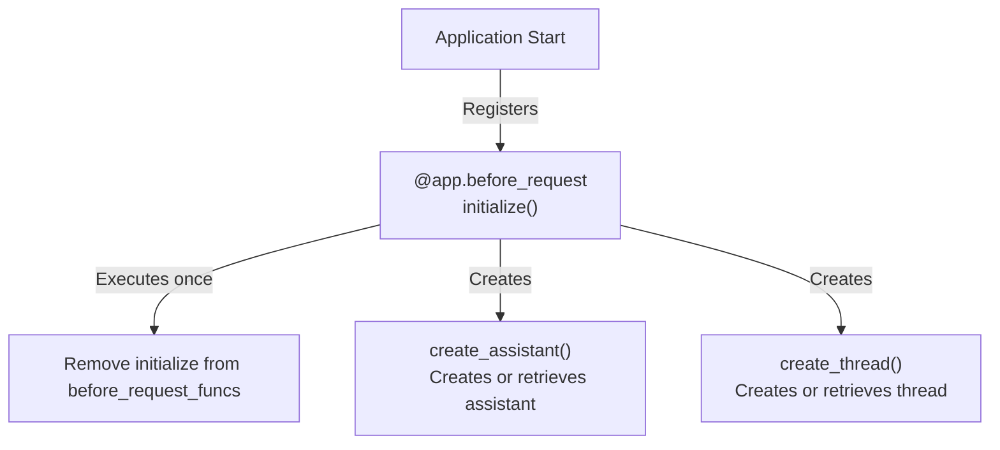
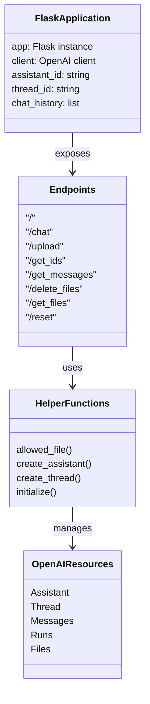
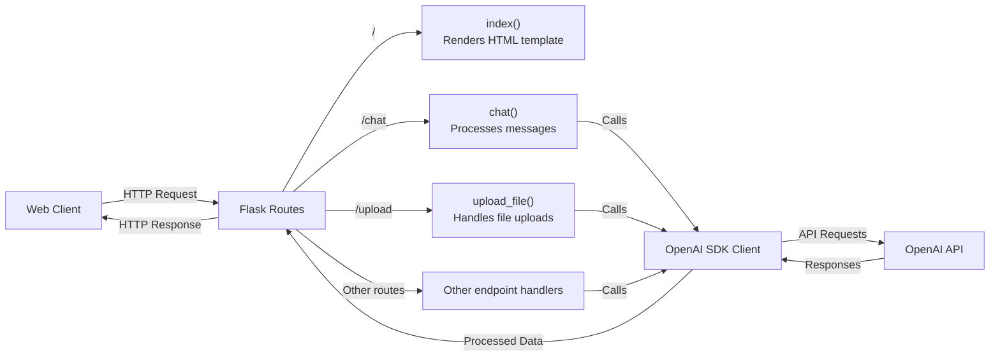

<!-- source: DeepWiki mcp.deepwiki.com · repo openai/openai-quickstart-python · extra page Application Architecture · fetched 2026-10-26 -->

# Application Architecture

Relevant source files

The following files were used as context for generating this wiki page:

- [examples/assistant-flask/app.py](examples/assistant-flask/app.py)

This document details the server-side architecture, endpoints, and backend logic of the Assistant Flask application. For information about the user interface implementation, see [User Interface](#3.1.2). For details on how file management is implemented, see [File Management](#3.1.3).

## Overview

The Assistant Flask application is a web-based implementation that demonstrates the OpenAI Assistants API capabilities. It is built using Flask as the web framework and integrates directly with OpenAI's Python SDK to create and manage assistants, threads, messages, and files.

Sources: [examples/assistant-flask/app.py:1-205]()

## Core Components

The application architecture consists of the following core components:

| Component | Description | Implementation |
|-----------|-------------|----------------|
| Flask Application | Web server that handles HTTP requests | [app.py:10]() |
| OpenAI Client | Interface to the OpenAI API | [app.py:6-8]() |
| Application State | Global variables storing application state | [app.py:14-19]() |
| Route Handlers | Functions to handle HTTP endpoints | [app.py:26-193]() |
| Initialization | Setup executed before the first request | [app.py:197-201]() |

Sources: [examples/assistant-flask/app.py:1-205]()

## Application State

The application maintains three key pieces of state:

Sources: [examples/assistant-flask/app.py:14-19]()

## Route Structure

The application exposes several HTTP endpoints to handle different aspects of the chat interface:

| Route | Method | Purpose | Implementation |
|-------|--------|---------|----------------|
| `/` | GET | Renders the main chat interface | [app.py:142-144]() |
| `/chat` | POST | Processes user messages and gets assistant responses | [app.py:147-182]() |
| `/upload` | POST | Handles file uploads to the assistant | [app.py:26-58]() |
| `/get_ids` | GET | Returns the current assistant and thread IDs | [app.py:61-63]() |
| `/get_messages` | GET | Retrieves message history from the thread | [app.py:66-79]() |
| `/delete_files` | POST | Removes files from the assistant | [app.py:82-92]() |
| `/get_files` | GET | Lists files attached to the assistant | [app.py:95-110]() |
| `/reset` | POST | Resets the conversation and creates a new thread | [app.py:185-193]() |

Sources: [examples/assistant-flask/app.py:26-193]()

## OpenAI Integration

The application creates and manages OpenAI resources upon initialization:

Sources: [examples/assistant-flask/app.py:113-139](), [examples/assistant-flask/app.py:197-201]()

## Chat Flow

The most important functionality is the chat flow, which integrates with OpenAI's Assistants API:

Sources: [examples/assistant-flask/app.py:147-182]()

## File Management Architecture

The application allows users to upload files and attach them to the OpenAI Assistant:

Sources: [examples/assistant-flask/app.py:26-58](), [examples/assistant-flask/app.py:82-110]()

## Reset Functionality

The application provides a way to reset the conversation:

Sources: [examples/assistant-flask/app.py:185-193]()

## Application Initialization

The application uses Flask's before_request hook to initialize the OpenAI resources:

Sources: [examples/assistant-flask/app.py:197-201]()

## Code Structure Mapping

This diagram maps the main application concepts to their implementations in the codebase:

Sources: [examples/assistant-flask/app.py:1-205]()

## Request-Response Flow

The following diagram illustrates the typical request-response flow through the application:

Sources: [examples/assistant-flask/app.py:26-193]()

## Summary

The Assistant Flask application is built on a Flask backend that integrates with OpenAI's Assistants API. It maintains state through global variables for the assistant and thread IDs, exposes HTTP endpoints to handle user interactions, and manages the flow of messages between the user and the OpenAI Assistant. The architecture supports file uploading and management, allowing users to share files with the assistant for analysis and reference.

---

