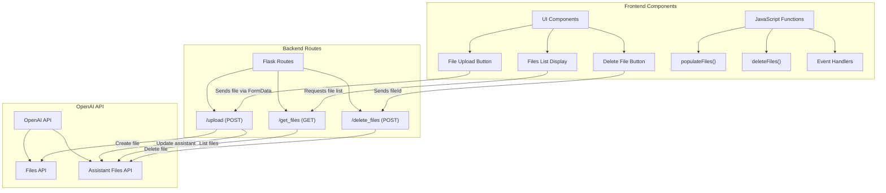
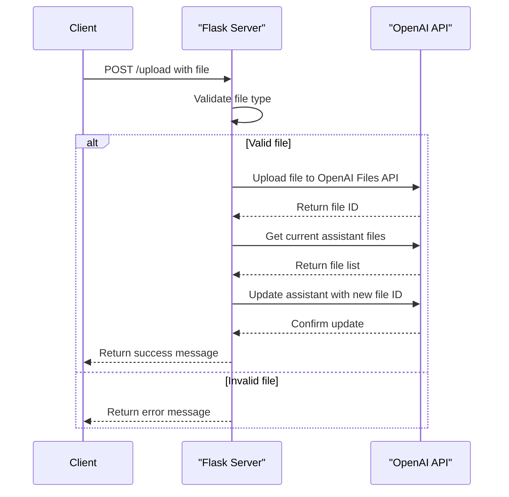
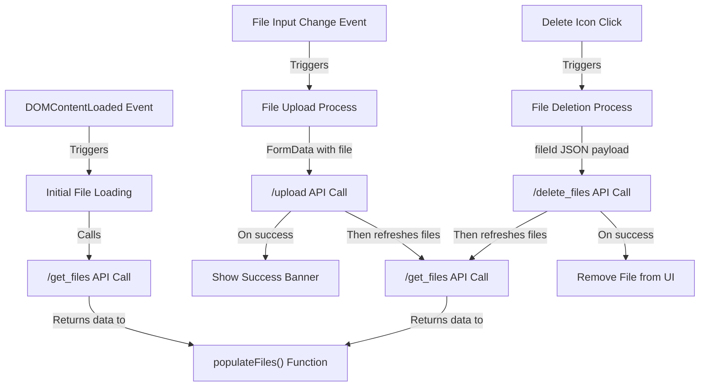
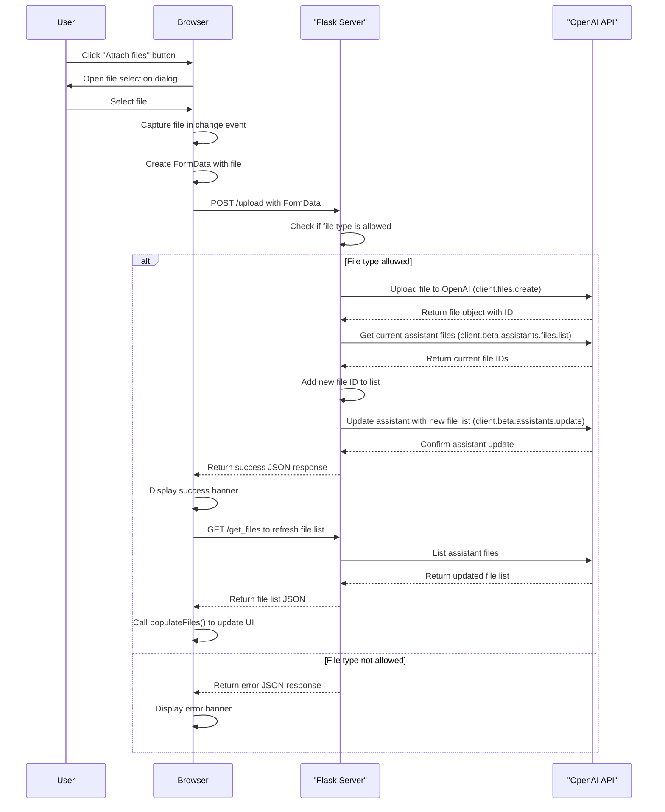
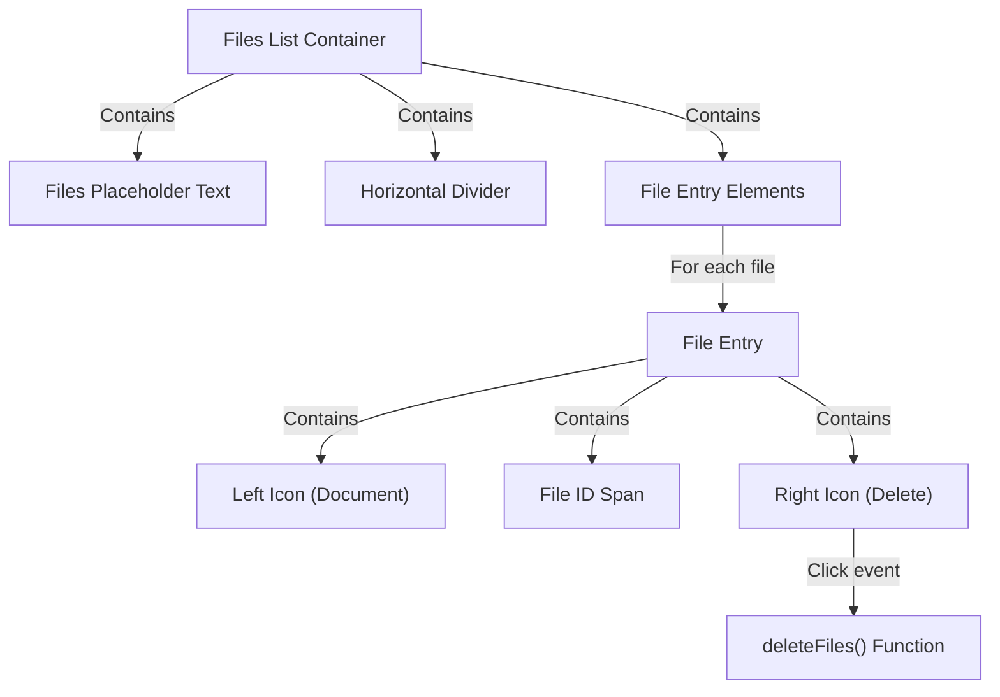

<!-- source: DeepWiki mcp.deepwiki.com · repo openai/openai-quickstart-python · extra page File Management · fetched 2026-10-26 -->

# File Management

<details>
<summary>Relevant source files</summary>

The following files were used as context for generating this wiki page:

- [examples/assistant-flask/app.py](examples/assistant-flask/app.py)
- [examples/assistant-flask/templates/index.html](examples/assistant-flask/templates/index.html)

</details>


## Purpose and Scope

This document details the file management system implemented in the Assistant Flask application. It covers the upload, display, and deletion of files that can be used by the OpenAI Assistant API's code interpreter. The file management functionality allows users to attach various document types to their conversation, enabling the AI assistant to process and analyze this data.

For information about the overall application architecture, see [Application Architecture](#3.1.1). For details about the user interface beyond file management, see [User Interface](#3.1.2).

## File Management Architecture

The file management system consists of backend routes that handle file operations and frontend components that allow users to interact with these files. Below is an architecture diagram showing the key components:



Sources: [examples/assistant-flask/app.py:26-110](), [examples/assistant-flask/templates/index.html:15-51](), [examples/assistant-flask/templates/index.html:82-162]()

## Supported File Types

The application restricts the types of files that can be uploaded to ensure compatibility with the OpenAI Assistant API's code interpreter.

```python
ALLOWED_EXTENSIONS = {"txt", "pdf", "png", "jpg", "jpeg", "gif", "csv"}
```

This whitelist helps maintain security and ensures that only files that can be processed by the code interpreter are uploaded.

Sources: [examples/assistant-flask/app.py:11](), [examples/assistant-flask/app.py:22-23]()

## Backend Implementation

### File Upload Endpoint

The backend handles file uploads through the `/upload` route, which:

1. Validates that a file was provided in the request
2. Checks if the file has an allowed extension
3. Uploads the file to OpenAI's servers using the Files API
4. Associates the file with the Assistant by adding its ID to the Assistant's file list
5. Returns a success or failure message to the client



Sources: [examples/assistant-flask/app.py:26-58]()

### File Listing Endpoint

The `/get_files` endpoint retrieves all files associated with the current Assistant:

1. Calls the OpenAI Assistant Files API to list files
2. Formats the file data for frontend consumption
3. Returns a JSON array of file objects with ID, object type, and creation timestamp

Sources: [examples/assistant-flask/app.py:95-110]()

### File Deletion Endpoint

The `/delete_files` endpoint removes a file from the Assistant:

1. Receives a file ID from the client
2. Uses the OpenAI Assistant Files API to delete the file association
3. Returns a success or failure message based on the deletion result

Sources: [examples/assistant-flask/app.py:82-92]()

## Frontend Implementation

### UI Components

The frontend includes several components for file management:

| Component | Purpose | HTML Location |
|-----------|---------|---------------|
| File Upload Section | Contains upload button and visual elements | Lines 15-51 |
| Files List | Displays uploaded files with delete options | Lines 23-24 |
| Upload Status Banner | Shows success/failure messages | Lines 11-13 |

Sources: [examples/assistant-flask/templates/index.html:15-51](), [examples/assistant-flask/templates/index.html:11-13](), [examples/assistant-flask/templates/index.html:23-24]()

### File Display and Management

The frontend uses JavaScript to handle file operations:

1. `populateFiles()` function renders the list of files in the UI
2. `deleteFiles()` function sends delete requests to the server
3. Event listeners capture file upload events and form submissions



Sources: [examples/assistant-flask/templates/index.html:108-162](), [examples/assistant-flask/templates/index.html:82-107](), [examples/assistant-flask/templates/index.html:213-262]()

## File Upload Flow

The following diagram illustrates the complete flow of file upload, from user action to association with the OpenAI Assistant:



Sources: [examples/assistant-flask/templates/index.html:213-262](), [examples/assistant-flask/app.py:26-58]()

## File Display Implementation

When files are successfully attached to the Assistant, they appear in the UI with the following structure:

1. File icon (document symbol)
2. File ID display
3. Delete icon for removing the file

The application uses JavaScript to dynamically generate these elements based on the response from the `/get_files` endpoint.



Sources: [examples/assistant-flask/templates/index.html:108-162]()

## Integration with Chat Interface

The file management system integrates with the chat interface, allowing the AI assistant to access and process uploaded files. When files are attached to the Assistant:

1. The OpenAI Assistant API includes them in the context for the code interpreter
2. The assistant can analyze, manipulate, and reference these files in its responses
3. If code interpreter is enabled, the assistant can perform operations on the files (e.g., data analysis on CSV files, image processing on image files)

This integration enables more powerful AI capabilities beyond simple text conversations.

Sources: [examples/assistant-flask/app.py:40-52](), [examples/assistant-flask/app.py:147-182]()

## Limitations and Considerations

- The application supports a limited set of file types as defined in `ALLOWED_EXTENSIONS`
- There's no limit on file size implemented in the application code, though OpenAI's API has its own limits
- Files are stored on OpenAI's servers, not locally
- File uploads are tied to the specific Assistant instance defined by `assistant_id`
- When resetting a chat thread, files remain attached to the Assistant

Sources: [examples/assistant-flask/app.py:11](), [examples/assistant-flask/app.py:40-52](), [examples/assistant-flask/app.py:185-193]()

---

