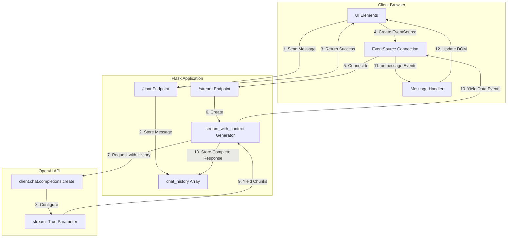
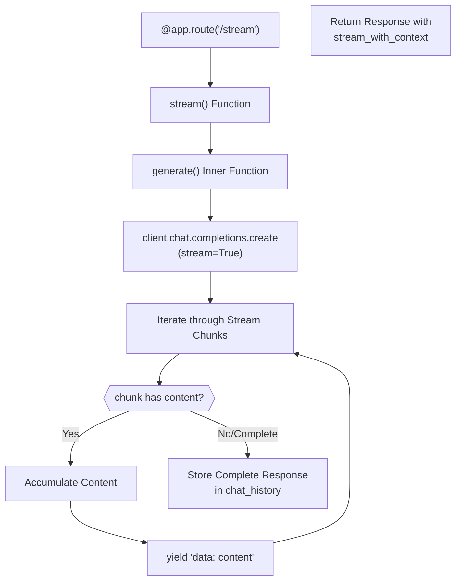
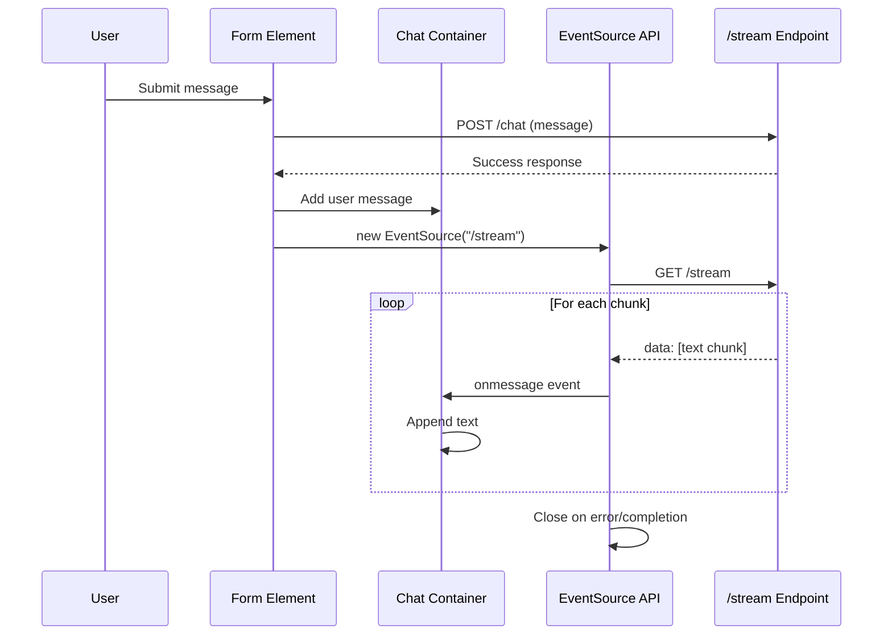
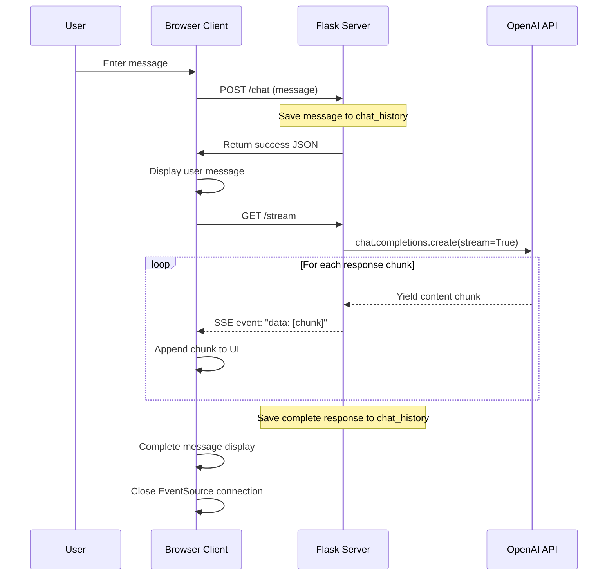

<!-- source: DeepWiki mcp.deepwiki.com · repo openai/openai-quickstart-python · extra page Streaming Responses · fetched 2026-10-26 -->

# Streaming Responses

<details>
<summary>Relevant source files</summary>

The following files were used as context for generating this wiki page:

- [examples/assistant-basic/assistant.py](examples/assistant-basic/assistant.py)
- [examples/chat-basic/app.py](examples/chat-basic/app.py)
- [examples/chat-basic/templates/index.html](examples/chat-basic/templates/index.html)

</details>


This document explains how the Chat Basic application implements streaming responses using Server-Sent Events (SSE) to display OpenAI's API responses incrementally as they are generated. For information about the complete Chat Basic application, see [Chat Basic Application](#3.2).

## Introduction to Streaming

Streaming responses allow the application to display text generated by the OpenAI API in real-time, as it's being produced, rather than waiting for the entire response to be completed. This creates a more interactive and responsive user experience, as users can see the AI assistant "thinking" and composing its response progressively.

The Chat Basic application demonstrates a complete implementation of streaming responses through:
1. Server-side streaming using Flask's streaming capabilities
2. OpenAI API streaming mode
3. Client-side handling with Server-Sent Events (SSE)

Sources: [examples/chat-basic/app.py:32-55]()

## Implementation Architecture



Sources: [examples/chat-basic/app.py:32-55](), [examples/chat-basic/templates/index.html:94-113]()

## Server-Side Implementation

### Flask Stream Route

The Flask application implements streaming through a dedicated `/stream` endpoint that establishes a Server-Sent Events connection:



The core implementation is found in the `/stream` route in `app.py`:

1. A generator function creates a streaming context
2. The OpenAI client is configured to stream responses
3. As chunks arrive, they're formatted as SSE events
4. The complete response is accumulated and stored in chat history
5. Flask's `stream_with_context` ensures the connection is properly maintained

Key technical details:
- Uses `mimetype="text/event-stream"` to define the proper content type for SSE
- Each data chunk is formatted according to the SSE protocol (`data: [content]\n\n`)
- Checks for `finish_reason="stop"` to detect end of stream

Sources: [examples/chat-basic/app.py:32-55]()

### OpenAI API Integration

The application uses OpenAI's streaming capability by setting `stream=True` in the API request:

```python
with client.chat.completions.create(
    model="gpt-3.5-turbo",
    messages=chat_history,
    stream=True,
) as stream:
    # Process stream chunks
```

This configuration tells OpenAI to send the response in chunks as they are generated, rather than waiting for the complete response.

Sources: [examples/chat-basic/app.py:37-41]()

## Client-Side Implementation

The frontend handles streaming responses using the EventSource API, which is specifically designed for Server-Sent Events:



Key components of the client-side implementation:

1. **EventSource Connection**: After submitting a message and receiving a success response, the client establishes an EventSource connection to `/stream`

2. **Message Handling**: The `onmessage` event handler processes each chunk:
   - Appends new text to the existing message
   - Handles formatting issues (adds spaces after punctuation if needed)
   - Auto-scrolls to keep the latest content visible

3. **Error Handling**: The `onerror` handler closes the connection if an error occurs

Sources: [examples/chat-basic/templates/index.html:94-113]()

## Complete Data Flow

Here's the complete flow of data through the system when a user sends a message:



Sources: [examples/chat-basic/app.py:25-55](), [examples/chat-basic/templates/index.html:72-115]()

## Code Details

### Server-Side Streaming Logic

The core streaming logic in `app.py` consists of:

1. Creating a generator function that yields SSE-formatted chunks
2. Accumulating the complete response
3. Storing the result in chat history after streaming completes

Key code details:
- The `generate()` inner function yields chunks in the SSE format
- The accumulated response is stored in chat history only after streaming completes
- Content is only sent if it exists (`chunk.choices[0].delta.content`)

Sources: [examples/chat-basic/app.py:34-53]()

### Client-Side EventSource Handling

The frontend JavaScript creates an EventSource connection and processes events:

```javascript
// Open a connection to receive streamed responses
const eventSource = new EventSource("/stream");
eventSource.onmessage = function (event) {
  // Process the chunk and update UI
};
eventSource.onerror = function () {
  eventSource.close();
};
```

The client also performs text formatting to ensure the chunks display properly, handling cases where punctuation might need spaces after them.

Sources: [examples/chat-basic/templates/index.html:94-113]()

## Technical Considerations

### Performance Implications

Streaming responses provide several advantages:

1. **Perceived Responsiveness**: Users see content immediately rather than waiting for complete responses
2. **Reduced Time-to-First-Byte**: First content appears much faster
3. **Efficient Resource Use**: Content processing can begin before transmission completes

### Server Memory Management

The Flask implementation uses `stream_with_context` to ensure that:
- The request context is preserved throughout the streaming process
- Memory is managed efficiently as chunks are yielded
- The connection is properly handled even if the client disconnects

Sources: [examples/chat-basic/app.py:55]()

### Browser Compatibility

Server-Sent Events are supported in all modern browsers. The implementation uses standard `EventSource` API without requiring polyfills or special configurations.

## Implementation Differences from Assistant Examples

The streaming implementation in the Chat Basic example differs from the Assistant examples in the repository:

| Feature | Chat Basic Streaming | Assistant Applications |
|---------|---------------------|------------------------|
| API Used | Chat Completions API | Assistants API |
| Stream Mechanism | Server-Sent Events | Polling for status |
| Response Time | Immediate streaming | Wait for completion |
| Implementation | Direct stream handling | Run and check status |

For information about the complete Chat Basic application UI, see [User Interface](#3.2.2).

Sources: [examples/chat-basic/app.py:32-55](), [examples/assistant-basic/assistant.py:57-75]()

---

