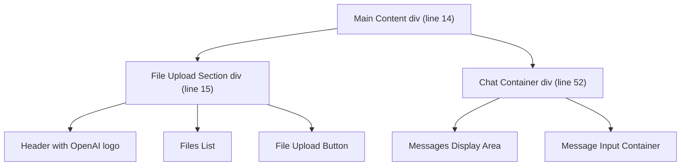
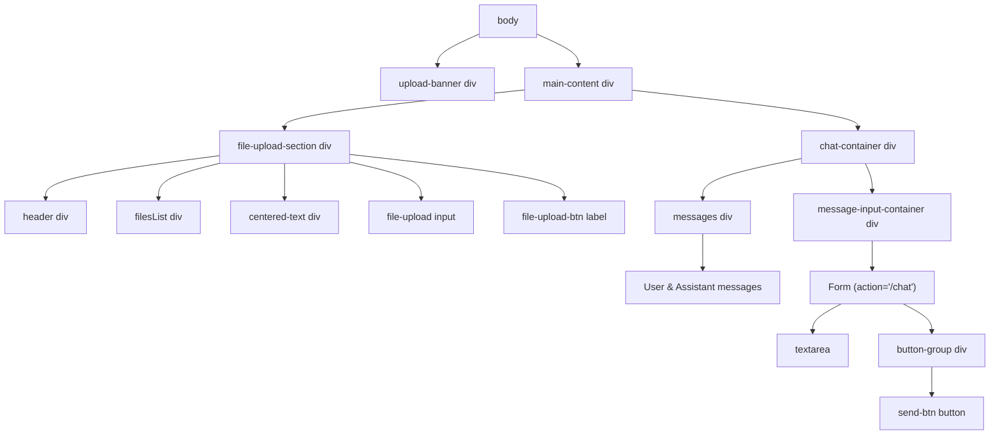
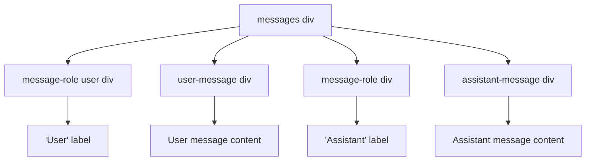
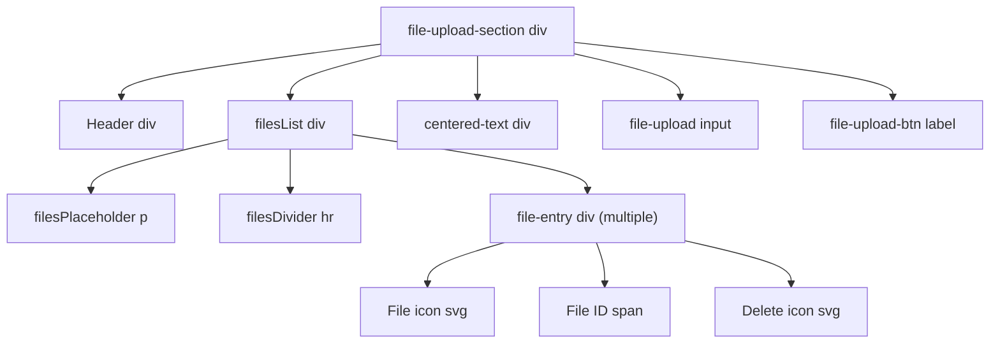
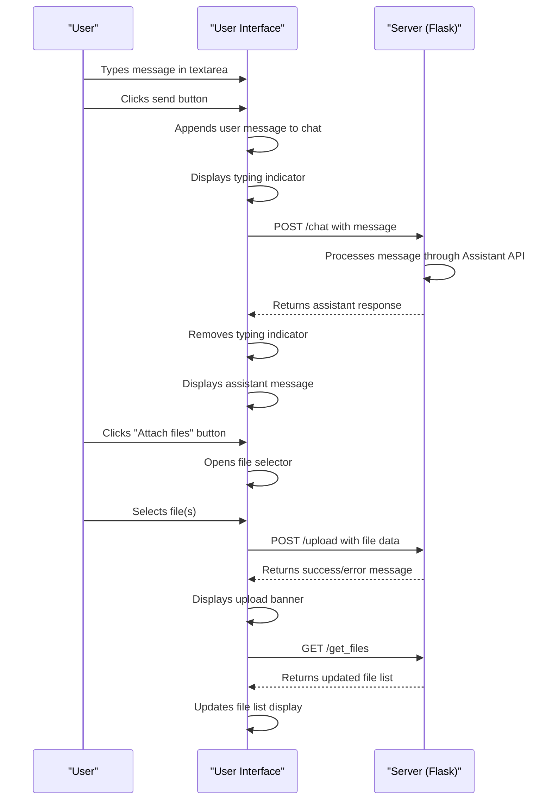
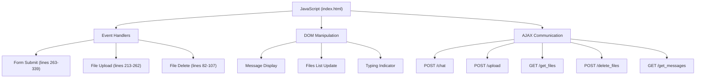

<!-- source: DeepWiki mcp.deepwiki.com · repo openai/openai-quickstart-python · extra page User Interface · fetched 2026-10-26 -->

# User Interface

Relevant source files

The following files were used as context for generating this wiki page:

- [examples/assistant-flask/static/icon.png](examples/assistant-flask/static/icon.png)
- [examples/assistant-flask/static/main.css](examples/assistant-flask/static/main.css)
- [examples/assistant-flask/templates/index.html](examples/assistant-flask/templates/index.html)

This document details the frontend components, styling, and user interactions in the Assistant Flask application, a web-based interface that demonstrates OpenAI's Assistant API capabilities. For information on the server-side implementation, see [Application Architecture](#3.1.1), and for details on how files are handled, see [File Management](#3.1.3).

## Layout Structure

The Assistant Flask application interface is divided into two main sections within a flexbox-based layout:

Sources:
- [examples/assistant-flask/templates/index.html:14-80]()
- [examples/assistant-flask/static/main.css:352-358]()

The HTML structure maintains a clear separation between the file management area and the conversation interface. The main content div uses flexbox to arrange these elements side by side, creating a modern chat application layout.

## Component Hierarchy

The following diagram illustrates the detailed hierarchy of UI components:

Sources:
- [examples/assistant-flask/templates/index.html:11-80]()
- [examples/assistant-flask/static/main.css:49-145]()

## Message Display System

Messages are rendered in the chat interface with distinct styling based on the sender:

| Feature | User Messages | Assistant Messages |
|---------|--------------|-------------------|
| Alignment | Right-aligned | Left-aligned |
| CSS Class | `user-message` | `assistant-message` |
| Background | Light gray (#f7f7f8) | Light green (#ebfaeb) |
| Label | "User" | "Assistant" |
| DOM Structure | Role div + message div | Role div + message div |

Sources:
- [examples/assistant-flask/templates/index.html:53-66]()
- [examples/assistant-flask/static/main.css:64-82]()
- [examples/assistant-flask/static/main.css:285-294]()

## File Management Interface

The file management section displays uploaded files and provides controls for file operations:

Files are represented with:
- Document icon SVG (lines 140-143)
- File ID text display
- Delete icon with click handler to remove files

When no files are present, a centered SVG icon and explanatory text appear, encouraging users to upload files for the code interpreter.

Sources:
- [examples/assistant-flask/templates/index.html:15-51]()
- [examples/assistant-flask/templates/index.html:108-163]()
- [examples/assistant-flask/static/main.css:309-317]()
- [examples/assistant-flask/static/main.css:371-396]()

## User Interaction Flow

This sequence diagram illustrates the typical user journey through the interface:

Sources:
- [examples/assistant-flask/templates/index.html:165-211]() (Initial loading)
- [examples/assistant-flask/templates/index.html:213-262]() (File upload handling)
- [examples/assistant-flask/templates/index.html:263-339]() (Message handling)

## Styling System

The application's visual design is implemented through a comprehensive CSS framework:

| Component | CSS Classes | Key Properties |
|-----------|-------------|----------------|
| Main Layout | `main-content`, `file-upload-section`, `chat-container` | Flexbox, height:100vh |
| Message Bubbles | `user-message`, `assistant-message` | Border-radius, padding, max-width:80% |
| Message Input | `message-input-container`, `textarea` | Position:relative, resize:vertical |
| Buttons | `send-btn`, `file-upload-btn` | Background:#10a37f, border-radius:4px |
| File Display | `file-entry`, `file-icon` | Display:flex, justify-content:space-between |
| Notifications | `upload-banner`, `typing-indicator` | Position:fixed, animation |

Custom fonts are loaded from OpenAI's CDN:
- ColfaxAI Regular and Bold (lines 1-17)

The UI uses a primarily white background with accent colors for interactive elements and messaging.

Sources:
- [examples/assistant-flask/static/main.css:1-396]()

## Frontend JavaScript Components

Client-side JavaScript handles several critical aspects of the interface:

Key JavaScript functions include:
- `deleteFiles()` - Removes files via API call (lines 82-107)
- `populateFiles()` - Updates file list display (lines 108-163)
- Event handlers for message submission and file uploads (lines 213-339)
- Dynamic message rendering with typing indicators (lines 322-335)

Sources:
- [examples/assistant-flask/templates/index.html:81-340]()

## API Integration Points

The frontend connects to the Flask backend through these key endpoints:

| Endpoint | Method | Purpose | Implementation |
|----------|--------|---------|---------------|
| `/chat` | POST | Send user message and receive assistant response | Lines 263-339 |
| `/upload` | POST | Upload files to the assistant | Lines 213-262 |
| `/get_files` | GET | Retrieve current file list | Lines 206-210 |
| `/delete_files` | POST | Remove a file from the assistant | Lines 82-107 |
| `/get_messages` | GET | Load existing chat history | Lines 167-191 |
| `/get_ids` | GET | Retrieve assistant and thread IDs | Lines 193-204 |

All API requests use fetch() with appropriate JSON handling for a seamless single-page application experience.

Sources:
- [examples/assistant-flask/templates/index.html:81-211]() (API endpoints and handlers)

## Responsive Design Features

The application adapts to different screen sizes through:
- Percentage-based sizing (`chat-container` width:70%, max-width:600px)
- Flexible layouts using CSS flexbox (`display:flex`, `flex-direction`)
- Relative width calculations (`width:calc(100% - 20px)`)
- Overflow handling for scrollable content areas (`overflow-y:auto`)

These features ensure the interface remains usable across desktop and mobile devices.

Sources:
- [examples/assistant-flask/static/main.css:26-35]() (Body styling)
- [examples/assistant-flask/static/main.css:49-62]() (Chat container)
- [examples/assistant-flask/static/main.css:352-365]() (Main content layout)

## Special UI Elements

Several specialized UI components enhance the user experience:

1. **Typing Indicator** - Shows animated dots when the assistant is generating a response (lines 164-190)
2. **Upload Banner** - Temporary notification that appears after file operations (lines 11-13, 230-256)
3. **File Icons** - SVG graphics that represent document types (lines 140-143)
4. **Delete Controls** - Interactive elements for file management (lines 149-155)

These elements provide visual feedback and improve the application's usability.

Sources:
- [examples/assistant-flask/static/main.css:164-190]() (Typing indicator)
- [examples/assistant-flask/static/main.css:202-212]() (Upload banner)
- [examples/assistant-flask/templates/index.html:230-256]() (Banner implementation)

The user interface design balances visual simplicity with functional completeness, creating an accessible demonstration of the OpenAI Assistant API's capabilities within a web application context.

---

