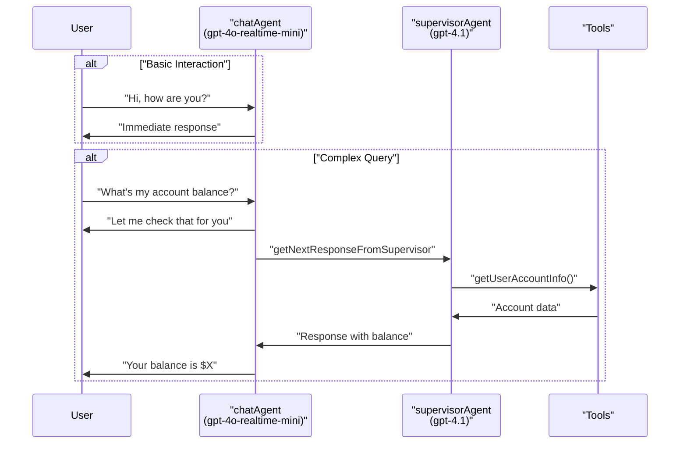
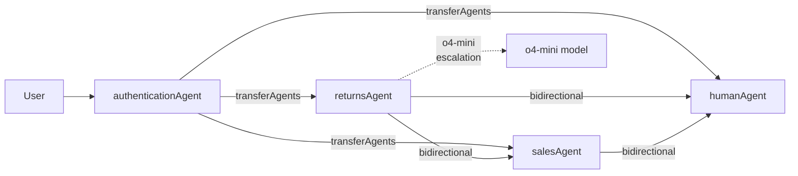
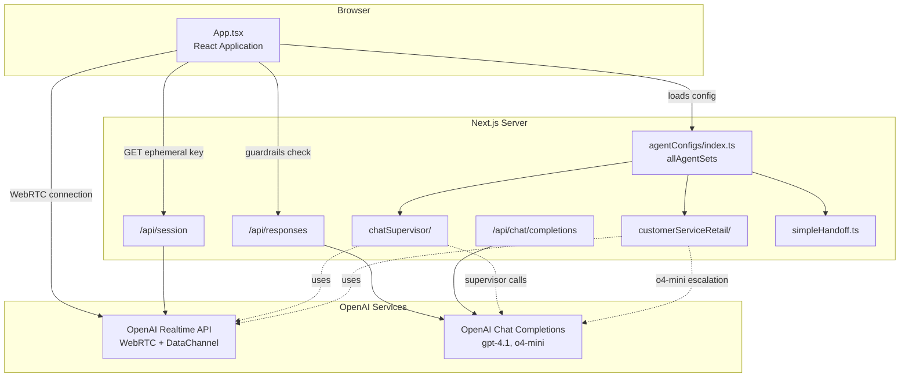

<!-- source: DeepWiki mcp.deepwiki.com · repo openai/openai-realtime-agents · page 1 Overview · fetched 2026-10-26 -->

# Overview

<details>
<summary>Relevant source files</summary>

The following files were used as context for generating this wiki page:

- [README.md](README.md)
- [public/screenshot_handoff.png](public/screenshot_handoff.png)

</details>


The OpenAI Realtime Agents repository is a reference implementation demonstrating advanced voice agent patterns using the [OpenAI Realtime API](https://platform.openai.com/docs/guides/realtime) and the [OpenAI Agents SDK](https://github.com/openai/openai-agents-js). It showcases two distinct architectural approaches for building intelligent voice assistants: **Chat-Supervisor** and **Sequential Handoff**.

The system is implemented as a Next.js web application that provides a complete voice agent framework with WebRTC-based real-time communication, agent orchestration, content moderation guardrails, and comprehensive event logging.

**Sources:** [README.md:1-21]()

## What Problem Does This Solve?

Building production-quality voice agents presents several challenges:

1. **Balancing Latency and Intelligence**: Voice interactions demand sub-second response times, but complex reasoning tasks require more powerful models that introduce latency.
2. **Managing Complex Conversations**: Real-world scenarios often require multiple specialized capabilities that are difficult to handle in a single "god agent" without degrading performance.
3. **Integration Complexity**: Connecting real-time voice communication with AI models, tool execution, and safety systems requires careful architecture.

This repository demonstrates two proven architectural patterns that address these challenges, providing a starting point for developers building their own voice agent applications.

**Sources:** [README.md:18-21](), [README.md:64-71](), [README.md:83-85]()

## The Two Agent Patterns

### Pattern 1: Chat-Supervisor

The Chat-Supervisor pattern addresses the latency-intelligence trade-off by using two agents working in tandem:

- **Chat Agent** (`gpt-4o-realtime-mini`): Provides immediate responses for basic interactions (greetings, information collection, casual conversation)
- **Supervisor Agent** (`gpt-4.1`): Handles complex tasks requiring tool calls or sophisticated reasoning

**How It Works:**



The Chat-Supervisor pattern is configured in [src/app/agentConfigs/chatSupervisor/index.ts]() with the supervisor logic in [src/app/agentConfigs/chatSupervisor/supervisorAgent.ts]().

**Key Benefits:**
- Maintains conversational flow with immediate responses
- Leverages high-intelligence models for complex tasks
- Easy migration path from existing text-based chat agents
- Cost-effective by using `realtime-mini` for most interactions

**Sources:** [README.md:30-81](), [src/app/agentConfigs/chatSupervisor/index.ts](), [src/app/agentConfigs/chatSupervisor/supervisorAgent.ts]()

### Pattern 2: Sequential Handoff

The Sequential Handoff pattern uses specialized agents that transfer conversations between each other based on user intent, creating an agent graph:



Each agent is defined using the `RealtimeAgent` class from `@openai/agents/realtime`. Agents specify their `handoffs` array to define which agents they can transfer to. The system automatically generates `transferAgents` tools based on the `downstreamAgents` property.

**Example Configuration:**

```typescript
// From src/app/agentConfigs/simpleHandoff.ts
export const haikuWriterAgent = new RealtimeAgent({
  name: 'haikuWriter',
  handoffDescription: 'Agent that writes haikus.',
  instructions: 'Ask the user for a topic, then reply with a haiku about that topic.',
  tools: [],
  handoffs: [],
});

export const greeterAgent = new RealtimeAgent({
  name: 'greeter',
  handoffDescription: 'Agent that greets the user.',
  instructions: "Please greet the user and ask them if they'd like a haiku. If yes, hand off to the 'haikuWriter' agent.",
  tools: [],
  handoffs: [haikuWriterAgent],
});
```

**Key Benefits:**
- Modularity through specialized agents with focused instructions
- Avoids "god agent" problem where all capabilities in one agent degrades performance
- Natural conversation flow as user needs evolve
- Can escalate to reasoning models (e.g., `o4-mini`) for high-stakes decisions

**Sources:** [README.md:83-146](), [src/app/agentConfigs/simpleHandoff.ts](), [src/app/agentConfigs/customerServiceRetail/index.ts]()

## System Architecture

**High-Level Component Architecture:**



**Data Flow:**

| Stage | Component | Action | Code Reference |
|-------|-----------|--------|----------------|
| **1. Initialization** | Browser | User loads page with `?agentConfig=chatSupervisor` | [src/app/page.tsx]() |
| **2. Agent Loading** | `App.tsx` | Loads agent set from `allAgentSets[agentConfig]` | [src/app/agentConfigs/index.ts]() |
| **3. Authentication** | `/api/session` | Creates ephemeral token with OpenAI Realtime API | [src/app/api/session/route.ts]() |
| **4. Connection** | `useRealtimeSession` | Establishes WebRTC with `OpenAIRealtimeWebRTC` transport | [src/app/hooks/useRealtimeSession.ts]() |
| **5. Communication** | WebRTC | User speaks → audio stream → OpenAI → response audio | Realtime API |
| **6. Tool Calls** | Agent | Calls tools (e.g., `transferAgents`, `getUserAccountInfo`) | Agent config `toolLogic` |
| **7. Guardrails** | `/api/responses` | Checks content against moderation policies | [src/app/api/responses/route.ts]() |

**Sources:** [README.md:1-30](), [src/app/page.tsx](), [src/app/App.tsx](), [src/app/agentConfigs/index.ts]()

## Technology Stack

The system is built on several key technologies:

**Core Framework:**
- **Next.js**: Full-stack React framework serving both the web UI and API routes
- **TypeScript**: Type-safe implementation across the entire codebase
- **React**: Component-based UI with context providers for state management

**OpenAI Integration:**
- **OpenAI Realtime API**: WebRTC-based voice communication with `gpt-4o-realtime-mini` model
- **OpenAI Agents SDK** (`@openai/agents/realtime`): Framework for defining and orchestrating agents
- **OpenAI Chat Completions API**: Text-based processing with `gpt-4.1` and `o4-mini` models

**Communication Layer:**
- **WebRTC**: Real-time audio streaming with sub-second latency
- **DataChannel** (`oai-events`): Event-based communication for agent commands and transcriptions
- **Codec Support**: Opus (48kHz wide-band), PCMU/PCMA (8kHz narrow-band)

**Key Components Mapping:**

| System Concern | Implementation | File Path |
|----------------|----------------|-----------|
| **Agent Registry** | `allAgentSets` object with agent configurations | [src/app/agentConfigs/index.ts]() |
| **Session Management** | `useRealtimeSession` hook with `RealtimeSession` class | [src/app/hooks/useRealtimeSession.ts]() |
| **Conversation State** | `TranscriptContext` with `TranscriptProvider` | [src/app/contexts/TranscriptContext.tsx]() |
| **Event Logging** | `EventContext` with client/server event tracking | [src/app/contexts/EventContext.tsx]() |
| **Content Moderation** | Guardrails system with `guardrail_tripped` events | [src/app/App.tsx:300-400]() (approx) |
| **Type Definitions** | `AgentConfig`, `TranscriptItem`, `ServerEvent` interfaces | [src/app/types.ts]() |

**Sources:** [README.md:5-14](), [README.md:24](), [src/app/agentConfigs/index.ts](), [src/app/types.ts]()

## Key System Components

| Component | Purpose | Implementation |
|-----------|---------|----------------|
| **Agent Configuration Registry** | Central management of agent scenarios | `src/app/agentConfigs/index.ts` with `defaultAgentSetKey` |
| **Session Management** | WebRTC connection and token handling | `/api/session` route with OpenAI Realtime API integration |
| **Guardrail System** | Content moderation and safety validation | Integrated in `App.tsx` with `guardrail_tripped` events |
| **Event Logging** | Real-time event tracking and debugging | Client and server event streams with full payload inspection |
| **Tool Execution** | Agent capability extension | Custom tool logic with `toolLogic` implementations |

**Sources:** [README.md:209-211](), [README.md:213-215](), [README.md:216-221]()

## Agent Pattern Overview

### Chat-Supervisor Pattern
Combines a fast realtime agent (`gpt-4o-realtime-mini`) for immediate responses with an intelligent supervisor (`gpt-4.1`) for complex processing. The chat agent handles basic interactions and defers sophisticated tasks using the `getNextResponseFromSupervisor` tool.

### Sequential Handoff Pattern  
Implements specialized agents that transfer users between them using the `agent_transfer` tool. Each `RealtimeAgent` defines `handoffs` and `handoffDescription` properties to enable seamless user routing based on intent recognition.

**Sources:** [README.md:18-21](), [README.md:64-71](), [README.md:92-116]()

## Integration with OpenAI Services

The system integrates multiple OpenAI services through a unified architecture:

- **Realtime API**: WebRTC-based voice communication using `gpt-4o-realtime-mini`
- **Chat Completions**: Text-based processing with `gpt-4.1` and `o4-mini` models
- **OpenAI Agents SDK**: Unified interface for agent definition and orchestration

The `/api/session` route manages ephemeral token creation, while `/api/responses` proxies chat completion requests for supervisor agents and escalation scenarios.

**Sources:** [README.md:5-14](), [README.md:119-123](), [README.md:162-163]()

## Development and Extension

The repository provides templates for creating custom voice applications. New agent configurations can be added to `src/app/agentConfigs/index.ts` for automatic UI integration. The system supports custom tool logic implementation and includes a metaprompt system for voice agent development at `src/app/agentConfigs/voiceAgentMetaprompt.txt`.

For detailed setup instructions, see [Project Setup](#5.1). For agent pattern implementation details, see [Agent Patterns and Core Concepts](#2). For example implementations, see [Example Agent Implementations](#3).

**Sources:** [README.md:208-212](), [README.md:22-29](), [README.md:222-225]()

---

