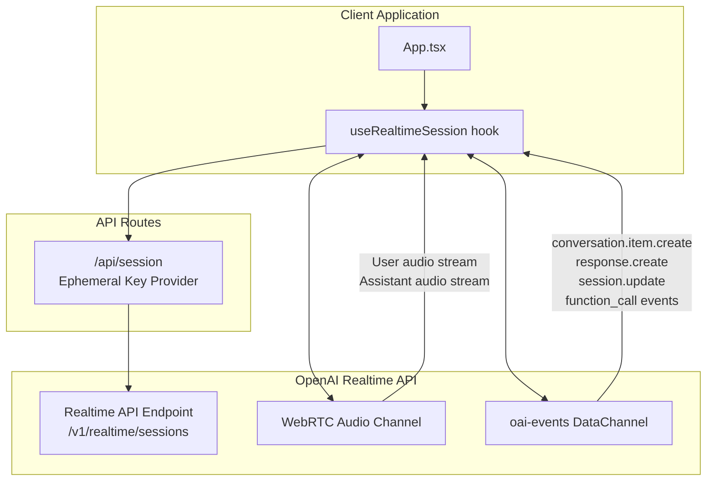
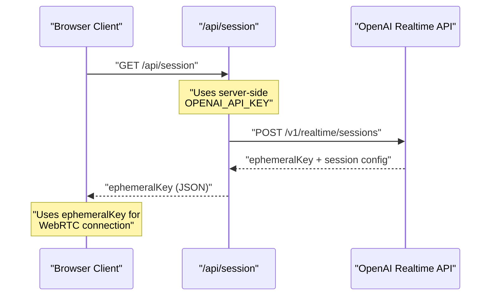
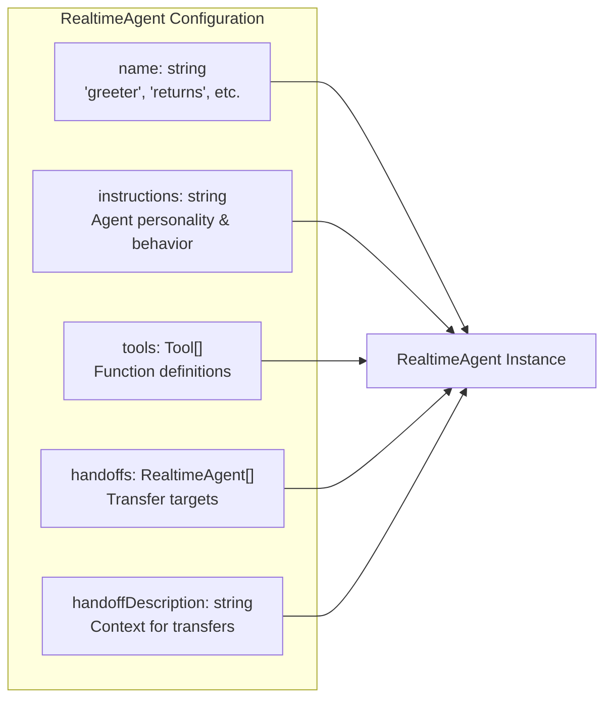
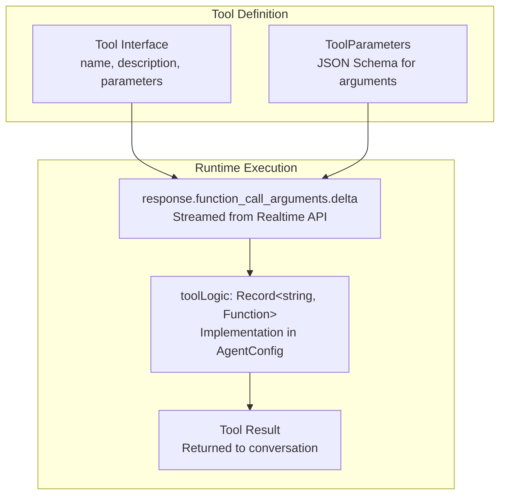
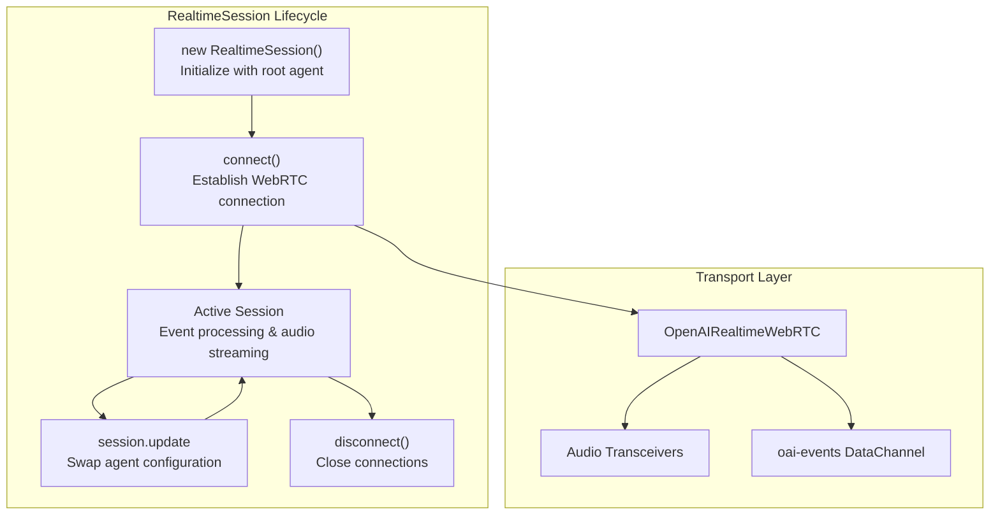
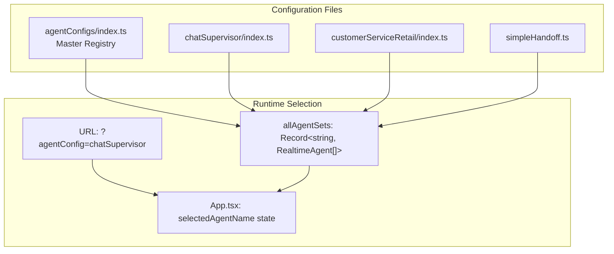
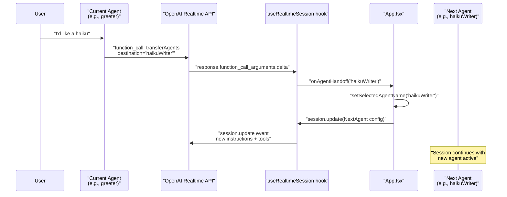
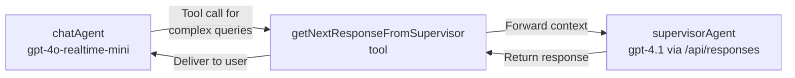
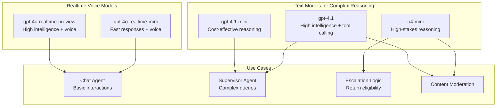

<!-- source: DeepWiki mcp.deepwiki.com · repo openai/openai-realtime-agents · page 1.1 What Are Realtime Agents? · fetched 2026-10-26 -->

# What Are Realtime Agents?

<details>
<summary>Relevant source files</summary>

The following files were used as context for generating this wiki page:

- [README.md](README.md)
- [public/screenshot_handoff.png](public/screenshot_handoff.png)
- [src/app/types.ts](src/app/types.ts)

</details>


## Purpose and Scope

This page explains the foundational concepts behind realtime AI agents, the OpenAI Realtime API, and the OpenAI Agents SDK. Understanding these building blocks is essential for working with the agent patterns demonstrated in this project.

For information about the specific agent patterns implemented (Chat-Supervisor and Sequential Handoff), see [Agent Patterns](#2). For the technical details of how real-time sessions are managed in the codebase, see [Real-time Session Management](#3.1).

## Core Concept: Real-time AI Agents

Real-time AI agents are conversational AI systems that interact with users through voice with minimal latency. Unlike traditional text-based chatbots or voice assistants that use a "stitched" architecture (speech-to-text → text processing → text-to-speech), real-time agents handle audio streams directly, enabling:

- **Sub-second response latency**: Agents can begin responding while the user is still speaking
- **Natural interruptions**: Users can interrupt the agent mid-response
- **Voice activity detection**: Automatic detection of when users start and stop speaking
- **Streaming interactions**: Both input and output are processed as continuous streams rather than discrete turns

**Sources:** [README.md:1-20]()

## The OpenAI Realtime API

The OpenAI Realtime API is a WebRTC-based service that enables low-latency, bidirectional audio streaming with AI models. It consists of two primary communication channels:

### Communication Architecture



**Sources:** [README.md:1-20]()

### WebRTC Audio Channel

The audio channel handles bidirectional voice streaming using WebRTC protocols. The system supports multiple audio codecs:

| Codec | Sample Rate | Bandwidth | Use Case |
|-------|-------------|-----------|----------|
| `opus` | 48 kHz | Wide-band | High-quality voice (default) |
| `pcmu` | 8 kHz | Narrow-band | Testing telephony scenarios |
| `pcma` | 8 kHz | Narrow-band | Testing telephony scenarios |

**Sources:** Diagram 1 analysis, Diagram 3 analysis

### oai-events DataChannel

The `oai-events` DataChannel is a WebRTC data channel that carries control messages and events. Key event types include:

- **`conversation.item.create`**: Send user messages or add items to the conversation
- **`response.create`**: Request the agent to generate a response
- **`session.update`**: Update agent configuration (instructions, tools, voice)
- **`response.audio_transcript.delta`**: Receive streaming transcriptions
- **`response.text.delta`**: Receive streaming text responses
- **`response.function_call_arguments.delta`**: Receive tool call arguments

The DataChannel enables dynamic session reconfiguration without disconnecting the audio stream, which is critical for agent handoffs.

**Sources:** Diagram 3 analysis

### Authentication Model

The API uses ephemeral session keys to secure connections:



This pattern keeps the permanent `OPENAI_API_KEY` server-side while allowing clients to establish WebRTC connections with short-lived credentials.

**Sources:** Diagram 3 analysis

## The OpenAI Agents SDK

The OpenAI Agents SDK ([`@openai/agents`](https://github.com/openai/openai-agents-js)) provides high-level abstractions for building, managing, and deploying AI agents that use the Realtime API. This project uses three core classes from the SDK:

### RealtimeAgent Class

The `RealtimeAgent` class defines the behavior and capabilities of an individual agent. Agent definitions are declarative configurations that specify:



**Example from the codebase:**

[README.md:96-103]() shows a simple agent definition:

```typescript
export const haikuWriterAgent = new RealtimeAgent({
  name: 'haikuWriter',
  handoffDescription: 'Agent that writes haikus.',
  instructions: 'Ask the user for a topic, then reply with a haiku about that topic.',
  tools: [],
  handoffs: [],
});
```

**Sources:** [README.md:93-116](), Diagram 4 analysis

### Agent Configuration Components

| Component | Type | Purpose | Location in Code |
|-----------|------|---------|------------------|
| `name` | `string` | Unique identifier for the agent | [types.ts:45]() |
| `instructions` | `string` | Natural language instructions defining agent behavior | [types.ts:47]() |
| `tools` | `Tool[]` | Array of function definitions available to the agent | [types.ts:48]() |
| `toolLogic` | `Record<string, Function>` | Implementation functions for tool calls | [types.ts:49-52]() |
| `handoffs` | `RealtimeAgent[]` | Array of agents this agent can transfer to | [README.md:111]() |
| `handoffDescription` | `string` | Context provided to other agents for transfer decisions | [README.md:98]() |

**Sources:** [types.ts:44-57](), [README.md:93-116]()

### Tool System

Tools enable agents to perform actions beyond text generation. The tool system consists of three parts:



**Tool Definition Structure:**

[types.ts:37-42]() defines the `Tool` interface:

```typescript
export interface Tool {
  type: "function";
  name: string;
  description: string;
  parameters: ToolParameters;
}
```

**Tool Parameters:**

[types.ts:30-35]() defines the `ToolParameters` interface, which uses JSON Schema format:

```typescript
export interface ToolParameters {
  type: string;
  properties: Record<string, ToolParameterProperty>;
  required?: string[];
  additionalProperties?: boolean;
}
```

**Tool Logic Implementation:**

[types.ts:49-52]() defines the `toolLogic` property in `AgentConfig`:

```typescript
toolLogic?: Record<
  string,
  (args: any, transcriptLogsFiltered: TranscriptItem[], addTranscriptBreadcrumb?: (title: string, data?: any) => void) => Promise<any> | any
>;
```

Tool logic functions receive:
- `args`: The parsed arguments from the tool call
- `transcriptLogsFiltered`: Current conversation transcript
- `addTranscriptBreadcrumb`: Optional function to log nested tool calls

**Sources:** [types.ts:19-52](), [README.md:210]()

### RealtimeSession Class

The `RealtimeSession` class manages the lifecycle of a real-time conversation session. It coordinates:

- Establishing and maintaining the WebRTC connection
- Routing events between the client and Realtime API
- Managing the active agent and handling agent handoffs
- Applying session updates (voice, temperature, etc.)



In this codebase, the `RealtimeSession` is managed by the `useRealtimeSession` hook, which is documented in [Real-time Session Management](#3.1).

**Sources:** Diagram 3 analysis, Diagram 4 analysis

## Agent Configuration Registry

Agent configurations are organized in a registry system that maps scenario names to agent sets. An **agent set** is simply an array of `RealtimeAgent[]` that participate in a scenario.



**Registry Structure:**

The registry exports `allAgentSets` which maps scenario names to agent arrays:

```typescript
// From agentConfigs/index.ts (conceptual)
export const allAgentSets: Record<string, RealtimeAgent[]> = {
  chatSupervisor: [chatAgent, supervisorAgent],
  customerServiceRetail: [authAgent, returnsAgent, salesAgent, humanAgent],
  simpleHandoff: [greeterAgent, haikuWriterAgent],
};
```

**Sources:** [README.md:209](), Diagram 4 analysis

## Agent Handoff Mechanism

Agent handoffs enable dynamic transfer of conversations between specialized agents. The handoff mechanism works through two patterns:

### Sequential Handoff via transferAgents Tool

In the Sequential Handoff pattern, agents explicitly transfer control using a special `transferAgents` tool call:



The handoff swaps the active agent's configuration mid-session without disconnecting the WebRTC audio stream.

**Sources:** Diagram 3 analysis, [README.md:84-116]()

### Tool-Based Delegation (Chat-Supervisor Pattern)

In the Chat-Supervisor pattern, the chat agent delegates complex tasks to a supervisor without transferring control:



This pattern uses a tool call to invoke a text-based supervisor model, which returns a response that the chat agent delivers to the user.

**Sources:** [README.md:30-81](), Diagram 2 analysis

## Session Status States

The real-time session progresses through three states managed by the `SessionStatus` type:

| State | Description | WebRTC State | User Can Interact |
|-------|-------------|--------------|-------------------|
| `DISCONNECTED` | No active session | Connection closed | No |
| `CONNECTING` | Establishing connection | Handshake in progress | No |
| `CONNECTED` | Active session | Audio and data channels open | Yes |

[types.ts:17]() defines this type:

```typescript
export type SessionStatus = "DISCONNECTED" | "CONNECTING" | "CONNECTED";
```

**Sources:** [types.ts:17]()

## Integration with OpenAI Models

The Realtime API and Agents SDK integrate with multiple OpenAI models for different purposes:



**Model Selection Strategy:**

- **Realtime models** (`gpt-4o-realtime-mini`, `gpt-4o-realtime-preview`) handle direct voice interactions through the Realtime API
- **Text models** (`gpt-4.1`, `gpt-4.1-mini`) handle complex reasoning, supervisor logic, and guardrails via `/api/responses` or `/api/chat/completions`
- **Reasoning models** (`o4-mini`) handle high-stakes decisions requiring chain-of-thought reasoning (e.g., return eligibility in the customer service example)

**Sources:** [README.md:18-20](), [README.md:80](), [README.md:121](), Diagram 2 analysis

## Summary: Key Concepts

| Concept | Definition | Code Entity |
|---------|------------|-------------|
| **Realtime Agent** | AI agent that interacts via voice with low latency | `RealtimeAgent` class |
| **Agent Set** | Array of agents that participate in a scenario | `RealtimeAgent[]` |
| **Tool** | Function that an agent can call to perform actions | `Tool` interface ([types.ts:37-42]()) |
| **Tool Logic** | Implementation function for a tool | `toolLogic` property ([types.ts:49-52]()) |
| **Handoff** | Transfer of conversation from one agent to another | `handoffs` property + `transferAgents` tool |
| **Session** | Active WebRTC connection managing agent interaction | `RealtimeSession` class |
| **Transport** | WebRTC communication layer with audio + data channels | `OpenAIRealtimeWebRTC` class |
| **Ephemeral Key** | Short-lived credential for WebRTC authentication | Returned by `/api/session` |

**Sources:** [types.ts:1-149](), [README.md:1-230]()

---

