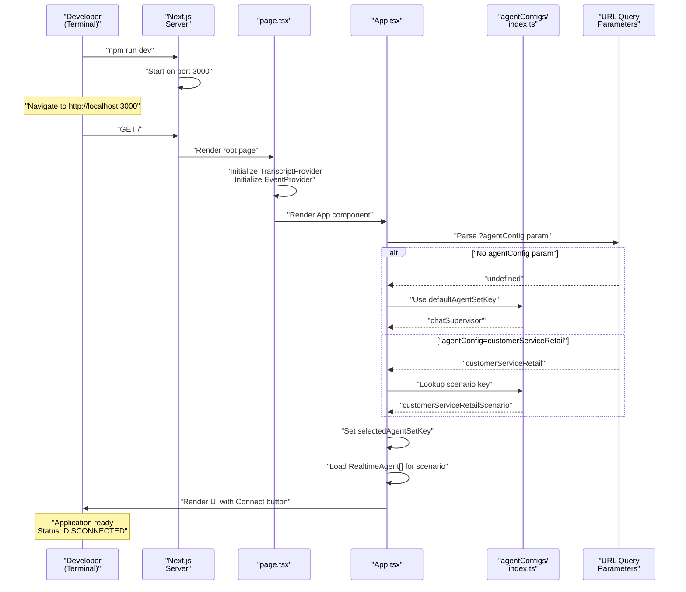
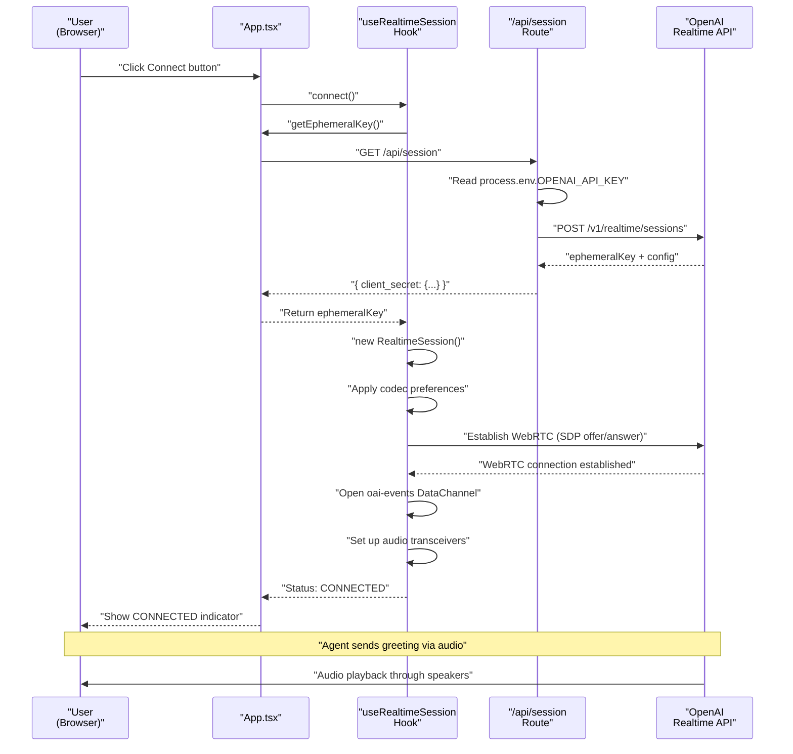
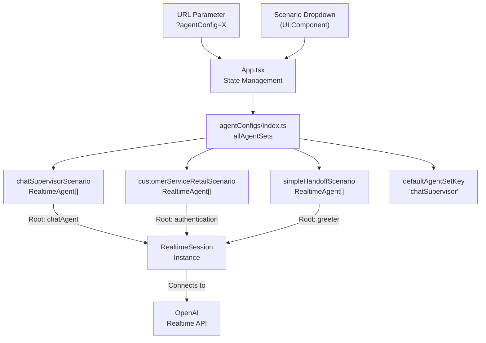

<!-- source: DeepWiki mcp.deepwiki.com · repo openai/openai-realtime-agents · page 1.2 Quick Start · fetched 2026-10-26 -->

# Quick Start

<details>
<summary>Relevant source files</summary>

The following files were used as context for generating this wiki page:

- [README.md](README.md)
- [package.json](package.json)
- [public/screenshot_handoff.png](public/screenshot_handoff.png)
- [src/app/agentConfigs/index.ts](src/app/agentConfigs/index.ts)

</details>


This page provides step-by-step instructions for installing, configuring, and running the OpenAI Realtime Agents demo. You will learn how to set up the development environment, start the application, connect to a real-time voice session, and interact with the pre-configured agent scenarios.

For detailed information about the agent patterns demonstrated in this application, see [Agent Patterns](#2). For architectural details, see [System Architecture](#1.3).

---

## Prerequisites

Before starting, ensure you have the following installed:

- **Node.js** (version 20 or higher recommended)
- **npm** (comes with Node.js)
- **OpenAI API Key** with access to the Realtime API

You will also need a modern web browser with microphone permissions enabled for voice interactions.

---

## Installation

### Step 1: Clone the Repository

```bash
git clone https://github.com/openai/openai-realtime-agents
cd openai-realtime-agents
```

### Step 2: Install Dependencies

Install the required npm packages:

```bash
npm i
```

This installs the following key dependencies as defined in [package.json:11-22]():
- `@openai/agents` - OpenAI Agents SDK for defining agent behaviors
- `next` - Next.js framework for the application server
- `react` and `react-dom` - React UI framework
- `openai` - OpenAI API client library
- `react-markdown` - Markdown rendering for transcript display

### Step 3: Configure API Key

The application requires an OpenAI API key to communicate with the Realtime API. You have two options:

**Option A: Environment Variable**

Add the API key to your shell profile (e.g., `.bash_profile`, `.zshrc`):

```bash
export OPENAI_API_KEY="sk-..."
```

**Option B: `.env` File**

1. Copy the sample environment file:
   ```bash
   cp .env.sample .env
   ```

2. Edit `.env` and add your API key:
   ```
   OPENAI_API_KEY=sk-...
   ```

The application will read this key from [src/app/api/session/route.ts]() when creating ephemeral session tokens.

**Sources:** [README.md:22-28](), [package.json:1-34]()

---

## Running the Application

### Start the Development Server

Run the following command to start the Next.js development server:

```bash
npm run dev
```

The server will start on port 3000. You should see output similar to:

```
ready - started server on 0.0.0.0:3000, url: http://localhost:3000
```

### Access the Application

Open your web browser and navigate to:

```
http://localhost:3000
```

The application will load with the default `chatSupervisor` agent configuration as defined in [src/app/agentConfigs/index.ts:14]().

**Sources:** [README.md:26-27](), [package.json:6-9]()

---

## Application Startup Flow

The following diagram shows the initialization sequence from running `npm run dev` to loading the first agent configuration:



**Sources:** [README.md:27-28](), [src/app/agentConfigs/index.ts:1-15]()

---

## Connecting to a Real-time Session

Once the application loads, you can establish a WebRTC connection to the OpenAI Realtime API.

### Connection Steps

1. **Grant Microphone Permission**: Your browser will prompt you to allow microphone access. Click "Allow".

2. **Click the Connect Button**: In the bottom toolbar, click the connection toggle button.

3. **Wait for Connection**: The application will:
   - Call `/api/session` to obtain an ephemeral key
   - Establish a WebRTC connection to the Realtime API
   - Open an `oai-events` DataChannel for control messages
   - Set up audio transceivers for bidirectional audio streaming

4. **Connection Established**: Once connected, the status indicator will show "CONNECTED" and the agent will greet you.

### Connection Flow Diagram



**Sources:** [README.md:27-28]()

---

## Interacting with Agents

Once connected, you can interact with the agent using voice or text input.

### Voice Interaction

The application supports two voice input modes:

| Mode | Description | Default |
|------|-------------|---------|
| **Voice Activity Detection (VAD)** | The agent automatically detects when you start and stop speaking | Yes |
| **Push-to-Talk (PTT)** | Hold a button while speaking, release when done | No |

To switch modes, click the "PTT" toggle in the bottom toolbar.

### Text Interaction

You can also send text messages using the input field at the bottom of the screen. Type your message and press Enter or click the send button.

### Agent Responses

Agent responses appear in the transcript pane on the left side of the screen. The transcript shows:

- **User messages** (blue bubbles)
- **Assistant messages** (white bubbles)
- **System breadcrumbs** (expandable gray entries for tool calls and agent transfers)
- **Guardrail status** (chips showing content moderation results)

**Sources:** [README.md:216-220]()

---

## Available Scenarios

The application includes three pre-configured agent scenarios. You can switch between them using the "Scenario" dropdown in the top-right corner.

### Scenario Overview

| Scenario Key | Name | Description | Root Agent |
|--------------|------|-------------|------------|
| `chatSupervisor` | Chat-Supervisor | Dual-agent pattern with a chat agent and supervisor | `chatAgent` |
| `customerServiceRetail` | Customer Service Retail | Multi-agent customer service with authentication, returns, sales | `authentication` |
| `simpleHandoff` | Simple Handoff | Minimal greeter-to-haiku-writer example | `greeter` |

### Accessing Scenarios

**Via URL Parameter:**

You can load a specific scenario by adding the `agentConfig` query parameter:

```
http://localhost:3000?agentConfig=customerServiceRetail
```

**Via UI Dropdown:**

Select a scenario from the dropdown menu in the top toolbar. The application will disconnect any active session and reload with the new agent configuration.

### Scenario Selection Flow



**Sources:** [src/app/agentConfigs/index.ts:1-15](), [README.md:28-29]()

---

## UI Layout

The application interface is divided into three main areas:

### Left Panel: Transcript

Displays the conversation history including:
- User and assistant messages
- Tool calls (expandable)
- Agent handoffs (expandable breadcrumbs)
- Guardrail moderation results (color-coded chips)

Click on any system message (breadcrumb) to expand and view detailed JSON data.

### Right Panel: Event Log

Shows real-time events flowing between the client and server:
- **Client events** (blue): Sent from browser to Realtime API
- **Server events** (green): Received from Realtime API

Click on any event to expand and view the full payload. This is useful for debugging and understanding the protocol.

### Bottom Toolbar: Controls

Provides interactive controls:

| Control | Function |
|---------|----------|
| **Connect/Disconnect** | Toggle WebRTC connection |
| **PTT Toggle** | Switch between VAD and Push-to-Talk modes |
| **PTT Button** | Hold to speak (only visible in PTT mode) |
| **Audio Playback** | Enable/disable agent audio responses |
| **Events Toggle** | Show/hide the event log panel |
| **Codec Selector** | Choose audio codec (opus 48kHz, pcmu 8kHz, pcma 8kHz) |

**Sources:** [README.md:216-220]()

---

## Testing Different Scenarios

### Chat-Supervisor Pattern

URL: `http://localhost:3000?agentConfig=chatSupervisor`

Try asking:
- "What's my account balance?" (triggers supervisor with tool call)
- "Hello" (handled directly by chat agent)
- "Find my nearest store in San Francisco" (supervisor uses location tool)

For details on this pattern, see [Chat-Supervisor Pattern](#2.1).

### Customer Service Retail

URL: `http://localhost:3000?agentConfig=customerServiceRetail`

Try saying:
- "I'd like to return my snowboard" (goes through authentication flow, then transfers to returns agent)
- "What promotions do you have?" (transfers to sales agent)
- "I need to speak to a human" (transfers to human agent)

For details on this pattern, see [Sequential Handoff Pattern](#2.2).

### Simple Handoff

URL: `http://localhost:3000?agentConfig=simpleHandoff`

Try saying:
- "Hello" (greeter agent responds)
- "Yes" when asked if you want a haiku (transfers to haiku writer agent)
- Provide a topic when prompted

For details, see [Simple Handoff Example](#4.1).

**Sources:** [README.md:30-146]()

---

## Troubleshooting

### Common Issues

| Problem | Solution |
|---------|----------|
| **"Failed to connect"** | Verify your `OPENAI_API_KEY` is set correctly and has Realtime API access |
| **No audio output** | Check that audio playback is enabled in the toolbar and browser audio isn't muted |
| **Microphone not working** | Ensure browser has microphone permission granted |
| **"Module not found" errors** | Run `npm i` again to ensure all dependencies are installed |
| **Port 3000 in use** | Stop other processes using port 3000 or set `PORT` environment variable |

### Viewing Logs

The event log panel (right side) shows all protocol messages. To view more detailed logs:

1. Open browser developer console (F12 or Cmd+Option+I)
2. Look for messages prefixed with the component name
3. Check the Network tab for API route calls

### Resetting State

If the application gets into a bad state:
1. Click "Disconnect" in the bottom toolbar
2. Refresh the browser page
3. Click "Connect" to start a fresh session

**Sources:** [README.md:22-29]()

---

## Next Steps

Once you have the application running and have tested the example scenarios, you can:

- Explore the [Agent Configuration System](#2.3) to understand how agents are defined
- Learn about [Custom Tool Development](#5.2) to add new capabilities
- Review the [Frontend Architecture](#3.2) to understand the React component structure
- Study the [API Routes and Backend](#3.3) to see how server-side integration works

For instructions on building your own agent configurations, see [Contributing](#6.3).

**Sources:** [README.md:208-211]()

---

