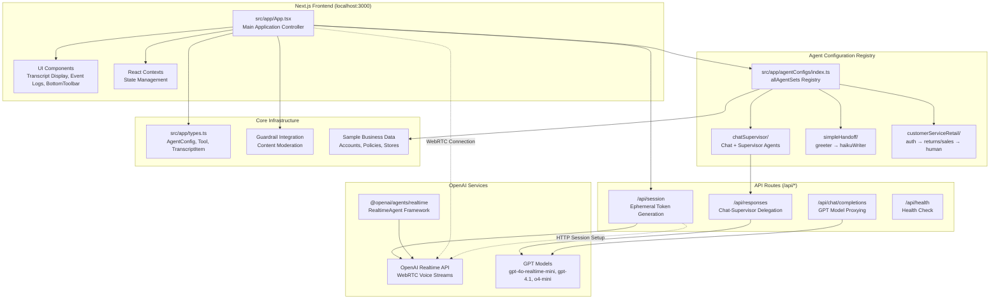
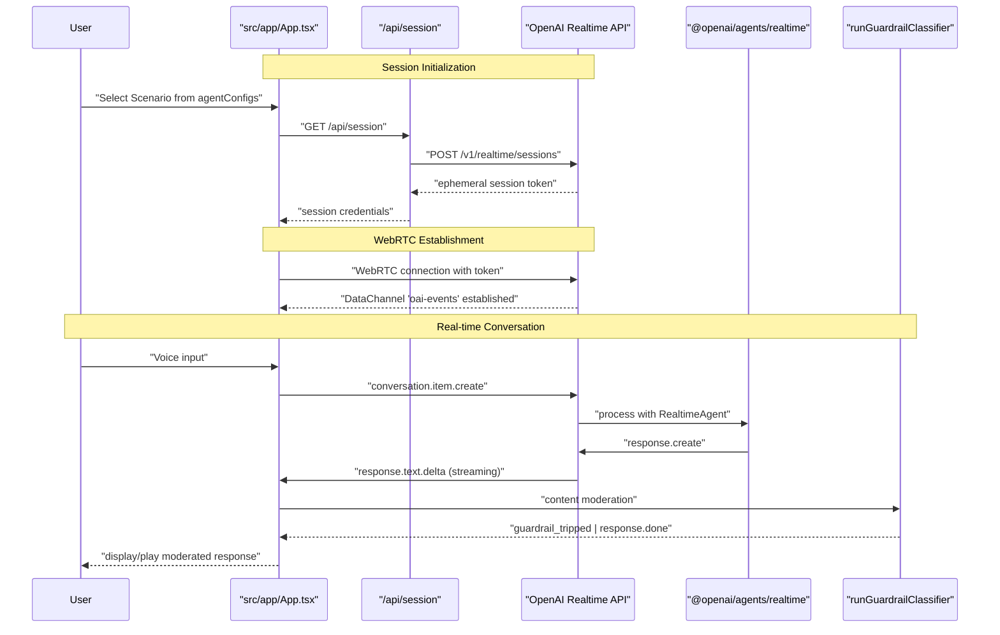
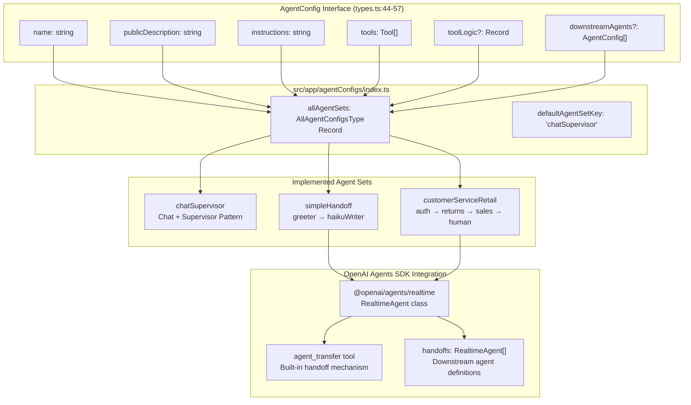
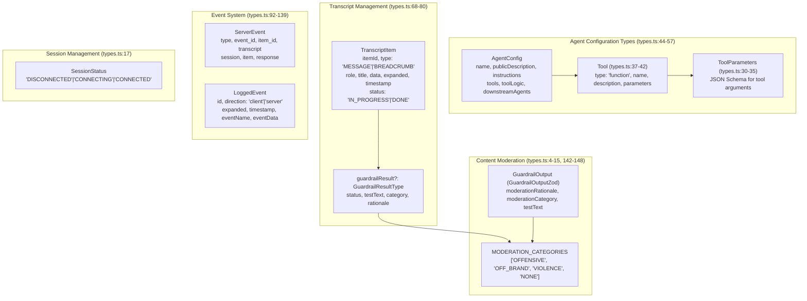
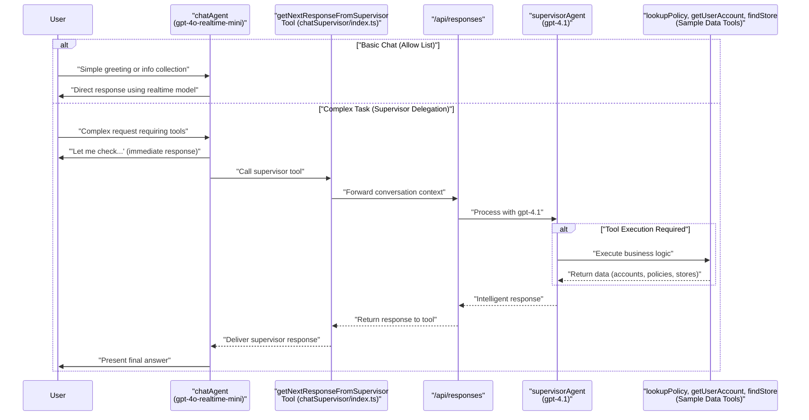
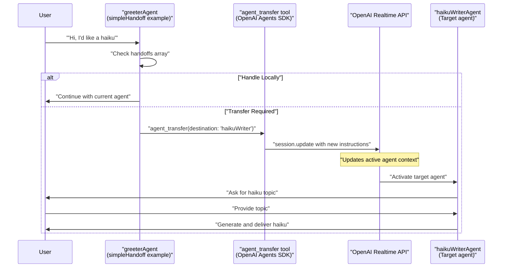
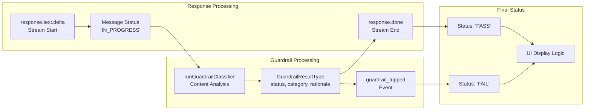

<!-- source: DeepWiki mcp.deepwiki.com · repo openai/openai-realtime-agents · page 1.3 System Architecture · fetched 2026-10-26 -->

# System Architecture

Relevant source files

The following files were used as context for generating this wiki page:

- [README.md](README.md)
- [public/screenshot_handoff.png](public/screenshot_handoff.png)
- [src/app/agentConfigs/index.ts](src/app/agentConfigs/index.ts)
- [src/app/types.ts](src/app/types.ts)

This document provides a comprehensive overview of the system architecture for the OpenAI Realtime Agents demonstration framework. The system demonstrates advanced voice agent patterns using the OpenAI Realtime API and OpenAI Agents SDK, implementing two primary agentic patterns: Chat-Supervisor and Sequential Handoffs.

For detailed information about specific agent implementations, see [Agent Patterns and Core Concepts](#2). For technical implementation details including frontend and backend components, see [Technical Implementation](#5).

## Overall System Architecture

The system implements a Next.js application that orchestrates voice-based AI agents through the OpenAI Realtime API. It supports two distinct agent patterns while providing a unified interface for agent configuration, real-time communication, and content moderation.

### High-Level System Overview

Sources: [README.md:1-30](), [README.md:156-203](), [src/app/types.ts:44-57]()
</thinking>

The system uses the OpenAI Agents SDK as a foundational framework for building and managing voice agents, with support for tool integration, state management, and agent orchestration patterns.

## Communication Architecture

The system operates on dual communication channels: HTTP for session management and WebRTC for real-time voice interactions. The architecture supports seamless switching between agent scenarios and real-time content moderation.

### Communication Flow

Sources: [README.md:156-203](), [README.md:213-214](), [src/app/types.ts:92-131]()

## Agent Configuration System

The agent configuration system provides a centralized registry implemented in `src/app/agentConfigs/index.ts` that manages different agent scenarios. Each scenario implements either the Chat-Supervisor or Sequential Handoff pattern using the OpenAI Agents SDK.

### Agent Configuration Registry

Sources: [README.md:91-116](), [README.md:125-146](), [src/app/types.ts:44-57]()

## Core Type System

The type system in `src/app/types.ts` defines fundamental data structures for agent configuration, transcript management, event handling, and content moderation. These types bridge the OpenAI Agents SDK with the application's UI and business logic.

### Core Type Definitions

Sources: [src/app/types.ts:44-57](), [src/app/types.ts:37-42](), [src/app/types.ts:68-80](), [src/app/types.ts:92-131](), [src/app/types.ts:4-15](), [src/app/types.ts:142-148]()

## Agent Pattern Data Flows

The system implements two distinct data flow patterns based on agent configuration: Chat-Supervisor pattern for intelligent delegation and Sequential Handoffs pattern for specialized agent transfers.

### Chat-Supervisor Pattern Flow

Sources: [README.md:30-80](), [README.md:73-76]()

### Sequential Handoffs Pattern Flow

Sources: [README.md:82-116](), [README.md:91-103]()

## Content Moderation Integration

The system includes integrated content moderation that operates in real-time during assistant responses to ensure appropriate and on-brand communication.

### Guardrail System Architecture

Sources: [README.md:213-214](), [src/app/types.ts:61-66](), [src/app/types.ts:142-148]()

---

