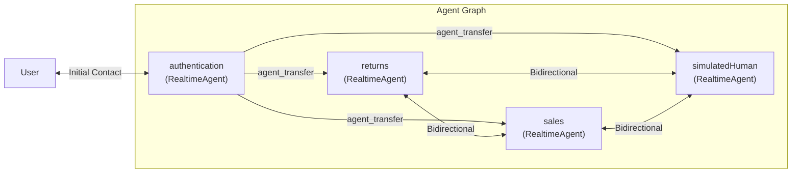
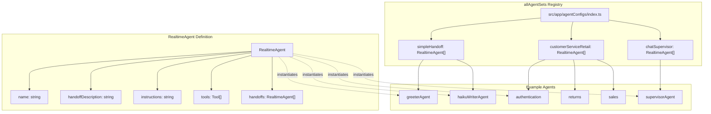
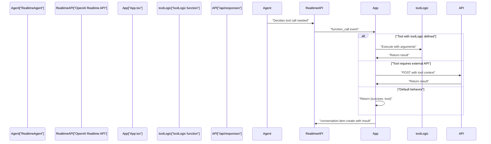
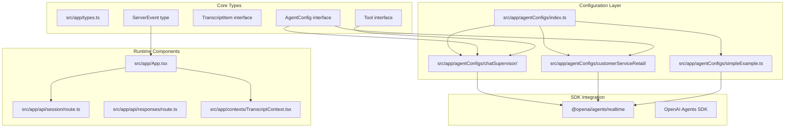

<!-- source: DeepWiki mcp.deepwiki.com · repo openai/openai-realtime-agents · page 2 Agent Patterns · fetched 2026-10-26 -->

# Agent Patterns

<details>
<summary>Relevant source files</summary>

The following files were used as context for generating this wiki page:

- [README.md](README.md)
- [public/screenshot_handoff.png](public/screenshot_handoff.png)
- [src/app/agentConfigs/index.ts](src/app/agentConfigs/index.ts)

</details>


This page introduces the two primary agent orchestration patterns demonstrated in this project: **Chat-Supervisor** and **Sequential Handoff**. These patterns represent fundamentally different approaches to building voice agents with the OpenAI Realtime API.

The Chat-Supervisor pattern uses a two-tier architecture where a responsive realtime agent handles basic interactions while delegating complex reasoning to a more intelligent text-based supervisor. The Sequential Handoff pattern uses specialized realtime agents that transfer conversations between each other based on user intent.

For detailed implementation information, see:
- [Chat-Supervisor Pattern (2.1)](#2.1) - Dual-agent delegation architecture
- [Sequential Handoff Pattern (2.2)](#2.2) - Multi-agent transfer system  
- [Agent Configuration System (2.3)](#2.3) - How agents are defined and registered
- [Choosing a Pattern (2.4)](#2.4) - Selection criteria and comparison

**Sources:** [README.md:18-21](), [README.md:30-33](), [README.md:82-85]()

## Pattern Overview

### Chat-Supervisor Pattern

The Chat-Supervisor pattern implements a two-tier architecture that optimizes for both responsiveness and intelligence. A `chatAgent` using `gpt-4o-realtime-mini` handles immediate user interactions, while a `supervisorAgent` using `gpt-4.1` processes complex reasoning and tool calls.

**Architecture Diagram: Chat-Supervisor Flow**

```mermaid
sequenceDiagram
    participant User
    participant chatAgent["chatAgent<br/>(gpt-4o-realtime-mini)"]
    participant supervisorAgent["supervisorAgent<br/>(gpt-4.1)"]
    participant Tools["lookupPolicyDocument<br/>getUserAccountInfo<br/>findNearestStore"]
    
    alt "Basic Task (Allow List)"
        User->>chatAgent: "Hi, I need help"
        chatAgent->>User: "Direct Response"
    end
    
    alt "Complex Task (Escalation)"
        User->>chatAgent: "Check my account balance"
        chatAgent->>User: "Let me check on that"
        chatAgent->>supervisorAgent: "getNextResponseFromSupervisor"
        supervisorAgent->>Tools: "Tool calls"
        Tools->>supervisorAgent: "Results"
        supervisorAgent->>chatAgent: "Formatted response"
        chatAgent->>User: "Your balance is..."
    end
```

**Key Characteristics:**
- Single active agent from user perspective
- Transparent delegation to supervisor
- ~2 second latency for complex queries
- Maintains conversational flow

**Sources:** [README.md:30-71](), [README.md:41-62](), [src/app/agentConfigs/chatSupervisor/index.ts]()

### Sequential Handoff Pattern

The Sequential Handoff pattern uses specialized agents that explicitly transfer conversations between each other. Each agent is responsible for a specific domain and can hand off to other agents in the graph.

**Architecture Diagram: Sequential Handoff Flow**



**Key Characteristics:**
- Multiple visible agents with distinct roles
- Explicit `agent_transfer` tool calls
- Session updates with new instructions and tools
- Agent specialization prevents context pollution

**Sources:** [README.md:82-146](), [src/app/agentConfigs/customerServiceRetail/index.ts](), [src/app/agentConfigs/simpleHandoff.ts:92-116]()

### Comparison Table

| Aspect | Chat-Supervisor | Sequential Handoff |
|--------|----------------|-------------------|
| **Active Agents** | 1 user-facing agent | Multiple specialized agents |
| **Model Types** | Realtime + text-based | All realtime agents |
| **Delegation** | Internal to supervisor | Explicit transfers |
| **User Experience** | Single continuous conversation | Agent changes visible to user |
| **Complexity** | Centralized in supervisor | Distributed across agents |
| **Best For** | Migrating existing text agents | Multi-domain customer service |

**Sources:** [README.md:64-71](), [README.md:119-124]()

## RealtimeAgent Foundation

Both patterns are built on the `RealtimeAgent` class from the `@openai/agents/realtime` package. This class provides a standardized interface for defining agent behavior, tools, and transfer capabilities.

**Diagram: RealtimeAgent Structure and Registry**



**Core Properties:**
- `name`: Unique identifier for the agent
- `handoffDescription`: Used by other agents to determine transfer targets
- `instructions`: System prompt defining agent behavior and personality
- `tools`: Array of function definitions the agent can invoke
- `handoffs`: Array of agents this agent can transfer to

**Sources:** [src/app/agentConfigs/simpleHandoff.ts:92-116](), [src/app/agentConfigs/index.ts:1-15](), [README.md:92-116]()

## Tool Integration

Tools enable agents to perform actions beyond text generation. Each agent pattern uses tools differently:

**Chat-Supervisor Tools:**
- `getNextResponseFromSupervisor` - Delegates to supervisor agent
- Domain tools only available to supervisor (e.g., `lookupPolicyDocument`, `getUserAccountInfo`)

**Sequential Handoff Tools:**
- `agent_transfer` - Automatically generated for agent graph navigation
- Domain-specific tools per agent (e.g., `authenticate_user_information`, `checkEligibilityAndPossiblyInitiateReturn`)

**Diagram: Tool Execution Flow**



Tools are defined with JSON Schema for parameters and can include custom `toolLogic` functions for implementation. When undefined, tools return a success message by default.

**Sources:** [README.md:73-80](), [README.md:209-211]()

## Agent Transfer Mechanisms

The two patterns use fundamentally different approaches to delegation and transfer:

### Internal Delegation (Chat-Supervisor)

The `chatAgent` maintains the active WebRTC session and calls `getNextResponseFromSupervisor` as a tool. This tool invokes the `/api/responses` endpoint with the conversation context, receives the supervisor's response, and delivers it to the user.

**Key implementation points:**
- Single session, no `session.update` events
- Supervisor operates via standard text API calls
- Transparent to user (appears as single agent)
- Latency added only when supervisor is invoked

### Explicit Transfer (Sequential Handoff)

Agents call the `agent_transfer` tool with a destination agent name. This triggers a `session.update` event that reconfigures the session with new instructions, tools, and context.

**Key implementation points:**
- Session updated with new agent configuration
- User sees agent change in transcript via breadcrumbs
- Bidirectional transfers supported
- Utility function `injectTransferTools()` generates transfer tools from agent graph

**Sources:** [README.md:48-62](), [README.md:125-146](), [src/app/agentConfigs/customerServiceRetail/index.ts:127-146]()

## Implementation Foundation Mapping

### Code Entity Relationships

The following diagram maps core concepts to their primary implementation locations in the codebase:



**Sources:** [README.md:125-146](), [README.md:209-211]()

### Pattern Selection Criteria

| Use Case | Recommended Pattern | Key Factors |
|----------|-------------------|-------------|
| **Existing Text Agent Migration** | Chat-Supervisor | Leverage existing prompts and tools |
| **Complex Multi-Domain Service** | Sequential Handoff | Clear user intent boundaries |
| **High Intelligence Requirements** | Chat-Supervisor | Access to reasoning models like `o4-mini` |
| **Specialist Agent Workflows** | Sequential Handoff | Domain-specific expertise per agent |
| **Cost Optimization** | Chat-Supervisor | Use `gpt-4o-realtime-mini` for basic tasks |
| **Low Latency Priority** | Sequential Handoff | Consistent single-agent response times |

**Sources:** [README.md:64-71](), [README.md:119-124]()

Both patterns share common infrastructure for session management, guardrails, event logging, and the underlying realtime communication protocol, enabling developers to choose the pattern that best fits their specific use case requirements while maintaining consistent system behavior and user experience.

---

