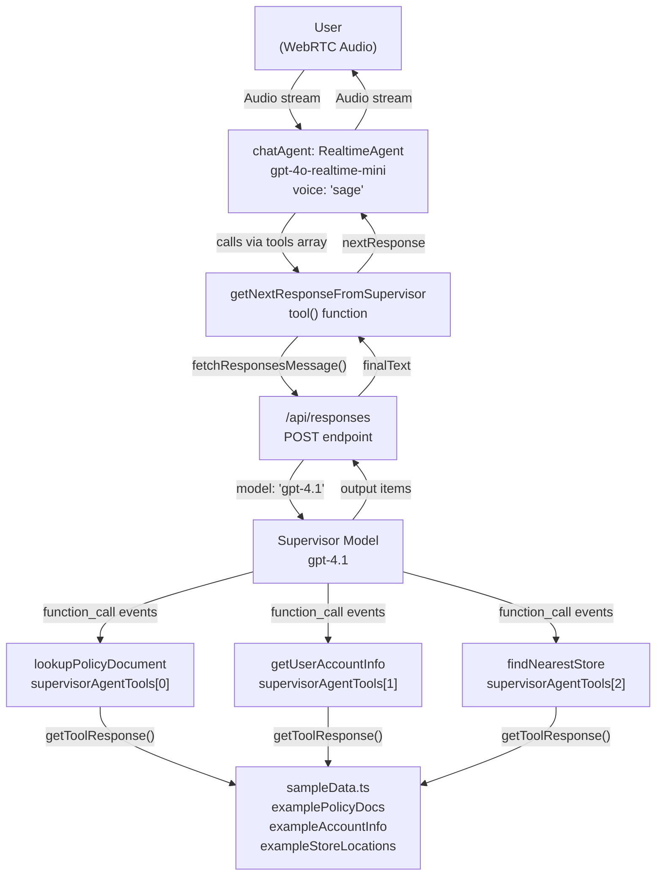
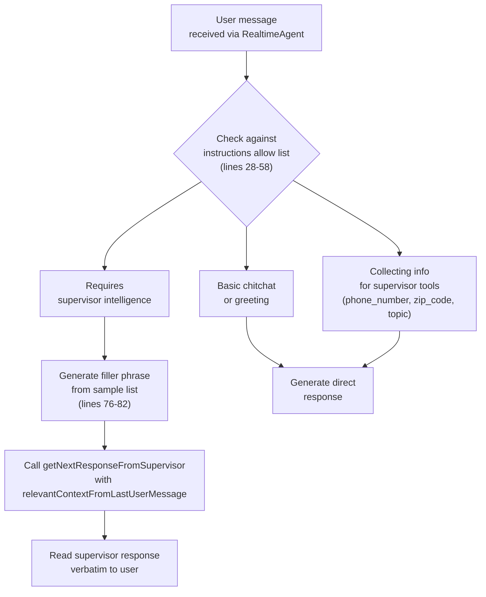
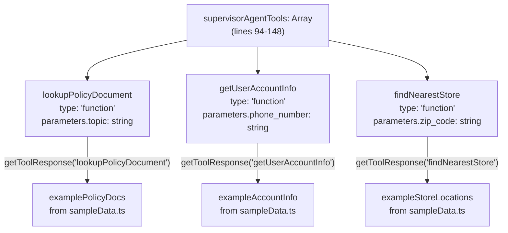
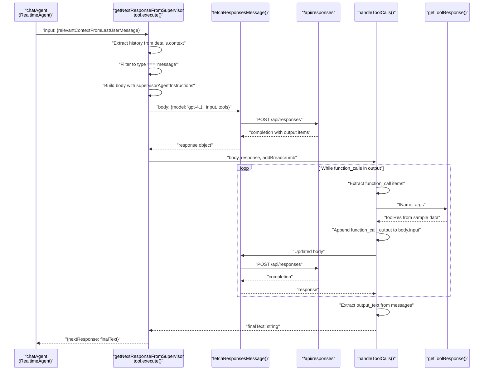
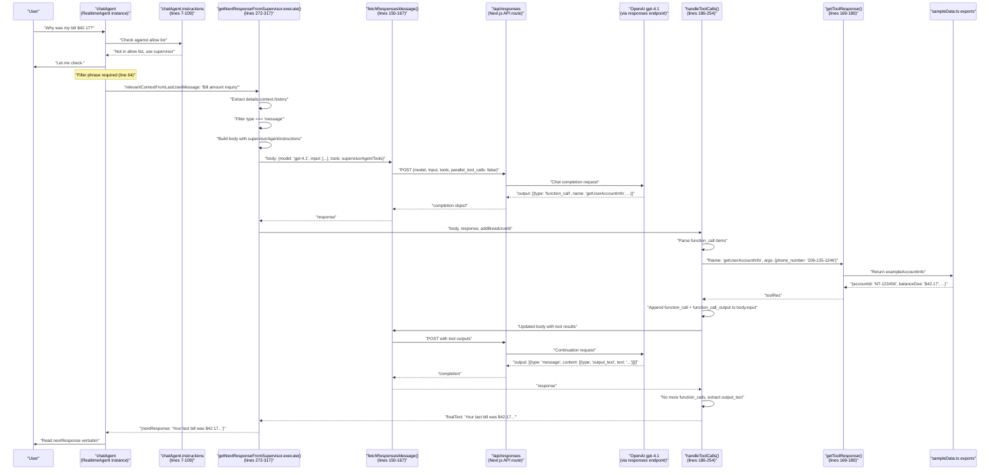
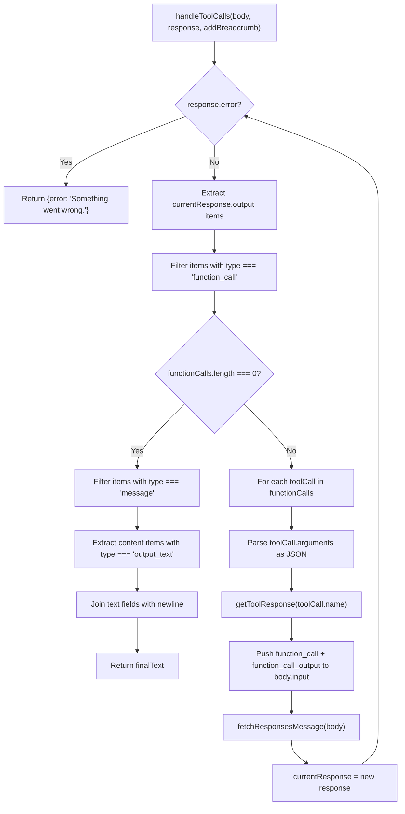

<!-- source: DeepWiki mcp.deepwiki.com · repo openai/openai-realtime-agents · page 2.1 Chat-Supervisor Pattern · fetched 2026-10-26 -->

# Chat-Supervisor Pattern

Relevant source files

The following files were used as context for generating this wiki page:

- [README.md](README.md)
- [public/screenshot_handoff.png](public/screenshot_handoff.png)
- [src/app/agentConfigs/chatSupervisor/index.ts](src/app/agentConfigs/chatSupervisor/index.ts)
- [src/app/agentConfigs/chatSupervisor/sampleData.ts](src/app/agentConfigs/chatSupervisor/sampleData.ts)
- [src/app/agentConfigs/chatSupervisor/supervisorAgent.ts](src/app/agentConfigs/chatSupervisor/supervisorAgent.ts)

This document covers the Chat-Supervisor pattern, one of the two primary architectural patterns implemented in the OpenAI Realtime Agents repository. The Chat-Supervisor pattern uses a two-tier agent system where a fast realtime chat agent handles basic interactions and defers complex tasks to an intelligent supervisor agent.

For information about the alternative Sequential Handoffs pattern, see [Sequential Handoffs Pattern](#2.2). For details on how agents are configured and registered, see [Agent Configuration System](#2.3).

## Pattern Overview

The Chat-Supervisor pattern combines a lightweight `RealtimeAgent` for immediate user interaction with a text-based supervisor model for complex reasoning and tool execution. The chat agent uses `gpt-4o-realtime-mini` for low-latency conversational responses, while the supervisor uses `gpt-4.1` via the `/api/responses` endpoint for intelligent decision-making.

The pattern implements a strict division of responsibilities enforced through an "allow list" in the chat agent's instructions. The chat agent handles only basic chitchat and information collection, deferring all other requests to the supervisor via the `getNextResponseFromSupervisor` tool.

**Architecture: Code Entity Mapping**

Sources: [src/app/agentConfigs/chatSupervisor/index.ts:1-121](), [src/app/agentConfigs/chatSupervisor/supervisorAgent.ts:1-319](), [README.md:30-81]()

## Core Components

### Chat Agent Implementation

The `chatAgent` is instantiated as a `RealtimeAgent` with a single tool in its configuration. The agent is defined in [src/app/agentConfigs/chatSupervisor/index.ts:4-113]() and exported as part of the `chatSupervisorScenario` array.

**Chat Agent Configuration**

| Property | Value | Purpose |
|----------|-------|---------|
| `name` | `'chatAgent'` | Agent identifier used in session configuration |
| `voice` | `'sage'` | OpenAI voice model for audio responses |
| `instructions` | Multi-line string [lines 7-109]() | Defines behavior constraints and allow list |
| `tools` | `[getNextResponseFromSupervisor]` | Single tool array providing supervisor access |

The agent's instructions implement an allow list at [src/app/agentConfigs/chatSupervisor/index.ts:28-58]():
- Basic chitchat and greetings
- Collecting information needed for supervisor tool calls (phone numbers, zip codes, topics)
- Responses to clarification requests

**Chat Agent Decision Logic**

The constraint at [src/app/agentConfigs/chatSupervisor/index.ts:64]() requires a filler phrase before every `getNextResponseFromSupervisor` call: "Before calling getNextResponseFromSupervisor, you MUST ALWAYS say something to the user".

Sources: [src/app/agentConfigs/chatSupervisor/index.ts:4-113]()

### Supervisor Agent Configuration

The supervisor agent is not a `RealtimeAgent` instance but rather a configuration of instructions, tools, and execution logic invoked through the `/api/responses` endpoint. The configuration is defined in [src/app/agentConfigs/chatSupervisor/supervisorAgent.ts]().

**Supervisor Components**

| Component | Definition Location | Purpose |
|-----------|---------------------|---------|
| `supervisorAgentInstructions` | [lines 10-92]() | System prompt with domain-specific logic and response format |
| `supervisorAgentTools` | [lines 94-148]() | Array of three tool definitions for OpenAI function calling |
| `getToolResponse()` | [lines 169-180]() | Local function executor mapping tool names to sample data |
| `fetchResponsesMessage()` | [lines 150-167]() | HTTP client for `/api/responses` endpoint |
| `handleToolCalls()` | [lines 186-254]() | Iterative tool execution loop until final text response |

**Supervisor Tools Array Structure**

The supervisor instructions at [src/app/agentConfigs/chatSupervisor/supervisorAgent.ts:22]() enforce tool usage: "Always call a tool before answering factual questions about the company, its offerings or products, or a user's account."

Sources: [src/app/agentConfigs/chatSupervisor/supervisorAgent.ts:10-180]()

### Tool Communication Mechanism

The `getNextResponseFromSupervisor` tool is defined using the `tool()` function from `@openai/agents/realtime` at [src/app/agentConfigs/chatSupervisor/supervisorAgent.ts:256-318](). This tool bridges the chat agent to the supervisor by packaging conversation history and invoking the `/api/responses` endpoint.

**getNextResponseFromSupervisor Data Flow**

The tool's parameter schema at [src/app/agentConfigs/chatSupervisor/supervisorAgent.ts:262-270]() requires `relevantContextFromLastUserMessage` as a string, allowing the chat agent to provide essential context that may not be in the conversation history accessible to the supervisor.

Sources: [src/app/agentConfigs/chatSupervisor/supervisorAgent.ts:150-318]()

## Communication Flow

The interaction between chat agent and supervisor follows a multi-step protocol involving the `RealtimeAgent`, tool execution, HTTP requests to `/api/responses`, and iterative function calling until a final response is generated.

**Complete Interaction Sequence with Code Mappings**

Sources: [src/app/agentConfigs/chatSupervisor/supervisorAgent.ts:150-318](), [src/app/agentConfigs/chatSupervisor/index.ts:64-93]()

### Iterative Tool Execution

The `handleToolCalls()` function at [src/app/agentConfigs/chatSupervisor/supervisorAgent.ts:186-254]() implements a while loop that continues until the supervisor produces output without function calls:

**handleToolCalls() Loop Logic**

The function at [src/app/agentConfigs/chatSupervisor/supervisorAgent.ts:222-249]() executes tools by calling `getToolResponse()` with the tool name, which returns mock data from [src/app/agentConfigs/chatSupervisor/sampleData.ts](). Each tool result is appended to `body.input` as `function_call` and `function_call_output` items before making another request to `/api/responses`.

Sources: [src/app/agentConfigs/chatSupervisor/supervisorAgent.ts:169-254]()

## Pattern Benefits and Trade-offs

### Advantages

| Benefit | Description |
|---------|-------------|
| **Simpler Onboarding** | Existing text-based chat agents can be adapted by using the supervisor pattern |
| **Incremental Migration** | Tasks can be moved from supervisor to chat agent gradually |
| **High Intelligence** | Leverages advanced models like `gpt-4.1` for complex reasoning |
| **Lower Cost** | Uses `gpt-4o-realtime-mini` for basic interactions combined with selective `gpt-4.1` usage |
| **Natural UX** | Immediate responses with filler phrases maintain conversation flow |

### Trade-offs

The pattern introduces additional latency for complex queries due to the supervisor call overhead. The README notes approximately 2 seconds between the filler phrase completion and the start of the supervisor's response [README.md:38]().

Additionally, many assistant responses begin with filler phrases rather than providing immediate complete answers, which may affect the perceived naturalness of the interaction.

Sources: [README.md:64-71](), [src/app/agentConfigs/chatSupervisor/index.ts:64-68]()

## Implementation Configuration

The Chat-Supervisor pattern is configured as the default agent scenario through the `chatSupervisorScenario` export and registered in the central configuration system. The pattern includes company branding through the `chatSupervisorCompanyName` constant set to 'NewTelco' [src/app/agentConfigs/chatSupervisor/index.ts:118]().

The supervisor agent uses sample data for demonstration purposes, including `exampleAccountInfo`, `examplePolicyDocs`, and `exampleStoreLocations` imported from the sample data module [src/app/agentConfigs/chatSupervisor/supervisorAgent.ts:4-8]().

Sources: [src/app/agentConfigs/chatSupervisor/index.ts:115-121](), [src/app/agentConfigs/chatSupervisor/supervisorAgent.ts:1-9]()

---

