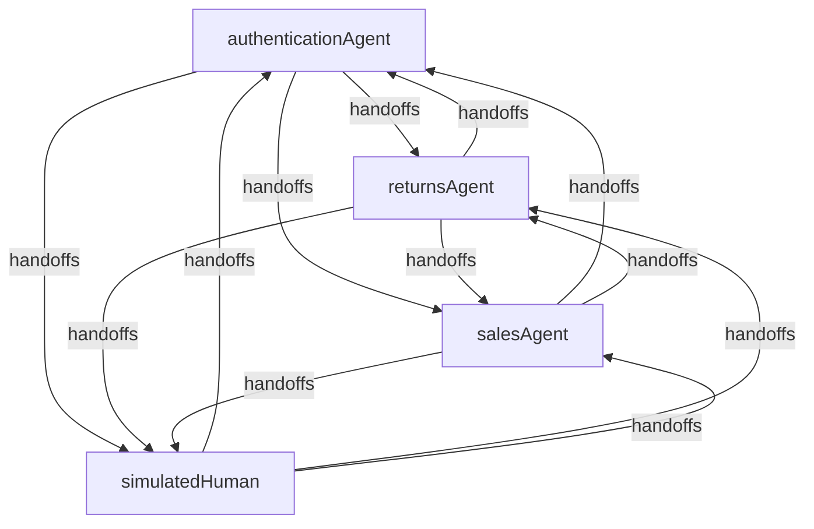
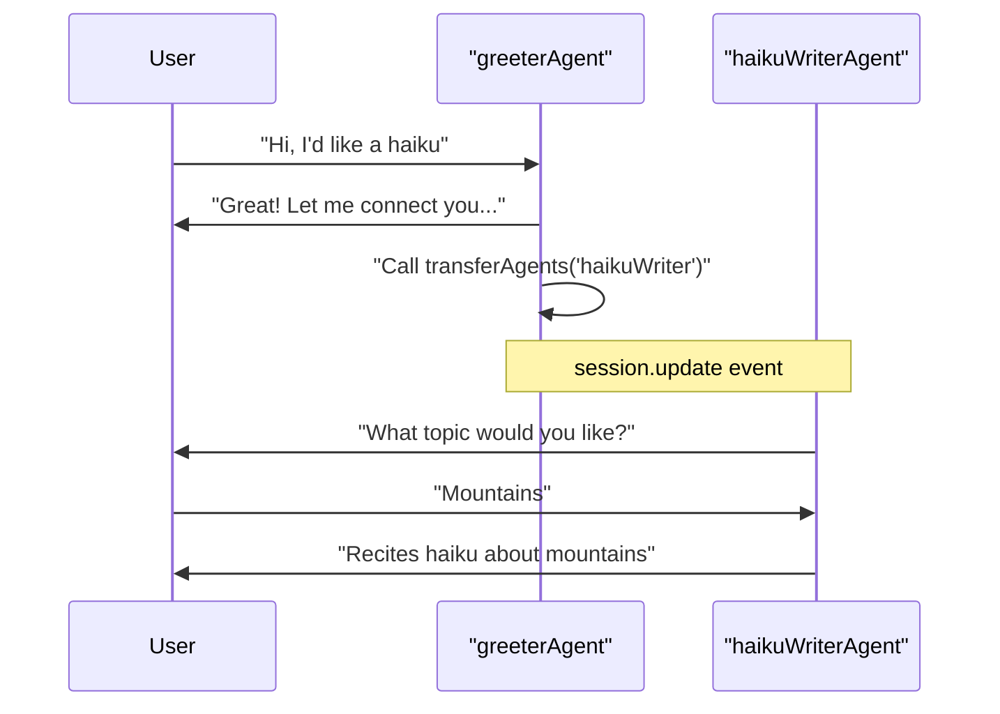
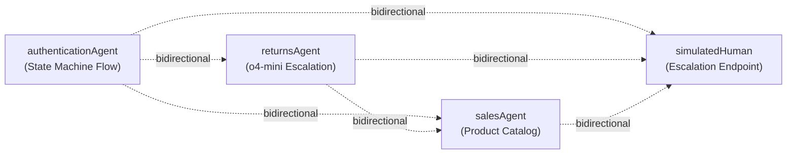
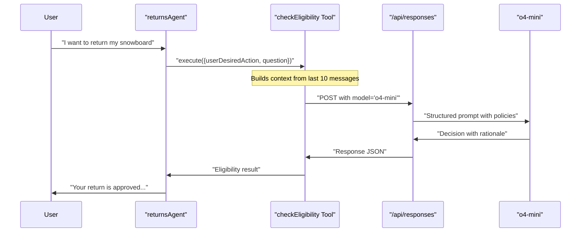
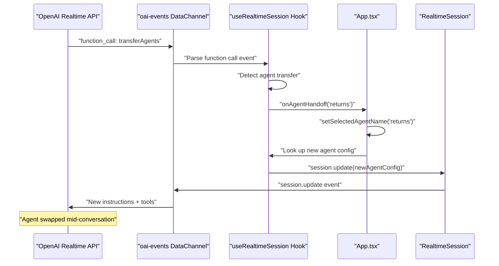

<!-- source: DeepWiki mcp.deepwiki.com · repo openai/openai-realtime-agents · page 2.2 Sequential Handoff Pattern · fetched 2026-10-26 -->

# Sequential Handoff Pattern

<details>
<summary>Relevant source files</summary>

The following files were used as context for generating this wiki page:

- [README.md](README.md)
- [public/screenshot_handoff.png](public/screenshot_handoff.png)
- [src/app/agentConfigs/customerServiceRetail/returns.ts](src/app/agentConfigs/customerServiceRetail/returns.ts)
- [src/app/agentConfigs/customerServiceRetail/sales.ts](src/app/agentConfigs/customerServiceRetail/sales.ts)
- [src/app/agentConfigs/index.ts](src/app/agentConfigs/index.ts)
- [src/app/agentConfigs/simpleHandoff.ts](src/app/agentConfigs/simpleHandoff.ts)
- [src/app/api/health/route.ts](src/app/api/health/route.ts)

</details>


## Purpose and Scope

This document describes the Sequential Handoff Pattern, one of two primary agent architecture patterns demonstrated in this project. The pattern enables specialized agents to transfer conversations between each other based on user intent, implemented using agent graphs where agents are nodes and handoff relationships are edges.

For information about the alternative Chat-Supervisor pattern, see [Chat-Supervisor Pattern](#2.1). For general agent configuration concepts that apply to both patterns, see [Agent Configuration System](#2.3). For guidance on choosing between patterns, see [Choosing a Pattern](#2.4).

**Sources:** [README.md:82-147]()

---

## Pattern Overview

The Sequential Handoff Pattern is an agent orchestration architecture where multiple specialized agents handle specific domains or intents. Agents transfer conversations to each other through explicit tool calls, with valid transfers defined in an agent graph structure. This approach prevents the "god agent" problem where a single agent with all capabilities suffers from context pollution and degraded performance.

### Key Characteristics

| Characteristic | Description |
|----------------|-------------|
| **Specialization** | Each agent focuses on a narrow domain (e.g., authentication, returns, sales) |
| **Agent Graph** | Handoff relationships form a directed graph defined at configuration time |
| **Transfer Mechanism** | The `transferAgents` tool is automatically injected into agents based on their handoff configuration |
| **Session Updates** | Handoffs trigger `session.update` events that swap agent instructions and tools mid-conversation |
| **Context Preservation** | Full conversation history is maintained across agent transfers |

### When to Use This Pattern

- **Multiple distinct user intents** that require different tools and instructions
- **Complex workflows** where user needs may evolve (e.g., from returns inquiry to new purchase)
- **Domain specialization** where different teams or knowledge bases inform different agents
- **Long instruction sets** that would cause context pollution in a single agent
- **State machine flows** like authentication or multi-step verification processes

**Sources:** [README.md:82-90](), [README.md:18-21]()

---

## Core Concepts

### Agent Graph Structure

Agents are configured with a `handoffs` array that defines which downstream agents they can transfer to. The `injectTransferTools()` utility function processes this graph and automatically generates transfer tools for each agent.


**Agent Graph for Customer Service Retail Scenario**

In this fully-connected graph, any agent can transfer to any other agent, allowing natural conversation flow as user needs change.

**Sources:** [README.md:126-146]()

### RealtimeAgent Configuration

Each agent in a Sequential Handoff scenario is defined using the `RealtimeAgent` class from the OpenAI Agents SDK. The key properties for handoff configuration are:

| Property | Type | Purpose |
|----------|------|---------|
| `name` | `string` | Unique identifier for the agent |
| `handoffDescription` | `string` | Brief description used by transfer tool to determine appropriate target |
| `instructions` | `string` | Agent personality, tone, and task-specific guidance |
| `tools` | `Tool[]` | Functions available to this agent |
| `handoffs` | `RealtimeAgent[]` | Array of agents this agent can transfer to |

**Sources:** [src/app/agentConfigs/simpleHandoff.ts:1-26]()

### Transfer Tool Injection

The `injectTransferTools()` utility automates the creation of transfer tools. For each agent with a non-empty `handoffs` array, it generates a `transferAgents` tool that:

1. Lists all valid transfer targets with their `handoffDescription`
2. Accepts a `destination` parameter (the target agent's `name`)
3. Triggers an `agent_handoff` event when executed

The function is typically used in the agent set configuration:

```
authentication.downstreamAgents = [returns, sales, simulatedHuman];
returns.downstreamAgents = [authentication, sales, simulatedHuman];
// ... configure all edges

const agents = injectTransferTools([
  authentication,
  returns,
  sales,
  simulatedHuman,
]);
```

**Sources:** [README.md:126-146]()

---

## Simple Handoff Example

The minimal demonstration of the Sequential Handoff Pattern consists of two agents: a greeter and a haiku writer. This example illustrates the basic mechanics without additional complexity.

### Agent Definitions

The `greeterAgent` is the entry point and can transfer to the `haikuWriterAgent`:


**Simple Handoff Sequence**

### Code Structure

The complete configuration is defined in [src/app/agentConfigs/simpleHandoff.ts:1-26]():

- **haikuWriterAgent** ([src/app/agentConfigs/simpleHandoff.ts:5-13]()): Has empty `handoffs` array (terminal agent)
- **greeterAgent** ([src/app/agentConfigs/simpleHandoff.ts:15-23]()): Includes `haikuWriterAgent` in its `handoffs` array
- **simpleHandoffScenario** ([src/app/agentConfigs/simpleHandoff.ts:25]()): Exports array of both agents

Key implementation details:
- The `handoffDescription` property ("Agent that writes haikus") provides context for the LLM when deciding whether to transfer
- Instructions explicitly mention transferring: "If yes, hand off to the 'haiku' agent"
- Both agents have empty `tools` arrays since no custom functions are needed

**Sources:** [src/app/agentConfigs/simpleHandoff.ts:1-26](), [README.md:86-116]()

---

## Customer Service Retail Example

The `customerServiceRetail` scenario demonstrates a production-ready implementation with multiple specialized agents, state machines, and escalation to reasoning models.

### Agent Architecture


**Customer Service Retail Agent Graph**

All agents can transfer bidirectionally, but the typical flow starts with `authenticationAgent`.

**Sources:** [README.md:117-146]()

### Agent Specializations

| Agent | Purpose | Key Tools | Special Features |
|-------|---------|-----------|------------------|
| `authenticationAgent` | Verify user identity | `authenticate_user_information` | State machine for structured data collection |
| `returnsAgent` | Handle returns and order lookups | `lookupOrders`, `retrievePolicy`, `checkEligibilityAndPossiblyInitiateReturn` | Escalates to `o4-mini` for eligibility decisions |
| `salesAgent` | Product recommendations and purchases | `lookupNewSales`, `addToCart`, `checkout` | Access to product catalog |
| `simulatedHuman` | Escalation endpoint | None | Placeholder for human agent handoff |

**Sources:** [README.md:117-125](), [src/app/agentConfigs/customerServiceRetail/returns.ts:1-307](), [src/app/agentConfigs/customerServiceRetail/sales.ts:1-101]()

### Returns Agent Deep Dive

The `returnsAgent` demonstrates advanced patterns including personality definition, state machine guidance, and escalation to reasoning models.

#### Personality Configuration

The agent's `instructions` property ([src/app/agentConfigs/customerServiceRetail/returns.ts:9-74]()) defines:

- **Identity**: "Calm and approachable online store assistant specializing in snowboarding gear"
- **Demeanor**: "Relaxed, friendly vibe while staying attentive"
- **Tone**: "Warm, conversational style"
- **Pacing**: "Medium pace—steady and clear"
- **Filler words**: "Include a few casual filler words ('um,' 'hmm,' 'uh')"

This level of detail creates a consistent, natural-sounding voice agent.

#### Tool Definitions

The agent has three primary tools defined in [src/app/agentConfigs/customerServiceRetail/returns.ts:75-303]():

1. **lookupOrders** ([src/app/agentConfigs/customerServiceRetail/returns.ts:76-143]()): Retrieves order history by phone number. Returns mock data with order IDs, items, and delivery status.

2. **retrievePolicy** ([src/app/agentConfigs/customerServiceRetail/returns.ts:144-204]()): Returns store return policies including 30-day window, defective item handling, and refund processing guidelines.

3. **checkEligibilityAndPossiblyInitiateReturn** ([src/app/agentConfigs/customerServiceRetail/returns.ts:205-303]()): The escalation tool that delegates to `o4-mini` for high-stakes decisions.

#### Escalation to o4-mini

The `checkEligibilityAndPossiblyInitiateReturn` tool demonstrates how to integrate reasoning models into realtime agents:


**o4-mini Escalation Flow**

The tool implementation ([src/app/agentConfigs/customerServiceRetail/returns.ts:230-301]()):

1. Extracts last 10 conversation messages for context
2. Constructs a structured prompt with `userDesiredAction`, `question`, and conversation history
3. Posts to `/api/responses` with `model: "o4-mini"`
4. Parses response for eligibility determination and rationale
5. Returns result to agent for verbalization to user

The prompt structure enforces a specific output format:
- **Rationale**: Explanation of the decision
- **User Request**: The desired outcome
- **Is Eligible**: `true`/`false`/`need_more_information`
- **Additional Information Needed**: What else is required
- **Return Next Steps**: Instructions for the user

**Sources:** [src/app/agentConfigs/customerServiceRetail/returns.ts:205-303](), [README.md:121-124]()

### Graph Configuration

The agent graph is configured in [src/app/agentConfigs/customerServiceRetail/index.ts]() (structure shown in README.md):

```
authentication.downstreamAgents = [returns, sales, simulatedHuman];
returns.downstreamAgents = [authentication, sales, simulatedHuman];
sales.downstreamAgents = [authentication, returns, simulatedHuman];
simulatedHuman.downstreamAgents = [authentication, returns, sales];

const agents = injectTransferTools([
  authentication,
  returns,
  sales,
  simulatedHuman,
]);
```

This creates a fully-connected directed graph where each agent can transfer to any other agent, enabling flexible conversation flows.

**Sources:** [README.md:126-146]()

---

## Runtime Handoff Mechanism

### Session Update Flow

When an agent decides to transfer the conversation, the following sequence occurs:


**Agent Handoff Event Flow**

The handoff process preserves full conversation history while swapping the active agent's instructions and tools. This is transparent to the user—they continue speaking without interruption.

**Sources:** Based on architecture diagrams and README.md description

### Transfer Tool Structure

The automatically injected `transferAgents` tool has the following schema:

| Parameter | Type | Description |
|-----------|------|-------------|
| `destination` | `string` (enum) | Target agent name from `handoffs` array |

The tool's `description` includes the `handoffDescription` of all valid target agents, helping the LLM make appropriate transfer decisions based on user intent.

**Sources:** [README.md:82-90]()

### Context Preservation

During a handoff:

1. **Conversation History**: All messages remain in the session's message history
2. **Audio Stream**: WebRTC connection remains active—no reconnection required
3. **Tool Execution Context**: The `details.context` parameter passed to tools includes the full conversation history ([src/app/agentConfigs/customerServiceRetail/returns.ts:236-237]())
4. **User Experience**: No audible interruption; the new agent continues the conversation naturally

This seamless transition is a key advantage over traditional IVR systems where transfers often require repeating information.

**Sources:** [src/app/agentConfigs/customerServiceRetail/returns.ts:230-301]()

---

## Agent Registry Integration

All agent scenarios are registered in [src/app/agentConfigs/index.ts:1-15]():

```
export const allAgentSets: Record<string, RealtimeAgent[]> = {
  simpleHandoff: simpleHandoffScenario,
  customerServiceRetail: customerServiceRetailScenario,
  chatSupervisor: chatSupervisorScenario,
};

export const defaultAgentSetKey = 'chatSupervisor';
```

The `allAgentSets` object maps scenario keys to arrays of `RealtimeAgent` instances. The UI's scenario dropdown uses these keys to allow runtime switching between different agent configurations.

**Sources:** [src/app/agentConfigs/index.ts:1-15]()

---

## Comparison: Sequential Handoff vs Chat-Supervisor

| Aspect | Sequential Handoff | Chat-Supervisor |
|--------|-------------------|-----------------|
| **Architecture** | Multiple specialized agents in a graph | Single chat agent + supervisor agent |
| **Latency** | Consistent (agent already configured) | Variable (~2s when delegating to supervisor) |
| **Complexity** | Higher (agent graph + transfer logic) | Lower (single decision boundary) |
| **Use Case** | Multiple distinct intents/domains | Single domain with variable complexity |
| **Scalability** | Excellent for many intents | Limited by supervisor context window |
| **Maintenance** | Modular (agents can be updated independently) | Centralized (supervisor has all logic) |
| **User Experience** | Natural flow between specialists | "Let me think" acknowledgments |

For detailed comparison and selection guidance, see [Choosing a Pattern](#2.4).

**Sources:** [README.md:18-21](), [README.md:30-81]()

---

## Implementation Checklist

When implementing a Sequential Handoff pattern:

1. **Define Agent Roles**: Identify distinct user intents and map them to specialized agents
2. **Configure Agent Graph**: Determine which agents should be able to transfer to which others
3. **Write Instructions**: Create detailed personality and task guidance for each agent (see [Voice Agent Prompt Engineering](#5.1))
4. **Define Tools**: Implement domain-specific functions for each agent
5. **Set Handoff Descriptions**: Write clear descriptions to help the LLM route correctly
6. **Use injectTransferTools**: Apply the utility to automatically generate transfer tools
7. **Register Scenario**: Add the agent set to [src/app/agentConfigs/index.ts]()
8. **Test Transfers**: Verify that agents correctly identify when to transfer and to whom

**Sources:** [README.md:206-211]()

---

