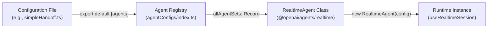
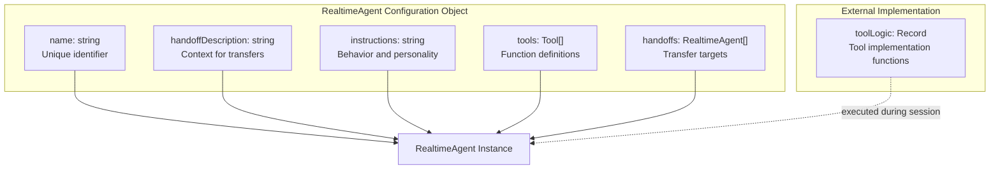
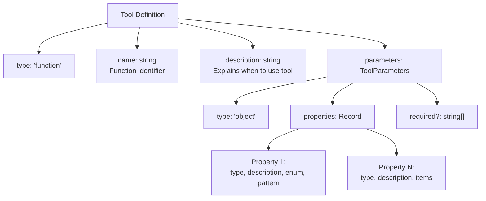
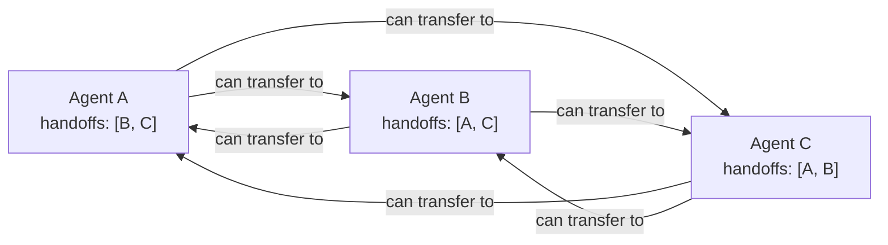
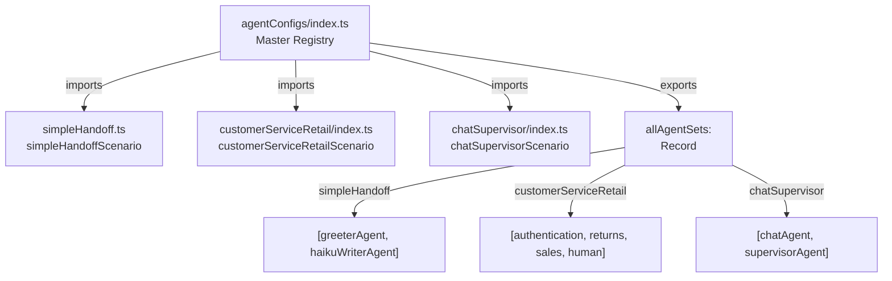
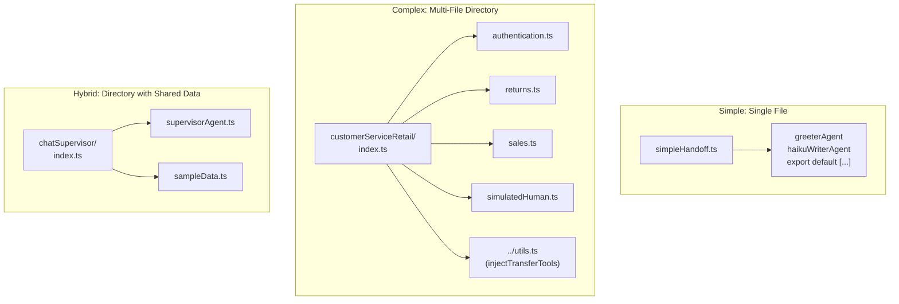

<!-- source: DeepWiki mcp.deepwiki.com · repo openai/openai-realtime-agents · page 2.3 Agent Configuration System · fetched 2026-10-26 -->

# Agent Configuration System

<details>
<summary>Relevant source files</summary>

The following files were used as context for generating this wiki page:

- [README.md](README.md)
- [public/screenshot_handoff.png](public/screenshot_handoff.png)
- [src/app/agentConfigs/index.ts](src/app/agentConfigs/index.ts)
- [src/app/types.ts](src/app/types.ts)

</details>


## Purpose and Scope

This document describes the agent configuration system used to define, register, and instantiate AI agents in the OpenAI Realtime Agents demo. It covers how agents are configured using the `RealtimeAgent` class from the OpenAI Agents SDK, including their instructions, tools, handoffs, and tool logic implementations. This page focuses on the **declarative configuration layer** that defines agent behavior at design time.

For information about the runtime session lifecycle and WebRTC connection management, see [Real-time Session Management](#3.1). For details on specific agent pattern implementations (Chat-Supervisor and Sequential Handoff), see [Agent Patterns](#2).

---

## Agent Configuration Architecture

The agent configuration system consists of three layers: configuration files, the agent registry, and the `RealtimeAgent` class interface. Configuration files define agent behavior declaratively, the registry organizes scenarios, and the SDK class instantiates runtime agents from these configurations.

### Configuration to Runtime Pipeline



**Sources:** [src/app/agentConfigs/index.ts:1-15](), [README.md:92-116]()

---

## RealtimeAgent Configuration Components

Each agent is instantiated from the `RealtimeAgent` class, which accepts a configuration object with five core components. These components define the agent's identity, behavior, capabilities, and integration points.

### Component Structure



**Sources:** [README.md:92-116](), [src/app/types.ts:44-58]()

### Configuration Properties

| Property | Type | Purpose | Required |
|----------|------|---------|----------|
| `name` | `string` | Unique identifier used for agent selection and transfers | Yes |
| `handoffDescription` | `string` | Brief description used by transfer tool to determine handoff appropriateness | Yes (for handoff scenarios) |
| `instructions` | `string` | Multi-line text defining agent behavior, personality, tone, and task boundaries | Yes |
| `tools` | `Tool[]` | Array of function definitions with JSON Schema parameters | No |
| `handoffs` | `RealtimeAgent[]` | Array of agent references this agent can transfer to | No |

**Sources:** [README.md:96-112]()

---

## Instructions

The `instructions` property is a string containing the agent's behavioral prompt. This defines how the agent should respond to users, what tasks it should handle, and any operational constraints.

### Instruction Structure Patterns

Instructions typically follow these structural patterns:

**Pattern 1: Conversational Agent**
```
Role definition (who the agent is)
Tone and personality guidelines
Task boundaries (what to do/not do)
Response formatting instructions
```

**Pattern 2: State Machine Agent**
```
Role definition
State definitions with clear transitions
Validation and confirmation procedures
Error handling instructions
```

**Example:** The greeter agent in the simple handoff scenario:

```typescript
instructions: "Please greet the user and ask them if they'd like a haiku. " +
              "If yes, hand off to the 'haikuWriter' agent."
```

**Sources:** [README.md:99-100](), [README.md:108-109]()

For guidance on creating agent instructions with state machines, see [Voice Agent Prompt Engineering](#5.1).

---

## Tools

The `tools` property defines functions the agent can call during conversation. Each tool is defined using JSON Schema format for parameter validation.

### Tool Definition Structure



**Sources:** [src/app/types.ts:19-42]()

### Tool Interface

The `Tool` interface defines the structure for function declarations:

```typescript
interface Tool {
  type: "function";
  name: string;
  description: string;
  parameters: ToolParameters;
}

interface ToolParameters {
  type: string;
  properties: Record<string, ToolParameterProperty>;
  required?: string[];
  additionalProperties?: boolean;
}
```

**Sources:** [src/app/types.ts:37-42]()

### Tool Logic Implementation

While `tools` are defined in the agent configuration, their implementations are provided separately through the `toolLogic` property (when using the legacy `AgentConfig` interface) or handled by the session's tool execution system.

```typescript
toolLogic: Record<
  string,
  (args: any, transcriptLogsFiltered: TranscriptItem[], addTranscriptBreadcrumb?: Function) => Promise<any> | any
>
```

Tool logic functions receive:
- `args`: The arguments extracted from the function call
- `transcriptLogsFiltered`: Conversation history for context
- `addTranscriptBreadcrumb`: Optional callback to log nested tool calls

**Sources:** [src/app/types.ts:49-53]()

---

## Handoffs

The `handoffs` property defines which agents the current agent can transfer the conversation to. This creates an explicit agent graph for Sequential Handoff patterns.

### Handoff Configuration



**Example:** Unidirectional handoff in simple example:

```typescript
export const greeterAgent = new RealtimeAgent({
  name: 'greeter',
  handoffDescription: 'Agent that greets the user.',
  instructions: "Please greet the user and ask them if they'd like a haiku. " +
                "If yes, hand off to the 'haikuWriter' agent.",
  tools: [],
  handoffs: [haikuWriterAgent], // One-way transfer only
});
```

**Sources:** [README.md:105-112]()

### Handoff Description

The `handoffDescription` provides context for the transfer decision. When an agent evaluates possible transfers, these descriptions help determine which agent is most appropriate for the user's current need.

**Sources:** [README.md:98]()

---

## The Agent Registry System

The agent registry is implemented in `src/app/agentConfigs/index.ts` and serves as the central lookup table for all agent scenarios. It exports a `Record` mapping scenario keys to arrays of `RealtimeAgent` instances.

### Registry Structure



**Registry Implementation:**

```typescript
import { simpleHandoffScenario } from './simpleHandoff';
import { customerServiceRetailScenario } from './customerServiceRetail';
import { chatSupervisorScenario } from './chatSupervisor';

export const allAgentSets: Record<string, RealtimeAgent[]> = {
  simpleHandoff: simpleHandoffScenario,
  customerServiceRetail: customerServiceRetailScenario,
  chatSupervisor: chatSupervisorScenario,
};

export const defaultAgentSetKey = 'chatSupervisor';
```

**Sources:** [src/app/agentConfigs/index.ts:1-15]()

### Scenario Selection

The registry enables runtime scenario selection through:
1. **URL Parameters:** `?agentConfig=chatSupervisor` pre-selects a scenario
2. **UI Dropdown:** Scenario selector populated from `Object.keys(allAgentSets)`
3. **Default Selection:** Falls back to `defaultAgentSetKey` when not specified

**Sources:** [README.md:27-28](), [src/app/agentConfigs/index.ts:14]()

---

## Configuration File Structure

Agent configurations are organized into separate files or directories based on complexity. The project demonstrates three organizational patterns.

### File Organization Patterns

| Pattern | Structure | Use Case |
|---------|-----------|----------|
| **Single File** | `simpleHandoff.ts` | Simple scenarios with 2-3 agents and minimal tools |
| **Multi-File Directory** | `customerServiceRetail/index.ts` + agent files | Complex scenarios with specialized agents and shared utilities |
| **Hybrid Directory** | `chatSupervisor/index.ts` + `supervisorAgent.ts` + `sampleData.ts` | Moderate complexity with some shared data/logic |



**Sources:** [README.md:91-116](), [README.md:125-146]()

### Configuration Export Pattern

All configuration files follow the same export pattern:

```typescript
// Define agents
export const agent1 = new RealtimeAgent({...});
export const agent2 = new RealtimeAgent({...});

// Export as array (Agent Set)
export default [agent1, agent2];
```

For multi-file directories:

```typescript
// index.ts
import authentication from "./authentication";
import returns from "./returns";
import sales from "./sales";

// Configure handoff graph
authentication.downstreamAgents = [returns, sales];
returns.downstreamAgents = [authentication, sales];
sales.downstreamAgents = [authentication, returns];

// Process and export
const agents = injectTransferTools([authentication, returns, sales]);
export default agents;
```

**Sources:** [README.md:127-146]()

---

## From Configuration to Runtime

The configuration-to-runtime pipeline transforms static agent definitions into active session instances. This process involves URL routing, agent selection, and session initialization.

### Configuration Loading Flow

```mermaid
sequenceDiagram
    participant User
    participant Browser["Browser<br/>(URL params)"]
    participant App["App.tsx<br/>Controller"]
    participant Registry["allAgentSets<br/>(index.ts)"]
    participant Hook["useRealtimeSession"]
    participant SDK["RealtimeSession<br/>(OpenAI SDK)"]
    
    User->>Browser: "Navigate to<br/>?agentConfig=chatSupervisor"
    Browser->>App: "Load with params"
    App->>Registry: "agentSetKey = 'chatSupervisor'"
    Registry-->>App: "RealtimeAgent[]<br/>[chatAgent, supervisorAgent]"
    
    User->>App: "Click Connect"
    App->>Hook: "connect({<br/>  initialAgents: agents,<br/>  ...<br/>})"
    Hook->>SDK: "new RealtimeSession({<br/>  rootAgent: agents[0],<br/>  transport: ...<br/>})"
    SDK-->>Hook: "Session instance"
    Hook-->>App: "Status: CONNECTED"
```

**Sources:** [README.md:27-28](), [src/app/agentConfigs/index.ts:8-12]()

### Runtime Agent Selection

Once a session is established, agents can be dynamically selected:

1. **Initial Agent:** The first agent in the array (`agents[0]`) becomes the root agent
2. **Agent Handoff:** During conversation, the current agent can transfer to any agent in its `handoffs` array
3. **Manual Selection:** UI dropdown allows switching to any agent in the current scenario's array

**Sources:** [README.md:217]()

### Configuration Properties Mapping

The following table shows how configuration properties map to runtime behavior:

| Configuration Property | Runtime Effect |
|----------------------|----------------|
| `name` | Used for agent identification in transfer tool calls and UI display |
| `handoffDescription` | Passed to transfer tool as context for decision-making |
| `instructions` | Sent to OpenAI Realtime API as `session.instructions` parameter |
| `tools` | Registered with session; made available for function calling |
| `handoffs` | Converted to `transferAgents` tool definition with agent names |

**Sources:** [README.md:92-116]()

---

## Adding New Agent Configurations

To add a new agent scenario to the system:

1. **Create Configuration File:** Define agents using `RealtimeAgent` class in `src/app/agentConfigs/`
2. **Export Agent Array:** Export default array of agent instances
3. **Register in Index:** Import and add to `allAgentSets` in `src/app/agentConfigs/index.ts`
4. **Select in UI:** Choose scenario from Scenario dropdown

### Example: Adding a New Scenario

```typescript
// src/app/agentConfigs/myNewScenario.ts
import { RealtimeAgent } from '@openai/agents/realtime';

export const myAgent = new RealtimeAgent({
  name: 'myAgent',
  handoffDescription: 'My custom agent',
  instructions: 'Custom instructions here',
  tools: [],
  handoffs: [],
});

export default [myAgent];
```

```typescript
// src/app/agentConfigs/index.ts
import { myNewScenarioAgents } from './myNewScenario';

export const allAgentSets: Record<string, RealtimeAgent[]> = {
  simpleHandoff: simpleHandoffScenario,
  customerServiceRetail: customerServiceRetailScenario,
  chatSupervisor: chatSupervisorScenario,
  myNewScenario: myNewScenarioAgents, // Add here
};
```

**Sources:** [README.md:209-210]()

---

## Configuration Best Practices

### Instruction Design

- **Be Concise:** Voice agents benefit from shorter, more direct instructions than text agents
- **Define Boundaries:** Explicitly state what the agent should and shouldn't do
- **Use State Machines:** For structured interactions (authentication, form filling), define clear states and transitions
- **Voice-Appropriate:** Avoid long lists or complex formatting that work poorly in spoken format

**Sources:** [README.md:75](), [README.md:122]()

### Tool Design

- **YAML Descriptions:** In Chat-Supervisor pattern, use brief YAML descriptions rather than full JSON schemas to prevent the chat agent from attempting tool calls directly
- **Descriptive Names:** Use clear, action-oriented function names (`getUserAccountInfo`, not `getInfo`)
- **Parameter Validation:** Define strict parameter schemas to ensure proper argument extraction

**Sources:** [README.md:78]()

### Handoff Design

- **Explicit Graphs:** Define handoff relationships explicitly to prevent unexpected transfers
- **Bidirectional Links:** For flexible conversations, allow agents to transfer back to previous agents
- **Descriptive Context:** Provide clear `handoffDescription` to guide transfer decisions

**Sources:** [README.md:84-86](), [README.md:133-136]()

---

