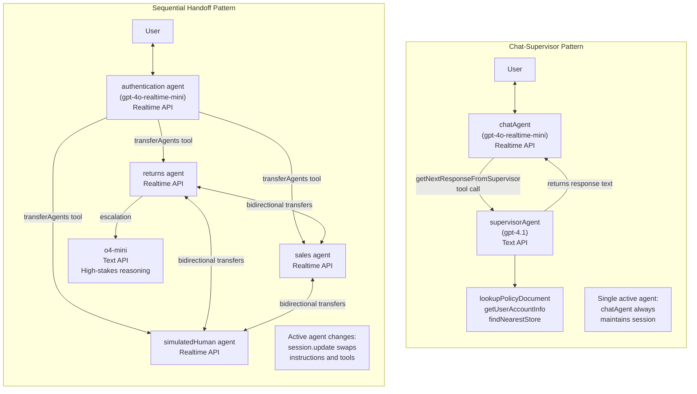
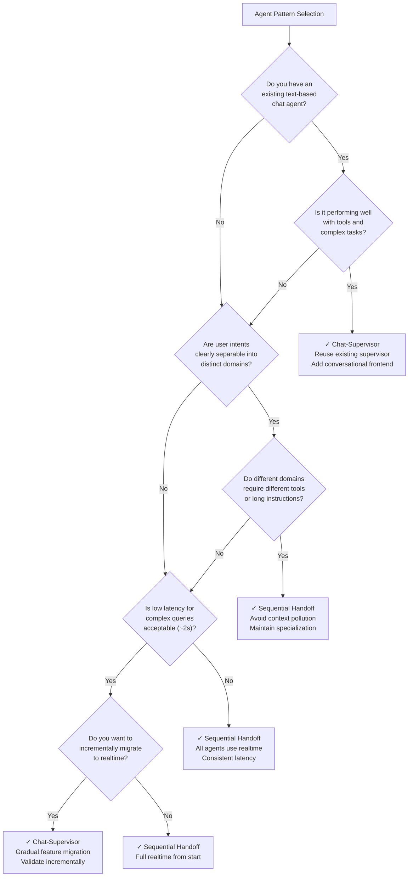
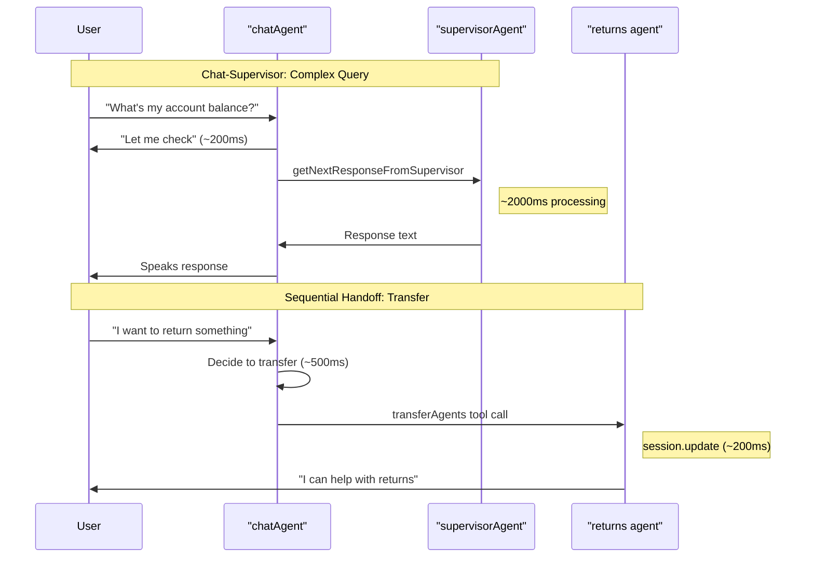
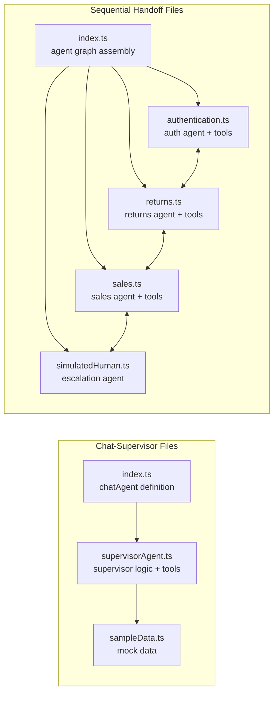

<!-- source: DeepWiki mcp.deepwiki.com · repo openai/openai-realtime-agents · page 2.4 Choosing a Pattern · fetched 2026-10-26 -->

# Choosing a Pattern

<details>
<summary>Relevant source files</summary>

The following files were used as context for generating this wiki page:

- [README.md](README.md)
- [public/screenshot_handoff.png](public/screenshot_handoff.png)
- [src/app/agentConfigs/index.ts](src/app/agentConfigs/index.ts)

</details>


This page provides guidance on selecting between the two primary agent patterns demonstrated in this repository: the **Chat-Supervisor Pattern** and the **Sequential Handoff Pattern**. It compares their architectures, trade-offs, and optimal use cases to help you determine which pattern best fits your requirements.

For detailed explanations of how each pattern works, see [Chat-Supervisor Pattern](#2.1) and [Sequential Handoff Pattern](#2.2). For information on configuring agents within either pattern, see [Agent Configuration System](#2.3).

## Pattern Comparison Matrix

The following table summarizes the key differences between the two patterns:

| Dimension | Chat-Supervisor | Sequential Handoff |
|-----------|-----------------|-------------------|
| **Agent Count** | 2 agents: `chatAgent` + `supervisorAgent` | N agents in a graph (e.g., `authentication`, `returns`, `sales`, `simulatedHuman`) |
| **Agent Roles** | Frontend (conversational) + Backend (intelligent) | Domain specialists with specific responsibilities |
| **Transfer Mechanism** | Tool call to `getNextResponseFromSupervisor` | Tool call to `transferAgents` with `destination` parameter |
| **Transfer Type** | Temporary delegation (returns to chatAgent) | Persistent transfer (new agent becomes active) |
| **Session Updates** | No session update; supervisor returns response text | `session.update` event changes instructions and tools |
| **Realtime API Usage** | Only chatAgent uses realtime API | All agents use realtime API |
| **Text API Usage** | Supervisor uses GPT-4.1 or GPT-4.1-mini | Optional: specific agents can escalate to o4-mini |
| **Agent Graph** | Linear: User ↔ chatAgent → supervisorAgent | Fully-connected or directed graph |
| **Configuration Complexity** | Low: 2 agent configs, 1 tool | Medium-High: N agent configs, transfer injection |
| **Typical Latency** | ~2s for complex queries requiring supervisor | Consistent latency; transfer occurs mid-conversation |
| **Best For** | Balancing UX with intelligence | Complex multi-domain flows |

Sources: [README.md:18-20](), [README.md:30-81](), [README.md:83-146]()

## Architecture Comparison



**Key Architectural Difference:** In Chat-Supervisor, the `chatAgent` remains the active session participant and consults the `supervisorAgent` via a synchronous tool call. In Sequential Handoff, the active agent changes entirely when `transferAgents` is called, triggering a `session.update` event that reconfigures the realtime session.

Sources: [README.md:40-62](), [README.md:148-204]()

## Decision Flowchart



Sources: [README.md:64-70](), [README.md:83-84]()

## Use Case Mapping

### When to Use Chat-Supervisor

**Optimal Scenarios:**

1. **Existing Text Agent Migration**
   - You have a working text-based agent with good tool-calling performance
   - You want to add voice capabilities without rewriting everything
   - Configuration: Reuse your text agent prompt for `supervisorAgent`, add conversational `chatAgent`
   - Implementation: [src/app/agentConfigs/chatSupervisor/supervisorAgent.ts]()

2. **Simple Information Retrieval + Complex Reasoning**
   - Basic tasks: greetings, information collection, simple Q&A
   - Complex tasks: policy lookups, account queries, multi-step reasoning
   - The `chatAgent` handles basic interactions instantly; complex queries go to `supervisorAgent`
   - Example: Customer support where most queries are simple but some require deep knowledge

3. **Cost Optimization**
   - Use `gpt-4o-mini-realtime` for `chatAgent` (frequent, simple interactions)
   - Use `gpt-4.1-mini` for `supervisorAgent` (infrequent, complex tasks)
   - Lower overall cost compared to full `gpt-4o-realtime` for all interactions

4. **Incremental Feature Migration**
   - Start with supervisor handling everything
   - Gradually move low-risk tasks to chatAgent by expanding the "Allow List"
   - Validate each feature before production deployment
   - See [README.md:72-80]() for modification guidance

**Example Configuration:**
```typescript
// chatAgent handles basic tasks
const chatAgent = new RealtimeAgent({
  name: 'chatAgent',
  instructions: `Handle greetings, collect phone numbers, 
    use getNextResponseFromSupervisor for complex queries`,
  tools: [getNextResponseFromSupervisorTool],
  // ...
});

// supervisorAgent has all domain intelligence
const supervisorAgent = {
  model: 'gpt-4.1',
  instructions: '==== Domain-Specific Agent Instructions ====...',
  tools: [lookupPolicyDocument, getUserAccountInfo, findNearestStore],
};
```

Sources: [README.md:30-81](), [src/app/agentConfigs/chatSupervisor/index.ts]()

### When to Use Sequential Handoff

**Optimal Scenarios:**

1. **Multi-Domain Customer Service**
   - Distinct user intents: authentication, returns, sales, technical support
   - Each domain has specialized instructions and tools
   - Users naturally switch between domains (e.g., return inquiry → new purchase)
   - Configuration: Define agent graph with `downstreamAgents` and `injectTransferTools()`
   - Implementation: [src/app/agentConfigs/customerServiceRetail/index.ts]()

2. **State Machine Workflows**
   - Authentication flows with structured verification steps
   - Multi-step processes requiring state tracking (e.g., order placement)
   - Each agent maintains its own state machine in instructions
   - Example: [src/app/agentConfigs/customerServiceRetail/authentication.ts]() (implied)

3. **Avoiding Context Pollution**
   - Single "god agent" with all capabilities performs poorly
   - Different domains have conflicting instructions or tone requirements
   - Long combined instructions exceed token limits or degrade performance
   - Solution: Specialized agents with focused instructions

4. **High-Stakes Decision Points**
   - Specific agents escalate critical decisions to reasoning models
   - Example: `returns` agent uses `o4-mini` for return eligibility determination
   - Only escalate when necessary; maintain realtime for conversation flow
   - See [README.md:121-123]() for escalation pattern

5. **Bidirectional Handoffs**
   - Users need to move freely between domains
   - Example: Discussing return policy → asking about promotions → back to return
   - Graph structure: `authentication.downstreamAgents = [returns, sales, simulatedHuman]`
   - Configuration: [README.md:133-136]()

**Example Configuration:**
```typescript
// Define specialized agents
const authAgent = new RealtimeAgent({
  name: 'authentication',
  instructions: 'State machine for user verification...',
  handoffs: [returnsAgent, salesAgent, humanAgent],
  // ...
});

const returnsAgent = new RealtimeAgent({
  name: 'returns',
  instructions: 'Handle return inquiries, check eligibility...',
  tools: [checkEligibilityAndPossiblyInitiateReturn],
  handoffs: [authAgent, salesAgent, humanAgent],
  // ...
});

// Inject transfer tools automatically
const agents = injectTransferTools([authAgent, returnsAgent, salesAgent, humanAgent]);
```

Sources: [README.md:82-146](), [README.md:127-146](), [src/app/agentConfigs/customerServiceRetail/index.ts]()

## Trade-off Analysis

### Latency Comparison



**Latency Characteristics:**

| Pattern | Basic Query | Complex Query | Agent Transfer |
|---------|-------------|---------------|----------------|
| Chat-Supervisor | ~200ms | ~2000ms | N/A (no transfer) |
| Sequential Handoff | ~500ms | ~500ms | ~700ms (transfer time) |

Sources: [README.md:38](), Diagram 2 from high-level architecture

### Configuration Complexity

**Chat-Supervisor Setup:**
1. Define `chatAgent` with conversational instructions
2. Define `supervisorAgent` with domain logic and tools
3. Implement `getNextResponseFromSupervisor` tool logic
4. Total files: 3 (index.ts, supervisorAgent.ts, sampleData.ts)

**Sequential Handoff Setup:**
1. Define N specialized agents (authentication, returns, sales, etc.)
2. Configure `downstreamAgents` for each agent's transfer graph
3. Call `injectTransferTools()` utility to generate transfer tools
4. Implement domain-specific tool logic for each agent
5. Total files: N+1 (one per agent + index.ts)

**Complexity Comparison:**



Sources: [src/app/agentConfigs/chatSupervisor/](), [src/app/agentConfigs/customerServiceRetail/]()

### Cost Comparison

**Chat-Supervisor Cost Structure:**
- `chatAgent`: `gpt-4o-realtime-mini` (or `gpt-4o-mini-realtime`) for all user interactions
- `supervisorAgent`: `gpt-4.1` (or `gpt-4.1-mini`) only when complex query detected
- Cost optimization: Most queries handled by cheaper realtime-mini model

**Sequential Handoff Cost Structure:**
- All agents: `gpt-4o-realtime-mini` for conversational interactions
- Optional escalations: `o4-mini` for specific high-stakes decisions
- Cost consideration: More tokens consumed due to multiple session updates

**Example Cost Calculation:**
Assume 100 user queries, 20% complex, 5% require agent transfer:
- Chat-Supervisor: 100 realtime-mini calls + 20 gpt-4.1 calls
- Sequential Handoff: 100 realtime-mini calls + 5 session updates + rare escalations

Sources: [README.md:68](), [README.md:80](), [README.md:121-123]()

## Implementation Examples in Codebase

The repository provides three working examples demonstrating both patterns:

### 1. Simple Handoff (Minimal Sequential Handoff)
- **Config**: [src/app/agentConfigs/simpleHandoff.ts]()
- **Agents**: `greeterAgent` → `haikuWriterAgent` (unidirectional)
- **Purpose**: Educational demonstration of basic transfer mechanics
- **Complexity**: Minimal (2 agents, no tools)

### 2. Chat Supervisor (Chat-Supervisor Pattern)
- **Config**: [src/app/agentConfigs/chatSupervisor/index.ts]()
- **Agents**: `chatAgent` + `supervisorAgent`
- **Tools**: `getNextResponseFromSupervisor`, `lookupPolicyDocument`, `getUserAccountInfo`, `findNearestStore`
- **Purpose**: NewTelco customer service with intelligent delegation
- **Key File**: [src/app/agentConfigs/chatSupervisor/supervisorAgent.ts]()

### 3. Customer Service Retail (Advanced Sequential Handoff)
- **Config**: [src/app/agentConfigs/customerServiceRetail/index.ts]()
- **Agents**: `authentication`, `returns`, `sales`, `simulatedHuman`
- **Graph**: Fully-connected bidirectional transfers
- **Escalation**: `returns` agent uses `o4-mini` for high-stakes decisions
- **Purpose**: Complex multi-domain customer service flow

**Registry Configuration:**
```typescript
// All scenarios registered in central index
export const allAgentSets: Record<string, RealtimeAgent[]> = {
  simpleHandoff: simpleHandoffScenario,          // Basic transfer demo
  customerServiceRetail: customerServiceRetailScenario,  // Advanced handoff
  chatSupervisor: chatSupervisorScenario,        // Chat-supervisor pattern
};

export const defaultAgentSetKey = 'chatSupervisor';
```

Sources: [src/app/agentConfigs/index.ts:8-14](), [README.md:91-116](), [README.md:118-146]()

## Migration Strategies

### From Text Agent to Chat-Supervisor

1. **Phase 1: Direct Migration**
   - Copy existing text agent prompt to `supervisorAgent.instructions`
   - Copy all tools to `supervisorAgent` tool definitions
   - Create minimal `chatAgent` that delegates everything to supervisor
   - Result: Voice-enabled version of existing agent with ~2s latency

2. **Phase 2: Incremental Optimization**
   - Identify low-risk tasks: greetings, acknowledgments, information collection
   - Add these to `chatAgent` "Allow List of Permitted Actions"
   - Test each task thoroughly before production deployment
   - Result: Improved latency for common queries while maintaining quality

3. **Phase 3: Cost Optimization**
   - Switch `chatAgent` to `gpt-4o-mini-realtime` if appropriate
   - Switch `supervisorAgent` to `gpt-4.1-mini` if intelligence requirements allow
   - Monitor quality metrics and adjust as needed
   - Result: Reduced operational costs

Sources: [README.md:72-80]()

### From Chat-Supervisor to Sequential Handoff

1. **Identify Domain Boundaries**
   - Analyze conversation logs to identify distinct user intent clusters
   - Group intents by domain (e.g., account management, technical support, billing)
   - Determine which domains require different tools or conflicting instructions

2. **Extract Domain Agents**
   - Create separate agent files for each domain
   - Move domain-specific instructions from `supervisorAgent` to specialist agents
   - Configure `downstreamAgents` to define transfer graph
   - Use `injectTransferTools()` utility to generate transfer capabilities

3. **Test Transfer Flows**
   - Verify users can move between agents appropriately
   - Test edge cases: transfers during incomplete tasks, repeated transfers
   - Validate that context is maintained across transfers

4. **Add Escalations (Optional)**
   - Identify high-stakes decisions requiring advanced reasoning
   - Implement text API calls to `o4-mini` for these decisions
   - Example pattern: [src/app/agentConfigs/customerServiceRetail/returns.ts:233]()

Sources: [README.md:119-123](), [README.md:127-146]()

## Selection Summary Table

| Requirement | Recommended Pattern | Rationale |
|-------------|---------------------|-----------|
| Existing text agent to migrate | Chat-Supervisor | Reuse existing logic, minimal rewrite |
| 3+ distinct user intent domains | Sequential Handoff | Specialization prevents context pollution |
| Single domain with varying complexity | Chat-Supervisor | Delegate complexity without domain switching |
| State machine workflows | Sequential Handoff | Each agent maintains focused state |
| Cost optimization priority | Chat-Supervisor | Use mini models for most interactions |
| Consistent latency requirement | Sequential Handoff | All realtime, no supervisor delays |
| Incremental adoption strategy | Chat-Supervisor | Gradually shift features to realtime |
| High-stakes decision points | Either | Both support text API escalation |
| Simple proof-of-concept | Sequential Handoff | Minimal config ([simpleHandoff.ts]()) |

Sources: [README.md:18-21](), [README.md:64-70](), [README.md:83-84]()

## Key Decision Factors

When choosing between patterns, prioritize these factors in order:

1. **Domain Structure**: Multiple distinct domains → Sequential Handoff
2. **Existing Assets**: Working text agent → Chat-Supervisor  
3. **Latency Tolerance**: Cannot accept 2s delays → Sequential Handoff
4. **Configuration Complexity**: Limited development time → Chat-Supervisor
5. **Cost Constraints**: Tight budget → Chat-Supervisor with mini models
6. **Future Scalability**: Expecting many domains → Sequential Handoff

Both patterns are production-ready and can be selected based on your specific requirements. The repository provides working examples of each pattern that can be adapted for your use case.

Sources: [README.md:1-225](), [src/app/agentConfigs/index.ts:1-15]()

---

