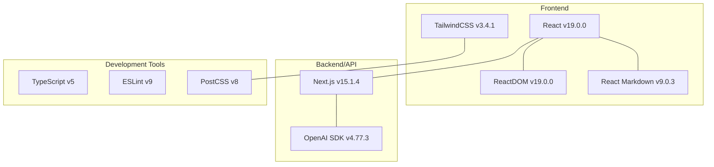
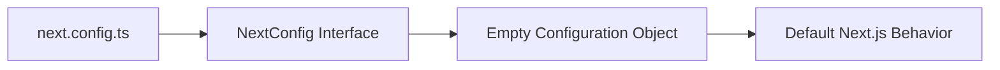
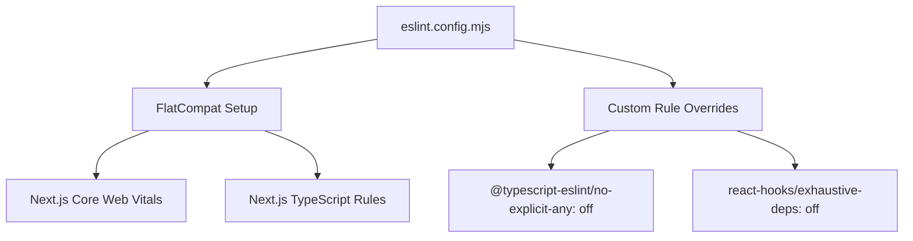
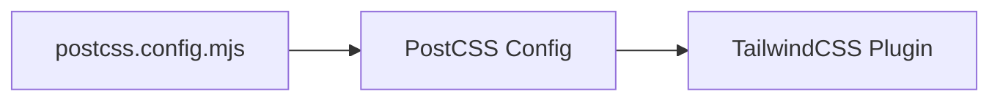
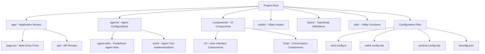
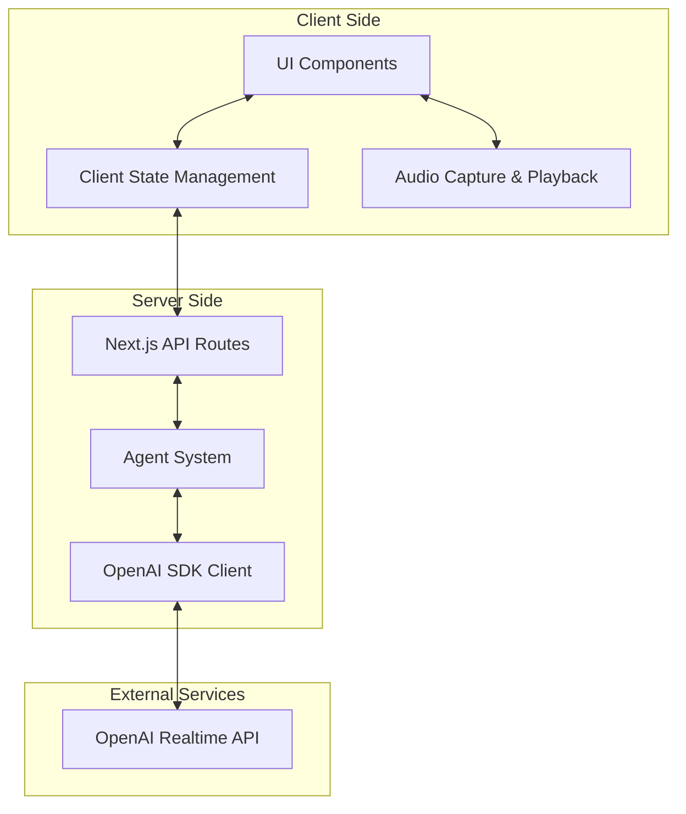
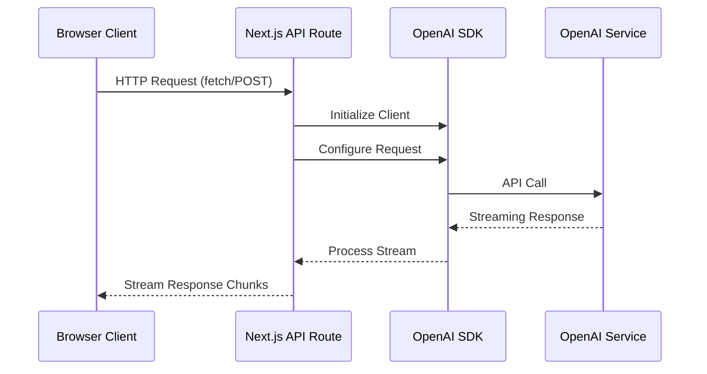
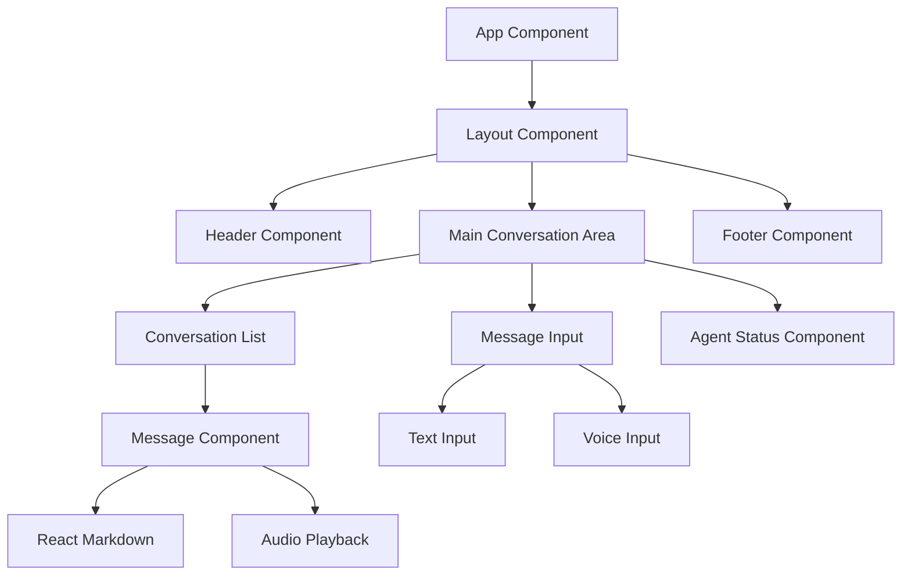
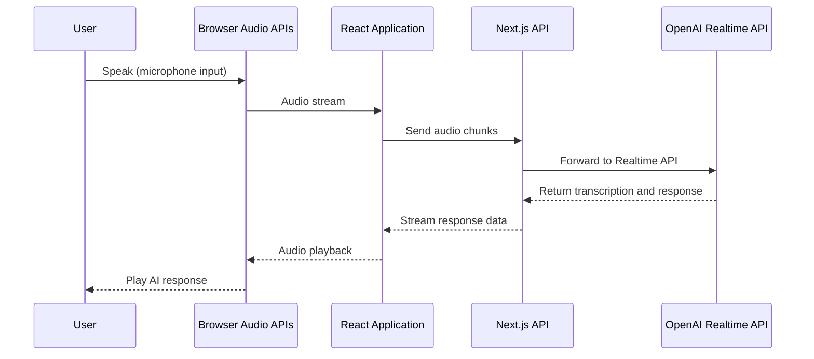
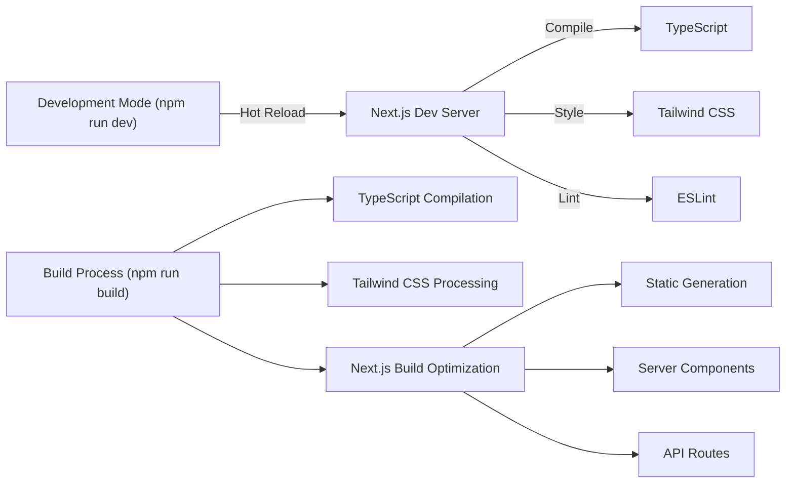

<!-- source: DeepWiki mcp.deepwiki.com · repo openai/openai-realtime-agents · page 3 Technical Implementation · fetched 2026-10-26 -->

# Technical Implementation

Relevant source files

The following files were used as context for generating this wiki page:

- [README.md](README.md)
- [public/screenshot_handoff.png](public/screenshot_handoff.png)

This page provides a comprehensive overview of the technical aspects of the OpenAI Realtime Agents codebase, focusing on implementation details, technology choices, and development setup. For information about conceptual components like Agent Sets and Agent Configuration, see [Agent System Core Concepts](#2). For specific examples, see [Example Agent Sets](#3).

## Technology Stack

The OpenAI Realtime Agents project is built with a modern web technology stack centered around Next.js and React, with TypeScript providing type safety throughout the application.

Sources: [package.json:11-29]()

### Core Dependencies

| Category | Technology | Version | Purpose |
|----------|------------|---------|---------|
| Framework | Next.js | 15.1.4 | React framework with server-side rendering |
| UI | React | 19.0.0 | Frontend library for building user interfaces |
| UI | React DOM | 19.0.0 | React rendering for web browsers |
| UI | React Markdown | 9.0.3 | Markdown rendering in React components |
| API | OpenAI SDK | 4.77.3 | Interface to OpenAI's APIs |
| Styling | TailwindCSS | 3.4.1 | Utility-first CSS framework |
| Utilities | UUID | 11.0.4 | Generation of universally unique identifiers |
| DevTools | TypeScript | 5.x | Static typing for JavaScript |
| DevTools | ESLint | 9.x | Code linting and style enforcement |

Sources: [package.json:11-29]()

## Project Configuration

The project uses standard Next.js configuration with additional tooling for code quality and styling.

### Next.js Configuration

The Next.js configuration is minimal, providing a foundation for the application without extensive customizations.

Sources: [next.config.ts:1-7]()

### ESLint Configuration

ESLint is configured to use Next.js's recommended rules with TypeScript support, with some specific rule adjustments:

Sources: [eslint.config.mjs:1-22]()

### CSS Configuration

The project uses TailwindCSS for styling, configured through PostCSS:

Sources: [postcss.config.mjs:1-9]()

## Project Structure

The OpenAI Realtime Agents project follows a typical Next.js application structure with specialized directories for agent configurations and tools.

Sources: [package.json:1-30](), [next.config.ts:1-7](), [eslint.config.mjs:1-22](), [postcss.config.mjs:1-9]()

## Development Environment

### Scripts and Commands

The project provides standard npm scripts for development, building, and linting:

| Command | Purpose |
|---------|---------|
| `npm run dev` | Start development server |
| `npm run build` | Build production-ready application |
| `npm run start` | Start production server |
| `npm run lint` | Run ESLint to check code quality |

Sources: [package.json:5-10]()

### Project Setup

To set up the project locally:

1. Clone the repository
2. Install dependencies with `npm install`
3. Create environment variables for OpenAI API keys
4. Run the development server with `npm run dev`

For more detailed setup instructions, see [Project Setup](#4.1).

## Technical Architecture

The application is built on a client-server architecture facilitated by Next.js, with specialized components for handling real-time communication with OpenAI's APIs.

Sources: [package.json:11-18]()

### Next.js and API Routes

The application leverages Next.js's API routes to create serverless functions that interface with OpenAI's APIs. This approach provides:

1. Backend functionality without dedicated server infrastructure
2. Secure API key management (server-side only)
3. Simplified deployment model

### OpenAI SDK Integration

The application integrates with OpenAI's services using their official JavaScript SDK (version 4.77.3), which provides:

1. Type-safe interfaces for API requests
2. Streaming response handling
3. Authentication management
4. Error handling

Sources: [package.json:13]()

## UI Implementation

The user interface is built with React 19, React Markdown for message formatting, and TailwindCSS for styling.

### Component Architecture

Sources: [package.json:11-17]()

## Audio Processing

The application handles real-time voice conversation through the browser's WebAudio API for capture and the HTML5 Audio API for playback.

Sources: [package.json:11-17]()

## Development and Build Process

The project uses a standard Next.js development workflow, enhanced with TypeScript for type safety and ESLint for code quality.

Sources: [package.json:5-10](), [next.config.ts:1-7](), [eslint.config.mjs:1-22](), [postcss.config.mjs:1-9]()

## Summary

The OpenAI Realtime Agents codebase implements a sophisticated agent-based conversational system using modern web technologies. The technical implementation leverages Next.js as the foundation, OpenAI SDK for API integration, and React for the user interface. The project structure follows best practices for Next.js applications with specialized directories for agent configurations and tools.

For detailed information about setting up the project, see [Project Setup](#4.1). For information about the Next.js configuration, see [Next.js Configuration](#4.2). For documentation about UI components, see [UI Components and Assets](#4.3).

---

