<!-- source: DeepWiki mcp.deepwiki.com · repo openai/openai-realtime-agents · page 3.1 Real-time Session Management · fetched 2026-10-26 -->

# Real-time Session Management

<details>
<summary>Relevant source files</summary>

The following files were used as context for generating this wiki page:

- [README.md](README.md)
- [public/screenshot_handoff.png](public/screenshot_handoff.png)
- [src/app/api/session/route.ts](src/app/api/session/route.ts)
- [src/app/hooks/useRealtimeSession.ts](src/app/hooks/useRealtimeSession.ts)
- [src/app/lib/codecUtils.ts](src/app/lib/codecUtils.ts)

</details>


## Purpose and Scope

This document describes the real-time session management system that orchestrates WebRTC connections to the OpenAI Realtime API. The system is implemented primarily through the `useRealtimeSession` hook, which manages connection lifecycle, event handling, audio codec configuration, and session state.

For information about the frontend components that consume this session, see [Frontend Architecture](#3.2). For details about API endpoints that support session creation, see [API Routes and Backend](#3.3). For agent configuration patterns that define session behavior, see [Agent Configuration System](#2.3).

---

## Overview

The session management system bridges the Next.js application with OpenAI's Realtime API via WebRTC. It abstracts the complexity of establishing peer connections, managing audio transceivers, configuring data channels, and handling real-time events.

**Key Components:**

| Component | File | Purpose |
|-----------|------|---------|
| `useRealtimeSession` hook | [src/app/hooks/useRealtimeSession.ts]() | Main session management interface |
| `/api/session` endpoint | [src/app/api/session/route.ts]() | Ephemeral key generation |
| `applyCodecPreferences` | [src/app/lib/codecUtils.ts]() | Audio codec configuration |
| `RealtimeSession` (SDK) | OpenAI Agents SDK | Session orchestration |
| `OpenAIRealtimeWebRTC` (SDK) | OpenAI Agents SDK | WebRTC transport implementation |

Sources: [src/app/hooks/useRealtimeSession.ts:1-205](), [README.md:1-230]()

---

## Session Lifecycle

### Connection State Machine

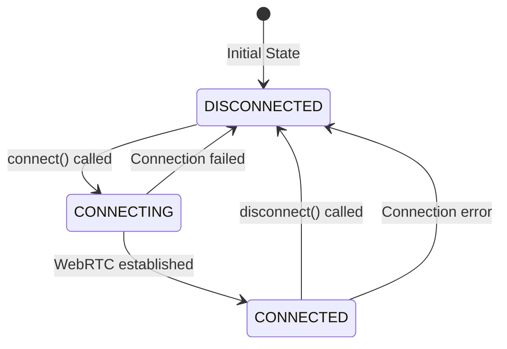

**Session Status Types:**

The system tracks session status using the `SessionStatus` type, which represents the three possible connection states.

| Status | Description |
|--------|-------------|
| `DISCONNECTED` | No active session, initial state |
| `CONNECTING` | Establishing WebRTC connection |
| `CONNECTED` | Active session with bidirectional audio/data |

Sources: [src/app/hooks/useRealtimeSession.ts:11-30]()

---

### Connection Establishment Flow

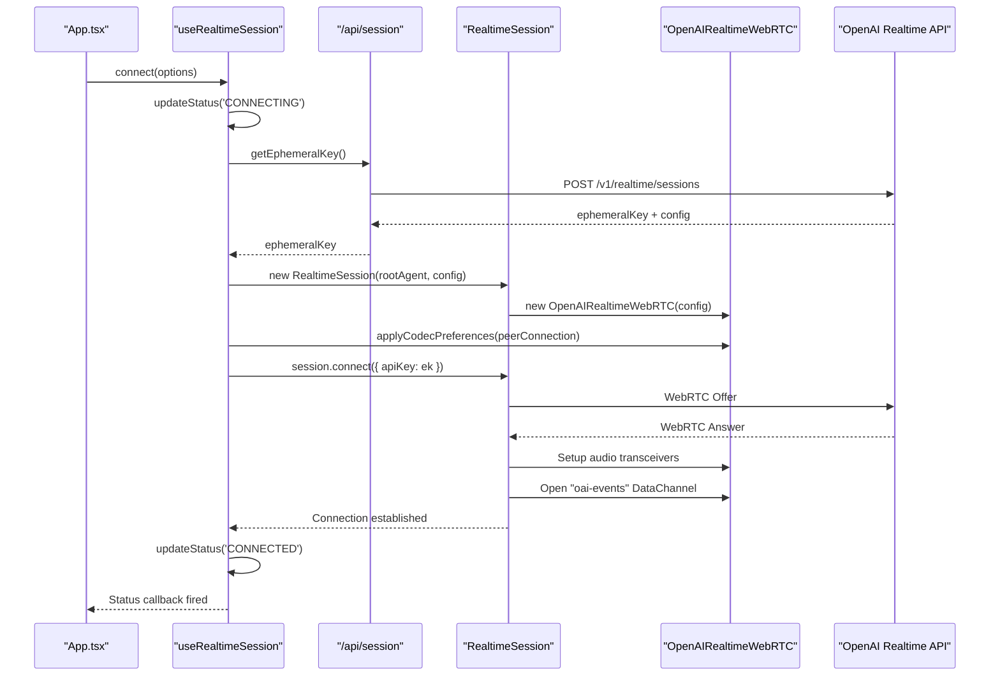

**Connection Steps:**

1. **Status Update**: Hook transitions to `CONNECTING` state [src/app/hooks/useRealtimeSession.ts:123]()
2. **Ephemeral Key**: Retrieves temporary authentication token from `/api/session` [src/app/hooks/useRealtimeSession.ts:125]()
3. **Session Creation**: Instantiates `RealtimeSession` with root agent and transport configuration [src/app/hooks/useRealtimeSession.ts:128-145]()
4. **Codec Configuration**: Applies codec preferences to peer connection before offer [src/app/hooks/useRealtimeSession.ts:132-135]()
5. **Connection**: Establishes WebRTC connection using ephemeral key [src/app/hooks/useRealtimeSession.ts:147]()
6. **Status Update**: Hook transitions to `CONNECTED` state [src/app/hooks/useRealtimeSession.ts:148]()

Sources: [src/app/hooks/useRealtimeSession.ts:113-151](), [src/app/api/session/route.ts:1-27]()

---

### Ephemeral Key Generation

The `/api/session` endpoint acts as a secure proxy to prevent exposing the `OPENAI_API_KEY` to client browsers:

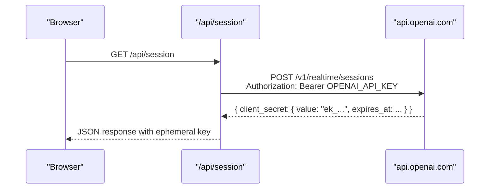

The endpoint creates a short-lived session credential with the `gpt-4o-realtime-preview-2025-06-03` model. The ephemeral key expires after a time window and is scoped to a single session.

**Security Pattern**: The server-side API key never leaves the Next.js server, while the ephemeral key is safe to transmit to the browser since it has limited scope and duration.

Sources: [src/app/api/session/route.ts:3-27]()

---

### Session Teardown

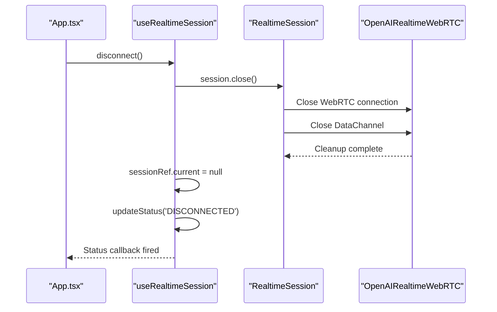

The teardown process cleanly releases all resources: the WebRTC peer connection, audio transceivers, and the `oai-events` data channel. The session reference is nullified to prevent stale operations.

Sources: [src/app/hooks/useRealtimeSession.ts:153-157]()

---

## The useRealtimeSession Hook

### Interface and Types

**Hook Signature:**

```typescript
function useRealtimeSession(callbacks?: RealtimeSessionCallbacks): {
  status: SessionStatus;
  connect: (options: ConnectOptions) => Promise<void>;
  disconnect: () => void;
  sendUserText: (text: string) => void;
  sendEvent: (event: any) => void;
  mute: (muted: boolean) => void;
  pushToTalkStart: () => void;
  pushToTalkStop: () => void;
  interrupt: () => void;
}
```

**Callback Types:**

| Callback | Purpose | Parameters |
|----------|---------|------------|
| `onConnectionChange` | Session status transitions | `status: SessionStatus` |
| `onAgentHandoff` | Agent transfer completed | `agentName: string` |

**Connection Options:**

| Option | Type | Purpose |
|--------|------|---------|
| `getEphemeralKey` | `() => Promise<string>` | Function to retrieve authentication token |
| `initialAgents` | `RealtimeAgent[]` | Agent set to initialize session with |
| `audioElement` | `HTMLAudioElement?` | Audio element for playback |
| `extraContext` | `Record<string, any>?` | Additional context data |
| `outputGuardrails` | `any[]?` | Content moderation guardrails |

Sources: [src/app/hooks/useRealtimeSession.ts:13-24]()

---

### State Management

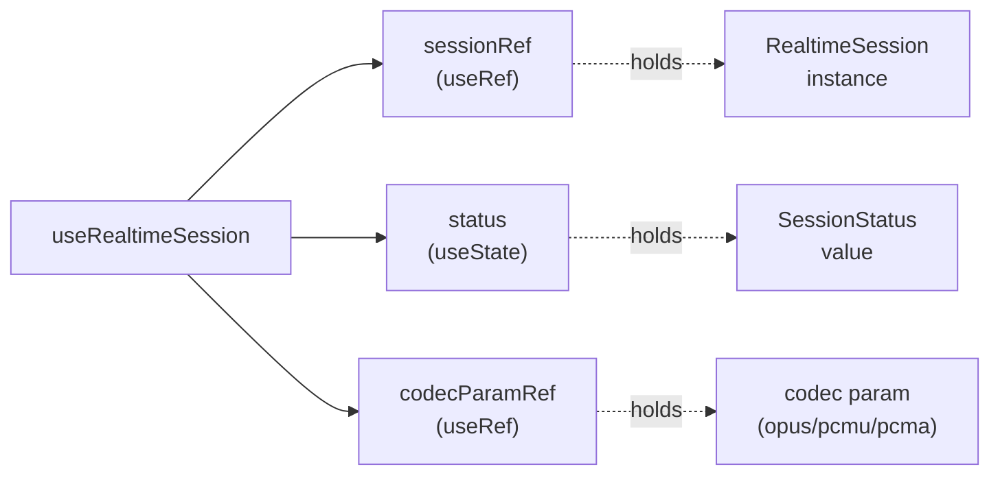

**State Variables:**

- **`sessionRef`**: Persistent reference to `RealtimeSession` instance, preserved across renders [src/app/hooks/useRealtimeSession.ts:27]()
- **`status`**: Current connection status (DISCONNECTED/CONNECTING/CONNECTED) [src/app/hooks/useRealtimeSession.ts:28-30]()
- **`codecParamRef`**: Audio codec preference from URL parameter (defaults to 'opus') [src/app/hooks/useRealtimeSession.ts:68-73]()

The hook uses `useRef` for the session to prevent re-renders when the session object changes, while `useState` for status ensures UI updates on connection state changes.

Sources: [src/app/hooks/useRealtimeSession.ts:27-73]()

---

### Core Methods

#### Message Sending

**Send Text Message:**
```typescript
sendUserText(text: string)
```
Creates a user message item in the conversation. Used for text input from the UI.

**Send Raw Event:**
```typescript
sendEvent(event: any)
```
Sends a raw protocol event through the transport layer. Provides low-level control for advanced use cases.

**Interrupt Playback:**
```typescript
interrupt()
```
Stops the current assistant response playback and clears the audio buffer. Used when the user wants to interrupt the assistant.

Sources: [src/app/hooks/useRealtimeSession.ts:165-177]()

---

#### Push-to-Talk Control

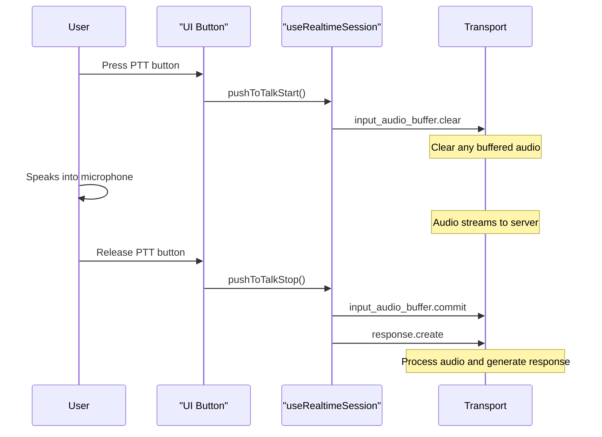

**Push-to-Talk Methods:**

- **`pushToTalkStart()`**: Clears audio buffer when PTT button is pressed [src/app/hooks/useRealtimeSession.ts:182-185]()
- **`pushToTalkStop()`**: Commits buffered audio and triggers response generation [src/app/hooks/useRealtimeSession.ts:187-191]()

This pattern prevents voice activity detection (VAD) from triggering during PTT mode, giving users explicit control over when they're transmitting audio.

Sources: [src/app/hooks/useRealtimeSession.ts:182-191]()

---

#### Audio Control

**Mute/Unmute:**
```typescript
mute(muted: boolean)
```

Controls microphone input. When muted, audio is not transmitted to the server. This is distinct from pausing playback - it only affects the input stream.

Sources: [src/app/hooks/useRealtimeSession.ts:178-180]()

---

## Event Handling System

### Event Architecture

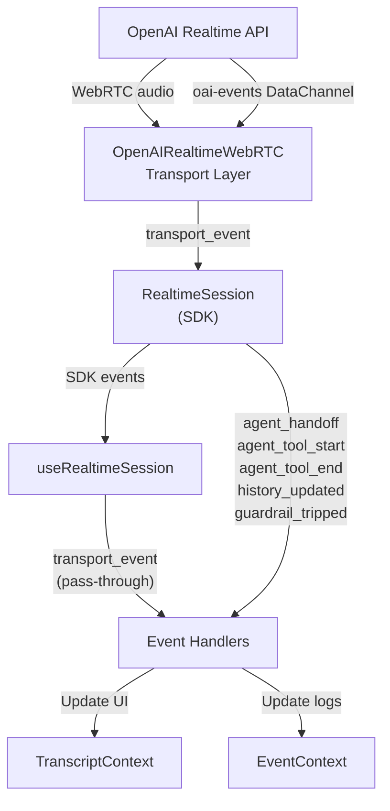

The event system operates in layers:
1. **Transport Layer**: Receives raw protocol events from OpenAI via DataChannel
2. **Session Layer**: SDK processes events, emits high-level semantic events
3. **Hook Layer**: Registers event listeners, routes to appropriate handlers
4. **Handler Layer**: Updates application state (transcript, event log)

Sources: [src/app/hooks/useRealtimeSession.ts:46-111]()

---

### Session Event Registration

The hook registers event listeners in a `useEffect` that runs when the session instance changes:

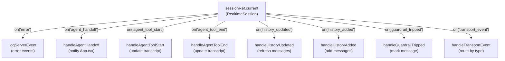

**Event Categories:**

| Event | Handler | Purpose |
|-------|---------|---------|
| `error` | `logServerEvent` | Log server-side errors [src/app/hooks/useRealtimeSession.ts:93-98]() |
| `agent_handoff` | `handleAgentHandoff` | Extract and notify about agent transfers [src/app/hooks/useRealtimeSession.ts:83-88]() |
| `agent_tool_start` | `handleAgentToolStart` | Mark tool call initiated in transcript |
| `agent_tool_end` | `handleAgentToolEnd` | Mark tool call completed in transcript |
| `history_updated` | `handleHistoryUpdated` | Refresh conversation history |
| `history_added` | `handleHistoryAdded` | Append new items to history |
| `guardrail_tripped` | `handleGuardrailTripped` | Mark moderation failure |
| `transport_event` | `handleTransportEvent` | Route raw protocol events |

Sources: [src/app/hooks/useRealtimeSession.ts:90-111]()

---

### Transport Event Routing

The `handleTransportEvent` function routes raw protocol events to specialized handlers:

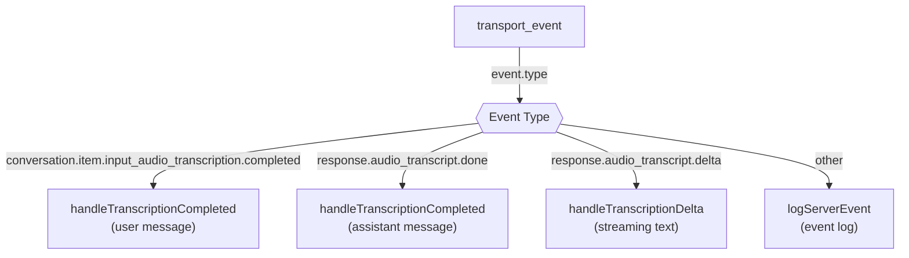

**Key Transport Events:**

| Event Type | Purpose |
|------------|---------|
| `conversation.item.input_audio_transcription.completed` | User speech transcription ready |
| `response.audio_transcript.done` | Assistant speech transcription complete |
| `response.audio_transcript.delta` | Streaming assistant transcription chunks |

All unhandled events are logged to the event log for debugging purposes.

Sources: [src/app/hooks/useRealtimeSession.ts:46-66]()

---

### Agent Handoff Event Handling

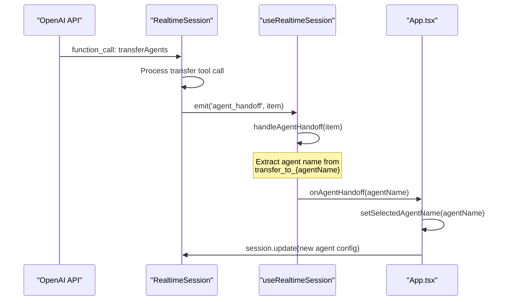

The handoff handler extracts the destination agent name from the tool call context. The transfer tool is named `transfer_to_{agentName}`, so the handler parses the suffix to determine the target agent.

Sources: [src/app/hooks/useRealtimeSession.ts:83-88](), [src/app/hooks/useRealtimeSession.ts:101]()

---

## Audio Codec Configuration

### Codec Selection System

The system supports three audio codecs for testing different scenarios:

| Codec | Sample Rate | Bandwidth | Use Case |
|-------|-------------|-----------|----------|
| `opus` | 48 kHz | Wide-band | Default, highest quality |
| `pcmu` (G.711 μ-law) | 8 kHz | Narrow-band | Simulate PSTN phone calls |
| `pcma` (G.711 A-law) | 8 kHz | Narrow-band | Simulate PSTN phone calls (Europe) |

The codec is selected via URL parameter: `?codec=opus` (default), `?codec=pcmu`, or `?codec=pcma`.

Sources: [src/app/hooks/useRealtimeSession.ts:68-73](), [README.md:220]()

---

### Codec Application Flow

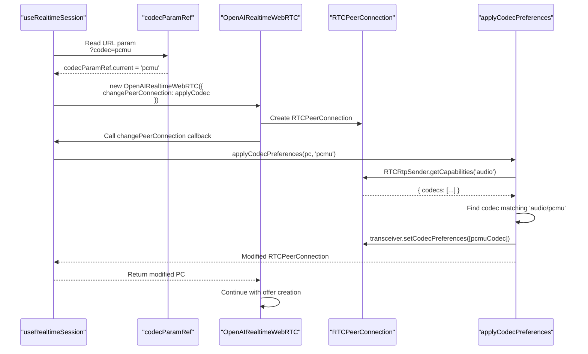

**Codec Application Steps:**

1. **Parameter Read**: Codec preference read from URL on hook initialization [src/app/hooks/useRealtimeSession.ts:68-73]()
2. **Callback Registration**: `changePeerConnection` callback provided to transport [src/app/hooks/useRealtimeSession.ts:132-135]()
3. **Capability Query**: Query available codecs from browser's RTP sender [src/app/lib/codecUtils.ts:7-8]()
4. **Codec Matching**: Find codec matching requested MIME type [src/app/lib/codecUtils.ts:10-13]()
5. **Preference Application**: Set codec preference on audio transceivers [src/app/lib/codecUtils.ts:15-18]()

The codec preference is applied **before** the WebRTC offer is created, ensuring the preference is reflected in the SDP negotiation.

Sources: [src/app/hooks/useRealtimeSession.ts:68-81](), [src/app/lib/codecUtils.ts:1-22]()

---

### Codec Utility Implementation

The `applyCodecPreferences` function is designed to be safe and non-destructive:

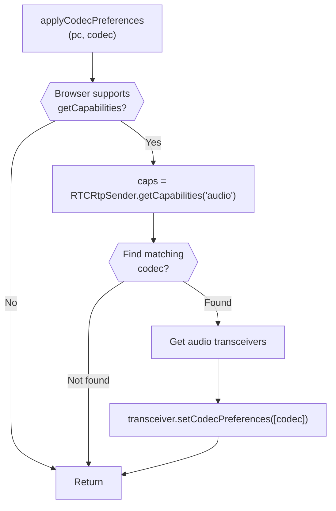

**Error Handling**: The function wraps all operations in a try-catch block. If any step fails, it logs the error and returns gracefully without disrupting the connection.

**Safety Features**:
- Early return if browser doesn't support `getCapabilities`
- Early return if requested codec not available
- Error catching prevents codec issues from breaking the connection
- Can be called multiple times safely

Sources: [src/app/lib/codecUtils.ts:1-22]()

---

## Integration with Application

### Hook Usage in App.tsx

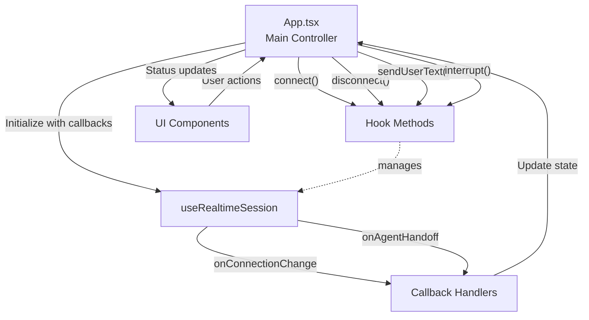

**Callback Registration:**

The App component provides two callbacks when initializing the hook:

1. **`onConnectionChange`**: Updates local status state and UI indicators
2. **`onAgentHandoff`**: Updates selected agent name and triggers session update

**Method Invocation:**

UI interactions trigger hook methods:
- Connect button → `connect({ getEphemeralKey, initialAgents, ... })`
- Disconnect button → `disconnect()`
- Text input send → `sendUserText(message)`
- Interrupt button → `interrupt()`
- PTT press/release → `pushToTalkStart()` / `pushToTalkStop()`

Sources: [src/app/hooks/useRealtimeSession.ts:26-204]()

---

### Connection Options Configuration

When connecting, the App provides a comprehensive configuration object:

| Option | Value Source | Purpose |
|--------|--------------|---------|
| `getEphemeralKey` | `() => fetch('/api/session')` | Async function to retrieve auth token |
| `initialAgents` | `allAgentSets[selectedConfig]` | Agent set from registry |
| `audioElement` | `document.getElementById('audio')` | HTML audio element reference |
| `extraContext` | `{ ... }` | Additional context for agents |
| `outputGuardrails` | `[moderationGuardrail]` | Content moderation rules |

The connection process is fully asynchronous, allowing the App to show loading states during the `CONNECTING` phase.

Sources: [src/app/hooks/useRealtimeSession.ts:18-24](), [src/app/hooks/useRealtimeSession.ts:113-151]()

---

## Session Configuration

### RealtimeSession Options

When creating a `RealtimeSession`, the hook provides comprehensive configuration:

```typescript
new RealtimeSession(rootAgent, {
  transport: new OpenAIRealtimeWebRTC({
    audioElement,
    changePeerConnection: async (pc) => applyCodec(pc),
  }),
  model: 'gpt-4o-realtime-preview-2025-06-03',
  config: {
    inputAudioTranscription: {
      model: 'gpt-4o-mini-transcribe',
    },
  },
  outputGuardrails: outputGuardrails ?? [],
  context: extraContext ?? {},
})
```

**Configuration Components:**

| Component | Purpose |
|-----------|---------|
| `rootAgent` | Initial agent from agent set (first in array) |
| `transport` | WebRTC transport with audio element and codec config |
| `model` | Realtime model version |
| `config.inputAudioTranscription` | Transcription model for user audio |
| `outputGuardrails` | Content moderation guardrails |
| `context` | Additional context data available to all agents |

Sources: [src/app/hooks/useRealtimeSession.ts:128-145]()

---

### Audio Transcription Configuration

The session enables input audio transcription using the `gpt-4o-mini-transcribe` model. This generates text transcriptions of user speech, which are delivered via the `conversation.item.input_audio_transcription.completed` event.

**Benefits:**
- Provides text representation of user messages in transcript UI
- Enables text-based guardrails on user input
- Creates searchable conversation history
- Supports accessibility features

Sources: [src/app/hooks/useRealtimeSession.ts:139-141]()

---

## Error Handling

### Session-Level Errors

The hook registers an error event listener that logs all session errors:

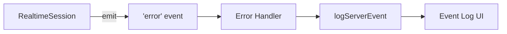

Errors are logged with type `"error"` and include the error message. This provides visibility into connection issues, protocol errors, and API problems without crashing the application.

Sources: [src/app/hooks/useRealtimeSession.ts:93-98]()

---

### Connection Failure Handling

If the connection fails during establishment, the session remains in the `CONNECTING` state and does not transition to `CONNECTED`. The application can detect this by observing that the status callback is not invoked with `CONNECTED` status.

**Recovery Pattern**: The user can click "Disconnect" (which resets to `DISCONNECTED`) and then "Connect" again to retry.

Sources: [src/app/hooks/useRealtimeSession.ts:123-151]()

---

## Advanced Usage Patterns

### Dynamic Agent Switching

While connected, agents can be swapped by calling `session.update()` on the session instance. This is typically done in response to an `agent_handoff` event:

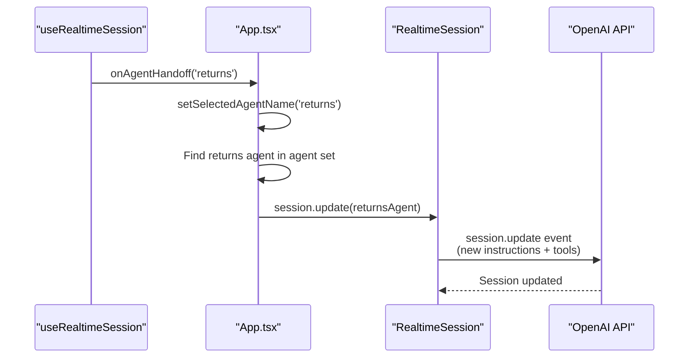

The session update changes the active agent's instructions and tools without disconnecting the WebRTC connection. This enables seamless multi-agent flows.

Sources: [src/app/hooks/useRealtimeSession.ts:83-88]()

---

### Custom Event Injection

The `sendEvent` method provides low-level access to inject custom protocol events:

```typescript
// Example: Clear input audio buffer
sendEvent({ type: 'input_audio_buffer.clear' });

// Example: Trigger response generation
sendEvent({ type: 'response.create' });
```

This is primarily used internally for PTT mode but can be leveraged for advanced use cases like manual response triggering or buffer manipulation.

Sources: [src/app/hooks/useRealtimeSession.ts:174-176]()

---

## Performance Considerations

### Reference Stability

The hook uses `useRef` for the session instance to prevent unnecessary re-renders. The session object is complex and frequently mutated, so storing it in state would trigger excessive React re-renders.

**Pattern**: Mutable objects that don't directly affect UI → `useRef`  
**Pattern**: Values that should trigger UI updates → `useState`

Sources: [src/app/hooks/useRealtimeSession.ts:27]()

---

### Callback Stability

Hook methods are wrapped in `useCallback` to ensure stable references across renders. This prevents downstream components from re-rendering when the hook's internal state changes.

**Methods with useCallback:**
- `connect`
- `disconnect`
- `interrupt`
- `sendUserText`
- `sendEvent`
- `mute`
- `pushToTalkStart`
- `pushToTalkStop`

Sources: [src/app/hooks/useRealtimeSession.ts:113-203]()

---

## Testing Narrow-Band Scenarios

### Codec Testing Workflow

To test how voice agents perform over traditional phone systems:

1. Navigate to the application with codec parameter: `http://localhost:3000?codec=pcmu`
2. Alternatively, use the codec selector dropdown in the UI
3. Connect to a session
4. The audio will use 8 kHz narrow-band encoding, simulating PSTN quality

**Comparison Testing:**

| Scenario | URL | Expected Quality |
|----------|-----|------------------|
| Default (wide-band) | `?codec=opus` | Crisp, clear audio at 48 kHz |
| US phone system | `?codec=pcmu` | Phone-quality audio at 8 kHz |
| European phone system | `?codec=pcma` | Phone-quality audio at 8 kHz |

This allows developers to ensure their voice agents remain intelligible and effective even when accessed via phone systems rather than web browsers.

Sources: [README.md:220](), [src/app/hooks/useRealtimeSession.ts:68-81]()

---

