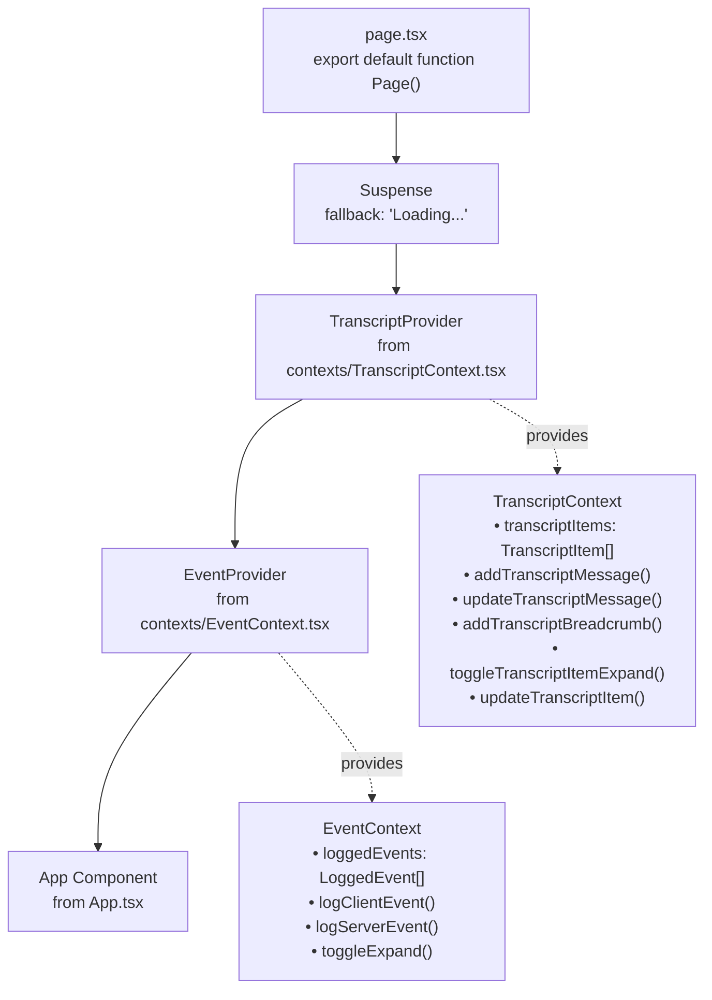
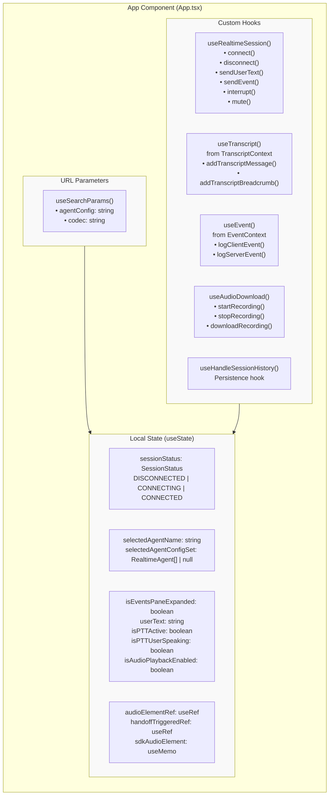
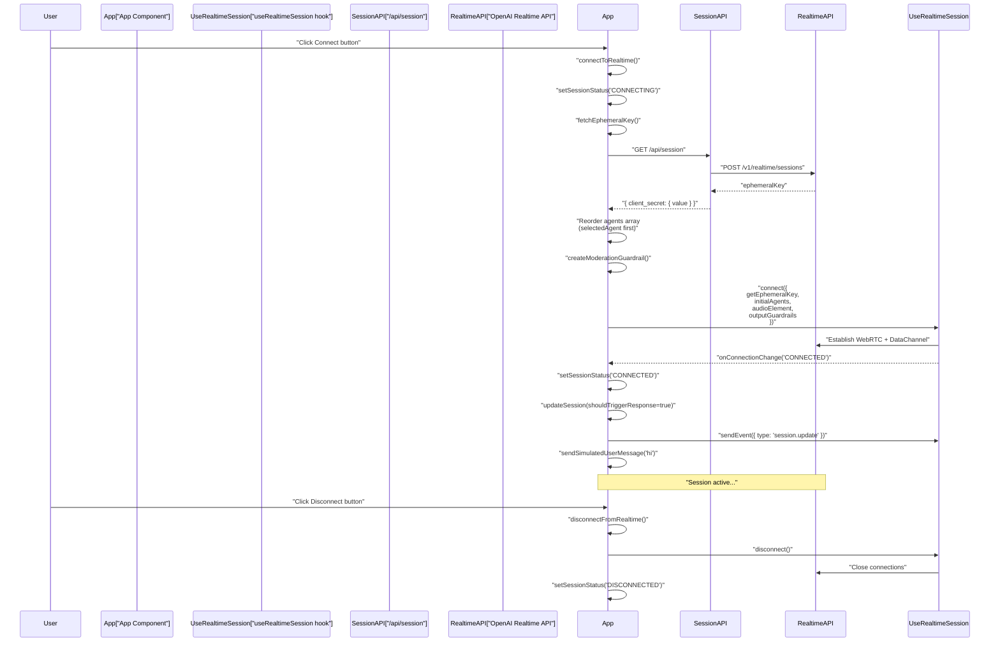
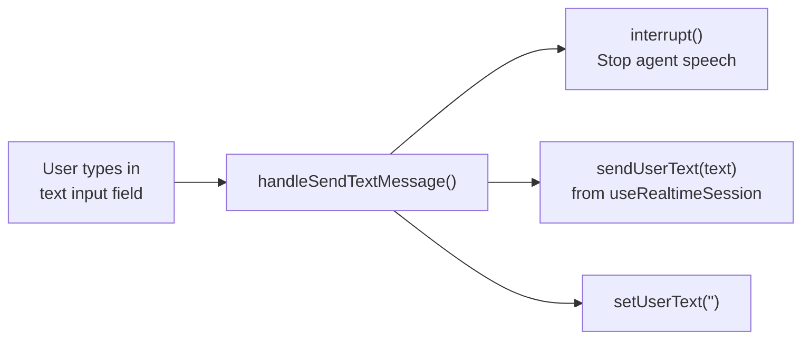
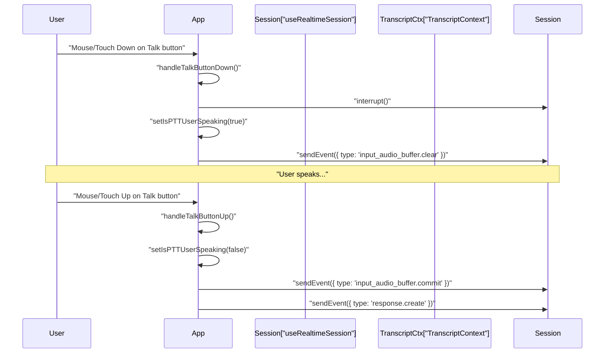
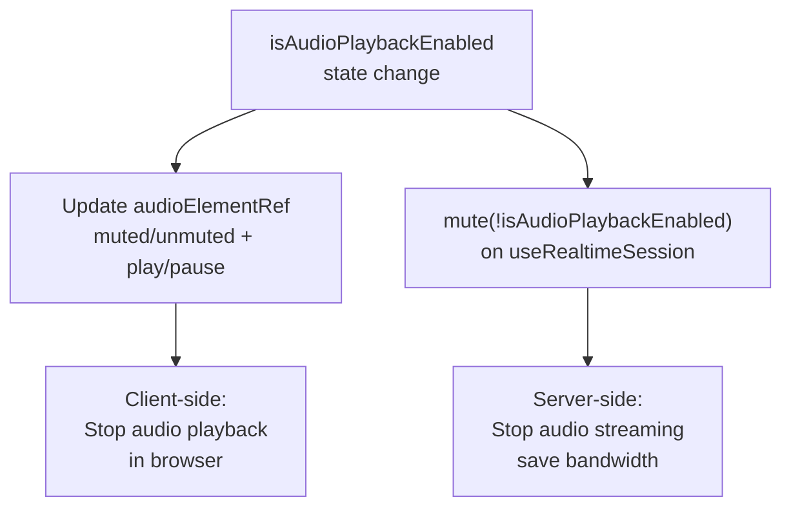
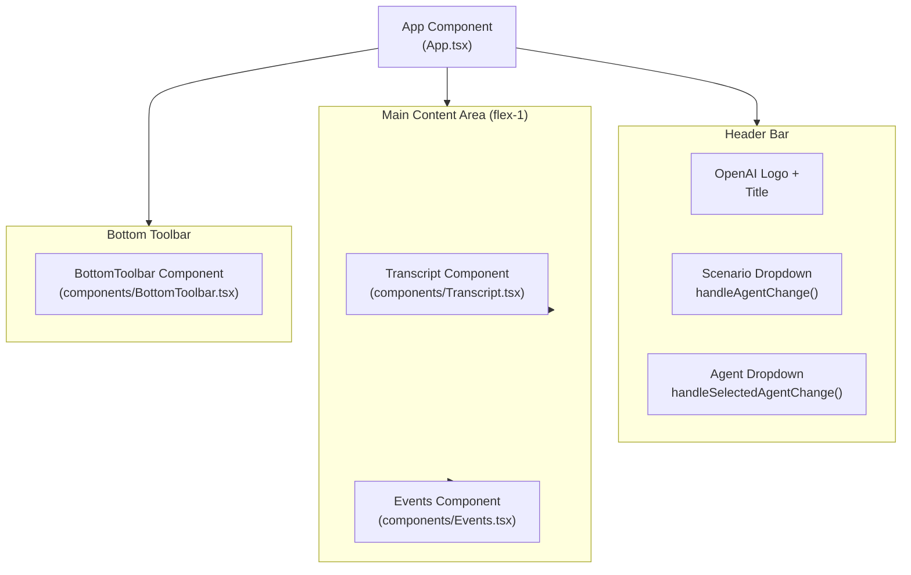
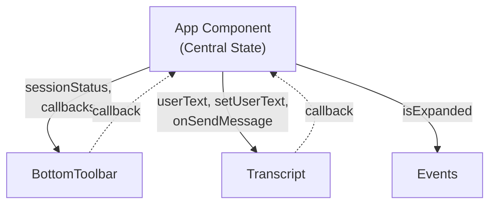
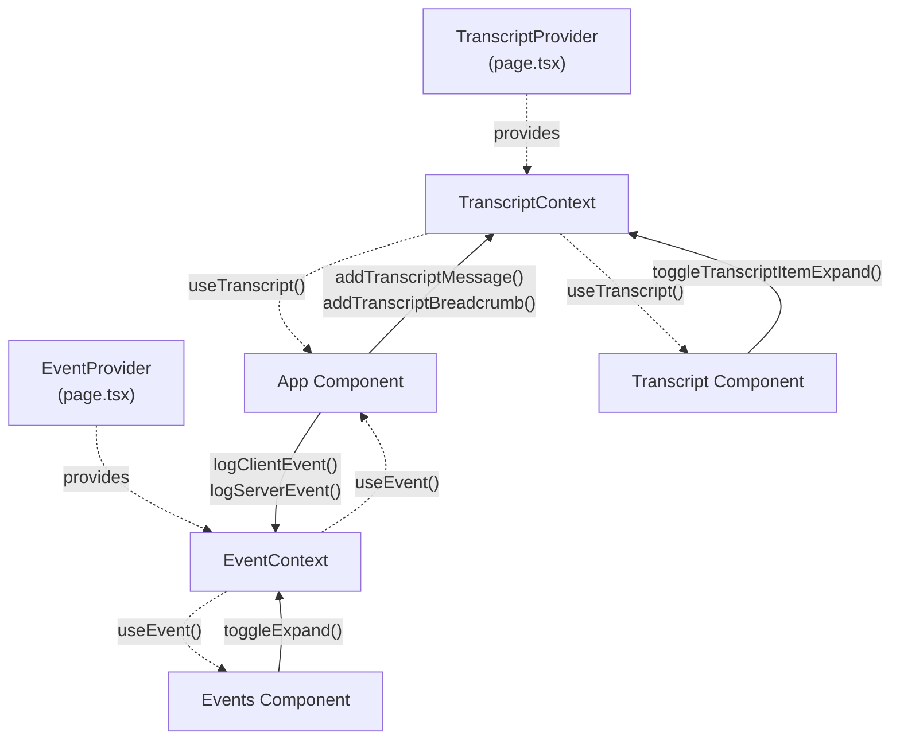

<!-- source: DeepWiki mcp.deepwiki.com · repo openai/openai-realtime-agents · page 3.2 Frontend Architecture · fetched 2026-10-26 -->

# Frontend Architecture

<details>
<summary>Relevant source files</summary>

The following files were used as context for generating this wiki page:

- [src/app/App.tsx](src/app/App.tsx)
- [src/app/components/BottomToolbar.tsx](src/app/components/BottomToolbar.tsx)
- [src/app/components/Events.tsx](src/app/components/Events.tsx)
- [src/app/components/Transcript.tsx](src/app/components/Transcript.tsx)
- [src/app/contexts/TranscriptContext.tsx](src/app/contexts/TranscriptContext.tsx)
- [src/app/page.tsx](src/app/page.tsx)

</details>


## Purpose and Scope

This document describes the React-based frontend architecture of the OpenAI Realtime Agents demo application. It covers the component hierarchy, state management patterns, context providers, and the central controller logic in `App.tsx`. 

For information about real-time session management and WebRTC communication, see [Real-time Session Management](#3.1). For API routes and backend integration, see [API Routes and Backend](#3.3). For type definitions, see [Type System and Data Structures](#3.5).

---

## Application Root and Context Setup

The application root is established in `page.tsx`, which wraps the main `App` component with two React Context providers that provide global state management throughout the component tree.



**Sources:** [src/app/page.tsx:1-16]()

### Context Providers

#### TranscriptProvider

The `TranscriptProvider` manages conversation history and UI state for transcript items. Each item can be either a `MESSAGE` (user or assistant speech bubble) or a `BREADCRUMB` (system event log).

**Key methods:**
- `addTranscriptMessage(itemId, role, text, isHidden?)` - Creates a new message in the transcript
- `updateTranscriptMessage(itemId, newText, isDelta)` - Updates message content (supports delta updates)
- `addTranscriptBreadcrumb(title, data?)` - Adds a system event log with optional expandable JSON data
- `toggleTranscriptItemExpand(itemId)` - Toggles expanded state for items with additional data
- `updateTranscriptItem(itemId, updatedProperties)` - Partially updates any transcript item properties

Each transcript item includes:
- `itemId`: Unique identifier
- `type`: `"MESSAGE"` or `"BREADCRUMB"`
- `role`: `"user"` or `"assistant"` (for messages)
- `title`: Display text
- `timestamp`: Formatted timestamp (HH:MM:SS.mmm)
- `createdAtMs`: Unix timestamp for sorting
- `status`: `"IN_PROGRESS"` or `"DONE"`
- `isHidden`: Boolean flag to hide items from UI
- `guardrailResult?`: Optional moderation result attached to messages

**Sources:** [src/app/contexts/TranscriptContext.tsx:1-136]()

#### EventProvider

The `EventProvider` manages the event log visible in the Logs pane. It tracks all client-to-server and server-to-client events for debugging purposes.

Each logged event includes:
- `id`: Unique identifier
- `direction`: `"client"` or `"server"`
- `eventName`: Name of the event with optional suffix
- `eventData`: Raw event payload (JSON)
- `timestamp`: Formatted timestamp
- `expanded`: Boolean for expandable view

**Sources:** Referenced in [src/app/App.tsx:19](), implemented in `contexts/EventContext.tsx` (not provided in files but inferred from usage)

---

## Main Application Controller

The `App` component ([src/app/App.tsx]()) serves as the central orchestrator, integrating state management, UI rendering, and business logic. It is a client-side component marked with `"use client"`.

### Component State Architecture



**Sources:** [src/app/App.tsx:41-106]()

### State Management Details

| State Variable | Type | Purpose | Persistence |
|---|---|---|---|
| `sessionStatus` | `SessionStatus` | Tracks connection lifecycle | None |
| `selectedAgentName` | `string` | Currently active agent identifier | URL parameter |
| `selectedAgentConfigSet` | `RealtimeAgent[] \| null` | Full agent configuration for current scenario | Derived from URL |
| `isEventsPaneExpanded` | `boolean` | Controls Logs pane visibility | localStorage |
| `userText` | `string` | Text input field content | None |
| `isPTTActive` | `boolean` | Push-to-Talk mode toggle | localStorage |
| `isPTTUserSpeaking` | `boolean` | Active PTT button press state | None |
| `isAudioPlaybackEnabled` | `boolean` | Audio playback mute control | localStorage |

**Sources:** [src/app/App.tsx:65-119](), [src/app/App.tsx:353-383]()

### URL-Driven Configuration

The application uses URL search parameters for scenario and agent selection, enabling deep linking and easy scenario switching:

```typescript
// Read from URL: ?agentConfig=chatSupervisor&codec=opus
const agentConfig = searchParams.get("agentConfig") || defaultAgentSetKey
const codec = searchParams.get("codec") || "opus"
```

Changes to these parameters trigger page reloads to reset state cleanly:

```typescript
const handleAgentChange = (e: React.ChangeEvent<HTMLSelectElement>) => {
  const newAgentConfig = e.target.value;
  const url = new URL(window.location.toString());
  url.searchParams.set("agentConfig", newAgentConfig);
  window.location.replace(url.toString());
};
```

**Sources:** [src/app/App.tsx:42](), [src/app/App.tsx:54](), [src/app/App.tsx:328-333]()

---

## Session Lifecycle Management

The `App` component orchestrates the connection lifecycle through several key methods that interact with the `useRealtimeSession` hook.



**Sources:** [src/app/App.tsx:181-235](), [src/app/App.tsx:237-241](), [src/app/App.tsx:259-285]()

### Connection Flow Details

#### fetchEphemeralKey()

Obtains a temporary authentication token from the `/api/session` endpoint. This keeps the OpenAI API key server-side for security.

```typescript
const fetchEphemeralKey = async (): Promise<string | null> => {
  logClientEvent({ url: "/session" }, "fetch_session_token_request");
  const tokenResponse = await fetch("/api/session");
  const data = await tokenResponse.json();
  logServerEvent(data, "fetch_session_token_response");
  
  if (!data.client_secret?.value) {
    console.error("No ephemeral key provided by the server");
    setSessionStatus("DISCONNECTED");
    return null;
  }
  
  return data.client_secret.value;
};
```

**Sources:** [src/app/App.tsx:181-195]()

#### connectToRealtime()

Establishes the WebRTC connection with proper agent ordering and guardrail configuration:

```typescript
const connectToRealtime = async () => {
  const agentSetKey = searchParams.get("agentConfig") || "default";
  if (sdkScenarioMap[agentSetKey]) {
    if (sessionStatus !== "DISCONNECTED") return;
    setSessionStatus("CONNECTING");
    
    const EPHEMERAL_KEY = await fetchEphemeralKey();
    if (!EPHEMERAL_KEY) return;
    
    // Ensure the selectedAgentName is first so that it becomes the root
    const reorderedAgents = [...sdkScenarioMap[agentSetKey]];
    const idx = reorderedAgents.findIndex((a) => a.name === selectedAgentName);
    if (idx > 0) {
      const [agent] = reorderedAgents.splice(idx, 1);
      reorderedAgents.unshift(agent);
    }
    
    const companyName = agentSetKey === 'customerServiceRetail'
      ? customerServiceRetailCompanyName
      : chatSupervisorCompanyName;
    const guardrail = createModerationGuardrail(companyName);
    
    await connect({
      getEphemeralKey: async () => EPHEMERAL_KEY,
      initialAgents: reorderedAgents,
      audioElement: sdkAudioElement,
      outputGuardrails: [guardrail],
      extraContext: { addTranscriptBreadcrumb },
    });
  }
};
```

**Key implementation details:**
- The selected agent must be first in the array to become the root agent
- Guardrails are configured based on the scenario's company name
- The `extraContext` object passes callback functions to the session hook

**Sources:** [src/app/App.tsx:197-234]()

#### updateSession()

Updates session parameters dynamically, particularly for Push-to-Talk mode:

```typescript
const updateSession = (shouldTriggerResponse: boolean = false) => {
  // Reflect Push-to-Talk UI state by (de)activating server VAD
  const turnDetection = isPTTActive
    ? null  // Disable server VAD when PTT is active
    : {
        type: 'server_vad',
        threshold: 0.9,
        prefix_padding_ms: 300,
        silence_duration_ms: 500,
        create_response: true,
      };
  
  sendEvent({
    type: 'session.update',
    session: { turn_detection: turnDetection },
  });
  
  // Send an initial 'hi' message to trigger the agent to greet the user
  if (shouldTriggerResponse) {
    sendSimulatedUserMessage('hi');
  }
};
```

**Sources:** [src/app/App.tsx:259-285]()

---

## Event Handling and User Interactions

The `App` component implements numerous event handlers that bridge user actions to session operations.

### Message Sending



**Sources:** [src/app/App.tsx:287-298]()

### Push-to-Talk Flow



**Sources:** [src/app/App.tsx:300-317]()

### Agent Handoff Handling

When the Realtime API triggers an agent transfer (via the `transferAgents` tool), the `useRealtimeSession` hook invokes the `onAgentHandoff` callback:

```typescript
const {
  connect,
  disconnect,
  sendUserText,
  sendEvent,
  interrupt,
  mute,
} = useRealtimeSession({
  onConnectionChange: (s) => setSessionStatus(s as SessionStatus),
  onAgentHandoff: (agentName: string) => {
    handoffTriggeredRef.current = true;
    setSelectedAgentName(agentName);
  },
});
```

The `handoffTriggeredRef` prevents sending a greeting message during automatic handoffs (only manual agent switches should greet).

**Sources:** [src/app/App.tsx:90-103](), [src/app/App.tsx:159-173]()

### Audio Playback Control



**Implementation:**

```typescript
useEffect(() => {
  if (audioElementRef.current) {
    if (isAudioPlaybackEnabled) {
      audioElementRef.current.muted = false;
      audioElementRef.current.play().catch((err) => {
        console.warn("Autoplay may be blocked by browser:", err);
      });
    } else {
      audioElementRef.current.muted = true;
      audioElementRef.current.pause();
    }
  }
  
  try {
    mute(!isAudioPlaybackEnabled);
  } catch (err) {
    console.warn('Failed to toggle SDK mute', err);
  }
}, [isAudioPlaybackEnabled]);
```

**Sources:** [src/app/App.tsx:385-418]()

---

## UI Component Structure

The `App` component renders three primary UI components, passing down state and callbacks via props.

### Component Layout



**Sources:** [src/app/App.tsx:435-547]()

### Transcript Component

Displays conversation history with message bubbles and system breadcrumbs. Receives state and callbacks from `App`:

**Props interface:**
```typescript
interface TranscriptProps {
  userText: string;
  setUserText: (val: string) => void;
  onSendMessage: () => void;
  canSend: boolean;
  downloadRecording: () => void;
}
```

**Key features:**
- Consumes `TranscriptContext` directly via `useTranscript()` hook
- Renders messages with ReactMarkdown for formatting
- Displays `GuardrailChip` component for moderation results
- Auto-scrolls to bottom on new messages
- Text input field with Enter-to-send functionality
- Copy transcript and download audio buttons

**Message rendering logic:**
- `MESSAGE` items render as speech bubbles (gray for assistant, dark for user)
- `BREADCRUMB` items render as system logs with expandable JSON data
- Items marked `isHidden: true` are filtered out
- Messages with `guardrailResult` show a chip with moderation status

**Sources:** [src/app/components/Transcript.tsx:1-240]()

### Events Component

Displays the event log for debugging. Conditionally rendered based on `isExpanded` prop.

**Props interface:**
```typescript
interface EventsProps {
  isExpanded: boolean;
}
```

**Key features:**
- Consumes `EventContext` directly via `useEvent()` hook
- Shows direction indicators: ▲ (client, purple) ▼ (server, green)
- Highlights error events in red
- Expandable JSON payloads for each event
- Auto-scrolls to bottom on new events when expanded

**Direction arrow mapping:**
```typescript
const getDirectionArrow = (direction: string) => {
  if (direction === "client") return { symbol: "▲", color: "#7f5af0" };
  if (direction === "server") return { symbol: "▼", color: "#2cb67d" };
  return { symbol: "•", color: "#555" };
};
```

**Sources:** [src/app/components/Events.tsx:1-102]()

### BottomToolbar Component

Provides interactive controls for session management and configuration.

**Props interface:**
```typescript
interface BottomToolbarProps {
  sessionStatus: SessionStatus;
  onToggleConnection: () => void;
  isPTTActive: boolean;
  setIsPTTActive: (val: boolean) => void;
  isPTTUserSpeaking: boolean;
  handleTalkButtonDown: () => void;
  handleTalkButtonUp: () => void;
  isEventsPaneExpanded: boolean;
  setIsEventsPaneExpanded: (val: boolean) => void;
  isAudioPlaybackEnabled: boolean;
  setIsAudioPlaybackEnabled: (val: boolean) => void;
  codec: string;
  onCodecChange: (newCodec: string) => void;
}
```

**Control elements:**
1. **Connect/Disconnect button** - Manages session lifecycle
   - Label changes: "Connect" → "Connecting..." → "Disconnect"
   - Color changes: black (disconnected) → red (connected)
2. **Push-to-Talk checkbox + Talk button** - Enables PTT mode
   - Checkbox toggles `isPTTActive` state
   - Talk button active only when checkbox checked
3. **Audio playback checkbox** - Controls audio output
4. **Logs checkbox** - Toggles Events pane visibility
5. **Codec selector** - Dropdown for opus/pcmu/pcma selection

**Sources:** [src/app/components/BottomToolbar.tsx:1-158]()

---

## Data Flow Patterns

The frontend architecture implements several key data flow patterns:

### Top-Down Props Flow



**Sources:** [src/app/App.tsx:519-546]()

### Context-Based State Access



This pattern allows components to:
- Read global state without prop drilling
- Update global state through context methods
- Automatically re-render when relevant state changes

**Sources:** [src/app/App.tsx:18-19](), [src/app/App.tsx:60-63](), [src/app/components/Transcript.tsx:7](), [src/app/components/Transcript.tsx:26](), [src/app/components/Events.tsx:4](), [src/app/components/Events.tsx:15]()

### Event-Driven Updates

The `useRealtimeSession` hook emits events that the `App` component observes:

```typescript
const {
  connect,
  disconnect,
  sendUserText,
  sendEvent,
  interrupt,
  mute,
} = useRealtimeSession({
  onConnectionChange: (s) => setSessionStatus(s as SessionStatus),
  onAgentHandoff: (agentName: string) => {
    handoffTriggeredRef.current = true;
    setSelectedAgentName(agentName);
  },
});
```

The hook internally listens to WebRTC and DataChannel events, then invokes these callbacks to notify the App of state changes.

**Sources:** [src/app/App.tsx:90-103]()

---

## State Persistence

The application persists certain UI preferences to `localStorage` to maintain user settings across sessions:

| State | Storage Key | Type | Default |
|---|---|---|---|
| Push-to-Talk mode | `"pushToTalkUI"` | `boolean` | `false` |
| Logs pane expanded | `"logsExpanded"` | `boolean` | `true` |
| Audio playback enabled | `"audioPlaybackEnabled"` | `boolean` | `true` |

**Implementation pattern:**

```typescript
// Read on mount
useEffect(() => {
  const storedPushToTalkUI = localStorage.getItem("pushToTalkUI");
  if (storedPushToTalkUI) {
    setIsPTTActive(storedPushToTalkUI === "true");
  }
  // ... similar for other settings
}, []);

// Write on change
useEffect(() => {
  localStorage.setItem("pushToTalkUI", isPTTActive.toString());
}, [isPTTActive]);
```

**Sources:** [src/app/App.tsx:353-383]()

---

## Audio Element Management

The application creates a dedicated audio element for WebRTC playback using React patterns:

```typescript
const sdkAudioElement = React.useMemo(() => {
  if (typeof window === 'undefined') return undefined;
  const el = document.createElement('audio');
  el.autoplay = true;
  el.style.display = 'none';
  document.body.appendChild(el);
  return el;
}, []);

// Attach to ref after first render
useEffect(() => {
  if (sdkAudioElement && !audioElementRef.current) {
    audioElementRef.current = sdkAudioElement;
  }
}, [sdkAudioElement]);
```

This pattern:
- Uses `useMemo` to create the element only once
- Checks for `window` existence for SSR compatibility
- Stores reference in both a ref and the memoized value
- Passes the element to `useRealtimeSession` for WebRTC stream attachment

**Sources:** [src/app/App.tsx:70-88]()

---

## Recording Integration

The `useAudioDownload` hook provides session recording functionality:

```typescript
const { startRecording, stopRecording, downloadRecording } = useAudioDownload();

useEffect(() => {
  if (sessionStatus === "CONNECTED" && audioElementRef.current?.srcObject) {
    const remoteStream = audioElementRef.current.srcObject as MediaStream;
    startRecording(remoteStream);
  }
  
  return () => {
    stopRecording();
  };
}, [sessionStatus]);
```

The recording:
- Starts automatically when session connects
- Captures the remote audio stream from the audio element
- Stops on session disconnect or unmount
- Can be downloaded via the Transcript component's download button

**Sources:** [src/app/App.tsx:122-123](), [src/app/App.tsx:420-431]()

---

