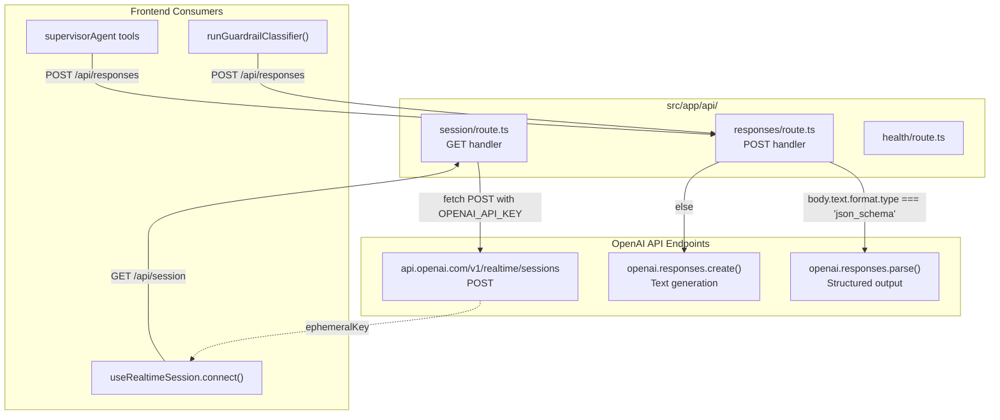
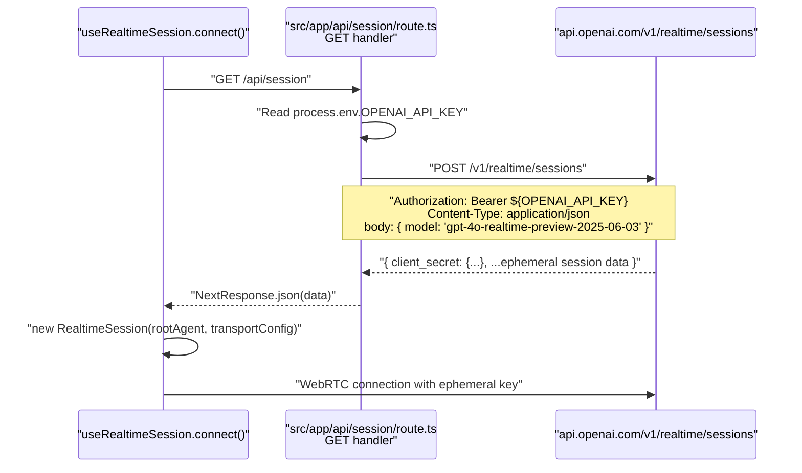
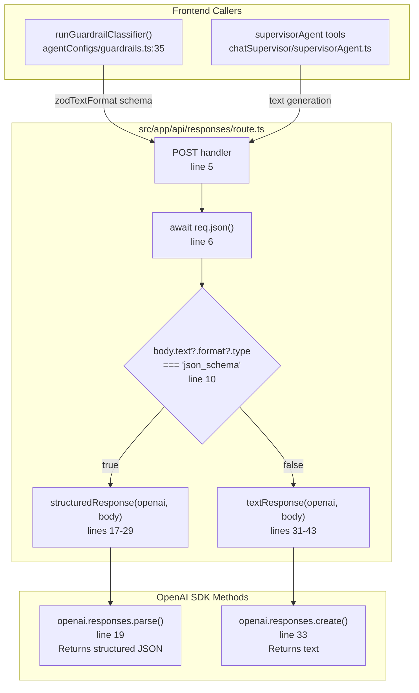
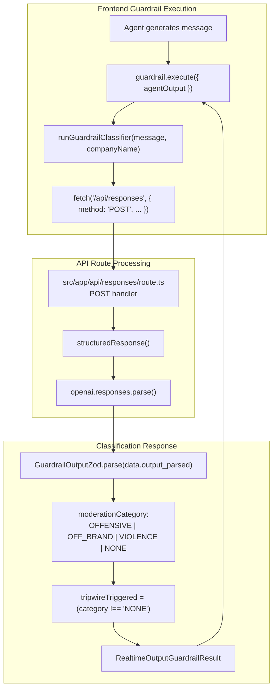
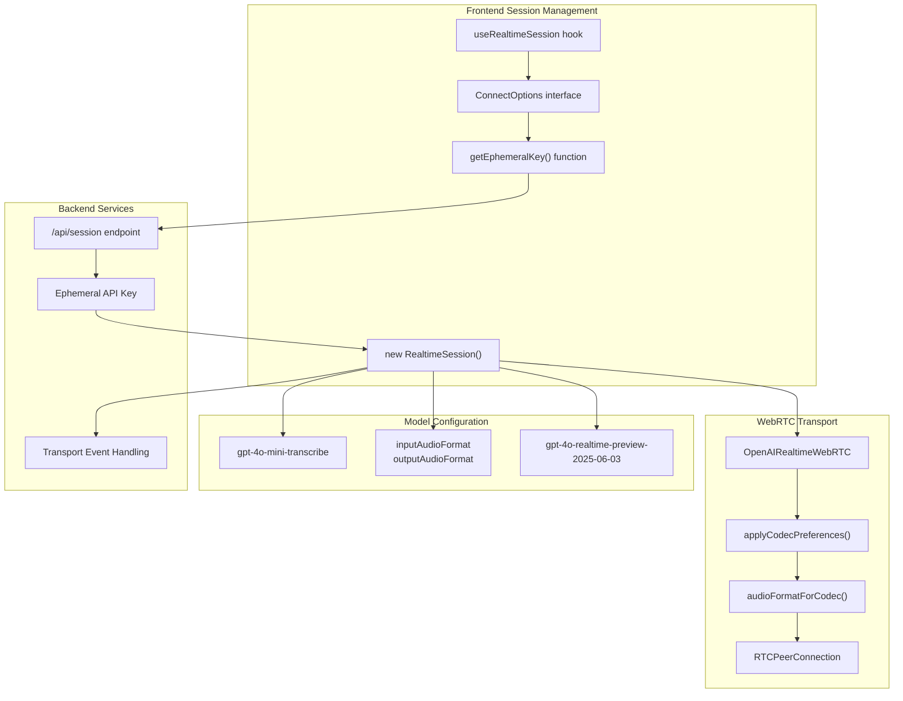

<!-- source: DeepWiki mcp.deepwiki.com · repo openai/openai-realtime-agents · page 3.3 API Routes and Backend · fetched 2026-10-26 -->

# API Routes and Backend

<details>
<summary>Relevant source files</summary>

The following files were used as context for generating this wiki page:

- [.gitignore](.gitignore)
- [src/app/agentConfigs/guardrails.ts](src/app/agentConfigs/guardrails.ts)
- [src/app/api/responses/route.ts](src/app/api/responses/route.ts)
- [src/app/api/session/route.ts](src/app/api/session/route.ts)

</details>


This page documents the Next.js API routes that provide backend services for the realtime agent system. The backend implements three primary endpoints: `/api/session` for ephemeral key generation, `/api/responses` for OpenAI API proxying, and `/api/health` for health checks. These routes enable secure communication between the frontend and OpenAI services while keeping API keys server-side.

## API Routes Overview

The Next.js application implements API routes in the `src/app/api/` directory following Next.js 13+ App Router conventions. Each route is defined by a `route.ts` file that exports HTTP method handlers (`GET`, `POST`, etc.).

### API Endpoint Architecture



**Next.js API Routes and External Service Integration**

The backend routes act as secure proxies that authenticate with OpenAI services using server-side API keys and forward responses to the frontend.

Sources: [src/app/api/session/route.ts:1-28](), [src/app/api/responses/route.ts:1-44]()

## /api/session Endpoint

The `/api/session` route provides ephemeral session tokens for WebRTC connections to OpenAI's Realtime API. This endpoint keeps the `OPENAI_API_KEY` secure on the server while allowing the frontend to establish direct WebRTC connections.

### Session Creation Sequence



**Ephemeral Session Token Exchange Flow**

The session route exchanges a server-side API key for a temporary session token that enables direct WebRTC communication.

### Implementation Details

The `GET` handler in [src/app/api/session/route.ts:3-27]() implements the following logic:

| Line Numbers | Component | Description |
|--------------|-----------|-------------|
| [3-27]() | `GET()` handler | Exported async function handling GET requests |
| [5-17]() | OpenAI API call | `fetch()` to `https://api.openai.com/v1/realtime/sessions` |
| [10]() | Authorization | `Bearer ${process.env.OPENAI_API_KEY}` header |
| [14]() | Model specification | Hardcoded to `gpt-4o-realtime-preview-2025-06-03` |
| [18-19]() | Response forwarding | Parses JSON and returns via `NextResponse.json()` |
| [20-26]() | Error handling | Try-catch block returning 500 status on failures |

### Security Model

The endpoint implements a security proxy pattern:

1. **API Key Protection**: The `OPENAI_API_KEY` never leaves the server
2. **Ephemeral Credentials**: Returned session tokens are temporary and scoped
3. **No Parameter Validation**: Accepts no input parameters, reducing attack surface
4. **Generic Error Messages**: Returns `{ error: "Internal Server Error" }` without exposing internal details

Sources: [src/app/api/session/route.ts:1-28]()

## /api/responses Endpoint

The `/api/responses` route proxies requests to OpenAI's Responses API, providing both structured JSON schema responses and standard text generation. This endpoint is used by guardrail validation and supervisor agent tools.

### Request Routing Logic



**Conditional Routing Based on Response Format Type**

The endpoint branches to different OpenAI SDK methods based on whether the request specifies a JSON schema.

### Route Handler Implementation

The `POST` handler in [src/app/api/responses/route.ts:5-15]() implements the following:

```typescript
// Pseudo-code representation of route.ts logic
export async function POST(req: NextRequest) {
  const body = await req.json();
  const openai = new OpenAI({ apiKey: process.env.OPENAI_API_KEY });
  
  if (body.text?.format?.type === 'json_schema') {
    return await structuredResponse(openai, body);
  } else {
    return await textResponse(openai, body);
  }
}
```

### Structured Response Function

The `structuredResponse()` function in [src/app/api/responses/route.ts:17-29]() handles JSON schema requests:

| Line | Operation | Description |
|------|-----------|-------------|
| 19-22 | `openai.responses.parse()` | Calls OpenAI Parse API with structured schema |
| 21 | `stream: false` | Disables streaming to ensure complete response |
| 24 | `NextResponse.json()` | Returns parsed response to client |
| 25-28 | Error handling | Logs error and returns 500 status |

This function is used by `runGuardrailClassifier()` which passes a Zod schema via `zodTextFormat()` helper.

### Text Response Function

The `textResponse()` function in [src/app/api/responses/route.ts:31-43]() handles standard text generation:

| Line | Operation | Description |
|------|-----------|-------------|
| 33-36 | `openai.responses.create()` | Calls OpenAI Responses API for text generation |
| 35 | `stream: false` | Disables streaming for complete responses |
| 38 | `NextResponse.json()` | Returns response to client |
| 39-42 | Error handling | Logs error and returns 500 status |

This function is used by supervisor agent tools that require reasoning capabilities from models like `gpt-4.1`.

Sources: [src/app/api/responses/route.ts:1-44]()

## Guardrail Integration with /api/responses

The guardrail system uses the `/api/responses` endpoint to classify agent outputs for content moderation. The `runGuardrailClassifier()` function sends agent messages to OpenAI for classification against defined moderation policies.

### Guardrail Classification Flow



**Content Moderation Classification Pipeline**

The guardrail system sends agent outputs through the responses API for classification and returns structured moderation results.

### runGuardrailClassifier() Implementation

The function in [src/app/agentConfigs/guardrails.ts:8-66]() performs content classification:

| Line Range | Component | Description |
|------------|-----------|-------------|
| [12-33]() | Prompt construction | Builds classification prompt with moderation categories |
| [18]() | Company context | Injects `companyName` for context-aware moderation |
| [22]() | Message content | Agent output to be classified |
| [25-30]() | Category definitions | `OFFENSIVE`, `OFF_BRAND`, `VIOLENCE`, `NONE` |
| [35-47]() | API request | POST to `/api/responses` with `gpt-4o-mini` model |
| [44]() | Schema specification | Uses `zodTextFormat(GuardrailOutputZod, 'output_format')` |
| [54-61]() | Response parsing | Parses `data.output_parsed` using Zod schema |
| [62-65]() | Error handling | Returns rejected promise on parse failures |

### Moderation Categories

The guardrail classifier uses four moderation categories defined in the prompt:

| Category | Description | Example |
|----------|-------------|---------|
| `OFFENSIVE` | Hate speech, discriminatory language, insults, slurs, harassment | User insults or disparaging remarks |
| `OFF_BRAND` | Competitors mentioned in disparaging way | Negative mentions of competing brands |
| `VIOLENCE` | Explicit threats, incitement of harm, graphic violence descriptions | Threats or violent content |
| `NONE` | Content passes all moderation checks | Appropriate business conversation |

### createModerationGuardrail() Factory

The factory function in [src/app/agentConfigs/guardrails.ts:80-100]() creates guardrail instances:

```typescript
// Pseudo-code representation
export function createModerationGuardrail(companyName: string) {
  return {
    name: 'moderation_guardrail',
    async execute({ agentOutput }: RealtimeOutputGuardrailArgs) {
      const res = await runGuardrailClassifier(agentOutput, companyName);
      const triggered = res.moderationCategory !== 'NONE';
      return {
        tripwireTriggered: triggered,
        outputInfo: res,
      };
    },
  };
}
```

The factory binds the `companyName` to the guardrail closure, enabling company-specific moderation logic without duplicating code.

Sources: [src/app/agentConfigs/guardrails.ts:1-100](), [src/app/api/responses/route.ts:17-29]()

## Real-time Session Backend Support

The backend integration enables the frontend `useRealtimeSession` hook to establish and maintain WebRTC connections with OpenAI's Realtime API while providing additional services.

### Session Configuration and Transport



**Real-time Session Configuration and Backend Dependencies**

The frontend session management relies on backend services for authentication while handling transport and codec configuration client-side.

### Session Lifecycle Management

The `connect()` function in [src/app/hooks/useRealtimeSession.ts:111-156]() orchestrates the session establishment:

1. **Duplicate Connection Prevention**: Checks `sessionRef.current` to prevent multiple connections
2. **Status Updates**: Sets status to `CONNECTING` via `updateStatus()` callback
3. **Key Acquisition**: Calls `getEphemeralKey()` to fetch session credentials from backend
4. **Transport Configuration**: Configures WebRTC transport with codec preferences and audio element
5. **Session Creation**: Instantiates `RealtimeSession` with agent, transport, and model configuration
6. **Connection Establishment**: Calls `session.connect()` with ephemeral API key
7. **Status Finalization**: Updates status to `CONNECTED` on successful connection

### Event Handling and Transport Integration

The session hook manages various event types through backend-supported transport:

| Event Category | Handler Function | Purpose |
|---------------|------------------|---------|
| **Transcription Events** | `handleTranscriptionCompleted()`, `handleTranscriptionDelta()` | Process audio transcription results |
| **Agent Events** | `handleAgentToolStart()`, `handleAgentToolEnd()` | Track agent tool execution |
| **History Events** | `handleHistoryUpdated()`, `handleHistoryAdded()` | Maintain conversation history |
| **Guardrail Events** | `handleGuardrailTripped()` | Process moderation results |
| **Transport Events** | `handleTransportEvent()` | Log additional server events |

Sources: [src/app/hooks/useRealtimeSession.ts:26-209](), [src/app/api/session/route.ts:3-27]()

---

