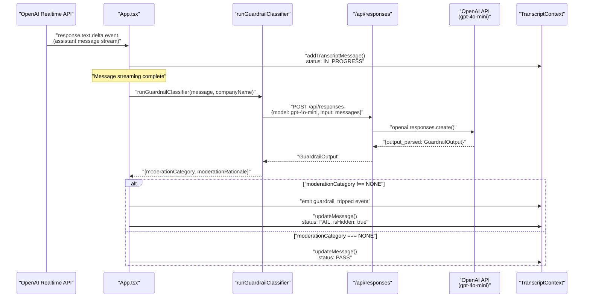
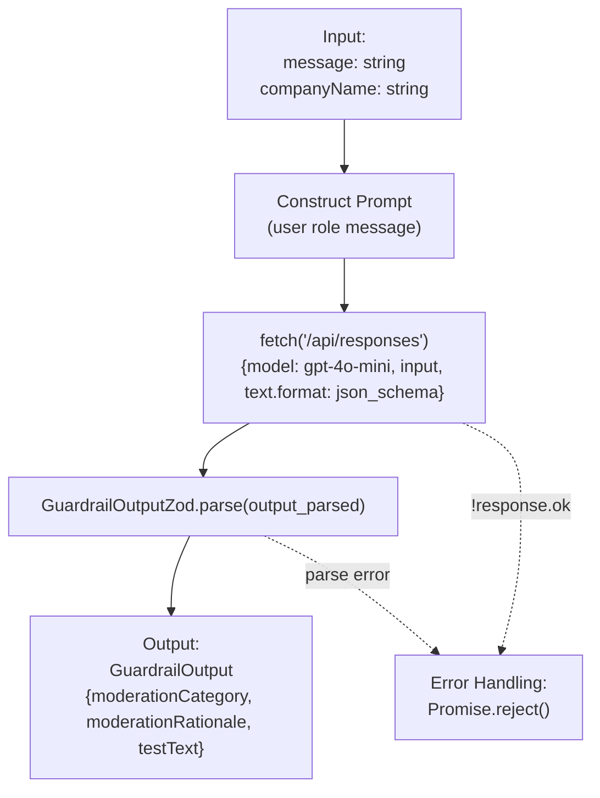
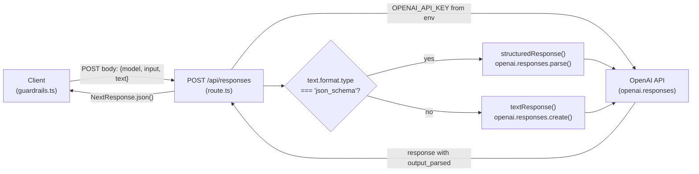
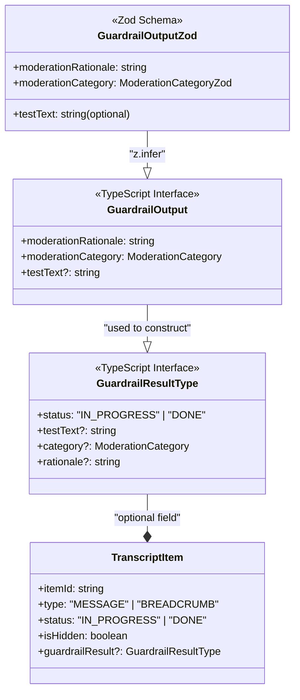
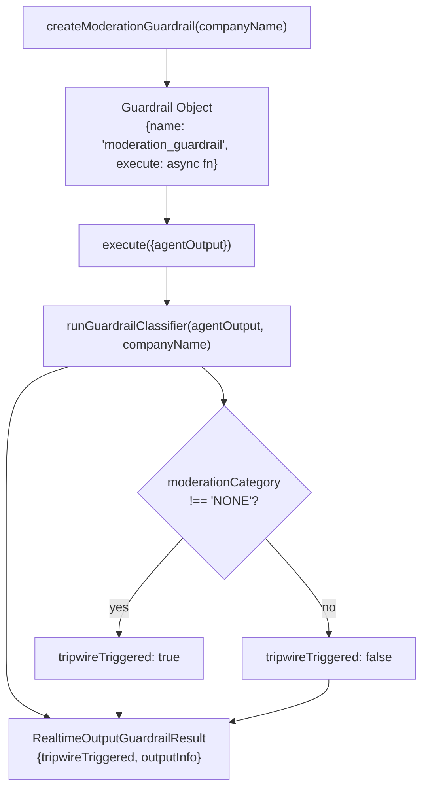
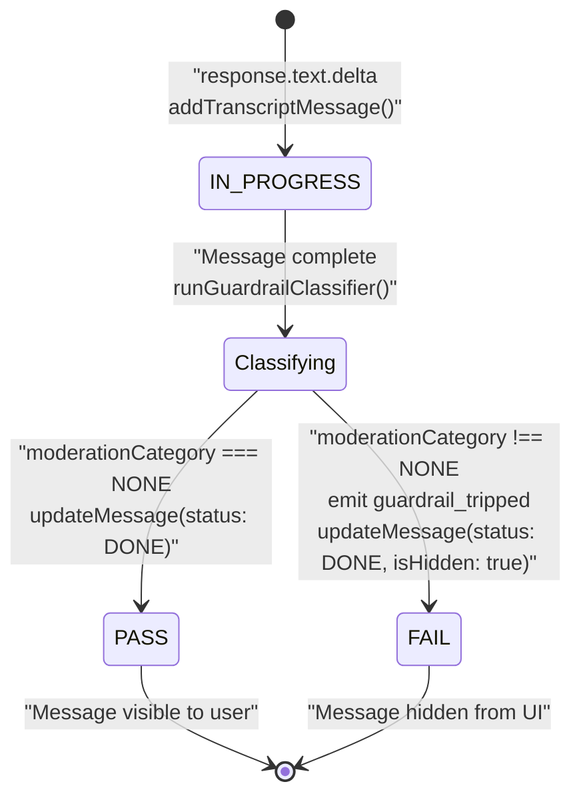
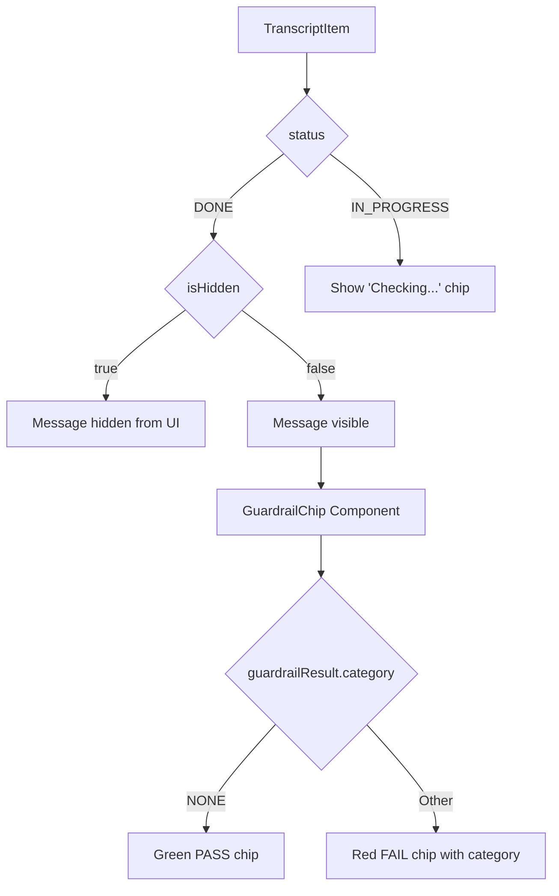

<!-- source: DeepWiki mcp.deepwiki.com · repo openai/openai-realtime-agents · page 3.4 Guardrails and Content Moderation · fetched 2026-10-26 -->

# Guardrails and Content Moderation

<details>
<summary>Relevant source files</summary>

The following files were used as context for generating this wiki page:

- [README.md](README.md)
- [public/screenshot_handoff.png](public/screenshot_handoff.png)
- [src/app/agentConfigs/guardrails.ts](src/app/agentConfigs/guardrails.ts)
- [src/app/api/responses/route.ts](src/app/api/responses/route.ts)
- [src/app/types.ts](src/app/types.ts)

</details>


## Purpose and Scope

This document describes the guardrails and content moderation system used to validate assistant messages in real-time before displaying them to users. The system classifies agent outputs against moderation policies (offensive content, off-brand messaging, violence) and allows the application to filter or respond appropriately to policy violations.

For information about agent configuration patterns and tool development, see [Agent Configuration System](#2.3) and [Custom Tool Development](#5.2). For details on how guardrails integrate with the real-time session lifecycle, see [Real-time Session Management](#3.1).

---

## Overview

The guardrails system provides output moderation by intercepting assistant messages as they stream from the OpenAI Realtime API and classifying them against a set of moderation policies. Messages that violate policies can be marked as `FAIL` and hidden from the UI, while compliant messages are marked as `PASS` and displayed normally.

The system operates asynchronously during message streaming, using a separate LLM classifier (gpt-4o-mini) to evaluate content without blocking the real-time audio playback. This allows natural conversation flow while maintaining content safety.

**Sources:** [README.md:213-214](), [src/app/types.ts:4-9,61-66]()

---

## System Architecture

### Guardrail Execution Flow



**Sources:** [src/app/agentConfigs/guardrails.ts:8-66](), [README.md:213-214]()

---

## Moderation Categories

The system classifies content into four categories:

| Category | Description | Action |
|----------|-------------|--------|
| `OFFENSIVE` | Hate speech, discriminatory language, insults, slurs, or harassment | Block message |
| `OFF_BRAND` | Discussions of competitors in a disparaging way | Block message |
| `VIOLENCE` | Explicit threats, incitement of harm, or graphic descriptions of violence | Block message |
| `NONE` | Content is compliant with all policies | Allow message |

These categories are defined as a TypeScript const array and used consistently across the system:

```typescript
export const MODERATION_CATEGORIES = [
  "OFFENSIVE",
  "OFF_BRAND", 
  "VIOLENCE",
  "NONE",
] as const;

export type ModerationCategory = (typeof MODERATION_CATEGORIES)[number];
```

**Sources:** [src/app/types.ts:4-12](), [src/app/agentConfigs/guardrails.ts:25-30]()

---

## Core Components

### Guardrail Classifier

The `runGuardrailClassifier` function is the core classification component that evaluates message content:



The function constructs a structured prompt that includes:
- Expert role definition for the LLM
- Company name for context
- The message to classify
- Detailed definitions of each output class

The response is validated against the `GuardrailOutputZod` schema to ensure type safety.

**Sources:** [src/app/agentConfigs/guardrails.ts:8-66]()

---

### Responses API Proxy

The `/api/responses` endpoint proxies requests to OpenAI's Responses API while keeping the API key server-side:



The proxy handles both structured responses (with JSON schema validation) and plain text responses. For guardrails, structured responses are used with Zod schema validation.

**Sources:** [src/app/api/responses/route.ts:1-44]()

---

## Data Structures

### GuardrailOutput Type



**Key Fields:**

- **moderationCategory**: One of `OFFENSIVE`, `OFF_BRAND`, `VIOLENCE`, or `NONE`
- **moderationRationale**: Short explanation (max 2 sentences) of the classification
- **testText**: The original message that was classified
- **status**: Tracks whether moderation is `IN_PROGRESS` or `DONE`

**Sources:** [src/app/types.ts:61-80,142-149]()

---

### Moderation Guardrail Factory

The `createModerationGuardrail` function creates a guardrail object bound to a specific company name:



This factory pattern allows creating multiple guardrails with different company contexts. The `execute` method:
1. Calls `runGuardrailClassifier` with the agent output and company name
2. Checks if `moderationCategory !== 'NONE'`
3. Returns `tripwireTriggered: true` if a violation is detected
4. Includes the full `GuardrailOutput` in `outputInfo` for logging

**Sources:** [src/app/agentConfigs/guardrails.ts:79-100]()

---

## Integration with Real-time Session

### Message Status Lifecycle



The message lifecycle is managed in the App.tsx component:

1. **Stream Start**: When `response.text.delta` events begin, a new `TranscriptItem` is created with `status: "IN_PROGRESS"`
2. **Classification**: After streaming completes, `runGuardrailClassifier` is called asynchronously
3. **Result Handling**: Based on the classification result:
   - **PASS**: Message is marked as `status: "DONE"` and remains visible
   - **FAIL**: A `guardrail_tripped` event is emitted, and the message is marked as `status: "DONE", isHidden: true`

**Sources:** [README.md:213-214](), [src/app/types.ts:68-80]()

---

## Example Usage

### Creating and Using a Guardrail

```typescript
// Create a guardrail for a specific company
const guardrail = createModerationGuardrail('newTelco');

// Execute the guardrail on agent output
const result = await guardrail.execute({
  agentOutput: "Let me help you with that request..."
});

if (result.tripwireTriggered) {
  console.log('Policy violation detected:', result.outputInfo);
  // Handle violation (hide message, log, etc.)
} else {
  console.log('Content passed moderation');
  // Display message normally
}
```

### Guardrail Classification Prompt

The classifier prompt includes:

1. **Expert Role**: "You are an expert at classifying text according to moderation policies"
2. **Context**: Company name (e.g., "newTelco")
3. **Input**: The message to classify
4. **Output Classes**: Detailed descriptions of OFFENSIVE, OFF_BRAND, VIOLENCE, and NONE
5. **Instructions**: Keep analysis short (max 2 sentences), output JSON following the schema

This structured approach ensures consistent, explainable classifications with minimal latency overhead.

**Sources:** [src/app/agentConfigs/guardrails.ts:12-33]()

---

## Performance Considerations

### Asynchronous Execution

Guardrail classification happens asynchronously after message streaming completes. This design:
- **Minimizes Latency Impact**: Audio playback is not blocked by classification
- **Maintains Natural Flow**: Users hear responses immediately
- **Allows Retroactive Filtering**: Messages can be hidden after playback if violations are detected

### Model Selection

The system uses `gpt-4o-mini` for classification because:
- **Cost-Effective**: Lower cost than larger models for this specific task
- **Low Latency**: Fast enough to complete during typical response pauses
- **Sufficient Accuracy**: Structured output format with clear categories reduces error rates

**Sources:** [src/app/agentConfigs/guardrails.ts:41]()

---

## Extending the Guardrail System

### Adding New Moderation Categories

To add a new category:

1. Update the `MODERATION_CATEGORIES` array in [src/app/types.ts:4-9]()
2. Add the category description to the prompt in [src/app/agentConfigs/guardrails.ts:25-30]()
3. Update the `GuardrailOutputZod` schema if needed (though it uses the enum automatically)

### Custom Guardrail Logic

The guardrail factory pattern allows creating custom guardrails with different:
- **Company contexts** (different brand guidelines)
- **Severity thresholds** (more or less strict filtering)
- **Additional classifiers** (beyond moderation, e.g., accuracy checks)

Example custom guardrail:

```typescript
function createAccuracyGuardrail() {
  return {
    name: 'accuracy_guardrail',
    async execute({ agentOutput, context }) {
      // Custom logic to verify factual accuracy
      const isAccurate = await verifyFacts(agentOutput, context);
      return {
        tripwireTriggered: !isAccurate,
        outputInfo: { accurate: isAccurate }
      };
    }
  };
}
```

**Sources:** [src/app/agentConfigs/guardrails.ts:79-100]()

---

## UI Integration

### Transcript Display

The TranscriptContext manages message visibility based on guardrail results:



The `GuardrailChip` component displays the moderation status inline with messages:
- **IN_PROGRESS**: Gray chip showing classification is pending
- **PASS**: Green chip confirming content is compliant
- **FAIL**: Red chip showing the violation category (OFFENSIVE, OFF_BRAND, or VIOLENCE)

**Sources:** [src/app/types.ts:68-80]()

---

## Error Handling

The guardrail system includes robust error handling:

### Classification Errors

If `runGuardrailClassifier` encounters an error:
- HTTP errors from `/api/responses` are caught and rejected
- Zod parsing errors are caught and rejected
- The calling code can decide whether to allow or block the message on error

### Execute Method Fallback

The `execute` method in the guardrail object wraps classification in a try-catch:

```typescript
try {
  const res = await runGuardrailClassifier(agentOutput, companyName);
  const triggered = res.moderationCategory !== 'NONE';
  return { tripwireTriggered: triggered, outputInfo: res };
} catch {
  return {
    tripwireTriggered: false,
    outputInfo: { error: 'guardrail_failed' }
  };
}
```

This fail-open approach prevents guardrail errors from blocking legitimate messages, while logging the error for debugging.

**Sources:** [src/app/agentConfigs/guardrails.ts:85-98]()

---

## Summary

The guardrails and content moderation system provides real-time output validation by:

1. **Intercepting** assistant messages as they stream from the Realtime API
2. **Classifying** content against moderation policies using a separate LLM (gpt-4o-mini)
3. **Filtering** messages that violate policies by marking them as hidden
4. **Operating asynchronously** to avoid blocking natural conversation flow

Key implementation files:
- [src/app/agentConfigs/guardrails.ts]() - Classification logic and guardrail factory
- [src/app/api/responses/route.ts]() - OpenAI API proxy for secure key management
- [src/app/types.ts:4-9,61-80]() - Type definitions for moderation categories and results

The system is extensible, allowing custom guardrails with different policies, contexts, and classification logic to be added as needed.

---

