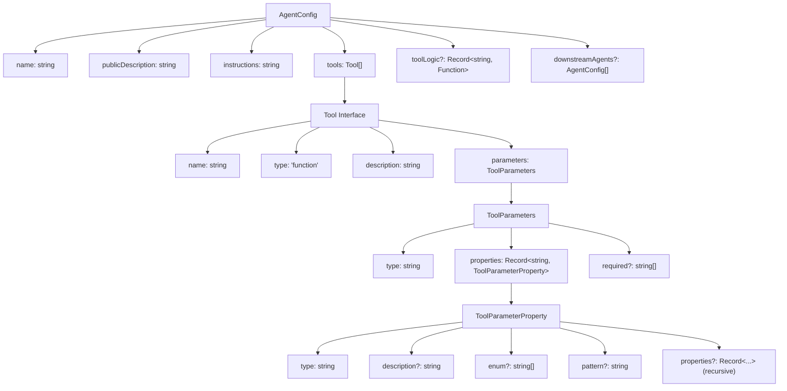
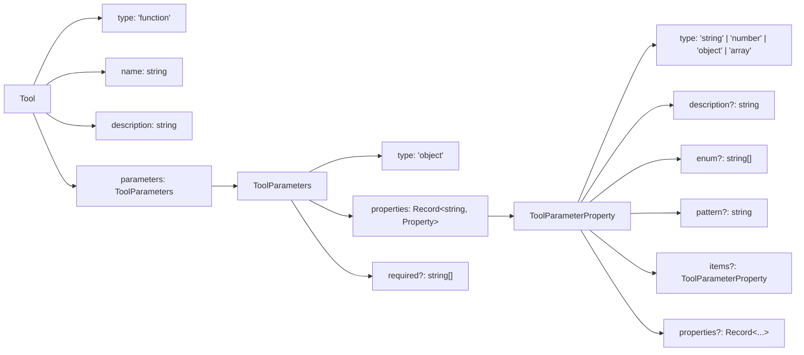
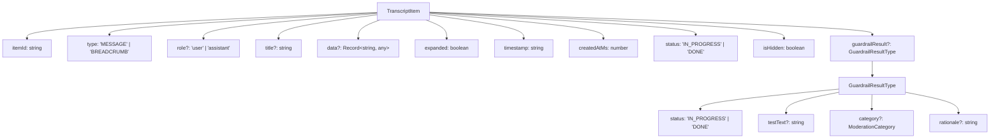
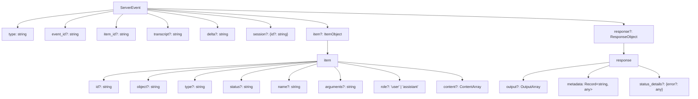
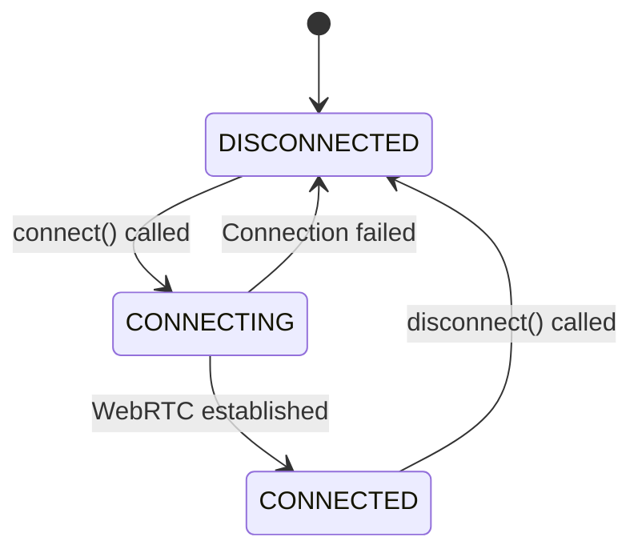
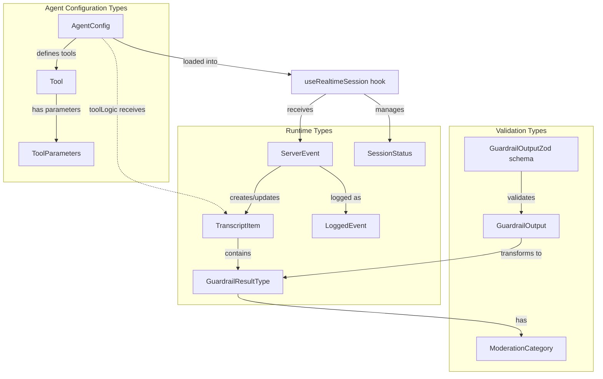

<!-- source: DeepWiki mcp.deepwiki.com · repo openai/openai-realtime-agents · page 3.5 Type System and Data Structures · fetched 2026-10-26 -->

# Type System and Data Structures

<details>
<summary>Relevant source files</summary>

The following files were used as context for generating this wiki page:

- [README.md](README.md)
- [public/screenshot_handoff.png](public/screenshot_handoff.png)
- [src/app/types.ts](src/app/types.ts)

</details>


This document provides a comprehensive reference for the TypeScript type system used throughout the openai-realtime-agents codebase. All core type definitions are centralized in [src/app/types.ts](). These types establish contracts between the frontend UI, the OpenAI Realtime API integration, agent configurations, and content moderation systems.

For information about how these types are used in agent configurations, see [Agent Configuration System](#2.3). For details on session management using these types, see [Real-time Session Management](#3.1). For guardrails implementation details, see [Guardrails and Content Moderation](#3.4).

---

## Type System Overview

The type system is organized into five major categories that correspond to the architectural layers of the application:

| Category | Primary Types | Purpose |
|----------|---------------|---------|
| **Agent Configuration** | `AgentConfig`, `Tool`, `ToolParameters` | Define agent behavior, tools, and capabilities |
| **Conversation State** | `TranscriptItem`, `GuardrailResultType` | Track message history and moderation status |
| **Event Handling** | `ServerEvent`, `LoggedEvent`, `Log` | Process real-time API events and debugging logs |
| **Session Management** | `SessionStatus` | Track WebRTC connection lifecycle |
| **Content Moderation** | `ModerationCategory`, `GuardrailOutput` | Classify and filter assistant responses |

**Sources:** [src/app/types.ts:1-149]()

---

## Agent Configuration Types

### AgentConfig Interface

The `AgentConfig` interface defines the complete configuration for a single agent in the system. Each agent configuration specifies its instructions, available tools, tool implementation logic, and potential handoff targets.



**Key Properties:**

- **`name`**: Unique identifier for the agent (e.g., `"greeter"`, `"returns"`, `"chatAgent"`)
- **`publicDescription`**: Human-readable description used by the transfer tool to understand when to hand off to this agent
- **`instructions`**: Multi-line string containing the agent's system prompt, personality, task definitions, and optionally state machine logic
- **`tools`**: Array of `Tool` objects defining functions the agent can call
- **`toolLogic`**: Optional record mapping tool names to their implementation functions. If omitted, tools return `true` by default
- **`downstreamAgents`**: Array of agents this agent can transfer to, used in Sequential Handoff patterns

**Tool Logic Function Signature:**
```typescript
(
  args: any,
  transcriptLogsFiltered: TranscriptItem[],
  addTranscriptBreadcrumb?: (title: string, data?: any) => void
) => Promise<any> | any
```

**Sources:** [src/app/types.ts:44-58]()

---

### Tool Definition Structure

Tools follow a JSON Schema-based parameter specification, allowing the OpenAI Realtime API to validate tool calls and generate proper function invocations.



The `ToolParameterProperty` interface is recursive, supporting deeply nested object schemas. This enables tools with complex parameter structures.

**Common Patterns:**

| Pattern | Example Use Case | Structure |
|---------|------------------|-----------|
| **Simple String** | `destination` parameter for transfer | `{type: "string", enum: ["returns", "sales"]}` |
| **Pattern Validation** | Phone number collection | `{type: "string", pattern: "^\\d{10}$"}` |
| **Nested Objects** | User account information | `{type: "object", properties: {...}}` |
| **Arrays** | List of items | `{type: "array", items: {...}}` |

**Sources:** [src/app/types.ts:19-42]()

---

## Conversation and Transcript Types

### TranscriptItem Interface

The `TranscriptItem` interface represents a single entry in the conversation history. Items can be either user/assistant messages or system breadcrumbs (e.g., tool calls, agent transfers).



**Type Discrimination:**

- **MESSAGE items**: Have `role` property set to `"user"` or `"assistant"`, displayed as chat bubbles in the UI
- **BREADCRUMB items**: Have `title` and `data` properties, displayed as expandable system events (tool calls, transfers, etc.)

**Status Flow:**

1. **IN_PROGRESS**: Item is being generated or processed
2. **DONE**: Item generation is complete

**Guardrail Integration:**

When `guardrailResult` is present, it indicates the message has been or is being evaluated by the moderation system. The `category` field indicates the moderation result (see Guardrails section below).

**Sources:** [src/app/types.ts:68-80]()

---

## Event and Logging Types

### ServerEvent Interface

The `ServerEvent` interface types the events received from the OpenAI Realtime API over the `oai-events` DataChannel. This is a complex discriminated union based on the `type` field.



**Common Event Types:**

| Event Type | Properties Used | Purpose |
|------------|----------------|---------|
| `conversation.item.create` | `item` | New conversation item added |
| `response.audio_transcript.delta` | `delta`, `item_id` | Streaming transcription |
| `response.text.delta` | `delta`, `item_id` | Streaming text response |
| `response.function_call_arguments.delta` | `delta`, `item_id` | Streaming tool call arguments |
| `response.done` | `response` | Complete response with all outputs |
| `session.created` | `session` | Session established |

**Sources:** [src/app/types.ts:92-130]()

---

### LoggedEvent Interface

The `LoggedEvent` interface represents events stored in the debugging event log, displayed in the right panel of the UI.

| Field | Type | Description |
|-------|------|-------------|
| `id` | `number` | Unique sequential identifier |
| `direction` | `"client" \| "server"` | Event originator |
| `expanded` | `boolean` | UI expansion state |
| `timestamp` | `string` | ISO timestamp |
| `eventName` | `string` | Event type (e.g., `"response.audio_transcript.delta"`) |
| `eventData` | `Record<string, any>` | Full event payload |

The `Log` interface ([src/app/types.ts:82-90]()) is similar but uses slightly different field names. Both are used for debugging visibility.

**Sources:** [src/app/types.ts:132-139]()

---

## Session Management Types

### SessionStatus

A simple union type tracking the WebRTC connection lifecycle:

```typescript
type SessionStatus = "DISCONNECTED" | "CONNECTING" | "CONNECTED"
```

**State Transitions:**



This status is used by the `useRealtimeSession` hook and displayed in the UI to show connection state. The App component uses this to enable/disable controls.

**Sources:** [src/app/types.ts:17]()

---

## Guardrails and Moderation Types

### ModerationCategory

The moderation system classifies assistant messages into four categories:

```typescript
const MODERATION_CATEGORIES = [
  "OFFENSIVE",
  "OFF_BRAND",
  "VIOLENCE",
  "NONE",
] as const;

type ModerationCategory = (typeof MODERATION_CATEGORIES)[number];
```

**Category Definitions:**

| Category | Description | Action |
|----------|-------------|--------|
| `OFFENSIVE` | Hateful, harassing, or inappropriate content | Message hidden, marked as FAIL |
| `OFF_BRAND` | Response doesn't align with company voice/values | Message hidden, marked as FAIL |
| `VIOLENCE` | Content depicting or encouraging violence | Message hidden, marked as FAIL |
| `NONE` | Content passes all checks | Message displayed, marked as PASS |

The system also provides a Zod schema version (`ModerationCategoryZod`) for runtime validation when parsing API responses from the moderation endpoint.

**Sources:** [src/app/types.ts:3-15]()

---

### GuardrailOutput and GuardrailResultType

Two related interfaces handle moderation results:

**GuardrailOutput** (parsed from API response):
```typescript
{
  moderationRationale: string;    // Explanation of classification
  moderationCategory: ModerationCategory;
  testText?: string;              // Text that was evaluated
}
```

**GuardrailResultType** (stored in TranscriptItem):
```typescript
{
  status: "IN_PROGRESS" | "DONE";
  testText?: string;
  category?: ModerationCategory;
  rationale?: string;
}
```

The `GuardrailOutput` is validated against the Zod schema ([src/app/types.ts:142-146]()) when parsing responses from `/api/responses`. The `status` field is added when storing results in the transcript.

**Sources:** [src/app/types.ts:61-66](), [src/app/types.ts:142-148]()

---

## Type Relationships and Data Flow

The following diagram shows how the major type categories interact across the application architecture:



**Key Type Flow Patterns:**

1. **Configuration → Runtime**: `AgentConfig` objects are loaded from [src/app/agentConfigs/]() and passed to the `useRealtimeSession` hook, which instantiates `RealtimeAgent` objects from the OpenAI Agents SDK.

2. **Events → State**: `ServerEvent` objects received from the Realtime API are processed and transformed into `TranscriptItem` entries or `LoggedEvent` entries for display.

3. **Moderation Pipeline**: When a `response.text.delta` event creates a `TranscriptItem`, the guardrails system fetches a `GuardrailOutput` (validated by `GuardrailOutputZod`), which is transformed into a `GuardrailResultType` and attached to the transcript item.

4. **Tool Execution**: Agent `toolLogic` functions receive the current array of `TranscriptItem[]` as context, allowing tools to access conversation history when making decisions.

**Sources:** [src/app/types.ts:1-149]()

---

## AllAgentConfigsType Registry

The `AllAgentConfigsType` defines the structure for the agent configuration registry:

```typescript
type AllAgentConfigsType = Record<string, AgentConfig[]>
```

This type is used in [src/app/agentConfigs/index.ts]() to export all available agent scenarios:

```typescript
const allAgentSets: AllAgentConfigsType = {
  chatSupervisor: [...],
  customerServiceRetail: [...],
  simpleHandoff: [...]
}
```

Each key corresponds to an agent scenario name (used in URL parameters like `?agentConfig=chatSupervisor`), and each value is an array of `AgentConfig` objects that participate in that scenario. The first agent in the array is typically the root agent that initially handles user interactions.

**Sources:** [src/app/types.ts:59]()

---

## Type Safety and Validation

The codebase uses three mechanisms to ensure type safety:

1. **TypeScript Interfaces**: Compile-time type checking for all data structures
2. **Zod Schemas**: Runtime validation for external API responses (e.g., `GuardrailOutputZod`)
3. **Const Assertions**: Type-safe enums derived from arrays (e.g., `MODERATION_CATEGORIES`)

This multi-layered approach provides both developer experience benefits (autocomplete, refactoring safety) and runtime guarantees (validation of API responses).

**Sources:** [src/app/types.ts:1-16](), [src/app/types.ts:142-148]()

---

