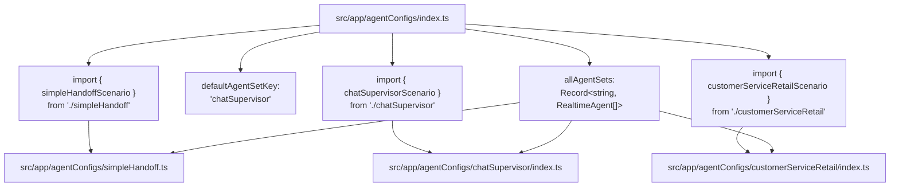
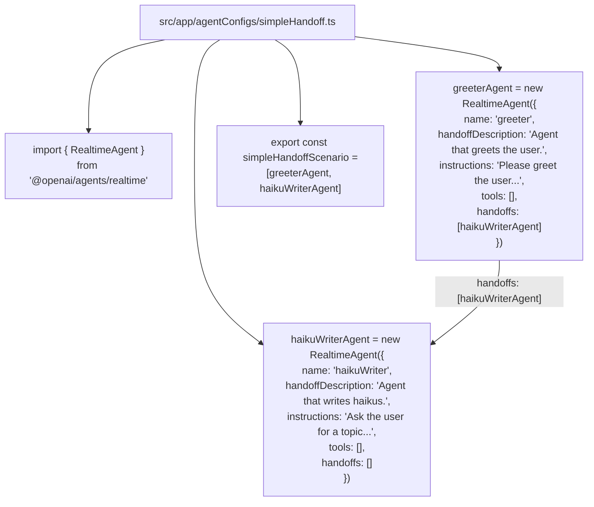
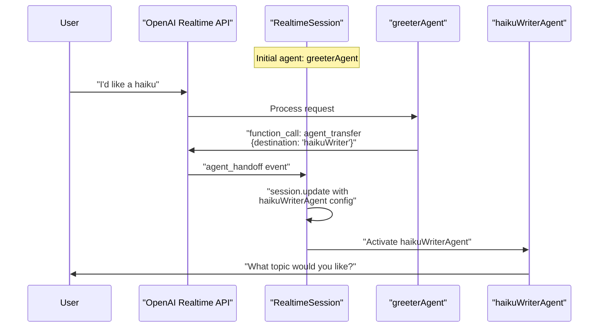
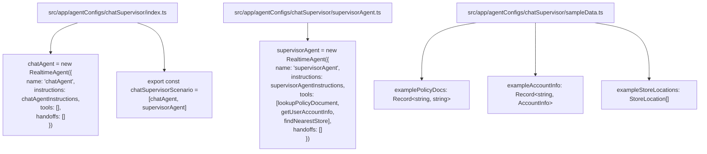
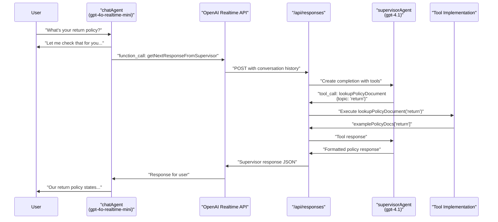
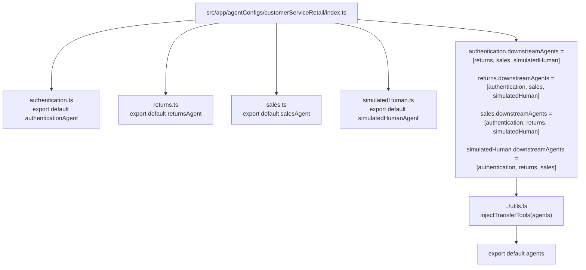
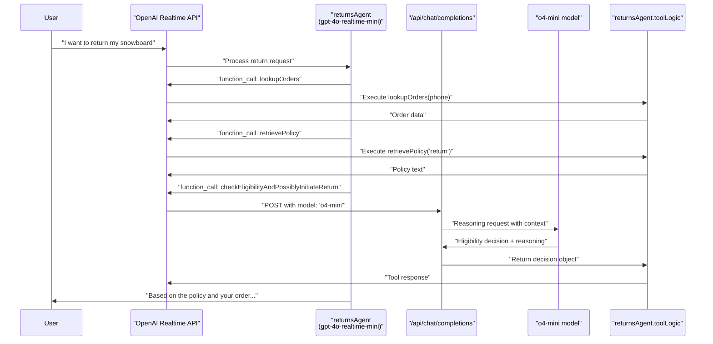
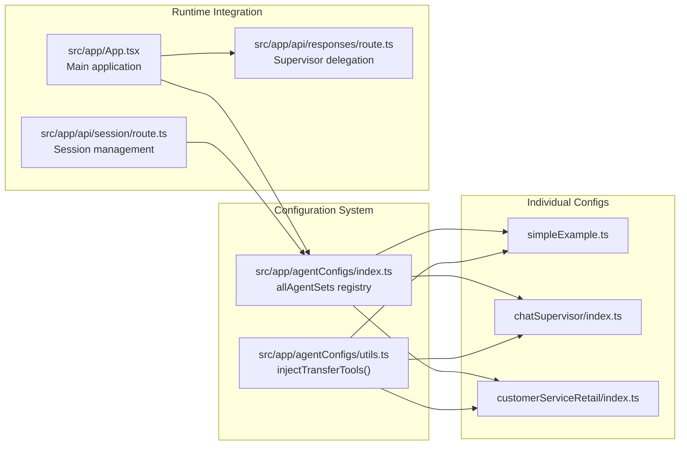

<!-- source: DeepWiki mcp.deepwiki.com · repo openai/openai-realtime-agents · page 4 Example Implementations · fetched 2026-10-26 -->

# Example Agent Implementations

<details>
<summary>Relevant source files</summary>

The following files were used as context for generating this wiki page:

- [README.md](README.md)
- [public/screenshot_handoff.png](public/screenshot_handoff.png)
- [src/app/agentConfigs/index.ts](src/app/agentConfigs/index.ts)

</details>


This page documents the three agent implementation examples included in the repository. Each example demonstrates a specific agent pattern using the `RealtimeAgent` class from the OpenAI Agents SDK. The implementations are located in [src/app/agentConfigs/]() and registered in [src/app/agentConfigs/index.ts:8-12]() as the `allAgentSets` object.

The three implementations are:
1. **simpleHandoff**: Minimal two-agent transfer demonstrating basic handoff mechanics
2. **chatSupervisor**: Dual-agent pattern with chat agent delegating to supervisor for complex tasks
3. **customerServiceRetail**: Multi-agent customer service flow with authentication, returns, sales, and human escalation agents

For architectural pattern concepts, see page 2. For frontend/backend technical implementation, see page 3.

## Agent Configuration Registry

The `allAgentSets` object in [src/app/agentConfigs/index.ts:8-12]() maps scenario keys to arrays of `RealtimeAgent` instances. The registry structure is:

```typescript
export const allAgentSets: Record<string, RealtimeAgent[]> = {
  simpleHandoff: simpleHandoffScenario,
  customerServiceRetail: customerServiceRetailScenario,
  chatSupervisor: chatSupervisorScenario,
};
```

**Registry Structure**



**RealtimeAgent Constructor Parameters**

Each agent is instantiated using `new RealtimeAgent({ ... })` with these parameters:

| Parameter | Type | Purpose |
|-----------|------|---------|
| `name` | `string` | Unique identifier for the agent |
| `instructions` | `string` | System prompt defining agent behavior |
| `tools` | `Tool[]` | Array of function definitions with JSON schemas |
| `handoffs` | `RealtimeAgent[]` | Array of agents this agent can transfer to |
| `handoffDescription` | `string` | Description used by `agent_transfer` tool |

The `defaultAgentSetKey` in [src/app/agentConfigs/index.ts:14]() is set to `'chatSupervisor'`, which is used when no `?agentConfig=` URL parameter is provided.

Sources: [src/app/agentConfigs/index.ts:1-15](), [README.md:93-116]()

## Simple Handoff Implementation

The `simpleHandoffScenario` in [src/app/agentConfigs/simpleHandoff.ts]() defines two agents with unidirectional transfer from `greeterAgent` to `haikuWriterAgent`. This is the minimal implementation demonstrating the handoff mechanism.

**Agent Instantiation Code Structure**



**Agent Configuration Details**

The `haikuWriterAgent` is defined first because `greeterAgent.handoffs` references it:

| Agent | Name | Instructions Summary | Tools | Handoffs |
|-------|------|---------------------|-------|----------|
| `haikuWriterAgent` | `"haikuWriter"` | Ask for topic, reply with haiku | `[]` | `[]` |
| `greeterAgent` | `"greeter"` | Greet user, ask if they want haiku, transfer if yes | `[]` | `[haikuWriterAgent]` |

The `handoffDescription` fields provide context for the automatic `agent_transfer` tool that is injected by the SDK. When `greeterAgent` has `handoffs: [haikuWriterAgent]`, the SDK automatically adds an `agent_transfer` tool with the destination's `handoffDescription` as part of the tool schema.

**Transfer Mechanism**



The transfer occurs when the Realtime API calls the `agent_transfer` function. The SDK handles the `agent_handoff` event by updating the session with the new agent's `instructions`, `tools`, and configuration.

Sources: [README.md:92-116](), [src/app/agentConfigs/simpleHandoff.ts]()

## Chat Supervisor Implementation

The `chatSupervisorScenario` in [src/app/agentConfigs/chatSupervisor/index.ts]() implements a two-agent pattern where `chatAgent` (using `gpt-4o-realtime-mini`) handles basic interactions and delegates to `supervisorAgent` (using `gpt-4.1`) via the `getNextResponseFromSupervisor` tool.

**File Structure and Agent Creation**



**chatAgent Instructions Structure**

The `chatAgentInstructions` in [src/app/agentConfigs/chatSupervisor/index.ts]() define an explicit allow-list:

```
## Permitted Actions
You MAY ONLY:
1. Greet the user warmly
2. Engage in brief, friendly chitchat
3. Collect necessary information (phone numbers, order numbers, addresses)
4. Provide filler responses when deferring to supervisor
5. Thank the user and say goodbye

## Prohibited Actions - MUST Use Supervisor
- Answering questions about policies, products, services
- Looking up account information
- Finding store locations
- Making decisions about returns, exchanges, refunds
- Providing any business-specific information
```

The `chatAgent` has `tools: []` but references the supervisor tool in its instructions using YAML format (not JSON) to prevent the realtime model from attempting to call tools directly.

**supervisorAgent Tool Definitions**

The `supervisorAgent` in [src/app/agentConfigs/chatSupervisor/supervisorAgent.ts]() defines three tools:

| Tool Name | Parameters | Implementation | Data Source |
|-----------|------------|----------------|-------------|
| `lookupPolicyDocument` | `topic: string` | Searches `examplePolicyDocs` | [sampleData.ts]() |
| `getUserAccountInfo` | `phone_number: string` | Looks up user in `exampleAccountInfo` | [sampleData.ts]() |
| `findNearestStore` | `zip_code: string` | Filters `exampleStoreLocations` | [sampleData.ts]() |

**Tool Call Delegation Flow**



The `getNextResponseFromSupervisor` tool is handled in [src/app/App.tsx]() by calling `/api/responses`, which uses the OpenAI Chat Completions API with `gpt-4.1` as the model. The supervisor agent's tool calls are executed server-side, and the final response is returned to the chat agent.

Sources: [src/app/agentConfigs/chatSupervisor/index.ts](), [src/app/agentConfigs/chatSupervisor/supervisorAgent.ts](), [src/app/agentConfigs/chatSupervisor/sampleData.ts](), [README.md:30-81]()

## Customer Service Retail Implementation

The `customerServiceRetailScenario` in [src/app/agentConfigs/customerServiceRetail/index.ts]() implements a fully-connected four-agent graph using the `injectTransferTools()` utility to generate bidirectional transfer capabilities.

**Agent Graph Construction**



The `injectTransferTools()` function in [src/app/agentConfigs/utils.ts]() iterates through each agent's `downstreamAgents` property and adds a `transferAgents` tool with the downstream agent names as an enum parameter.

**Agent File Structure and Tools**

| Agent File | Instructions Section | Tools Defined | Tool Count |
|-----------|---------------------|---------------|------------|
| [authentication.ts]() | State machine for name/phone collection | `authenticate_user_information`, `save_or_update_address` | 2 |
| [returns.ts]() | Return eligibility validation | `lookupOrders`, `retrievePolicy`, `checkEligibilityAndPossiblyInitiateReturn` | 3 |
| [sales.ts]() | Product promotion and sales | `lookupNewSales`, `addToCart`, `checkout` | 3 |
| [simulatedHuman.ts]() | Human escalation simulation | (none) | 0 |

**authenticationAgent State Machine**

The `authenticationAgent` instructions in [src/app/agentConfigs/customerServiceRetail/authentication.ts]() define a structured state flow:

```mermaid
stateDiagram-v2
    direction LR
    [*] --> GREETING
    GREETING --> COLLECT_NAME: "Initial greeting"
    COLLECT_NAME --> CONFIRM_NAME_LETTER: "User provides name"
    CONFIRM_NAME_LETTER --> COLLECT_PHONE: "Name confirmed"
    CONFIRM_NAME_LETTER --> COLLECT_NAME: "Name rejected"
    COLLECT_PHONE --> CONFIRM_PHONE_DIGIT: "User provides phone"
    CONFIRM_PHONE_DIGIT --> CALL_AUTH_TOOL: "Phone confirmed"
    CONFIRM_PHONE_DIGIT --> COLLECT_PHONE: "Phone rejected"
    CALL_AUTH_TOOL --> AUTHENTICATED: "Tool returns true"
    CALL_AUTH_TOOL --> COLLECT_NAME: "Tool returns false"
    AUTHENTICATED --> ROUTE_TO_SPECIALIST: "Auth successful"
    ROUTE_TO_SPECIALIST --> [*]: "transferAgents call"
```



The instructions specify character-by-character confirmation: "After they provide their name, read it back to them letter by letter and ask them to confirm."

**returnsAgent O4-Mini Escalation**

The `checkEligibilityAndPossiblyInitiateReturn` tool in [src/app/agentConfigs/customerServiceRetail/returns.ts]() demonstrates calling `o4-mini` for high-stakes decisions:



The `checkEligibilityAndPossiblyInitiateReturn` tool logic in [src/app/agentConfigs/customerServiceRetail/returns.ts:233]() makes a fetch request to `/api/chat/completions` with `model: 'o4-mini'` and structured reasoning instructions.

**Transfer Tool Injection**

The `injectTransferTools()` utility in [src/app/agentConfigs/utils.ts]() generates the `transferAgents` tool for each agent:

```typescript
const transferTool = {
  type: 'function' as const,
  name: 'transferAgents',
  description: `Transfer to another agent. Available destinations: ${names.join(', ')}`,
  parameters: {
    type: 'object',
    properties: {
      destination: {
        type: 'string',
        enum: names, // Array of downstream agent names
        description: 'The agent to transfer to',
      },
    },
    required: ['destination'],
  },
};
```

When an agent calls `transferAgents`, the `RealtimeSession` handles the `agent_handoff` event and updates the session with the destination agent's configuration.

Sources: [src/app/agentConfigs/customerServiceRetail/index.ts:127-146](), [src/app/agentConfigs/customerServiceRetail/authentication.ts](), [src/app/agentConfigs/customerServiceRetail/returns.ts](), [src/app/agentConfigs/customerServiceRetail/sales.ts](), [src/app/agentConfigs/customerServiceRetail/simulatedHuman.ts](), [src/app/agentConfigs/utils.ts](), [README.md:117-206]()

## Implementation Integration

All agent configurations integrate with the same underlying infrastructure through consistent interfaces and shared utilities.

**Configuration Loading and Injection**


Each implementation follows the same integration pattern:
1. **Agent Definition**: Using `RealtimeAgent` class from OpenAI Agents SDK
2. **Tool Registration**: Business logic tools defined in agent configurations
3. **Transfer Logic**: `injectTransferTools()` utility adds agent transfer capabilities
4. **Runtime Selection**: UI dropdown selection updates active agent configuration

Sources: [src/app/agentConfigs/index.ts](), [src/app/agentConfigs/utils.ts](), [src/app/App.tsx]()

---

