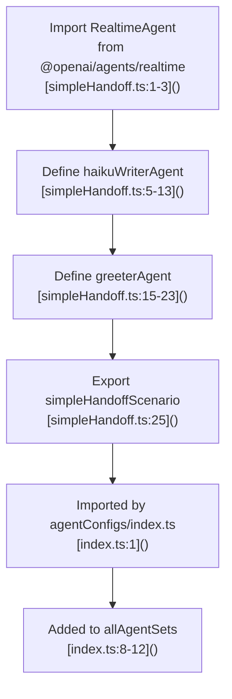
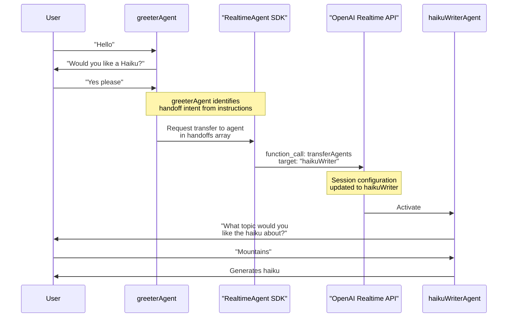
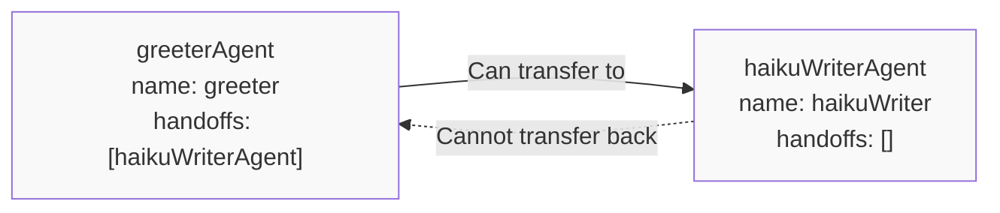
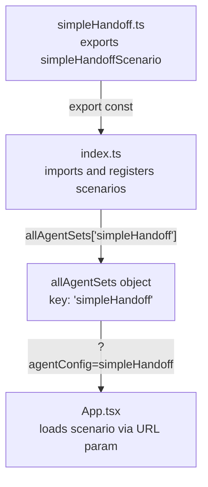

<!-- source: DeepWiki mcp.deepwiki.com · repo openai/openai-realtime-agents · page 4.1 Simple Handoff Example · fetched 2026-10-26 -->

# Simple Handoff Example

<details>
<summary>Relevant source files</summary>

The following files were used as context for generating this wiki page:

- [src/app/agentConfigs/index.ts](src/app/agentConfigs/index.ts)
- [src/app/agentConfigs/simpleHandoff.ts](src/app/agentConfigs/simpleHandoff.ts)

</details>


## Overview

The Simple Handoff Example is the most minimal demonstration of agent transfers in the repository, consisting of only 26 lines of code in [src/app/agentConfigs/simpleHandoff.ts](). It illustrates the basic mechanics of unidirectional agent handoffs without the complexity of tools, state machines, or bidirectional transfers. For more sophisticated patterns, see page 4.2 (Chat Supervisor Example) and page 4.3 (Customer Service Retail Example).
</thinking>

Sources: [src/app/agentConfigs/simpleHandoff.ts:1-26]()

## Agent Components

The scenario consists of two `RealtimeAgent` instances defined in [src/app/agentConfigs/simpleHandoff.ts:1-26]():

| Agent | Purpose | Can Transfer To |
|-------|---------|-----------------|
| `greeterAgent` | Initial entry point; greets user and identifies haiku interest | `haikuWriterAgent` |
| `haikuWriterAgent` | Terminal agent; writes haikus on requested topics | None (empty handoffs array) |

This demonstrates a **unidirectional handoff pattern** - the greeter can transfer to the haiku writer, but the haiku writer cannot transfer back. This differs from the bidirectional transfers in the Customer Service Retail example (page 4.3).

Sources: [src/app/agentConfigs/simpleHandoff.ts:5-25]()

## Code Structure

### Agent Definitions

The file structure is straightforward:



Sources: [src/app/agentConfigs/simpleHandoff.ts:1-26](), [src/app/agentConfigs/index.ts:1-12]()

### haikuWriterAgent Configuration

Defined in [src/app/agentConfigs/simpleHandoff.ts:5-13]():

| Property | Value | Purpose |
|----------|-------|---------|
| `name` | `"haikuWriter"` | Identifier for this agent |
| `voice` | `"sage"` | OpenAI voice model for audio output |
| `instructions` | `"Ask the user for a topic, then reply with a haiku about that topic."` | Defines agent behavior |
| `handoffs` | `[]` | Empty array - this is a terminal agent with no downstream transfers |
| `tools` | `[]` | No custom tools needed |
| `handoffDescription` | `"Agent that writes haikus"` | Description used by transferring agents |

The empty `handoffs` array makes this a **terminal agent** - once control transfers here, it cannot transfer to another agent.

### greeterAgent Configuration

Defined in [src/app/agentConfigs/simpleHandoff.ts:15-23]():

| Property | Value | Purpose |
|----------|-------|---------|
| `name` | `"greeter"` | Identifier for this agent |
| `voice` | `"sage"` | OpenAI voice model for audio output |
| `instructions` | `"Please greet the user and ask them if they'd like a Haiku. If yes, hand off to the 'haiku' agent."` | Defines greeting behavior and transfer trigger |
| `handoffs` | `[haikuWriterAgent]` | Reference to downstream agent |
| `tools` | `[]` | No custom tools needed |
| `handoffDescription` | `"Agent that greets the user"` | Description for other agents |

The `handoffs` array containing `haikuWriterAgent` enables the `RealtimeAgent` class to automatically generate a transfer capability. The agent's instructions explicitly mention handing off to the "haiku" agent.

### Scenario Export

[src/app/agentConfigs/simpleHandoff.ts:25]() exports:

```typescript
export const simpleHandoffScenario = [greeterAgent, haikuWriterAgent];
```

This array is imported by [src/app/agentConfigs/index.ts:1]() and registered in the `allAgentSets` object with key `"simpleHandoff"` [src/app/agentConfigs/index.ts:9](). The first agent in the array (`greeterAgent`) becomes the initial active agent when this scenario is selected.

Sources: [src/app/agentConfigs/simpleHandoff.ts:5-25](), [src/app/agentConfigs/index.ts:1-12]()

## Transfer Mechanism

### Handoff Flow



Sources: [src/app/agentConfigs/simpleHandoff.ts:15-23]()

### How the Handoff Works

The transfer mechanism is built into the `RealtimeAgent` class from `@openai/agents/realtime`:

1. **Declaration**: The `greeterAgent`'s `handoffs` property [src/app/agentConfigs/simpleHandoff.ts:20]() contains a reference to `haikuWriterAgent`
2. **Intent Recognition**: When the user expresses interest in a haiku, the agent's instructions [src/app/agentConfigs/simpleHandoff.ts:18-19]() guide it to "hand off to the 'haiku' agent"
3. **Automatic Transfer**: The `RealtimeAgent` SDK translates this into a `transferAgents` function call to the OpenAI Realtime API
4. **Context Switch**: The API updates the session configuration to use the `haikuWriterAgent`'s instructions, voice, and capabilities
5. **Conversation Continues**: The `haikuWriterAgent` takes over from where the conversation left off

No custom tools or explicit `injectTransferTools()` calls are needed - the handoff capability is automatic based on the `handoffs` array.

Sources: [src/app/agentConfigs/simpleHandoff.ts:15-23]()

## Agent Graph Structure

### Unidirectional Transfer Pattern



Sources: [src/app/agentConfigs/simpleHandoff.ts:5-23]()

This demonstrates a **one-way transfer graph**:
- `greeterAgent` can transfer TO `haikuWriterAgent`
- `haikuWriterAgent` cannot transfer back (empty `handoffs` array)
- Once in the haiku writer agent, the conversation remains there

This contrasts with the **bidirectional transfers** in the Customer Service Retail pattern (page 4.3), where agents can transfer back and forth between each other.

### Integration with Agent Registry



Sources: [src/app/agentConfigs/simpleHandoff.ts:25](), [src/app/agentConfigs/index.ts:1-12]()

The scenario becomes accessible to the application through:
1. Export from [src/app/agentConfigs/simpleHandoff.ts:25]()
2. Import in [src/app/agentConfigs/index.ts:1]()
3. Registration in `allAgentSets` [src/app/agentConfigs/index.ts:9]()
4. Selection via URL parameter: `?agentConfig=simpleHandoff`

## Example Interaction

A typical conversation demonstrating the handoff:

| Turn | Speaker | Message | Active Agent |
|------|---------|---------|--------------|
| 1 | System | *Connection established* | `greeterAgent` |
| 2 | greeterAgent | "Hello! Would you like a haiku?" | `greeterAgent` |
| 3 | User | "Yes please" | `greeterAgent` |
| 4 | System | *Transfer to haikuWriterAgent* | → |
| 5 | haikuWriterAgent | "What topic for your haiku?" | `haikuWriterAgent` |
| 6 | User | "Spring" | `haikuWriterAgent` |
| 7 | haikuWriterAgent | "Cherry blossoms fall<br/>Soft petals on morning dew<br/>Spring whispers hello" | `haikuWriterAgent` |

Note that after the transfer in turn 4, all subsequent conversation happens with `haikuWriterAgent`. There is no mechanism for the user to return to `greeterAgent` without disconnecting and reconnecting.

Sources: [src/app/agentConfigs/simpleHandoff.ts:8-9](), [src/app/agentConfigs/simpleHandoff.ts:18-19]()

## Key Technical Concepts

The Simple Example demonstrates several important concepts in the OpenAI Realtime Agents framework:

1. **Agent Specialization**: Each agent has a focused role and specific instructions
2. **Directed Agent Graph**: Agents are connected in a directed graph through the `downstreamAgents` property
3. **Tool-Enabled Transfers**: Agent transitions happen through standardized tool calls
4. **Context Preservation**: Conversation context is maintained during agent transitions
5. **Declarative Configuration**: Agent behavior is defined through configuration rather than procedural code

## Using the Simple Example as a Template

The Simple Example can serve as a starting point for creating custom multi-agent applications:

1. Define specialized agents with clear roles
2. Configure the directed graph of possible agent transitions
3. Let the system handle the transition mechanics through the `injectTransferTools` function
4. Focus on designing effective instructions for each agent

This pattern scales from simple two-agent scenarios to complex multi-agent systems with sophisticated conversation flows.

Sources: [README.md:3-9](), [README.md:20-48](), [README.md:52-62]()

---

