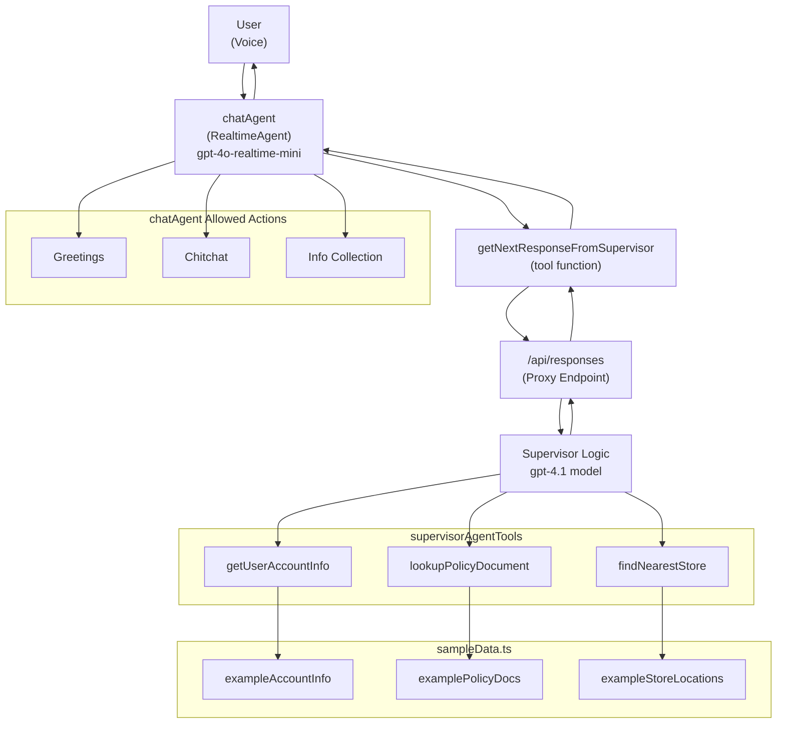

<!-- source: DeepWiki mcp.deepwiki.com · repo openai/openai-realtime-agents · page 4.2 Chat Supervisor Example · fetched 2026-10-26 -->

# Chat Supervisor Example

<details>
<summary>Relevant source files</summary>

The following files were used as context for generating this wiki page:

- [public/screenshot_chat_supervisor.png](public/screenshot_chat_supervisor.png)
- [src/app/agentConfigs/chatSupervisor/index.ts](src/app/agentConfigs/chatSupervisor/index.ts)
- [src/app/agentConfigs/chatSupervisor/sampleData.ts](src/app/agentConfigs/chatSupervisor/sampleData.ts)
- [src/app/agentConfigs/chatSupervisor/supervisorAgent.ts](src/app/agentConfigs/chatSupervisor/supervisorAgent.ts)

</details>


This page walks through the Chat Supervisor implementation in the NewTelco customer service scenario. This example demonstrates how a fast realtime agent (`chatAgent`) defers complex tasks to an intelligent supervisor agent while maintaining natural conversation flow.

For the Chat-Supervisor pattern overview, see page 2.1. For the Sequential Handoff pattern, see page 2.2.

## Overview

The Chat Supervisor example implements a two-tier customer service system where `chatAgent` handles basic interactions and defers to a supervisor for complex queries. The example simulates a telecommunications company called "NewTelco" providing customer support through voice interactions.

**Key Components:**
- **chatAgent** ([src/app/agentConfigs/chatSupervisor/index.ts:4-113]()): Fast realtime agent with limited capabilities
- **supervisorAgent** ([src/app/agentConfigs/chatSupervisor/supervisorAgent.ts:10-92]()): Intelligent agent accessed via `/api/responses` with `gpt-4.1`
- **getNextResponseFromSupervisor** ([src/app/agentConfigs/chatSupervisor/supervisorAgent.ts:256-318]()): Tool connecting the two agents
- **Sample Data** ([src/app/agentConfigs/chatSupervisor/sampleData.ts:1-132]()): Account info, policies, and store locations

Sources: [src/app/agentConfigs/chatSupervisor/index.ts:1-121](), [src/app/agentConfigs/chatSupervisor/supervisorAgent.ts:1-319](), [src/app/agentConfigs/chatSupervisor/sampleData.ts:1-132]()

## File Structure

The Chat Supervisor example is organized across three files in `src/app/agentConfigs/chatSupervisor/`:

| File | Purpose | Key Exports |
|------|---------|-------------|
| `index.ts` | Defines `chatAgent` and scenario registration | `chatAgent`, `chatSupervisorScenario`, `chatSupervisorCompanyName` |
| `supervisorAgent.ts` | Defines supervisor instructions, tools, and tool logic | `supervisorAgentInstructions`, `supervisorAgentTools`, `getNextResponseFromSupervisor` |
| `sampleData.ts` | Mock data for demo purposes | `exampleAccountInfo`, `examplePolicyDocs`, `exampleStoreLocations` |

Sources: [src/app/agentConfigs/chatSupervisor/index.ts:1-121](), [src/app/agentConfigs/chatSupervisor/supervisorAgent.ts:1-319](), [src/app/agentConfigs/chatSupervisor/sampleData.ts:1-132]()

## Architecture Diagram



**Architecture Notes:**
- `chatAgent` runs in the Realtime API with `gpt-4o-realtime-mini` for low-latency responses
- `getNextResponseFromSupervisor` calls `/api/responses` which uses `gpt-4.1` for intelligent reasoning
- Supervisor tools execute locally in the browser, returning mock data from `sampleData.ts`
- The supervisor has access to full conversation history via the `details.context.history` parameter

Sources: [src/app/agentConfigs/chatSupervisor/index.ts:4-113](), [src/app/agentConfigs/chatSupervisor/supervisorAgent.ts:256-318]()

## Execution Flow

```mermaid
sequenceDiagram
    participant User
    participant chatAgent
    participant getNextTool["getNextResponseFromSupervisor<br/>(tool)"]
    participant apiResponses["/api/responses"]
    participant gpt41["gpt-4.1"]
    participant toolLogic["Tool Logic<br/>(getToolResponse)"]
    participant sampleData["sampleData.ts"]
    
    User->>chatAgent: "Hi"
    chatAgent->>User: "Hi, you've reached NewTelco, how can I help you?"
    
    User->>chatAgent: "Why was my recent bill so high?"
    chatAgent->>User: "Sure, may I have your phone number?"
    
    User->>chatAgent: "206 135 1246"
    chatAgent->>User: "Let me look into that"
    
    chatAgent->>getNextTool: relevantContextFromLastUserMessage: "Phone number: 206 135 1246"
    Note over getNextTool: Builds request with history + supervisorAgentInstructions
    getNextTool->>apiResponses: POST with conversation history
    apiResponses->>gpt41: Forward request
    gpt41-->>apiResponses: function_call: getUserAccountInfo
    apiResponses-->>getNextTool: Response with tool call
    getNextTool->>toolLogic: Execute getUserAccountInfo("206 135 1246")
    toolLogic->>sampleData: Fetch exampleAccountInfo
    sampleData-->>toolLogic: Account data
    toolLogic-->>getNextTool: Return account data
    getNextTool->>apiResponses: POST with tool result
    apiResponses->>gpt41: Forward with function_call_output
    gpt41-->>apiResponses: Final message text
    apiResponses-->>getNextTool: Completion response
    getNextTool-->>chatAgent: nextResponse: "Your last bill was $42.17..."
    
    chatAgent->>User: "Your last bill was $42.17..."
```

**Key Implementation Details:**
- `getNextResponseFromSupervisor.execute()` at [src/app/agentConfigs/chatSupervisor/supervisorAgent.ts:272-317]() orchestrates the flow
- `fetchResponsesMessage()` at [src/app/agentConfigs/chatSupervisor/supervisorAgent.ts:150-167]() calls `/api/responses`
- `handleToolCalls()` at [src/app/agentConfigs/chatSupervisor/supervisorAgent.ts:186-254]() iteratively executes supervisor tool calls
- `getToolResponse()` at [src/app/agentConfigs/chatSupervisor/supervisorAgent.ts:169-180]() returns mock data from `sampleData.ts`

Sources: [src/app/agentConfigs/chatSupervisor/supervisorAgent.ts:150-318](), [src/app/agentConfigs/chatSupervisor/index.ts:64-108]()

## Implementation Details

### Chat Agent Configuration

The `chatAgent` is configured as a `RealtimeAgent` with strict limitations:

| Property | Value | Purpose |
|----------|-------|---------|
| `name` | `'chatAgent'` | Agent identifier |
| `voice` | `'sage'` | Voice personality |
| `instructions` | Detailed prompt | Defines behavior and constraints |
| `tools` | `[getNextResponseFromSupervisor]` | Only allowed tool |

The agent follows a strict allow list of permitted actions defined in [src/app/agentConfigs/chatSupervisor/index.ts:28-57]():

**Directly Allowed Actions:**
- Basic chitchat and greetings
- Information collection for supervisor tools (phone numbers, zip codes, topics)
- Clarification requests

**Prohibited Actions:**
- Any factual questions about accounts or policies
- Process-related questions
- Direct tool usage (except `getNextResponseFromSupervisor`)

Sources: [src/app/agentConfigs/chatSupervisor/index.ts:4-13](), [src/app/agentConfigs/chatSupervisor/index.ts:28-57]()

### Mandatory Filler Phrases

The `chatAgent` must use filler phrases before every `getNextResponseFromSupervisor` call to maintain natural conversation flow. Sample phrases from [src/app/agentConfigs/chatSupervisor/index.ts:76-82]():

| Filler Phrase | Purpose |
|---------------|---------|
| "Just a second." | Buy time for supervisor processing |
| "Let me check." | Indicate lookup is happening |
| "One moment." | Generic delay acknowledgment |
| "Let me look into that." | Show investigation is underway |
| "Give me a moment." | Request patience |
| "Let me see." | Indicate research is starting |

**Enforcement:** The instructions at [src/app/agentConfigs/chatSupervisor/index.ts:64-68]() explicitly state: "Before calling getNextResponseFromSupervisor, you MUST ALWAYS say something to the user... Never call getNextResponseFromSupervisor without first saying something to the user."

Sources: [src/app/agentConfigs/chatSupervisor/index.ts:64-68](), [src/app/agentConfigs/chatSupervisor/index.ts:76-82]()

### Supervisor Tool References

The `chatAgent` includes tool schemas for reference but cannot call them directly. These tools are available to the `supervisorAgent`:

```typescript
// Referenced but not callable by chatAgent
lookupPolicyDocument: {
  description: "Look up internal documents and policies by topic or keyword",
  params: { topic: string (required) }
}

getUserAccountInfo: {
  description: "Get user account and billing information (read-only)",
  params: { phone_number: string (required) }
}

findNearestStore: {
  description: "Find the nearest store location given a zip code",
  params: { zip_code: string (required) }
}
```

Sources: [src/app/agentConfigs/chatSupervisor/index.ts:39-56]()

### Company Context

The demo represents "NewTelco" as defined in [src/app/agentConfigs/chatSupervisor/index.ts:118]():

```typescript
export const chatSupervisorCompanyName = 'NewTelco';
```

This company name is used by the guardrails system for context-aware content moderation.

Sources: [src/app/agentConfigs/chatSupervisor/index.ts:13-14](), [src/app/agentConfigs/chatSupervisor/index.ts:118]()

## Example Interaction Pattern

The following table shows the typical interaction flow:

| Step | Actor | Action | Code Reference |
|------|-------|--------|----------------|
| 1 | User | Initial greeting | - |
| 2 | `chatAgent` | Canned greeting response | [line 14]() |
| 3 | User | Complex query (billing question) | - |
| 4 | `chatAgent` | Information collection (phone number) | [lines 36-38]() |
| 5 | User | Provides phone number | - |
| 6 | `chatAgent` | Filler phrase | [lines 76-82]() |
| 7 | `chatAgent` | Calls `getNextResponseFromSupervisor` | [line 91]() |
| 8 | `supervisorAgent` | Processes with tools and returns response | [lines 71-74]() |
| 9 | `chatAgent` | Relays supervisor response verbatim | [line 93]() |

This pattern ensures that complex queries are handled by the intelligent supervisor while maintaining the illusion of a single agent conversation.

Sources: [src/app/agentConfigs/chatSupervisor/index.ts:84-101]()

---

