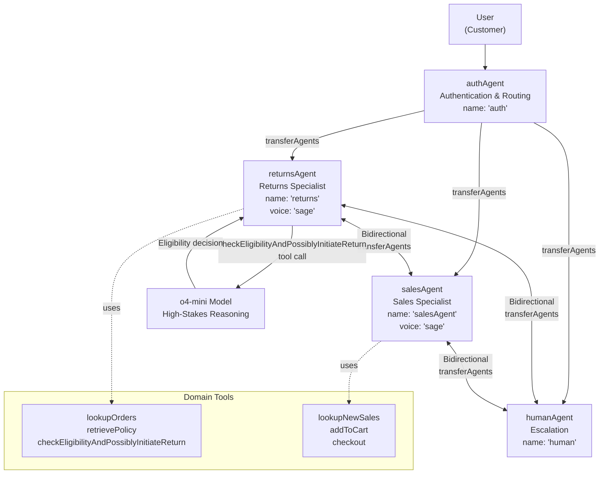
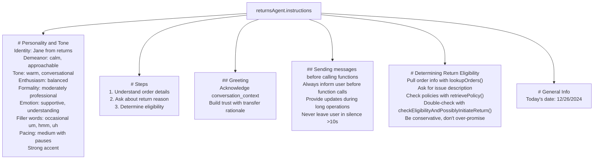
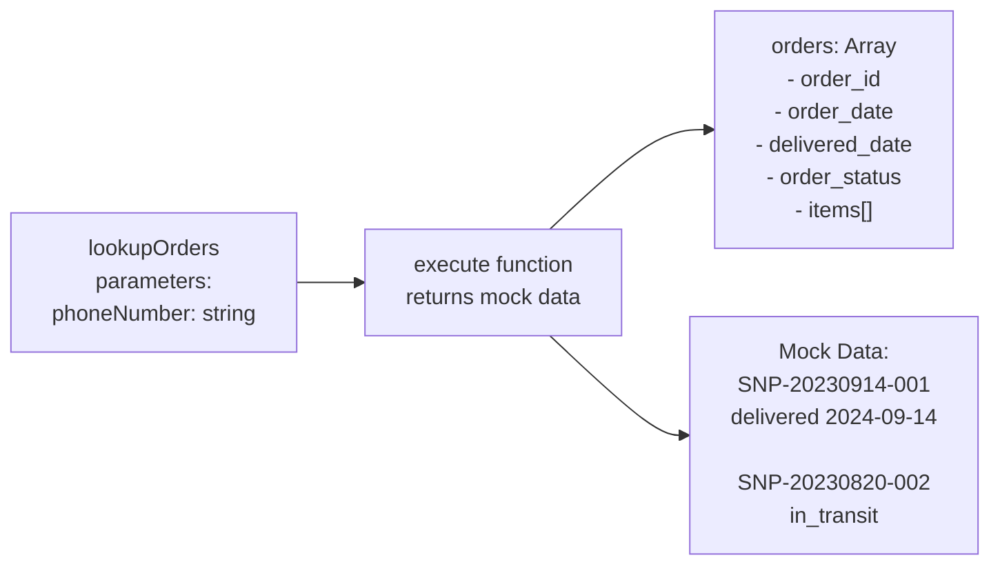
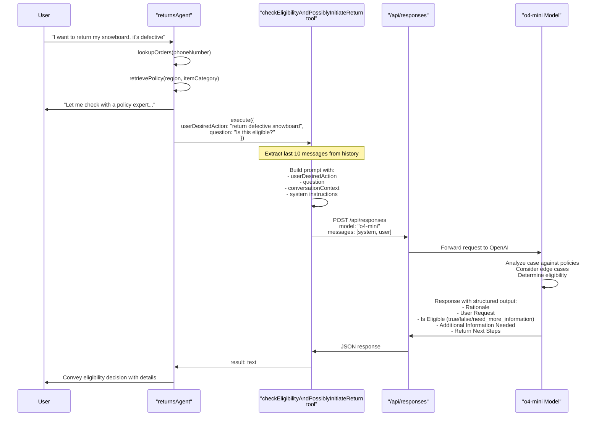
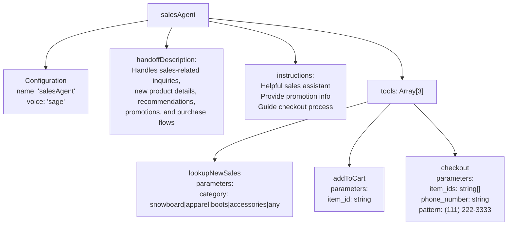
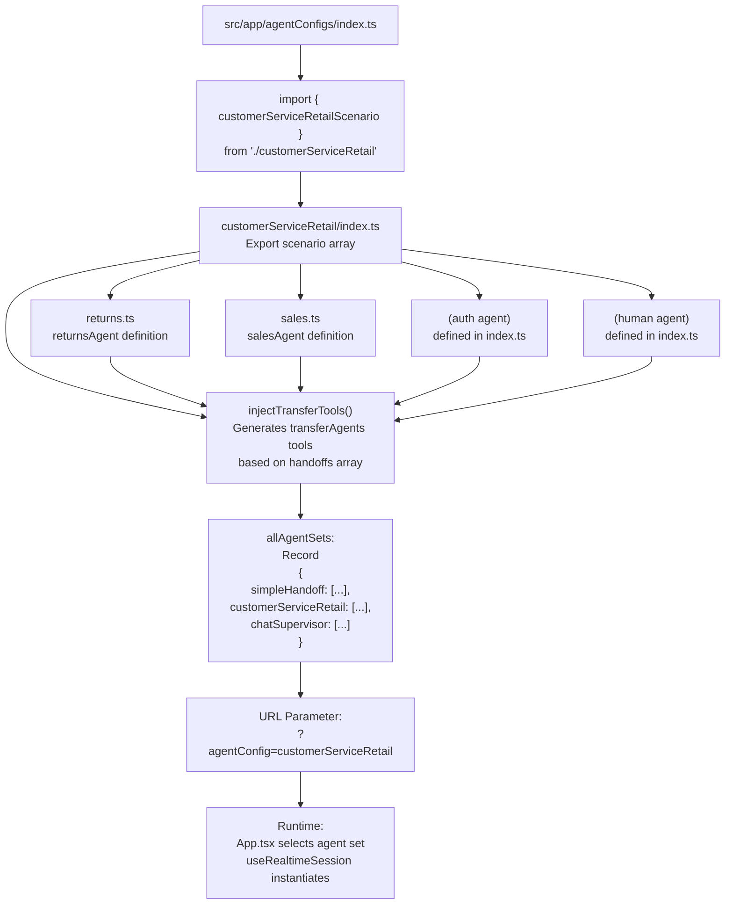
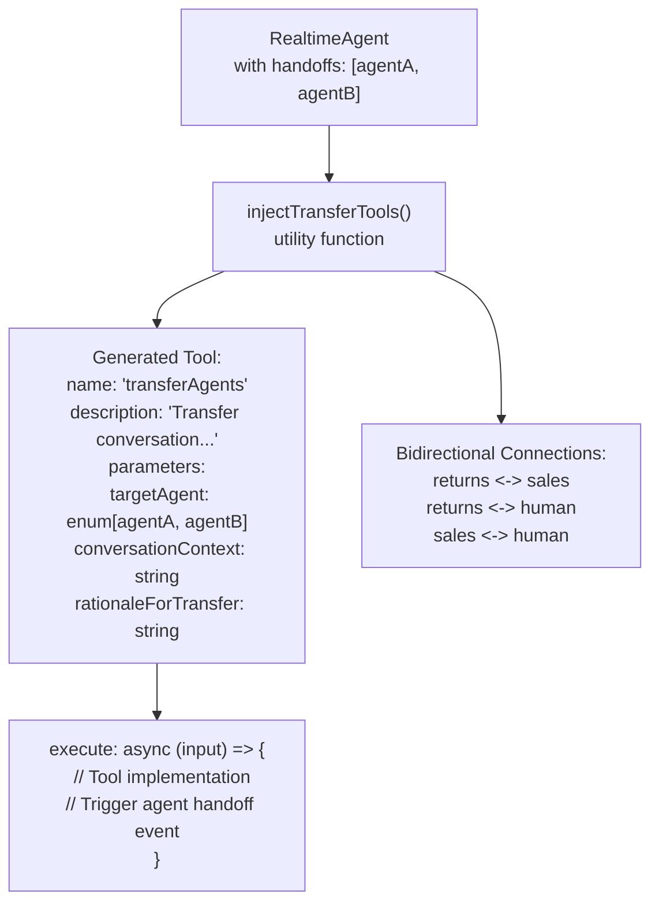
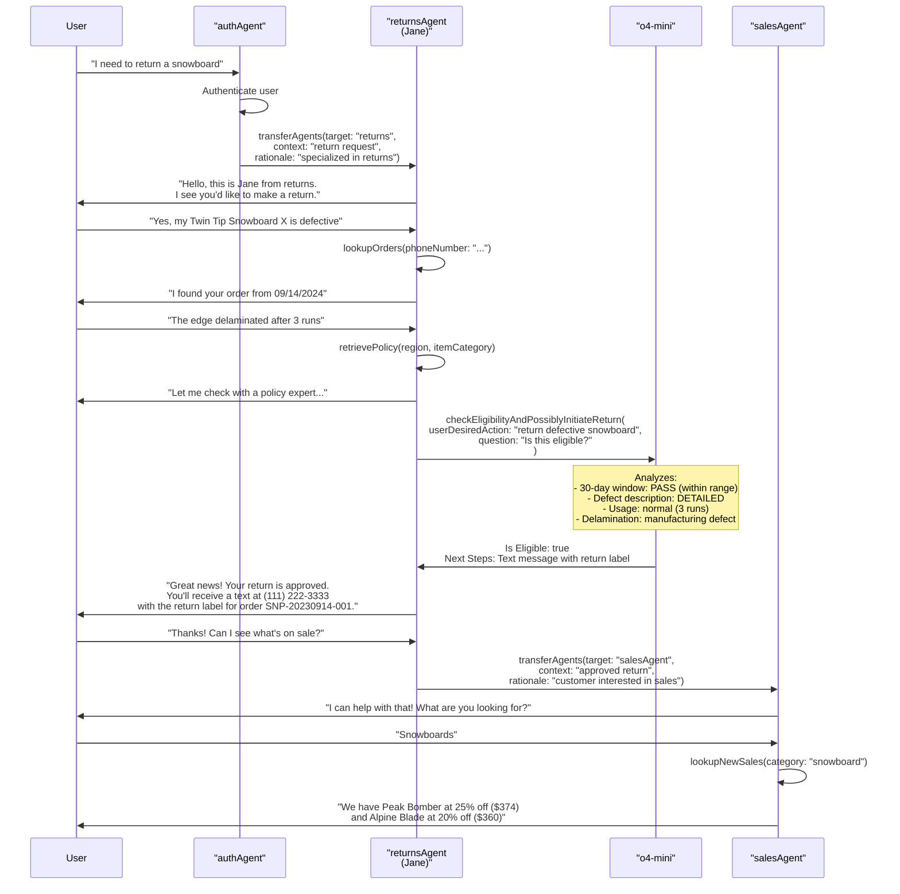

<!-- source: DeepWiki mcp.deepwiki.com · repo openai/openai-realtime-agents · page 4.3 Customer Service Retail Example · fetched 2026-10-26 -->

# Customer Service Retail Example

<details>
<summary>Relevant source files</summary>

The following files were used as context for generating this wiki page:

- [src/app/agentConfigs/customerServiceRetail/returns.ts](src/app/agentConfigs/customerServiceRetail/returns.ts)
- [src/app/agentConfigs/customerServiceRetail/sales.ts](src/app/agentConfigs/customerServiceRetail/sales.ts)
- [src/app/agentConfigs/index.ts](src/app/agentConfigs/index.ts)
- [src/app/api/health/route.ts](src/app/api/health/route.ts)

</details>


## Purpose and Scope

This document details the Customer Service Retail scenario, a demonstration of the Sequential Handoff Pattern implemented for a snowboarding equipment retailer named "Snowy Peak Boards". This scenario showcases a multi-agent customer service system with specialized agents for authentication, returns processing, and sales inquiries. The implementation demonstrates bidirectional agent transfers, complex tool usage, and escalation to the o4-mini reasoning model for high-stakes return eligibility decisions.

For information about the Sequential Handoff Pattern architecture, see [Sequential Handoff Pattern](#2.2). For general agent configuration concepts, see [Agent Configuration System](#2.3). For implementation details of the simpler handoff demonstration, see [Simple Handoff Example](#4.1).

---

## Agent Graph Architecture

The Customer Service Retail scenario implements a graph of specialized agents that can transfer conversations between each other based on user intent. The system begins with an authentication agent that verifies user identity before routing to domain specialists.

### Agent Graph Structure



**Sources:** [src/app/agentConfigs/customerServiceRetail/returns.ts:1-306](), [src/app/agentConfigs/customerServiceRetail/sales.ts:1-100]()

The graph demonstrates a fully-connected specialist topology where:
- The `authAgent` serves as the entry point and initial router
- `returnsAgent` and `salesAgent` are domain specialists with distinct tool sets
- `humanAgent` provides an escalation path from any specialist
- Bidirectional transfers allow natural conversation flow as customer needs evolve

---

## Returns Agent Implementation

The returns agent (`returnsAgent`) is the most sophisticated agent in the scenario, demonstrating advanced personality configuration, complex tool implementation, and integration with o4-mini for critical decision-making.

### Agent Configuration

| Property | Value | Purpose |
|----------|-------|---------|
| `name` | `"returns"` | Agent identifier for transfers |
| `voice` | `"sage"` | OpenAI voice parameter |
| `handoffDescription` | `"Customer Service Agent specialized in order lookups, policy checks, and return initiations."` | Used by other agents to determine transfer appropriateness |
| `instructions` | 74-line detailed prompt | Personality, workflow, and behavioral guidelines |
| `tools` | 3 functions | Order lookup, policy retrieval, eligibility checking |
| `handoffs` | Empty array | Populated by `injectTransferTools()` utility |

**Sources:** [src/app/agentConfigs/customerServiceRetail/returns.ts:3-8]()

### Personality and Behavioral Instructions

The returns agent uses a comprehensive instruction set structured into several sections:



**Sources:** [src/app/agentConfigs/customerServiceRetail/returns.ts:9-74]()

Key behavioral guidelines include:
- **Identity**: Agent presents as "Jane from returns" with expertise in snowboarding gear
- **Transparency**: Always inform users before calling functions (lines 54-61)
- **Patience**: Provide updates every 10 seconds during long operations
- **Conservative approach**: Don't over-promise return approvals without confirmation (line 69)
- **Contextual awareness**: Reference `conversation_context` and `rationale_for_transfer` to build trust (lines 51-52)

---

## Returns Agent Tools

### Order Lookup Tool

The `lookupOrders` tool retrieves mock order data based on phone number:



**Sources:** [src/app/agentConfigs/customerServiceRetail/returns.ts:76-143]()

The tool returns two mock orders:
- **Order SNP-20230914-001**: Delivered order with Twin Tip Snowboard X and All-Mountain Snowboard Boots (total $471.48)
- **Order SNP-20230820-002**: In-transit order with Park & Pipe Freestyle Board, Snow Goggles, and Binding Set (total $390.97)

### Policy Retrieval Tool

The `retrievePolicy` tool returns comprehensive store policies:

| Policy Section | Key Details |
|----------------|-------------|
| General Return Policy | 30-day window from delivery, unused items with tags |
| Condition Requirements | Restocking fees for used items, promotional item value deducted |
| Defective Items | 1-year eligibility for defects outside normal wear |
| Refund Processing | 5 business day inspection, original payment method |
| Exchange Policy | Confirm availability, may require separate transactions |
| Additional Clauses | Extended window for store credit at discretion |

**Sources:** [src/app/agentConfigs/customerServiceRetail/returns.ts:144-204]()

Critical policy detail for defective items (lines 179-186):
- Requires detailed description of defect and usage circumstances
- Agent discretion to determine true defect vs. normal wear
- Example: "delaminated edge after three runs" is acceptable; "big crack" needs more information

---

## o4-mini Escalation for Return Eligibility

The most sophisticated component of the returns agent is the `checkEligibilityAndPossiblyInitiateReturn` tool, which escalates critical decisions to the o4-mini reasoning model.

### Escalation Flow



**Sources:** [src/app/agentConfigs/customerServiceRetail/returns.ts:205-302]()

### Tool Implementation Details

The `checkEligibilityAndPossiblyInitiateReturn` tool (lines 205-302) implements a sophisticated escalation pattern:

**Input Parameters:**
- `userDesiredAction` (string): The proposed action (e.g., "return defective snowboard")
- `question` (string): The specific question for the escalation agent

**Context Extraction** (lines 235-237):
```
const history: RealtimeItem[] = (details?.context as any)?.history ?? [];
const filteredLogs = history.filter((log) => log.type === 'message');
```

The tool extracts the last 10 message items from the conversation history to provide context to o4-mini.

**Prompt Structure** (lines 238-276):
The prompt sent to o4-mini includes:
1. **System message**: Defines o4-mini as an expert assessor who follows policies strictly "by the book"
2. **User message**: Contains:
   - Instructions to consider context and edge cases
   - Emphasis on requesting missing information rather than denying claims
   - `<modelContext>` with userDesiredAction and question
   - `<conversationContext>` with recent conversation JSON
   - `<output_format>` specifying structured output sections

**Structured Output Format:**
```
# Rationale
// Decision explanation

# User Request  
// Desired outcome

# Is Eligible
true/false/need_more_information

# Additional Information Needed
// Required clarifications or "None"

# Return Next Steps
// Details if eligible, otherwise "None"
```

**API Integration** (lines 278-300):
```
const model = "o4-mini";
const response = await fetch("/api/responses", {
  method: "POST",
  headers: { "Content-Type": "application/json" },
  body: JSON.stringify({ model, input: messages }),
});
```

The tool uses the `/api/responses` proxy endpoint to call OpenAI's text API with the o4-mini model. This model is chosen for its advanced reasoning capabilities suitable for high-stakes decisions.

**Sources:** [src/app/agentConfigs/customerServiceRetail/returns.ts:230-301]()

### Why o4-mini for Return Eligibility

The decision to escalate return eligibility to o4-mini demonstrates several architectural principles:

| Aspect | Rationale |
|--------|-----------|
| **High-Stakes Reasoning** | Return approvals have financial implications requiring careful policy interpretation |
| **Edge Case Handling** | o4-mini excels at identifying missing information and edge cases (line 267) |
| **Policy Adherence** | System prompt emphasizes "by the book" approach for consistency (line 242) |
| **Structured Output** | Defined output format ensures parseable, actionable decisions |
| **Context Awareness** | Full conversation history allows nuanced understanding of the situation |
| **Latency Tolerance** | Returns agent warns users this "can take up to 10 seconds" (line 212) |

**Sources:** [src/app/agentConfigs/customerServiceRetail/returns.ts:205-302]()

---

## Sales Agent Implementation

The sales agent (`salesAgent`) handles promotional inquiries and purchase flows with a simpler configuration than the returns agent.

### Agent Configuration



**Sources:** [src/app/agentConfigs/customerServiceRetail/sales.ts:3-100]()

### Sales Tools Implementation

**lookupNewSales Tool** (lines 14-51):
Returns mock promotional data filtered by category:

| Item ID | Type | Name | Retail Price | Sale Price | Discount |
|---------|------|------|--------------|------------|----------|
| 101 | snowboard | Alpine Blade | $450 | $360 | 20% |
| 102 | snowboard | Peak Bomber | $499 | $374 | 25% |
| 201 | apparel | Thermal Jacket | $120 | $84 | 30% |
| 202 | apparel | Insulated Pants | $150 | $112 | 25% |
| 301 | boots | Glacier Grip | $250 | $200 | 20% |
| 302 | boots | Summit Steps | $300 | $210 | 30% |
| 401 | accessories | Goggles | $80 | $60 | 25% |
| 402 | accessories | Warm Gloves | $60 | $48 | 20% |

Results are sorted by discount percentage descending (line 46).

**addToCart Tool** (lines 53-69):
- Simple mock implementation returning `{ success: true }`
- Would integrate with shopping cart system in production

**checkout Tool** (lines 71-96):
- Accepts array of `item_ids` and `phone_number` for verification
- Phone number uses validated pattern: `^\(\d{3}\) \d{3}-\d{4}$`
- Returns mock checkout URL: `https://example.com/checkout`

**Sources:** [src/app/agentConfigs/customerServiceRetail/sales.ts:14-96]()

---

## Agent Registration and Instantiation

The customer service retail scenario is registered in the agent configuration system and made available for runtime selection.

### Registration Pipeline



**Sources:** [src/app/agentConfigs/index.ts:1-14]()

### Registry Structure

The `allAgentSets` object in [src/app/agentConfigs/index.ts:8-12]() maps scenario keys to agent arrays:

```typescript
export const allAgentSets: Record<string, RealtimeAgent[]> = {
  simpleHandoff: simpleHandoffScenario,
  customerServiceRetail: customerServiceRetailScenario,
  chatSupervisor: chatSupervisorScenario,
};
```

The `customerServiceRetail` key provides access to the full agent set including authentication, returns, sales, and human escalation agents.

**Sources:** [src/app/agentConfigs/index.ts:8-12]()

---

## Bidirectional Transfer Mechanism

The customer service retail scenario uses the `injectTransferTools()` utility function to automatically generate `transferAgents` tools based on each agent's `handoffs` array configuration.

### Transfer Tool Generation



When `injectTransferTools()` processes an agent with a `handoffs` array:
1. Generates a `transferAgents` tool with enum parameter listing available targets
2. Includes `conversationContext` and `rationaleForTransfer` parameters for context preservation
3. Implements execute function to trigger the OpenAI Realtime API's handoff mechanism
4. Reciprocal connections allow transfers in both directions (e.g., returns → sales and sales → returns)

This automated approach reduces boilerplate and ensures consistent transfer behavior across all agents in the graph.

**Sources:** Referenced in high-level architecture diagrams and Sequential Handoff Pattern documentation

---

## Usage Example Flow

A typical customer interaction might follow this pattern:



**Sources:** [src/app/agentConfigs/customerServiceRetail/returns.ts:1-306](), [src/app/agentConfigs/customerServiceRetail/sales.ts:1-100]()

---

## Key Architectural Patterns

The Customer Service Retail example demonstrates several important patterns:

| Pattern | Implementation | Benefit |
|---------|---------------|---------|
| **Domain Specialization** | Separate agents for returns vs. sales | Each agent has focused instructions and relevant tools |
| **Escalation to Reasoning Models** | o4-mini for return eligibility | High-stakes decisions benefit from advanced reasoning |
| **Bidirectional Transfers** | Full agent graph connectivity | Natural conversation flow as needs evolve |
| **Context Preservation** | `conversationContext` and `rationaleForTransfer` in transfers | New agent understands conversation history |
| **Transparency** | Agent notifies user before function calls | User understands what's happening |
| **Conservative Decision-Making** | Returns agent doesn't over-promise | Better UX when final decision might differ |
| **Structured Output** | o4-mini returns formatted eligibility decisions | Parseable results for agent consumption |
| **Mock Data Consistency** | Orders and promotions use realistic IDs and prices | Demonstrates production-ready patterns |

**Sources:** [src/app/agentConfigs/customerServiceRetail/returns.ts:1-306](), [src/app/agentConfigs/customerServiceRetail/sales.ts:1-100]()

---

## Comparison to Other Patterns

The Customer Service Retail scenario differs from other examples in key ways:

| Aspect | Customer Service Retail | Chat-Supervisor | Simple Handoff |
|--------|------------------------|-----------------|----------------|
| **Pattern** | Sequential Handoff | Chat-Supervisor | Sequential Handoff |
| **Agent Count** | 4 (auth, returns, sales, human) | 2 (chat, supervisor) | 2 (greeter, haiku) |
| **Transfers** | Bidirectional graph | Unidirectional via tool | Unidirectional |
| **Specialization** | High (domain experts) | Medium (basic vs. complex) | Low (demonstration) |
| **Advanced Model** | o4-mini in returns agent | gpt-4.1 in supervisor | None |
| **Tool Complexity** | High (8 total tools) | Medium (3 tools) | None |
| **Personality Detail** | Very detailed (74 lines) | Moderate | Minimal |
| **Use Case** | Realistic customer service | Responsive + intelligent chat | Educational example |

For more details on the Chat-Supervisor pattern, see [Chat Supervisor Example](#4.2). For the minimal demonstration, see [Simple Handoff Example](#4.1).

**Sources:** [src/app/agentConfigs/customerServiceRetail/returns.ts:9-74](), [src/app/agentConfigs/index.ts:8-12]()

---

