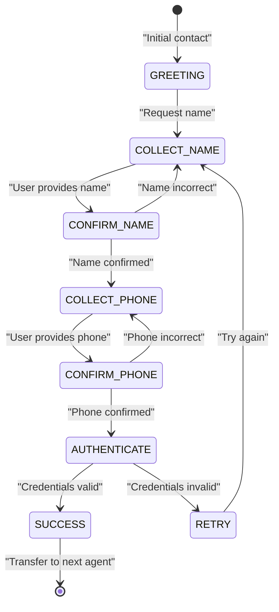
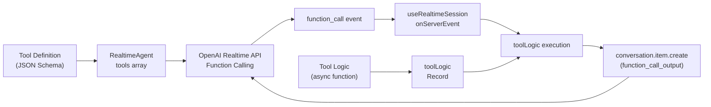
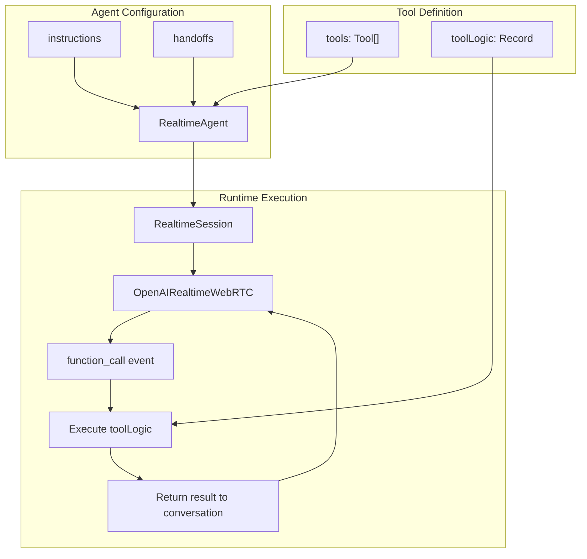
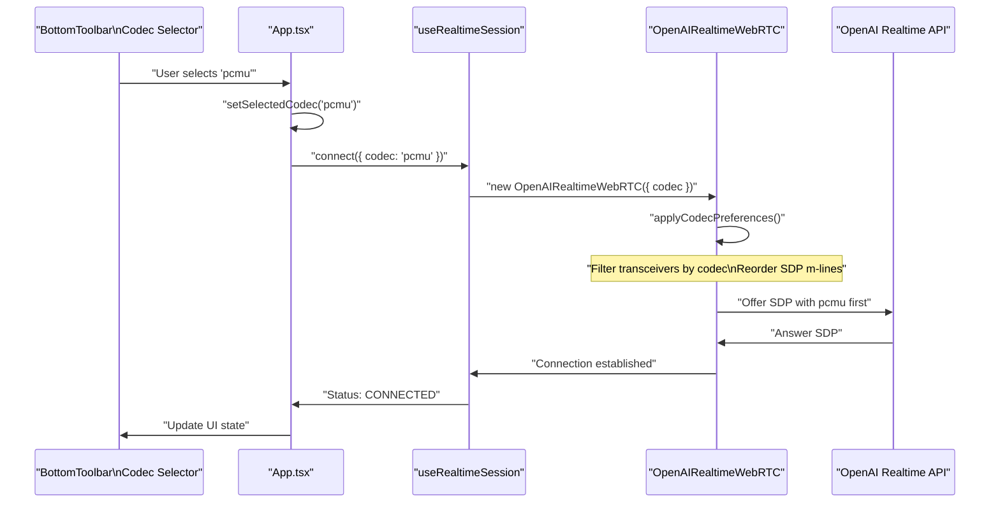
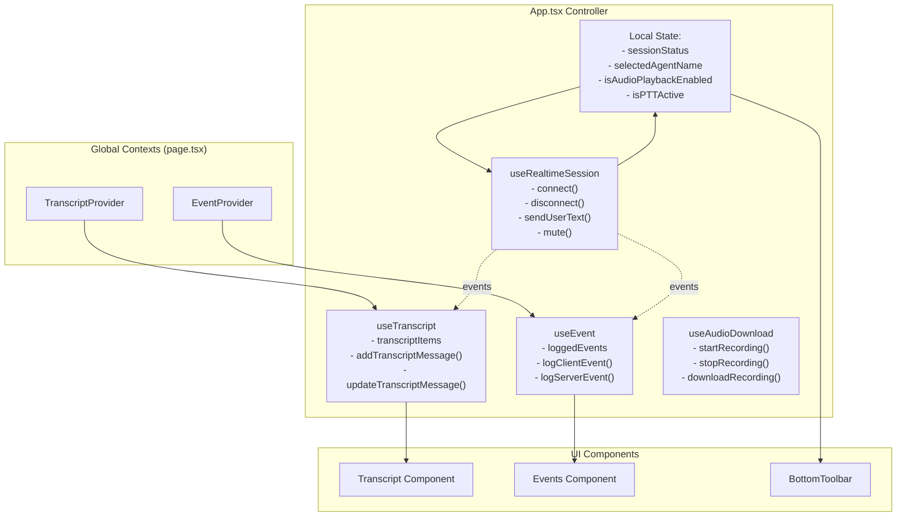
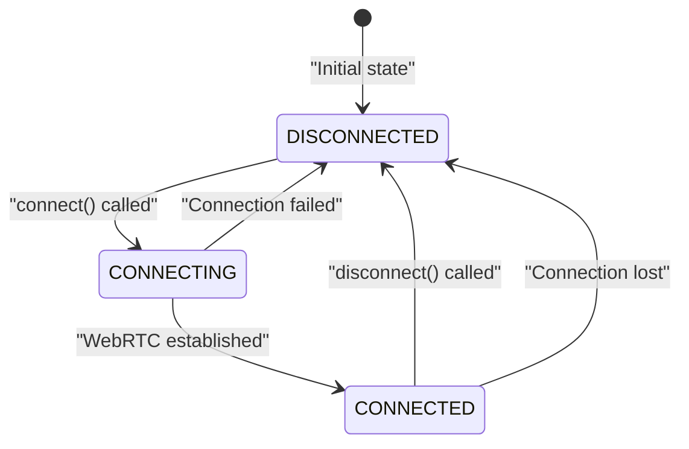

<!-- source: DeepWiki mcp.deepwiki.com · repo openai/openai-realtime-agents · page 5 Advanced Topics · fetched 2026-10-26 -->

# Advanced Topics

<details>
<summary>Relevant source files</summary>

The following files were used as context for generating this wiki page:

- [README.md](README.md)
- [public/screenshot_handoff.png](public/screenshot_handoff.png)

</details>


This section covers advanced customization and extension topics for developers building on top of the Realtime Agents demo. The material assumes familiarity with the basic agent patterns (see [Agent Patterns](#2)) and technical implementation details (see [Technical Implementation](#3)). Topics include prompt engineering techniques, custom tool development, audio codec configuration, and state management patterns.

For concrete examples of these concepts in use, see [Example Implementations](#4).

---

## Voice Agent Prompt Engineering

The system provides a structured approach to designing voice agent prompts through the `voiceAgentMetaprompt.txt` file and the implementation patterns used in the customer service examples.

### Metaprompt Structure

The `voiceAgentMetaprompt.txt` file at [src/app/agentConfigs/voiceAgentMetaprompt.txt:1-100]() defines a template for generating agent prompts using LLMs. This metaprompt follows a five-section structure:

| Section | Purpose | Key Elements |
|---------|---------|--------------|
| **Persona & Tone** | Define agent personality and communication style | Brand voice, formality level, empathy guidelines |
| **Core Responsibilities** | Specify agent's primary tasks and boundaries | What agent should/shouldn't do, scope limitations |
| **State Machine** | Structure conversation flow for complex interactions | States, transitions, validation rules |
| **Tools & Capabilities** | Document available tools in YAML format | Brief tool descriptions, when to use them |
| **Example Interactions** | Provide few-shot examples | Successful dialogues, edge case handling |

The CustomerServiceRetail agents demonstrate this structure in practice. For example, [src/app/agentConfigs/customerServiceRetail/authentication.ts:15-80]() implements a state machine for user authentication:



**Diagram: Authentication Agent State Machine**

Sources: [src/app/agentConfigs/voiceAgentMetaprompt.txt](), [src/app/agentConfigs/customerServiceRetail/authentication.ts]()

### Prompt Engineering Patterns

The implementation files reveal several prompt engineering patterns optimized for voice interactions:

**Character-by-Character Confirmation:**
The authentication agent uses explicit character confirmation to ensure accuracy for critical data like phone numbers. From [src/app/agentConfigs/customerServiceRetail/authentication.ts:45-60](), the instructions specify reading back each digit individually and requesting confirmation before proceeding.

**Task Boundary Definition:**
The chatAgent in the Chat-Supervisor pattern uses an "Allow List of Permitted Actions" at [src/app/agentConfigs/chatSupervisor/index.ts:35-50](). This pattern explicitly defines which tasks the realtime agent can handle directly versus deferring to the supervisor:

- **Permitted:** Greetings, chitchat, information collection
- **Deferred:** Tool calls, complex reasoning, policy decisions

**Concise Response Guidelines:**
Voice prompts emphasize brevity. The supervisorAgent instructions at [src/app/agentConfigs/chatSupervisor/supervisorAgent.ts:20-35]() include directives to avoid long lists, use natural speech patterns, and limit responses to 2-3 sentences for voice delivery.

**Tool Description Format:**
Rather than JSON schemas, the chatAgent uses YAML-formatted tool descriptions at [src/app/agentConfigs/chatSupervisor/index.ts:60-90](). This prevents the realtime model from attempting direct tool calls while still informing it about supervisor capabilities.

Sources: [src/app/agentConfigs/chatSupervisor/index.ts](), [src/app/agentConfigs/customerServiceRetail/authentication.ts](), [src/app/agentConfigs/chatSupervisor/supervisorAgent.ts](), [README.md:211]()

---

## Custom Tool Development

Tools extend agent capabilities by allowing interaction with external systems and data. The system uses the OpenAI Agents SDK tool definition format combined with custom implementation logic.

### Tool Definition Pipeline



**Diagram: Tool Definition to Execution Pipeline**

### Tool Definition Structure

Tools are defined using JSON Schema format in the `tools` array of a `RealtimeAgent`. Example from [src/app/agentConfigs/chatSupervisor/supervisorAgent.ts:95-120]():

```typescript
{
  name: "lookupPolicyDocument",
  description: "Look up company policy by category",
  parameters: {
    type: "object",
    properties: {
      category: {
        type: "string",
        enum: ["returns", "billing", "privacy"],
        description: "Policy category to retrieve"
      }
    },
    required: ["category"]
  }
}
```

### Tool Schema Components

| Component | Type | Purpose | Example |
|-----------|------|---------|---------|
| **name** | `string` | Unique identifier for tool | `"getUserAccountInfo"` |
| **description** | `string` | When and how to use the tool | `"Retrieves user account details by phone number"` |
| **parameters** | `object` | JSON Schema defining inputs | `{type: "object", properties: {...}}` |
| **properties** | `object` | Individual parameter definitions | `{phoneNumber: {type: "string"}}` |
| **required** | `string[]` | Mandatory parameter names | `["phoneNumber"]` |
| **enum** | `any[]` | Constrain parameter to specific values | `["approved", "denied", "pending"]` |

Sources: [src/app/agentConfigs/chatSupervisor/supervisorAgent.ts:95-150]()

### Tool Logic Implementation

Tool logic functions are defined in the `toolLogic` Record and executed server-side when the Realtime API calls the tool. The function signature is:

```typescript
async (args: any, transcriptItems: TranscriptItem[]) => Promise<any>
```

Example from [src/app/agentConfigs/chatSupervisor/supervisorAgent.ts:155-175]():

```typescript
toolLogic: {
  getUserAccountInfo: async (args: { phoneNumber: string }) => {
    const account = accountDatabase.find(
      acc => acc.phoneNumber === args.phoneNumber
    );
    return account || { error: "Account not found" };
  },
  
  lookupPolicyDocument: async (args: { category: string }) => {
    return policyDocuments[args.category];
  },
  
  findNearestStore: async (args: { zipCode: string }) => {
    return storeLocations.find(
      store => store.serviceArea.includes(args.zipCode)
    );
  }
}
```

### Tool Logic Patterns

**Database Lookups:**
The `getUserAccountInfo` tool at [src/app/agentConfigs/chatSupervisor/supervisorAgent.ts:160-170]() demonstrates retrieving data from sample databases. In production, this would connect to actual data stores.

**API Integration:**
Tools can call external APIs. The returns agent uses this pattern at [src/app/agentConfigs/customerServiceRetail/returns.ts:235-275]() to escalate to `o4-mini` for high-stakes decisions:

```typescript
checkEligibilityAndPossiblyInitiateReturn: async (args) => {
  const response = await fetch('/api/chat/completions', {
    method: 'POST',
    body: JSON.stringify({
      model: 'o4-mini',
      messages: [/* context */],
      tools: [/* available tools */]
    })
  });
  return await response.json();
}
```

**Context Access:**
The second parameter `transcriptItems` provides conversation history. This enables tools to make context-aware decisions based on prior exchanges.

**Error Handling:**
Tools should return structured error objects when operations fail, allowing agents to communicate issues naturally to users.

Sources: [src/app/agentConfigs/chatSupervisor/supervisorAgent.ts:155-200](), [src/app/agentConfigs/customerServiceRetail/returns.ts:233-280]()

### Tool Integration with Agents

Tools are integrated into agents through three mechanisms:

**1. Direct Tool Assignment:**
Assign tools array to the `RealtimeAgent` constructor at [src/app/agentConfigs/chatSupervisor/supervisorAgent.ts:90-120]().

**2. Agent Transfer Tools:**
The `injectTransferTools()` utility at [src/app/agentConfigs/utils.ts:10-45]() automatically generates `transferAgents` tool definitions based on the `downstreamAgents` property. This eliminates boilerplate for Sequential Handoff patterns.

**3. Supervisor Tool Delegation:**
The chatAgent doesn't call tools directly. Instead, it uses `getNextResponseFromSupervisor` at [src/app/agentConfigs/chatSupervisor/index.ts:95-110]() to delegate to the supervisor, which has full tool access.



**Diagram: Tool Integration Architecture**

Sources: [src/app/agentConfigs/chatSupervisor/supervisorAgent.ts](), [src/app/agentConfigs/utils.ts](), [src/app/agentConfigs/customerServiceRetail/returns.ts]()

---

## Audio Codec Configuration

The system supports multiple audio codecs for testing different quality and latency scenarios. Codec selection affects audio quality, bandwidth consumption, and compatibility with telephony systems.

### Supported Codecs

| Codec | Sample Rate | Bandwidth | Quality | Use Case |
|-------|-------------|-----------|---------|----------|
| **opus** | 48 kHz | ~40-64 kbps | Wide-band, high fidelity | Default for web applications |
| **pcmu** | 8 kHz | 64 kbps | Narrow-band, telephone quality | Legacy telephony integration |
| **pcma** | 8 kHz | 64 kbps | Narrow-band, telephone quality | International telephony (E1) |

### Codec Selection Flow



**Diagram: Codec Selection and Negotiation Flow**

### Codec Configuration Implementation

The codec preference is applied in the `useRealtimeSession` hook at the connection establishment phase. The process involves:

**1. Codec Parameter:**
The `connect()` method accepts a `codec` parameter at [src/app/hooks/useRealtimeSession.ts:80-95](). This is passed from `App.tsx` based on user selection or URL parameters.

**2. Transport Instantiation:**
The codec is passed to the `OpenAIRealtimeWebRTC` transport constructor at [src/app/hooks/useRealtimeSession.ts:100-115]().

**3. SDP Manipulation:**
During WebRTC negotiation, the transport applies codec preferences by manipulating the Session Description Protocol (SDP). This reorders codec preferences in the SDP offer to prioritize the selected codec.

**4. Transceiver Configuration:**
Audio transceivers are configured with the preferred codec before establishing the connection at [src/app/hooks/useRealtimeSession.ts:120-140]().

### Testing Different Codecs

The UI provides codec selection through the `BottomToolbar` component at [src/app/components/BottomToolbar.tsx:45-75](). Users can:

1. **Disconnect** from the current session
2. **Select** a different codec from the dropdown
3. **Reconnect** to establish a new session with the chosen codec

This allows real-time comparison of audio quality and latency characteristics across codecs.

### Codec Selection Considerations

**Opus (Default):**
- Provides wide-band audio (50 Hz - 20 kHz)
- Adapts bitrate dynamically based on network conditions
- Best for modern web applications requiring high fidelity
- Higher computational requirements

**PCMU/PCMA (8kHz):**
- Narrow-band audio (300 Hz - 3.4 kHz), telephone quality
- Fixed 64 kbps bitrate
- Essential for SIP/PSTN telephony integration
- Lower latency due to simpler encoding
- Compatible with legacy phone systems

The codec can also be specified via URL parameter: `?codec=pcmu` at page load, which is parsed in `App.tsx` at [src/app/App.tsx:65-80]().

Sources: [src/app/hooks/useRealtimeSession.ts](), [src/app/App.tsx:65-85](), [src/app/components/BottomToolbar.tsx:45-75]()

---

## State Management Patterns

The application uses React Context API combined with custom hooks to manage real-time state across components. This architecture provides clean separation between communication logic, conversation history, and UI state.

### State Management Architecture



**Diagram: State Management Data Flow**

### TranscriptContext Pattern

The `TranscriptContext` at [src/app/contexts/TranscriptContext.tsx:15-80]() manages conversation history with the following state structure:

**State Schema:**
```typescript
{
  transcriptItems: TranscriptItem[],
  addTranscriptMessage: (item: TranscriptItem) => void,
  updateTranscriptMessage: (id: string, updates: Partial<TranscriptItem>) => void,
  addBreadcrumb: (text: string) => void,
  clearTranscript: () => void
}
```

**TranscriptItem Types:**
The `TranscriptItem` type at [src/app/types.ts:20-50]() supports multiple message types:

| Type | Purpose | Display |
|------|---------|---------|
| **MESSAGE** | User or assistant speech | Chat bubble with markdown |
| **BREADCRUMB** | System events, agent changes | Gray log entry |
| **FUNCTION_CALL** | Tool invocations | Expandable JSON |
| **FUNCTION_CALL_OUTPUT** | Tool results | Expandable JSON |

**Guardrail Integration:**
Messages include guardrail state at [src/app/types.ts:35-45]():
- `guardrailStatus`: `"IN_PROGRESS" | "PASS" | "FAIL"`
- `moderationCategory`: `"OFFENSIVE" | "OFF_BRAND" | "VIOLENCE" | "NONE"`

The `App.tsx` updates guardrail status when receiving `response.text.delta` and `guardrail_tripped` events at [src/app/App.tsx:180-220]().

Sources: [src/app/contexts/TranscriptContext.tsx](), [src/app/types.ts:20-65](), [src/app/App.tsx:180-220]()

### EventContext Pattern

The `EventContext` at [src/app/contexts/EventContext.tsx:10-60]() manages real-time event logging:

**State Schema:**
```typescript
{
  loggedEvents: LoggedEvent[],
  logClientEvent: (event: ClientEvent) => void,
  logServerEvent: (event: ServerEvent) => void,
  clearEvents: () => void
}
```

**Event Flow:**
1. `useRealtimeSession` receives events from `OpenAIRealtimeWebRTC` transport
2. Hook dispatches via `onServerEvent` callback at [src/app/hooks/useRealtimeSession.ts:200-230]()
3. `App.tsx` calls `logServerEvent()` at [src/app/App.tsx:145-165]()
4. `EventContext` appends to `loggedEvents` array
5. `Events` component subscribes and renders

**Event Types:**
Events are tagged with:
- **Direction:** `"client"` or `"server"`
- **Event name:** `"session.update"`, `"response.text.delta"`, etc.
- **Timestamp:** ISO 8601 format
- **Payload:** Full JSON event data

Sources: [src/app/contexts/EventContext.tsx](), [src/app/hooks/useRealtimeSession.ts:200-230](), [src/app/App.tsx:145-165]()

### Session State Management

The `useRealtimeSession` hook at [src/app/hooks/useRealtimeSession.ts:1-400]() manages WebRTC session lifecycle:

**Session Status State Machine:**


**Hook Interface:**
```typescript
{
  sessionStatus: SessionStatus,
  connect: (config: ConnectionConfig) => Promise<void>,
  disconnect: () => void,
  sendUserText: (text: string) => void,
  interrupt: () => void,
  mute: (enabled: boolean) => void,
  sendEvent: (event: ClientEvent) => void
}
```

**Connection Configuration:**
The `connect()` method accepts at [src/app/hooks/useRealtimeSession.ts:85-110]():
- `getEphemeralKey`: Async function returning ephemeral auth token
- `initialAgents`: `RealtimeAgent[]` defining the agent set
- `audioElement`: HTML Audio Element for playback
- `guardrails`: Optional guardrail configuration
- `codec`: Audio codec preference (`"opus" | "pcmu" | "pcma"`)

Sources: [src/app/hooks/useRealtimeSession.ts:1-400]()

### Custom Hook Patterns

**useAudioDownload Hook:**
Manages session recording at [src/app/hooks/useAudioDownload.ts:1-100](). Captures audio stream, creates WAV file, and triggers browser download.

**useHandleSessionHistory Hook:**
Persists conversation state to localStorage for session recovery. Not directly used in provided code but follows the pattern of separating concerns into focused hooks.

### State Update Flow Example

When a user sends a text message:

1. User types in input field at [src/app/components/TextInput.tsx:20-40]()
2. Component calls `onSendMessage` callback
3. `App.tsx` receives callback at [src/app/App.tsx:250-270]()
4. Calls `addTranscriptMessage()` from `useTranscript`
5. `TranscriptContext` updates `transcriptItems` array
6. Calls `sendUserText()` from `useRealtimeSession`
7. Hook sends `conversation.item.create` event via transport
8. `Transcript` component re-renders with new message

This unidirectional data flow ensures predictable state updates and simplifies debugging.

Sources: [src/app/App.tsx:250-280](), [src/app/contexts/TranscriptContext.tsx](), [src/app/hooks/useRealtimeSession.ts:280-310](), [README.md:218-220]()

---

