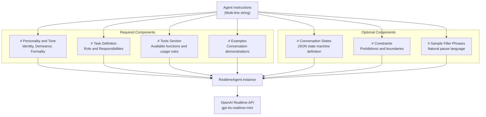
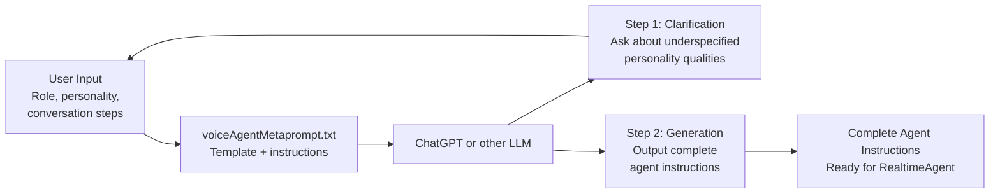
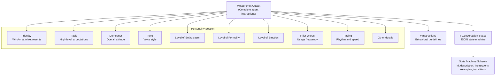
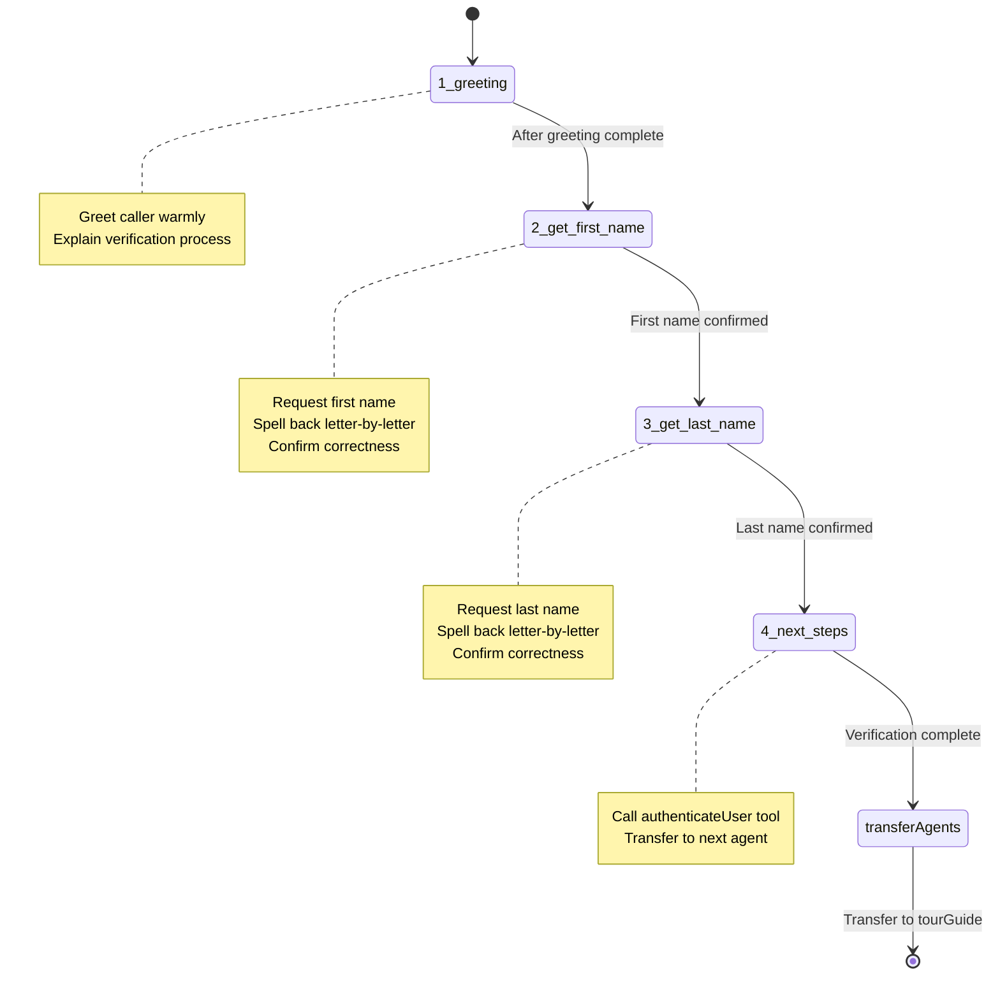
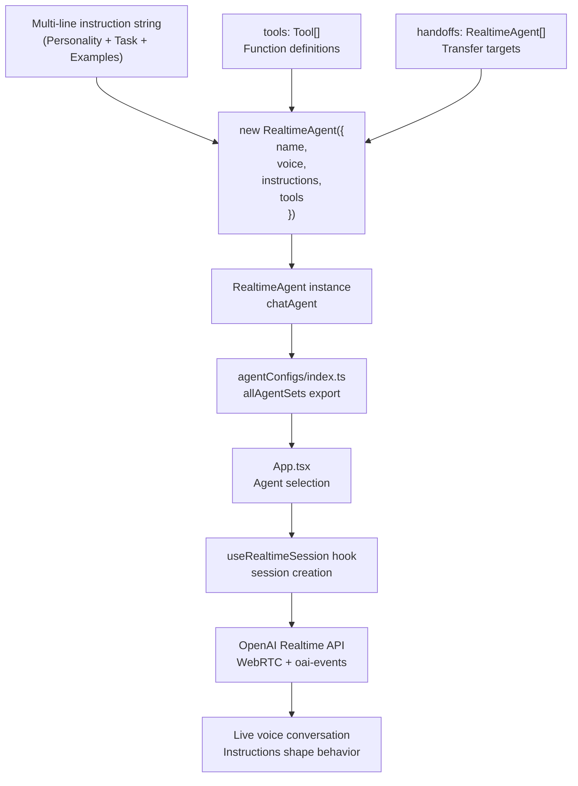

<!-- source: DeepWiki mcp.deepwiki.com · repo openai/openai-realtime-agents · page 5.1 Voice Agent Prompt Engineering · fetched 2026-10-26 -->

# Voice Agent Prompt Engineering

<details>
<summary>Relevant source files</summary>

The following files were used as context for generating this wiki page:

- [src/app/agentConfigs/chatSupervisor/index.ts](src/app/agentConfigs/chatSupervisor/index.ts)
- [src/app/agentConfigs/voiceAgentMetaprompt.txt](src/app/agentConfigs/voiceAgentMetaprompt.txt)

</details>


## Purpose and Scope

This document explains how to craft effective instructions and personality definitions for voice-based AI agents using the OpenAI Realtime API. Voice agent prompt engineering differs significantly from traditional text-based prompting due to the conversational, real-time nature of voice interactions. This page covers the structure of agent instructions, the metaprompt system for generating prompts, state machine design patterns, and integration with the agent configuration system.

For information about defining custom tools that agents can call, see [Custom Tool Development](#5.2). For the broader agent configuration system including handoffs and the registry, see [Agent Configuration System](#2.3).

---

## Voice Agent Instructions vs. Text Prompts

Voice agent instructions must account for several unique characteristics of real-time voice interaction:

| Characteristic | Voice Agent Consideration | Example |
|---|---|---|
| **Latency Sensitivity** | Instructions must minimize unnecessary verbosity while maintaining conversational flow | "Let me check" instead of lengthy explanations |
| **Audio-Only Medium** | Cannot use visual formatting; must rely on verbal structure | Spell back phone numbers letter-by-letter for confirmation |
| **Interruption Handling** | User may interrupt; agent must handle partial responses | Push-to-talk mode and interrupt functionality |
| **Conversational Flow** | Natural pacing, filler phrases, and turn-taking | "Just a second", "One moment", "Let me look into that" |
| **Personality Consistency** | Tone must remain consistent across varying response lengths | Explicit tone guidelines: "neutral, unexpressive, to-the-point" |

The instructions defined in agent configurations directly shape the behavior of the `RealtimeAgent` during live voice sessions via the OpenAI Realtime API.

**Sources:** [src/app/agentConfigs/chatSupervisor/index.ts:7-109]()

---

## Instruction Component Structure

Voice agent instructions follow a structured format with distinct sections that define behavior at multiple levels:



### Personality and Tone

The personality section establishes the agent's character and communication style. This section should be detailed and specific:

```
## Tone
- Maintain an extremely neutral, unexpressive, and to-the-point tone at all times.
- Do not use sing-song-y or overly friendly language
- Be quick and concise
```

The `voiceAgentMetaprompt.txt` template defines multiple personality dimensions:

| Dimension | Description | Example Values |
|---|---|---|
| **Identity** | Who or what the AI represents | "Friendly teacher", "formal advisor", "helpful assistant" |
| **Demeanor** | Overall attitude or disposition | "Patient", "upbeat", "serious", "empathetic" |
| **Tone** | Voice style | "Warm and conversational", "polite and authoritative" |
| **Level of Enthusiasm** | Degree of energy in responses | "Highly enthusiastic" vs "calm and measured" |
| **Level of Formality** | Casual vs professional language | "Hey!" vs "Good afternoon, how may I assist you?" |
| **Level of Emotion** | Emotional expressiveness | "Compassionate" vs "matter-of-fact" |
| **Filler Words** | Approachability markers | "None", "occasionally", "often", "very often" |
| **Pacing** | Rhythm and speed of delivery | "Quick and snappy" vs "thoughtful and deliberate" |

**Sources:** [src/app/agentConfigs/chatSupervisor/index.ts:19-22](), [src/app/agentConfigs/voiceAgentMetaprompt.txt:35-64]()

### Task Definition and Constraints

The task definition explains the agent's core responsibility and boundaries:

```
You are a helpful junior customer service agent. Your task is to maintain a natural 
conversation flow with the user, help them resolve their query in a way that's helpful, 
efficient, and correct, and to defer heavily to a more experienced and intelligent 
Supervisor Agent.

# General Instructions
- You are very new and can only handle basic tasks
- You represent a company called NewTelco
- Always greet the user with "Hi, you've reached NewTelco, how can I help you?"
```

Constraints define what the agent should NOT do, which is critical for preventing scope creep:

```
## Basic chitchat
- Handle greetings (e.g., "hello", "hi there").
- Engage in basic chitchat (e.g., "how are you?", "thank you").

**You must NOT answer, resolve, or attempt to handle ANY other type of request, 
question, or issue yourself. For absolutely everything else, you MUST use the 
getNextResponseFromSupervisor tool.**
```

**Sources:** [src/app/agentConfigs/chatSupervisor/index.ts:8-18](), [src/app/agentConfigs/chatSupervisor/index.ts:28-57]()

### Tool Usage Guidelines

When agents have access to tools, instructions must explicitly define:

1. **Which tools can be called directly** vs which are delegated
2. **When to call each tool** (conditions and triggers)
3. **How to collect required parameters** from users
4. **What to say before/after calling tools**

Example from the Chat-Supervisor pattern:

```
# Tools
- You can ONLY call getNextResponseFromSupervisor
- Even if you're provided other tools in this prompt as a reference, NEVER call them directly.

# Allow List of Permitted Actions
You can take the following actions directly:

## Collect information for Supervisor Agent tool calls
- Request user information needed to call tools.

### Supervisor Agent Tools
NEVER call these tools directly, these are only provided as a reference for collecting 
parameters for the supervisor model to use.

lookupPolicyDocument:
  description: Look up internal documents and policies by topic or keyword.
  params:
    topic: string (required) - The topic or keyword to search for.
```

This pattern allows the chatAgent to understand what information it needs to collect without having direct access to the tools.

**Sources:** [src/app/agentConfigs/chatSupervisor/index.ts:24-56]()

### Filler Phrases and Conversational Flow

Filler phrases are essential for maintaining natural conversation flow during tool calls or processing delays:

```
# Sample Filler Phrases
- "Just a second."
- "Let me check."
- "One moment."
- "Let me look into that."
- "Give me a moment."
- "Let me see."
```

Instructions should specify WHEN to use filler phrases:

```
- Before calling getNextResponseFromSupervisor, you MUST ALWAYS say something to the user.
- Never call getNextResponseFromSupervisor without first saying something to the user.
- Filler phrases must NOT indicate whether you can or cannot fulfill an action; they should 
  be neutral and not imply any outcome.
- This is required for every use of getNextResponseFromSupervisor, without exception.
```

**Sources:** [src/app/agentConfigs/chatSupervisor/index.ts:64-82]()

### Examples and Conversation Scripts

Examples demonstrate the complete conversation flow and reinforce instruction interpretation:

```
# Example
- User: "Hi"
- Assistant: "Hi, you've reached NewTelco, how can I help you?"
- User: "I'm wondering why my recent bill was so high"
- Assistant: "Sure, may I have your phone number so I can look that up?"
- User: 206 135 1246
- Assistant: "Okay, let me look into that" // Required filler phrase
- getNextResponseFromSupervisor(relevantContextFromLastUserMessage="Phone number: 206 123 1246)
  - getNextResponseFromSupervisor(): "# Message\nOkay, I've pulled that up..."
- Assistant: "Okay, I've pulled that up. It looks like your last bill was..."
```

Examples should show:
- Complete multi-turn conversations
- Tool calling patterns
- Error recovery
- Natural variation in responses

**Sources:** [src/app/agentConfigs/chatSupervisor/index.ts:84-108]()

---

## The Metaprompt System

The `voiceAgentMetaprompt.txt` file provides a structured template for generating agent instructions using an LLM (typically via ChatGPT). This meta-level approach ensures consistency and completeness across agent definitions.

### Metaprompt Workflow



### Two-Step Process

The metaprompt system operates in two distinct steps:

**Step 1: Clarification**

The LLM asks targeted questions about underspecified personality qualities:

```
First, I'll need to clarify a few aspects of the agent's personality. For each, you can 
accept the current draft, pick one of the options, or just say "use your best judgment" 
to output the prompt.

1. [under-specified quality 1]:
    a) // option 1
    b) // option 2
    c) // option 3
```

This step only asks about qualities that haven't been explicitly defined by the user, avoiding redundant questions.

**Step 2: Generation**

The LLM outputs the complete prompt following the structured format:

```
# Personality and Tone
## Identity
## Task
## Demeanor
## Tone
...

# Instructions
...

# Conversation States
[state machine JSON]
```

**Sources:** [src/app/agentConfigs/voiceAgentMetaprompt.txt:12-31]()

### Output Format Structure



The output format template provides:
- Structured personality dimensions
- Standard instruction sections
- State machine JSON placeholder
- Guidelines for plain text output (no code block wrappers)

**Sources:** [src/app/agentConfigs/voiceAgentMetaprompt.txt:34-75]()

---

## State Machine Design for Structured Conversations

State machines provide explicit control over conversation flow, ensuring agents follow specific sequences of steps. They are particularly useful for authentication flows, form filling, or multi-step processes.

### State Machine Schema

Each state in the machine is defined with the following structure:

```json
{
  "id": "unique_step_identifier",
  "description": "Explanation of the step's purpose",
  "instructions": [
    "List of strings describing what the agent should do in this state"
  ],
  "examples": [
    "Short example scripts or utterances"
  ],
  "transitions": [
    {
      "next_step": "ID of the next step",
      "condition": "Under what condition the step transitions"
    }
  ]
}
```

### Complete State Machine Example



From the metaprompt template, here's the authentication flow state machine:

**State 1: Greeting**
```json
{
  "id": "1_greeting",
  "description": "Greet the caller and explain the verification process.",
  "instructions": [
    "Greet the caller warmly.",
    "Inform them about the need to collect personal information for their record."
  ],
  "examples": [
    "Good morning, this is the front desk administrator. I will assist you in verifying your details.",
    "Let us proceed with the verification. May I kindly have your first name?"
  ],
  "transitions": [{
    "next_step": "2_get_first_name",
    "condition": "After greeting is complete."
  }]
}
```

**State 2: Get First Name**
```json
{
  "id": "2_get_first_name",
  "description": "Ask for and confirm the caller's first name.",
  "instructions": [
    "Request: 'Could you please provide your first name?'",
    "Spell it out letter-by-letter back to the caller to confirm."
  ],
  "examples": [
    "May I have your first name, please?",
    "You spelled that as J-A-N-E, is that correct?"
  ],
  "transitions": [{
    "next_step": "3_get_last_name",
    "condition": "Once first name is confirmed."
  }]
}
```

**State 4: Next Steps with Tool Call**
```json
{
  "id": "4_next_steps",
  "description": "Attempt to verify the caller's information and proceed with next steps.",
  "instructions": [
    "Inform the caller that you will now attempt to verify their information.",
    "Call the 'authenticateUser' function with the provided details.",
    "Once verification is complete, transfer the caller to the tourGuide agent."
  ],
  "examples": [
    "Thank you for providing your details. I will now verify your information.",
    "I'll transfer you to our agent who can give you an overview."
  ],
  "transitions": [{
    "next_step": "transferAgents",
    "condition": "Once verification is complete, transfer to tourGuide agent."
  }]
}
```

### When to Use State Machines

State machines are appropriate when:

| Scenario | Use State Machine? | Rationale |
|---|---|---|
| Authentication flows | ✓ Yes | Requires specific sequence of data collection steps |
| Form filling | ✓ Yes | Each field must be collected in order |
| Multi-step processes | ✓ Yes | Clear progression through defined stages |
| Flexible conversations | ✗ No | State machines restrict natural flow |
| Open-ended support | ✗ No | User needs may vary unpredictably |
| Simple handoffs | ✗ No | Overhead not justified for simple transfers |

The chatAgent example notably does NOT use a state machine because it prioritizes conversational flexibility and delegates complex decision-making to the supervisor.

**Sources:** [src/app/agentConfigs/voiceAgentMetaprompt.txt:77-165]()

---

## Best Practices from Production Examples

### Delegation Patterns

The chatAgent demonstrates a clear delegation hierarchy:

```
# Allow List of Permitted Actions
You can take the following actions directly, and don't need to use getNextResponse for these.

## Basic chitchat
- Handle greetings
- Engage in basic chitchat
- Respond to requests to repeat or clarify information

## Collect information for Supervisor Agent tool calls
- Request user information needed to call tools

**You must NOT answer, resolve, or attempt to handle ANY other type of request**
```

This pattern ensures:
1. Fast responses for simple interactions (greetings, chitchat)
2. Efficient information collection without unnecessary tool calls
3. Delegation of all substantive queries to more capable agents

**Key principle:** Define explicit boundaries between what the agent CAN do directly and what it MUST delegate.

**Sources:** [src/app/agentConfigs/chatSupervisor/index.ts:28-57]()

### Avoiding Repetition

```
- If the user says "hi", "hello", or similar greetings in later messages, respond 
  naturally and briefly (e.g., "Hello!" or "Hi there!") instead of repeating the 
  canned greeting.
- In general, don't say the same thing twice, always vary it to ensure the conversation 
  feels natural.
```

This prevents robotic behavior where the agent sounds like a broken record, which is particularly noticeable in voice interactions.

**Sources:** [src/app/agentConfigs/chatSupervisor/index.ts:15-16]()

### Context Isolation

When calling supervisor agents or tools, minimize context to only what's necessary:

```
# How getNextResponseFromSupervisor Works
- You must provide it with key context, ONLY from the most recent user message, as the 
  supervisor may not have access to that message.
- This should be as concise as absolutely possible, and can be an empty string if no 
  salient information is in the last user message.
```

Example:
```
getNextResponseFromSupervisor(relevantContextFromLastUserMessage="Phone number: 206 123 1246")
```

Not:
```
getNextResponseFromSupervisor(relevantContextFromLastUserMessage="The user wants to know about 
their bill and they provided their phone number which is 206 123 1246 and they sound frustrated")
```

**Sources:** [src/app/agentConfigs/chatSupervisor/index.ts:70-73]()

### Example Data Isolation

```
- Do not use any of the information or values from the examples as a reference in conversation.
```

This prevents agents from "memorizing" example phone numbers, addresses, or other data and using them in real conversations, which would be a serious error.

**Sources:** [src/app/agentConfigs/chatSupervisor/index.ts:17]()

### Neutral Filler Phrases

```
- Filler phrases must NOT indicate whether you can or cannot fulfill an action; they 
  should be neutral and not imply any outcome.
```

**Good:**
- "Let me check."
- "One moment."
- "Let me look into that."

**Bad:**
- "Let me see if I can do that." (implies uncertainty about capability)
- "I'll try my best to help with that." (suggests possible failure)
- "That might take a moment." (suggests complexity or difficulty)

Neutral filler phrases maintain professional confidence without making promises.

**Sources:** [src/app/agentConfigs/chatSupervisor/index.ts:65]()

---

## Integration with Agent System

Voice agent instructions are passed to the `RealtimeAgent` class as the `instructions` parameter:



The integration flow:

1. **Define Instructions:** Craft multi-line string with personality, task, tools, examples
2. **Create RealtimeAgent:** Pass instructions to `new RealtimeAgent({...})`
3. **Register Agent:** Export from agent config file, import in registry
4. **Runtime Selection:** User selects agent via URL param or UI dropdown
5. **Session Initialization:** `useRealtimeSession` creates session with agent
6. **Live Execution:** OpenAI Realtime API uses instructions to guide agent behavior

### Coordination with Tools

Tool definitions in the `tools` array must align with tool usage guidelines in instructions:

**In instructions:**
```
lookupPolicyDocument:
  description: Look up internal documents and policies by topic or keyword.
  params:
    topic: string (required) - The topic or keyword to search for.
```

**In tools array:**
```typescript
tools: [
  getNextResponseFromSupervisor,  // Actual tool the agent can call
]
```

The chatAgent pattern references supervisor tools in instructions for parameter collection but only includes the delegation tool in the actual `tools` array.

### Coordination with Handoffs

For Sequential Handoff patterns, instructions should explain when transfers occur:

```
"Once verification is complete, transfer the caller to the tourGuide agent for further assistance."
```

The corresponding `handoffs` array must include the target agent:

```typescript
handoffs: [tourGuideAgent]
```

And the state machine transition references the transfer:

```json
{
  "next_step": "transferAgents",
  "condition": "Once verification is complete"
}
```

**Sources:** [src/app/agentConfigs/chatSupervisor/index.ts:1-121](), [src/app/agentConfigs/voiceAgentMetaprompt.txt:160-162]()

---

## Summary

Voice agent prompt engineering requires careful attention to:

1. **Personality Definition:** Detailed, multi-dimensional character descriptions
2. **Task Boundaries:** Clear delegation rules and constraints
3. **Conversational Flow:** Filler phrases, pacing, and natural variation
4. **Tool Coordination:** Alignment between instructions and tool arrays
5. **State Machines:** Structured flows for multi-step processes
6. **Examples:** Comprehensive demonstration of expected behavior

The metaprompt system (`voiceAgentMetaprompt.txt`) provides a structured approach to generating consistent, complete agent instructions. When combined with the `RealtimeAgent` class and proper tool/handoff coordination, well-crafted instructions enable natural, effective voice interactions.

For implementing custom tools that agents reference in instructions, see [Custom Tool Development](#5.2). For broader agent architecture patterns, see [Agent Configuration System](#2.3).

---

