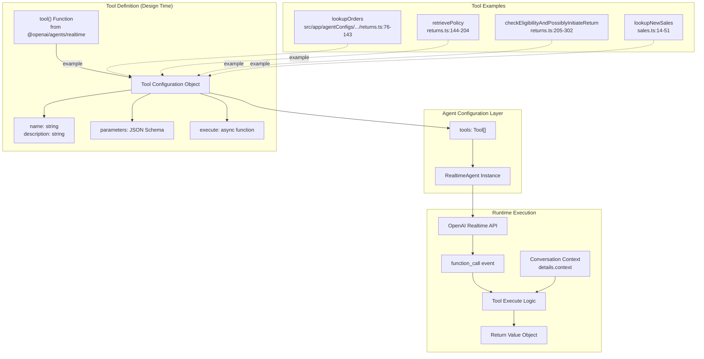
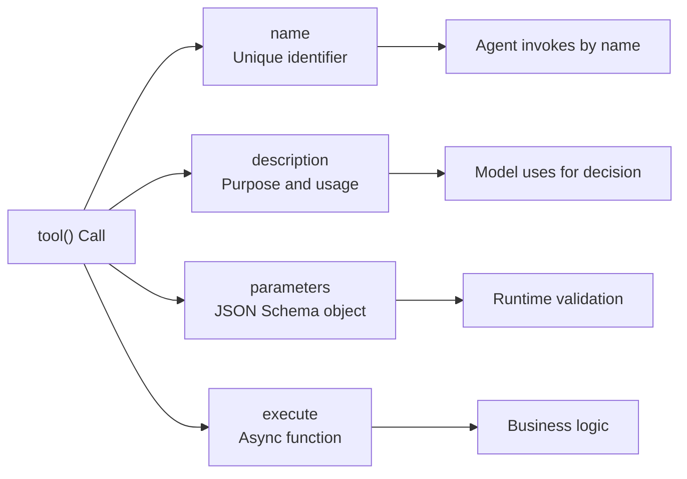
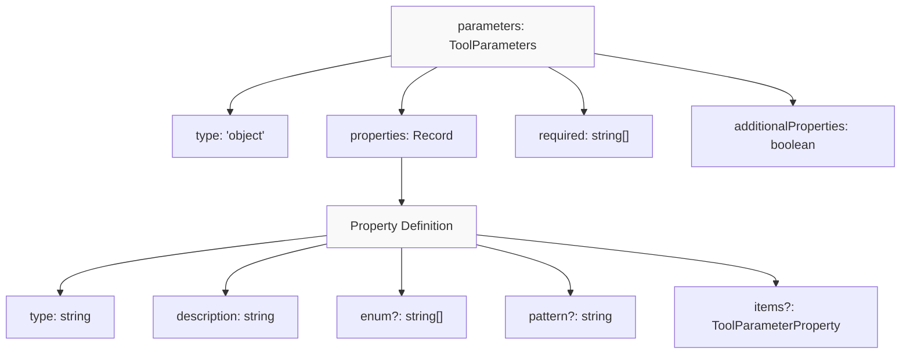
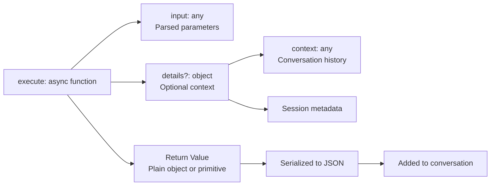
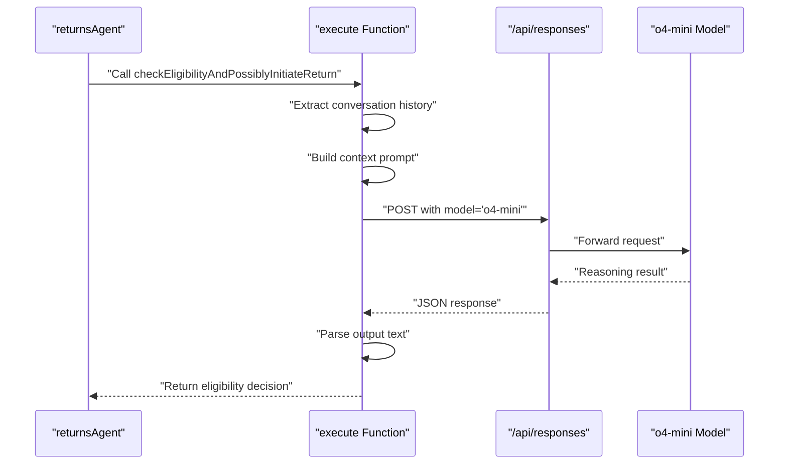
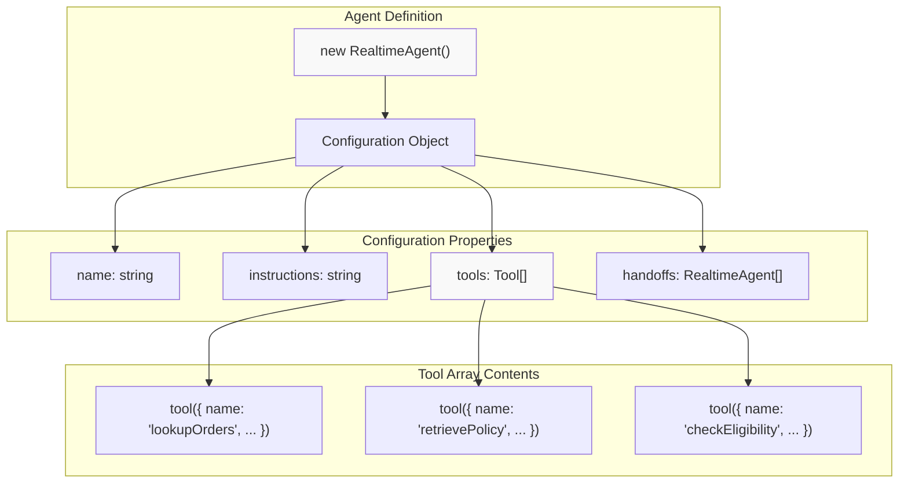
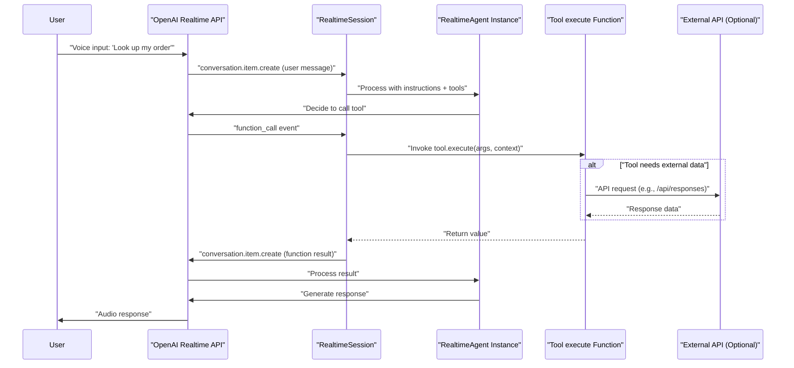

<!-- source: DeepWiki mcp.deepwiki.com · repo openai/openai-realtime-agents · page 5.2 Custom Tool Development · fetched 2026-10-26 -->

# Custom Tool Development

<details>
<summary>Relevant source files</summary>

The following files were used as context for generating this wiki page:

- [README.md](README.md)
- [public/screenshot_handoff.png](public/screenshot_handoff.png)
- [src/app/agentConfigs/customerServiceRetail/returns.ts](src/app/agentConfigs/customerServiceRetail/returns.ts)
- [src/app/agentConfigs/customerServiceRetail/sales.ts](src/app/agentConfigs/customerServiceRetail/sales.ts)
- [src/app/api/health/route.ts](src/app/api/health/route.ts)
- [src/app/types.ts](src/app/types.ts)

</details>


This document explains how to create custom tools for RealtimeAgent instances in the OpenAI Realtime Agents system. Tools enable agents to perform actions beyond text generation, such as looking up information, calling external APIs, and initiating business processes.

**Scope:** This page covers the technical implementation of tools using the `@openai/agents/realtime` SDK, including tool definition, parameter schemas, execution logic, and integration with agents. For information about agent configuration patterns, see [Agent Configuration System](#2.3). For prompt engineering guidance related to tool usage, see [Voice Agent Prompt Engineering](#5.1).

## Tool Architecture Overview

Tools in this system are function definitions that agents can invoke during conversations. The following diagram illustrates how tools flow from definition to runtime execution:



**Sources:** [src/app/agentConfigs/customerServiceRetail/returns.ts:1-307](), [src/app/agentConfigs/customerServiceRetail/sales.ts:1-101](), [README.md:92-116]()

## Tool Definition Structure

Tools are created using the `tool()` function from the `@openai/agents/realtime` SDK. Each tool consists of four primary components:



### Basic Tool Template

The following structure represents a minimal tool definition:

```typescript
tool({
  name: 'toolName',
  description: 'What this tool does and when to use it',
  parameters: {
    type: 'object',
    properties: {
      paramName: {
        type: 'string',
        description: 'Parameter purpose'
      }
    },
    required: ['paramName'],
    additionalProperties: false
  },
  execute: async (input: any) => {
    // Tool logic here
    return { result: 'value' };
  }
})
```

**Sources:** [src/app/agentConfigs/customerServiceRetail/returns.ts:76-143](), [src/app/agentConfigs/customerServiceRetail/sales.ts:14-51]()

## Parameter Schema Definition

Tool parameters use JSON Schema format to define input structure and validation rules. The system supports standard JSON Schema types and constraints.

### Parameter Type Mapping

| JSON Schema Type | TypeScript Type | Example Usage |
|-----------------|-----------------|---------------|
| `string` | `string` | Phone numbers, IDs, text fields |
| `number` | `number` | Quantities, prices, ratings |
| `boolean` | `boolean` | Flags, toggles |
| `array` | `Array<T>` | Lists of items, multiple selections |
| `object` | `object` | Nested structures |

### Schema Components



### Example: Phone Number with Pattern Validation

From [src/app/agentConfigs/customerServiceRetail/sales.ts:85-89]():

```typescript
phone_number: {
  type: 'string',
  description: "User's phone number used for verification. Formatted like '(111) 222-3333'",
  pattern: '^\\(\\d{3}\\) \\d{3}-\\d{4}$',
}
```

### Example: Enum-Constrained Parameter

From [src/app/agentConfigs/customerServiceRetail/sales.ts:21-25]():

```typescript
category: {
  type: 'string',
  enum: ['snowboard', 'apparel', 'boots', 'accessories', 'any'],
  description: 'The product category or general area the user is interested in (optional).',
}
```

### Example: Array Parameter

From [src/app/agentConfigs/customerServiceRetail/sales.ts:78-83]():

```typescript
item_ids: {
  type: 'array',
  description: 'An array of item IDs the user intends to purchase.',
  items: {
    type: 'string',
  },
}
```

**Sources:** [src/app/agentConfigs/customerServiceRetail/sales.ts:14-97](), [src/app/types.ts:19-42]()

## Tool Execution Logic

The `execute` function contains the tool's business logic. It receives input parameters and optionally conversation context, then returns a value that becomes part of the conversation.

### Execution Function Signature



### Basic Execution Pattern

Simple tools that don't require conversation context:

From [src/app/agentConfigs/customerServiceRetail/sales.ts:30-50]():

```typescript
execute: async (input: any) => {
  const { category } = input as { category: string };
  const items = [
    { item_id: 101, type: 'snowboard', name: 'Alpine Blade', retail_price_usd: 450, sale_price_usd: 360, sale_discount_pct: 20 },
    // ... more items
  ];
  const filteredItems =
    category === 'any'
      ? items
      : items.filter((item) => item.type === category);
  filteredItems.sort((a, b) => b.sale_discount_pct - a.sale_discount_pct);
  return {
    sales: filteredItems,
  };
}
```

### Accessing Conversation Context

Tools can access conversation history through the `details` parameter:

From [src/app/agentConfigs/customerServiceRetail/returns.ts:230-237]():

```typescript
execute: async (input: any, details) => {
  const { userDesiredAction, question } = input as {
    userDesiredAction: string;
    question: string;
  };
  const nMostRecentLogs = 10;
  const history: RealtimeItem[] = (details?.context as any)?.history ?? [];
  const filteredLogs = history.filter((log) => log.type === 'message');
  // ... use history for context
}
```

**Sources:** [src/app/agentConfigs/customerServiceRetail/returns.ts:230-302](), [src/app/agentConfigs/customerServiceRetail/sales.ts:30-50]()

## Advanced Tool Patterns

### Pattern 1: API Escalation to Higher Intelligence Models

The `checkEligibilityAndPossiblyInitiateReturn` tool demonstrates escalating decisions to `o4-mini` for high-stakes reasoning:



From [src/app/agentConfigs/customerServiceRetail/returns.ts:278-301]():

```typescript
const model = "o4-mini";
console.log(`checking order eligibility with model=${model}`);

const response = await fetch("/api/responses", {
  method: "POST",
  headers: {
    "Content-Type": "application/json",
  },
  body: JSON.stringify({ model, input: messages }),
});

if (!response.ok) {
  console.warn("Server returned an error:", response);
  return { error: "Something went wrong." };
}

const { output = [] } = await response.json();
const text = output
  .find((i: any) => i.type === 'message' && i.role === 'assistant')
  ?.content?.find((c: any) => c.type === 'output_text')?.text ?? '';

return { result: text || output };
```

**Key aspects:**
- Tool makes HTTP request to `/api/responses` endpoint
- Passes conversation history as context to reasoning model
- Returns structured decision with rationale
- Handles errors gracefully with fallback responses

**Sources:** [src/app/agentConfigs/customerServiceRetail/returns.ts:205-302]()

### Pattern 2: Structured Output with Template Format

Tools can guide model responses using structured output formats:

From [src/app/agentConfigs/customerServiceRetail/returns.ts:257-275]():

```typescript
<output_format>
# Rationale
// Short description explaining the decision

# User Request
// The user's desired outcome or action

# Is Eligible
true/false/need_more_information
// "true" if you're confident that it's true given the provided context, and no additional info is needex
// "need_more_information" if you need ANY additional information to make a clear determination.

# Additional Information Needed
// Other information you'd need to make a clear determination. Can be "None"

# Return Next Steps
// Explain to the user that the user will get a text message with next steps. Only if is_eligible=true, otherwise "None". Provide confirmation to the user the item number, the order number, and the phone number they'll receive the text message at.
</output_format>
```

This pattern ensures consistent, parseable responses from reasoning models.

**Sources:** [src/app/agentConfigs/customerServiceRetail/returns.ts:244-276]()

### Pattern 3: Mock Data for Demonstration

Tools in demo configurations return hardcoded data to simulate real integrations:

From [src/app/agentConfigs/customerServiceRetail/returns.ts:92-142]():

```typescript
execute: async (input: any) => {
  return {
    orders: [
      {
        order_id: 'SNP-20230914-001',
        order_date: '2024-09-14T09:30:00Z',
        delivered_date: '2024-09-16T14:00:00Z',
        order_status: 'delivered',
        subtotal_usd: 409.98,
        total_usd: 471.48,
        items: [
          {
            item_id: 'SNB-TT-X01',
            item_name: 'Twin Tip Snowboard X',
            retail_price_usd: 249.99,
          },
          // ... more items
        ],
      },
      // ... more orders
    ],
  };
}
```

For production use, replace mock returns with actual API calls or database queries.

**Sources:** [src/app/agentConfigs/customerServiceRetail/returns.ts:92-142](), [src/app/agentConfigs/customerServiceRetail/sales.ts:30-50]()

## Integration with Agents

Tools are integrated with agents through the `tools` array in the `RealtimeAgent` constructor:



### Complete Example: Returns Agent

From [src/app/agentConfigs/customerServiceRetail/returns.ts:3-306]():

```typescript
export const returnsAgent = new RealtimeAgent({
  name: 'returns',
  voice: 'sage',
  handoffDescription:
    'Customer Service Agent specialized in order lookups, policy checks, and return initiations.',
  instructions: `
    # Personality and Tone
    // ... agent instructions ...
  `,
  tools: [
    tool({
      name: 'lookupOrders',
      description: '...',
      parameters: { /* ... */ },
      execute: async (input: any) => { /* ... */ }
    }),
    tool({
      name: 'retrievePolicy',
      description: '...',
      parameters: { /* ... */ },
      execute: async (input: any) => { /* ... */ }
    }),
    tool({
      name: 'checkEligibilityAndPossiblyInitiateReturn',
      description: '...',
      parameters: { /* ... */ },
      execute: async (input: any, details) => { /* ... */ }
    }),
  ],
  handoffs: [],
});
```

**Sources:** [src/app/agentConfigs/customerServiceRetail/returns.ts:1-307]()

## Tool Execution Flow in Runtime

The following diagram shows how tools are invoked during a live session:



**Sources:** [src/app/agentConfigs/customerServiceRetail/returns.ts:230-302](), [README.md:155-203]()

## Type Definitions

The system provides TypeScript type definitions for tools:

From [src/app/types.ts:19-42]():

```typescript
export interface ToolParameterProperty {
  type: string;
  description?: string;
  enum?: string[];
  pattern?: string;
  properties?: Record<string, ToolParameterProperty>;
  required?: string[];
  additionalProperties?: boolean;
  items?: ToolParameterProperty;
}

export interface ToolParameters {
  type: string;
  properties: Record<string, ToolParameterProperty>;
  required?: string[];
  additionalProperties?: boolean;
}

export interface Tool {
  type: "function";
  name: string;
  description: string;
  parameters: ToolParameters;
}
```

**Note:** When using the `@openai/agents/realtime` SDK's `tool()` function, these types are automatically inferred. The above definitions are shown for reference and are used internally by the system.

**Sources:** [src/app/types.ts:19-42]()

## Best Practices

### Tool Naming

- Use descriptive, action-oriented names: `lookupOrders`, `checkEligibility`, `addToCart`
- Follow camelCase convention
- Avoid generic names like `getData` or `processRequest`

### Description Writing

From [src/app/agentConfigs/customerServiceRetail/returns.ts:77-79]():

```typescript
description:
  "Retrieve detailed order information by using the user's phone number, including shipping status and item details. Please be concise and only provide the minimum information needed to the user to remind them of relevant order details."
```

**Guidelines:**
- Explain what the tool does and when to use it
- Include guidance on how to present results to users
- Mention any prerequisites or dependencies
- Be specific about expected input format

### Parameter Design

- Mark parameters as `required` when they are essential for tool execution
- Set `additionalProperties: false` to enforce strict validation
- Use `enum` for constrained value sets
- Use `pattern` for format validation (e.g., phone numbers)
- Provide clear descriptions for each parameter

### Error Handling

From [src/app/agentConfigs/customerServiceRetail/returns.ts:289-292]():

```typescript
if (!response.ok) {
  console.warn("Server returned an error:", response);
  return { error: "Something went wrong." };
}
```

**Recommendations:**
- Always handle API failures gracefully
- Return structured error objects
- Log errors for debugging
- Provide user-friendly error messages in return values

### Context Usage

When tools need conversation history:
- Extract `history` from `details?.context`
- Filter for relevant message types
- Limit history to recent items to reduce token usage (e.g., last 10 messages)
- Type-cast appropriately: `const history: RealtimeItem[] = (details?.context as any)?.history ?? []`

### Agent Instructions Coordination

From [src/app/agentConfigs/customerServiceRetail/returns.ts:54-61]():

```typescript
## Sending messages before calling functions
- If you're going to call a function, ALWAYS let the user know what you're about to do BEFORE calling the function so they're aware of each step.
  - Example: "Okay, I'm going to check your order details now."
  - Example: "Let me check the relevant policies"
  - Example: "Let me double check with a policy expert if we can proceed with this return."
```

**Coordination patterns:**
- Instruct agents to notify users before tool calls
- Provide status updates during long-running tools
- Explain tool results in natural language
- Reference tool capabilities in agent instructions

**Sources:** [src/app/agentConfigs/customerServiceRetail/returns.ts:44-75]()

## Creating a New Tool Checklist

1. **Define tool purpose and scope**
   - What specific action does it perform?
   - When should the agent use it?

2. **Design parameter schema**
   - List required and optional parameters
   - Define types and constraints
   - Write parameter descriptions

3. **Implement execute function**
   - Handle input parsing and validation
   - Implement business logic (or API calls)
   - Handle errors and edge cases
   - Return structured data

4. **Update agent instructions**
   - Document when to use the tool
   - Provide usage examples
   - Coordinate tool calls with user communication

5. **Add tool to agent configuration**
   - Include in `tools` array of `RealtimeAgent`
   - Test in development environment

6. **Test tool execution**
   - Verify parameter validation
   - Check return value formatting
   - Test error conditions
   - Validate conversation flow

**Sources:** [src/app/agentConfigs/customerServiceRetail/returns.ts:1-307](), [src/app/agentConfigs/customerServiceRetail/sales.ts:1-101](), [README.md:209-211]()

---

