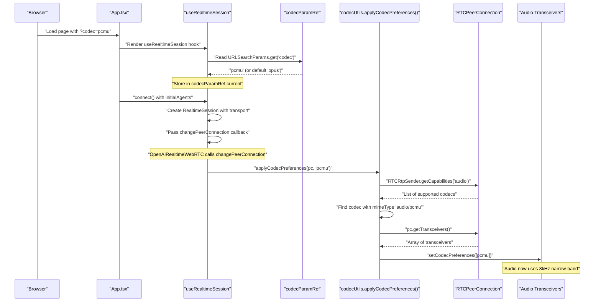
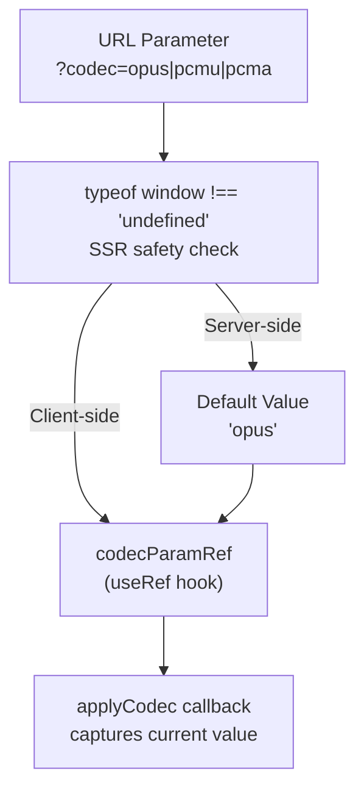
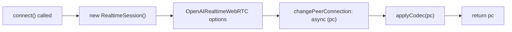
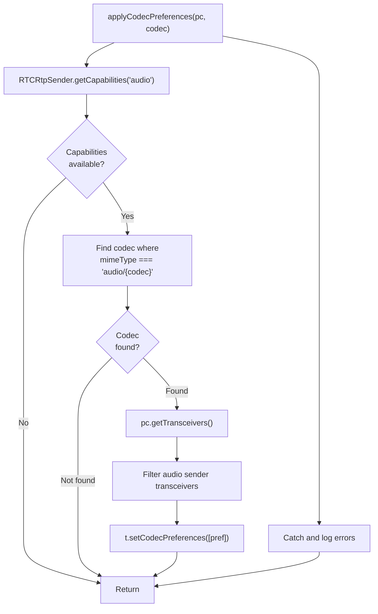
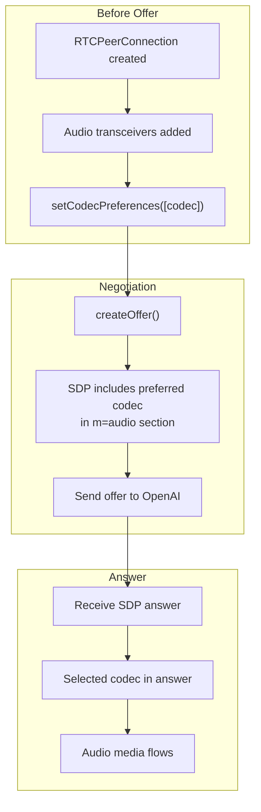

<!-- source: DeepWiki mcp.deepwiki.com · repo openai/openai-realtime-agents · page 5.3 Audio Codec Configuration · fetched 2026-10-26 -->

# Audio Codec Configuration

Relevant source files

The following files were used as context for generating this wiki page:

- [README.md](README.md)
- [public/screenshot_handoff.png](public/screenshot_handoff.png)
- [src/app/hooks/useRealtimeSession.ts](src/app/hooks/useRealtimeSession.ts)
- [src/app/lib/codecUtils.ts](src/app/lib/codecUtils.ts)

## Purpose and Scope

This document explains the audio codec configuration system in the OpenAI Realtime Agents demo. It covers how the system selects and applies audio codecs for WebRTC connections, enabling testing of different audio quality scenarios ranging from high-quality wide-band audio to narrow-band telephony simulation.

For information about the WebRTC session lifecycle and connection management, see [Real-time Session Management](#3.1). For details on the overall transport architecture, see [Technical Implementation](#3).

## Overview

The codec configuration system allows developers to test voice agents under different audio quality conditions. The primary use case is simulating how agents will perform over traditional telephony networks (PSTN/SIP) where audio is limited to 8 kHz narrow-band quality, versus modern WebRTC connections that support 48 kHz wide-band audio.

The system supports three codecs:

| Codec | Sample Rate | Bandwidth | Primary Use Case |
|-------|-------------|-----------|------------------|
| `opus` | 48 kHz | Wide-band | Default high-quality WebRTC audio |
| `pcmu` | 8 kHz | Narrow-band | μ-law telephony simulation (North America/Japan) |
| `pcma` | 8 kHz | Narrow-band | A-law telephony simulation (International) |

Sources: [README.md:220](), [src/app/hooks/useRealtimeSession.ts:76-77]()

## Codec Selection Flow

The following diagram shows how a codec is selected via URL parameter and applied to the WebRTC peer connection during session initialization:

Sources: [src/app/hooks/useRealtimeSession.ts:68-81, 132-134](), [src/app/lib/codecUtils.ts:2-22]()

## Architecture Components

The codec configuration system consists of three primary components:

### Codec Parameter Reference

The `codecParamRef` is initialized during hook rendering and captures the codec parameter from the URL query string. If no parameter is provided, it defaults to `'opus'`. The value is normalized to lowercase for consistent comparison.

Sources: [src/app/hooks/useRealtimeSession.ts:68-73]()

### Codec Application Callback

The `applyCodec` callback wraps the `applyCodecPreferences` utility function, capturing the current codec parameter value. This callback is passed to the `OpenAIRealtimeWebRTC` transport constructor via the `changePeerConnection` option:

The `changePeerConnection` callback is invoked by the transport layer after creating the peer connection but before generating the WebRTC offer. This timing ensures codec preferences are set before negotiation begins.

Sources: [src/app/hooks/useRealtimeSession.ts:78-81, 128-136]()

### Codec Preference Application

The `applyCodecPreferences` function in `codecUtils.ts` performs the actual codec configuration:

The function is defensive, returning early if capabilities are unavailable or the requested codec isn't supported. It applies the preference to all audio sender transceivers on the peer connection.

Sources: [src/app/lib/codecUtils.ts:2-22]()

## Code Entity Reference

The following table maps the key entities involved in codec configuration:

| Entity | Type | Location | Role |
|--------|------|----------|------|
| `codecParamRef` | `React.useRef<string>` | [src/app/hooks/useRealtimeSession.ts:68-73]() | Stores codec parameter from URL |
| `applyCodec` | `function` | [src/app/hooks/useRealtimeSession.ts:78-81]() | Callback that applies codec to peer connection |
| `applyCodecPreferences` | `function` | [src/app/lib/codecUtils.ts:2-22]() | Core utility that sets codec on transceivers |
| `changePeerConnection` | `option` | [src/app/hooks/useRealtimeSession.ts:132-134]() | Transport option for modifying peer connection |
| `OpenAIRealtimeWebRTC` | `class` | [src/app/hooks/useRealtimeSession.ts:129]() | WebRTC transport implementation |

Sources: [src/app/hooks/useRealtimeSession.ts:1-204](), [src/app/lib/codecUtils.ts:1-23]()

## URL Parameter Configuration

The codec is selected via the `codec` URL parameter. The parameter value is case-insensitive and must be one of: `opus`, `pcmu`, or `pcma`.

**Example URLs:**

- `http://localhost:3000/?codec=opus` - High-quality 48 kHz audio (default)
- `http://localhost:3000/?codec=pcmu` - 8 kHz μ-law narrow-band
- `http://localhost:3000/?agentConfig=chatSupervisor&codec=pcma` - A-law codec with chat-supervisor agent

The parameter is read during hook initialization and persists for the lifetime of the hook instance. Changing the URL parameter requires a page reload to take effect.

Sources: [src/app/hooks/useRealtimeSession.ts:68-73](), [README.md:220]()

## UI Integration

According to the README, the UI includes a codec selector component (referenced as part of the bottom toolbar controls). The selector allows runtime switching between codecs without manually editing the URL:

**Bottom Toolbar Controls:**
- Connection toggle
- Push-to-Talk controls
- Audio playback enable/disable
- Event pane expansion toggle
- **Codec selector** (opus 48kHz, pcmu 8kHz, pcma 8kHz)

The codec selector updates the URL parameter and triggers a page reload to apply the new codec setting.

Sources: [README.md:220]()

## Testing Scenarios

### Wide-band Testing (opus)

**Use Case:** Validating agent performance under optimal conditions

**Characteristics:**
- 48 kHz sample rate
- Full audio frequency range
- Modern WebRTC standard
- Best speech recognition accuracy

**When to test:**
- Initial development and debugging
- Validating transcription accuracy
- Testing complex instructions and responses
- Baseline performance metrics

### Narrow-band Testing (pcmu/pcma)

**Use Case:** Simulating PSTN/SIP telephony deployments

**Characteristics:**
- 8 kHz sample rate
- Limited frequency range (300-3400 Hz)
- Reduced audio quality
- May impact transcription accuracy

**When to test:**
- Pre-deployment for IVR systems
- Call center integrations
- Legacy telephony infrastructure
- Validating agent robustness to poor audio

The comment in the code explicitly states: "This lets you use the codec selector in the UI to force narrow-band (8 kHz) codecs to simulate how the voice agent sounds over a PSTN/SIP phone call."

Sources: [src/app/hooks/useRealtimeSession.ts:76-77](), [README.md:220]()

## WebRTC Codec Negotiation

The codec configuration leverages the WebRTC `setCodecPreferences` API, which influences the Session Description Protocol (SDP) offer generated during peer connection establishment:

The OpenAI Realtime API respects codec preferences where supported. If the requested codec is unavailable, WebRTC fallback negotiation selects an alternative from the supported list.

Sources: [src/app/lib/codecUtils.ts:2-22](), [src/app/hooks/useRealtimeSession.ts:132-136]()

## Error Handling

The `applyCodecPreferences` function includes comprehensive error handling:

**Safety Checks:**
1. **Capability Check:** Returns early if `RTCRtpSender.getCapabilities` is unavailable (older browsers)
2. **Codec Validation:** Returns early if requested codec isn't in capabilities list
3. **Exception Handling:** Catches and logs any errors during transceiver modification

**Error Logging:**
Errors are logged to console with the prefix `[codecUtils] applyCodecPreferences error` for debugging.

The defensive approach ensures codec configuration failures don't prevent connection establishment - the system falls back to default browser codec negotiation.

Sources: [src/app/lib/codecUtils.ts:2-22]()

## Implementation Notes

**Key Implementation Details:**

1. **Immutable Reference:** The `codecParamRef` is created once during hook initialization and never updates, even if the URL changes. This is intentional - codec changes require reconnection.

2. **Safe to Call Multiple Times:** The `applyCodecPreferences` function can be called multiple times on the same peer connection without side effects (idempotent operation).

3. **Server-Side Rendering:** The codec parameter reading includes an SSR safety check (`typeof window !== 'undefined'`) to prevent errors during Next.js server-side rendering.

4. **Transceiver Filtering:** The function only applies preferences to audio sender transceivers, not receivers or video transceivers.

5. **MIME Type Matching:** Codec matching is case-insensitive (`toLowerCase()`) on both the parameter and MIME type comparison.

Sources: [src/app/hooks/useRealtimeSession.ts:68-81](), [src/app/lib/codecUtils.ts:2-22]()

---

