<!-- source: DeepWiki mcp.deepwiki.com · repo openai/openai-realtime-agents · page 5.4 State Management Patterns · fetched 2026-10-26 -->

# State Management Patterns

<details>
<summary>Relevant source files</summary>

The following files were used as context for generating this wiki page:

- [src/app/App.tsx](src/app/App.tsx)
- [src/app/contexts/TranscriptContext.tsx](src/app/contexts/TranscriptContext.tsx)
- [src/app/types.ts](src/app/types.ts)

</details>


This page describes the state management architecture in the OpenAI Realtime Agents application, focusing on how conversation history, event logs, and session state are managed across the UI. The system uses React Context for global state (transcript and events) combined with local component state for UI-specific concerns.

For information about the overall component hierarchy and UI architecture, see [Frontend Architecture](#3.2). For details about session lifecycle and WebRTC connection management, see [Real-time Session Management](#3.1).

## State Architecture Overview

The application employs a hybrid state management approach with three distinct layers:

1. **Global Context State**: React Contexts provide shared state for transcript messages and event logs, accessible throughout the component tree
2. **Local Component State**: App.tsx maintains UI-specific state like connection status, audio controls, and PTT mode
3. **Hook-Encapsulated State**: Custom hooks like `useRealtimeSession` manage WebRTC connection state and expose methods for interaction

This separation allows components to access conversation history without prop drilling while keeping UI state localized to relevant components.

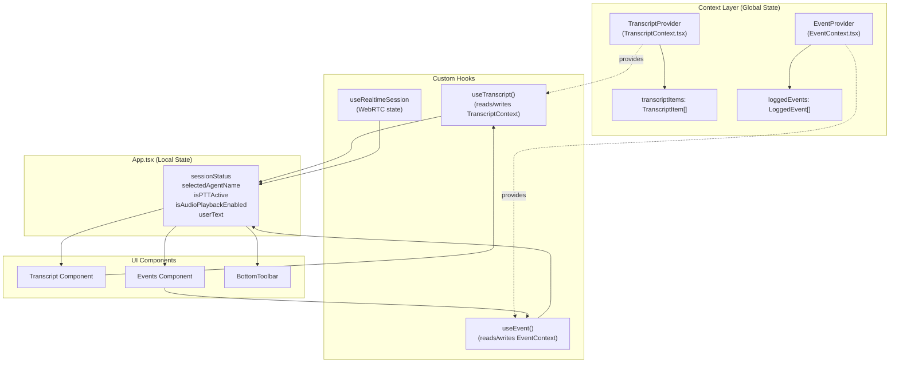

**Sources:** [src/app/App.tsx:1-551](), [src/app/contexts/TranscriptContext.tsx:1-136](), [src/app/types.ts:1-149]()

## TranscriptContext: Conversation History Management

The `TranscriptContext` provides centralized management of conversation history, including user and assistant messages as well as system breadcrumbs for debugging. It is implemented in `TranscriptContext.tsx` using React's Context API.

### Context Structure

The context maintains an array of `TranscriptItem` objects and exposes methods for manipulating them:

| Method | Purpose | Parameters |
|--------|---------|------------|
| `addTranscriptMessage` | Create a new user or assistant message | `itemId`, `role`, `text`, `isHidden?` |
| `updateTranscriptMessage` | Update existing message text | `itemId`, `newText`, `isDelta` |
| `addTranscriptBreadcrumb` | Add system event breadcrumb | `title`, `data?` |
| `toggleTranscriptItemExpand` | Toggle JSON data expansion | `itemId` |
| `updateTranscriptItem` | Apply partial updates to any item | `itemId`, `updatedProperties` |

**Sources:** [src/app/contexts/TranscriptContext.tsx:13-25]()

### TranscriptItem Data Structure

Each `TranscriptItem` represents either a MESSAGE (conversation turn) or BREADCRUMB (system event):

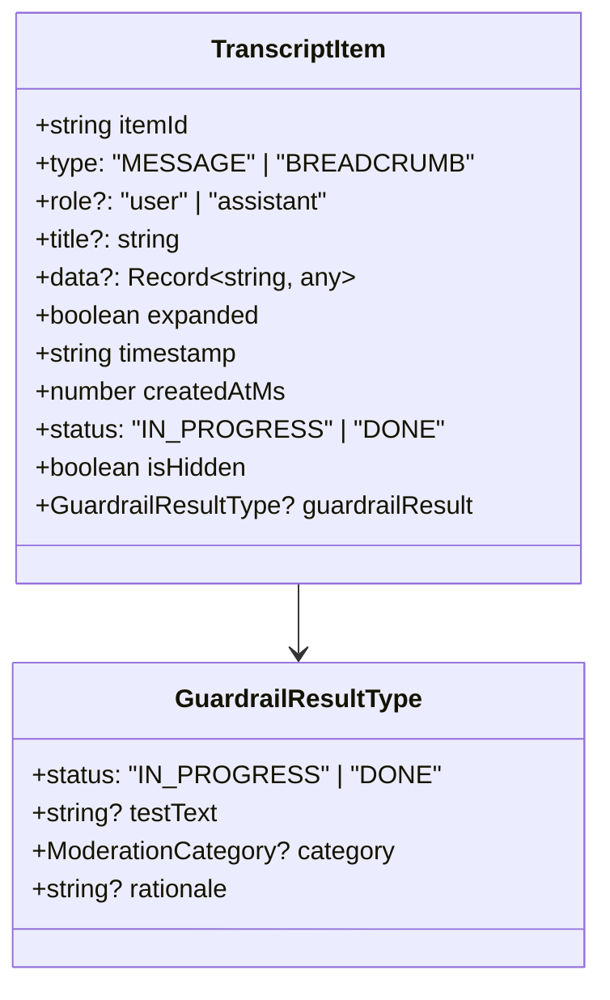

**Sources:** [src/app/types.ts:68-80](), [src/app/types.ts:61-66]()

### Message Lifecycle Pattern

Messages follow a specific lifecycle from creation to completion, with optional guardrail evaluation:

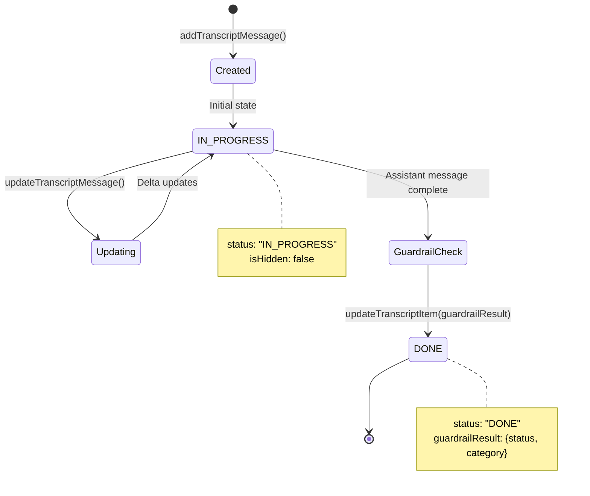

**Sources:** [src/app/contexts/TranscriptContext.tsx:44-65](), [src/app/contexts/TranscriptContext.tsx:67-79](), [src/app/contexts/TranscriptContext.tsx:106-112]()

### Provider Implementation

The `TranscriptProvider` wraps the application at the root level in `page.tsx`, making the context available to all descendant components:

**Key Implementation Details:**

1. **Timestamp Generation**: Each item receives a formatted timestamp with millisecond precision via `newTimestampPretty()` [src/app/contexts/TranscriptContext.tsx:32-42]()

2. **Duplicate Prevention**: `addTranscriptMessage` checks for existing items with the same `itemId` to prevent duplicates [src/app/contexts/TranscriptContext.tsx:46-49]()

3. **Immutable Updates**: All state updates use functional setState with array spreading to maintain immutability [src/app/contexts/TranscriptContext.tsx:68-78]()

**Sources:** [src/app/contexts/TranscriptContext.tsx:29-128]()

## EventContext: Real-time Protocol Event Logging

The `EventContext` (referenced but implementation not provided in source files) manages a log of all WebRTC and OpenAI Realtime API events for debugging purposes. Based on usage in App.tsx, it provides:

### Event Context Interface

| Method | Purpose | Usage |
|--------|---------|-------|
| `logClientEvent` | Log events sent to server | Used for tracking `session.update`, `input_audio_buffer.clear`, etc. |
| `logServerEvent` | Log events received from server | Used for tracking API responses, transcripts, audio deltas |
| `loggedEvents` | Array of all logged events | Consumed by Events component for display |

**Sources:** [src/app/App.tsx:19](), [src/app/App.tsx:63]()

### LoggedEvent Structure

Events are stored with metadata for filtering and debugging:

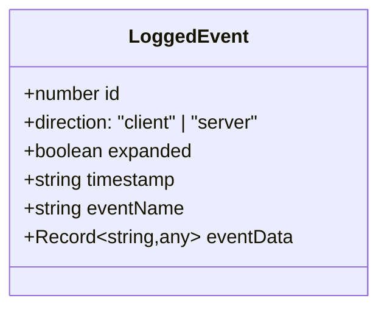

**Sources:** [src/app/types.ts:132-139]()

### Event Logging Pattern

Throughout App.tsx, events are logged at key points in the session lifecycle:

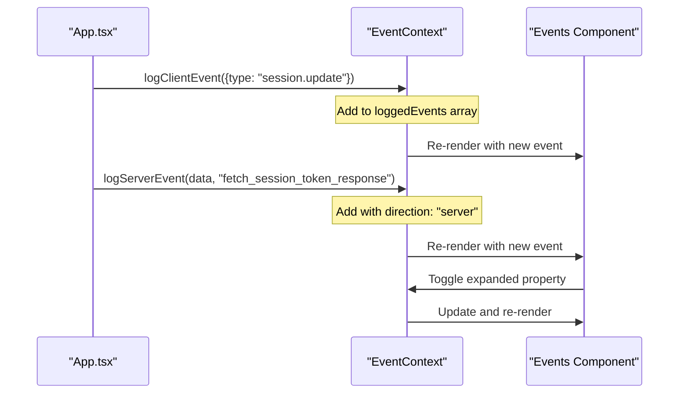

**Sources:** [src/app/App.tsx:125-132](), [src/app/App.tsx:182-195]()

## Local State Management in App.tsx

The main App component maintains several pieces of local state using React's `useState` hook. This state is UI-specific and doesn't need to be shared globally.

### Session and Agent State

| State Variable | Type | Purpose |
|----------------|------|---------|
| `sessionStatus` | `SessionStatus` | Connection state: "DISCONNECTED", "CONNECTING", "CONNECTED" |
| `selectedAgentName` | `string` | Currently active agent name |
| `selectedAgentConfigSet` | `RealtimeAgent[] \| null` | Available agents for current scenario |

**Sources:** [src/app/App.tsx:65-68](), [src/app/App.tsx:105-106](), [src/app/types.ts:17]()

### UI Control State

| State Variable | Type | Purpose | Persisted |
|----------------|------|---------|-----------|
| `isPTTActive` | `boolean` | Push-to-Talk mode enabled | localStorage |
| `isPTTUserSpeaking` | `boolean` | User currently holding PTT button | No |
| `isAudioPlaybackEnabled` | `boolean` | Audio output enabled | localStorage |
| `isEventsPaneExpanded` | `boolean` | Events panel visibility | localStorage |
| `userText` | `string` | Text input field value | No |

**Sources:** [src/app/App.tsx:108-119]()

### State Persistence Pattern

The application persists certain UI preferences to `localStorage` using a useEffect pattern:

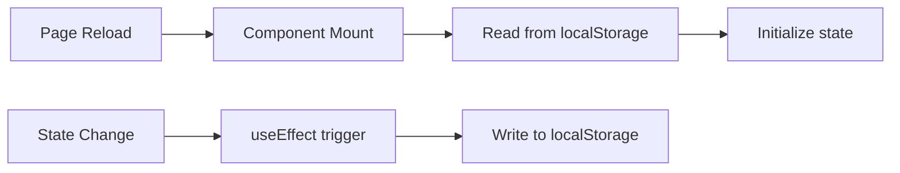

**Implementation:**

1. **On mount**: Read persisted values [src/app/App.tsx:353-368]()
2. **On change**: Sync to localStorage [src/app/App.tsx:370-383]()

**Sources:** [src/app/App.tsx:353-383]()

## State Update Patterns

### Pattern 1: Direct Context Updates

Components call context methods directly to update global state:

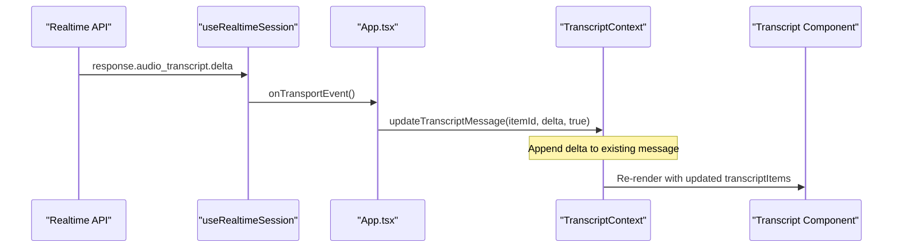

**Sources:** [src/app/App.tsx:60-62]()

### Pattern 2: Callback-Driven Updates

The `useRealtimeSession` hook accepts callbacks that trigger state updates:

**Connection Status Updates:**

```typescript
// Hook callback updates local state
onConnectionChange: (s) => setSessionStatus(s as SessionStatus)
```

**Agent Handoff Updates:**

```typescript
// Hook callback triggers agent switch
onAgentHandoff: (agentName: string) => {
  handoffTriggeredRef.current = true;
  setSelectedAgentName(agentName);
}
```

**Sources:** [src/app/App.tsx:98-103]()

### Pattern 3: Derived State and Side Effects

Changes to state trigger side effects via `useEffect` hooks:

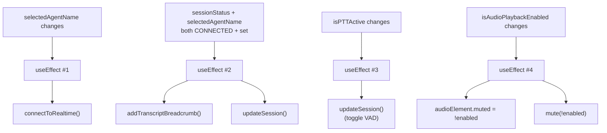

**Sources:** [src/app/App.tsx:153-157](), [src/app/App.tsx:159-173](), [src/app/App.tsx:175-179](), [src/app/App.tsx:385-418]()

## State Synchronization Across Components

### Transcript State Flow

The transcript state flows from context to multiple consuming components:

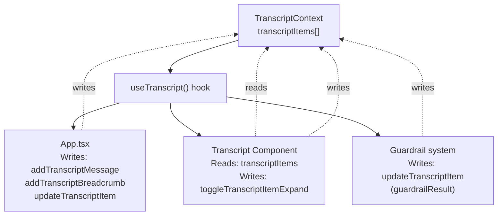

**Sources:** [src/app/contexts/TranscriptContext.tsx:130-136](), [src/app/App.tsx:60-62]()

### Event State Flow

Events are logged at the App.tsx level and consumed by the Events component:

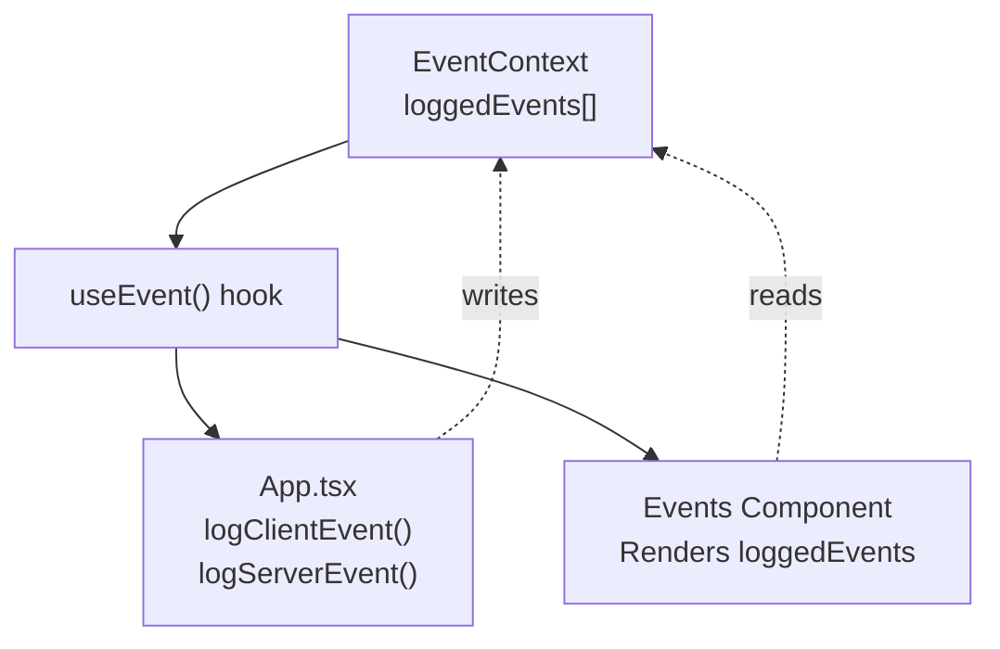

**Sources:** [src/app/App.tsx:63](), [src/app/App.tsx:125-132]()

## Advanced State Patterns

### RefBased State for Transient Flags

The application uses React refs to track transient state that shouldn't trigger re-renders:

**Handoff Trigger Detection:**

The `handoffTriggeredRef` distinguishes between user-initiated agent changes (which should trigger a greeting) and automatic handoffs (which should not):

```typescript
// On handoff from API:
onAgentHandoff: (agentName: string) => {
  handoffTriggeredRef.current = true;
  setSelectedAgentName(agentName);
}

// In effect that responds to agent change:
useEffect(() => {
  updateSession(!handoffTriggeredRef.current);
  handoffTriggeredRef.current = false; // Reset after handling
}, [selectedAgentName]);
```

**Sources:** [src/app/App.tsx:72](), [src/app/App.tsx:99-102](), [src/app/App.tsx:169-171]()

### Audio Element Management

The `audioElementRef` provides stable access to the HTMLAudioElement across renders:

```typescript
const audioElementRef = useRef<HTMLAudioElement | null>(null);

// Created once via useMemo:
const sdkAudioElement = React.useMemo(() => {
  if (typeof window === 'undefined') return undefined;
  const el = document.createElement('audio');
  el.autoplay = true;
  document.body.appendChild(el);
  return el;
}, []);

// Assigned in effect:
useEffect(() => {
  if (sdkAudioElement && !audioElementRef.current) {
    audioElementRef.current = sdkAudioElement;
  }
}, [sdkAudioElement]);
```

**Sources:** [src/app/App.tsx:70](), [src/app/App.tsx:74-81](), [src/app/App.tsx:84-88]()

### Guardrail Result Updates

Guardrail results are asynchronously added to transcript items using partial updates:

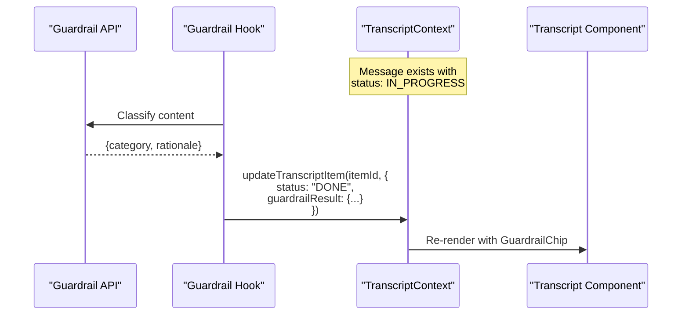

**Sources:** [src/app/contexts/TranscriptContext.tsx:106-112](), [src/app/types.ts:79]()

## Best Practices

### 1. Context vs Local State Decision Matrix

| Use Context When | Use Local State When |
|------------------|---------------------|
| Data is read by multiple components | Data is only used within one component |
| Data represents domain concepts (messages, events) | Data represents UI state (expanded panels, input values) |
| Updates come from multiple sources | Updates are user-driven from a single component |

### 2. Immutable Update Patterns

All state updates follow immutable patterns to ensure proper React re-rendering:

**Array Updates:**
```typescript
// Adding items
setTranscriptItems((prev) => [...prev, newItem]);

// Updating items
setTranscriptItems((prev) =>
  prev.map((item) =>
    item.itemId === targetId ? { ...item, ...updates } : item
  )
);
```

**Sources:** [src/app/contexts/TranscriptContext.tsx:63](), [src/app/contexts/TranscriptContext.tsx:107-110]()

### 3. Effect Dependency Management

Effects that depend on multiple state variables must list all dependencies:

```typescript
// Correct: All dependencies listed
useEffect(() => {
  if (sessionStatus === "CONNECTED" && selectedAgentConfigSet && selectedAgentName) {
    updateSession(!handoffTriggeredRef.current);
  }
}, [selectedAgentConfigSet, selectedAgentName, sessionStatus]);
```

**Sources:** [src/app/App.tsx:159-173]()

### 4. Timestamp Consistency

All transcript items use a consistent timestamp format with millisecond precision for accurate ordering and debugging:

```typescript
function newTimestampPretty(): string {
  const now = new Date();
  const time = now.toLocaleTimeString([], {
    hour12: false,
    hour: "2-digit",
    minute: "2-digit",
    second: "2-digit",
  });
  const ms = now.getMilliseconds().toString().padStart(3, "0");
  return `${time}.${ms}`;
}
```

**Sources:** [src/app/contexts/TranscriptContext.tsx:32-42]()

### 5. Prop Drilling Avoidance

The context pattern eliminates prop drilling for frequently-accessed data. Compare:

**Without Context (requires 3 levels of props):**
```
App → Transcript → TranscriptItem (needs transcriptItems)
```

**With Context (direct access):**
```
TranscriptContext → TranscriptItem (via useTranscript())
```

**Sources:** [src/app/contexts/TranscriptContext.tsx:130-136]()

---

