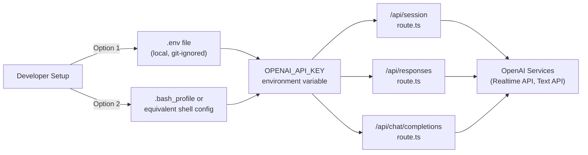
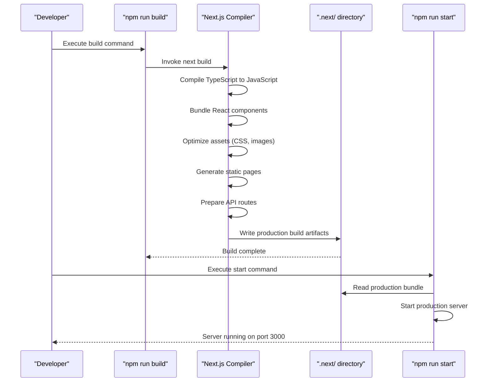
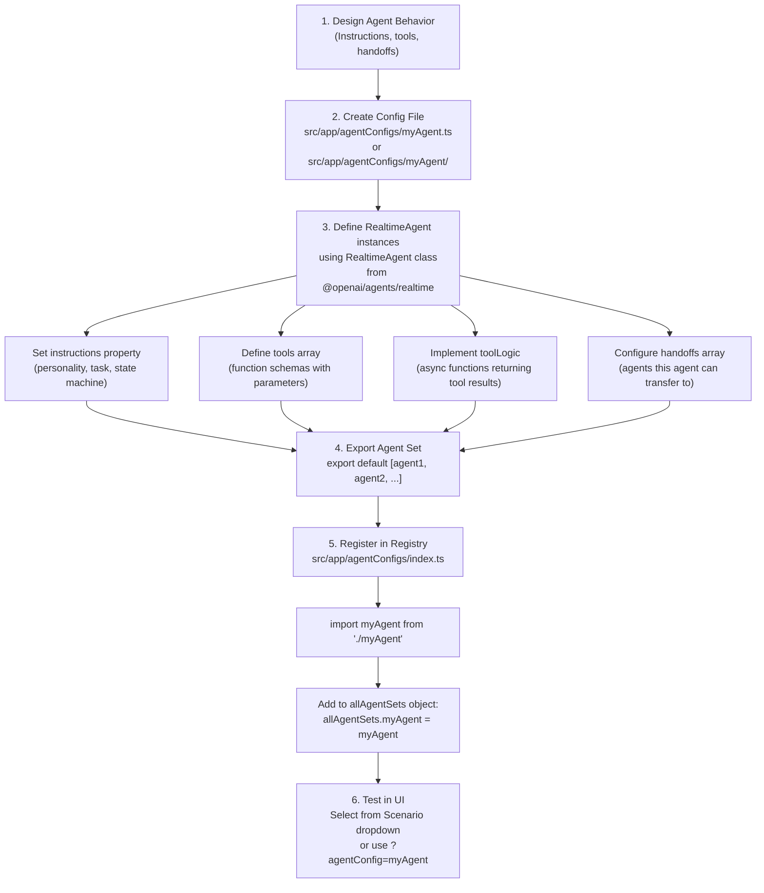
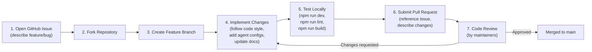

<!-- source: DeepWiki mcp.deepwiki.com · repo openai/openai-realtime-agents · page 6 Development Guide · fetched 2026-10-26 -->

# Development Guide

<details>
<summary>Relevant source files</summary>

The following files were used as context for generating this wiki page:

- [README.md](README.md)
- [package.json](package.json)
- [public/screenshot_handoff.png](public/screenshot_handoff.png)

</details>


This guide provides practical information for developers who want to modify, extend, or contribute to the OpenAI Realtime Agents project. It covers project setup, development workflow, build processes, and contribution guidelines.

For information about agent architecture patterns, see [Agent Patterns](#2). For details on technical implementation of specific systems, see [Technical Implementation](#3). For example agent configurations, see [Example Implementations](#4).

---

## Project Setup and Dependencies

### Prerequisites

This project requires the following tools installed on your system:

- **Node.js**: Version 20 or higher (the project uses modern JavaScript features)
- **npm**: Package manager included with Node.js
- **OpenAI API Key**: Required for connecting to OpenAI services

### Project Structure

The repository follows Next.js 15 conventions with TypeScript. Understanding the directory structure is essential for navigating the codebase:

```mermaid
graph TB
    Root["Repository Root"]
    Src["src/"]
    App["src/app/"]
    AgentConfigs["src/app/agentConfigs/"]
    API["src/app/api/"]
    Components["src/app/components/"]
    
    Root --> Src
    Root --> Public["public/<br/>(static assets)"]
    Root --> Config["Configuration Files<br/>(package.json, tsconfig.json,<br/>next.config.js, .env)"]
    
    Src --> App
    
    App --> Page["page.tsx<br/>(Root component with<br/>context providers)"]
    App --> AppTSX["App.tsx<br/>(Main application<br/>controller)"]
    App --> AgentConfigs
    App --> API
    App --> Components
    App --> Contexts["contexts/<br/>(TranscriptContext,<br/>EventContext)"]
    App --> Hooks["hooks/<br/>(useRealtimeSession,<br/>useAudioDownload, etc.)"]
    
    AgentConfigs --> ChatSup["chatSupervisor/<br/>(index.ts, supervisorAgent.ts,<br/>sampleData.ts)"]
    AgentConfigs --> CustServ["customerServiceRetail/<br/>(index.ts, authentication.ts,<br/>returns.ts, sales.ts,<br/>simulatedHuman.ts)"]
    AgentConfigs --> Simple["simpleHandoff.ts"]
    AgentConfigs --> Index["index.ts<br/>(Agent registry)"]
    AgentConfigs --> Utils["utils.ts<br/>(injectTransferTools)"]
    AgentConfigs --> Types["types.ts<br/>(Type definitions)"]
    AgentConfigs --> Meta["voiceAgentMetaprompt.txt"]
    
    API --> Session["session/route.ts<br/>(Ephemeral key endpoint)"]
    API --> Responses["responses/route.ts<br/>(OpenAI proxy + guardrails)"]
    API --> Chat["chat/completions/route.ts<br/>(OpenAI text API proxy)"]
    API --> Health["health/route.ts"]
    
    Components --> Transcript["Transcript.tsx"]
    Components --> Events["Events.tsx"]
    Components --> Toolbar["BottomToolbar.tsx"]
    Components --> Guardrail["GuardrailChip.tsx"]
```



**Sources:** [README.md:1-230]()

### Installation

Clone the repository and install dependencies:

```bash
git clone https://github.com/openai/openai-realtime-agents.git
cd openai-realtime-agents
npm install
```

The `npm install` command resolves all dependencies defined in `package.json`.

**Sources:** [README.md:24]()

### Core Dependencies

The project relies on several key npm packages:

| Package | Version | Purpose |
|---------|---------|---------|
| `@openai/agents` | ^0.0.5 | OpenAI Agents SDK providing `RealtimeAgent` and `RealtimeSession` classes |
| `next` | ^15.3.1 | Next.js framework for React application and API routes |
| `openai` | ^4.77.3 | Official OpenAI Node.js client for text API calls |
| `react` / `react-dom` | ^19.0.0 | React framework for UI components |
| `react-markdown` | ^9.0.3 | Markdown rendering in transcript messages |
| `uuid` | ^11.0.4 | Generating unique identifiers for transcript items |
| `zod` | ^3.24.1 | Runtime type validation for API requests/responses |

**Development Dependencies:**

| Package | Purpose |
|---------|---------|
| `typescript` | TypeScript compiler (version ^5) |
| `eslint` | Code linting with Next.js config |
| `tailwindcss` | Utility-first CSS framework for styling |

**Sources:** [package.json:11-34]()

### Environment Configuration

The application requires environment variables for API authentication:



**Configuration steps:**

1. Copy `.env.sample` to `.env` in the repository root (or add to shell profile)
2. Add your OpenAI API key: `OPENAI_API_KEY=sk-...`
3. The API routes access this variable via `process.env.OPENAI_API_KEY`

The API key is never exposed to the client. API routes at `/api/session`, `/api/responses`, and `/api/chat/completions` proxy requests to OpenAI services server-side, keeping the key secure.

**Sources:** [README.md:25]()

---

## Building and Running

### Development Mode

Start the development server with hot module replacement:

```bash
npm run dev
```

This executes `next dev`, which:
- Starts the Next.js development server on `http://localhost:3000`
- Enables hot module replacement (HMR) for instant code updates
- Provides detailed error messages and stack traces
- Watches for file changes in `src/` directory

**Sources:** [README.md:26](), [package.json:6]()

### Production Build

Build the optimized production bundle:

```bash
npm run build
npm run start
```

**Build process:**



The `npm run build` command:
- Compiles TypeScript files to JavaScript
- Bundles and minifies React components
- Optimizes CSS with Tailwind
- Generates production-ready API routes
- Creates static assets in `.next/` directory

The `npm run start` command serves the production build.

**Sources:** [package.json:7-8]()

### Linting

Check code style and potential errors:

```bash
npm run lint
```

This runs ESLint with Next.js configuration, checking:
- TypeScript type errors
- React component best practices
- Next.js-specific patterns (e.g., proper `<Image>` usage)
- Code formatting issues

**Sources:** [package.json:9]()

### Available npm Scripts

| Script | Command | Purpose |
|--------|---------|---------|
| `dev` | `next dev` | Start development server with HMR |
| `build` | `next build` | Build production-optimized bundle |
| `start` | `next start` | Serve production build |
| `lint` | `next lint` | Run ESLint code quality checks |

**Sources:** [package.json:5-10]()

---

## Contributing

### Adding a New Agent Configuration

Creating a new agent scenario involves several steps. This workflow bridges high-level agent design to concrete code entities:



**Detailed steps:**

#### Step 1: Design Agent Behavior

Determine:
- Agent personality and tone
- Tasks the agent should handle
- Tools the agent needs (if any)
- Which agents it should transfer to (if using Sequential Handoff)
- Whether to use state machines for structured flows

#### Step 2: Create Configuration File

For simple scenarios, create a single file:
```
src/app/agentConfigs/myAgent.ts
```

For complex scenarios with multiple agents, create a directory:
```
src/app/agentConfigs/myAgent/
  ├── index.ts          (exports agent set)
  ├── agent1.ts         (first agent definition)
  ├── agent2.ts         (second agent definition)
  └── utils.ts          (shared utilities)
```

#### Step 3: Define RealtimeAgent Instances

Import the `RealtimeAgent` class and create agent instances:

```typescript
import { RealtimeAgent } from '@openai/agents/realtime';

export const myAgent = new RealtimeAgent({
  name: 'myAgent',
  handoffDescription: 'Brief description for transfer tool',
  instructions: `
    Your instructions here...
  `,
  tools: [
    {
      type: 'function',
      name: 'myTool',
      description: 'What this tool does',
      parameters: {
        type: 'object',
        properties: {
          param1: { type: 'string', description: 'Parameter description' }
        },
        required: ['param1']
      }
    }
  ],
  handoffs: [otherAgent], // If using handoffs
});
```

#### Step 4: Implement Tool Logic (if applicable)

If your agent uses tools, implement the logic:

```typescript
export const toolLogic = {
  myTool: async (args: { param1: string }) => {
    // Implement tool logic
    const result = performAction(args.param1);
    return { result };
  }
};
```

For the Chat-Supervisor pattern, implement supervisor logic:

```typescript
export const supervisorToolLogic = {
  myTool: async (args, transcript) => {
    // Access full transcript for context-aware decisions
    const result = complexOperation(args, transcript);
    return result;
  }
};
```

#### Step 5: Export Agent Set

Export an array of agents that participate in the scenario:

```typescript
export default [myAgent, otherAgent];
```

#### Step 6: Register in Index

Add your configuration to the registry at [src/app/agentConfigs/index.ts]():

```typescript
import myAgent from './myAgent';

export const allAgentSets = {
  chatSupervisor,
  customerServiceRetail,
  simpleHandoff,
  myAgent, // Add your agent set here
};
```

#### Step 7: Test in UI

Access your agent in two ways:
1. Navigate to `http://localhost:3000?agentConfig=myAgent`
2. Select "myAgent" from the Scenario dropdown

**Sources:** [README.md:92-116](), [README.md:209-210]()

### Agent Configuration Patterns Reference

The codebase demonstrates three patterns you can use as templates:

| Pattern | File(s) | Use When |
|---------|---------|----------|
| Simple Handoff | `simpleHandoff.ts` | Learning basic handoff mechanics, minimal agent graph |
| Chat-Supervisor | `chatSupervisor/index.ts`, `supervisorAgent.ts` | Need fast responses + intelligent tool handling |
| Sequential Handoff | `customerServiceRetail/*.ts` | Multiple specialized agents with complex flows |

**Key utilities:**

- **`injectTransferTools()`** at [src/app/agentConfigs/utils.ts](): Automatically generates transfer tools based on `downstreamAgents` property
- **`voiceAgentMetaprompt.txt`** at [src/app/agentConfigs/voiceAgentMetaprompt.txt](): Template for generating structured agent instructions using LLMs

**Sources:** [README.md:18-20](), [README.md:82-146](), [README.md:211]()

### Code Style Guidelines

While the repository does not specify strict style guidelines, follow these conventions observed in the codebase:

1. **TypeScript:** All code uses TypeScript with strict type checking
2. **Naming conventions:**
   - Agent names: `camelCase` (e.g., `haikuWriter`, `customerServiceRetail`)
   - File names: `camelCase.ts` or `kebab-case.tsx` for components
   - Component names: `PascalCase` (e.g., `Transcript`, `GuardrailChip`)
3. **Imports:** Use named imports from `@openai/agents/realtime` and absolute imports for project files
4. **Formatting:** Use ESLint configuration defined in the project
5. **Comments:** Document complex agent instructions and tool logic

**Sources:** [README.md:222-224]()

### Pull Request Process

The repository welcomes contributions focused on core agent demonstration logic:



**Guidelines:**

1. **Scope:** Focus on core agent flow demonstrations. PRs beyond this scope may not be merged.
2. **Issue first:** Open an issue to discuss significant changes before starting work.
3. **Testing:** Ensure your changes work in both development and production builds.
4. **Documentation:** Update README.md if adding new agent patterns or features.
5. **Agent configs:** New agent configurations should include clear instructions and tool definitions.

**Sources:** [README.md:222-224]()

### Testing Your Changes

Before submitting a PR, verify:

| Test | Command | Expected Result |
|------|---------|-----------------|
| Development mode | `npm run dev` | Server starts without errors, UI loads |
| Linting | `npm run lint` | No ESLint errors or warnings |
| Production build | `npm run build` | Build completes successfully |
| Production server | `npm run start` | Production server serves application |
| Agent loading | Navigate to scenarios | All agent configs load in dropdown |
| Agent switching | Select different scenarios | Agents switch without errors |
| WebRTC connection | Click "Connect" button | Connection establishes, audio works |

**Sources:** [package.json:5-10]()

### Development Tips

**Adding tool logic:**
- Tool logic functions receive `args` and optionally `transcript` parameter
- Always return an object that can be serialized to JSON
- Use async/await for API calls or database queries
- Handle errors gracefully and return error messages in tool response

**Working with state machines:**
- Define states clearly in agent instructions
- Use numbered lists or bullet points for state transitions
- Test transitions thoroughly with various user inputs
- See `customerServiceRetail/authentication.ts` for state machine examples

**Debugging:**
- Enable the Events pane to see all client/server events
- Check browser console for WebRTC connection issues
- Monitor transcript for unexpected agent behavior
- Use `console.log` in tool logic functions (visible in terminal)

**Performance:**
- Keep agent instructions concise (realtime models perform better with shorter prompts)
- Minimize tool definitions (only include necessary tools for each agent)
- Use Chat-Supervisor pattern if tool calls cause noticeable latency
- Consider `gpt-4o-mini-realtime` or `gpt-4.1-mini` for cost optimization

**Sources:** [README.md:30-81](), [README.md:126-146]()

---

This development guide provides the foundation for working with the OpenAI Realtime Agents codebase. For deeper technical details on specific systems, refer to the other sections of this wiki.

---

