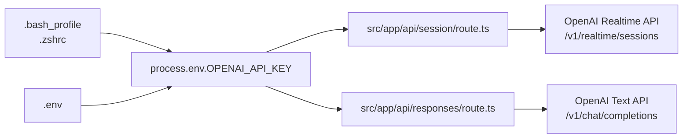
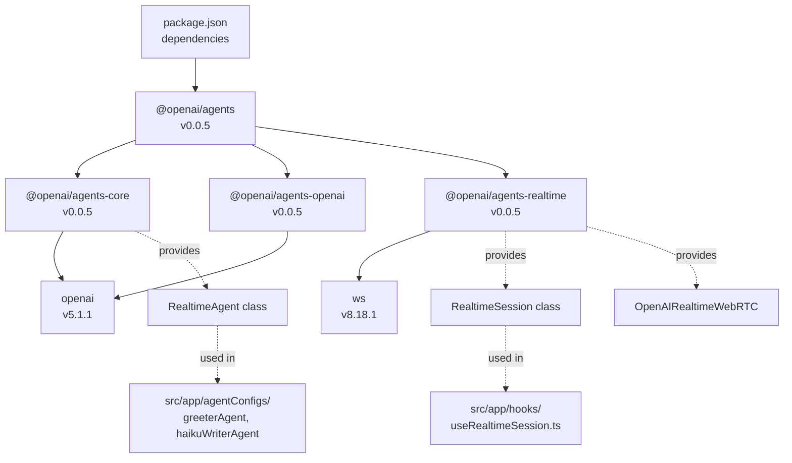
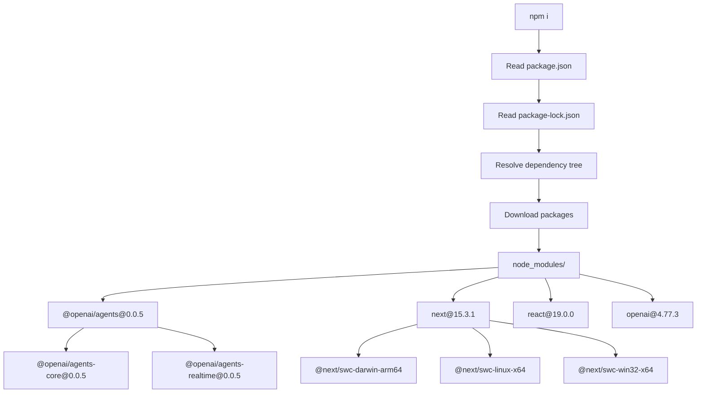
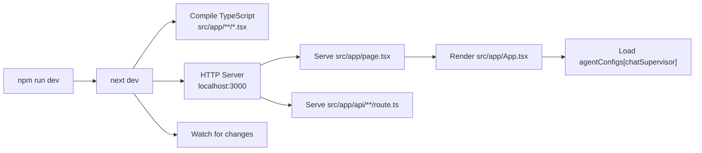
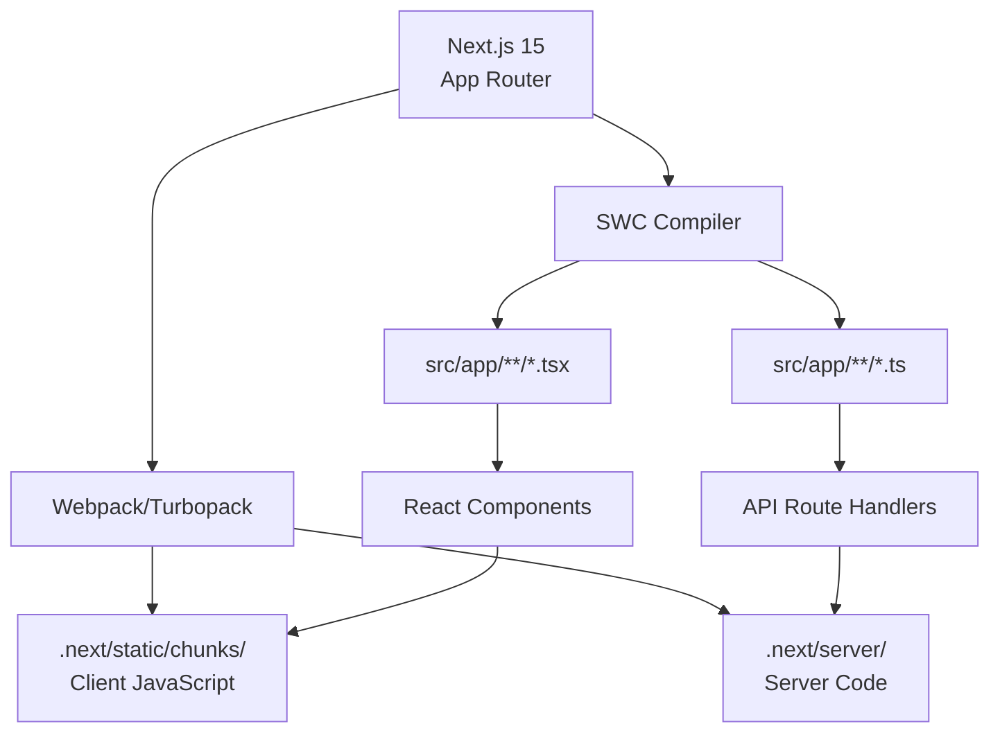
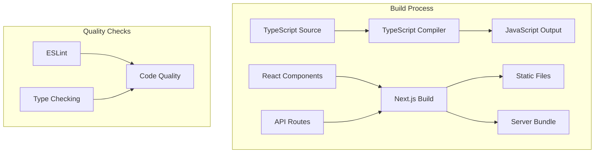

<!-- source: DeepWiki mcp.deepwiki.com · repo openai/openai-realtime-agents · page 6.1 Project Setup and Dependencies · fetched 2026-10-26 -->

# Project Setup and Dependencies

<details>
<summary>Relevant source files</summary>

The following files were used as context for generating this wiki page:

- [README.md](README.md)
- [package-lock.json](package-lock.json)
- [package.json](package.json)
- [public/screenshot_handoff.png](public/screenshot_handoff.png)

</details>


This document details the project structure, npm dependencies, Next.js configuration, and environment setup requirements for the OpenAI Realtime Agents demo. It provides technical specifications for the development environment, dependency tree, and build system configuration.

For overall system architecture, see page 1.3. For runtime session management, see page 3.1. For API route implementation, see page 3.3.

## Project Structure

The repository follows Next.js 15 App Router conventions with TypeScript.

```
openai-realtime-agents/
├── src/
│   ├── app/
│   │   ├── agentConfigs/          # Agent configuration registry
│   │   │   ├── index.ts           # Master agent registry: allAgentSets
│   │   │   ├── chatSupervisor/    # Chat-Supervisor pattern
│   │   │   ├── customerServiceRetail/  # Sequential handoff pattern
│   │   │   ├── simpleHandoff.ts   # Basic example
│   │   │   └── utils.ts           # injectTransferTools()
│   │   ├── api/                   # Next.js API routes
│   │   │   ├── session/route.ts   # POST /api/session (ephemeral keys)
│   │   │   ├── responses/route.ts # POST /api/responses (OpenAI proxy)
│   │   │   └── chat/completions/route.ts
│   │   ├── contexts/              # React contexts
│   │   │   ├── TranscriptContext.tsx
│   │   │   └── EventContext.tsx
│   │   ├── hooks/                 # Custom React hooks
│   │   │   ├── useRealtimeSession.ts
│   │   │   ├── useAudioDownload.ts
│   │   │   └── useHandleSessionHistory.ts
│   │   ├── components/            # UI components
│   │   ├── types.ts               # TypeScript type definitions
│   │   ├── App.tsx                # Main application controller
│   │   ├── page.tsx               # Root page with context providers
│   │   ├── layout.tsx             # Root layout
│   │   └── globals.css            # Tailwind CSS
│   └── utils/                     # Utility functions
├── public/                        # Static assets
├── package.json                   # npm dependencies and scripts
├── package-lock.json              # Dependency lock file
├── tsconfig.json                  # TypeScript configuration
├── next.config.js                 # Next.js configuration
├── tailwind.config.js             # Tailwind CSS configuration
├── .env.sample                    # Environment variable template
└── README.md                      # Setup documentation
```

**Directory Structure: Code Organization**

Sources: [README.md:1-230]()

## Environment Configuration

The application requires the `OPENAI_API_KEY` environment variable to authenticate with OpenAI services. This key is used by API routes to obtain ephemeral session tokens and make requests to OpenAI's text completion APIs.

### Configuration Methods

1. **Shell Environment**: Export `OPENAI_API_KEY` in `.bash_profile`, `.zshrc`, or equivalent
2. **Local .env File**: Copy `.env.sample` to `.env` and set `OPENAI_API_KEY=sk-...`

The Next.js server reads this variable at runtime via `process.env.OPENAI_API_KEY` in API route handlers.



**Environment Variable Flow to API Routes**

Sources: [README.md:25-26]()

## npm Dependency Specification

The project uses npm for package management. Dependencies are declared in [package.json:1-35]() and resolved versions are locked in [package-lock.json:1-35]().

### Production Dependencies

| Package | Version | Purpose | Used By |
|---------|---------|---------|---------|
| `@openai/agents` | ^0.0.5 | OpenAI Agents SDK umbrella package | `src/app/agentConfigs/` |
| `next` | ^15.3.1 | Next.js App Router framework | All components, API routes |
| `react` | ^19.0.0 | React 19 UI framework | `src/app/App.tsx`, components |
| `react-dom` | ^19.0.0 | React DOM renderer | `src/app/page.tsx` |
| `openai` | ^4.77.3 | OpenAI API client library | `src/app/api/` routes |
| `@radix-ui/react-icons` | ^1.3.2 | Icon components | UI components |
| `react-markdown` | ^9.0.3 | Markdown rendering | Transcript display |
| `uuid` | ^11.0.4 | UUID generation | Session tracking |
| `zod` | ^3.24.1 | Runtime type validation | Type checking |
| `dotenv` | ^16.4.7 | Environment variable loading | Server-side configuration |

### Development Dependencies

| Package | Version | Purpose |
|---------|---------|---------|
| `typescript` | ^5 | TypeScript compiler and type checker |
| `@types/node` | ^20 | Node.js type definitions |
| `@types/react` | ^19 | React type definitions |
| `@types/react-dom` | ^19 | React DOM type definitions |
| `eslint` | ^9 | JavaScript/TypeScript linter |
| `eslint-config-next` | 15.1.4 | Next.js ESLint configuration |
| `postcss` | ^8 | CSS transformation tool |
| `tailwindcss` | ^3.4.1 | Utility-first CSS framework |

### OpenAI Agents SDK Structure

The `@openai/agents` package (v0.0.5) internally depends on three sub-packages:



**Dependency Graph: OpenAI Agents SDK to Code Usage**

Sources: [package.json:11-22](), [package-lock.json:981-1103]()

## Installation Procedure

Installation follows the standard npm workflow:

```bash
npm i
```

This command reads [package.json:11-22]() and installs all production dependencies, then reads [package.json:23-33]() to install development dependencies. The [package-lock.json]() ensures deterministic dependency resolution across environments.

### Package Resolution Process

npm resolves the dependency tree, which includes:

1. **Direct dependencies** from `package.json`
2. **Transitive dependencies** from each package's own dependencies
3. **Platform-specific binaries** for Next.js SWC compiler (`@next/swc-*`)
4. **Optional dependencies** like `@img/sharp-*` for image optimization
5. **Peer dependencies** for TypeScript and React ecosystem compatibility



**npm Installation and Dependency Resolution**

The installation creates a `node_modules/` directory containing approximately 2,000 packages when all transitive dependencies are resolved.

Sources: [README.md:24](), [package.json:11-33](), [package-lock.json:1-35]()

## npm Scripts

The project defines four npm scripts in [package.json:5-10]():

| Script | Command | Description |
|--------|---------|-------------|
| `dev` | `next dev` | Start Next.js development server on port 3000 |
| `build` | `next build` | Compile TypeScript and build production bundle |
| `start` | `next start` | Serve production build |
| `lint` | `next lint` | Run ESLint with Next.js configuration |

### Development Mode

```bash
npm run dev
```

This executes `next dev`, which:
1. Starts the Next.js development server on `http://localhost:3000`
2. Enables Fast Refresh for React components
3. Compiles TypeScript on-demand
4. Serves API routes from `src/app/api/`
5. Loads the default agent configuration (`chatSupervisor`)



**Development Server Execution Flow**

### Production Build

```bash
npm run build
```

This executes `next build`, which:
1. Runs TypeScript type checking
2. Compiles all pages and API routes
3. Optimizes JavaScript bundles
4. Generates static assets
5. Creates `.next/` build directory

The build output includes:
- **Server bundles**: Node.js code for API routes and server components
- **Client bundles**: Browser JavaScript for client components
- **Static files**: Pre-rendered HTML pages

Sources: [package.json:5-10](), [README.md:26-28]()

## Next.js Configuration

The project uses Next.js 15 with the App Router architecture. Key configuration aspects:

### App Router Structure

- **Root Layout**: [src/app/layout.tsx]() defines the HTML shell
- **Root Page**: [src/app/page.tsx]() provides React context providers
- **API Routes**: [src/app/api/**/route.ts]() handle server-side endpoints
- **Client Components**: [src/app/App.tsx]() and components use `'use client'` directive

### TypeScript Configuration

The `tsconfig.json` configures TypeScript compilation:
- **Target**: ES2017+ for modern JavaScript features
- **Module**: ESNext for ES module syntax
- **JSX**: Preserve for Next.js to handle
- **Strict Mode**: Enabled for type safety
- **Path Aliases**: Configured for import resolution

### Build System

Next.js uses:
- **SWC Compiler**: Rust-based JavaScript/TypeScript compiler (faster than Babel)
- **Webpack**: Module bundler for production builds
- **Turbopack**: (Optional) Next-generation bundler for development



**Next.js Build Pipeline**

Sources: [package.json:15](), [README.md:24-28]()

## Tailwind CSS Configuration

The project uses Tailwind CSS v3.4.1 for styling:
- **Configuration**: `tailwind.config.js` defines theme and content paths
- **Global Styles**: [src/app/globals.css]() imports Tailwind directives
- **JIT Mode**: Just-in-Time compiler generates CSS on-demand
- **PostCSS**: Processes Tailwind directives via `postcss.config.js`

Tailwind classes are used extensively in UI components for responsive design and consistent styling.

Sources: [package.json:30]()

## Build Configuration

The project uses Next.js 15 with TypeScript 5 and modern tooling for production builds.

### TypeScript Configuration

The project leverages TypeScript for type safety across:
- React components and hooks
- API route handlers  
- Agent configuration types
- OpenAI SDK integrations

### Linting and Code Quality

ESLint configuration includes:
- Next.js recommended rules
- TypeScript-specific linting
- React best practices



**Build and Quality Assurance Process**

Sources: [package.json:7-9](), [package.json:24-33]()

## Agent Configuration Selection

The application supports multiple agent scenarios through a dropdown interface. By default, it loads the `chatSupervisor` configuration, but developers can switch between different agent patterns during development.

Available configurations are managed through the central registry in `src/app/agentConfigs/index.ts`, allowing easy addition of new agent scenarios for testing and development.

Sources: [README.md:27-28]()

---

