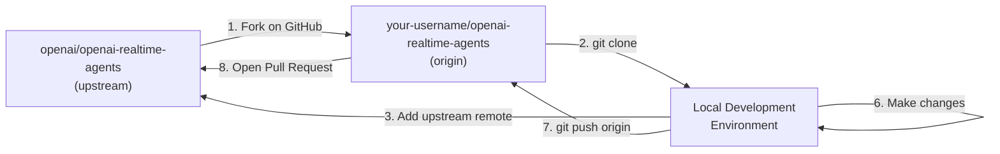
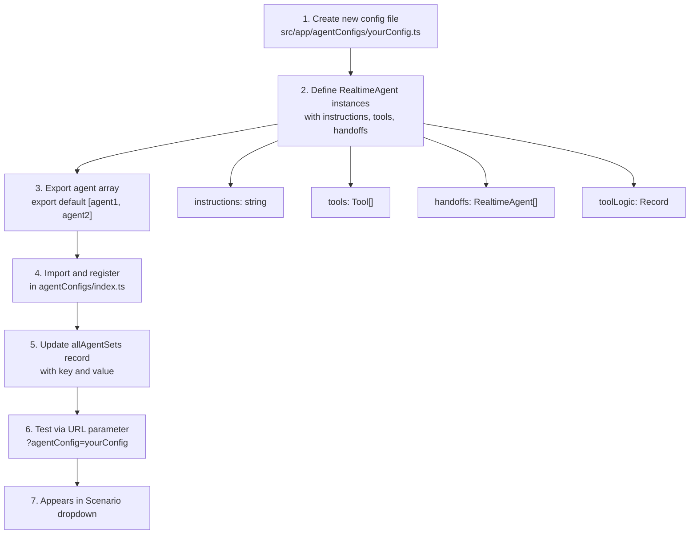
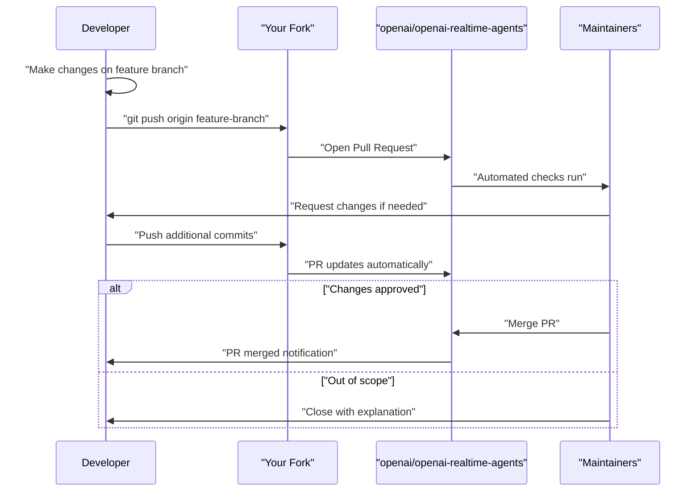

<!-- source: DeepWiki mcp.deepwiki.com · repo openai/openai-realtime-agents · page 6.3 Contributing · fetched 2026-10-26 -->

# Contributing

<details>
<summary>Relevant source files</summary>

The following files were used as context for generating this wiki page:

- [README.md](README.md)
- [package.json](package.json)
- [public/screenshot_handoff.png](public/screenshot_handoff.png)

</details>


This document provides guidelines for contributing to the OpenAI Realtime Agents demo repository. This project is designed as an educational reference implementation demonstrating advanced agent patterns using the OpenAI Realtime API and Agents SDK. Contributions should focus on improving these core demonstrations rather than extending the project into a production framework.

For information about building and running the project, see [Building and Running](#6.2). For details on agent configuration structure, see [Agent Configuration System](#2.3).

## Contribution Philosophy

The repository serves a specific educational purpose: demonstrating core logic for agentic voice flows using the OpenAI Realtime API. Contributions that align with this mission are welcome, while those that expand the scope beyond demonstration and reference implementation will likely not be merged.

**In Scope:**
- New agent pattern demonstrations that illustrate useful architectures
- Bug fixes and error handling improvements
- Documentation enhancements and clarifications
- Performance optimizations that don't sacrifice code clarity
- Additional example agent configurations following existing patterns

**Out of Scope:**
- Production-ready features (authentication systems, databases, analytics)
- Complex UI enhancements beyond the existing demonstration interface
- Framework-level abstractions or generalization layers
- Third-party service integrations beyond OpenAI
- Deployment configurations or infrastructure code

Sources: [README.md:222-224]()

## Development Workflow

### Fork and Setup



**Setup Steps:**

1. Fork the repository on GitHub
2. Clone your fork: `git clone https://github.com/your-username/openai-realtime-agents.git`
3. Add upstream remote: `git remote add upstream https://github.com/openai/openai-realtime-agents.git`
4. Install dependencies: `npm i`
5. Copy `.env.sample` to `.env` and add your `OPENAI_API_KEY`
6. Start development server: `npm run dev`
7. Create a feature branch: `git checkout -b feature/your-feature-name`

Sources: [README.md:22-28](), [package.json:5-9]()

### Development Environment

The project requires:

| Dependency | Purpose | Version |
|------------|---------|---------|
| Node.js | Runtime environment | 20+ recommended |
| npm | Package manager | Latest stable |
| TypeScript | Type system | 5.x |
| Next.js | Application framework | 15.3+ |
| OpenAI Agents SDK | Agent orchestration | 0.0.5+ |
| OpenAI API Key | Access to Realtime API | N/A |

**Key npm Scripts:**

- `npm run dev` - Start development server with hot reload on http://localhost:3000
- `npm run build` - Compile production build
- `npm run start` - Run production build
- `npm run lint` - Run ESLint checks

Sources: [package.json:1-34]()

## Code Standards and Conventions

### TypeScript Usage

The codebase is fully typed using TypeScript. When contributing:

- **No `any` types**: Use proper type definitions or generics
- **Explicit return types**: Define return types for functions
- **Interface over type**: Prefer `interface` for object shapes
- **Import types separately**: Use `import type` for type-only imports where applicable

Type definitions are centralized in domain-specific files:
- Agent types: Defined via OpenAI Agents SDK (`RealtimeAgent`)
- Transcript types: [src/app/contexts/TranscriptContext.tsx]()
- Event types: [src/app/contexts/EventContext.tsx]()

### File Organization

```
src/app/
├── agentConfigs/           # Agent configuration modules
│   ├── index.ts           # Master registry (MUST UPDATE when adding configs)
│   ├── chatSupervisor/    # Chat-Supervisor pattern example
│   ├── customerServiceRetail/ # Sequential Handoff pattern example
│   ├── simpleHandoff.ts   # Minimal example
│   └── utils.ts           # Shared utilities (injectTransferTools)
├── api/                   # Next.js API routes
│   ├── session/           # Ephemeral key endpoint
│   ├── responses/         # OpenAI proxy for guardrails
│   └── chat/completions/  # Chat completions proxy
├── contexts/              # React Context providers
├── components/            # UI components
└── hooks/                 # Custom React hooks
```

### Naming Conventions

| Entity Type | Convention | Example |
|-------------|-----------|---------|
| Agent names | camelCase, descriptive | `greeterAgent`, `returnsAgent` |
| Agent configs (exported) | camelCase, descriptive | `chatSupervisor`, `customerServiceRetail` |
| Tools | camelCase, verb-based | `lookupPolicyDocument`, `authenticateUser` |
| React components | PascalCase | `Transcript`, `BottomToolbar` |
| Hooks | camelCase with `use` prefix | `useRealtimeSession`, `useTranscript` |
| API routes | kebab-case directories | `/api/session`, `/api/chat/completions` |

Sources: [README.md:91-146]()

## Adding New Agent Configurations

### Agent Configuration Pipeline



### Step-by-Step Process

**1. Create Agent Configuration File**

Create a new file in `src/app/agentConfigs/` (e.g., `myAgentFlow.ts`):

```typescript
import { RealtimeAgent } from '@openai/agents/realtime';

export const primaryAgent = new RealtimeAgent({
  name: 'primaryAgent',
  handoffDescription: 'Main agent for handling user requests',
  instructions: 'Your detailed instructions here...',
  tools: [
    {
      name: 'exampleTool',
      description: 'What this tool does',
      parameters: {
        type: 'object',
        properties: {
          param1: { type: 'string', description: 'Parameter description' }
        },
        required: ['param1']
      }
    }
  ],
  handoffs: [], // Add other agents here for Sequential Handoff
});

// Define tool implementations
const toolLogic = {
  exampleTool: async ({ param1 }: { param1: string }) => {
    // Your tool logic here
    return { result: 'success' };
  }
};

export default [primaryAgent];
```

**2. Register in Master Registry**

Add your configuration to [src/app/agentConfigs/index.ts]():

```typescript
import myAgentFlow from './myAgentFlow';

export const allAgentSets: Record<string, RealtimeAgent[]> = {
  chatSupervisor,
  customerServiceRetail,
  simpleHandoff,
  myAgentFlow, // Add your configuration here
};
```

**3. Test Your Configuration**

Navigate to `http://localhost:3000?agentConfig=myAgentFlow` to test. Your configuration will also appear in the "Scenario" dropdown in the UI.

Sources: [README.md:91-116](), [README.md:125-146](), [README.md:209-211]()

### Agent Configuration Best Practices

**Instructions:**
- Be explicit about agent personality, tone, and communication style
- Define clear task boundaries (what the agent should/shouldn't do)
- Use state machines for structured flows (e.g., authentication, data collection)
- Keep instructions concise for realtime agents (they have limited instruction-following capacity)
- For state machines, refer to [src/app/agentConfigs/voiceAgentMetaprompt.txt]() for structure guidance

**Tools:**
- Provide clear, concise descriptions
- Use JSON Schema for parameter definitions
- Avoid complex nested parameters (realtime models struggle with these)
- Test tool calls individually before integration

**Handoffs:**
- Define `handoffDescription` for each agent (used by `transferAgents` tool)
- Use `injectTransferTools()` utility from [src/app/agentConfigs/utils.ts]() for complex graphs
- Prefer unidirectional transfers for simple flows
- Use bidirectional transfers only when backtracking is necessary

**Tool Logic:**
- Implement in separate `toolLogic` object or file
- Return objects that provide context to the conversation
- Handle errors gracefully and return informative error messages
- Keep tool execution fast (under 2 seconds when possible)

Sources: [README.md:72-80](), [README.md:211](), [src/app/agentConfigs/utils.ts]()

## Pull Request Process

### Before Submitting

**1. Test Thoroughly**

- Test your agent configuration with multiple conversation flows
- Verify tool calls execute correctly
- Check that handoffs work as expected
- Test with different codec settings (`?codec=opus`, `?codec=pcmu`)
- Verify guardrails don't interfere with legitimate responses

**2. Code Quality**

- Run `npm run lint` and fix all errors
- Ensure TypeScript compilation succeeds (`npm run build`)
- Follow existing code style and patterns
- Add inline comments for complex logic
- Remove console.log statements and debugging code

**3. Documentation**

- Add comments explaining your agent's purpose and behavior
- Update README.md if introducing new patterns
- Document any new URL parameters or configuration options
- Include example conversation flows in PR description

### Submitting Pull Request



**PR Template Structure:**

```markdown
## Description
Brief description of what this PR adds/changes.

## Type of Change
- [ ] New agent configuration/pattern
- [ ] Bug fix
- [ ] Documentation update
- [ ] Performance improvement

## Testing Performed
- Describe how you tested the changes
- Include example conversation flows
- List any edge cases covered

## Agent Configuration (if applicable)
- Agent name: 
- Pattern used: Chat-Supervisor / Sequential Handoff / Other
- Key features demonstrated:

## Checklist
- [ ] Code follows existing style conventions
- [ ] TypeScript types are properly defined
- [ ] All lint checks pass
- [ ] Tested with multiple conversation flows
- [ ] Documentation updated if needed
- [ ] No console.log or debugging code
```

Sources: [README.md:222-224]()

### Review Expectations

**Response Time:**
Contributors will review PRs on a best-effort basis. Educational/demonstration PRs typically receive review within 1-2 weeks.

**Review Criteria:**
- **Scope alignment**: Does it demonstrate core agentic patterns?
- **Code quality**: Is it readable and maintainable?
- **Educational value**: Does it teach something useful?
- **Complexity**: Is it simple enough to understand quickly?

**Common Rejection Reasons:**
- Production-focused features (auth, analytics, complex state management)
- UI enhancements that don't serve educational purpose
- Framework-level abstractions
- Breaking changes to existing patterns
- Performance optimizations that sacrifice code clarity

Sources: [README.md:222-224]()

## Common Contribution Scenarios

### Adding a New Agent Pattern

**Scenario:** You want to demonstrate a novel agent architecture pattern.

**Process:**

1. Create a new directory in `src/app/agentConfigs/yourPatternName/`
2. Implement agent definitions with clear, documented instructions
3. Add README.md in the directory explaining the pattern
4. Register in [src/app/agentConfigs/index.ts]()
5. Update main [README.md]() with pattern description and schematic diagram
6. Submit PR with example conversation flows

**Example:** The Chat-Supervisor pattern at [src/app/agentConfigs/chatSupervisor/]()

### Improving Existing Agent Configuration

**Scenario:** You found a better prompt or tool implementation for an existing agent.

**Process:**

1. Modify the relevant agent configuration file
2. Test extensively to ensure no regressions
3. Document why the change improves behavior
4. Include before/after conversation examples in PR description
5. Submit PR explaining the improvement

### Adding Sample Data or Tools

**Scenario:** You want to add realistic sample data or useful tools for demonstrations.

**Process:**

1. Add data to appropriate `sampleData.ts` file or create new one
2. Update tool implementations to use the new data
3. Ensure data is realistic but anonymized/fictional
4. Document the data structure and purpose
5. Submit PR

**Example:** Sample data in [src/app/agentConfigs/chatSupervisor/sampleData.ts]()

### Bug Fixes

**Scenario:** You found a bug in existing code.

**Process:**

1. Create an issue describing the bug with reproduction steps
2. Fork and create a fix on a bug-fix branch
3. Add test case or steps to verify the fix
4. Submit PR referencing the issue number
5. Explain the root cause and fix approach

Sources: [README.md:1-230]()

## Areas Actively Seeking Contributions

### High Priority

**Novel Agent Patterns:**
- Hierarchical multi-agent systems
- Agent patterns with memory/context management
- Hybrid text/voice agent patterns
- State machine implementations for complex flows

**Documentation:**
- More detailed conversation flow examples
- Architecture decision records (ADRs)
- Troubleshooting guides
- Best practices documentation

**Bug Fixes:**
- Edge cases in agent handoffs
- Error handling improvements
- Race conditions in session management

### Medium Priority

**Example Enhancements:**
- Additional industry-specific examples (healthcare, finance, education)
- More sophisticated tool implementations
- Better sample data sets

**Code Quality:**
- TypeScript type improvements
- Code comments and inline documentation
- Test coverage (if maintaining educational focus)

### Lower Priority

**UI Improvements:**
- Minor accessibility enhancements
- Better event log formatting
- Transcript export features (must be simple)

Sources: [README.md:222-224]()

## Getting Help

**For Development Questions:**
- Review existing agent configurations as reference
- Check documentation in [README.md]()
- Search closed issues for similar questions
- Open a discussion (not issue) for design questions

**For Bugs:**
- Check if issue already exists
- Provide minimal reproduction steps
- Include browser console output and event logs
- Specify agent configuration and conversation flow

**For Feature Proposals:**
- Open an issue first to discuss scope alignment
- Explain educational value and use case
- Provide example/mockup if applicable
- Be prepared for "out of scope" determination

## Core Contributors

The project is maintained by:
- Noah MacCallum - [@noahmacca](https://x.com/noahmacca)
- Ilan Bigio - [@ibigio](https://github.com/ibigio)
- Brian Fioca - [@bfioca](https://github.com/bfioca)

For questions about contribution scope or project direction, tag maintainers in issues or PRs.

Sources: [README.md:226-229]()