# Page: Overview

# Overview

<details>
<summary>Relevant source files</summary>

The following files were used as context for generating this wiki page:

- [README.md](README.md)
- [public/screenshot_handoff.png](public/screenshot_handoff.png)

</details>


The OpenAI Realtime Agents repository is a reference implementation demonstrating advanced voice agent patterns using the [OpenAI Realtime API](https://platform.openai.com/docs/guides/realtime) and the [OpenAI Agents SDK](https://github.com/openai/openai-agents-js). It showcases two distinct architectural approaches for building intelligent voice assistants: **Chat-Supervisor** and **Sequential Handoff**.

The system is implemented as a Next.js web application that provides a complete voice agent framework with WebRTC-based real-time communication, agent orchestration, content moderation guardrails, and comprehensive event logging.

**Sources:** [README.md:1-21]()

## What Problem Does This Solve?

Building production-quality voice agents presents several challenges:

1. **Balancing Latency and Intelligence**: Voice interactions demand sub-second response times, but complex reasoning tasks require more powerful models that introduce latency.
2. **Managing Complex Conversations**: Real-world scenarios often require multiple specialized capabilities that are difficult to handle in a single "god agent" without degrading performance.
3. **Integration Complexity**: Connecting real-time voice communication with AI models, tool execution, and safety systems requires careful architecture.

This repository demonstrates two proven architectural patterns that address these challenges, providing a starting point for developers building their own voice agent applications.

**Sources:** [README.md:18-21](), [README.md:64-71](), [README.md:83-85]()

## The Two Agent Patterns

### Pattern 1: Chat-Supervisor

The Chat-Supervisor pattern addresses the latency-intelligence trade-off by using two agents working in tandem:

- **Chat Agent** (`gpt-4o-realtime-mini`): Provides immediate responses for basic interactions (greetings, information collection, casual conversation)
- **Supervisor Agent** (`gpt-4.1`): Handles complex tasks requiring tool calls or sophisticated reasoning

**How It Works:**

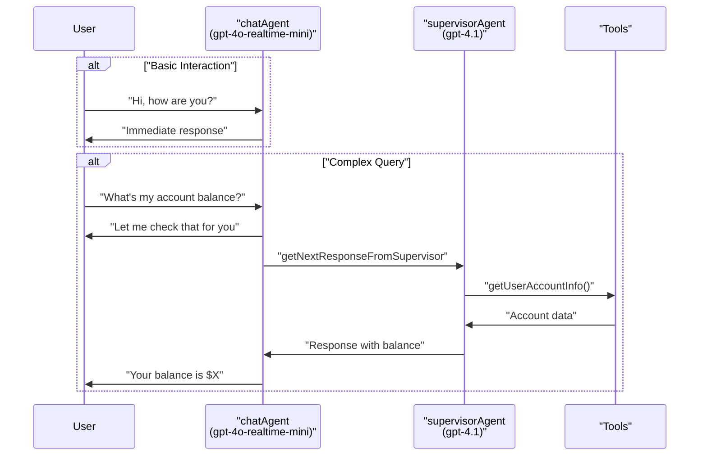

The Chat-Supervisor pattern is configured in [src/app/agentConfigs/chatSupervisor/index.ts]() with the supervisor logic in [src/app/agentConfigs/chatSupervisor/supervisorAgent.ts]().

**Key Benefits:**
- Maintains conversational flow with immediate responses
- Leverages high-intelligence models for complex tasks
- Easy migration path from existing text-based chat agents
- Cost-effective by using `realtime-mini` for most interactions

**Sources:** [README.md:30-81](), [src/app/agentConfigs/chatSupervisor/index.ts](), [src/app/agentConfigs/chatSupervisor/supervisorAgent.ts]()

### Pattern 2: Sequential Handoff

The Sequential Handoff pattern uses specialized agents that transfer conversations between each other based on user intent, creating an agent graph:

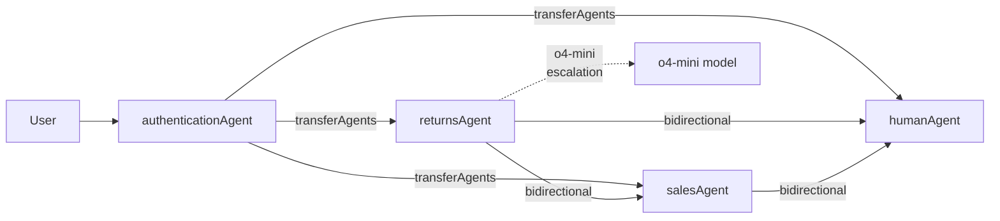

Each agent is defined using the `RealtimeAgent` class from `@openai/agents/realtime`. Agents specify their `handoffs` array to define which agents they can transfer to. The system automatically generates `transferAgents` tools based on the `downstreamAgents` property.

**Example Configuration:**

```typescript
// From src/app/agentConfigs/simpleHandoff.ts
export const haikuWriterAgent = new RealtimeAgent({
  name: 'haikuWriter',
  handoffDescription: 'Agent that writes haikus.',
  instructions: 'Ask the user for a topic, then reply with a haiku about that topic.',
  tools: [],
  handoffs: [],
});

export const greeterAgent = new RealtimeAgent({
  name: 'greeter',
  handoffDescription: 'Agent that greets the user.',
  instructions: "Please greet the user and ask them if they'd like a haiku. If yes, hand off to the 'haikuWriter' agent.",
  tools: [],
  handoffs: [haikuWriterAgent],
});
```

**Key Benefits:**
- Modularity through specialized agents with focused instructions
- Avoids "god agent" problem where all capabilities in one agent degrades performance
- Natural conversation flow as user needs evolve
- Can escalate to reasoning models (e.g., `o4-mini`) for high-stakes decisions

**Sources:** [README.md:83-146](), [src/app/agentConfigs/simpleHandoff.ts](), [src/app/agentConfigs/customerServiceRetail/index.ts]()

## System Architecture

**High-Level Component Architecture:**

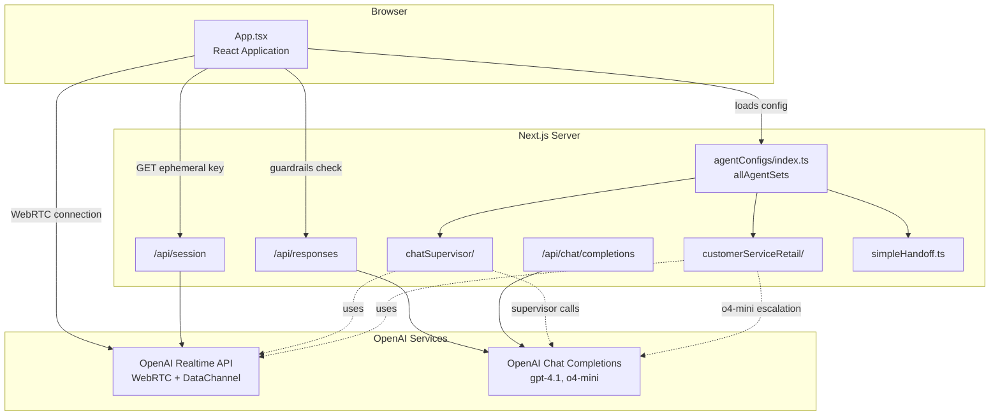

**Data Flow:**

| Stage | Component | Action | Code Reference |
|-------|-----------|--------|----------------|
| **1. Initialization** | Browser | User loads page with `?agentConfig=chatSupervisor` | [src/app/page.tsx]() |
| **2. Agent Loading** | `App.tsx` | Loads agent set from `allAgentSets[agentConfig]` | [src/app/agentConfigs/index.ts]() |
| **3. Authentication** | `/api/session` | Creates ephemeral token with OpenAI Realtime API | [src/app/api/session/route.ts]() |
| **4. Connection** | `useRealtimeSession` | Establishes WebRTC with `OpenAIRealtimeWebRTC` transport | [src/app/hooks/useRealtimeSession.ts]() |
| **5. Communication** | WebRTC | User speaks → audio stream → OpenAI → response audio | Realtime API |
| **6. Tool Calls** | Agent | Calls tools (e.g., `transferAgents`, `getUserAccountInfo`) | Agent config `toolLogic` |
| **7. Guardrails** | `/api/responses` | Checks content against moderation policies | [src/app/api/responses/route.ts]() |

**Sources:** [README.md:1-30](), [src/app/page.tsx](), [src/app/App.tsx](), [src/app/agentConfigs/index.ts]()

## Technology Stack

The system is built on several key technologies:

**Core Framework:**
- **Next.js**: Full-stack React framework serving both the web UI and API routes
- **TypeScript**: Type-safe implementation across the entire codebase
- **React**: Component-based UI with context providers for state management

**OpenAI Integration:**
- **OpenAI Realtime API**: WebRTC-based voice communication with `gpt-4o-realtime-mini` model
- **OpenAI Agents SDK** (`@openai/agents/realtime`): Framework for defining and orchestrating agents
- **OpenAI Chat Completions API**: Text-based processing with `gpt-4.1` and `o4-mini` models

**Communication Layer:**
- **WebRTC**: Real-time audio streaming with sub-second latency
- **DataChannel** (`oai-events`): Event-based communication for agent commands and transcriptions
- **Codec Support**: Opus (48kHz wide-band), PCMU/PCMA (8kHz narrow-band)

**Key Components Mapping:**

| System Concern | Implementation | File Path |
|----------------|----------------|-----------|
| **Agent Registry** | `allAgentSets` object with agent configurations | [src/app/agentConfigs/index.ts]() |
| **Session Management** | `useRealtimeSession` hook with `RealtimeSession` class | [src/app/hooks/useRealtimeSession.ts]() |
| **Conversation State** | `TranscriptContext` with `TranscriptProvider` | [src/app/contexts/TranscriptContext.tsx]() |
| **Event Logging** | `EventContext` with client/server event tracking | [src/app/contexts/EventContext.tsx]() |
| **Content Moderation** | Guardrails system with `guardrail_tripped` events | [src/app/App.tsx:300-400]() (approx) |
| **Type Definitions** | `AgentConfig`, `TranscriptItem`, `ServerEvent` interfaces | [src/app/types.ts]() |

**Sources:** [README.md:5-14](), [README.md:24](), [src/app/agentConfigs/index.ts](), [src/app/types.ts]()

## Key System Components

| Component | Purpose | Implementation |
|-----------|---------|----------------|
| **Agent Configuration Registry** | Central management of agent scenarios | `src/app/agentConfigs/index.ts` with `defaultAgentSetKey` |
| **Session Management** | WebRTC connection and token handling | `/api/session` route with OpenAI Realtime API integration |
| **Guardrail System** | Content moderation and safety validation | Integrated in `App.tsx` with `guardrail_tripped` events |
| **Event Logging** | Real-time event tracking and debugging | Client and server event streams with full payload inspection |
| **Tool Execution** | Agent capability extension | Custom tool logic with `toolLogic` implementations |

**Sources:** [README.md:209-211](), [README.md:213-215](), [README.md:216-221]()

## Agent Pattern Overview

### Chat-Supervisor Pattern
Combines a fast realtime agent (`gpt-4o-realtime-mini`) for immediate responses with an intelligent supervisor (`gpt-4.1`) for complex processing. The chat agent handles basic interactions and defers sophisticated tasks using the `getNextResponseFromSupervisor` tool.

### Sequential Handoff Pattern  
Implements specialized agents that transfer users between them using the `agent_transfer` tool. Each `RealtimeAgent` defines `handoffs` and `handoffDescription` properties to enable seamless user routing based on intent recognition.

**Sources:** [README.md:18-21](), [README.md:64-71](), [README.md:92-116]()

## Integration with OpenAI Services

The system integrates multiple OpenAI services through a unified architecture:

- **Realtime API**: WebRTC-based voice communication using `gpt-4o-realtime-mini`
- **Chat Completions**: Text-based processing with `gpt-4.1` and `o4-mini` models
- **OpenAI Agents SDK**: Unified interface for agent definition and orchestration

The `/api/session` route manages ephemeral token creation, while `/api/responses` proxies chat completion requests for supervisor agents and escalation scenarios.

**Sources:** [README.md:5-14](), [README.md:119-123](), [README.md:162-163]()

## Development and Extension

The repository provides templates for creating custom voice applications. New agent configurations can be added to `src/app/agentConfigs/index.ts` for automatic UI integration. The system supports custom tool logic implementation and includes a metaprompt system for voice agent development at `src/app/agentConfigs/voiceAgentMetaprompt.txt`.

For detailed setup instructions, see [Project Setup](#5.1). For agent pattern implementation details, see [Agent Patterns and Core Concepts](#2). For example implementations, see [Example Agent Implementations](#3).

**Sources:** [README.md:208-212](), [README.md:22-29](), [README.md:222-225]()

---

# Page: What Are Realtime Agents?

# What Are Realtime Agents?

<details>
<summary>Relevant source files</summary>

The following files were used as context for generating this wiki page:

- [README.md](README.md)
- [public/screenshot_handoff.png](public/screenshot_handoff.png)
- [src/app/types.ts](src/app/types.ts)

</details>


## Purpose and Scope

This page explains the foundational concepts behind realtime AI agents, the OpenAI Realtime API, and the OpenAI Agents SDK. Understanding these building blocks is essential for working with the agent patterns demonstrated in this project.

For information about the specific agent patterns implemented (Chat-Supervisor and Sequential Handoff), see [Agent Patterns](#2). For the technical details of how real-time sessions are managed in the codebase, see [Real-time Session Management](#3.1).

## Core Concept: Real-time AI Agents

Real-time AI agents are conversational AI systems that interact with users through voice with minimal latency. Unlike traditional text-based chatbots or voice assistants that use a "stitched" architecture (speech-to-text → text processing → text-to-speech), real-time agents handle audio streams directly, enabling:

- **Sub-second response latency**: Agents can begin responding while the user is still speaking
- **Natural interruptions**: Users can interrupt the agent mid-response
- **Voice activity detection**: Automatic detection of when users start and stop speaking
- **Streaming interactions**: Both input and output are processed as continuous streams rather than discrete turns

**Sources:** [README.md:1-20]()

## The OpenAI Realtime API

The OpenAI Realtime API is a WebRTC-based service that enables low-latency, bidirectional audio streaming with AI models. It consists of two primary communication channels:

### Communication Architecture

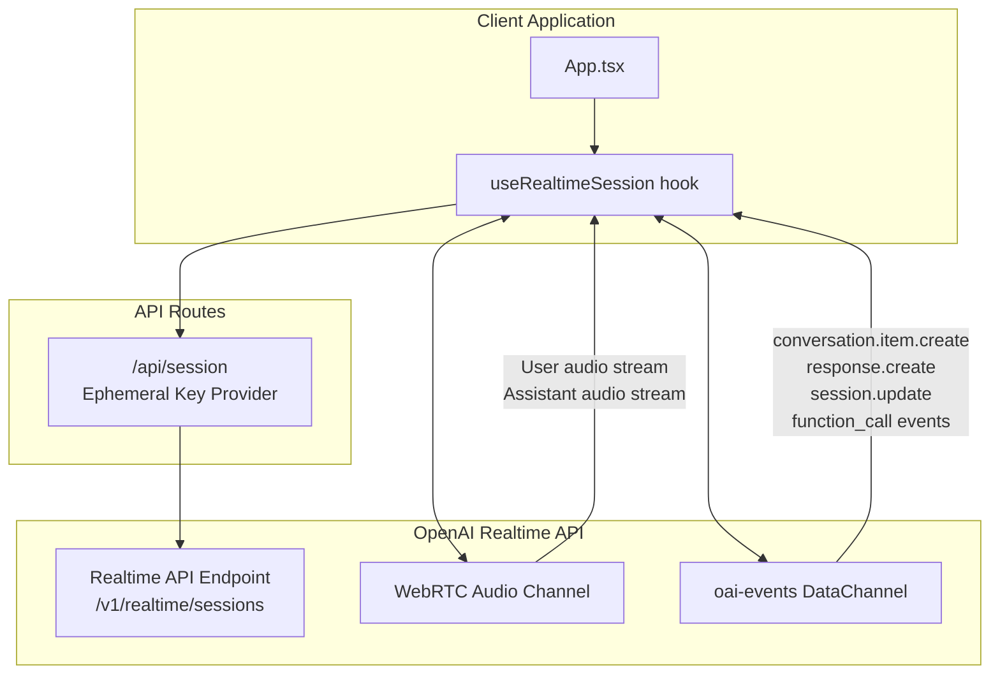

**Sources:** [README.md:1-20]()

### WebRTC Audio Channel

The audio channel handles bidirectional voice streaming using WebRTC protocols. The system supports multiple audio codecs:

| Codec | Sample Rate | Bandwidth | Use Case |
|-------|-------------|-----------|----------|
| `opus` | 48 kHz | Wide-band | High-quality voice (default) |
| `pcmu` | 8 kHz | Narrow-band | Testing telephony scenarios |
| `pcma` | 8 kHz | Narrow-band | Testing telephony scenarios |

**Sources:** Diagram 1 analysis, Diagram 3 analysis

### oai-events DataChannel

The `oai-events` DataChannel is a WebRTC data channel that carries control messages and events. Key event types include:

- **`conversation.item.create`**: Send user messages or add items to the conversation
- **`response.create`**: Request the agent to generate a response
- **`session.update`**: Update agent configuration (instructions, tools, voice)
- **`response.audio_transcript.delta`**: Receive streaming transcriptions
- **`response.text.delta`**: Receive streaming text responses
- **`response.function_call_arguments.delta`**: Receive tool call arguments

The DataChannel enables dynamic session reconfiguration without disconnecting the audio stream, which is critical for agent handoffs.

**Sources:** Diagram 3 analysis

### Authentication Model

The API uses ephemeral session keys to secure connections:

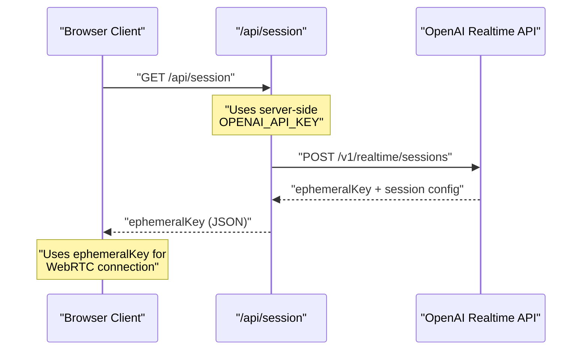

This pattern keeps the permanent `OPENAI_API_KEY` server-side while allowing clients to establish WebRTC connections with short-lived credentials.

**Sources:** Diagram 3 analysis

## The OpenAI Agents SDK

The OpenAI Agents SDK ([`@openai/agents`](https://github.com/openai/openai-agents-js)) provides high-level abstractions for building, managing, and deploying AI agents that use the Realtime API. This project uses three core classes from the SDK:

### RealtimeAgent Class

The `RealtimeAgent` class defines the behavior and capabilities of an individual agent. Agent definitions are declarative configurations that specify:

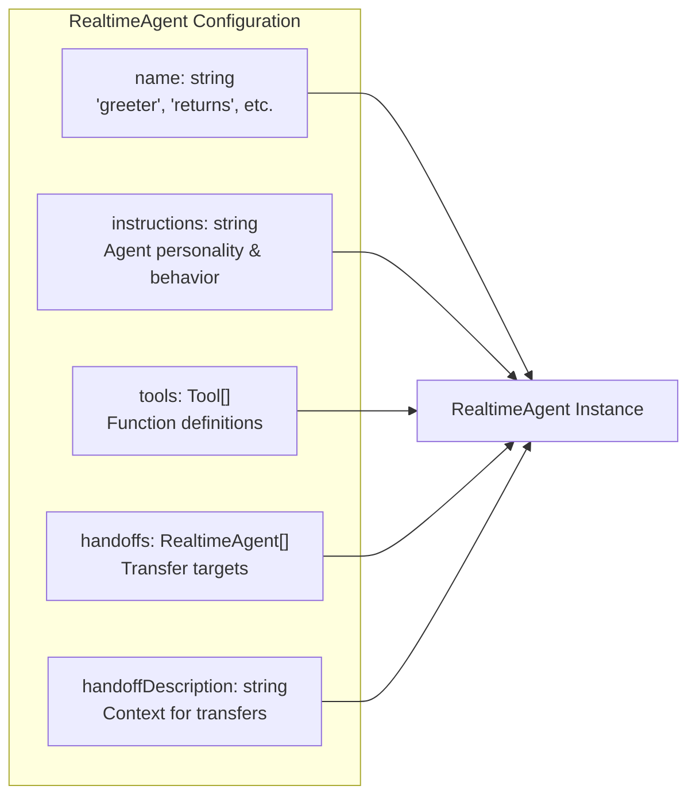

**Example from the codebase:**

[README.md:96-103]() shows a simple agent definition:

```typescript
export const haikuWriterAgent = new RealtimeAgent({
  name: 'haikuWriter',
  handoffDescription: 'Agent that writes haikus.',
  instructions: 'Ask the user for a topic, then reply with a haiku about that topic.',
  tools: [],
  handoffs: [],
});
```

**Sources:** [README.md:93-116](), Diagram 4 analysis

### Agent Configuration Components

| Component | Type | Purpose | Location in Code |
|-----------|------|---------|------------------|
| `name` | `string` | Unique identifier for the agent | [types.ts:45]() |
| `instructions` | `string` | Natural language instructions defining agent behavior | [types.ts:47]() |
| `tools` | `Tool[]` | Array of function definitions available to the agent | [types.ts:48]() |
| `toolLogic` | `Record<string, Function>` | Implementation functions for tool calls | [types.ts:49-52]() |
| `handoffs` | `RealtimeAgent[]` | Array of agents this agent can transfer to | [README.md:111]() |
| `handoffDescription` | `string` | Context provided to other agents for transfer decisions | [README.md:98]() |

**Sources:** [types.ts:44-57](), [README.md:93-116]()

### Tool System

Tools enable agents to perform actions beyond text generation. The tool system consists of three parts:

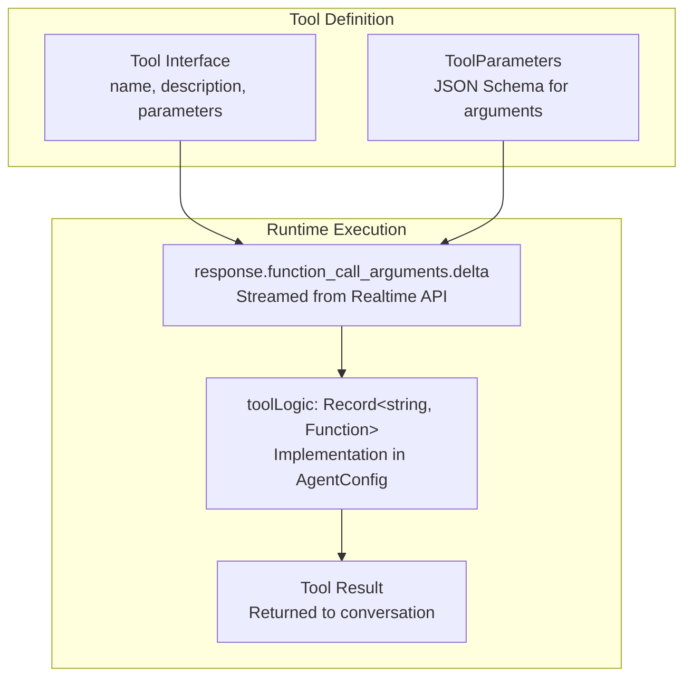

**Tool Definition Structure:**

[types.ts:37-42]() defines the `Tool` interface:

```typescript
export interface Tool {
  type: "function";
  name: string;
  description: string;
  parameters: ToolParameters;
}
```

**Tool Parameters:**

[types.ts:30-35]() defines the `ToolParameters` interface, which uses JSON Schema format:

```typescript
export interface ToolParameters {
  type: string;
  properties: Record<string, ToolParameterProperty>;
  required?: string[];
  additionalProperties?: boolean;
}
```

**Tool Logic Implementation:**

[types.ts:49-52]() defines the `toolLogic` property in `AgentConfig`:

```typescript
toolLogic?: Record<
  string,
  (args: any, transcriptLogsFiltered: TranscriptItem[], addTranscriptBreadcrumb?: (title: string, data?: any) => void) => Promise<any> | any
>;
```

Tool logic functions receive:
- `args`: The parsed arguments from the tool call
- `transcriptLogsFiltered`: Current conversation transcript
- `addTranscriptBreadcrumb`: Optional function to log nested tool calls

**Sources:** [types.ts:19-52](), [README.md:210]()

### RealtimeSession Class

The `RealtimeSession` class manages the lifecycle of a real-time conversation session. It coordinates:

- Establishing and maintaining the WebRTC connection
- Routing events between the client and Realtime API
- Managing the active agent and handling agent handoffs
- Applying session updates (voice, temperature, etc.)

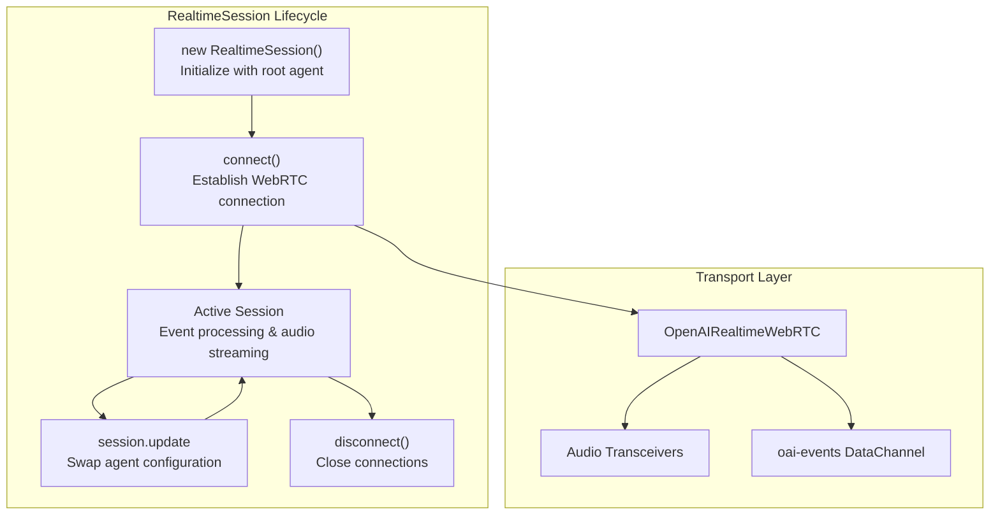

In this codebase, the `RealtimeSession` is managed by the `useRealtimeSession` hook, which is documented in [Real-time Session Management](#3.1).

**Sources:** Diagram 3 analysis, Diagram 4 analysis

## Agent Configuration Registry

Agent configurations are organized in a registry system that maps scenario names to agent sets. An **agent set** is simply an array of `RealtimeAgent[]` that participate in a scenario.

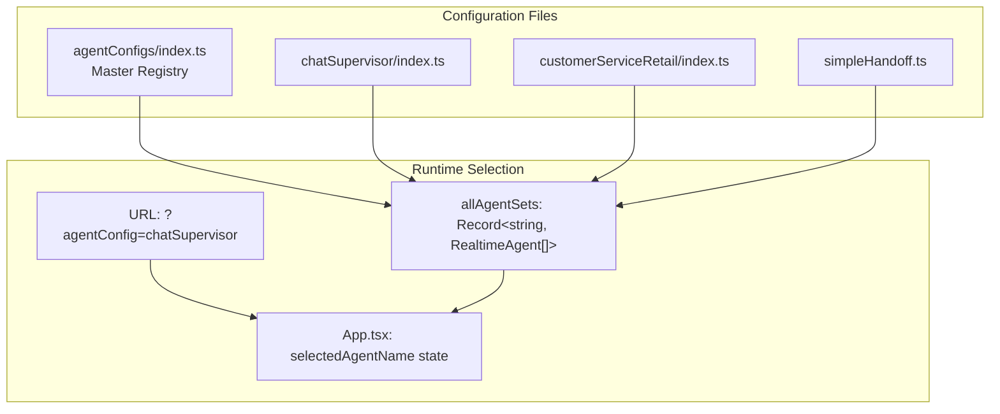

**Registry Structure:**

The registry exports `allAgentSets` which maps scenario names to agent arrays:

```typescript
// From agentConfigs/index.ts (conceptual)
export const allAgentSets: Record<string, RealtimeAgent[]> = {
  chatSupervisor: [chatAgent, supervisorAgent],
  customerServiceRetail: [authAgent, returnsAgent, salesAgent, humanAgent],
  simpleHandoff: [greeterAgent, haikuWriterAgent],
};
```

**Sources:** [README.md:209](), Diagram 4 analysis

## Agent Handoff Mechanism

Agent handoffs enable dynamic transfer of conversations between specialized agents. The handoff mechanism works through two patterns:

### Sequential Handoff via transferAgents Tool

In the Sequential Handoff pattern, agents explicitly transfer control using a special `transferAgents` tool call:

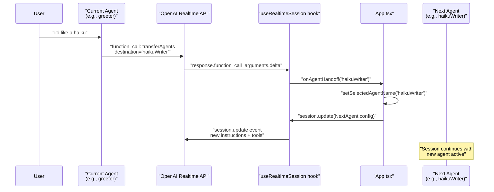

The handoff swaps the active agent's configuration mid-session without disconnecting the WebRTC audio stream.

**Sources:** Diagram 3 analysis, [README.md:84-116]()

### Tool-Based Delegation (Chat-Supervisor Pattern)

In the Chat-Supervisor pattern, the chat agent delegates complex tasks to a supervisor without transferring control:

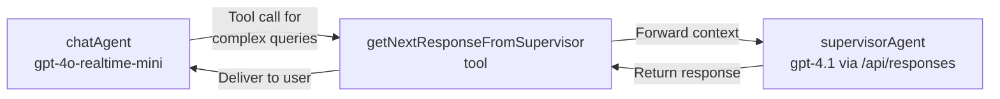

This pattern uses a tool call to invoke a text-based supervisor model, which returns a response that the chat agent delivers to the user.

**Sources:** [README.md:30-81](), Diagram 2 analysis

## Session Status States

The real-time session progresses through three states managed by the `SessionStatus` type:

| State | Description | WebRTC State | User Can Interact |
|-------|-------------|--------------|-------------------|
| `DISCONNECTED` | No active session | Connection closed | No |
| `CONNECTING` | Establishing connection | Handshake in progress | No |
| `CONNECTED` | Active session | Audio and data channels open | Yes |

[types.ts:17]() defines this type:

```typescript
export type SessionStatus = "DISCONNECTED" | "CONNECTING" | "CONNECTED";
```

**Sources:** [types.ts:17]()

## Integration with OpenAI Models

The Realtime API and Agents SDK integrate with multiple OpenAI models for different purposes:

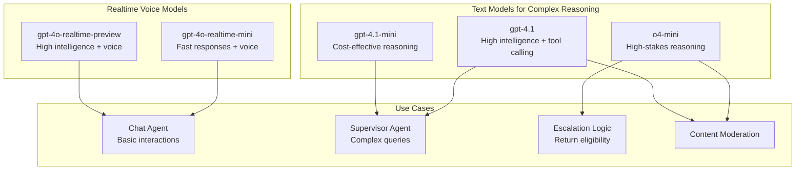

**Model Selection Strategy:**

- **Realtime models** (`gpt-4o-realtime-mini`, `gpt-4o-realtime-preview`) handle direct voice interactions through the Realtime API
- **Text models** (`gpt-4.1`, `gpt-4.1-mini`) handle complex reasoning, supervisor logic, and guardrails via `/api/responses` or `/api/chat/completions`
- **Reasoning models** (`o4-mini`) handle high-stakes decisions requiring chain-of-thought reasoning (e.g., return eligibility in the customer service example)

**Sources:** [README.md:18-20](), [README.md:80](), [README.md:121](), Diagram 2 analysis

## Summary: Key Concepts

| Concept | Definition | Code Entity |
|---------|------------|-------------|
| **Realtime Agent** | AI agent that interacts via voice with low latency | `RealtimeAgent` class |
| **Agent Set** | Array of agents that participate in a scenario | `RealtimeAgent[]` |
| **Tool** | Function that an agent can call to perform actions | `Tool` interface ([types.ts:37-42]()) |
| **Tool Logic** | Implementation function for a tool | `toolLogic` property ([types.ts:49-52]()) |
| **Handoff** | Transfer of conversation from one agent to another | `handoffs` property + `transferAgents` tool |
| **Session** | Active WebRTC connection managing agent interaction | `RealtimeSession` class |
| **Transport** | WebRTC communication layer with audio + data channels | `OpenAIRealtimeWebRTC` class |
| **Ephemeral Key** | Short-lived credential for WebRTC authentication | Returned by `/api/session` |

**Sources:** [types.ts:1-149](), [README.md:1-230]()

---

# Page: Quick Start

# Quick Start

<details>
<summary>Relevant source files</summary>

The following files were used as context for generating this wiki page:

- [README.md](README.md)
- [package.json](package.json)
- [public/screenshot_handoff.png](public/screenshot_handoff.png)
- [src/app/agentConfigs/index.ts](src/app/agentConfigs/index.ts)

</details>


This page provides step-by-step instructions for installing, configuring, and running the OpenAI Realtime Agents demo. You will learn how to set up the development environment, start the application, connect to a real-time voice session, and interact with the pre-configured agent scenarios.

For detailed information about the agent patterns demonstrated in this application, see [Agent Patterns](#2). For architectural details, see [System Architecture](#1.3).

---

## Prerequisites

Before starting, ensure you have the following installed:

- **Node.js** (version 20 or higher recommended)
- **npm** (comes with Node.js)
- **OpenAI API Key** with access to the Realtime API

You will also need a modern web browser with microphone permissions enabled for voice interactions.

---

## Installation

### Step 1: Clone the Repository

```bash
git clone https://github.com/openai/openai-realtime-agents
cd openai-realtime-agents
```

### Step 2: Install Dependencies

Install the required npm packages:

```bash
npm i
```

This installs the following key dependencies as defined in [package.json:11-22]():
- `@openai/agents` - OpenAI Agents SDK for defining agent behaviors
- `next` - Next.js framework for the application server
- `react` and `react-dom` - React UI framework
- `openai` - OpenAI API client library
- `react-markdown` - Markdown rendering for transcript display

### Step 3: Configure API Key

The application requires an OpenAI API key to communicate with the Realtime API. You have two options:

**Option A: Environment Variable**

Add the API key to your shell profile (e.g., `.bash_profile`, `.zshrc`):

```bash
export OPENAI_API_KEY="sk-..."
```

**Option B: `.env` File**

1. Copy the sample environment file:
   ```bash
   cp .env.sample .env
   ```

2. Edit `.env` and add your API key:
   ```
   OPENAI_API_KEY=sk-...
   ```

The application will read this key from [src/app/api/session/route.ts]() when creating ephemeral session tokens.

**Sources:** [README.md:22-28](), [package.json:1-34]()

---

## Running the Application

### Start the Development Server

Run the following command to start the Next.js development server:

```bash
npm run dev
```

The server will start on port 3000. You should see output similar to:

```
ready - started server on 0.0.0.0:3000, url: http://localhost:3000
```

### Access the Application

Open your web browser and navigate to:

```
http://localhost:3000
```

The application will load with the default `chatSupervisor` agent configuration as defined in [src/app/agentConfigs/index.ts:14]().

**Sources:** [README.md:26-27](), [package.json:6-9]()

---

## Application Startup Flow

The following diagram shows the initialization sequence from running `npm run dev` to loading the first agent configuration:

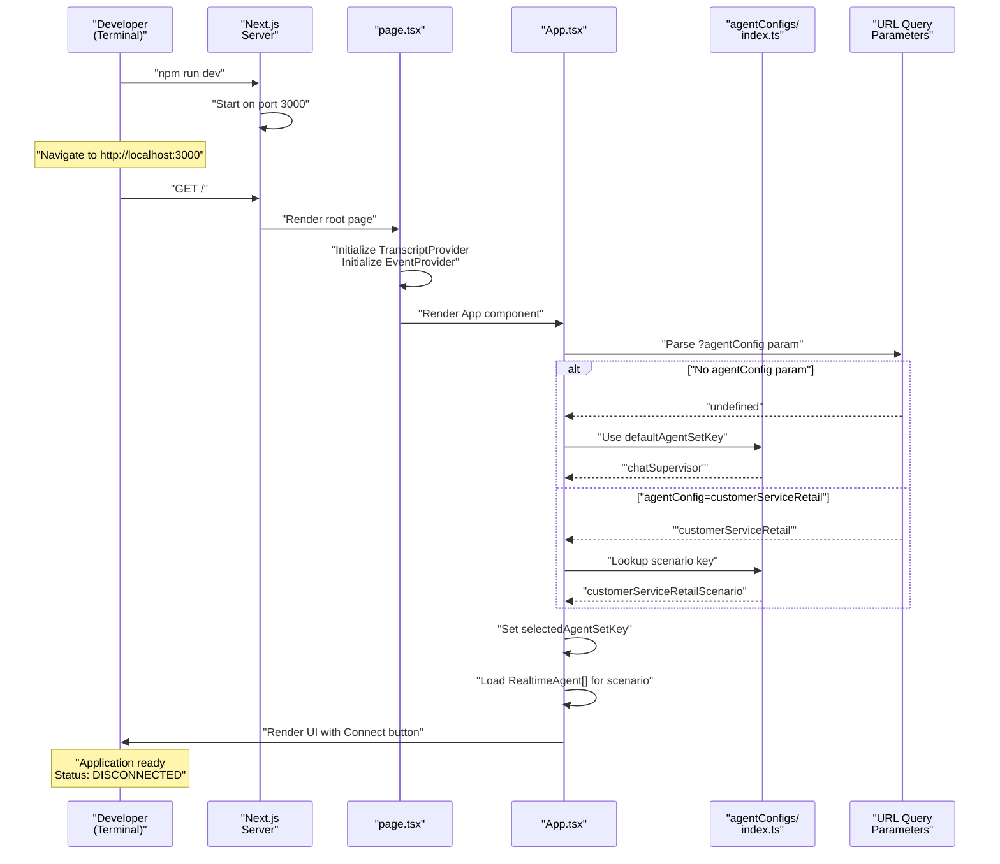

**Sources:** [README.md:27-28](), [src/app/agentConfigs/index.ts:1-15]()

---

## Connecting to a Real-time Session

Once the application loads, you can establish a WebRTC connection to the OpenAI Realtime API.

### Connection Steps

1. **Grant Microphone Permission**: Your browser will prompt you to allow microphone access. Click "Allow".

2. **Click the Connect Button**: In the bottom toolbar, click the connection toggle button.

3. **Wait for Connection**: The application will:
   - Call `/api/session` to obtain an ephemeral key
   - Establish a WebRTC connection to the Realtime API
   - Open an `oai-events` DataChannel for control messages
   - Set up audio transceivers for bidirectional audio streaming

4. **Connection Established**: Once connected, the status indicator will show "CONNECTED" and the agent will greet you.

### Connection Flow Diagram

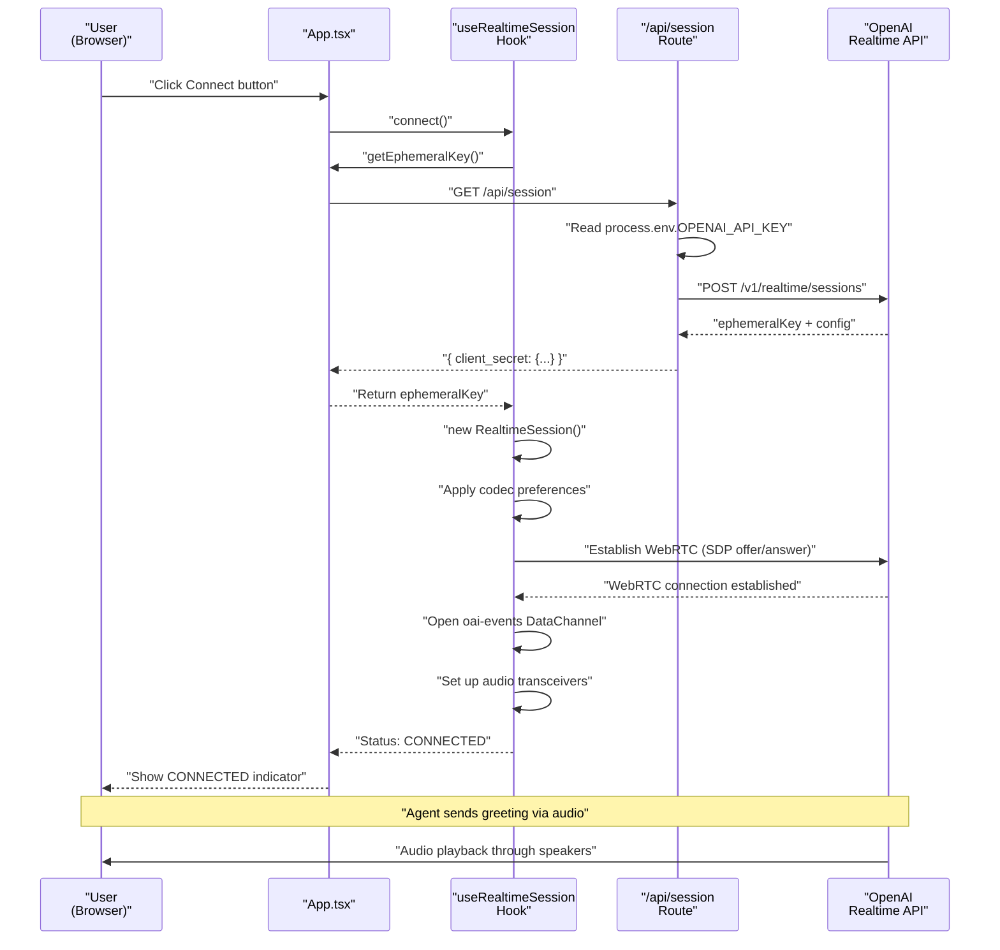

**Sources:** [README.md:27-28]()

---

## Interacting with Agents

Once connected, you can interact with the agent using voice or text input.

### Voice Interaction

The application supports two voice input modes:

| Mode | Description | Default |
|------|-------------|---------|
| **Voice Activity Detection (VAD)** | The agent automatically detects when you start and stop speaking | Yes |
| **Push-to-Talk (PTT)** | Hold a button while speaking, release when done | No |

To switch modes, click the "PTT" toggle in the bottom toolbar.

### Text Interaction

You can also send text messages using the input field at the bottom of the screen. Type your message and press Enter or click the send button.

### Agent Responses

Agent responses appear in the transcript pane on the left side of the screen. The transcript shows:

- **User messages** (blue bubbles)
- **Assistant messages** (white bubbles)
- **System breadcrumbs** (expandable gray entries for tool calls and agent transfers)
- **Guardrail status** (chips showing content moderation results)

**Sources:** [README.md:216-220]()

---

## Available Scenarios

The application includes three pre-configured agent scenarios. You can switch between them using the "Scenario" dropdown in the top-right corner.

### Scenario Overview

| Scenario Key | Name | Description | Root Agent |
|--------------|------|-------------|------------|
| `chatSupervisor` | Chat-Supervisor | Dual-agent pattern with a chat agent and supervisor | `chatAgent` |
| `customerServiceRetail` | Customer Service Retail | Multi-agent customer service with authentication, returns, sales | `authentication` |
| `simpleHandoff` | Simple Handoff | Minimal greeter-to-haiku-writer example | `greeter` |

### Accessing Scenarios

**Via URL Parameter:**

You can load a specific scenario by adding the `agentConfig` query parameter:

```
http://localhost:3000?agentConfig=customerServiceRetail
```

**Via UI Dropdown:**

Select a scenario from the dropdown menu in the top toolbar. The application will disconnect any active session and reload with the new agent configuration.

### Scenario Selection Flow

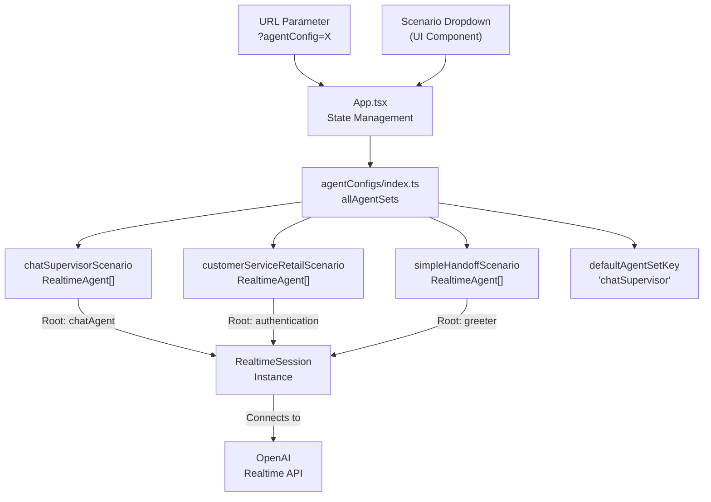

**Sources:** [src/app/agentConfigs/index.ts:1-15](), [README.md:28-29]()

---

## UI Layout

The application interface is divided into three main areas:

### Left Panel: Transcript

Displays the conversation history including:
- User and assistant messages
- Tool calls (expandable)
- Agent handoffs (expandable breadcrumbs)
- Guardrail moderation results (color-coded chips)

Click on any system message (breadcrumb) to expand and view detailed JSON data.

### Right Panel: Event Log

Shows real-time events flowing between the client and server:
- **Client events** (blue): Sent from browser to Realtime API
- **Server events** (green): Received from Realtime API

Click on any event to expand and view the full payload. This is useful for debugging and understanding the protocol.

### Bottom Toolbar: Controls

Provides interactive controls:

| Control | Function |
|---------|----------|
| **Connect/Disconnect** | Toggle WebRTC connection |
| **PTT Toggle** | Switch between VAD and Push-to-Talk modes |
| **PTT Button** | Hold to speak (only visible in PTT mode) |
| **Audio Playback** | Enable/disable agent audio responses |
| **Events Toggle** | Show/hide the event log panel |
| **Codec Selector** | Choose audio codec (opus 48kHz, pcmu 8kHz, pcma 8kHz) |

**Sources:** [README.md:216-220]()

---

## Testing Different Scenarios

### Chat-Supervisor Pattern

URL: `http://localhost:3000?agentConfig=chatSupervisor`

Try asking:
- "What's my account balance?" (triggers supervisor with tool call)
- "Hello" (handled directly by chat agent)
- "Find my nearest store in San Francisco" (supervisor uses location tool)

For details on this pattern, see [Chat-Supervisor Pattern](#2.1).

### Customer Service Retail

URL: `http://localhost:3000?agentConfig=customerServiceRetail`

Try saying:
- "I'd like to return my snowboard" (goes through authentication flow, then transfers to returns agent)
- "What promotions do you have?" (transfers to sales agent)
- "I need to speak to a human" (transfers to human agent)

For details on this pattern, see [Sequential Handoff Pattern](#2.2).

### Simple Handoff

URL: `http://localhost:3000?agentConfig=simpleHandoff`

Try saying:
- "Hello" (greeter agent responds)
- "Yes" when asked if you want a haiku (transfers to haiku writer agent)
- Provide a topic when prompted

For details, see [Simple Handoff Example](#4.1).

**Sources:** [README.md:30-146]()

---

## Troubleshooting

### Common Issues

| Problem | Solution |
|---------|----------|
| **"Failed to connect"** | Verify your `OPENAI_API_KEY` is set correctly and has Realtime API access |
| **No audio output** | Check that audio playback is enabled in the toolbar and browser audio isn't muted |
| **Microphone not working** | Ensure browser has microphone permission granted |
| **"Module not found" errors** | Run `npm i` again to ensure all dependencies are installed |
| **Port 3000 in use** | Stop other processes using port 3000 or set `PORT` environment variable |

### Viewing Logs

The event log panel (right side) shows all protocol messages. To view more detailed logs:

1. Open browser developer console (F12 or Cmd+Option+I)
2. Look for messages prefixed with the component name
3. Check the Network tab for API route calls

### Resetting State

If the application gets into a bad state:
1. Click "Disconnect" in the bottom toolbar
2. Refresh the browser page
3. Click "Connect" to start a fresh session

**Sources:** [README.md:22-29]()

---

## Next Steps

Once you have the application running and have tested the example scenarios, you can:

- Explore the [Agent Configuration System](#2.3) to understand how agents are defined
- Learn about [Custom Tool Development](#5.2) to add new capabilities
- Review the [Frontend Architecture](#3.2) to understand the React component structure
- Study the [API Routes and Backend](#3.3) to see how server-side integration works

For instructions on building your own agent configurations, see [Contributing](#6.3).

**Sources:** [README.md:208-211]()

---

# Page: System Architecture

# System Architecture

<details>
<summary>Relevant source files</summary>

The following files were used as context for generating this wiki page:

- [README.md](README.md)
- [public/screenshot_handoff.png](public/screenshot_handoff.png)
- [src/app/agentConfigs/index.ts](src/app/agentConfigs/index.ts)
- [src/app/types.ts](src/app/types.ts)

</details>


This document provides a comprehensive overview of the system architecture for the OpenAI Realtime Agents demonstration framework. The system demonstrates advanced voice agent patterns using the OpenAI Realtime API and OpenAI Agents SDK, implementing two primary agentic patterns: Chat-Supervisor and Sequential Handoffs.

For detailed information about specific agent implementations, see [Agent Patterns and Core Concepts](#2). For technical implementation details including frontend and backend components, see [Technical Implementation](#5).

## Overall System Architecture

The system implements a Next.js application that orchestrates voice-based AI agents through the OpenAI Realtime API. It supports two distinct agent patterns while providing a unified interface for agent configuration, real-time communication, and content moderation.

### High-Level System Overview

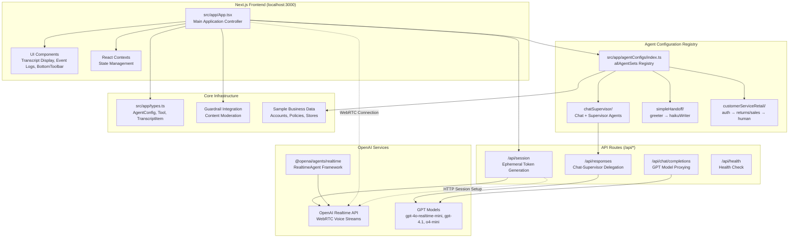

Sources: [README.md:1-30](), [README.md:156-203](), [src/app/types.ts:44-57]()
</thinking>

The system uses the OpenAI Agents SDK as a foundational framework for building and managing voice agents, with support for tool integration, state management, and agent orchestration patterns.

## Communication Architecture

The system operates on dual communication channels: HTTP for session management and WebRTC for real-time voice interactions. The architecture supports seamless switching between agent scenarios and real-time content moderation.

### Communication Flow

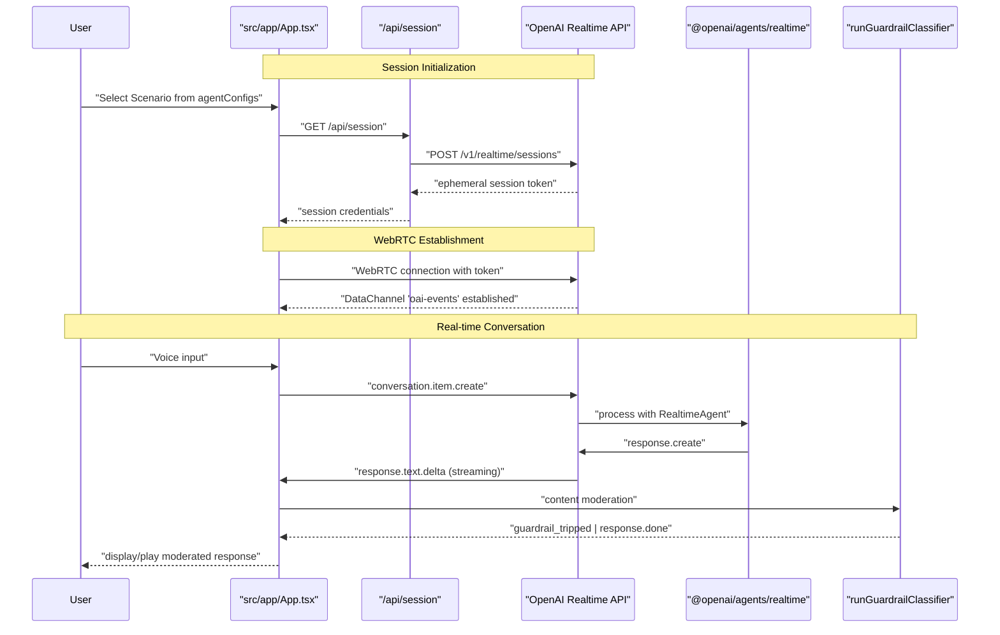

Sources: [README.md:156-203](), [README.md:213-214](), [src/app/types.ts:92-131]()

## Agent Configuration System

The agent configuration system provides a centralized registry implemented in `src/app/agentConfigs/index.ts` that manages different agent scenarios. Each scenario implements either the Chat-Supervisor or Sequential Handoff pattern using the OpenAI Agents SDK.

### Agent Configuration Registry

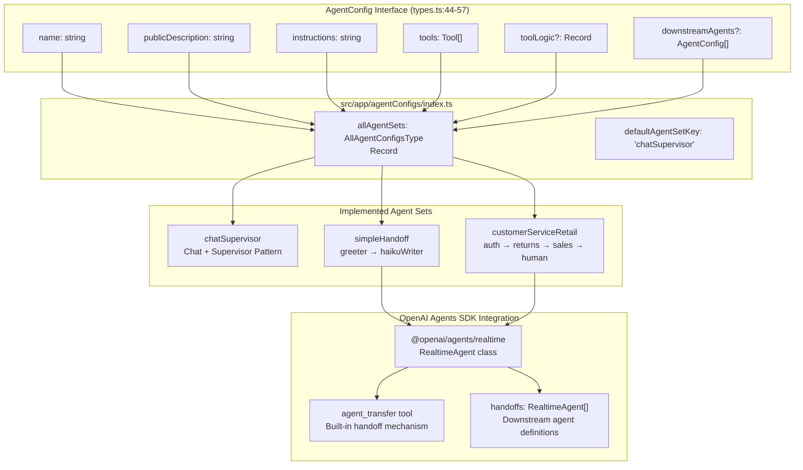

Sources: [README.md:91-116](), [README.md:125-146](), [src/app/types.ts:44-57]()

## Core Type System

The type system in `src/app/types.ts` defines fundamental data structures for agent configuration, transcript management, event handling, and content moderation. These types bridge the OpenAI Agents SDK with the application's UI and business logic.

### Core Type Definitions

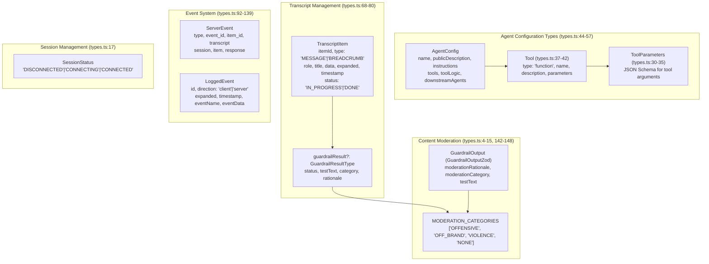

Sources: [src/app/types.ts:44-57](), [src/app/types.ts:37-42](), [src/app/types.ts:68-80](), [src/app/types.ts:92-131](), [src/app/types.ts:4-15](), [src/app/types.ts:142-148]()

## Agent Pattern Data Flows

The system implements two distinct data flow patterns based on agent configuration: Chat-Supervisor pattern for intelligent delegation and Sequential Handoffs pattern for specialized agent transfers.

### Chat-Supervisor Pattern Flow

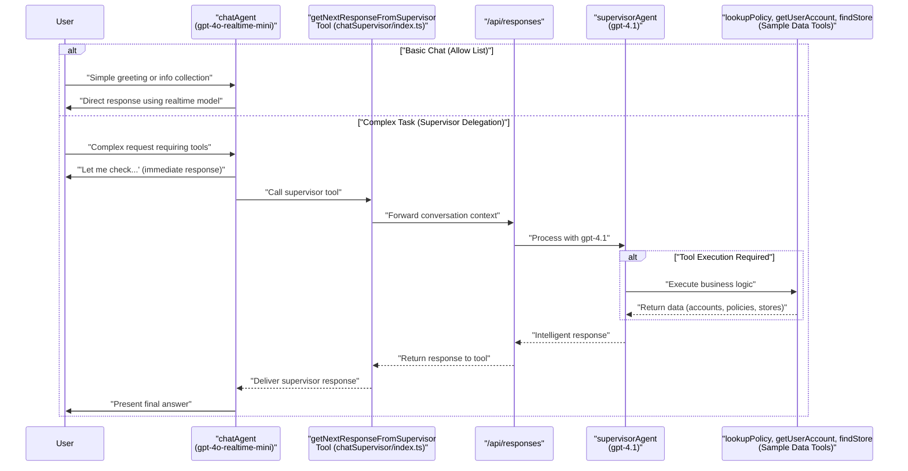

Sources: [README.md:30-80](), [README.md:73-76]()

### Sequential Handoffs Pattern Flow

```mermaid
sequenceDiagram
    participant User
    participant greeterAgent as "greeterAgent<br/>(simpleHandoff example)"
    participant agentTransfer as "agent_transfer tool<br/>(OpenAI Agents SDK)"
    participant RealtimeAPI as "OpenAI Realtime API"
    participant haikuWriterAgent as "haikuWriterAgent<br/>(Target agent)"
    
    User->>greeterAgent: "'Hi, I'd like a haiku'"
    greeterAgent->>greeterAgent: "Check handoffs array"
    
    alt "Handle Locally"
        greeterAgent->>User: "Continue with current agent"
    else "Transfer Required"
        greeterAgent->>agentTransfer: "agent_transfer(destination: 'haikuWriter')"
        agentTransfer->>RealtimeAPI: "session.update with new instructions"
        Note over RealtimeAPI: "Updates active agent context"
        RealtimeAPI->>haikuWriterAgent: "Activate target agent"
        haikuWriterAgent->>User: "Ask for haiku topic"
        User->>haikuWriterAgent: "Provide topic"
        haikuWriterAgent->>User: "Generate and deliver haiku"
    end
```

Sources: [README.md:82-116](), [README.md:91-103]()

## Content Moderation Integration

The system includes integrated content moderation that operates in real-time during assistant responses to ensure appropriate and on-brand communication.

### Guardrail System Architecture

```mermaid
graph LR
    subgraph "Response Processing"
        ResponseStart["response.text.delta<br/>Stream Start"]
        InProgress["Message Status<br/>'IN_PROGRESS'"]
        ResponseDone["response.done<br/>Stream End"]
    end
    
    subgraph "Guardrail Processing"
        GuardrailCheck["runGuardrailClassifier<br/>Content Analysis"]
        ModerationResult["GuardrailResultType<br/>status, category, rationale"]
        GuardrailTripped["guardrail_tripped<br/>Event"]
    end
    
    subgraph "Final Status"
        PassStatus["Status: 'PASS'"]
        FailStatus["Status: 'FAIL'"]
        UIDisplay["UI Display Logic"]
    end
    
    ResponseStart --> InProgress
    InProgress --> GuardrailCheck
    GuardrailCheck --> ModerationResult
    
    ModerationResult --> GuardrailTripped
    ModerationResult --> ResponseDone
    
    GuardrailTripped --> FailStatus
    ResponseDone --> PassStatus
    
    PassStatus --> UIDisplay
    FailStatus --> UIDisplay
```

Sources: [README.md:213-214](), [src/app/types.ts:61-66](), [src/app/types.ts:142-148]()

---

# Page: Agent Patterns

# Agent Patterns

<details>
<summary>Relevant source files</summary>

The following files were used as context for generating this wiki page:

- [README.md](README.md)
- [public/screenshot_handoff.png](public/screenshot_handoff.png)
- [src/app/agentConfigs/index.ts](src/app/agentConfigs/index.ts)

</details>


This page introduces the two primary agent orchestration patterns demonstrated in this project: **Chat-Supervisor** and **Sequential Handoff**. These patterns represent fundamentally different approaches to building voice agents with the OpenAI Realtime API.

The Chat-Supervisor pattern uses a two-tier architecture where a responsive realtime agent handles basic interactions while delegating complex reasoning to a more intelligent text-based supervisor. The Sequential Handoff pattern uses specialized realtime agents that transfer conversations between each other based on user intent.

For detailed implementation information, see:
- [Chat-Supervisor Pattern (2.1)](#2.1) - Dual-agent delegation architecture
- [Sequential Handoff Pattern (2.2)](#2.2) - Multi-agent transfer system  
- [Agent Configuration System (2.3)](#2.3) - How agents are defined and registered
- [Choosing a Pattern (2.4)](#2.4) - Selection criteria and comparison

**Sources:** [README.md:18-21](), [README.md:30-33](), [README.md:82-85]()

## Pattern Overview

### Chat-Supervisor Pattern

The Chat-Supervisor pattern implements a two-tier architecture that optimizes for both responsiveness and intelligence. A `chatAgent` using `gpt-4o-realtime-mini` handles immediate user interactions, while a `supervisorAgent` using `gpt-4.1` processes complex reasoning and tool calls.

**Architecture Diagram: Chat-Supervisor Flow**

```mermaid
sequenceDiagram
    participant User
    participant chatAgent["chatAgent<br/>(gpt-4o-realtime-mini)"]
    participant supervisorAgent["supervisorAgent<br/>(gpt-4.1)"]
    participant Tools["lookupPolicyDocument<br/>getUserAccountInfo<br/>findNearestStore"]
    
    alt "Basic Task (Allow List)"
        User->>chatAgent: "Hi, I need help"
        chatAgent->>User: "Direct Response"
    end
    
    alt "Complex Task (Escalation)"
        User->>chatAgent: "Check my account balance"
        chatAgent->>User: "Let me check on that"
        chatAgent->>supervisorAgent: "getNextResponseFromSupervisor"
        supervisorAgent->>Tools: "Tool calls"
        Tools->>supervisorAgent: "Results"
        supervisorAgent->>chatAgent: "Formatted response"
        chatAgent->>User: "Your balance is..."
    end
```

**Key Characteristics:**
- Single active agent from user perspective
- Transparent delegation to supervisor
- ~2 second latency for complex queries
- Maintains conversational flow

**Sources:** [README.md:30-71](), [README.md:41-62](), [src/app/agentConfigs/chatSupervisor/index.ts]()

### Sequential Handoff Pattern

The Sequential Handoff pattern uses specialized agents that explicitly transfer conversations between each other. Each agent is responsible for a specific domain and can hand off to other agents in the graph.

**Architecture Diagram: Sequential Handoff Flow**

```mermaid
graph LR
    User["User"]
    
    subgraph "Agent Graph"
        auth["authentication<br/>(RealtimeAgent)"]
        returns["returns<br/>(RealtimeAgent)"]
        sales["sales<br/>(RealtimeAgent)"]
        human["simulatedHuman<br/>(RealtimeAgent)"]
    end
    
    User <-->|"Initial Contact"| auth
    
    auth -->|"agent_transfer"| returns
    auth -->|"agent_transfer"| sales
    auth -->|"agent_transfer"| human
    
    returns <-->|"Bidirectional"| sales
    returns <-->|"Bidirectional"| human
    sales <-->|"Bidirectional"| human
```

**Key Characteristics:**
- Multiple visible agents with distinct roles
- Explicit `agent_transfer` tool calls
- Session updates with new instructions and tools
- Agent specialization prevents context pollution

**Sources:** [README.md:82-146](), [src/app/agentConfigs/customerServiceRetail/index.ts](), [src/app/agentConfigs/simpleHandoff.ts:92-116]()

### Comparison Table

| Aspect | Chat-Supervisor | Sequential Handoff |
|--------|----------------|-------------------|
| **Active Agents** | 1 user-facing agent | Multiple specialized agents |
| **Model Types** | Realtime + text-based | All realtime agents |
| **Delegation** | Internal to supervisor | Explicit transfers |
| **User Experience** | Single continuous conversation | Agent changes visible to user |
| **Complexity** | Centralized in supervisor | Distributed across agents |
| **Best For** | Migrating existing text agents | Multi-domain customer service |

**Sources:** [README.md:64-71](), [README.md:119-124]()

## RealtimeAgent Foundation

Both patterns are built on the `RealtimeAgent` class from the `@openai/agents/realtime` package. This class provides a standardized interface for defining agent behavior, tools, and transfer capabilities.

**Diagram: RealtimeAgent Structure and Registry**

```mermaid
graph TB
    subgraph "RealtimeAgent Definition"
        agent[RealtimeAgent]
        
        agent --> name["name: string"]
        agent --> handoffDesc["handoffDescription: string"]
        agent --> instructions["instructions: string"]
        agent --> tools["tools: Tool[]"]
        agent --> handoffs["handoffs: RealtimeAgent[]"]
    end
    
    subgraph "allAgentSets Registry"
        registry["src/app/agentConfigs/index.ts"]
        
        registry --> chatSupervisor["chatSupervisor: RealtimeAgent[]"]
        registry --> customerServiceRetail["customerServiceRetail: RealtimeAgent[]"]
        registry --> simpleHandoff["simpleHandoff: RealtimeAgent[]"]
    end
    
    subgraph "Example Agents"
        greeterAgent["greeterAgent"]
        haikuWriterAgent["haikuWriterAgent"]
        authentication["authentication"]
        returns["returns"]
        sales["sales"]
        supervisorAgent["supervisorAgent"]
    end
    
    agent -.instantiates.-> greeterAgent
    agent -.instantiates.-> haikuWriterAgent
    agent -.instantiates.-> authentication
    agent -.instantiates.-> supervisorAgent
    
    simpleHandoff --> greeterAgent
    simpleHandoff --> haikuWriterAgent
    customerServiceRetail --> authentication
    customerServiceRetail --> returns
    customerServiceRetail --> sales
    chatSupervisor --> supervisorAgent
```

**Core Properties:**
- `name`: Unique identifier for the agent
- `handoffDescription`: Used by other agents to determine transfer targets
- `instructions`: System prompt defining agent behavior and personality
- `tools`: Array of function definitions the agent can invoke
- `handoffs`: Array of agents this agent can transfer to

**Sources:** [src/app/agentConfigs/simpleHandoff.ts:92-116](), [src/app/agentConfigs/index.ts:1-15](), [README.md:92-116]()

## Tool Integration

Tools enable agents to perform actions beyond text generation. Each agent pattern uses tools differently:

**Chat-Supervisor Tools:**
- `getNextResponseFromSupervisor` - Delegates to supervisor agent
- Domain tools only available to supervisor (e.g., `lookupPolicyDocument`, `getUserAccountInfo`)

**Sequential Handoff Tools:**
- `agent_transfer` - Automatically generated for agent graph navigation
- Domain-specific tools per agent (e.g., `authenticate_user_information`, `checkEligibilityAndPossiblyInitiateReturn`)

**Diagram: Tool Execution Flow**

```mermaid
sequenceDiagram
    participant Agent["RealtimeAgent"]
    participant RealtimeAPI["OpenAI Realtime API"]
    participant App["App.tsx"]
    participant toolLogic["toolLogic function"]
    participant API["/api/responses"]
    
    Agent->>RealtimeAPI: "Decides tool call needed"
    RealtimeAPI->>App: "function_call event"
    
    alt "Tool with toolLogic defined"
        App->>toolLogic: "Execute with arguments"
        toolLogic->>App: "Return result"
    else "Tool requires external API"
        App->>API: "POST with tool context"
        API->>App: "Return result"
    else "Default behavior"
        App->>App: "Return {success: true}"
    end
    
    App->>RealtimeAPI: "conversation.item.create with result"
```

Tools are defined with JSON Schema for parameters and can include custom `toolLogic` functions for implementation. When undefined, tools return a success message by default.

**Sources:** [README.md:73-80](), [README.md:209-211]()

## Agent Transfer Mechanisms

The two patterns use fundamentally different approaches to delegation and transfer:

### Internal Delegation (Chat-Supervisor)

The `chatAgent` maintains the active WebRTC session and calls `getNextResponseFromSupervisor` as a tool. This tool invokes the `/api/responses` endpoint with the conversation context, receives the supervisor's response, and delivers it to the user.

**Key implementation points:**
- Single session, no `session.update` events
- Supervisor operates via standard text API calls
- Transparent to user (appears as single agent)
- Latency added only when supervisor is invoked

### Explicit Transfer (Sequential Handoff)

Agents call the `agent_transfer` tool with a destination agent name. This triggers a `session.update` event that reconfigures the session with new instructions, tools, and context.

**Key implementation points:**
- Session updated with new agent configuration
- User sees agent change in transcript via breadcrumbs
- Bidirectional transfers supported
- Utility function `injectTransferTools()` generates transfer tools from agent graph

**Sources:** [README.md:48-62](), [README.md:125-146](), [src/app/agentConfigs/customerServiceRetail/index.ts:127-146]()

## Implementation Foundation Mapping

### Code Entity Relationships

The following diagram maps core concepts to their primary implementation locations in the codebase:

```mermaid
graph TD
    subgraph "Configuration Layer"
        CONFIG_INDEX["src/app/agentConfigs/index.ts"]
        CHAT_SUP_CONFIG["src/app/agentConfigs/chatSupervisor/"]
        RETAIL_CONFIG["src/app/agentConfigs/customerServiceRetail/"]
        SIMPLE_CONFIG["src/app/agentConfigs/simpleExample.ts"]
    end
    
    subgraph "Core Types"
        TYPES_FILE["src/app/types.ts"]
        AGENT_CONFIG["AgentConfig interface"]
        TRANSCRIPT_ITEM["TranscriptItem interface"]  
        TOOL_DEF["Tool interface"]
        SERVER_EVENT["ServerEvent type"]
    end
    
    subgraph "Runtime Components"
        APP_COMPONENT["src/app/App.tsx"]
        SESSION_ROUTE["src/app/api/session/route.ts"]
        RESPONSES_ROUTE["src/app/api/responses/route.ts"]
        TRANSCRIPT_CONTEXT["src/app/contexts/TranscriptContext.tsx"]
    end
    
    subgraph "SDK Integration"
        REALTIME_AGENT["@openai/agents/realtime"]
        AGENTS_SDK["OpenAI Agents SDK"]
    end
    
    CONFIG_INDEX --> CHAT_SUP_CONFIG
    CONFIG_INDEX --> RETAIL_CONFIG
    CONFIG_INDEX --> SIMPLE_CONFIG
    
    AGENT_CONFIG --> CHAT_SUP_CONFIG
    AGENT_CONFIG --> RETAIL_CONFIG
    TOOL_DEF --> CHAT_SUP_CONFIG
    
    APP_COMPONENT --> TRANSCRIPT_CONTEXT
    APP_COMPONENT --> SESSION_ROUTE
    SERVER_EVENT --> APP_COMPONENT
    
    CHAT_SUP_CONFIG --> REALTIME_AGENT
    RETAIL_CONFIG --> REALTIME_AGENT
    SIMPLE_CONFIG --> REALTIME_AGENT
```

**Sources:** [README.md:125-146](), [README.md:209-211]()

### Pattern Selection Criteria

| Use Case | Recommended Pattern | Key Factors |
|----------|-------------------|-------------|
| **Existing Text Agent Migration** | Chat-Supervisor | Leverage existing prompts and tools |
| **Complex Multi-Domain Service** | Sequential Handoff | Clear user intent boundaries |
| **High Intelligence Requirements** | Chat-Supervisor | Access to reasoning models like `o4-mini` |
| **Specialist Agent Workflows** | Sequential Handoff | Domain-specific expertise per agent |
| **Cost Optimization** | Chat-Supervisor | Use `gpt-4o-realtime-mini` for basic tasks |
| **Low Latency Priority** | Sequential Handoff | Consistent single-agent response times |

**Sources:** [README.md:64-71](), [README.md:119-124]()

Both patterns share common infrastructure for session management, guardrails, event logging, and the underlying realtime communication protocol, enabling developers to choose the pattern that best fits their specific use case requirements while maintaining consistent system behavior and user experience.

---

# Page: Chat-Supervisor Pattern

# Chat-Supervisor Pattern

<details>
<summary>Relevant source files</summary>

The following files were used as context for generating this wiki page:

- [README.md](README.md)
- [public/screenshot_handoff.png](public/screenshot_handoff.png)
- [src/app/agentConfigs/chatSupervisor/index.ts](src/app/agentConfigs/chatSupervisor/index.ts)
- [src/app/agentConfigs/chatSupervisor/sampleData.ts](src/app/agentConfigs/chatSupervisor/sampleData.ts)
- [src/app/agentConfigs/chatSupervisor/supervisorAgent.ts](src/app/agentConfigs/chatSupervisor/supervisorAgent.ts)

</details>


This document covers the Chat-Supervisor pattern, one of the two primary architectural patterns implemented in the OpenAI Realtime Agents repository. The Chat-Supervisor pattern uses a two-tier agent system where a fast realtime chat agent handles basic interactions and defers complex tasks to an intelligent supervisor agent.

For information about the alternative Sequential Handoffs pattern, see [Sequential Handoffs Pattern](#2.2). For details on how agents are configured and registered, see [Agent Configuration System](#2.3).

## Pattern Overview

The Chat-Supervisor pattern combines a lightweight `RealtimeAgent` for immediate user interaction with a text-based supervisor model for complex reasoning and tool execution. The chat agent uses `gpt-4o-realtime-mini` for low-latency conversational responses, while the supervisor uses `gpt-4.1` via the `/api/responses` endpoint for intelligent decision-making.

The pattern implements a strict division of responsibilities enforced through an "allow list" in the chat agent's instructions. The chat agent handles only basic chitchat and information collection, deferring all other requests to the supervisor via the `getNextResponseFromSupervisor` tool.

**Architecture: Code Entity Mapping**

```mermaid
graph TB
    User["User<br/>(WebRTC Audio)"]
    ChatAgentInstance["chatAgent: RealtimeAgent<br/>gpt-4o-realtime-mini<br/>voice: 'sage'"]
    GetNextTool["getNextResponseFromSupervisor<br/>tool() function"]
    ResponsesEndpoint["/api/responses<br/>POST endpoint"]
    SupervisorModel["Supervisor Model<br/>gpt-4.1"]
    
    LookupTool["lookupPolicyDocument<br/>supervisorAgentTools[0]"]
    AccountTool["getUserAccountInfo<br/>supervisorAgentTools[1]"]
    StoreTool["findNearestStore<br/>supervisorAgentTools[2]"]
    
    SampleDataModule["sampleData.ts<br/>examplePolicyDocs<br/>exampleAccountInfo<br/>exampleStoreLocations"]
    
    User -->|"Audio stream"| ChatAgentInstance
    ChatAgentInstance -->|"calls via tools array"| GetNextTool
    GetNextTool -->|"fetchResponsesMessage()"| ResponsesEndpoint
    ResponsesEndpoint -->|"model: 'gpt-4.1'"| SupervisorModel
    SupervisorModel -->|"function_call events"| LookupTool
    SupervisorModel -->|"function_call events"| AccountTool
    SupervisorModel -->|"function_call events"| StoreTool
    LookupTool -->|"getToolResponse()"| SampleDataModule
    AccountTool -->|"getToolResponse()"| SampleDataModule
    StoreTool -->|"getToolResponse()"| SampleDataModule
    SupervisorModel -->|"output items"| ResponsesEndpoint
    ResponsesEndpoint -->|"finalText"| GetNextTool
    GetNextTool -->|"nextResponse"| ChatAgentInstance
    ChatAgentInstance -->|"Audio stream"| User
```

Sources: [src/app/agentConfigs/chatSupervisor/index.ts:1-121](), [src/app/agentConfigs/chatSupervisor/supervisorAgent.ts:1-319](), [README.md:30-81]()

## Core Components

### Chat Agent Implementation

The `chatAgent` is instantiated as a `RealtimeAgent` with a single tool in its configuration. The agent is defined in [src/app/agentConfigs/chatSupervisor/index.ts:4-113]() and exported as part of the `chatSupervisorScenario` array.

**Chat Agent Configuration**

| Property | Value | Purpose |
|----------|-------|---------|
| `name` | `'chatAgent'` | Agent identifier used in session configuration |
| `voice` | `'sage'` | OpenAI voice model for audio responses |
| `instructions` | Multi-line string [lines 7-109]() | Defines behavior constraints and allow list |
| `tools` | `[getNextResponseFromSupervisor]` | Single tool array providing supervisor access |

The agent's instructions implement an allow list at [src/app/agentConfigs/chatSupervisor/index.ts:28-58]():
- Basic chitchat and greetings
- Collecting information needed for supervisor tool calls (phone numbers, zip codes, topics)
- Responses to clarification requests

**Chat Agent Decision Logic**

```mermaid
flowchart TD
    UserInput["User message<br/>received via RealtimeAgent"]
    CheckAllowList{"Check against<br/>instructions allow list<br/>(lines 28-58)"}
    IsBasicChitchat["Basic chitchat<br/>or greeting"]
    IsInfoCollection["Collecting info<br/>for supervisor tools<br/>(phone_number, zip_code, topic)"]
    RequiresSupervisor["Requires<br/>supervisor intelligence"]
    
    SayFillerPhrase["Generate filler phrase<br/>from sample list<br/>(lines 76-82)"]
    CallTool["Call getNextResponseFromSupervisor<br/>with relevantContextFromLastUserMessage"]
    RespondDirect["Generate direct<br/>response"]
    ReadVerbatim["Read supervisor response<br/>verbatim to user"]
    
    UserInput --> CheckAllowList
    CheckAllowList --> IsBasicChitchat
    CheckAllowList --> IsInfoCollection
    CheckAllowList --> RequiresSupervisor
    
    IsBasicChitchat --> RespondDirect
    IsInfoCollection --> RespondDirect
    RequiresSupervisor --> SayFillerPhrase
    SayFillerPhrase --> CallTool
    CallTool --> ReadVerbatim
```

The constraint at [src/app/agentConfigs/chatSupervisor/index.ts:64]() requires a filler phrase before every `getNextResponseFromSupervisor` call: "Before calling getNextResponseFromSupervisor, you MUST ALWAYS say something to the user".

Sources: [src/app/agentConfigs/chatSupervisor/index.ts:4-113]()

### Supervisor Agent Configuration

The supervisor agent is not a `RealtimeAgent` instance but rather a configuration of instructions, tools, and execution logic invoked through the `/api/responses` endpoint. The configuration is defined in [src/app/agentConfigs/chatSupervisor/supervisorAgent.ts]().

**Supervisor Components**

| Component | Definition Location | Purpose |
|-----------|---------------------|---------|
| `supervisorAgentInstructions` | [lines 10-92]() | System prompt with domain-specific logic and response format |
| `supervisorAgentTools` | [lines 94-148]() | Array of three tool definitions for OpenAI function calling |
| `getToolResponse()` | [lines 169-180]() | Local function executor mapping tool names to sample data |
| `fetchResponsesMessage()` | [lines 150-167]() | HTTP client for `/api/responses` endpoint |
| `handleToolCalls()` | [lines 186-254]() | Iterative tool execution loop until final text response |

**Supervisor Tools Array Structure**

```mermaid
graph TB
    ToolsArray["supervisorAgentTools: Array<br/>(lines 94-148)"]
    
    LookupTool["lookupPolicyDocument<br/>type: 'function'<br/>parameters.topic: string"]
    GetAccountTool["getUserAccountInfo<br/>type: 'function'<br/>parameters.phone_number: string"]
    FindStoreTool["findNearestStore<br/>type: 'function'<br/>parameters.zip_code: string"]
    
    ToolsArray --> LookupTool
    ToolsArray --> GetAccountTool
    ToolsArray --> FindStoreTool
    
    LookupTool -->|"getToolResponse('lookupPolicyDocument')"| ExamplePolicyDocs["examplePolicyDocs<br/>from sampleData.ts"]
    GetAccountTool -->|"getToolResponse('getUserAccountInfo')"| ExampleAccountInfo["exampleAccountInfo<br/>from sampleData.ts"]
    FindStoreTool -->|"getToolResponse('findNearestStore')"| ExampleStoreLocations["exampleStoreLocations<br/>from sampleData.ts"]
```

The supervisor instructions at [src/app/agentConfigs/chatSupervisor/supervisorAgent.ts:22]() enforce tool usage: "Always call a tool before answering factual questions about the company, its offerings or products, or a user's account."

Sources: [src/app/agentConfigs/chatSupervisor/supervisorAgent.ts:10-180]()

### Tool Communication Mechanism

The `getNextResponseFromSupervisor` tool is defined using the `tool()` function from `@openai/agents/realtime` at [src/app/agentConfigs/chatSupervisor/supervisorAgent.ts:256-318](). This tool bridges the chat agent to the supervisor by packaging conversation history and invoking the `/api/responses` endpoint.

**getNextResponseFromSupervisor Data Flow**

```mermaid
sequenceDiagram
    participant ChatAgent as "chatAgent<br/>(RealtimeAgent)"
    participant ToolFunc as "getNextResponseFromSupervisor<br/>tool.execute()"
    participant FetchFunc as "fetchResponsesMessage()"
    participant ResponsesAPI as "/api/responses"
    participant HandleFunc as "handleToolCalls()"
    participant GetToolResp as "getToolResponse()"
    
    ChatAgent->>ToolFunc: "input: {relevantContextFromLastUserMessage}"
    ToolFunc->>ToolFunc: "Extract history from details.context"
    ToolFunc->>ToolFunc: "Filter to type === 'message'"
    ToolFunc->>ToolFunc: "Build body with supervisorAgentInstructions"
    ToolFunc->>FetchFunc: "body: {model: 'gpt-4.1', input, tools}"
    FetchFunc->>ResponsesAPI: "POST /api/responses"
    ResponsesAPI-->>FetchFunc: "completion with output items"
    FetchFunc-->>ToolFunc: "response object"
    ToolFunc->>HandleFunc: "body, response, addBreadcrumb"
    
    loop "While function_calls in output"
        HandleFunc->>HandleFunc: "Extract function_call items"
        HandleFunc->>GetToolResp: "fName, args"
        GetToolResp-->>HandleFunc: "toolRes from sample data"
        HandleFunc->>HandleFunc: "Append function_call_output to body.input"
        HandleFunc->>FetchFunc: "Updated body"
        FetchFunc->>ResponsesAPI: "POST /api/responses"
        ResponsesAPI-->>FetchFunc: "completion"
        FetchFunc-->>HandleFunc: "response"
    end
    
    HandleFunc->>HandleFunc: "Extract output_text from messages"
    HandleFunc-->>ToolFunc: "finalText: string"
    ToolFunc-->>ChatAgent: "{nextResponse: finalText}"
```

The tool's parameter schema at [src/app/agentConfigs/chatSupervisor/supervisorAgent.ts:262-270]() requires `relevantContextFromLastUserMessage` as a string, allowing the chat agent to provide essential context that may not be in the conversation history accessible to the supervisor.

Sources: [src/app/agentConfigs/chatSupervisor/supervisorAgent.ts:150-318]()

## Communication Flow

The interaction between chat agent and supervisor follows a multi-step protocol involving the `RealtimeAgent`, tool execution, HTTP requests to `/api/responses`, and iterative function calling until a final response is generated.

**Complete Interaction Sequence with Code Mappings**

```mermaid
sequenceDiagram
    participant User as "User"
    participant RealtimeAgent as "chatAgent<br/>(RealtimeAgent instance)"
    participant Instructions as "chatAgent.instructions<br/>(lines 7-109)"
    participant GetNextTool as "getNextResponseFromSupervisor.execute()<br/>(lines 272-317)"
    participant FetchMsg as "fetchResponsesMessage()<br/>(lines 150-167)"
    participant ResponsesAPI as "/api/responses<br/>(Next.js API route)"
    participant GPT41 as "OpenAI gpt-4.1<br/>(via responses endpoint)"
    participant HandleTools as "handleToolCalls()<br/>(lines 186-254)"
    participant GetTool as "getToolResponse()<br/>(lines 169-180)"
    participant SampleData as "sampleData.ts exports"
    
    User->>RealtimeAgent: "Why was my bill $42.17?"
    RealtimeAgent->>Instructions: "Check against allow list"
    Instructions-->>RealtimeAgent: "Not in allow list, use supervisor"
    RealtimeAgent->>User: "Let me check." 
    Note over RealtimeAgent: "Filler phrase required (line 64)"
    RealtimeAgent->>GetNextTool: "relevantContextFromLastUserMessage: 'Bill amount inquiry'"
    GetNextTool->>GetNextTool: "Extract details.context.history"
    GetNextTool->>GetNextTool: "Filter type === 'message'"
    GetNextTool->>GetNextTool: "Build body with supervisorAgentInstructions"
    GetNextTool->>FetchMsg: "body: {model: 'gpt-4.1', input: [...], tools: supervisorAgentTools}"
    FetchMsg->>ResponsesAPI: "POST {model, input, tools, parallel_tool_calls: false}"
    ResponsesAPI->>GPT41: "Chat completion request"
    GPT41-->>ResponsesAPI: "output: [{type: 'function_call', name: 'getUserAccountInfo', ...}]"
    ResponsesAPI-->>FetchMsg: "completion object"
    FetchMsg-->>GetNextTool: "response"
    GetNextTool->>HandleTools: "body, response, addBreadcrumb"
    HandleTools->>HandleTools: "Parse function_call items"
    HandleTools->>GetTool: "fName: 'getUserAccountInfo', args: {phone_number: '206-135-1246'}"
    GetTool->>SampleData: "Return exampleAccountInfo"
    SampleData-->>GetTool: "{accountId: 'NT-123456', balanceDue: '$42.17', ...}"
    GetTool-->>HandleTools: "toolRes"
    HandleTools->>HandleTools: "Append function_call + function_call_output to body.input"
    HandleTools->>FetchMsg: "Updated body with tool results"
    FetchMsg->>ResponsesAPI: "POST with tool outputs"
    ResponsesAPI->>GPT41: "Continuation request"
    GPT41-->>ResponsesAPI: "output: [{type: 'message', content: [{type: 'output_text', text: '...'}]}]"
    ResponsesAPI-->>FetchMsg: "completion"
    FetchMsg-->>HandleTools: "response"
    HandleTools->>HandleTools: "No more function_calls, extract output_text"
    HandleTools-->>GetNextTool: "finalText: 'Your last bill was $42.17...'"
    GetNextTool-->>RealtimeAgent: "{nextResponse: 'Your last bill was $42.17...'}"
    RealtimeAgent->>User: "Read nextResponse verbatim"
```

Sources: [src/app/agentConfigs/chatSupervisor/supervisorAgent.ts:150-318](), [src/app/agentConfigs/chatSupervisor/index.ts:64-93]()

### Iterative Tool Execution

The `handleToolCalls()` function at [src/app/agentConfigs/chatSupervisor/supervisorAgent.ts:186-254]() implements a while loop that continues until the supervisor produces output without function calls:

**handleToolCalls() Loop Logic**

```mermaid
flowchart TD
    Start["handleToolCalls(body, response, addBreadcrumb)"]
    CheckError{"response.error?"}
    ReturnError["Return {error: 'Something went wrong.'}"]
    
    GetOutput["Extract currentResponse.output items"]
    FilterFunctionCalls["Filter items with type === 'function_call'"]
    CheckFunctionCalls{"functionCalls.length === 0?"}
    
    ExtractMessages["Filter items with type === 'message'"]
    ExtractText["Extract content items with type === 'output_text'"]
    JoinText["Join text fields with newline"]
    ReturnFinal["Return finalText"]
    
    IterateTools["For each toolCall in functionCalls"]
    ParseArgs["Parse toolCall.arguments as JSON"]
    CallGetTool["getToolResponse(toolCall.name)"]
    AppendToBody["Push function_call + function_call_output to body.input"]
    FetchAgain["fetchResponsesMessage(body)"]
    UpdateResponse["currentResponse = new response"]
    
    Start --> CheckError
    CheckError -->|"Yes"| ReturnError
    CheckError -->|"No"| GetOutput
    GetOutput --> FilterFunctionCalls
    FilterFunctionCalls --> CheckFunctionCalls
    CheckFunctionCalls -->|"Yes"| ExtractMessages
    ExtractMessages --> ExtractText
    ExtractText --> JoinText
    JoinText --> ReturnFinal
    
    CheckFunctionCalls -->|"No"| IterateTools
    IterateTools --> ParseArgs
    ParseArgs --> CallGetTool
    CallGetTool --> AppendToBody
    AppendToBody --> FetchAgain
    FetchAgain --> UpdateResponse
    UpdateResponse --> CheckError
```

The function at [src/app/agentConfigs/chatSupervisor/supervisorAgent.ts:222-249]() executes tools by calling `getToolResponse()` with the tool name, which returns mock data from [src/app/agentConfigs/chatSupervisor/sampleData.ts](). Each tool result is appended to `body.input` as `function_call` and `function_call_output` items before making another request to `/api/responses`.

Sources: [src/app/agentConfigs/chatSupervisor/supervisorAgent.ts:169-254]()

## Pattern Benefits and Trade-offs

### Advantages

| Benefit | Description |
|---------|-------------|
| **Simpler Onboarding** | Existing text-based chat agents can be adapted by using the supervisor pattern |
| **Incremental Migration** | Tasks can be moved from supervisor to chat agent gradually |
| **High Intelligence** | Leverages advanced models like `gpt-4.1` for complex reasoning |
| **Lower Cost** | Uses `gpt-4o-realtime-mini` for basic interactions combined with selective `gpt-4.1` usage |
| **Natural UX** | Immediate responses with filler phrases maintain conversation flow |

### Trade-offs

The pattern introduces additional latency for complex queries due to the supervisor call overhead. The README notes approximately 2 seconds between the filler phrase completion and the start of the supervisor's response [README.md:38]().

Additionally, many assistant responses begin with filler phrases rather than providing immediate complete answers, which may affect the perceived naturalness of the interaction.

Sources: [README.md:64-71](), [src/app/agentConfigs/chatSupervisor/index.ts:64-68]()

## Implementation Configuration

The Chat-Supervisor pattern is configured as the default agent scenario through the `chatSupervisorScenario` export and registered in the central configuration system. The pattern includes company branding through the `chatSupervisorCompanyName` constant set to 'NewTelco' [src/app/agentConfigs/chatSupervisor/index.ts:118]().

The supervisor agent uses sample data for demonstration purposes, including `exampleAccountInfo`, `examplePolicyDocs`, and `exampleStoreLocations` imported from the sample data module [src/app/agentConfigs/chatSupervisor/supervisorAgent.ts:4-8]().

Sources: [src/app/agentConfigs/chatSupervisor/index.ts:115-121](), [src/app/agentConfigs/chatSupervisor/supervisorAgent.ts:1-9]()

---

# Page: Sequential Handoff Pattern

# Sequential Handoff Pattern

<details>
<summary>Relevant source files</summary>

The following files were used as context for generating this wiki page:

- [README.md](README.md)
- [public/screenshot_handoff.png](public/screenshot_handoff.png)
- [src/app/agentConfigs/customerServiceRetail/returns.ts](src/app/agentConfigs/customerServiceRetail/returns.ts)
- [src/app/agentConfigs/customerServiceRetail/sales.ts](src/app/agentConfigs/customerServiceRetail/sales.ts)
- [src/app/agentConfigs/index.ts](src/app/agentConfigs/index.ts)
- [src/app/agentConfigs/simpleHandoff.ts](src/app/agentConfigs/simpleHandoff.ts)
- [src/app/api/health/route.ts](src/app/api/health/route.ts)

</details>


## Purpose and Scope

This document describes the Sequential Handoff Pattern, one of two primary agent architecture patterns demonstrated in this project. The pattern enables specialized agents to transfer conversations between each other based on user intent, implemented using agent graphs where agents are nodes and handoff relationships are edges.

For information about the alternative Chat-Supervisor pattern, see [Chat-Supervisor Pattern](#2.1). For general agent configuration concepts that apply to both patterns, see [Agent Configuration System](#2.3). For guidance on choosing between patterns, see [Choosing a Pattern](#2.4).

**Sources:** [README.md:82-147]()

---

## Pattern Overview

The Sequential Handoff Pattern is an agent orchestration architecture where multiple specialized agents handle specific domains or intents. Agents transfer conversations to each other through explicit tool calls, with valid transfers defined in an agent graph structure. This approach prevents the "god agent" problem where a single agent with all capabilities suffers from context pollution and degraded performance.

### Key Characteristics

| Characteristic | Description |
|----------------|-------------|
| **Specialization** | Each agent focuses on a narrow domain (e.g., authentication, returns, sales) |
| **Agent Graph** | Handoff relationships form a directed graph defined at configuration time |
| **Transfer Mechanism** | The `transferAgents` tool is automatically injected into agents based on their handoff configuration |
| **Session Updates** | Handoffs trigger `session.update` events that swap agent instructions and tools mid-conversation |
| **Context Preservation** | Full conversation history is maintained across agent transfers |

### When to Use This Pattern

- **Multiple distinct user intents** that require different tools and instructions
- **Complex workflows** where user needs may evolve (e.g., from returns inquiry to new purchase)
- **Domain specialization** where different teams or knowledge bases inform different agents
- **Long instruction sets** that would cause context pollution in a single agent
- **State machine flows** like authentication or multi-step verification processes

**Sources:** [README.md:82-90](), [README.md:18-21]()

---

## Core Concepts

### Agent Graph Structure

Agents are configured with a `handoffs` array that defines which downstream agents they can transfer to. The `injectTransferTools()` utility function processes this graph and automatically generates transfer tools for each agent.

```mermaid
graph TD
    Auth["authenticationAgent"]
    Returns["returnsAgent"]
    Sales["salesAgent"]
    Human["simulatedHuman"]
    
    Auth -->|"handoffs"| Returns
    Auth -->|"handoffs"| Sales
    Auth -->|"handoffs"| Human
    
    Returns -->|"handoffs"| Auth
    Returns -->|"handoffs"| Sales
    Returns -->|"handoffs"| Human
    
    Sales -->|"handoffs"| Auth
    Sales -->|"handoffs"| Returns
    Sales -->|"handoffs"| Human
    
    Human -->|"handoffs"| Auth
    Human -->|"handoffs"| Returns
    Human -->|"handoffs"| Sales
```
**Agent Graph for Customer Service Retail Scenario**

In this fully-connected graph, any agent can transfer to any other agent, allowing natural conversation flow as user needs change.

**Sources:** [README.md:126-146]()

### RealtimeAgent Configuration

Each agent in a Sequential Handoff scenario is defined using the `RealtimeAgent` class from the OpenAI Agents SDK. The key properties for handoff configuration are:

| Property | Type | Purpose |
|----------|------|---------|
| `name` | `string` | Unique identifier for the agent |
| `handoffDescription` | `string` | Brief description used by transfer tool to determine appropriate target |
| `instructions` | `string` | Agent personality, tone, and task-specific guidance |
| `tools` | `Tool[]` | Functions available to this agent |
| `handoffs` | `RealtimeAgent[]` | Array of agents this agent can transfer to |

**Sources:** [src/app/agentConfigs/simpleHandoff.ts:1-26]()

### Transfer Tool Injection

The `injectTransferTools()` utility automates the creation of transfer tools. For each agent with a non-empty `handoffs` array, it generates a `transferAgents` tool that:

1. Lists all valid transfer targets with their `handoffDescription`
2. Accepts a `destination` parameter (the target agent's `name`)
3. Triggers an `agent_handoff` event when executed

The function is typically used in the agent set configuration:

```
authentication.downstreamAgents = [returns, sales, simulatedHuman];
returns.downstreamAgents = [authentication, sales, simulatedHuman];
// ... configure all edges

const agents = injectTransferTools([
  authentication,
  returns,
  sales,
  simulatedHuman,
]);
```

**Sources:** [README.md:126-146]()

---

## Simple Handoff Example

The minimal demonstration of the Sequential Handoff Pattern consists of two agents: a greeter and a haiku writer. This example illustrates the basic mechanics without additional complexity.

### Agent Definitions

The `greeterAgent` is the entry point and can transfer to the `haikuWriterAgent`:

```mermaid
sequenceDiagram
    participant User
    participant Greeter as "greeterAgent"
    participant Haiku as "haikuWriterAgent"
    
    User->>Greeter: "Hi, I'd like a haiku"
    Greeter->>User: "Great! Let me connect you..."
    Greeter->>Greeter: "Call transferAgents('haikuWriter')"
    Note over Greeter,Haiku: session.update event
    Haiku->>User: "What topic would you like?"
    User->>Haiku: "Mountains"
    Haiku->>User: "Recites haiku about mountains"
```
**Simple Handoff Sequence**

### Code Structure

The complete configuration is defined in [src/app/agentConfigs/simpleHandoff.ts:1-26]():

- **haikuWriterAgent** ([src/app/agentConfigs/simpleHandoff.ts:5-13]()): Has empty `handoffs` array (terminal agent)
- **greeterAgent** ([src/app/agentConfigs/simpleHandoff.ts:15-23]()): Includes `haikuWriterAgent` in its `handoffs` array
- **simpleHandoffScenario** ([src/app/agentConfigs/simpleHandoff.ts:25]()): Exports array of both agents

Key implementation details:
- The `handoffDescription` property ("Agent that writes haikus") provides context for the LLM when deciding whether to transfer
- Instructions explicitly mention transferring: "If yes, hand off to the 'haiku' agent"
- Both agents have empty `tools` arrays since no custom functions are needed

**Sources:** [src/app/agentConfigs/simpleHandoff.ts:1-26](), [README.md:86-116]()

---

## Customer Service Retail Example

The `customerServiceRetail` scenario demonstrates a production-ready implementation with multiple specialized agents, state machines, and escalation to reasoning models.

### Agent Architecture

```mermaid
graph LR
    Auth["authenticationAgent<br/>(State Machine Flow)"]
    Returns["returnsAgent<br/>(o4-mini Escalation)"]
    Sales["salesAgent<br/>(Product Catalog)"]
    Human["simulatedHuman<br/>(Escalation Endpoint)"]
    
    Auth -.->|"bidirectional"| Returns
    Auth -.->|"bidirectional"| Sales
    Auth -.->|"bidirectional"| Human
    Returns -.->|"bidirectional"| Sales
    Returns -.->|"bidirectional"| Human
    Sales -.->|"bidirectional"| Human
```
**Customer Service Retail Agent Graph**

All agents can transfer bidirectionally, but the typical flow starts with `authenticationAgent`.

**Sources:** [README.md:117-146]()

### Agent Specializations

| Agent | Purpose | Key Tools | Special Features |
|-------|---------|-----------|------------------|
| `authenticationAgent` | Verify user identity | `authenticate_user_information` | State machine for structured data collection |
| `returnsAgent` | Handle returns and order lookups | `lookupOrders`, `retrievePolicy`, `checkEligibilityAndPossiblyInitiateReturn` | Escalates to `o4-mini` for eligibility decisions |
| `salesAgent` | Product recommendations and purchases | `lookupNewSales`, `addToCart`, `checkout` | Access to product catalog |
| `simulatedHuman` | Escalation endpoint | None | Placeholder for human agent handoff |

**Sources:** [README.md:117-125](), [src/app/agentConfigs/customerServiceRetail/returns.ts:1-307](), [src/app/agentConfigs/customerServiceRetail/sales.ts:1-101]()

### Returns Agent Deep Dive

The `returnsAgent` demonstrates advanced patterns including personality definition, state machine guidance, and escalation to reasoning models.

#### Personality Configuration

The agent's `instructions` property ([src/app/agentConfigs/customerServiceRetail/returns.ts:9-74]()) defines:

- **Identity**: "Calm and approachable online store assistant specializing in snowboarding gear"
- **Demeanor**: "Relaxed, friendly vibe while staying attentive"
- **Tone**: "Warm, conversational style"
- **Pacing**: "Medium pace—steady and clear"
- **Filler words**: "Include a few casual filler words ('um,' 'hmm,' 'uh')"

This level of detail creates a consistent, natural-sounding voice agent.

#### Tool Definitions

The agent has three primary tools defined in [src/app/agentConfigs/customerServiceRetail/returns.ts:75-303]():

1. **lookupOrders** ([src/app/agentConfigs/customerServiceRetail/returns.ts:76-143]()): Retrieves order history by phone number. Returns mock data with order IDs, items, and delivery status.

2. **retrievePolicy** ([src/app/agentConfigs/customerServiceRetail/returns.ts:144-204]()): Returns store return policies including 30-day window, defective item handling, and refund processing guidelines.

3. **checkEligibilityAndPossiblyInitiateReturn** ([src/app/agentConfigs/customerServiceRetail/returns.ts:205-303]()): The escalation tool that delegates to `o4-mini` for high-stakes decisions.

#### Escalation to o4-mini

The `checkEligibilityAndPossiblyInitiateReturn` tool demonstrates how to integrate reasoning models into realtime agents:

```mermaid
sequenceDiagram
    participant User
    participant Returns as "returnsAgent"
    participant Tool as "checkEligibility Tool"
    participant API as "/api/responses"
    participant Model as "o4-mini"
    
    User->>Returns: "I want to return my snowboard"
    Returns->>Tool: "execute({userDesiredAction, question})"
    Note over Tool: Builds context from last 10 messages
    Tool->>API: "POST with model='o4-mini'"
    API->>Model: "Structured prompt with policies"
    Model->>API: "Decision with rationale"
    API->>Tool: "Response JSON"
    Tool->>Returns: "Eligibility result"
    Returns->>User: "Your return is approved..."
```
**o4-mini Escalation Flow**

The tool implementation ([src/app/agentConfigs/customerServiceRetail/returns.ts:230-301]()):

1. Extracts last 10 conversation messages for context
2. Constructs a structured prompt with `userDesiredAction`, `question`, and conversation history
3. Posts to `/api/responses` with `model: "o4-mini"`
4. Parses response for eligibility determination and rationale
5. Returns result to agent for verbalization to user

The prompt structure enforces a specific output format:
- **Rationale**: Explanation of the decision
- **User Request**: The desired outcome
- **Is Eligible**: `true`/`false`/`need_more_information`
- **Additional Information Needed**: What else is required
- **Return Next Steps**: Instructions for the user

**Sources:** [src/app/agentConfigs/customerServiceRetail/returns.ts:205-303](), [README.md:121-124]()

### Graph Configuration

The agent graph is configured in [src/app/agentConfigs/customerServiceRetail/index.ts]() (structure shown in README.md):

```
authentication.downstreamAgents = [returns, sales, simulatedHuman];
returns.downstreamAgents = [authentication, sales, simulatedHuman];
sales.downstreamAgents = [authentication, returns, simulatedHuman];
simulatedHuman.downstreamAgents = [authentication, returns, sales];

const agents = injectTransferTools([
  authentication,
  returns,
  sales,
  simulatedHuman,
]);
```

This creates a fully-connected directed graph where each agent can transfer to any other agent, enabling flexible conversation flows.

**Sources:** [README.md:126-146]()

---

## Runtime Handoff Mechanism

### Session Update Flow

When an agent decides to transfer the conversation, the following sequence occurs:

```mermaid
sequenceDiagram
    participant API as "OpenAI Realtime API"
    participant Transport as "oai-events DataChannel"
    participant Hook as "useRealtimeSession Hook"
    participant App as "App.tsx"
    participant Session as "RealtimeSession"
    
    API->>Transport: "function_call: transferAgents"
    Transport->>Hook: "Parse function call event"
    Hook->>Hook: "Detect agent transfer"
    Hook->>App: "onAgentHandoff('returns')"
    App->>App: "setSelectedAgentName('returns')"
    App->>Hook: "Look up new agent config"
    Hook->>Session: "session.update(newAgentConfig)"
    Session->>Transport: "session.update event"
    Transport->>API: "New instructions + tools"
    Note over API: "Agent swapped mid-conversation"
```
**Agent Handoff Event Flow**

The handoff process preserves full conversation history while swapping the active agent's instructions and tools. This is transparent to the user—they continue speaking without interruption.

**Sources:** Based on architecture diagrams and README.md description

### Transfer Tool Structure

The automatically injected `transferAgents` tool has the following schema:

| Parameter | Type | Description |
|-----------|------|-------------|
| `destination` | `string` (enum) | Target agent name from `handoffs` array |

The tool's `description` includes the `handoffDescription` of all valid target agents, helping the LLM make appropriate transfer decisions based on user intent.

**Sources:** [README.md:82-90]()

### Context Preservation

During a handoff:

1. **Conversation History**: All messages remain in the session's message history
2. **Audio Stream**: WebRTC connection remains active—no reconnection required
3. **Tool Execution Context**: The `details.context` parameter passed to tools includes the full conversation history ([src/app/agentConfigs/customerServiceRetail/returns.ts:236-237]())
4. **User Experience**: No audible interruption; the new agent continues the conversation naturally

This seamless transition is a key advantage over traditional IVR systems where transfers often require repeating information.

**Sources:** [src/app/agentConfigs/customerServiceRetail/returns.ts:230-301]()

---

## Agent Registry Integration

All agent scenarios are registered in [src/app/agentConfigs/index.ts:1-15]():

```
export const allAgentSets: Record<string, RealtimeAgent[]> = {
  simpleHandoff: simpleHandoffScenario,
  customerServiceRetail: customerServiceRetailScenario,
  chatSupervisor: chatSupervisorScenario,
};

export const defaultAgentSetKey = 'chatSupervisor';
```

The `allAgentSets` object maps scenario keys to arrays of `RealtimeAgent` instances. The UI's scenario dropdown uses these keys to allow runtime switching between different agent configurations.

**Sources:** [src/app/agentConfigs/index.ts:1-15]()

---

## Comparison: Sequential Handoff vs Chat-Supervisor

| Aspect | Sequential Handoff | Chat-Supervisor |
|--------|-------------------|-----------------|
| **Architecture** | Multiple specialized agents in a graph | Single chat agent + supervisor agent |
| **Latency** | Consistent (agent already configured) | Variable (~2s when delegating to supervisor) |
| **Complexity** | Higher (agent graph + transfer logic) | Lower (single decision boundary) |
| **Use Case** | Multiple distinct intents/domains | Single domain with variable complexity |
| **Scalability** | Excellent for many intents | Limited by supervisor context window |
| **Maintenance** | Modular (agents can be updated independently) | Centralized (supervisor has all logic) |
| **User Experience** | Natural flow between specialists | "Let me think" acknowledgments |

For detailed comparison and selection guidance, see [Choosing a Pattern](#2.4).

**Sources:** [README.md:18-21](), [README.md:30-81]()

---

## Implementation Checklist

When implementing a Sequential Handoff pattern:

1. **Define Agent Roles**: Identify distinct user intents and map them to specialized agents
2. **Configure Agent Graph**: Determine which agents should be able to transfer to which others
3. **Write Instructions**: Create detailed personality and task guidance for each agent (see [Voice Agent Prompt Engineering](#5.1))
4. **Define Tools**: Implement domain-specific functions for each agent
5. **Set Handoff Descriptions**: Write clear descriptions to help the LLM route correctly
6. **Use injectTransferTools**: Apply the utility to automatically generate transfer tools
7. **Register Scenario**: Add the agent set to [src/app/agentConfigs/index.ts]()
8. **Test Transfers**: Verify that agents correctly identify when to transfer and to whom

**Sources:** [README.md:206-211]()

---

# Page: Agent Configuration System

# Agent Configuration System

<details>
<summary>Relevant source files</summary>

The following files were used as context for generating this wiki page:

- [README.md](README.md)
- [public/screenshot_handoff.png](public/screenshot_handoff.png)
- [src/app/agentConfigs/index.ts](src/app/agentConfigs/index.ts)
- [src/app/types.ts](src/app/types.ts)

</details>


## Purpose and Scope

This document describes the agent configuration system used to define, register, and instantiate AI agents in the OpenAI Realtime Agents demo. It covers how agents are configured using the `RealtimeAgent` class from the OpenAI Agents SDK, including their instructions, tools, handoffs, and tool logic implementations. This page focuses on the **declarative configuration layer** that defines agent behavior at design time.

For information about the runtime session lifecycle and WebRTC connection management, see [Real-time Session Management](#3.1). For details on specific agent pattern implementations (Chat-Supervisor and Sequential Handoff), see [Agent Patterns](#2).

---

## Agent Configuration Architecture

The agent configuration system consists of three layers: configuration files, the agent registry, and the `RealtimeAgent` class interface. Configuration files define agent behavior declaratively, the registry organizes scenarios, and the SDK class instantiates runtime agents from these configurations.

### Configuration to Runtime Pipeline

```mermaid
graph LR
    Config["Configuration File<br/>(e.g., simpleHandoff.ts)"]
    Registry["Agent Registry<br/>(agentConfigs/index.ts)"]
    SDK["RealtimeAgent Class<br/>(@openai/agents/realtime)"]
    Runtime["Runtime Instance<br/>(useRealtimeSession)"]
    
    Config -->|"export default [agents]"| Registry
    Registry -->|"allAgentSets: Record<string, RealtimeAgent[]>"| SDK
    SDK -->|"new RealtimeAgent(config)"| Runtime
```

**Sources:** [src/app/agentConfigs/index.ts:1-15](), [README.md:92-116]()

---

## RealtimeAgent Configuration Components

Each agent is instantiated from the `RealtimeAgent` class, which accepts a configuration object with five core components. These components define the agent's identity, behavior, capabilities, and integration points.

### Component Structure

```mermaid
graph TB
    subgraph "RealtimeAgent Configuration Object"
        Name["name: string<br/>Unique identifier"]
        HandoffDesc["handoffDescription: string<br/>Context for transfers"]
        Instructions["instructions: string<br/>Behavior and personality"]
        Tools["tools: Tool[]<br/>Function definitions"]
        Handoffs["handoffs: RealtimeAgent[]<br/>Transfer targets"]
    end
    
    subgraph "External Implementation"
        ToolLogic["toolLogic: Record<string, Function><br/>Tool implementation functions"]
    end
    
    Name --> Agent["RealtimeAgent Instance"]
    HandoffDesc --> Agent
    Instructions --> Agent
    Tools --> Agent
    Handoffs --> Agent
    
    ToolLogic -.executed during session.-> Agent
```

**Sources:** [README.md:92-116](), [src/app/types.ts:44-58]()

### Configuration Properties

| Property | Type | Purpose | Required |
|----------|------|---------|----------|
| `name` | `string` | Unique identifier used for agent selection and transfers | Yes |
| `handoffDescription` | `string` | Brief description used by transfer tool to determine handoff appropriateness | Yes (for handoff scenarios) |
| `instructions` | `string` | Multi-line text defining agent behavior, personality, tone, and task boundaries | Yes |
| `tools` | `Tool[]` | Array of function definitions with JSON Schema parameters | No |
| `handoffs` | `RealtimeAgent[]` | Array of agent references this agent can transfer to | No |

**Sources:** [README.md:96-112]()

---

## Instructions

The `instructions` property is a string containing the agent's behavioral prompt. This defines how the agent should respond to users, what tasks it should handle, and any operational constraints.

### Instruction Structure Patterns

Instructions typically follow these structural patterns:

**Pattern 1: Conversational Agent**
```
Role definition (who the agent is)
Tone and personality guidelines
Task boundaries (what to do/not do)
Response formatting instructions
```

**Pattern 2: State Machine Agent**
```
Role definition
State definitions with clear transitions
Validation and confirmation procedures
Error handling instructions
```

**Example:** The greeter agent in the simple handoff scenario:

```typescript
instructions: "Please greet the user and ask them if they'd like a haiku. " +
              "If yes, hand off to the 'haikuWriter' agent."
```

**Sources:** [README.md:99-100](), [README.md:108-109]()

For guidance on creating agent instructions with state machines, see [Voice Agent Prompt Engineering](#5.1).

---

## Tools

The `tools` property defines functions the agent can call during conversation. Each tool is defined using JSON Schema format for parameter validation.

### Tool Definition Structure

```mermaid
graph TB
    ToolDef["Tool Definition"]
    
    ToolDef --> Type["type: 'function'"]
    ToolDef --> Name["name: string<br/>Function identifier"]
    ToolDef --> Desc["description: string<br/>Explains when to use tool"]
    ToolDef --> Params["parameters: ToolParameters"]
    
    Params --> ParamType["type: 'object'"]
    Params --> Props["properties: Record<string, Property>"]
    Params --> Required["required?: string[]"]
    
    Props --> Prop1["Property 1:<br/>type, description, enum, pattern"]
    Props --> PropN["Property N:<br/>type, description, items"]
```

**Sources:** [src/app/types.ts:19-42]()

### Tool Interface

The `Tool` interface defines the structure for function declarations:

```typescript
interface Tool {
  type: "function";
  name: string;
  description: string;
  parameters: ToolParameters;
}

interface ToolParameters {
  type: string;
  properties: Record<string, ToolParameterProperty>;
  required?: string[];
  additionalProperties?: boolean;
}
```

**Sources:** [src/app/types.ts:37-42]()

### Tool Logic Implementation

While `tools` are defined in the agent configuration, their implementations are provided separately through the `toolLogic` property (when using the legacy `AgentConfig` interface) or handled by the session's tool execution system.

```typescript
toolLogic: Record<
  string,
  (args: any, transcriptLogsFiltered: TranscriptItem[], addTranscriptBreadcrumb?: Function) => Promise<any> | any
>
```

Tool logic functions receive:
- `args`: The arguments extracted from the function call
- `transcriptLogsFiltered`: Conversation history for context
- `addTranscriptBreadcrumb`: Optional callback to log nested tool calls

**Sources:** [src/app/types.ts:49-53]()

---

## Handoffs

The `handoffs` property defines which agents the current agent can transfer the conversation to. This creates an explicit agent graph for Sequential Handoff patterns.

### Handoff Configuration

```mermaid
graph LR
    AgentA["Agent A<br/>handoffs: [B, C]"]
    AgentB["Agent B<br/>handoffs: [A, C]"]
    AgentC["Agent C<br/>handoffs: [A, B]"]
    
    AgentA -->|"can transfer to"| AgentB
    AgentA -->|"can transfer to"| AgentC
    AgentB -->|"can transfer to"| AgentA
    AgentB -->|"can transfer to"| AgentC
    AgentC -->|"can transfer to"| AgentA
    AgentC -->|"can transfer to"| AgentB
```

**Example:** Unidirectional handoff in simple example:

```typescript
export const greeterAgent = new RealtimeAgent({
  name: 'greeter',
  handoffDescription: 'Agent that greets the user.',
  instructions: "Please greet the user and ask them if they'd like a haiku. " +
                "If yes, hand off to the 'haikuWriter' agent.",
  tools: [],
  handoffs: [haikuWriterAgent], // One-way transfer only
});
```

**Sources:** [README.md:105-112]()

### Handoff Description

The `handoffDescription` provides context for the transfer decision. When an agent evaluates possible transfers, these descriptions help determine which agent is most appropriate for the user's current need.

**Sources:** [README.md:98]()

---

## The Agent Registry System

The agent registry is implemented in `src/app/agentConfigs/index.ts` and serves as the central lookup table for all agent scenarios. It exports a `Record` mapping scenario keys to arrays of `RealtimeAgent` instances.

### Registry Structure

```mermaid
graph TB
    Index["agentConfigs/index.ts<br/>Master Registry"]
    
    Index -->|imports| Simple["simpleHandoff.ts<br/>simpleHandoffScenario"]
    Index -->|imports| Retail["customerServiceRetail/index.ts<br/>customerServiceRetailScenario"]
    Index -->|imports| Supervisor["chatSupervisor/index.ts<br/>chatSupervisorScenario"]
    
    Index -->|exports| AllSets["allAgentSets:<br/>Record<string, RealtimeAgent[]>"]
    
    AllSets -->|"simpleHandoff"| SimpleArray["[greeterAgent, haikuWriterAgent]"]
    AllSets -->|"customerServiceRetail"| RetailArray["[authentication, returns, sales, human]"]
    AllSets -->|"chatSupervisor"| SupervisorArray["[chatAgent, supervisorAgent]"]
```

**Registry Implementation:**

```typescript
import { simpleHandoffScenario } from './simpleHandoff';
import { customerServiceRetailScenario } from './customerServiceRetail';
import { chatSupervisorScenario } from './chatSupervisor';

export const allAgentSets: Record<string, RealtimeAgent[]> = {
  simpleHandoff: simpleHandoffScenario,
  customerServiceRetail: customerServiceRetailScenario,
  chatSupervisor: chatSupervisorScenario,
};

export const defaultAgentSetKey = 'chatSupervisor';
```

**Sources:** [src/app/agentConfigs/index.ts:1-15]()

### Scenario Selection

The registry enables runtime scenario selection through:
1. **URL Parameters:** `?agentConfig=chatSupervisor` pre-selects a scenario
2. **UI Dropdown:** Scenario selector populated from `Object.keys(allAgentSets)`
3. **Default Selection:** Falls back to `defaultAgentSetKey` when not specified

**Sources:** [README.md:27-28](), [src/app/agentConfigs/index.ts:14]()

---

## Configuration File Structure

Agent configurations are organized into separate files or directories based on complexity. The project demonstrates three organizational patterns.

### File Organization Patterns

| Pattern | Structure | Use Case |
|---------|-----------|----------|
| **Single File** | `simpleHandoff.ts` | Simple scenarios with 2-3 agents and minimal tools |
| **Multi-File Directory** | `customerServiceRetail/index.ts` + agent files | Complex scenarios with specialized agents and shared utilities |
| **Hybrid Directory** | `chatSupervisor/index.ts` + `supervisorAgent.ts` + `sampleData.ts` | Moderate complexity with some shared data/logic |

```mermaid
graph TB
    subgraph "Simple: Single File"
        SF["simpleHandoff.ts"]
        SF --> SFG["greeterAgent<br/>haikuWriterAgent<br/>export default [...]"]
    end
    
    subgraph "Complex: Multi-File Directory"
        CSR["customerServiceRetail/<br/>index.ts"]
        CSR --> Auth["authentication.ts"]
        CSR --> Returns["returns.ts"]
        CSR --> Sales["sales.ts"]
        CSR --> Human["simulatedHuman.ts"]
        CSR --> Utils["../utils.ts<br/>(injectTransferTools)"]
    end
    
    subgraph "Hybrid: Directory with Shared Data"
        CS["chatSupervisor/<br/>index.ts"]
        CS --> CSA["supervisorAgent.ts"]
        CS --> CSD["sampleData.ts"]
    end
```

**Sources:** [README.md:91-116](), [README.md:125-146]()

### Configuration Export Pattern

All configuration files follow the same export pattern:

```typescript
// Define agents
export const agent1 = new RealtimeAgent({...});
export const agent2 = new RealtimeAgent({...});

// Export as array (Agent Set)
export default [agent1, agent2];
```

For multi-file directories:

```typescript
// index.ts
import authentication from "./authentication";
import returns from "./returns";
import sales from "./sales";

// Configure handoff graph
authentication.downstreamAgents = [returns, sales];
returns.downstreamAgents = [authentication, sales];
sales.downstreamAgents = [authentication, returns];

// Process and export
const agents = injectTransferTools([authentication, returns, sales]);
export default agents;
```

**Sources:** [README.md:127-146]()

---

## From Configuration to Runtime

The configuration-to-runtime pipeline transforms static agent definitions into active session instances. This process involves URL routing, agent selection, and session initialization.

### Configuration Loading Flow

```mermaid
sequenceDiagram
    participant User
    participant Browser["Browser<br/>(URL params)"]
    participant App["App.tsx<br/>Controller"]
    participant Registry["allAgentSets<br/>(index.ts)"]
    participant Hook["useRealtimeSession"]
    participant SDK["RealtimeSession<br/>(OpenAI SDK)"]
    
    User->>Browser: "Navigate to<br/>?agentConfig=chatSupervisor"
    Browser->>App: "Load with params"
    App->>Registry: "agentSetKey = 'chatSupervisor'"
    Registry-->>App: "RealtimeAgent[]<br/>[chatAgent, supervisorAgent]"
    
    User->>App: "Click Connect"
    App->>Hook: "connect({<br/>  initialAgents: agents,<br/>  ...<br/>})"
    Hook->>SDK: "new RealtimeSession({<br/>  rootAgent: agents[0],<br/>  transport: ...<br/>})"
    SDK-->>Hook: "Session instance"
    Hook-->>App: "Status: CONNECTED"
```

**Sources:** [README.md:27-28](), [src/app/agentConfigs/index.ts:8-12]()

### Runtime Agent Selection

Once a session is established, agents can be dynamically selected:

1. **Initial Agent:** The first agent in the array (`agents[0]`) becomes the root agent
2. **Agent Handoff:** During conversation, the current agent can transfer to any agent in its `handoffs` array
3. **Manual Selection:** UI dropdown allows switching to any agent in the current scenario's array

**Sources:** [README.md:217]()

### Configuration Properties Mapping

The following table shows how configuration properties map to runtime behavior:

| Configuration Property | Runtime Effect |
|----------------------|----------------|
| `name` | Used for agent identification in transfer tool calls and UI display |
| `handoffDescription` | Passed to transfer tool as context for decision-making |
| `instructions` | Sent to OpenAI Realtime API as `session.instructions` parameter |
| `tools` | Registered with session; made available for function calling |
| `handoffs` | Converted to `transferAgents` tool definition with agent names |

**Sources:** [README.md:92-116]()

---

## Adding New Agent Configurations

To add a new agent scenario to the system:

1. **Create Configuration File:** Define agents using `RealtimeAgent` class in `src/app/agentConfigs/`
2. **Export Agent Array:** Export default array of agent instances
3. **Register in Index:** Import and add to `allAgentSets` in `src/app/agentConfigs/index.ts`
4. **Select in UI:** Choose scenario from Scenario dropdown

### Example: Adding a New Scenario

```typescript
// src/app/agentConfigs/myNewScenario.ts
import { RealtimeAgent } from '@openai/agents/realtime';

export const myAgent = new RealtimeAgent({
  name: 'myAgent',
  handoffDescription: 'My custom agent',
  instructions: 'Custom instructions here',
  tools: [],
  handoffs: [],
});

export default [myAgent];
```

```typescript
// src/app/agentConfigs/index.ts
import { myNewScenarioAgents } from './myNewScenario';

export const allAgentSets: Record<string, RealtimeAgent[]> = {
  simpleHandoff: simpleHandoffScenario,
  customerServiceRetail: customerServiceRetailScenario,
  chatSupervisor: chatSupervisorScenario,
  myNewScenario: myNewScenarioAgents, // Add here
};
```

**Sources:** [README.md:209-210]()

---

## Configuration Best Practices

### Instruction Design

- **Be Concise:** Voice agents benefit from shorter, more direct instructions than text agents
- **Define Boundaries:** Explicitly state what the agent should and shouldn't do
- **Use State Machines:** For structured interactions (authentication, form filling), define clear states and transitions
- **Voice-Appropriate:** Avoid long lists or complex formatting that work poorly in spoken format

**Sources:** [README.md:75](), [README.md:122]()

### Tool Design

- **YAML Descriptions:** In Chat-Supervisor pattern, use brief YAML descriptions rather than full JSON schemas to prevent the chat agent from attempting tool calls directly
- **Descriptive Names:** Use clear, action-oriented function names (`getUserAccountInfo`, not `getInfo`)
- **Parameter Validation:** Define strict parameter schemas to ensure proper argument extraction

**Sources:** [README.md:78]()

### Handoff Design

- **Explicit Graphs:** Define handoff relationships explicitly to prevent unexpected transfers
- **Bidirectional Links:** For flexible conversations, allow agents to transfer back to previous agents
- **Descriptive Context:** Provide clear `handoffDescription` to guide transfer decisions

**Sources:** [README.md:84-86](), [README.md:133-136]()

---

# Page: Choosing a Pattern

# Choosing a Pattern

<details>
<summary>Relevant source files</summary>

The following files were used as context for generating this wiki page:

- [README.md](README.md)
- [public/screenshot_handoff.png](public/screenshot_handoff.png)
- [src/app/agentConfigs/index.ts](src/app/agentConfigs/index.ts)

</details>


This page provides guidance on selecting between the two primary agent patterns demonstrated in this repository: the **Chat-Supervisor Pattern** and the **Sequential Handoff Pattern**. It compares their architectures, trade-offs, and optimal use cases to help you determine which pattern best fits your requirements.

For detailed explanations of how each pattern works, see [Chat-Supervisor Pattern](#2.1) and [Sequential Handoff Pattern](#2.2). For information on configuring agents within either pattern, see [Agent Configuration System](#2.3).

## Pattern Comparison Matrix

The following table summarizes the key differences between the two patterns:

| Dimension | Chat-Supervisor | Sequential Handoff |
|-----------|-----------------|-------------------|
| **Agent Count** | 2 agents: `chatAgent` + `supervisorAgent` | N agents in a graph (e.g., `authentication`, `returns`, `sales`, `simulatedHuman`) |
| **Agent Roles** | Frontend (conversational) + Backend (intelligent) | Domain specialists with specific responsibilities |
| **Transfer Mechanism** | Tool call to `getNextResponseFromSupervisor` | Tool call to `transferAgents` with `destination` parameter |
| **Transfer Type** | Temporary delegation (returns to chatAgent) | Persistent transfer (new agent becomes active) |
| **Session Updates** | No session update; supervisor returns response text | `session.update` event changes instructions and tools |
| **Realtime API Usage** | Only chatAgent uses realtime API | All agents use realtime API |
| **Text API Usage** | Supervisor uses GPT-4.1 or GPT-4.1-mini | Optional: specific agents can escalate to o4-mini |
| **Agent Graph** | Linear: User ↔ chatAgent → supervisorAgent | Fully-connected or directed graph |
| **Configuration Complexity** | Low: 2 agent configs, 1 tool | Medium-High: N agent configs, transfer injection |
| **Typical Latency** | ~2s for complex queries requiring supervisor | Consistent latency; transfer occurs mid-conversation |
| **Best For** | Balancing UX with intelligence | Complex multi-domain flows |

Sources: [README.md:18-20](), [README.md:30-81](), [README.md:83-146]()

## Architecture Comparison

```mermaid
graph TB
    subgraph ChatSupervisor["Chat-Supervisor Pattern"]
        direction TB
        User1["User"] <--> ChatAgent["chatAgent<br/>(gpt-4o-realtime-mini)<br/>Realtime API"]
        ChatAgent -->|"getNextResponseFromSupervisor<br/>tool call"| Supervisor["supervisorAgent<br/>(gpt-4.1)<br/>Text API"]
        Supervisor -->|"returns response text"| ChatAgent
        Supervisor --> Tools1["lookupPolicyDocument<br/>getUserAccountInfo<br/>findNearestStore"]
        
        Note1["Single active agent:<br/>chatAgent always<br/>maintains session"]
    end
    
    subgraph SequentialHandoff["Sequential Handoff Pattern"]
        direction TB
        User2["User"] <--> Auth["authentication agent<br/>(gpt-4o-realtime-mini)<br/>Realtime API"]
        
        Auth -->|"transferAgents tool"| Returns["returns agent<br/>Realtime API"]
        Auth -->|"transferAgents tool"| Sales["sales agent<br/>Realtime API"]
        Auth -->|"transferAgents tool"| Human["simulatedHuman agent<br/>Realtime API"]
        
        Returns <-->|"bidirectional transfers"| Sales
        Returns <-->|"bidirectional transfers"| Human
        Sales <-->|"bidirectional transfers"| Human
        
        Returns -->|"escalation"| O4["o4-mini<br/>Text API<br/>High-stakes reasoning"]
        
        Note2["Active agent changes:<br/>session.update swaps<br/>instructions and tools"]
    end
```

**Key Architectural Difference:** In Chat-Supervisor, the `chatAgent` remains the active session participant and consults the `supervisorAgent` via a synchronous tool call. In Sequential Handoff, the active agent changes entirely when `transferAgents` is called, triggering a `session.update` event that reconfigures the realtime session.

Sources: [README.md:40-62](), [README.md:148-204]()

## Decision Flowchart

```mermaid
flowchart TD
    Start["Agent Pattern Selection"]
    
    Start --> Q1{"Do you have an<br/>existing text-based<br/>chat agent?"}
    
    Q1 -->|"Yes"| Q2{"Is it performing well<br/>with tools and<br/>complex tasks?"}
    Q1 -->|"No"| Q3{"Are user intents<br/>clearly separable into<br/>distinct domains?"}
    
    Q2 -->|"Yes"| ChatSup1["✓ Chat-Supervisor<br/>Reuse existing supervisor<br/>Add conversational frontend"]
    Q2 -->|"No"| Q3
    
    Q3 -->|"Yes"| Q4{"Do different domains<br/>require different tools<br/>or long instructions?"}
    Q3 -->|"No"| Q5{"Is low latency for<br/>complex queries<br/>acceptable (~2s)?"}
    
    Q4 -->|"Yes"| Handoff1["✓ Sequential Handoff<br/>Avoid context pollution<br/>Maintain specialization"]
    Q4 -->|"No"| Q5
    
    Q5 -->|"Yes"| Q6{"Do you want to<br/>incrementally migrate<br/>to realtime?"}
    Q5 -->|"No"| Handoff2["✓ Sequential Handoff<br/>All agents use realtime<br/>Consistent latency"]
    
    Q6 -->|"Yes"| ChatSup2["✓ Chat-Supervisor<br/>Gradual feature migration<br/>Validate incrementally"]
    Q6 -->|"No"| Handoff3["✓ Sequential Handoff<br/>Full realtime from start"]
```

Sources: [README.md:64-70](), [README.md:83-84]()

## Use Case Mapping

### When to Use Chat-Supervisor

**Optimal Scenarios:**

1. **Existing Text Agent Migration**
   - You have a working text-based agent with good tool-calling performance
   - You want to add voice capabilities without rewriting everything
   - Configuration: Reuse your text agent prompt for `supervisorAgent`, add conversational `chatAgent`
   - Implementation: [src/app/agentConfigs/chatSupervisor/supervisorAgent.ts]()

2. **Simple Information Retrieval + Complex Reasoning**
   - Basic tasks: greetings, information collection, simple Q&A
   - Complex tasks: policy lookups, account queries, multi-step reasoning
   - The `chatAgent` handles basic interactions instantly; complex queries go to `supervisorAgent`
   - Example: Customer support where most queries are simple but some require deep knowledge

3. **Cost Optimization**
   - Use `gpt-4o-mini-realtime` for `chatAgent` (frequent, simple interactions)
   - Use `gpt-4.1-mini` for `supervisorAgent` (infrequent, complex tasks)
   - Lower overall cost compared to full `gpt-4o-realtime` for all interactions

4. **Incremental Feature Migration**
   - Start with supervisor handling everything
   - Gradually move low-risk tasks to chatAgent by expanding the "Allow List"
   - Validate each feature before production deployment
   - See [README.md:72-80]() for modification guidance

**Example Configuration:**
```typescript
// chatAgent handles basic tasks
const chatAgent = new RealtimeAgent({
  name: 'chatAgent',
  instructions: `Handle greetings, collect phone numbers, 
    use getNextResponseFromSupervisor for complex queries`,
  tools: [getNextResponseFromSupervisorTool],
  // ...
});

// supervisorAgent has all domain intelligence
const supervisorAgent = {
  model: 'gpt-4.1',
  instructions: '==== Domain-Specific Agent Instructions ====...',
  tools: [lookupPolicyDocument, getUserAccountInfo, findNearestStore],
};
```

Sources: [README.md:30-81](), [src/app/agentConfigs/chatSupervisor/index.ts]()

### When to Use Sequential Handoff

**Optimal Scenarios:**

1. **Multi-Domain Customer Service**
   - Distinct user intents: authentication, returns, sales, technical support
   - Each domain has specialized instructions and tools
   - Users naturally switch between domains (e.g., return inquiry → new purchase)
   - Configuration: Define agent graph with `downstreamAgents` and `injectTransferTools()`
   - Implementation: [src/app/agentConfigs/customerServiceRetail/index.ts]()

2. **State Machine Workflows**
   - Authentication flows with structured verification steps
   - Multi-step processes requiring state tracking (e.g., order placement)
   - Each agent maintains its own state machine in instructions
   - Example: [src/app/agentConfigs/customerServiceRetail/authentication.ts]() (implied)

3. **Avoiding Context Pollution**
   - Single "god agent" with all capabilities performs poorly
   - Different domains have conflicting instructions or tone requirements
   - Long combined instructions exceed token limits or degrade performance
   - Solution: Specialized agents with focused instructions

4. **High-Stakes Decision Points**
   - Specific agents escalate critical decisions to reasoning models
   - Example: `returns` agent uses `o4-mini` for return eligibility determination
   - Only escalate when necessary; maintain realtime for conversation flow
   - See [README.md:121-123]() for escalation pattern

5. **Bidirectional Handoffs**
   - Users need to move freely between domains
   - Example: Discussing return policy → asking about promotions → back to return
   - Graph structure: `authentication.downstreamAgents = [returns, sales, simulatedHuman]`
   - Configuration: [README.md:133-136]()

**Example Configuration:**
```typescript
// Define specialized agents
const authAgent = new RealtimeAgent({
  name: 'authentication',
  instructions: 'State machine for user verification...',
  handoffs: [returnsAgent, salesAgent, humanAgent],
  // ...
});

const returnsAgent = new RealtimeAgent({
  name: 'returns',
  instructions: 'Handle return inquiries, check eligibility...',
  tools: [checkEligibilityAndPossiblyInitiateReturn],
  handoffs: [authAgent, salesAgent, humanAgent],
  // ...
});

// Inject transfer tools automatically
const agents = injectTransferTools([authAgent, returnsAgent, salesAgent, humanAgent]);
```

Sources: [README.md:82-146](), [README.md:127-146](), [src/app/agentConfigs/customerServiceRetail/index.ts]()

## Trade-off Analysis

### Latency Comparison

```mermaid
sequenceDiagram
    participant User
    participant ChatAgent as "chatAgent"
    participant Supervisor as "supervisorAgent"
    participant Returns as "returns agent"
    
    Note over User,Supervisor: Chat-Supervisor: Complex Query
    User->>ChatAgent: "What's my account balance?"
    ChatAgent->>User: "Let me check" (~200ms)
    ChatAgent->>Supervisor: getNextResponseFromSupervisor
    Note right of Supervisor: ~2000ms processing
    Supervisor->>ChatAgent: Response text
    ChatAgent->>User: Speaks response
    
    Note over User,Returns: Sequential Handoff: Transfer
    User->>ChatAgent: "I want to return something"
    ChatAgent->>ChatAgent: Decide to transfer (~500ms)
    ChatAgent->>Returns: transferAgents tool call
    Note right of Returns: session.update (~200ms)
    Returns->>User: "I can help with returns"
```

**Latency Characteristics:**

| Pattern | Basic Query | Complex Query | Agent Transfer |
|---------|-------------|---------------|----------------|
| Chat-Supervisor | ~200ms | ~2000ms | N/A (no transfer) |
| Sequential Handoff | ~500ms | ~500ms | ~700ms (transfer time) |

Sources: [README.md:38](), Diagram 2 from high-level architecture

### Configuration Complexity

**Chat-Supervisor Setup:**
1. Define `chatAgent` with conversational instructions
2. Define `supervisorAgent` with domain logic and tools
3. Implement `getNextResponseFromSupervisor` tool logic
4. Total files: 3 (index.ts, supervisorAgent.ts, sampleData.ts)

**Sequential Handoff Setup:**
1. Define N specialized agents (authentication, returns, sales, etc.)
2. Configure `downstreamAgents` for each agent's transfer graph
3. Call `injectTransferTools()` utility to generate transfer tools
4. Implement domain-specific tool logic for each agent
5. Total files: N+1 (one per agent + index.ts)

**Complexity Comparison:**

```mermaid
graph LR
    subgraph ChatSupervisor["Chat-Supervisor Files"]
        CS1["index.ts<br/>chatAgent definition"]
        CS2["supervisorAgent.ts<br/>supervisor logic + tools"]
        CS3["sampleData.ts<br/>mock data"]
    end
    
    subgraph SequentialHandoff["Sequential Handoff Files"]
        SH1["index.ts<br/>agent graph assembly"]
        SH2["authentication.ts<br/>auth agent + tools"]
        SH3["returns.ts<br/>returns agent + tools"]
        SH4["sales.ts<br/>sales agent + tools"]
        SH5["simulatedHuman.ts<br/>escalation agent"]
    end
    
    CS1 --> CS2
    CS2 --> CS3
    
    SH1 --> SH2
    SH1 --> SH3
    SH1 --> SH4
    SH1 --> SH5
    SH2 <--> SH3
    SH3 <--> SH4
    SH4 <--> SH5
```

Sources: [src/app/agentConfigs/chatSupervisor/](), [src/app/agentConfigs/customerServiceRetail/]()

### Cost Comparison

**Chat-Supervisor Cost Structure:**
- `chatAgent`: `gpt-4o-realtime-mini` (or `gpt-4o-mini-realtime`) for all user interactions
- `supervisorAgent`: `gpt-4.1` (or `gpt-4.1-mini`) only when complex query detected
- Cost optimization: Most queries handled by cheaper realtime-mini model

**Sequential Handoff Cost Structure:**
- All agents: `gpt-4o-realtime-mini` for conversational interactions
- Optional escalations: `o4-mini` for specific high-stakes decisions
- Cost consideration: More tokens consumed due to multiple session updates

**Example Cost Calculation:**
Assume 100 user queries, 20% complex, 5% require agent transfer:
- Chat-Supervisor: 100 realtime-mini calls + 20 gpt-4.1 calls
- Sequential Handoff: 100 realtime-mini calls + 5 session updates + rare escalations

Sources: [README.md:68](), [README.md:80](), [README.md:121-123]()

## Implementation Examples in Codebase

The repository provides three working examples demonstrating both patterns:

### 1. Simple Handoff (Minimal Sequential Handoff)
- **Config**: [src/app/agentConfigs/simpleHandoff.ts]()
- **Agents**: `greeterAgent` → `haikuWriterAgent` (unidirectional)
- **Purpose**: Educational demonstration of basic transfer mechanics
- **Complexity**: Minimal (2 agents, no tools)

### 2. Chat Supervisor (Chat-Supervisor Pattern)
- **Config**: [src/app/agentConfigs/chatSupervisor/index.ts]()
- **Agents**: `chatAgent` + `supervisorAgent`
- **Tools**: `getNextResponseFromSupervisor`, `lookupPolicyDocument`, `getUserAccountInfo`, `findNearestStore`
- **Purpose**: NewTelco customer service with intelligent delegation
- **Key File**: [src/app/agentConfigs/chatSupervisor/supervisorAgent.ts]()

### 3. Customer Service Retail (Advanced Sequential Handoff)
- **Config**: [src/app/agentConfigs/customerServiceRetail/index.ts]()
- **Agents**: `authentication`, `returns`, `sales`, `simulatedHuman`
- **Graph**: Fully-connected bidirectional transfers
- **Escalation**: `returns` agent uses `o4-mini` for high-stakes decisions
- **Purpose**: Complex multi-domain customer service flow

**Registry Configuration:**
```typescript
// All scenarios registered in central index
export const allAgentSets: Record<string, RealtimeAgent[]> = {
  simpleHandoff: simpleHandoffScenario,          // Basic transfer demo
  customerServiceRetail: customerServiceRetailScenario,  // Advanced handoff
  chatSupervisor: chatSupervisorScenario,        // Chat-supervisor pattern
};

export const defaultAgentSetKey = 'chatSupervisor';
```

Sources: [src/app/agentConfigs/index.ts:8-14](), [README.md:91-116](), [README.md:118-146]()

## Migration Strategies

### From Text Agent to Chat-Supervisor

1. **Phase 1: Direct Migration**
   - Copy existing text agent prompt to `supervisorAgent.instructions`
   - Copy all tools to `supervisorAgent` tool definitions
   - Create minimal `chatAgent` that delegates everything to supervisor
   - Result: Voice-enabled version of existing agent with ~2s latency

2. **Phase 2: Incremental Optimization**
   - Identify low-risk tasks: greetings, acknowledgments, information collection
   - Add these to `chatAgent` "Allow List of Permitted Actions"
   - Test each task thoroughly before production deployment
   - Result: Improved latency for common queries while maintaining quality

3. **Phase 3: Cost Optimization**
   - Switch `chatAgent` to `gpt-4o-mini-realtime` if appropriate
   - Switch `supervisorAgent` to `gpt-4.1-mini` if intelligence requirements allow
   - Monitor quality metrics and adjust as needed
   - Result: Reduced operational costs

Sources: [README.md:72-80]()

### From Chat-Supervisor to Sequential Handoff

1. **Identify Domain Boundaries**
   - Analyze conversation logs to identify distinct user intent clusters
   - Group intents by domain (e.g., account management, technical support, billing)
   - Determine which domains require different tools or conflicting instructions

2. **Extract Domain Agents**
   - Create separate agent files for each domain
   - Move domain-specific instructions from `supervisorAgent` to specialist agents
   - Configure `downstreamAgents` to define transfer graph
   - Use `injectTransferTools()` utility to generate transfer capabilities

3. **Test Transfer Flows**
   - Verify users can move between agents appropriately
   - Test edge cases: transfers during incomplete tasks, repeated transfers
   - Validate that context is maintained across transfers

4. **Add Escalations (Optional)**
   - Identify high-stakes decisions requiring advanced reasoning
   - Implement text API calls to `o4-mini` for these decisions
   - Example pattern: [src/app/agentConfigs/customerServiceRetail/returns.ts:233]()

Sources: [README.md:119-123](), [README.md:127-146]()

## Selection Summary Table

| Requirement | Recommended Pattern | Rationale |
|-------------|---------------------|-----------|
| Existing text agent to migrate | Chat-Supervisor | Reuse existing logic, minimal rewrite |
| 3+ distinct user intent domains | Sequential Handoff | Specialization prevents context pollution |
| Single domain with varying complexity | Chat-Supervisor | Delegate complexity without domain switching |
| State machine workflows | Sequential Handoff | Each agent maintains focused state |
| Cost optimization priority | Chat-Supervisor | Use mini models for most interactions |
| Consistent latency requirement | Sequential Handoff | All realtime, no supervisor delays |
| Incremental adoption strategy | Chat-Supervisor | Gradually shift features to realtime |
| High-stakes decision points | Either | Both support text API escalation |
| Simple proof-of-concept | Sequential Handoff | Minimal config ([simpleHandoff.ts]()) |

Sources: [README.md:18-21](), [README.md:64-70](), [README.md:83-84]()

## Key Decision Factors

When choosing between patterns, prioritize these factors in order:

1. **Domain Structure**: Multiple distinct domains → Sequential Handoff
2. **Existing Assets**: Working text agent → Chat-Supervisor  
3. **Latency Tolerance**: Cannot accept 2s delays → Sequential Handoff
4. **Configuration Complexity**: Limited development time → Chat-Supervisor
5. **Cost Constraints**: Tight budget → Chat-Supervisor with mini models
6. **Future Scalability**: Expecting many domains → Sequential Handoff

Both patterns are production-ready and can be selected based on your specific requirements. The repository provides working examples of each pattern that can be adapted for your use case.

Sources: [README.md:1-225](), [src/app/agentConfigs/index.ts:1-15]()

---

# Page: Technical Implementation

# Technical Implementation

<details>
<summary>Relevant source files</summary>

The following files were used as context for generating this wiki page:

- [README.md](README.md)
- [public/screenshot_handoff.png](public/screenshot_handoff.png)

</details>


This page provides a comprehensive overview of the technical aspects of the OpenAI Realtime Agents codebase, focusing on implementation details, technology choices, and development setup. For information about conceptual components like Agent Sets and Agent Configuration, see [Agent System Core Concepts](#2). For specific examples, see [Example Agent Sets](#3).

## Technology Stack

The OpenAI Realtime Agents project is built with a modern web technology stack centered around Next.js and React, with TypeScript providing type safety throughout the application.

```mermaid
graph TD
    subgraph "Frontend"
        React["React v19.0.0"]
        ReactDOM["ReactDOM v19.0.0"]
        ReactMarkdown["React Markdown v9.0.3"]
        Tailwind["TailwindCSS v3.4.1"]
    end
    
    subgraph "Backend/API"
        NextJS["Next.js v15.1.4"]
        OpenAISDK["OpenAI SDK v4.77.3"]
    end
    
    subgraph "Development Tools"
        TypeScript["TypeScript v5"]
        ESLint["ESLint v9"]
        PostCSS["PostCSS v8"]
    end
    
    React --- ReactDOM
    React --- ReactMarkdown
    React --- NextJS
    NextJS --- OpenAISDK
    Tailwind --- PostCSS
```

Sources: [package.json:11-29]()

### Core Dependencies

| Category | Technology | Version | Purpose |
|----------|------------|---------|---------|
| Framework | Next.js | 15.1.4 | React framework with server-side rendering |
| UI | React | 19.0.0 | Frontend library for building user interfaces |
| UI | React DOM | 19.0.0 | React rendering for web browsers |
| UI | React Markdown | 9.0.3 | Markdown rendering in React components |
| API | OpenAI SDK | 4.77.3 | Interface to OpenAI's APIs |
| Styling | TailwindCSS | 3.4.1 | Utility-first CSS framework |
| Utilities | UUID | 11.0.4 | Generation of universally unique identifiers |
| DevTools | TypeScript | 5.x | Static typing for JavaScript |
| DevTools | ESLint | 9.x | Code linting and style enforcement |

Sources: [package.json:11-29]()

## Project Configuration

The project uses standard Next.js configuration with additional tooling for code quality and styling.

### Next.js Configuration

The Next.js configuration is minimal, providing a foundation for the application without extensive customizations.

```mermaid
graph LR
    A["next.config.ts"] --> B["NextConfig Interface"]
    B --> C["Empty Configuration Object"]
    C --> D["Default Next.js Behavior"]
```

Sources: [next.config.ts:1-7]()

### ESLint Configuration

ESLint is configured to use Next.js's recommended rules with TypeScript support, with some specific rule adjustments:

```mermaid
graph TD
    A["eslint.config.mjs"] --> B["FlatCompat Setup"]
    B --> C["Next.js Core Web Vitals"]
    B --> D["Next.js TypeScript Rules"]
    A --> E["Custom Rule Overrides"]
    E --> F["@typescript-eslint/no-explicit-any: off"]
    E --> G["react-hooks/exhaustive-deps: off"]
```

Sources: [eslint.config.mjs:1-22]()

### CSS Configuration

The project uses TailwindCSS for styling, configured through PostCSS:

```mermaid
graph LR
    A["postcss.config.mjs"] --> B["PostCSS Config"]
    B --> C["TailwindCSS Plugin"]
```

Sources: [postcss.config.mjs:1-9]()

## Project Structure

The OpenAI Realtime Agents project follows a typical Next.js application structure with specialized directories for agent configurations and tools.

```mermaid
graph TD
    Root["Project Root"] --> App["app/ - Application Routes"]
    Root --> Agents["agents/ - Agent Configurations"]
    Root --> Components["components/ - UI Components"]
    Root --> Public["public/ - Static Assets"]
    Root --> Types["types/ - TypeScript Definitions"]
    Root --> Utils["utils/ - Utility Functions"]
    Root --> Config["Configuration Files"]
    
    App --> Page["page.tsx - Main Entry Point"]
    App --> API["api/ - API Routes"]
    
    Agents --> AgentSets["agent-sets/ - Predefined Agent Sets"]
    Agents --> Tools["tools/ - Agent Tool Implementations"]
    
    Components --> UI["UI/ - User Interface Components"]
    Components --> Chat["Chat/ - Conversation Components"]
    
    Config --> Next["next.config.ts"]
    Config --> ESLint["eslint.config.mjs"]
    Config --> PostCSS["postcss.config.mjs"]
    Config --> TSConfig["tsconfig.json"]
```

Sources: [package.json:1-30](), [next.config.ts:1-7](), [eslint.config.mjs:1-22](), [postcss.config.mjs:1-9]()

## Development Environment

### Scripts and Commands

The project provides standard npm scripts for development, building, and linting:

| Command | Purpose |
|---------|---------|
| `npm run dev` | Start development server |
| `npm run build` | Build production-ready application |
| `npm run start` | Start production server |
| `npm run lint` | Run ESLint to check code quality |

Sources: [package.json:5-10]()

### Project Setup

To set up the project locally:

1. Clone the repository
2. Install dependencies with `npm install`
3. Create environment variables for OpenAI API keys
4. Run the development server with `npm run dev`

For more detailed setup instructions, see [Project Setup](#4.1).

## Technical Architecture

The application is built on a client-server architecture facilitated by Next.js, with specialized components for handling real-time communication with OpenAI's APIs.

```mermaid
flowchart TD
    subgraph "Client Side"
        UI["UI Components"]
        State["Client State Management"]
        AudioHandling["Audio Capture & Playback"]
    end
    
    subgraph "Server Side"
        APIRoutes["Next.js API Routes"]
        AgentSystem["Agent System"]
        OpenAIClient["OpenAI SDK Client"]
    end
    
    subgraph "External Services"
        OpenAIAPI["OpenAI Realtime API"]
    end
    
    UI <--> State
    UI <--> AudioHandling
    State <--> APIRoutes
    APIRoutes <--> AgentSystem
    AgentSystem <--> OpenAIClient
    OpenAIClient <--> OpenAIAPI
```

Sources: [package.json:11-18]()

### Next.js and API Routes

The application leverages Next.js's API routes to create serverless functions that interface with OpenAI's APIs. This approach provides:

1. Backend functionality without dedicated server infrastructure
2. Secure API key management (server-side only)
3. Simplified deployment model

### OpenAI SDK Integration

The application integrates with OpenAI's services using their official JavaScript SDK (version 4.77.3), which provides:

1. Type-safe interfaces for API requests
2. Streaming response handling
3. Authentication management
4. Error handling

```mermaid
sequenceDiagram
    participant Client as Browser Client
    participant NextAPI as Next.js API Route
    participant OpenAISDK as OpenAI SDK
    participant OpenAIService as OpenAI Service
    
    Client->>NextAPI: HTTP Request (fetch/POST)
    NextAPI->>OpenAISDK: Initialize Client
    NextAPI->>OpenAISDK: Configure Request
    OpenAISDK->>OpenAIService: API Call
    OpenAIService-->>OpenAISDK: Streaming Response
    OpenAISDK-->>NextAPI: Process Stream
    NextAPI-->>Client: Stream Response Chunks
```

Sources: [package.json:13]()

## UI Implementation

The user interface is built with React 19, React Markdown for message formatting, and TailwindCSS for styling.

### Component Architecture

```mermaid
graph TD
    App["App Component"] --> Layout["Layout Component"]
    Layout --> Header["Header Component"]
    Layout --> Main["Main Conversation Area"]
    Layout --> Footer["Footer Component"]
    
    Main --> ConversationList["Conversation List"]
    Main --> MessageInput["Message Input"]
    Main --> AgentStatus["Agent Status Component"]
    
    ConversationList --> Message["Message Component"]
    Message --> Markdown["React Markdown"]
    Message --> AudioPlayback["Audio Playback"]
    
    MessageInput --> TextInput["Text Input"]
    MessageInput --> VoiceInput["Voice Input"]
```

Sources: [package.json:11-17]()

## Audio Processing

The application handles real-time voice conversation through the browser's WebAudio API for capture and the HTML5 Audio API for playback.

```mermaid
sequenceDiagram
    participant User
    participant Browser as Browser Audio APIs
    participant App as React Application
    participant API as Next.js API
    participant OpenAI as OpenAI Realtime API
    
    User->>Browser: Speak (microphone input)
    Browser->>App: Audio stream
    App->>API: Send audio chunks
    API->>OpenAI: Forward to Realtime API
    OpenAI-->>API: Return transcription and response
    API-->>App: Stream response data
    App-->>Browser: Audio playback
    Browser-->>User: Play AI response
```

Sources: [package.json:11-17]()

## Development and Build Process

The project uses a standard Next.js development workflow, enhanced with TypeScript for type safety and ESLint for code quality.

```mermaid
graph LR
    Dev["Development Mode (npm run dev)"] -->|Hot Reload| NextDevServer["Next.js Dev Server"]
    NextDevServer -->|Compile| TypeScript["TypeScript"]
    NextDevServer -->|Style| TailwindCSS["Tailwind CSS"]
    NextDevServer -->|Lint| ESLint["ESLint"]
    
    Build["Build Process (npm run build)"] --> TypeScriptBuild["TypeScript Compilation"]
    Build --> TailwindBuild["Tailwind CSS Processing"]
    Build --> NextBuild["Next.js Build Optimization"]
    
    NextBuild --> StaticGeneration["Static Generation"]
    NextBuild --> ServerComponents["Server Components"]
    NextBuild --> APIRoutes["API Routes"]
```

Sources: [package.json:5-10](), [next.config.ts:1-7](), [eslint.config.mjs:1-22](), [postcss.config.mjs:1-9]()

## Summary

The OpenAI Realtime Agents codebase implements a sophisticated agent-based conversational system using modern web technologies. The technical implementation leverages Next.js as the foundation, OpenAI SDK for API integration, and React for the user interface. The project structure follows best practices for Next.js applications with specialized directories for agent configurations and tools.

For detailed information about setting up the project, see [Project Setup](#4.1). For information about the Next.js configuration, see [Next.js Configuration](#4.2). For documentation about UI components, see [UI Components and Assets](#4.3).

---

# Page: Real-time Session Management

# Real-time Session Management

<details>
<summary>Relevant source files</summary>

The following files were used as context for generating this wiki page:

- [README.md](README.md)
- [public/screenshot_handoff.png](public/screenshot_handoff.png)
- [src/app/api/session/route.ts](src/app/api/session/route.ts)
- [src/app/hooks/useRealtimeSession.ts](src/app/hooks/useRealtimeSession.ts)
- [src/app/lib/codecUtils.ts](src/app/lib/codecUtils.ts)

</details>


## Purpose and Scope

This document describes the real-time session management system that orchestrates WebRTC connections to the OpenAI Realtime API. The system is implemented primarily through the `useRealtimeSession` hook, which manages connection lifecycle, event handling, audio codec configuration, and session state.

For information about the frontend components that consume this session, see [Frontend Architecture](#3.2). For details about API endpoints that support session creation, see [API Routes and Backend](#3.3). For agent configuration patterns that define session behavior, see [Agent Configuration System](#2.3).

---

## Overview

The session management system bridges the Next.js application with OpenAI's Realtime API via WebRTC. It abstracts the complexity of establishing peer connections, managing audio transceivers, configuring data channels, and handling real-time events.

**Key Components:**

| Component | File | Purpose |
|-----------|------|---------|
| `useRealtimeSession` hook | [src/app/hooks/useRealtimeSession.ts]() | Main session management interface |
| `/api/session` endpoint | [src/app/api/session/route.ts]() | Ephemeral key generation |
| `applyCodecPreferences` | [src/app/lib/codecUtils.ts]() | Audio codec configuration |
| `RealtimeSession` (SDK) | OpenAI Agents SDK | Session orchestration |
| `OpenAIRealtimeWebRTC` (SDK) | OpenAI Agents SDK | WebRTC transport implementation |

Sources: [src/app/hooks/useRealtimeSession.ts:1-205](), [README.md:1-230]()

---

## Session Lifecycle

### Connection State Machine

```mermaid
stateDiagram-v2
    [*] --> DISCONNECTED: Initial State
    DISCONNECTED --> CONNECTING: connect() called
    CONNECTING --> CONNECTED: WebRTC established
    CONNECTING --> DISCONNECTED: Connection failed
    CONNECTED --> DISCONNECTED: disconnect() called
    CONNECTED --> DISCONNECTED: Connection error
```

**Session Status Types:**

The system tracks session status using the `SessionStatus` type, which represents the three possible connection states.

| Status | Description |
|--------|-------------|
| `DISCONNECTED` | No active session, initial state |
| `CONNECTING` | Establishing WebRTC connection |
| `CONNECTED` | Active session with bidirectional audio/data |

Sources: [src/app/hooks/useRealtimeSession.ts:11-30]()

---

### Connection Establishment Flow

```mermaid
sequenceDiagram
    participant App as "App.tsx"
    participant Hook as "useRealtimeSession"
    participant API as "/api/session"
    participant SDK as "RealtimeSession"
    participant Transport as "OpenAIRealtimeWebRTC"
    participant OpenAI as "OpenAI Realtime API"

    App->>Hook: connect(options)
    Hook->>Hook: updateStatus('CONNECTING')
    Hook->>API: getEphemeralKey()
    API->>OpenAI: POST /v1/realtime/sessions
    OpenAI-->>API: ephemeralKey + config
    API-->>Hook: ephemeralKey
    
    Hook->>SDK: new RealtimeSession(rootAgent, config)
    SDK->>Transport: new OpenAIRealtimeWebRTC(config)
    Hook->>Transport: applyCodecPreferences(peerConnection)
    
    Hook->>SDK: session.connect({ apiKey: ek })
    SDK->>OpenAI: WebRTC Offer
    OpenAI-->>SDK: WebRTC Answer
    SDK->>Transport: Setup audio transceivers
    SDK->>Transport: Open "oai-events" DataChannel
    
    SDK-->>Hook: Connection established
    Hook->>Hook: updateStatus('CONNECTED')
    Hook-->>App: Status callback fired
```

**Connection Steps:**

1. **Status Update**: Hook transitions to `CONNECTING` state [src/app/hooks/useRealtimeSession.ts:123]()
2. **Ephemeral Key**: Retrieves temporary authentication token from `/api/session` [src/app/hooks/useRealtimeSession.ts:125]()
3. **Session Creation**: Instantiates `RealtimeSession` with root agent and transport configuration [src/app/hooks/useRealtimeSession.ts:128-145]()
4. **Codec Configuration**: Applies codec preferences to peer connection before offer [src/app/hooks/useRealtimeSession.ts:132-135]()
5. **Connection**: Establishes WebRTC connection using ephemeral key [src/app/hooks/useRealtimeSession.ts:147]()
6. **Status Update**: Hook transitions to `CONNECTED` state [src/app/hooks/useRealtimeSession.ts:148]()

Sources: [src/app/hooks/useRealtimeSession.ts:113-151](), [src/app/api/session/route.ts:1-27]()

---

### Ephemeral Key Generation

The `/api/session` endpoint acts as a secure proxy to prevent exposing the `OPENAI_API_KEY` to client browsers:

```mermaid
sequenceDiagram
    participant Client as "Browser"
    participant Route as "/api/session"
    participant OpenAI as "api.openai.com"

    Client->>Route: GET /api/session
    Route->>OpenAI: POST /v1/realtime/sessions<br/>Authorization: Bearer OPENAI_API_KEY
    OpenAI-->>Route: { client_secret: { value: "ek_...", expires_at: ... } }
    Route-->>Client: JSON response with ephemeral key
```

The endpoint creates a short-lived session credential with the `gpt-4o-realtime-preview-2025-06-03` model. The ephemeral key expires after a time window and is scoped to a single session.

**Security Pattern**: The server-side API key never leaves the Next.js server, while the ephemeral key is safe to transmit to the browser since it has limited scope and duration.

Sources: [src/app/api/session/route.ts:3-27]()

---

### Session Teardown

```mermaid
sequenceDiagram
    participant App as "App.tsx"
    participant Hook as "useRealtimeSession"
    participant Session as "RealtimeSession"
    participant Transport as "OpenAIRealtimeWebRTC"

    App->>Hook: disconnect()
    Hook->>Session: session.close()
    Session->>Transport: Close WebRTC connection
    Session->>Transport: Close DataChannel
    Transport-->>Session: Cleanup complete
    Hook->>Hook: sessionRef.current = null
    Hook->>Hook: updateStatus('DISCONNECTED')
    Hook-->>App: Status callback fired
```

The teardown process cleanly releases all resources: the WebRTC peer connection, audio transceivers, and the `oai-events` data channel. The session reference is nullified to prevent stale operations.

Sources: [src/app/hooks/useRealtimeSession.ts:153-157]()

---

## The useRealtimeSession Hook

### Interface and Types

**Hook Signature:**

```typescript
function useRealtimeSession(callbacks?: RealtimeSessionCallbacks): {
  status: SessionStatus;
  connect: (options: ConnectOptions) => Promise<void>;
  disconnect: () => void;
  sendUserText: (text: string) => void;
  sendEvent: (event: any) => void;
  mute: (muted: boolean) => void;
  pushToTalkStart: () => void;
  pushToTalkStop: () => void;
  interrupt: () => void;
}
```

**Callback Types:**

| Callback | Purpose | Parameters |
|----------|---------|------------|
| `onConnectionChange` | Session status transitions | `status: SessionStatus` |
| `onAgentHandoff` | Agent transfer completed | `agentName: string` |

**Connection Options:**

| Option | Type | Purpose |
|--------|------|---------|
| `getEphemeralKey` | `() => Promise<string>` | Function to retrieve authentication token |
| `initialAgents` | `RealtimeAgent[]` | Agent set to initialize session with |
| `audioElement` | `HTMLAudioElement?` | Audio element for playback |
| `extraContext` | `Record<string, any>?` | Additional context data |
| `outputGuardrails` | `any[]?` | Content moderation guardrails |

Sources: [src/app/hooks/useRealtimeSession.ts:13-24]()

---

### State Management

```mermaid
graph LR
    Hook["useRealtimeSession"]
    SessionRef["sessionRef<br/>(useRef)"]
    StatusState["status<br/>(useState)"]
    CodecRef["codecParamRef<br/>(useRef)"]
    
    Hook --> SessionRef
    Hook --> StatusState
    Hook --> CodecRef
    
    SessionRef -.holds.-> RealtimeSession["RealtimeSession<br/>instance"]
    StatusState -.holds.-> Status["SessionStatus<br/>value"]
    CodecRef -.holds.-> Codec["codec param<br/>(opus/pcmu/pcma)"]
```

**State Variables:**

- **`sessionRef`**: Persistent reference to `RealtimeSession` instance, preserved across renders [src/app/hooks/useRealtimeSession.ts:27]()
- **`status`**: Current connection status (DISCONNECTED/CONNECTING/CONNECTED) [src/app/hooks/useRealtimeSession.ts:28-30]()
- **`codecParamRef`**: Audio codec preference from URL parameter (defaults to 'opus') [src/app/hooks/useRealtimeSession.ts:68-73]()

The hook uses `useRef` for the session to prevent re-renders when the session object changes, while `useState` for status ensures UI updates on connection state changes.

Sources: [src/app/hooks/useRealtimeSession.ts:27-73]()

---

### Core Methods

#### Message Sending

**Send Text Message:**
```typescript
sendUserText(text: string)
```
Creates a user message item in the conversation. Used for text input from the UI.

**Send Raw Event:**
```typescript
sendEvent(event: any)
```
Sends a raw protocol event through the transport layer. Provides low-level control for advanced use cases.

**Interrupt Playback:**
```typescript
interrupt()
```
Stops the current assistant response playback and clears the audio buffer. Used when the user wants to interrupt the assistant.

Sources: [src/app/hooks/useRealtimeSession.ts:165-177]()

---

#### Push-to-Talk Control

```mermaid
sequenceDiagram
    participant User
    participant UI as "UI Button"
    participant Hook as "useRealtimeSession"
    participant Transport

    User->>UI: Press PTT button
    UI->>Hook: pushToTalkStart()
    Hook->>Transport: input_audio_buffer.clear
    Note over Transport: Clear any buffered audio
    
    User->>User: Speaks into microphone
    Note over Transport: Audio streams to server
    
    User->>UI: Release PTT button
    UI->>Hook: pushToTalkStop()
    Hook->>Transport: input_audio_buffer.commit
    Hook->>Transport: response.create
    Note over Transport: Process audio and generate response
```

**Push-to-Talk Methods:**

- **`pushToTalkStart()`**: Clears audio buffer when PTT button is pressed [src/app/hooks/useRealtimeSession.ts:182-185]()
- **`pushToTalkStop()`**: Commits buffered audio and triggers response generation [src/app/hooks/useRealtimeSession.ts:187-191]()

This pattern prevents voice activity detection (VAD) from triggering during PTT mode, giving users explicit control over when they're transmitting audio.

Sources: [src/app/hooks/useRealtimeSession.ts:182-191]()

---

#### Audio Control

**Mute/Unmute:**
```typescript
mute(muted: boolean)
```

Controls microphone input. When muted, audio is not transmitted to the server. This is distinct from pausing playback - it only affects the input stream.

Sources: [src/app/hooks/useRealtimeSession.ts:178-180]()

---

## Event Handling System

### Event Architecture

```mermaid
graph TB
    OpenAI["OpenAI Realtime API"]
    Transport["OpenAIRealtimeWebRTC<br/>Transport Layer"]
    Session["RealtimeSession<br/>(SDK)"]
    Hook["useRealtimeSession"]
    Handlers["Event Handlers"]
    
    OpenAI -->|"WebRTC audio"| Transport
    OpenAI -->|"oai-events DataChannel"| Transport
    Transport -->|"transport_event"| Session
    Session -->|"SDK events"| Hook
    Hook -->|"transport_event<br/>(pass-through)"| Handlers
    Session -->|"agent_handoff<br/>agent_tool_start<br/>agent_tool_end<br/>history_updated<br/>guardrail_tripped"| Handlers
    
    Handlers -->|"Update UI"| TranscriptContext["TranscriptContext"]
    Handlers -->|"Update logs"| EventContext["EventContext"]
```

The event system operates in layers:
1. **Transport Layer**: Receives raw protocol events from OpenAI via DataChannel
2. **Session Layer**: SDK processes events, emits high-level semantic events
3. **Hook Layer**: Registers event listeners, routes to appropriate handlers
4. **Handler Layer**: Updates application state (transcript, event log)

Sources: [src/app/hooks/useRealtimeSession.ts:46-111]()

---

### Session Event Registration

The hook registers event listeners in a `useEffect` that runs when the session instance changes:

```mermaid
graph TB
    SessionRef["sessionRef.current<br/>(RealtimeSession)"]
    
    SessionRef -->|"on('error')"| ErrorHandler["logServerEvent<br/>(error events)"]
    SessionRef -->|"on('agent_handoff')"| HandoffHandler["handleAgentHandoff<br/>(notify App.tsx)"]
    SessionRef -->|"on('agent_tool_start')"| ToolStartHandler["handleAgentToolStart<br/>(update transcript)"]
    SessionRef -->|"on('agent_tool_end')"| ToolEndHandler["handleAgentToolEnd<br/>(update transcript)"]
    SessionRef -->|"on('history_updated')"| HistoryUpdatedHandler["handleHistoryUpdated<br/>(refresh messages)"]
    SessionRef -->|"on('history_added')"| HistoryAddedHandler["handleHistoryAdded<br/>(add messages)"]
    SessionRef -->|"on('guardrail_tripped')"| GuardrailHandler["handleGuardrailTripped<br/>(mark message)"]
    SessionRef -->|"on('transport_event')"| TransportHandler["handleTransportEvent<br/>(route by type)"]
```

**Event Categories:**

| Event | Handler | Purpose |
|-------|---------|---------|
| `error` | `logServerEvent` | Log server-side errors [src/app/hooks/useRealtimeSession.ts:93-98]() |
| `agent_handoff` | `handleAgentHandoff` | Extract and notify about agent transfers [src/app/hooks/useRealtimeSession.ts:83-88]() |
| `agent_tool_start` | `handleAgentToolStart` | Mark tool call initiated in transcript |
| `agent_tool_end` | `handleAgentToolEnd` | Mark tool call completed in transcript |
| `history_updated` | `handleHistoryUpdated` | Refresh conversation history |
| `history_added` | `handleHistoryAdded` | Append new items to history |
| `guardrail_tripped` | `handleGuardrailTripped` | Mark moderation failure |
| `transport_event` | `handleTransportEvent` | Route raw protocol events |

Sources: [src/app/hooks/useRealtimeSession.ts:90-111]()

---

### Transport Event Routing

The `handleTransportEvent` function routes raw protocol events to specialized handlers:

```mermaid
graph TB
    TransportEvent["transport_event"]
    
    TransportEvent -->|"event.type"| Router{{"Event Type"}}
    
    Router -->|"conversation.item.input_audio_transcription.completed"| TranscriptionHandler["handleTranscriptionCompleted<br/>(user message)"]
    Router -->|"response.audio_transcript.done"| TranscriptionHandler2["handleTranscriptionCompleted<br/>(assistant message)"]
    Router -->|"response.audio_transcript.delta"| DeltaHandler["handleTranscriptionDelta<br/>(streaming text)"]
    Router -->|"other"| DefaultHandler["logServerEvent<br/>(event log)"]
```

**Key Transport Events:**

| Event Type | Purpose |
|------------|---------|
| `conversation.item.input_audio_transcription.completed` | User speech transcription ready |
| `response.audio_transcript.done` | Assistant speech transcription complete |
| `response.audio_transcript.delta` | Streaming assistant transcription chunks |

All unhandled events are logged to the event log for debugging purposes.

Sources: [src/app/hooks/useRealtimeSession.ts:46-66]()

---

### Agent Handoff Event Handling

```mermaid
sequenceDiagram
    participant API as "OpenAI API"
    participant Session as "RealtimeSession"
    participant Hook as "useRealtimeSession"
    participant App as "App.tsx"

    API->>Session: function_call: transferAgents
    Session->>Session: Process transfer tool call
    Session->>Hook: emit('agent_handoff', item)
    Hook->>Hook: handleAgentHandoff(item)
    Note over Hook: Extract agent name from<br/>transfer_to_{agentName}
    Hook->>App: onAgentHandoff(agentName)
    App->>App: setSelectedAgentName(agentName)
    App->>Session: session.update(new agent config)
```

The handoff handler extracts the destination agent name from the tool call context. The transfer tool is named `transfer_to_{agentName}`, so the handler parses the suffix to determine the target agent.

Sources: [src/app/hooks/useRealtimeSession.ts:83-88](), [src/app/hooks/useRealtimeSession.ts:101]()

---

## Audio Codec Configuration

### Codec Selection System

The system supports three audio codecs for testing different scenarios:

| Codec | Sample Rate | Bandwidth | Use Case |
|-------|-------------|-----------|----------|
| `opus` | 48 kHz | Wide-band | Default, highest quality |
| `pcmu` (G.711 μ-law) | 8 kHz | Narrow-band | Simulate PSTN phone calls |
| `pcma` (G.711 A-law) | 8 kHz | Narrow-band | Simulate PSTN phone calls (Europe) |

The codec is selected via URL parameter: `?codec=opus` (default), `?codec=pcmu`, or `?codec=pcma`.

Sources: [src/app/hooks/useRealtimeSession.ts:68-73](), [README.md:220]()

---

### Codec Application Flow

```mermaid
sequenceDiagram
    participant Hook as "useRealtimeSession"
    participant Config as "codecParamRef"
    participant Transport as "OpenAIRealtimeWebRTC"
    participant PC as "RTCPeerConnection"
    participant Utils as "applyCodecPreferences"

    Hook->>Config: Read URL param<br/>?codec=pcmu
    Config-->>Hook: codecParamRef.current = 'pcmu'
    
    Hook->>Transport: new OpenAIRealtimeWebRTC({<br/>  changePeerConnection: applyCodec<br/>})
    
    Transport->>PC: Create RTCPeerConnection
    Transport->>Hook: Call changePeerConnection callback
    Hook->>Utils: applyCodecPreferences(pc, 'pcmu')
    
    Utils->>PC: RTCRtpSender.getCapabilities('audio')
    PC-->>Utils: { codecs: [...] }
    Utils->>Utils: Find codec matching 'audio/pcmu'
    Utils->>PC: transceiver.setCodecPreferences([pcmuCodec])
    
    Utils-->>Hook: Modified RTCPeerConnection
    Hook-->>Transport: Return modified PC
    Transport->>Transport: Continue with offer creation
```

**Codec Application Steps:**

1. **Parameter Read**: Codec preference read from URL on hook initialization [src/app/hooks/useRealtimeSession.ts:68-73]()
2. **Callback Registration**: `changePeerConnection` callback provided to transport [src/app/hooks/useRealtimeSession.ts:132-135]()
3. **Capability Query**: Query available codecs from browser's RTP sender [src/app/lib/codecUtils.ts:7-8]()
4. **Codec Matching**: Find codec matching requested MIME type [src/app/lib/codecUtils.ts:10-13]()
5. **Preference Application**: Set codec preference on audio transceivers [src/app/lib/codecUtils.ts:15-18]()

The codec preference is applied **before** the WebRTC offer is created, ensuring the preference is reflected in the SDP negotiation.

Sources: [src/app/hooks/useRealtimeSession.ts:68-81](), [src/app/lib/codecUtils.ts:1-22]()

---

### Codec Utility Implementation

The `applyCodecPreferences` function is designed to be safe and non-destructive:

```mermaid
graph TB
    Start["applyCodecPreferences<br/>(pc, codec)"]
    CheckCaps{{"Browser supports<br/>getCapabilities?"}}
    GetCaps["caps = RTCRtpSender.getCapabilities('audio')"]
    FindCodec{{"Find matching<br/>codec?"}}
    GetTransceivers["Get audio transceivers"]
    Apply["transceiver.setCodecPreferences([codec])"]
    Done["Return"]
    
    Start --> CheckCaps
    CheckCaps -->|"No"| Done
    CheckCaps -->|"Yes"| GetCaps
    GetCaps --> FindCodec
    FindCodec -->|"Not found"| Done
    FindCodec -->|"Found"| GetTransceivers
    GetTransceivers --> Apply
    Apply --> Done
```

**Error Handling**: The function wraps all operations in a try-catch block. If any step fails, it logs the error and returns gracefully without disrupting the connection.

**Safety Features**:
- Early return if browser doesn't support `getCapabilities`
- Early return if requested codec not available
- Error catching prevents codec issues from breaking the connection
- Can be called multiple times safely

Sources: [src/app/lib/codecUtils.ts:1-22]()

---

## Integration with Application

### Hook Usage in App.tsx

```mermaid
graph TB
    App["App.tsx<br/>Main Controller"]
    Hook["useRealtimeSession"]
    Callbacks["Callback Handlers"]
    Methods["Hook Methods"]
    UI["UI Components"]
    
    App -->|"Initialize with callbacks"| Hook
    Hook -->|"onConnectionChange"| Callbacks
    Hook -->|"onAgentHandoff"| Callbacks
    Callbacks -->|"Update state"| App
    
    App -->|"connect()"| Methods
    App -->|"disconnect()"| Methods
    App -->|"sendUserText()"| Methods
    App -->|"interrupt()"| Methods
    Methods -.manages.-> Hook
    
    UI -->|"User actions"| App
    App -->|"Status updates"| UI
```

**Callback Registration:**

The App component provides two callbacks when initializing the hook:

1. **`onConnectionChange`**: Updates local status state and UI indicators
2. **`onAgentHandoff`**: Updates selected agent name and triggers session update

**Method Invocation:**

UI interactions trigger hook methods:
- Connect button → `connect({ getEphemeralKey, initialAgents, ... })`
- Disconnect button → `disconnect()`
- Text input send → `sendUserText(message)`
- Interrupt button → `interrupt()`
- PTT press/release → `pushToTalkStart()` / `pushToTalkStop()`

Sources: [src/app/hooks/useRealtimeSession.ts:26-204]()

---

### Connection Options Configuration

When connecting, the App provides a comprehensive configuration object:

| Option | Value Source | Purpose |
|--------|--------------|---------|
| `getEphemeralKey` | `() => fetch('/api/session')` | Async function to retrieve auth token |
| `initialAgents` | `allAgentSets[selectedConfig]` | Agent set from registry |
| `audioElement` | `document.getElementById('audio')` | HTML audio element reference |
| `extraContext` | `{ ... }` | Additional context for agents |
| `outputGuardrails` | `[moderationGuardrail]` | Content moderation rules |

The connection process is fully asynchronous, allowing the App to show loading states during the `CONNECTING` phase.

Sources: [src/app/hooks/useRealtimeSession.ts:18-24](), [src/app/hooks/useRealtimeSession.ts:113-151]()

---

## Session Configuration

### RealtimeSession Options

When creating a `RealtimeSession`, the hook provides comprehensive configuration:

```typescript
new RealtimeSession(rootAgent, {
  transport: new OpenAIRealtimeWebRTC({
    audioElement,
    changePeerConnection: async (pc) => applyCodec(pc),
  }),
  model: 'gpt-4o-realtime-preview-2025-06-03',
  config: {
    inputAudioTranscription: {
      model: 'gpt-4o-mini-transcribe',
    },
  },
  outputGuardrails: outputGuardrails ?? [],
  context: extraContext ?? {},
})
```

**Configuration Components:**

| Component | Purpose |
|-----------|---------|
| `rootAgent` | Initial agent from agent set (first in array) |
| `transport` | WebRTC transport with audio element and codec config |
| `model` | Realtime model version |
| `config.inputAudioTranscription` | Transcription model for user audio |
| `outputGuardrails` | Content moderation guardrails |
| `context` | Additional context data available to all agents |

Sources: [src/app/hooks/useRealtimeSession.ts:128-145]()

---

### Audio Transcription Configuration

The session enables input audio transcription using the `gpt-4o-mini-transcribe` model. This generates text transcriptions of user speech, which are delivered via the `conversation.item.input_audio_transcription.completed` event.

**Benefits:**
- Provides text representation of user messages in transcript UI
- Enables text-based guardrails on user input
- Creates searchable conversation history
- Supports accessibility features

Sources: [src/app/hooks/useRealtimeSession.ts:139-141]()

---

## Error Handling

### Session-Level Errors

The hook registers an error event listener that logs all session errors:

```mermaid
graph LR
    Session["RealtimeSession"]
    ErrorEvent["'error' event"]
    Handler["Error Handler"]
    Logger["logServerEvent"]
    EventLog["Event Log UI"]
    
    Session -->|"emit"| ErrorEvent
    ErrorEvent --> Handler
    Handler --> Logger
    Logger --> EventLog
```

Errors are logged with type `"error"` and include the error message. This provides visibility into connection issues, protocol errors, and API problems without crashing the application.

Sources: [src/app/hooks/useRealtimeSession.ts:93-98]()

---

### Connection Failure Handling

If the connection fails during establishment, the session remains in the `CONNECTING` state and does not transition to `CONNECTED`. The application can detect this by observing that the status callback is not invoked with `CONNECTED` status.

**Recovery Pattern**: The user can click "Disconnect" (which resets to `DISCONNECTED`) and then "Connect" again to retry.

Sources: [src/app/hooks/useRealtimeSession.ts:123-151]()

---

## Advanced Usage Patterns

### Dynamic Agent Switching

While connected, agents can be swapped by calling `session.update()` on the session instance. This is typically done in response to an `agent_handoff` event:

```mermaid
sequenceDiagram
    participant Hook as "useRealtimeSession"
    participant App as "App.tsx"
    participant Session as "RealtimeSession"
    participant API as "OpenAI API"

    Hook->>App: onAgentHandoff('returns')
    App->>App: setSelectedAgentName('returns')
    App->>App: Find returns agent in agent set
    App->>Session: session.update(returnsAgent)
    Session->>API: session.update event<br/>(new instructions + tools)
    API-->>Session: Session updated
```

The session update changes the active agent's instructions and tools without disconnecting the WebRTC connection. This enables seamless multi-agent flows.

Sources: [src/app/hooks/useRealtimeSession.ts:83-88]()

---

### Custom Event Injection

The `sendEvent` method provides low-level access to inject custom protocol events:

```typescript
// Example: Clear input audio buffer
sendEvent({ type: 'input_audio_buffer.clear' });

// Example: Trigger response generation
sendEvent({ type: 'response.create' });
```

This is primarily used internally for PTT mode but can be leveraged for advanced use cases like manual response triggering or buffer manipulation.

Sources: [src/app/hooks/useRealtimeSession.ts:174-176]()

---

## Performance Considerations

### Reference Stability

The hook uses `useRef` for the session instance to prevent unnecessary re-renders. The session object is complex and frequently mutated, so storing it in state would trigger excessive React re-renders.

**Pattern**: Mutable objects that don't directly affect UI → `useRef`  
**Pattern**: Values that should trigger UI updates → `useState`

Sources: [src/app/hooks/useRealtimeSession.ts:27]()

---

### Callback Stability

Hook methods are wrapped in `useCallback` to ensure stable references across renders. This prevents downstream components from re-rendering when the hook's internal state changes.

**Methods with useCallback:**
- `connect`
- `disconnect`
- `interrupt`
- `sendUserText`
- `sendEvent`
- `mute`
- `pushToTalkStart`
- `pushToTalkStop`

Sources: [src/app/hooks/useRealtimeSession.ts:113-203]()

---

## Testing Narrow-Band Scenarios

### Codec Testing Workflow

To test how voice agents perform over traditional phone systems:

1. Navigate to the application with codec parameter: `http://localhost:3000?codec=pcmu`
2. Alternatively, use the codec selector dropdown in the UI
3. Connect to a session
4. The audio will use 8 kHz narrow-band encoding, simulating PSTN quality

**Comparison Testing:**

| Scenario | URL | Expected Quality |
|----------|-----|------------------|
| Default (wide-band) | `?codec=opus` | Crisp, clear audio at 48 kHz |
| US phone system | `?codec=pcmu` | Phone-quality audio at 8 kHz |
| European phone system | `?codec=pcma` | Phone-quality audio at 8 kHz |

This allows developers to ensure their voice agents remain intelligible and effective even when accessed via phone systems rather than web browsers.

Sources: [README.md:220](), [src/app/hooks/useRealtimeSession.ts:68-81]()

---

# Page: Frontend Architecture

# Frontend Architecture

<details>
<summary>Relevant source files</summary>

The following files were used as context for generating this wiki page:

- [src/app/App.tsx](src/app/App.tsx)
- [src/app/components/BottomToolbar.tsx](src/app/components/BottomToolbar.tsx)
- [src/app/components/Events.tsx](src/app/components/Events.tsx)
- [src/app/components/Transcript.tsx](src/app/components/Transcript.tsx)
- [src/app/contexts/TranscriptContext.tsx](src/app/contexts/TranscriptContext.tsx)
- [src/app/page.tsx](src/app/page.tsx)

</details>


## Purpose and Scope

This document describes the React-based frontend architecture of the OpenAI Realtime Agents demo application. It covers the component hierarchy, state management patterns, context providers, and the central controller logic in `App.tsx`. 

For information about real-time session management and WebRTC communication, see [Real-time Session Management](#3.1). For API routes and backend integration, see [API Routes and Backend](#3.3). For type definitions, see [Type System and Data Structures](#3.5).

---

## Application Root and Context Setup

The application root is established in `page.tsx`, which wraps the main `App` component with two React Context providers that provide global state management throughout the component tree.

```mermaid
graph TB
    Page["page.tsx<br/>export default function Page()"]
    Suspense["Suspense<br/>fallback: 'Loading...'"]
    TranscriptProvider["TranscriptProvider<br/>from contexts/TranscriptContext.tsx"]
    EventProvider["EventProvider<br/>from contexts/EventContext.tsx"]
    App["App Component<br/>from App.tsx"]
    
    Page --> Suspense
    Suspense --> TranscriptProvider
    TranscriptProvider --> EventProvider
    EventProvider --> App
    
    TranscriptProvider -.provides.-> TranscriptContext["TranscriptContext<br/>• transcriptItems: TranscriptItem[]<br/>• addTranscriptMessage()<br/>• updateTranscriptMessage()<br/>• addTranscriptBreadcrumb()<br/>• toggleTranscriptItemExpand()<br/>• updateTranscriptItem()"]
    
    EventProvider -.provides.-> EventContext["EventContext<br/>• loggedEvents: LoggedEvent[]<br/>• logClientEvent()<br/>• logServerEvent()<br/>• toggleExpand()"]
```

**Sources:** [src/app/page.tsx:1-16]()

### Context Providers

#### TranscriptProvider

The `TranscriptProvider` manages conversation history and UI state for transcript items. Each item can be either a `MESSAGE` (user or assistant speech bubble) or a `BREADCRUMB` (system event log).

**Key methods:**
- `addTranscriptMessage(itemId, role, text, isHidden?)` - Creates a new message in the transcript
- `updateTranscriptMessage(itemId, newText, isDelta)` - Updates message content (supports delta updates)
- `addTranscriptBreadcrumb(title, data?)` - Adds a system event log with optional expandable JSON data
- `toggleTranscriptItemExpand(itemId)` - Toggles expanded state for items with additional data
- `updateTranscriptItem(itemId, updatedProperties)` - Partially updates any transcript item properties

Each transcript item includes:
- `itemId`: Unique identifier
- `type`: `"MESSAGE"` or `"BREADCRUMB"`
- `role`: `"user"` or `"assistant"` (for messages)
- `title`: Display text
- `timestamp`: Formatted timestamp (HH:MM:SS.mmm)
- `createdAtMs`: Unix timestamp for sorting
- `status`: `"IN_PROGRESS"` or `"DONE"`
- `isHidden`: Boolean flag to hide items from UI
- `guardrailResult?`: Optional moderation result attached to messages

**Sources:** [src/app/contexts/TranscriptContext.tsx:1-136]()

#### EventProvider

The `EventProvider` manages the event log visible in the Logs pane. It tracks all client-to-server and server-to-client events for debugging purposes.

Each logged event includes:
- `id`: Unique identifier
- `direction`: `"client"` or `"server"`
- `eventName`: Name of the event with optional suffix
- `eventData`: Raw event payload (JSON)
- `timestamp`: Formatted timestamp
- `expanded`: Boolean for expandable view

**Sources:** Referenced in [src/app/App.tsx:19](), implemented in `contexts/EventContext.tsx` (not provided in files but inferred from usage)

---

## Main Application Controller

The `App` component ([src/app/App.tsx]()) serves as the central orchestrator, integrating state management, UI rendering, and business logic. It is a client-side component marked with `"use client"`.

### Component State Architecture

```mermaid
graph TB
    subgraph AppComponent["App Component (App.tsx)"]
        direction TB
        
        subgraph LocalState["Local State (useState)"]
            SessionStatus["sessionStatus: SessionStatus<br/>DISCONNECTED | CONNECTING | CONNECTED"]
            SelectedAgent["selectedAgentName: string<br/>selectedAgentConfigSet: RealtimeAgent[] | null"]
            UIState["isEventsPaneExpanded: boolean<br/>userText: string<br/>isPTTActive: boolean<br/>isPTTUserSpeaking: boolean<br/>isAudioPlaybackEnabled: boolean"]
            Refs["audioElementRef: useRef<br/>handoffTriggeredRef: useRef<br/>sdkAudioElement: useMemo"]
        end
        
        subgraph Hooks["Custom Hooks"]
            UseRealtimeSession["useRealtimeSession()<br/>• connect()<br/>• disconnect()<br/>• sendUserText()<br/>• sendEvent()<br/>• interrupt()<br/>• mute()"]
            UseTranscript["useTranscript()<br/>from TranscriptContext<br/>• addTranscriptMessage()<br/>• addTranscriptBreadcrumb()"]
            UseEvent["useEvent()<br/>from EventContext<br/>• logClientEvent()<br/>• logServerEvent()"]
            UseAudioDownload["useAudioDownload()<br/>• startRecording()<br/>• stopRecording()<br/>• downloadRecording()"]
            UseHandleSessionHistory["useHandleSessionHistory()<br/>Persistence hook"]
        end
        
        subgraph URLParams["URL Parameters"]
            SearchParams["useSearchParams()<br/>• agentConfig: string<br/>• codec: string"]
        end
    end
    
    URLParams --> LocalState
    Hooks --> LocalState
    
    style LocalState fill:#f9f9f9
    style Hooks fill:#f9f9f9
    style URLParams fill:#f9f9f9
```

**Sources:** [src/app/App.tsx:41-106]()

### State Management Details

| State Variable | Type | Purpose | Persistence |
|---|---|---|---|
| `sessionStatus` | `SessionStatus` | Tracks connection lifecycle | None |
| `selectedAgentName` | `string` | Currently active agent identifier | URL parameter |
| `selectedAgentConfigSet` | `RealtimeAgent[] \| null` | Full agent configuration for current scenario | Derived from URL |
| `isEventsPaneExpanded` | `boolean` | Controls Logs pane visibility | localStorage |
| `userText` | `string` | Text input field content | None |
| `isPTTActive` | `boolean` | Push-to-Talk mode toggle | localStorage |
| `isPTTUserSpeaking` | `boolean` | Active PTT button press state | None |
| `isAudioPlaybackEnabled` | `boolean` | Audio playback mute control | localStorage |

**Sources:** [src/app/App.tsx:65-119](), [src/app/App.tsx:353-383]()

### URL-Driven Configuration

The application uses URL search parameters for scenario and agent selection, enabling deep linking and easy scenario switching:

```typescript
// Read from URL: ?agentConfig=chatSupervisor&codec=opus
const agentConfig = searchParams.get("agentConfig") || defaultAgentSetKey
const codec = searchParams.get("codec") || "opus"
```

Changes to these parameters trigger page reloads to reset state cleanly:

```typescript
const handleAgentChange = (e: React.ChangeEvent<HTMLSelectElement>) => {
  const newAgentConfig = e.target.value;
  const url = new URL(window.location.toString());
  url.searchParams.set("agentConfig", newAgentConfig);
  window.location.replace(url.toString());
};
```

**Sources:** [src/app/App.tsx:42](), [src/app/App.tsx:54](), [src/app/App.tsx:328-333]()

---

## Session Lifecycle Management

The `App` component orchestrates the connection lifecycle through several key methods that interact with the `useRealtimeSession` hook.

```mermaid
sequenceDiagram
    participant User
    participant App["App Component"]
    participant UseRealtimeSession["useRealtimeSession hook"]
    participant SessionAPI["/api/session"]
    participant RealtimeAPI["OpenAI Realtime API"]
    
    User->>App: "Click Connect button"
    App->>App: "connectToRealtime()"
    App->>App: "setSessionStatus('CONNECTING')"
    App->>App: "fetchEphemeralKey()"
    App->>SessionAPI: "GET /api/session"
    SessionAPI->>RealtimeAPI: "POST /v1/realtime/sessions"
    RealtimeAPI-->>SessionAPI: "ephemeralKey"
    SessionAPI-->>App: "{ client_secret: { value } }"
    
    App->>App: "Reorder agents array<br/>(selectedAgent first)"
    App->>App: "createModerationGuardrail()"
    
    App->>UseRealtimeSession: "connect({<br/>  getEphemeralKey,<br/>  initialAgents,<br/>  audioElement,<br/>  outputGuardrails<br/>})"
    UseRealtimeSession->>RealtimeAPI: "Establish WebRTC + DataChannel"
    UseRealtimeSession-->>App: "onConnectionChange('CONNECTED')"
    App->>App: "setSessionStatus('CONNECTED')"
    
    App->>App: "updateSession(shouldTriggerResponse=true)"
    App->>UseRealtimeSession: "sendEvent({ type: 'session.update' })"
    App->>App: "sendSimulatedUserMessage('hi')"
    
    Note over App,RealtimeAPI: "Session active..."
    
    User->>App: "Click Disconnect button"
    App->>App: "disconnectFromRealtime()"
    App->>UseRealtimeSession: "disconnect()"
    UseRealtimeSession->>RealtimeAPI: "Close connections"
    App->>App: "setSessionStatus('DISCONNECTED')"
```

**Sources:** [src/app/App.tsx:181-235](), [src/app/App.tsx:237-241](), [src/app/App.tsx:259-285]()

### Connection Flow Details

#### fetchEphemeralKey()

Obtains a temporary authentication token from the `/api/session` endpoint. This keeps the OpenAI API key server-side for security.

```typescript
const fetchEphemeralKey = async (): Promise<string | null> => {
  logClientEvent({ url: "/session" }, "fetch_session_token_request");
  const tokenResponse = await fetch("/api/session");
  const data = await tokenResponse.json();
  logServerEvent(data, "fetch_session_token_response");
  
  if (!data.client_secret?.value) {
    console.error("No ephemeral key provided by the server");
    setSessionStatus("DISCONNECTED");
    return null;
  }
  
  return data.client_secret.value;
};
```

**Sources:** [src/app/App.tsx:181-195]()

#### connectToRealtime()

Establishes the WebRTC connection with proper agent ordering and guardrail configuration:

```typescript
const connectToRealtime = async () => {
  const agentSetKey = searchParams.get("agentConfig") || "default";
  if (sdkScenarioMap[agentSetKey]) {
    if (sessionStatus !== "DISCONNECTED") return;
    setSessionStatus("CONNECTING");
    
    const EPHEMERAL_KEY = await fetchEphemeralKey();
    if (!EPHEMERAL_KEY) return;
    
    // Ensure the selectedAgentName is first so that it becomes the root
    const reorderedAgents = [...sdkScenarioMap[agentSetKey]];
    const idx = reorderedAgents.findIndex((a) => a.name === selectedAgentName);
    if (idx > 0) {
      const [agent] = reorderedAgents.splice(idx, 1);
      reorderedAgents.unshift(agent);
    }
    
    const companyName = agentSetKey === 'customerServiceRetail'
      ? customerServiceRetailCompanyName
      : chatSupervisorCompanyName;
    const guardrail = createModerationGuardrail(companyName);
    
    await connect({
      getEphemeralKey: async () => EPHEMERAL_KEY,
      initialAgents: reorderedAgents,
      audioElement: sdkAudioElement,
      outputGuardrails: [guardrail],
      extraContext: { addTranscriptBreadcrumb },
    });
  }
};
```

**Key implementation details:**
- The selected agent must be first in the array to become the root agent
- Guardrails are configured based on the scenario's company name
- The `extraContext` object passes callback functions to the session hook

**Sources:** [src/app/App.tsx:197-234]()

#### updateSession()

Updates session parameters dynamically, particularly for Push-to-Talk mode:

```typescript
const updateSession = (shouldTriggerResponse: boolean = false) => {
  // Reflect Push-to-Talk UI state by (de)activating server VAD
  const turnDetection = isPTTActive
    ? null  // Disable server VAD when PTT is active
    : {
        type: 'server_vad',
        threshold: 0.9,
        prefix_padding_ms: 300,
        silence_duration_ms: 500,
        create_response: true,
      };
  
  sendEvent({
    type: 'session.update',
    session: { turn_detection: turnDetection },
  });
  
  // Send an initial 'hi' message to trigger the agent to greet the user
  if (shouldTriggerResponse) {
    sendSimulatedUserMessage('hi');
  }
};
```

**Sources:** [src/app/App.tsx:259-285]()

---

## Event Handling and User Interactions

The `App` component implements numerous event handlers that bridge user actions to session operations.

### Message Sending

```mermaid
graph LR
    UserInput["User types in<br/>text input field"]
    HandleSendTextMessage["handleSendTextMessage()"]
    Interrupt["interrupt()<br/>Stop agent speech"]
    SendUserText["sendUserText(text)<br/>from useRealtimeSession"]
    
    UserInput --> HandleSendTextMessage
    HandleSendTextMessage --> Interrupt
    HandleSendTextMessage --> SendUserText
    HandleSendTextMessage --> ClearInput["setUserText('')"]
```

**Sources:** [src/app/App.tsx:287-298]()

### Push-to-Talk Flow

```mermaid
sequenceDiagram
    participant User
    participant App
    participant Session["useRealtimeSession"]
    participant TranscriptCtx["TranscriptContext"]
    
    User->>App: "Mouse/Touch Down on Talk button"
    App->>App: "handleTalkButtonDown()"
    App->>Session: "interrupt()"
    App->>App: "setIsPTTUserSpeaking(true)"
    App->>Session: "sendEvent({ type: 'input_audio_buffer.clear' })"
    
    Note over User,Session: "User speaks..."
    
    User->>App: "Mouse/Touch Up on Talk button"
    App->>App: "handleTalkButtonUp()"
    App->>App: "setIsPTTUserSpeaking(false)"
    App->>Session: "sendEvent({ type: 'input_audio_buffer.commit' })"
    App->>Session: "sendEvent({ type: 'response.create' })"
```

**Sources:** [src/app/App.tsx:300-317]()

### Agent Handoff Handling

When the Realtime API triggers an agent transfer (via the `transferAgents` tool), the `useRealtimeSession` hook invokes the `onAgentHandoff` callback:

```typescript
const {
  connect,
  disconnect,
  sendUserText,
  sendEvent,
  interrupt,
  mute,
} = useRealtimeSession({
  onConnectionChange: (s) => setSessionStatus(s as SessionStatus),
  onAgentHandoff: (agentName: string) => {
    handoffTriggeredRef.current = true;
    setSelectedAgentName(agentName);
  },
});
```

The `handoffTriggeredRef` prevents sending a greeting message during automatic handoffs (only manual agent switches should greet).

**Sources:** [src/app/App.tsx:90-103](), [src/app/App.tsx:159-173]()

### Audio Playback Control

```mermaid
graph TB
    AudioPlaybackToggle["isAudioPlaybackEnabled<br/>state change"]
    
    AudioPlaybackToggle --> UpdateAudioElement["Update audioElementRef<br/>muted/unmuted + play/pause"]
    AudioPlaybackToggle --> CallMute["mute(!isAudioPlaybackEnabled)<br/>on useRealtimeSession"]
    
    UpdateAudioElement --> ClientSide["Client-side:<br/>Stop audio playback<br/>in browser"]
    CallMute --> ServerSide["Server-side:<br/>Stop audio streaming<br/>save bandwidth"]
```

**Implementation:**

```typescript
useEffect(() => {
  if (audioElementRef.current) {
    if (isAudioPlaybackEnabled) {
      audioElementRef.current.muted = false;
      audioElementRef.current.play().catch((err) => {
        console.warn("Autoplay may be blocked by browser:", err);
      });
    } else {
      audioElementRef.current.muted = true;
      audioElementRef.current.pause();
    }
  }
  
  try {
    mute(!isAudioPlaybackEnabled);
  } catch (err) {
    console.warn('Failed to toggle SDK mute', err);
  }
}, [isAudioPlaybackEnabled]);
```

**Sources:** [src/app/App.tsx:385-418]()

---

## UI Component Structure

The `App` component renders three primary UI components, passing down state and callbacks via props.

### Component Layout

```mermaid
graph TB
    AppRoot["App Component<br/>(App.tsx)"]
    
    subgraph Header["Header Bar"]
        Logo["OpenAI Logo +<br/>Title"]
        ScenarioSelector["Scenario Dropdown<br/>handleAgentChange()"]
        AgentSelector["Agent Dropdown<br/>handleSelectedAgentChange()"]
    end
    
    subgraph MainArea["Main Content Area (flex-1)"]
        TranscriptComp["Transcript Component<br/>(components/Transcript.tsx)"]
        EventsComp["Events Component<br/>(components/Events.tsx)"]
    end
    
    subgraph Footer["Bottom Toolbar"]
        BottomToolbarComp["BottomToolbar Component<br/>(components/BottomToolbar.tsx)"]
    end
    
    AppRoot --> Header
    AppRoot --> MainArea
    AppRoot --> Footer
    
    MainArea --> TranscriptComp
    MainArea --> EventsComp
```

**Sources:** [src/app/App.tsx:435-547]()

### Transcript Component

Displays conversation history with message bubbles and system breadcrumbs. Receives state and callbacks from `App`:

**Props interface:**
```typescript
interface TranscriptProps {
  userText: string;
  setUserText: (val: string) => void;
  onSendMessage: () => void;
  canSend: boolean;
  downloadRecording: () => void;
}
```

**Key features:**
- Consumes `TranscriptContext` directly via `useTranscript()` hook
- Renders messages with ReactMarkdown for formatting
- Displays `GuardrailChip` component for moderation results
- Auto-scrolls to bottom on new messages
- Text input field with Enter-to-send functionality
- Copy transcript and download audio buttons

**Message rendering logic:**
- `MESSAGE` items render as speech bubbles (gray for assistant, dark for user)
- `BREADCRUMB` items render as system logs with expandable JSON data
- Items marked `isHidden: true` are filtered out
- Messages with `guardrailResult` show a chip with moderation status

**Sources:** [src/app/components/Transcript.tsx:1-240]()

### Events Component

Displays the event log for debugging. Conditionally rendered based on `isExpanded` prop.

**Props interface:**
```typescript
interface EventsProps {
  isExpanded: boolean;
}
```

**Key features:**
- Consumes `EventContext` directly via `useEvent()` hook
- Shows direction indicators: ▲ (client, purple) ▼ (server, green)
- Highlights error events in red
- Expandable JSON payloads for each event
- Auto-scrolls to bottom on new events when expanded

**Direction arrow mapping:**
```typescript
const getDirectionArrow = (direction: string) => {
  if (direction === "client") return { symbol: "▲", color: "#7f5af0" };
  if (direction === "server") return { symbol: "▼", color: "#2cb67d" };
  return { symbol: "•", color: "#555" };
};
```

**Sources:** [src/app/components/Events.tsx:1-102]()

### BottomToolbar Component

Provides interactive controls for session management and configuration.

**Props interface:**
```typescript
interface BottomToolbarProps {
  sessionStatus: SessionStatus;
  onToggleConnection: () => void;
  isPTTActive: boolean;
  setIsPTTActive: (val: boolean) => void;
  isPTTUserSpeaking: boolean;
  handleTalkButtonDown: () => void;
  handleTalkButtonUp: () => void;
  isEventsPaneExpanded: boolean;
  setIsEventsPaneExpanded: (val: boolean) => void;
  isAudioPlaybackEnabled: boolean;
  setIsAudioPlaybackEnabled: (val: boolean) => void;
  codec: string;
  onCodecChange: (newCodec: string) => void;
}
```

**Control elements:**
1. **Connect/Disconnect button** - Manages session lifecycle
   - Label changes: "Connect" → "Connecting..." → "Disconnect"
   - Color changes: black (disconnected) → red (connected)
2. **Push-to-Talk checkbox + Talk button** - Enables PTT mode
   - Checkbox toggles `isPTTActive` state
   - Talk button active only when checkbox checked
3. **Audio playback checkbox** - Controls audio output
4. **Logs checkbox** - Toggles Events pane visibility
5. **Codec selector** - Dropdown for opus/pcmu/pcma selection

**Sources:** [src/app/components/BottomToolbar.tsx:1-158]()

---

## Data Flow Patterns

The frontend architecture implements several key data flow patterns:

### Top-Down Props Flow

```mermaid
graph TB
    App["App Component<br/>(Central State)"]
    
    App -->|"sessionStatus,<br/>callbacks"| BottomToolbar["BottomToolbar"]
    App -->|"userText, setUserText,<br/>onSendMessage"| Transcript["Transcript"]
    App -->|"isExpanded"| Events["Events"]
    
    BottomToolbar -.callback.-> App
    Transcript -.callback.-> App
```

**Sources:** [src/app/App.tsx:519-546]()

### Context-Based State Access

```mermaid
graph TB
    TranscriptProvider["TranscriptProvider<br/>(page.tsx)"]
    EventProvider["EventProvider<br/>(page.tsx)"]
    
    TranscriptProvider -.provides.-> TranscriptContext["TranscriptContext"]
    EventProvider -.provides.-> EventContext["EventContext"]
    
    TranscriptContext -.useTranscript().-> App["App Component"]
    TranscriptContext -.useTranscript().-> Transcript["Transcript Component"]
    
    EventContext -.useEvent().-> App
    EventContext -.useEvent().-> Events["Events Component"]
    
    App -->|"addTranscriptMessage()<br/>addTranscriptBreadcrumb()"| TranscriptContext
    App -->|"logClientEvent()<br/>logServerEvent()"| EventContext
    
    Transcript -->|"toggleTranscriptItemExpand()"| TranscriptContext
    Events -->|"toggleExpand()"| EventContext
```

This pattern allows components to:
- Read global state without prop drilling
- Update global state through context methods
- Automatically re-render when relevant state changes

**Sources:** [src/app/App.tsx:18-19](), [src/app/App.tsx:60-63](), [src/app/components/Transcript.tsx:7](), [src/app/components/Transcript.tsx:26](), [src/app/components/Events.tsx:4](), [src/app/components/Events.tsx:15]()

### Event-Driven Updates

The `useRealtimeSession` hook emits events that the `App` component observes:

```typescript
const {
  connect,
  disconnect,
  sendUserText,
  sendEvent,
  interrupt,
  mute,
} = useRealtimeSession({
  onConnectionChange: (s) => setSessionStatus(s as SessionStatus),
  onAgentHandoff: (agentName: string) => {
    handoffTriggeredRef.current = true;
    setSelectedAgentName(agentName);
  },
});
```

The hook internally listens to WebRTC and DataChannel events, then invokes these callbacks to notify the App of state changes.

**Sources:** [src/app/App.tsx:90-103]()

---

## State Persistence

The application persists certain UI preferences to `localStorage` to maintain user settings across sessions:

| State | Storage Key | Type | Default |
|---|---|---|---|
| Push-to-Talk mode | `"pushToTalkUI"` | `boolean` | `false` |
| Logs pane expanded | `"logsExpanded"` | `boolean` | `true` |
| Audio playback enabled | `"audioPlaybackEnabled"` | `boolean` | `true` |

**Implementation pattern:**

```typescript
// Read on mount
useEffect(() => {
  const storedPushToTalkUI = localStorage.getItem("pushToTalkUI");
  if (storedPushToTalkUI) {
    setIsPTTActive(storedPushToTalkUI === "true");
  }
  // ... similar for other settings
}, []);

// Write on change
useEffect(() => {
  localStorage.setItem("pushToTalkUI", isPTTActive.toString());
}, [isPTTActive]);
```

**Sources:** [src/app/App.tsx:353-383]()

---

## Audio Element Management

The application creates a dedicated audio element for WebRTC playback using React patterns:

```typescript
const sdkAudioElement = React.useMemo(() => {
  if (typeof window === 'undefined') return undefined;
  const el = document.createElement('audio');
  el.autoplay = true;
  el.style.display = 'none';
  document.body.appendChild(el);
  return el;
}, []);

// Attach to ref after first render
useEffect(() => {
  if (sdkAudioElement && !audioElementRef.current) {
    audioElementRef.current = sdkAudioElement;
  }
}, [sdkAudioElement]);
```

This pattern:
- Uses `useMemo` to create the element only once
- Checks for `window` existence for SSR compatibility
- Stores reference in both a ref and the memoized value
- Passes the element to `useRealtimeSession` for WebRTC stream attachment

**Sources:** [src/app/App.tsx:70-88]()

---

## Recording Integration

The `useAudioDownload` hook provides session recording functionality:

```typescript
const { startRecording, stopRecording, downloadRecording } = useAudioDownload();

useEffect(() => {
  if (sessionStatus === "CONNECTED" && audioElementRef.current?.srcObject) {
    const remoteStream = audioElementRef.current.srcObject as MediaStream;
    startRecording(remoteStream);
  }
  
  return () => {
    stopRecording();
  };
}, [sessionStatus]);
```

The recording:
- Starts automatically when session connects
- Captures the remote audio stream from the audio element
- Stops on session disconnect or unmount
- Can be downloaded via the Transcript component's download button

**Sources:** [src/app/App.tsx:122-123](), [src/app/App.tsx:420-431]()

---

# Page: API Routes and Backend

# API Routes and Backend

<details>
<summary>Relevant source files</summary>

The following files were used as context for generating this wiki page:

- [.gitignore](.gitignore)
- [src/app/agentConfigs/guardrails.ts](src/app/agentConfigs/guardrails.ts)
- [src/app/api/responses/route.ts](src/app/api/responses/route.ts)
- [src/app/api/session/route.ts](src/app/api/session/route.ts)

</details>


This page documents the Next.js API routes that provide backend services for the realtime agent system. The backend implements three primary endpoints: `/api/session` for ephemeral key generation, `/api/responses` for OpenAI API proxying, and `/api/health` for health checks. These routes enable secure communication between the frontend and OpenAI services while keeping API keys server-side.

## API Routes Overview

The Next.js application implements API routes in the `src/app/api/` directory following Next.js 13+ App Router conventions. Each route is defined by a `route.ts` file that exports HTTP method handlers (`GET`, `POST`, etc.).

### API Endpoint Architecture

```mermaid
graph TB
    subgraph "src/app/api/"
        SESSION["session/route.ts<br/>GET handler"]
        RESPONSES["responses/route.ts<br/>POST handler"] 
        HEALTH["health/route.ts"]
    end
    
    subgraph "OpenAI API Endpoints"
        REALTIME_SESSIONS["api.openai.com/v1/realtime/sessions<br/>POST"]
        OPENAI_RESPONSES_CREATE["openai.responses.create()<br/>Text generation"]
        OPENAI_RESPONSES_PARSE["openai.responses.parse()<br/>Structured output"]
    end
    
    subgraph "Frontend Consumers"
        USE_REALTIME["useRealtimeSession.connect()"]
        RUN_GUARDRAIL["runGuardrailClassifier()"]
        SUPERVISOR_AGENT["supervisorAgent tools"]
    end
    
    SESSION -->|"fetch POST with OPENAI_API_KEY"| REALTIME_SESSIONS
    RESPONSES -->|"body.text.format.type === 'json_schema'"| OPENAI_RESPONSES_PARSE
    RESPONSES -->|"else"| OPENAI_RESPONSES_CREATE
    
    USE_REALTIME -->|"GET /api/session"| SESSION
    RUN_GUARDRAIL -->|"POST /api/responses"| RESPONSES
    SUPERVISOR_AGENT -->|"POST /api/responses"| RESPONSES
    
    REALTIME_SESSIONS -.->|"ephemeralKey"| USE_REALTIME
```

**Next.js API Routes and External Service Integration**

The backend routes act as secure proxies that authenticate with OpenAI services using server-side API keys and forward responses to the frontend.

Sources: [src/app/api/session/route.ts:1-28](), [src/app/api/responses/route.ts:1-44]()

## /api/session Endpoint

The `/api/session` route provides ephemeral session tokens for WebRTC connections to OpenAI's Realtime API. This endpoint keeps the `OPENAI_API_KEY` secure on the server while allowing the frontend to establish direct WebRTC connections.

### Session Creation Sequence

```mermaid
sequenceDiagram
    participant Hook as "useRealtimeSession.connect()"
    participant Route as "src/app/api/session/route.ts<br/>GET handler"
    participant OpenAI as "api.openai.com/v1/realtime/sessions"
    
    Hook->>Route: "GET /api/session"
    Route->>Route: "Read process.env.OPENAI_API_KEY"
    Route->>OpenAI: "POST /v1/realtime/sessions"
    Note over Route,OpenAI: "Authorization: Bearer ${OPENAI_API_KEY}<br/>Content-Type: application/json<br/>body: { model: 'gpt-4o-realtime-preview-2025-06-03' }"
    OpenAI-->>Route: "{ client_secret: {...}, ...ephemeral session data }"
    Route-->>Hook: "NextResponse.json(data)"
    Hook->>Hook: "new RealtimeSession(rootAgent, transportConfig)"
    Hook->>OpenAI: "WebRTC connection with ephemeral key"
```

**Ephemeral Session Token Exchange Flow**

The session route exchanges a server-side API key for a temporary session token that enables direct WebRTC communication.

### Implementation Details

The `GET` handler in [src/app/api/session/route.ts:3-27]() implements the following logic:

| Line Numbers | Component | Description |
|--------------|-----------|-------------|
| [3-27]() | `GET()` handler | Exported async function handling GET requests |
| [5-17]() | OpenAI API call | `fetch()` to `https://api.openai.com/v1/realtime/sessions` |
| [10]() | Authorization | `Bearer ${process.env.OPENAI_API_KEY}` header |
| [14]() | Model specification | Hardcoded to `gpt-4o-realtime-preview-2025-06-03` |
| [18-19]() | Response forwarding | Parses JSON and returns via `NextResponse.json()` |
| [20-26]() | Error handling | Try-catch block returning 500 status on failures |

### Security Model

The endpoint implements a security proxy pattern:

1. **API Key Protection**: The `OPENAI_API_KEY` never leaves the server
2. **Ephemeral Credentials**: Returned session tokens are temporary and scoped
3. **No Parameter Validation**: Accepts no input parameters, reducing attack surface
4. **Generic Error Messages**: Returns `{ error: "Internal Server Error" }` without exposing internal details

Sources: [src/app/api/session/route.ts:1-28]()

## /api/responses Endpoint

The `/api/responses` route proxies requests to OpenAI's Responses API, providing both structured JSON schema responses and standard text generation. This endpoint is used by guardrail validation and supervisor agent tools.

### Request Routing Logic

```mermaid
graph TB
    subgraph "src/app/api/responses/route.ts"
        POST["POST handler<br/>line 5"]
        BODY["await req.json()<br/>line 6"]
        TYPE_CHECK{"body.text?.format?.type<br/>=== 'json_schema'<br/>line 10"}
        STRUCT_FN["structuredResponse(openai, body)<br/>lines 17-29"]
        TEXT_FN["textResponse(openai, body)<br/>lines 31-43"]
    end
    
    subgraph "OpenAI SDK Methods"
        PARSE["openai.responses.parse()<br/>line 19<br/>Returns structured JSON"]
        CREATE["openai.responses.create()<br/>line 33<br/>Returns text"]
    end
    
    subgraph "Frontend Callers"
        GUARDRAIL["runGuardrailClassifier()<br/>agentConfigs/guardrails.ts:35"]
        SUPERVISOR["supervisorAgent tools<br/>chatSupervisor/supervisorAgent.ts"]
    end
    
    POST --> BODY
    BODY --> TYPE_CHECK
    TYPE_CHECK -->|"true"| STRUCT_FN
    TYPE_CHECK -->|"false"| TEXT_FN
    
    STRUCT_FN --> PARSE
    TEXT_FN --> CREATE
    
    GUARDRAIL -->|"zodTextFormat schema"| POST
    SUPERVISOR -->|"text generation"| POST
```

**Conditional Routing Based on Response Format Type**

The endpoint branches to different OpenAI SDK methods based on whether the request specifies a JSON schema.

### Route Handler Implementation

The `POST` handler in [src/app/api/responses/route.ts:5-15]() implements the following:

```typescript
// Pseudo-code representation of route.ts logic
export async function POST(req: NextRequest) {
  const body = await req.json();
  const openai = new OpenAI({ apiKey: process.env.OPENAI_API_KEY });
  
  if (body.text?.format?.type === 'json_schema') {
    return await structuredResponse(openai, body);
  } else {
    return await textResponse(openai, body);
  }
}
```

### Structured Response Function

The `structuredResponse()` function in [src/app/api/responses/route.ts:17-29]() handles JSON schema requests:

| Line | Operation | Description |
|------|-----------|-------------|
| 19-22 | `openai.responses.parse()` | Calls OpenAI Parse API with structured schema |
| 21 | `stream: false` | Disables streaming to ensure complete response |
| 24 | `NextResponse.json()` | Returns parsed response to client |
| 25-28 | Error handling | Logs error and returns 500 status |

This function is used by `runGuardrailClassifier()` which passes a Zod schema via `zodTextFormat()` helper.

### Text Response Function

The `textResponse()` function in [src/app/api/responses/route.ts:31-43]() handles standard text generation:

| Line | Operation | Description |
|------|-----------|-------------|
| 33-36 | `openai.responses.create()` | Calls OpenAI Responses API for text generation |
| 35 | `stream: false` | Disables streaming for complete responses |
| 38 | `NextResponse.json()` | Returns response to client |
| 39-42 | Error handling | Logs error and returns 500 status |

This function is used by supervisor agent tools that require reasoning capabilities from models like `gpt-4.1`.

Sources: [src/app/api/responses/route.ts:1-44]()

## Guardrail Integration with /api/responses

The guardrail system uses the `/api/responses` endpoint to classify agent outputs for content moderation. The `runGuardrailClassifier()` function sends agent messages to OpenAI for classification against defined moderation policies.

### Guardrail Classification Flow

```mermaid
graph TB
    subgraph "Frontend Guardrail Execution"
        AGENT_MSG["Agent generates message"]
        EXEC["guardrail.execute({ agentOutput })"]
        RUN_CLASSIFIER["runGuardrailClassifier(message, companyName)"]
        FETCH["fetch('/api/responses', { method: 'POST', ... })"]
    end
    
    subgraph "API Route Processing"
        ROUTE["src/app/api/responses/route.ts<br/>POST handler"]
        STRUCT_FN["structuredResponse()"]
        PARSE_API["openai.responses.parse()"]
    end
    
    subgraph "Classification Response"
        ZOD_PARSE["GuardrailOutputZod.parse(data.output_parsed)"]
        CATEGORIES["moderationCategory:<br/>OFFENSIVE | OFF_BRAND | VIOLENCE | NONE"]
        TRIPWIRE["tripwireTriggered = (category !== 'NONE')"]
        RESULT["RealtimeOutputGuardrailResult"]
    end
    
    AGENT_MSG --> EXEC
    EXEC --> RUN_CLASSIFIER
    RUN_CLASSIFIER --> FETCH
    FETCH --> ROUTE
    ROUTE --> STRUCT_FN
    STRUCT_FN --> PARSE_API
    PARSE_API --> ZOD_PARSE
    ZOD_PARSE --> CATEGORIES
    CATEGORIES --> TRIPWIRE
    TRIPWIRE --> RESULT
    RESULT --> EXEC
```

**Content Moderation Classification Pipeline**

The guardrail system sends agent outputs through the responses API for classification and returns structured moderation results.

### runGuardrailClassifier() Implementation

The function in [src/app/agentConfigs/guardrails.ts:8-66]() performs content classification:

| Line Range | Component | Description |
|------------|-----------|-------------|
| [12-33]() | Prompt construction | Builds classification prompt with moderation categories |
| [18]() | Company context | Injects `companyName` for context-aware moderation |
| [22]() | Message content | Agent output to be classified |
| [25-30]() | Category definitions | `OFFENSIVE`, `OFF_BRAND`, `VIOLENCE`, `NONE` |
| [35-47]() | API request | POST to `/api/responses` with `gpt-4o-mini` model |
| [44]() | Schema specification | Uses `zodTextFormat(GuardrailOutputZod, 'output_format')` |
| [54-61]() | Response parsing | Parses `data.output_parsed` using Zod schema |
| [62-65]() | Error handling | Returns rejected promise on parse failures |

### Moderation Categories

The guardrail classifier uses four moderation categories defined in the prompt:

| Category | Description | Example |
|----------|-------------|---------|
| `OFFENSIVE` | Hate speech, discriminatory language, insults, slurs, harassment | User insults or disparaging remarks |
| `OFF_BRAND` | Competitors mentioned in disparaging way | Negative mentions of competing brands |
| `VIOLENCE` | Explicit threats, incitement of harm, graphic violence descriptions | Threats or violent content |
| `NONE` | Content passes all moderation checks | Appropriate business conversation |

### createModerationGuardrail() Factory

The factory function in [src/app/agentConfigs/guardrails.ts:80-100]() creates guardrail instances:

```typescript
// Pseudo-code representation
export function createModerationGuardrail(companyName: string) {
  return {
    name: 'moderation_guardrail',
    async execute({ agentOutput }: RealtimeOutputGuardrailArgs) {
      const res = await runGuardrailClassifier(agentOutput, companyName);
      const triggered = res.moderationCategory !== 'NONE';
      return {
        tripwireTriggered: triggered,
        outputInfo: res,
      };
    },
  };
}
```

The factory binds the `companyName` to the guardrail closure, enabling company-specific moderation logic without duplicating code.

Sources: [src/app/agentConfigs/guardrails.ts:1-100](), [src/app/api/responses/route.ts:17-29]()

## Real-time Session Backend Support

The backend integration enables the frontend `useRealtimeSession` hook to establish and maintain WebRTC connections with OpenAI's Realtime API while providing additional services.

### Session Configuration and Transport

```mermaid
graph TB
    subgraph "Frontend Session Management"
        USE_REALTIME["useRealtimeSession hook"]
        CONNECT_OPTIONS["ConnectOptions interface"]
        GET_EPHEMERAL["getEphemeralKey() function"]
        REALTIME_SESSION["new RealtimeSession()"]
    end
    
    subgraph "WebRTC Transport"
        WEBRTC_TRANSPORT["OpenAIRealtimeWebRTC"]
        CODEC_UTILS["applyCodecPreferences()"]
        AUDIO_FORMAT["audioFormatForCodec()"]
        PEER_CONNECTION["RTCPeerConnection"]
    end
    
    subgraph "Backend Services"
        SESSION_ENDPOINT["/api/session endpoint"]
        EPHEMERAL_KEY["Ephemeral API Key"]
        TRANSPORT_EVENTS["Transport Event Handling"]
    end
    
    subgraph "Model Configuration"
        MODEL_NAME["gpt-4o-realtime-preview-2025-06-03"]
        AUDIO_CONFIG["inputAudioFormat<br/>outputAudioFormat"]
        TRANSCRIPTION["gpt-4o-mini-transcribe"]
    end
    
    USE_REALTIME --> CONNECT_OPTIONS
    CONNECT_OPTIONS --> GET_EPHEMERAL
    GET_EPHEMERAL --> SESSION_ENDPOINT
    SESSION_ENDPOINT --> EPHEMERAL_KEY
    EPHEMERAL_KEY --> REALTIME_SESSION
    
    REALTIME_SESSION --> WEBRTC_TRANSPORT
    WEBRTC_TRANSPORT --> CODEC_UTILS
    CODEC_UTILS --> AUDIO_FORMAT
    AUDIO_FORMAT --> PEER_CONNECTION
    
    REALTIME_SESSION --> MODEL_NAME
    REALTIME_SESSION --> AUDIO_CONFIG
    REALTIME_SESSION --> TRANSCRIPTION
    
    REALTIME_SESSION --> TRANSPORT_EVENTS
```

**Real-time Session Configuration and Backend Dependencies**

The frontend session management relies on backend services for authentication while handling transport and codec configuration client-side.

### Session Lifecycle Management

The `connect()` function in [src/app/hooks/useRealtimeSession.ts:111-156]() orchestrates the session establishment:

1. **Duplicate Connection Prevention**: Checks `sessionRef.current` to prevent multiple connections
2. **Status Updates**: Sets status to `CONNECTING` via `updateStatus()` callback
3. **Key Acquisition**: Calls `getEphemeralKey()` to fetch session credentials from backend
4. **Transport Configuration**: Configures WebRTC transport with codec preferences and audio element
5. **Session Creation**: Instantiates `RealtimeSession` with agent, transport, and model configuration
6. **Connection Establishment**: Calls `session.connect()` with ephemeral API key
7. **Status Finalization**: Updates status to `CONNECTED` on successful connection

### Event Handling and Transport Integration

The session hook manages various event types through backend-supported transport:

| Event Category | Handler Function | Purpose |
|---------------|------------------|---------|
| **Transcription Events** | `handleTranscriptionCompleted()`, `handleTranscriptionDelta()` | Process audio transcription results |
| **Agent Events** | `handleAgentToolStart()`, `handleAgentToolEnd()` | Track agent tool execution |
| **History Events** | `handleHistoryUpdated()`, `handleHistoryAdded()` | Maintain conversation history |
| **Guardrail Events** | `handleGuardrailTripped()` | Process moderation results |
| **Transport Events** | `handleTransportEvent()` | Log additional server events |

Sources: [src/app/hooks/useRealtimeSession.ts:26-209](), [src/app/api/session/route.ts:3-27]()

---

# Page: Guardrails and Content Moderation

# Guardrails and Content Moderation

<details>
<summary>Relevant source files</summary>

The following files were used as context for generating this wiki page:

- [README.md](README.md)
- [public/screenshot_handoff.png](public/screenshot_handoff.png)
- [src/app/agentConfigs/guardrails.ts](src/app/agentConfigs/guardrails.ts)
- [src/app/api/responses/route.ts](src/app/api/responses/route.ts)
- [src/app/types.ts](src/app/types.ts)

</details>


## Purpose and Scope

This document describes the guardrails and content moderation system used to validate assistant messages in real-time before displaying them to users. The system classifies agent outputs against moderation policies (offensive content, off-brand messaging, violence) and allows the application to filter or respond appropriately to policy violations.

For information about agent configuration patterns and tool development, see [Agent Configuration System](#2.3) and [Custom Tool Development](#5.2). For details on how guardrails integrate with the real-time session lifecycle, see [Real-time Session Management](#3.1).

---

## Overview

The guardrails system provides output moderation by intercepting assistant messages as they stream from the OpenAI Realtime API and classifying them against a set of moderation policies. Messages that violate policies can be marked as `FAIL` and hidden from the UI, while compliant messages are marked as `PASS` and displayed normally.

The system operates asynchronously during message streaming, using a separate LLM classifier (gpt-4o-mini) to evaluate content without blocking the real-time audio playback. This allows natural conversation flow while maintaining content safety.

**Sources:** [README.md:213-214](), [src/app/types.ts:4-9,61-66]()

---

## System Architecture

### Guardrail Execution Flow

```mermaid
sequenceDiagram
    participant RealtimeAPI as "OpenAI Realtime API"
    participant App as "App.tsx"
    participant Classifier as "runGuardrailClassifier"
    participant ResponsesAPI as "/api/responses"
    participant OpenAI as "OpenAI API<br/>(gpt-4o-mini)"
    participant TranscriptCtx as "TranscriptContext"
    
    RealtimeAPI->>App: "response.text.delta event<br/>(assistant message stream)"
    App->>TranscriptCtx: "addTranscriptMessage()<br/>status: IN_PROGRESS"
    
    Note over App: "Message streaming complete"
    
    App->>Classifier: "runGuardrailClassifier(message, companyName)"
    Classifier->>ResponsesAPI: "POST /api/responses<br/>{model: gpt-4o-mini, input: messages}"
    ResponsesAPI->>OpenAI: "openai.responses.create()"
    OpenAI-->>ResponsesAPI: "{output_parsed: GuardrailOutput}"
    ResponsesAPI-->>Classifier: "GuardrailOutput"
    Classifier-->>App: "{moderationCategory, moderationRationale}"
    
    alt "moderationCategory !== NONE"
        App->>TranscriptCtx: "emit guardrail_tripped event"
        App->>TranscriptCtx: "updateMessage()<br/>status: FAIL, isHidden: true"
    else "moderationCategory === NONE"
        App->>TranscriptCtx: "updateMessage()<br/>status: PASS"
    end
```

**Sources:** [src/app/agentConfigs/guardrails.ts:8-66](), [README.md:213-214]()

---

## Moderation Categories

The system classifies content into four categories:

| Category | Description | Action |
|----------|-------------|--------|
| `OFFENSIVE` | Hate speech, discriminatory language, insults, slurs, or harassment | Block message |
| `OFF_BRAND` | Discussions of competitors in a disparaging way | Block message |
| `VIOLENCE` | Explicit threats, incitement of harm, or graphic descriptions of violence | Block message |
| `NONE` | Content is compliant with all policies | Allow message |

These categories are defined as a TypeScript const array and used consistently across the system:

```typescript
export const MODERATION_CATEGORIES = [
  "OFFENSIVE",
  "OFF_BRAND", 
  "VIOLENCE",
  "NONE",
] as const;

export type ModerationCategory = (typeof MODERATION_CATEGORIES)[number];
```

**Sources:** [src/app/types.ts:4-12](), [src/app/agentConfigs/guardrails.ts:25-30]()

---

## Core Components

### Guardrail Classifier

The `runGuardrailClassifier` function is the core classification component that evaluates message content:

```mermaid
graph TB
    Input["Input:<br/>message: string<br/>companyName: string"]
    Prompt["Construct Prompt<br/>(user role message)"]
    Fetch["fetch('/api/responses')<br/>{model: gpt-4o-mini, input, text.format: json_schema}"]
    Parse["GuardrailOutputZod.parse(output_parsed)"]
    Output["Output:<br/>GuardrailOutput<br/>{moderationCategory, moderationRationale, testText}"]
    
    Input --> Prompt
    Prompt --> Fetch
    Fetch --> Parse
    Parse --> Output
    
    Error["Error Handling:<br/>Promise.reject()"]
    Fetch -.->|"!response.ok"| Error
    Parse -.->|"parse error"| Error
```

The function constructs a structured prompt that includes:
- Expert role definition for the LLM
- Company name for context
- The message to classify
- Detailed definitions of each output class

The response is validated against the `GuardrailOutputZod` schema to ensure type safety.

**Sources:** [src/app/agentConfigs/guardrails.ts:8-66]()

---

### Responses API Proxy

The `/api/responses` endpoint proxies requests to OpenAI's Responses API while keeping the API key server-side:

```mermaid
graph LR
    Client["Client<br/>(guardrails.ts)"]
    Route["POST /api/responses<br/>(route.ts)"]
    OpenAI["OpenAI API<br/>(openai.responses)"]
    
    Client -->|"POST body: {model, input, text}"| Route
    Route -->|"OPENAI_API_KEY from env"| OpenAI
    OpenAI -->|"response with output_parsed"| Route
    Route -->|"NextResponse.json()"| Client
    
    Check{"text.format.type<br/>=== 'json_schema'?"}
    Structured["structuredResponse()<br/>openai.responses.parse()"]
    Text["textResponse()<br/>openai.responses.create()"]
    
    Route --> Check
    Check -->|"yes"| Structured
    Check -->|"no"| Text
    Structured --> OpenAI
    Text --> OpenAI
```

The proxy handles both structured responses (with JSON schema validation) and plain text responses. For guardrails, structured responses are used with Zod schema validation.

**Sources:** [src/app/api/responses/route.ts:1-44]()

---

## Data Structures

### GuardrailOutput Type

```mermaid
classDiagram
    class GuardrailOutputZod {
        <<Zod Schema>>
        +moderationRationale: string
        +moderationCategory: ModerationCategoryZod
        +testText: string (optional)
    }
    
    class GuardrailOutput {
        <<TypeScript Interface>>
        +moderationRationale: string
        +moderationCategory: ModerationCategory
        +testText?: string
    }
    
    class GuardrailResultType {
        <<TypeScript Interface>>
        +status: "IN_PROGRESS" | "DONE"
        +testText?: string
        +category?: ModerationCategory
        +rationale?: string
    }
    
    class TranscriptItem {
        +itemId: string
        +type: "MESSAGE" | "BREADCRUMB"
        +status: "IN_PROGRESS" | "DONE"
        +isHidden: boolean
        +guardrailResult?: GuardrailResultType
    }
    
    GuardrailOutputZod --|> GuardrailOutput: "z.infer"
    GuardrailOutput --|> GuardrailResultType: "used to construct"
    GuardrailResultType --* TranscriptItem: "optional field"
```

**Key Fields:**

- **moderationCategory**: One of `OFFENSIVE`, `OFF_BRAND`, `VIOLENCE`, or `NONE`
- **moderationRationale**: Short explanation (max 2 sentences) of the classification
- **testText**: The original message that was classified
- **status**: Tracks whether moderation is `IN_PROGRESS` or `DONE`

**Sources:** [src/app/types.ts:61-80,142-149]()

---

### Moderation Guardrail Factory

The `createModerationGuardrail` function creates a guardrail object bound to a specific company name:

```mermaid
graph TB
    Factory["createModerationGuardrail(companyName)"]
    Object["Guardrail Object<br/>{name: 'moderation_guardrail', execute: async fn}"]
    Execute["execute({agentOutput})"]
    Classifier["runGuardrailClassifier(agentOutput, companyName)"]
    Result["RealtimeOutputGuardrailResult<br/>{tripwireTriggered, outputInfo}"]
    
    Factory --> Object
    Object --> Execute
    Execute --> Classifier
    Classifier --> Result
    
    Check{"moderationCategory<br/>!== 'NONE'?"}
    Classifier --> Check
    Check -->|"yes"| Triggered["tripwireTriggered: true"]
    Check -->|"no"| NotTriggered["tripwireTriggered: false"]
    Triggered --> Result
    NotTriggered --> Result
```

This factory pattern allows creating multiple guardrails with different company contexts. The `execute` method:
1. Calls `runGuardrailClassifier` with the agent output and company name
2. Checks if `moderationCategory !== 'NONE'`
3. Returns `tripwireTriggered: true` if a violation is detected
4. Includes the full `GuardrailOutput` in `outputInfo` for logging

**Sources:** [src/app/agentConfigs/guardrails.ts:79-100]()

---

## Integration with Real-time Session

### Message Status Lifecycle

```mermaid
stateDiagram-v2
    [*] --> IN_PROGRESS: "response.text.delta<br/>addTranscriptMessage()"
    IN_PROGRESS --> Classifying: "Message complete<br/>runGuardrailClassifier()"
    
    Classifying --> PASS: "moderationCategory === NONE<br/>updateMessage(status: DONE)"
    Classifying --> FAIL: "moderationCategory !== NONE<br/>emit guardrail_tripped<br/>updateMessage(status: DONE, isHidden: true)"
    
    PASS --> [*]: "Message visible to user"
    FAIL --> [*]: "Message hidden from UI"
```

The message lifecycle is managed in the App.tsx component:

1. **Stream Start**: When `response.text.delta` events begin, a new `TranscriptItem` is created with `status: "IN_PROGRESS"`
2. **Classification**: After streaming completes, `runGuardrailClassifier` is called asynchronously
3. **Result Handling**: Based on the classification result:
   - **PASS**: Message is marked as `status: "DONE"` and remains visible
   - **FAIL**: A `guardrail_tripped` event is emitted, and the message is marked as `status: "DONE", isHidden: true`

**Sources:** [README.md:213-214](), [src/app/types.ts:68-80]()

---

## Example Usage

### Creating and Using a Guardrail

```typescript
// Create a guardrail for a specific company
const guardrail = createModerationGuardrail('newTelco');

// Execute the guardrail on agent output
const result = await guardrail.execute({
  agentOutput: "Let me help you with that request..."
});

if (result.tripwireTriggered) {
  console.log('Policy violation detected:', result.outputInfo);
  // Handle violation (hide message, log, etc.)
} else {
  console.log('Content passed moderation');
  // Display message normally
}
```

### Guardrail Classification Prompt

The classifier prompt includes:

1. **Expert Role**: "You are an expert at classifying text according to moderation policies"
2. **Context**: Company name (e.g., "newTelco")
3. **Input**: The message to classify
4. **Output Classes**: Detailed descriptions of OFFENSIVE, OFF_BRAND, VIOLENCE, and NONE
5. **Instructions**: Keep analysis short (max 2 sentences), output JSON following the schema

This structured approach ensures consistent, explainable classifications with minimal latency overhead.

**Sources:** [src/app/agentConfigs/guardrails.ts:12-33]()

---

## Performance Considerations

### Asynchronous Execution

Guardrail classification happens asynchronously after message streaming completes. This design:
- **Minimizes Latency Impact**: Audio playback is not blocked by classification
- **Maintains Natural Flow**: Users hear responses immediately
- **Allows Retroactive Filtering**: Messages can be hidden after playback if violations are detected

### Model Selection

The system uses `gpt-4o-mini` for classification because:
- **Cost-Effective**: Lower cost than larger models for this specific task
- **Low Latency**: Fast enough to complete during typical response pauses
- **Sufficient Accuracy**: Structured output format with clear categories reduces error rates

**Sources:** [src/app/agentConfigs/guardrails.ts:41]()

---

## Extending the Guardrail System

### Adding New Moderation Categories

To add a new category:

1. Update the `MODERATION_CATEGORIES` array in [src/app/types.ts:4-9]()
2. Add the category description to the prompt in [src/app/agentConfigs/guardrails.ts:25-30]()
3. Update the `GuardrailOutputZod` schema if needed (though it uses the enum automatically)

### Custom Guardrail Logic

The guardrail factory pattern allows creating custom guardrails with different:
- **Company contexts** (different brand guidelines)
- **Severity thresholds** (more or less strict filtering)
- **Additional classifiers** (beyond moderation, e.g., accuracy checks)

Example custom guardrail:

```typescript
function createAccuracyGuardrail() {
  return {
    name: 'accuracy_guardrail',
    async execute({ agentOutput, context }) {
      // Custom logic to verify factual accuracy
      const isAccurate = await verifyFacts(agentOutput, context);
      return {
        tripwireTriggered: !isAccurate,
        outputInfo: { accurate: isAccurate }
      };
    }
  };
}
```

**Sources:** [src/app/agentConfigs/guardrails.ts:79-100]()

---

## UI Integration

### Transcript Display

The TranscriptContext manages message visibility based on guardrail results:

```mermaid
graph TB
    Item["TranscriptItem"]
    Status{"status"}
    Hidden{"isHidden"}
    GuardrailChip["GuardrailChip Component"]
    
    Item --> Status
    Status -->|"IN_PROGRESS"| Chip1["Show 'Checking...' chip"]
    Status -->|"DONE"| Hidden
    
    Hidden -->|"true"| Hide["Message hidden from UI"]
    Hidden -->|"false"| Show["Message visible"]
    
    Show --> GuardrailChip
    GuardrailChip --> Category{"guardrailResult.category"}
    Category -->|"NONE"| PassChip["Green PASS chip"]
    Category -->|"Other"| FailChip["Red FAIL chip with category"]
```

The `GuardrailChip` component displays the moderation status inline with messages:
- **IN_PROGRESS**: Gray chip showing classification is pending
- **PASS**: Green chip confirming content is compliant
- **FAIL**: Red chip showing the violation category (OFFENSIVE, OFF_BRAND, or VIOLENCE)

**Sources:** [src/app/types.ts:68-80]()

---

## Error Handling

The guardrail system includes robust error handling:

### Classification Errors

If `runGuardrailClassifier` encounters an error:
- HTTP errors from `/api/responses` are caught and rejected
- Zod parsing errors are caught and rejected
- The calling code can decide whether to allow or block the message on error

### Execute Method Fallback

The `execute` method in the guardrail object wraps classification in a try-catch:

```typescript
try {
  const res = await runGuardrailClassifier(agentOutput, companyName);
  const triggered = res.moderationCategory !== 'NONE';
  return { tripwireTriggered: triggered, outputInfo: res };
} catch {
  return {
    tripwireTriggered: false,
    outputInfo: { error: 'guardrail_failed' }
  };
}
```

This fail-open approach prevents guardrail errors from blocking legitimate messages, while logging the error for debugging.

**Sources:** [src/app/agentConfigs/guardrails.ts:85-98]()

---

## Summary

The guardrails and content moderation system provides real-time output validation by:

1. **Intercepting** assistant messages as they stream from the Realtime API
2. **Classifying** content against moderation policies using a separate LLM (gpt-4o-mini)
3. **Filtering** messages that violate policies by marking them as hidden
4. **Operating asynchronously** to avoid blocking natural conversation flow

Key implementation files:
- [src/app/agentConfigs/guardrails.ts]() - Classification logic and guardrail factory
- [src/app/api/responses/route.ts]() - OpenAI API proxy for secure key management
- [src/app/types.ts:4-9,61-80]() - Type definitions for moderation categories and results

The system is extensible, allowing custom guardrails with different policies, contexts, and classification logic to be added as needed.

---

# Page: Type System and Data Structures

# Type System and Data Structures

<details>
<summary>Relevant source files</summary>

The following files were used as context for generating this wiki page:

- [README.md](README.md)
- [public/screenshot_handoff.png](public/screenshot_handoff.png)
- [src/app/types.ts](src/app/types.ts)

</details>


This document provides a comprehensive reference for the TypeScript type system used throughout the openai-realtime-agents codebase. All core type definitions are centralized in [src/app/types.ts](). These types establish contracts between the frontend UI, the OpenAI Realtime API integration, agent configurations, and content moderation systems.

For information about how these types are used in agent configurations, see [Agent Configuration System](#2.3). For details on session management using these types, see [Real-time Session Management](#3.1). For guardrails implementation details, see [Guardrails and Content Moderation](#3.4).

---

## Type System Overview

The type system is organized into five major categories that correspond to the architectural layers of the application:

| Category | Primary Types | Purpose |
|----------|---------------|---------|
| **Agent Configuration** | `AgentConfig`, `Tool`, `ToolParameters` | Define agent behavior, tools, and capabilities |
| **Conversation State** | `TranscriptItem`, `GuardrailResultType` | Track message history and moderation status |
| **Event Handling** | `ServerEvent`, `LoggedEvent`, `Log` | Process real-time API events and debugging logs |
| **Session Management** | `SessionStatus` | Track WebRTC connection lifecycle |
| **Content Moderation** | `ModerationCategory`, `GuardrailOutput` | Classify and filter assistant responses |

**Sources:** [src/app/types.ts:1-149]()

---

## Agent Configuration Types

### AgentConfig Interface

The `AgentConfig` interface defines the complete configuration for a single agent in the system. Each agent configuration specifies its instructions, available tools, tool implementation logic, and potential handoff targets.

```mermaid
graph TB
    AgentConfig["AgentConfig"]
    
    AgentConfig --> name["name: string"]
    AgentConfig --> publicDescription["publicDescription: string"]
    AgentConfig --> instructions["instructions: string"]
    AgentConfig --> tools["tools: Tool[]"]
    AgentConfig --> toolLogic["toolLogic?: Record&lt;string, Function&gt;"]
    AgentConfig --> downstreamAgents["downstreamAgents?: AgentConfig[]"]
    
    tools --> Tool["Tool Interface"]
    Tool --> toolName["name: string"]
    Tool --> toolType["type: 'function'"]
    Tool --> description["description: string"]
    Tool --> parameters["parameters: ToolParameters"]
    
    parameters --> ToolParameters["ToolParameters"]
    ToolParameters --> tpType["type: string"]
    ToolParameters --> properties["properties: Record&lt;string, ToolParameterProperty&gt;"]
    ToolParameters --> required["required?: string[]"]
    
    properties --> ToolParameterProperty["ToolParameterProperty"]
    ToolParameterProperty --> tppType["type: string"]
    ToolParameterProperty --> tppDescription["description?: string"]
    ToolParameterProperty --> enum["enum?: string[]"]
    ToolParameterProperty --> pattern["pattern?: string"]
    ToolParameterProperty --> nestedProps["properties?: Record&lt;...&gt; (recursive)"]
```

**Key Properties:**

- **`name`**: Unique identifier for the agent (e.g., `"greeter"`, `"returns"`, `"chatAgent"`)
- **`publicDescription`**: Human-readable description used by the transfer tool to understand when to hand off to this agent
- **`instructions`**: Multi-line string containing the agent's system prompt, personality, task definitions, and optionally state machine logic
- **`tools`**: Array of `Tool` objects defining functions the agent can call
- **`toolLogic`**: Optional record mapping tool names to their implementation functions. If omitted, tools return `true` by default
- **`downstreamAgents`**: Array of agents this agent can transfer to, used in Sequential Handoff patterns

**Tool Logic Function Signature:**
```typescript
(
  args: any,
  transcriptLogsFiltered: TranscriptItem[],
  addTranscriptBreadcrumb?: (title: string, data?: any) => void
) => Promise<any> | any
```

**Sources:** [src/app/types.ts:44-58]()

---

### Tool Definition Structure

Tools follow a JSON Schema-based parameter specification, allowing the OpenAI Realtime API to validate tool calls and generate proper function invocations.

```mermaid
graph LR
    Tool["Tool"]
    Tool --> type["type: 'function'"]
    Tool --> name["name: string"]
    Tool --> description["description: string"]
    Tool --> parameters["parameters: ToolParameters"]
    
    parameters --> ToolParameters["ToolParameters"]
    ToolParameters --> tpType["type: 'object'"]
    ToolParameters --> properties["properties: Record&lt;string, Property&gt;"]
    ToolParameters --> required["required?: string[]"]
    
    properties --> Property["ToolParameterProperty"]
    Property --> propType["type: 'string' | 'number' | 'object' | 'array'"]
    Property --> propDesc["description?: string"]
    Property --> enum["enum?: string[]"]
    Property --> pattern["pattern?: string"]
    Property --> items["items?: ToolParameterProperty"]
    Property --> nestedProperties["properties?: Record&lt;...&gt;"]
```

The `ToolParameterProperty` interface is recursive, supporting deeply nested object schemas. This enables tools with complex parameter structures.

**Common Patterns:**

| Pattern | Example Use Case | Structure |
|---------|------------------|-----------|
| **Simple String** | `destination` parameter for transfer | `{type: "string", enum: ["returns", "sales"]}` |
| **Pattern Validation** | Phone number collection | `{type: "string", pattern: "^\\d{10}$"}` |
| **Nested Objects** | User account information | `{type: "object", properties: {...}}` |
| **Arrays** | List of items | `{type: "array", items: {...}}` |

**Sources:** [src/app/types.ts:19-42]()

---

## Conversation and Transcript Types

### TranscriptItem Interface

The `TranscriptItem` interface represents a single entry in the conversation history. Items can be either user/assistant messages or system breadcrumbs (e.g., tool calls, agent transfers).

```mermaid
graph TB
    TranscriptItem["TranscriptItem"]
    
    TranscriptItem --> itemId["itemId: string"]
    TranscriptItem --> type["type: 'MESSAGE' | 'BREADCRUMB'"]
    TranscriptItem --> role["role?: 'user' | 'assistant'"]
    TranscriptItem --> title["title?: string"]
    TranscriptItem --> data["data?: Record&lt;string, any&gt;"]
    TranscriptItem --> expanded["expanded: boolean"]
    TranscriptItem --> timestamp["timestamp: string"]
    TranscriptItem --> createdAtMs["createdAtMs: number"]
    TranscriptItem --> status["status: 'IN_PROGRESS' | 'DONE'"]
    TranscriptItem --> isHidden["isHidden: boolean"]
    TranscriptItem --> guardrailResult["guardrailResult?: GuardrailResultType"]
    
    guardrailResult --> GuardrailResultType["GuardrailResultType"]
    GuardrailResultType --> gStatus["status: 'IN_PROGRESS' | 'DONE'"]
    GuardrailResultType --> testText["testText?: string"]
    GuardrailResultType --> category["category?: ModerationCategory"]
    GuardrailResultType --> rationale["rationale?: string"]
```

**Type Discrimination:**

- **MESSAGE items**: Have `role` property set to `"user"` or `"assistant"`, displayed as chat bubbles in the UI
- **BREADCRUMB items**: Have `title` and `data` properties, displayed as expandable system events (tool calls, transfers, etc.)

**Status Flow:**

1. **IN_PROGRESS**: Item is being generated or processed
2. **DONE**: Item generation is complete

**Guardrail Integration:**

When `guardrailResult` is present, it indicates the message has been or is being evaluated by the moderation system. The `category` field indicates the moderation result (see Guardrails section below).

**Sources:** [src/app/types.ts:68-80]()

---

## Event and Logging Types

### ServerEvent Interface

The `ServerEvent` interface types the events received from the OpenAI Realtime API over the `oai-events` DataChannel. This is a complex discriminated union based on the `type` field.

```mermaid
graph TB
    ServerEvent["ServerEvent"]
    
    ServerEvent --> type["type: string"]
    ServerEvent --> event_id["event_id?: string"]
    ServerEvent --> item_id["item_id?: string"]
    ServerEvent --> transcript["transcript?: string"]
    ServerEvent --> delta["delta?: string"]
    ServerEvent --> session["session?: {id?: string}"]
    ServerEvent --> item["item?: ItemObject"]
    ServerEvent --> response["response?: ResponseObject"]
    
    item --> ItemObject["item"]
    ItemObject --> iId["id?: string"]
    ItemObject --> iObject["object?: string"]
    ItemObject --> iType["type?: string"]
    ItemObject --> iStatus["status?: string"]
    ItemObject --> iName["name?: string"]
    ItemObject --> iArguments["arguments?: string"]
    ItemObject --> iRole["role?: 'user' | 'assistant'"]
    ItemObject --> iContent["content?: ContentArray"]
    
    response --> ResponseObject["response"]
    ResponseObject --> rOutput["output?: OutputArray"]
    ResponseObject --> rMetadata["metadata: Record&lt;string, any&gt;"]
    ResponseObject --> rStatusDetails["status_details?: {error?: any}"]
```

**Common Event Types:**

| Event Type | Properties Used | Purpose |
|------------|----------------|---------|
| `conversation.item.create` | `item` | New conversation item added |
| `response.audio_transcript.delta` | `delta`, `item_id` | Streaming transcription |
| `response.text.delta` | `delta`, `item_id` | Streaming text response |
| `response.function_call_arguments.delta` | `delta`, `item_id` | Streaming tool call arguments |
| `response.done` | `response` | Complete response with all outputs |
| `session.created` | `session` | Session established |

**Sources:** [src/app/types.ts:92-130]()

---

### LoggedEvent Interface

The `LoggedEvent` interface represents events stored in the debugging event log, displayed in the right panel of the UI.

| Field | Type | Description |
|-------|------|-------------|
| `id` | `number` | Unique sequential identifier |
| `direction` | `"client" \| "server"` | Event originator |
| `expanded` | `boolean` | UI expansion state |
| `timestamp` | `string` | ISO timestamp |
| `eventName` | `string` | Event type (e.g., `"response.audio_transcript.delta"`) |
| `eventData` | `Record<string, any>` | Full event payload |

The `Log` interface ([src/app/types.ts:82-90]()) is similar but uses slightly different field names. Both are used for debugging visibility.

**Sources:** [src/app/types.ts:132-139]()

---

## Session Management Types

### SessionStatus

A simple union type tracking the WebRTC connection lifecycle:

```typescript
type SessionStatus = "DISCONNECTED" | "CONNECTING" | "CONNECTED"
```

**State Transitions:**

```mermaid
stateDiagram-v2
    [*] --> DISCONNECTED
    DISCONNECTED --> CONNECTING: connect() called
    CONNECTING --> CONNECTED: WebRTC established
    CONNECTING --> DISCONNECTED: Connection failed
    CONNECTED --> DISCONNECTED: disconnect() called
```

This status is used by the `useRealtimeSession` hook and displayed in the UI to show connection state. The App component uses this to enable/disable controls.

**Sources:** [src/app/types.ts:17]()

---

## Guardrails and Moderation Types

### ModerationCategory

The moderation system classifies assistant messages into four categories:

```typescript
const MODERATION_CATEGORIES = [
  "OFFENSIVE",
  "OFF_BRAND",
  "VIOLENCE",
  "NONE",
] as const;

type ModerationCategory = (typeof MODERATION_CATEGORIES)[number];
```

**Category Definitions:**

| Category | Description | Action |
|----------|-------------|--------|
| `OFFENSIVE` | Hateful, harassing, or inappropriate content | Message hidden, marked as FAIL |
| `OFF_BRAND` | Response doesn't align with company voice/values | Message hidden, marked as FAIL |
| `VIOLENCE` | Content depicting or encouraging violence | Message hidden, marked as FAIL |
| `NONE` | Content passes all checks | Message displayed, marked as PASS |

The system also provides a Zod schema version (`ModerationCategoryZod`) for runtime validation when parsing API responses from the moderation endpoint.

**Sources:** [src/app/types.ts:3-15]()

---

### GuardrailOutput and GuardrailResultType

Two related interfaces handle moderation results:

**GuardrailOutput** (parsed from API response):
```typescript
{
  moderationRationale: string;    // Explanation of classification
  moderationCategory: ModerationCategory;
  testText?: string;              // Text that was evaluated
}
```

**GuardrailResultType** (stored in TranscriptItem):
```typescript
{
  status: "IN_PROGRESS" | "DONE";
  testText?: string;
  category?: ModerationCategory;
  rationale?: string;
}
```

The `GuardrailOutput` is validated against the Zod schema ([src/app/types.ts:142-146]()) when parsing responses from `/api/responses`. The `status` field is added when storing results in the transcript.

**Sources:** [src/app/types.ts:61-66](), [src/app/types.ts:142-148]()

---

## Type Relationships and Data Flow

The following diagram shows how the major type categories interact across the application architecture:

```mermaid
graph TB
    subgraph "Agent Configuration Types"
        AgentConfig["AgentConfig"]
        Tool["Tool"]
        ToolParameters["ToolParameters"]
    end
    
    subgraph "Runtime Types"
        TranscriptItem["TranscriptItem"]
        GuardrailResultType["GuardrailResultType"]
        ServerEvent["ServerEvent"]
        LoggedEvent["LoggedEvent"]
        SessionStatus["SessionStatus"]
    end
    
    subgraph "Validation Types"
        ModerationCategory["ModerationCategory"]
        GuardrailOutputZod["GuardrailOutputZod schema"]
        GuardrailOutput["GuardrailOutput"]
    end
    
    AgentConfig -->|"defines tools"| Tool
    Tool -->|"has parameters"| ToolParameters
    
    AgentConfig -->|"loaded into"| useRealtimeSession["useRealtimeSession hook"]
    useRealtimeSession -->|"manages"| SessionStatus
    useRealtimeSession -->|"receives"| ServerEvent
    
    ServerEvent -->|"creates/updates"| TranscriptItem
    ServerEvent -->|"logged as"| LoggedEvent
    
    TranscriptItem -->|"contains"| GuardrailResultType
    GuardrailResultType -->|"has"| ModerationCategory
    
    GuardrailOutputZod -->|"validates"| GuardrailOutput
    GuardrailOutput -->|"transforms to"| GuardrailResultType
    
    AgentConfig -.->|"toolLogic receives"| TranscriptItem
```

**Key Type Flow Patterns:**

1. **Configuration → Runtime**: `AgentConfig` objects are loaded from [src/app/agentConfigs/]() and passed to the `useRealtimeSession` hook, which instantiates `RealtimeAgent` objects from the OpenAI Agents SDK.

2. **Events → State**: `ServerEvent` objects received from the Realtime API are processed and transformed into `TranscriptItem` entries or `LoggedEvent` entries for display.

3. **Moderation Pipeline**: When a `response.text.delta` event creates a `TranscriptItem`, the guardrails system fetches a `GuardrailOutput` (validated by `GuardrailOutputZod`), which is transformed into a `GuardrailResultType` and attached to the transcript item.

4. **Tool Execution**: Agent `toolLogic` functions receive the current array of `TranscriptItem[]` as context, allowing tools to access conversation history when making decisions.

**Sources:** [src/app/types.ts:1-149]()

---

## AllAgentConfigsType Registry

The `AllAgentConfigsType` defines the structure for the agent configuration registry:

```typescript
type AllAgentConfigsType = Record<string, AgentConfig[]>
```

This type is used in [src/app/agentConfigs/index.ts]() to export all available agent scenarios:

```typescript
const allAgentSets: AllAgentConfigsType = {
  chatSupervisor: [...],
  customerServiceRetail: [...],
  simpleHandoff: [...]
}
```

Each key corresponds to an agent scenario name (used in URL parameters like `?agentConfig=chatSupervisor`), and each value is an array of `AgentConfig` objects that participate in that scenario. The first agent in the array is typically the root agent that initially handles user interactions.

**Sources:** [src/app/types.ts:59]()

---

## Type Safety and Validation

The codebase uses three mechanisms to ensure type safety:

1. **TypeScript Interfaces**: Compile-time type checking for all data structures
2. **Zod Schemas**: Runtime validation for external API responses (e.g., `GuardrailOutputZod`)
3. **Const Assertions**: Type-safe enums derived from arrays (e.g., `MODERATION_CATEGORIES`)

This multi-layered approach provides both developer experience benefits (autocomplete, refactoring safety) and runtime guarantees (validation of API responses).

**Sources:** [src/app/types.ts:1-16](), [src/app/types.ts:142-148]()

---

# Page: Example Implementations

# Example Agent Implementations

<details>
<summary>Relevant source files</summary>

The following files were used as context for generating this wiki page:

- [README.md](README.md)
- [public/screenshot_handoff.png](public/screenshot_handoff.png)
- [src/app/agentConfigs/index.ts](src/app/agentConfigs/index.ts)

</details>


This page documents the three agent implementation examples included in the repository. Each example demonstrates a specific agent pattern using the `RealtimeAgent` class from the OpenAI Agents SDK. The implementations are located in [src/app/agentConfigs/]() and registered in [src/app/agentConfigs/index.ts:8-12]() as the `allAgentSets` object.

The three implementations are:
1. **simpleHandoff**: Minimal two-agent transfer demonstrating basic handoff mechanics
2. **chatSupervisor**: Dual-agent pattern with chat agent delegating to supervisor for complex tasks
3. **customerServiceRetail**: Multi-agent customer service flow with authentication, returns, sales, and human escalation agents

For architectural pattern concepts, see page 2. For frontend/backend technical implementation, see page 3.

## Agent Configuration Registry

The `allAgentSets` object in [src/app/agentConfigs/index.ts:8-12]() maps scenario keys to arrays of `RealtimeAgent` instances. The registry structure is:

```typescript
export const allAgentSets: Record<string, RealtimeAgent[]> = {
  simpleHandoff: simpleHandoffScenario,
  customerServiceRetail: customerServiceRetailScenario,
  chatSupervisor: chatSupervisorScenario,
};
```

**Registry Structure**

```mermaid
graph TB
    INDEX["src/app/agentConfigs/index.ts"]
    ALLSETS["allAgentSets:<br/>Record&lt;string, RealtimeAgent[]&gt;"]
    DEFAULT["defaultAgentSetKey:<br/>'chatSupervisor'"]
    
    SIMPLE_IMPORT["import { simpleHandoffScenario }<br/>from './simpleHandoff'"]
    CHAT_IMPORT["import { chatSupervisorScenario }<br/>from './chatSupervisor'"]
    RETAIL_IMPORT["import { customerServiceRetailScenario }<br/>from './customerServiceRetail'"]
    
    SIMPLE_FILE["src/app/agentConfigs/simpleHandoff.ts"]
    CHAT_FILE["src/app/agentConfigs/chatSupervisor/index.ts"]
    RETAIL_FILE["src/app/agentConfigs/customerServiceRetail/index.ts"]
    
    INDEX --> ALLSETS
    INDEX --> DEFAULT
    INDEX --> SIMPLE_IMPORT
    INDEX --> CHAT_IMPORT
    INDEX --> RETAIL_IMPORT
    
    SIMPLE_IMPORT --> SIMPLE_FILE
    CHAT_IMPORT --> CHAT_FILE
    RETAIL_IMPORT --> RETAIL_FILE
    
    ALLSETS --> SIMPLE_FILE
    ALLSETS --> CHAT_FILE
    ALLSETS --> RETAIL_FILE
```

**RealtimeAgent Constructor Parameters**

Each agent is instantiated using `new RealtimeAgent({ ... })` with these parameters:

| Parameter | Type | Purpose |
|-----------|------|---------|
| `name` | `string` | Unique identifier for the agent |
| `instructions` | `string` | System prompt defining agent behavior |
| `tools` | `Tool[]` | Array of function definitions with JSON schemas |
| `handoffs` | `RealtimeAgent[]` | Array of agents this agent can transfer to |
| `handoffDescription` | `string` | Description used by `agent_transfer` tool |

The `defaultAgentSetKey` in [src/app/agentConfigs/index.ts:14]() is set to `'chatSupervisor'`, which is used when no `?agentConfig=` URL parameter is provided.

Sources: [src/app/agentConfigs/index.ts:1-15](), [README.md:93-116]()

## Simple Handoff Implementation

The `simpleHandoffScenario` in [src/app/agentConfigs/simpleHandoff.ts]() defines two agents with unidirectional transfer from `greeterAgent` to `haikuWriterAgent`. This is the minimal implementation demonstrating the handoff mechanism.

**Agent Instantiation Code Structure**

```mermaid
graph TB
    FILE["src/app/agentConfigs/simpleHandoff.ts"]
    IMPORT["import { RealtimeAgent }<br/>from '@openai/agents/realtime'"]
    
    HAIKU_DEF["haikuWriterAgent = new RealtimeAgent({<br/>name: 'haikuWriter',<br/>handoffDescription: 'Agent that writes haikus.',<br/>instructions: 'Ask the user for a topic...',<br/>tools: [],<br/>handoffs: []<br/>})"]
    
    GREETER_DEF["greeterAgent = new RealtimeAgent({<br/>name: 'greeter',<br/>handoffDescription: 'Agent that greets the user.',<br/>instructions: 'Please greet the user...',<br/>tools: [],<br/>handoffs: [haikuWriterAgent]<br/>})"]
    
    EXPORT["export const simpleHandoffScenario =<br/>[greeterAgent, haikuWriterAgent]"]
    
    FILE --> IMPORT
    FILE --> HAIKU_DEF
    FILE --> GREETER_DEF
    FILE --> EXPORT
    
    GREETER_DEF -->|"handoffs: [haikuWriterAgent]"| HAIKU_DEF
```

**Agent Configuration Details**

The `haikuWriterAgent` is defined first because `greeterAgent.handoffs` references it:

| Agent | Name | Instructions Summary | Tools | Handoffs |
|-------|------|---------------------|-------|----------|
| `haikuWriterAgent` | `"haikuWriter"` | Ask for topic, reply with haiku | `[]` | `[]` |
| `greeterAgent` | `"greeter"` | Greet user, ask if they want haiku, transfer if yes | `[]` | `[haikuWriterAgent]` |

The `handoffDescription` fields provide context for the automatic `agent_transfer` tool that is injected by the SDK. When `greeterAgent` has `handoffs: [haikuWriterAgent]`, the SDK automatically adds an `agent_transfer` tool with the destination's `handoffDescription` as part of the tool schema.

**Transfer Mechanism**

```mermaid
sequenceDiagram
    participant User
    participant RealtimeAPI as "OpenAI Realtime API"
    participant Session as "RealtimeSession"
    participant Greeter as "greeterAgent"
    participant Haiku as "haikuWriterAgent"
    
    Note over Session: Initial agent: greeterAgent
    User->>RealtimeAPI: "I'd like a haiku"
    RealtimeAPI->>Greeter: Process request
    Greeter->>RealtimeAPI: "function_call: agent_transfer<br/>{destination: 'haikuWriter'}"
    RealtimeAPI->>Session: "agent_handoff event"
    Session->>Session: "session.update with<br/>haikuWriterAgent config"
    Session->>Haiku: "Activate haikuWriterAgent"
    Haiku->>User: "What topic would you like?"
```

The transfer occurs when the Realtime API calls the `agent_transfer` function. The SDK handles the `agent_handoff` event by updating the session with the new agent's `instructions`, `tools`, and configuration.

Sources: [README.md:92-116](), [src/app/agentConfigs/simpleHandoff.ts]()

## Chat Supervisor Implementation

The `chatSupervisorScenario` in [src/app/agentConfigs/chatSupervisor/index.ts]() implements a two-agent pattern where `chatAgent` (using `gpt-4o-realtime-mini`) handles basic interactions and delegates to `supervisorAgent` (using `gpt-4.1`) via the `getNextResponseFromSupervisor` tool.

**File Structure and Agent Creation**

```mermaid
graph TB
    INDEX["src/app/agentConfigs/chatSupervisor/index.ts"]
    SUPERVISOR_FILE["src/app/agentConfigs/chatSupervisor/supervisorAgent.ts"]
    SAMPLE_DATA["src/app/agentConfigs/chatSupervisor/sampleData.ts"]
    
    INDEX --> CHAT_AGENT["chatAgent = new RealtimeAgent({<br/>name: 'chatAgent',<br/>instructions: chatAgentInstructions,<br/>tools: [],<br/>handoffs: []<br/>})"]
    
    SUPERVISOR_FILE --> SUPERVISOR_AGENT["supervisorAgent = new RealtimeAgent({<br/>name: 'supervisorAgent',<br/>instructions: supervisorAgentInstructions,<br/>tools: [lookupPolicyDocument,<br/>getUserAccountInfo,<br/>findNearestStore],<br/>handoffs: []<br/>})"]
    
    SAMPLE_DATA --> POLICY_DATA["examplePolicyDocs: Record&lt;string, string&gt;"]
    SAMPLE_DATA --> ACCOUNT_DATA["exampleAccountInfo: Record&lt;string, AccountInfo&gt;"]
    SAMPLE_DATA --> STORE_DATA["exampleStoreLocations: StoreLocation[]"]
    
    INDEX --> EXPORT["export const chatSupervisorScenario =<br/>[chatAgent, supervisorAgent]"]
```

**chatAgent Instructions Structure**

The `chatAgentInstructions` in [src/app/agentConfigs/chatSupervisor/index.ts]() define an explicit allow-list:

```
## Permitted Actions
You MAY ONLY:
1. Greet the user warmly
2. Engage in brief, friendly chitchat
3. Collect necessary information (phone numbers, order numbers, addresses)
4. Provide filler responses when deferring to supervisor
5. Thank the user and say goodbye

## Prohibited Actions - MUST Use Supervisor
- Answering questions about policies, products, services
- Looking up account information
- Finding store locations
- Making decisions about returns, exchanges, refunds
- Providing any business-specific information
```

The `chatAgent` has `tools: []` but references the supervisor tool in its instructions using YAML format (not JSON) to prevent the realtime model from attempting to call tools directly.

**supervisorAgent Tool Definitions**

The `supervisorAgent` in [src/app/agentConfigs/chatSupervisor/supervisorAgent.ts]() defines three tools:

| Tool Name | Parameters | Implementation | Data Source |
|-----------|------------|----------------|-------------|
| `lookupPolicyDocument` | `topic: string` | Searches `examplePolicyDocs` | [sampleData.ts]() |
| `getUserAccountInfo` | `phone_number: string` | Looks up user in `exampleAccountInfo` | [sampleData.ts]() |
| `findNearestStore` | `zip_code: string` | Filters `exampleStoreLocations` | [sampleData.ts]() |

**Tool Call Delegation Flow**

```mermaid
sequenceDiagram
    participant User
    participant ChatAgent as "chatAgent<br/>(gpt-4o-realtime-mini)"
    participant RealtimeAPI as "OpenAI Realtime API"
    participant ResponsesAPI as "/api/responses"
    participant SupervisorAgent as "supervisorAgent<br/>(gpt-4.1)"
    participant ToolLogic as "Tool Implementation"
    
    User->>ChatAgent: "What's your return policy?"
    ChatAgent->>User: "Let me check that for you..."
    ChatAgent->>RealtimeAPI: "function_call: getNextResponseFromSupervisor"
    RealtimeAPI->>ResponsesAPI: "POST with conversation history"
    ResponsesAPI->>SupervisorAgent: "Create completion with tools"
    SupervisorAgent->>ResponsesAPI: "tool_call: lookupPolicyDocument<br/>{topic: 'return'}"
    ResponsesAPI->>ToolLogic: "Execute lookupPolicyDocument('return')"
    ToolLogic->>ResponsesAPI: "examplePolicyDocs['return']"
    ResponsesAPI->>SupervisorAgent: "Tool response"
    SupervisorAgent->>ResponsesAPI: "Formatted policy response"
    ResponsesAPI->>RealtimeAPI: "Supervisor response JSON"
    RealtimeAPI->>ChatAgent: "Response for user"
    ChatAgent->>User: "Our return policy states..."
```

The `getNextResponseFromSupervisor` tool is handled in [src/app/App.tsx]() by calling `/api/responses`, which uses the OpenAI Chat Completions API with `gpt-4.1` as the model. The supervisor agent's tool calls are executed server-side, and the final response is returned to the chat agent.

Sources: [src/app/agentConfigs/chatSupervisor/index.ts](), [src/app/agentConfigs/chatSupervisor/supervisorAgent.ts](), [src/app/agentConfigs/chatSupervisor/sampleData.ts](), [README.md:30-81]()

## Customer Service Retail Implementation

The `customerServiceRetailScenario` in [src/app/agentConfigs/customerServiceRetail/index.ts]() implements a fully-connected four-agent graph using the `injectTransferTools()` utility to generate bidirectional transfer capabilities.

**Agent Graph Construction**

```mermaid
graph TB
    INDEX["src/app/agentConfigs/customerServiceRetail/index.ts"]
    
    AUTH_FILE["authentication.ts<br/>export default authenticationAgent"]
    RETURNS_FILE["returns.ts<br/>export default returnsAgent"]
    SALES_FILE["sales.ts<br/>export default salesAgent"]
    HUMAN_FILE["simulatedHuman.ts<br/>export default simulatedHumanAgent"]
    
    UTILS["../utils.ts<br/>injectTransferTools(agents)"]
    
    INDEX --> AUTH_FILE
    INDEX --> RETURNS_FILE
    INDEX --> SALES_FILE
    INDEX --> HUMAN_FILE
    
    INDEX --> DOWNSTREAM["authentication.downstreamAgents =<br/>[returns, sales, simulatedHuman]<br/><br/>returns.downstreamAgents =<br/>[authentication, sales, simulatedHuman]<br/><br/>sales.downstreamAgents =<br/>[authentication, returns, simulatedHuman]<br/><br/>simulatedHuman.downstreamAgents =<br/>[authentication, returns, sales]"]
    
    DOWNSTREAM --> UTILS
    UTILS --> EXPORT["export default agents"]
```

The `injectTransferTools()` function in [src/app/agentConfigs/utils.ts]() iterates through each agent's `downstreamAgents` property and adds a `transferAgents` tool with the downstream agent names as an enum parameter.

**Agent File Structure and Tools**

| Agent File | Instructions Section | Tools Defined | Tool Count |
|-----------|---------------------|---------------|------------|
| [authentication.ts]() | State machine for name/phone collection | `authenticate_user_information`, `save_or_update_address` | 2 |
| [returns.ts]() | Return eligibility validation | `lookupOrders`, `retrievePolicy`, `checkEligibilityAndPossiblyInitiateReturn` | 3 |
| [sales.ts]() | Product promotion and sales | `lookupNewSales`, `addToCart`, `checkout` | 3 |
| [simulatedHuman.ts]() | Human escalation simulation | (none) | 0 |

**authenticationAgent State Machine**

The `authenticationAgent` instructions in [src/app/agentConfigs/customerServiceRetail/authentication.ts]() define a structured state flow:

```mermaid
stateDiagram-v2
    direction LR
    [*] --> GREETING
    GREETING --> COLLECT_NAME: "Initial greeting"
    COLLECT_NAME --> CONFIRM_NAME_LETTER: "User provides name"
    CONFIRM_NAME_LETTER --> COLLECT_PHONE: "Name confirmed"
    CONFIRM_NAME_LETTER --> COLLECT_NAME: "Name rejected"
    COLLECT_PHONE --> CONFIRM_PHONE_DIGIT: "User provides phone"
    CONFIRM_PHONE_DIGIT --> CALL_AUTH_TOOL: "Phone confirmed"
    CONFIRM_PHONE_DIGIT --> COLLECT_PHONE: "Phone rejected"
    CALL_AUTH_TOOL --> AUTHENTICATED: "Tool returns true"
    CALL_AUTH_TOOL --> COLLECT_NAME: "Tool returns false"
    AUTHENTICATED --> ROUTE_TO_SPECIALIST: "Auth successful"
    ROUTE_TO_SPECIALIST --> [*]: "transferAgents call"
```

The instructions specify character-by-character confirmation: "After they provide their name, read it back to them letter by letter and ask them to confirm."

**returnsAgent O4-Mini Escalation**

The `checkEligibilityAndPossiblyInitiateReturn` tool in [src/app/agentConfigs/customerServiceRetail/returns.ts]() demonstrates calling `o4-mini` for high-stakes decisions:

```mermaid
sequenceDiagram
    participant User
    participant RealtimeAPI as "OpenAI Realtime API"
    participant ReturnsAgent as "returnsAgent<br/>(gpt-4o-realtime-mini)"
    participant ChatAPI as "/api/chat/completions"
    participant O4Mini as "o4-mini model"
    participant ToolLogic as "returnsAgent.toolLogic"
    
    User->>RealtimeAPI: "I want to return my snowboard"
    RealtimeAPI->>ReturnsAgent: "Process return request"
    ReturnsAgent->>RealtimeAPI: "function_call: lookupOrders"
    RealtimeAPI->>ToolLogic: "Execute lookupOrders(phone)"
    ToolLogic->>RealtimeAPI: "Order data"
    ReturnsAgent->>RealtimeAPI: "function_call: retrievePolicy"
    RealtimeAPI->>ToolLogic: "Execute retrievePolicy('return')"
    ToolLogic->>RealtimeAPI: "Policy text"
    ReturnsAgent->>RealtimeAPI: "function_call: checkEligibilityAndPossiblyInitiateReturn"
    RealtimeAPI->>ChatAPI: "POST with model: 'o4-mini'"
    ChatAPI->>O4Mini: "Reasoning request with context"
    O4Mini->>ChatAPI: "Eligibility decision + reasoning"
    ChatAPI->>ToolLogic: "Return decision object"
    ToolLogic->>RealtimeAPI: "Tool response"
    ReturnsAgent->>User: "Based on the policy and your order..."
```

The `checkEligibilityAndPossiblyInitiateReturn` tool logic in [src/app/agentConfigs/customerServiceRetail/returns.ts:233]() makes a fetch request to `/api/chat/completions` with `model: 'o4-mini'` and structured reasoning instructions.

**Transfer Tool Injection**

The `injectTransferTools()` utility in [src/app/agentConfigs/utils.ts]() generates the `transferAgents` tool for each agent:

```typescript
const transferTool = {
  type: 'function' as const,
  name: 'transferAgents',
  description: `Transfer to another agent. Available destinations: ${names.join(', ')}`,
  parameters: {
    type: 'object',
    properties: {
      destination: {
        type: 'string',
        enum: names, // Array of downstream agent names
        description: 'The agent to transfer to',
      },
    },
    required: ['destination'],
  },
};
```

When an agent calls `transferAgents`, the `RealtimeSession` handles the `agent_handoff` event and updates the session with the destination agent's configuration.

Sources: [src/app/agentConfigs/customerServiceRetail/index.ts:127-146](), [src/app/agentConfigs/customerServiceRetail/authentication.ts](), [src/app/agentConfigs/customerServiceRetail/returns.ts](), [src/app/agentConfigs/customerServiceRetail/sales.ts](), [src/app/agentConfigs/customerServiceRetail/simulatedHuman.ts](), [src/app/agentConfigs/utils.ts](), [README.md:117-206]()

## Implementation Integration

All agent configurations integrate with the same underlying infrastructure through consistent interfaces and shared utilities.

**Configuration Loading and Injection**
```mermaid
graph LR
    subgraph "Configuration System"
        INDEX["src/app/agentConfigs/index.ts<br/>allAgentSets registry"]
        UTILS["src/app/agentConfigs/utils.ts<br/>injectTransferTools()"]
    end
    
    subgraph "Individual Configs"
        SIMPLE_CONFIG["simpleExample.ts"]
        CHAT_CONFIG["chatSupervisor/index.ts"]
        RETAIL_CONFIG["customerServiceRetail/index.ts"]
    end
    
    subgraph "Runtime Integration"
        APP["src/app/App.tsx<br/>Main application"]
        SESSION["src/app/api/session/route.ts<br/>Session management"]
        RESPONSES["src/app/api/responses/route.ts<br/>Supervisor delegation"]
    end
    
    INDEX --> SIMPLE_CONFIG
    INDEX --> CHAT_CONFIG
    INDEX --> RETAIL_CONFIG
    
    UTILS --> SIMPLE_CONFIG
    UTILS --> CHAT_CONFIG
    UTILS --> RETAIL_CONFIG
    
    APP --> INDEX
    SESSION --> INDEX
    APP --> RESPONSES
```

Each implementation follows the same integration pattern:
1. **Agent Definition**: Using `RealtimeAgent` class from OpenAI Agents SDK
2. **Tool Registration**: Business logic tools defined in agent configurations
3. **Transfer Logic**: `injectTransferTools()` utility adds agent transfer capabilities
4. **Runtime Selection**: UI dropdown selection updates active agent configuration

Sources: [src/app/agentConfigs/index.ts](), [src/app/agentConfigs/utils.ts](), [src/app/App.tsx]()

---

# Page: Simple Handoff Example

# Simple Handoff Example

<details>
<summary>Relevant source files</summary>

The following files were used as context for generating this wiki page:

- [src/app/agentConfigs/index.ts](src/app/agentConfigs/index.ts)
- [src/app/agentConfigs/simpleHandoff.ts](src/app/agentConfigs/simpleHandoff.ts)

</details>


## Overview

The Simple Handoff Example is the most minimal demonstration of agent transfers in the repository, consisting of only 26 lines of code in [src/app/agentConfigs/simpleHandoff.ts](). It illustrates the basic mechanics of unidirectional agent handoffs without the complexity of tools, state machines, or bidirectional transfers. For more sophisticated patterns, see page 4.2 (Chat Supervisor Example) and page 4.3 (Customer Service Retail Example).
</thinking>

Sources: [src/app/agentConfigs/simpleHandoff.ts:1-26]()

## Agent Components

The scenario consists of two `RealtimeAgent` instances defined in [src/app/agentConfigs/simpleHandoff.ts:1-26]():

| Agent | Purpose | Can Transfer To |
|-------|---------|-----------------|
| `greeterAgent` | Initial entry point; greets user and identifies haiku interest | `haikuWriterAgent` |
| `haikuWriterAgent` | Terminal agent; writes haikus on requested topics | None (empty handoffs array) |

This demonstrates a **unidirectional handoff pattern** - the greeter can transfer to the haiku writer, but the haiku writer cannot transfer back. This differs from the bidirectional transfers in the Customer Service Retail example (page 4.3).

Sources: [src/app/agentConfigs/simpleHandoff.ts:5-25]()

## Code Structure

### Agent Definitions

The file structure is straightforward:

```mermaid
graph TD
    Import["Import RealtimeAgent<br/>from @openai/agents/realtime<br/>[simpleHandoff.ts:1-3]()"]
    
    HaikuDef["Define haikuWriterAgent<br/>[simpleHandoff.ts:5-13]()"]
    GreeterDef["Define greeterAgent<br/>[simpleHandoff.ts:15-23]()"]
    Export["Export simpleHandoffScenario<br/>[simpleHandoff.ts:25]()"]
    
    Registry["Imported by agentConfigs/index.ts<br/>[index.ts:1]()"]
    AllAgents["Added to allAgentSets<br/>[index.ts:8-12]()"]
    
    Import --> HaikuDef
    HaikuDef --> GreeterDef
    GreeterDef --> Export
    Export --> Registry
    Registry --> AllAgents
```

Sources: [src/app/agentConfigs/simpleHandoff.ts:1-26](), [src/app/agentConfigs/index.ts:1-12]()

### haikuWriterAgent Configuration

Defined in [src/app/agentConfigs/simpleHandoff.ts:5-13]():

| Property | Value | Purpose |
|----------|-------|---------|
| `name` | `"haikuWriter"` | Identifier for this agent |
| `voice` | `"sage"` | OpenAI voice model for audio output |
| `instructions` | `"Ask the user for a topic, then reply with a haiku about that topic."` | Defines agent behavior |
| `handoffs` | `[]` | Empty array - this is a terminal agent with no downstream transfers |
| `tools` | `[]` | No custom tools needed |
| `handoffDescription` | `"Agent that writes haikus"` | Description used by transferring agents |

The empty `handoffs` array makes this a **terminal agent** - once control transfers here, it cannot transfer to another agent.

### greeterAgent Configuration

Defined in [src/app/agentConfigs/simpleHandoff.ts:15-23]():

| Property | Value | Purpose |
|----------|-------|---------|
| `name` | `"greeter"` | Identifier for this agent |
| `voice` | `"sage"` | OpenAI voice model for audio output |
| `instructions` | `"Please greet the user and ask them if they'd like a Haiku. If yes, hand off to the 'haiku' agent."` | Defines greeting behavior and transfer trigger |
| `handoffs` | `[haikuWriterAgent]` | Reference to downstream agent |
| `tools` | `[]` | No custom tools needed |
| `handoffDescription` | `"Agent that greets the user"` | Description for other agents |

The `handoffs` array containing `haikuWriterAgent` enables the `RealtimeAgent` class to automatically generate a transfer capability. The agent's instructions explicitly mention handing off to the "haiku" agent.

### Scenario Export

[src/app/agentConfigs/simpleHandoff.ts:25]() exports:

```typescript
export const simpleHandoffScenario = [greeterAgent, haikuWriterAgent];
```

This array is imported by [src/app/agentConfigs/index.ts:1]() and registered in the `allAgentSets` object with key `"simpleHandoff"` [src/app/agentConfigs/index.ts:9](). The first agent in the array (`greeterAgent`) becomes the initial active agent when this scenario is selected.

Sources: [src/app/agentConfigs/simpleHandoff.ts:5-25](), [src/app/agentConfigs/index.ts:1-12]()

## Transfer Mechanism

### Handoff Flow

```mermaid
sequenceDiagram
    participant User
    participant greeterAgent
    participant SDK as "RealtimeAgent SDK"
    participant API as "OpenAI Realtime API"
    participant haikuWriterAgent
    
    User->>greeterAgent: "Hello"
    greeterAgent->>User: "Would you like a Haiku?"
    User->>greeterAgent: "Yes please"
    
    Note over greeterAgent,SDK: greeterAgent identifies<br/>handoff intent from instructions
    
    greeterAgent->>SDK: Request transfer to agent<br/>in handoffs array
    SDK->>API: function_call: transferAgents<br/>target: "haikuWriter"
    
    Note over API: Session configuration<br/>updated to haikuWriter
    
    API->>haikuWriterAgent: Activate
    haikuWriterAgent->>User: "What topic would you<br/>like the haiku about?"
    User->>haikuWriterAgent: "Mountains"
    haikuWriterAgent->>User: Generates haiku
```

Sources: [src/app/agentConfigs/simpleHandoff.ts:15-23]()

### How the Handoff Works

The transfer mechanism is built into the `RealtimeAgent` class from `@openai/agents/realtime`:

1. **Declaration**: The `greeterAgent`'s `handoffs` property [src/app/agentConfigs/simpleHandoff.ts:20]() contains a reference to `haikuWriterAgent`
2. **Intent Recognition**: When the user expresses interest in a haiku, the agent's instructions [src/app/agentConfigs/simpleHandoff.ts:18-19]() guide it to "hand off to the 'haiku' agent"
3. **Automatic Transfer**: The `RealtimeAgent` SDK translates this into a `transferAgents` function call to the OpenAI Realtime API
4. **Context Switch**: The API updates the session configuration to use the `haikuWriterAgent`'s instructions, voice, and capabilities
5. **Conversation Continues**: The `haikuWriterAgent` takes over from where the conversation left off

No custom tools or explicit `injectTransferTools()` calls are needed - the handoff capability is automatic based on the `handoffs` array.

Sources: [src/app/agentConfigs/simpleHandoff.ts:15-23]()

## Agent Graph Structure

### Unidirectional Transfer Pattern

```mermaid
graph LR
    greeter["greeterAgent<br/>name: greeter<br/>handoffs: [haikuWriterAgent]"]
    haiku["haikuWriterAgent<br/>name: haikuWriter<br/>handoffs: []"]
    
    greeter -->|"Can transfer to"| haiku
    haiku -.->|"Cannot transfer back"| greeter
    
    style greeter fill:#f9f9f9
    style haiku fill:#f9f9f9
```

Sources: [src/app/agentConfigs/simpleHandoff.ts:5-23]()

This demonstrates a **one-way transfer graph**:
- `greeterAgent` can transfer TO `haikuWriterAgent`
- `haikuWriterAgent` cannot transfer back (empty `handoffs` array)
- Once in the haiku writer agent, the conversation remains there

This contrasts with the **bidirectional transfers** in the Customer Service Retail pattern (page 4.3), where agents can transfer back and forth between each other.

### Integration with Agent Registry

```mermaid
graph TD
    Simple["simpleHandoff.ts<br/>exports simpleHandoffScenario"]
    Index["index.ts<br/>imports and registers scenarios"]
    AllSets["allAgentSets object<br/>key: 'simpleHandoff'"]
    App["App.tsx<br/>loads scenario via URL param"]
    
    Simple -->|"export const"| Index
    Index -->|"allAgentSets['simpleHandoff']"| AllSets
    AllSets -->|"?agentConfig=simpleHandoff"| App
```

Sources: [src/app/agentConfigs/simpleHandoff.ts:25](), [src/app/agentConfigs/index.ts:1-12]()

The scenario becomes accessible to the application through:
1. Export from [src/app/agentConfigs/simpleHandoff.ts:25]()
2. Import in [src/app/agentConfigs/index.ts:1]()
3. Registration in `allAgentSets` [src/app/agentConfigs/index.ts:9]()
4. Selection via URL parameter: `?agentConfig=simpleHandoff`

## Example Interaction

A typical conversation demonstrating the handoff:

| Turn | Speaker | Message | Active Agent |
|------|---------|---------|--------------|
| 1 | System | *Connection established* | `greeterAgent` |
| 2 | greeterAgent | "Hello! Would you like a haiku?" | `greeterAgent` |
| 3 | User | "Yes please" | `greeterAgent` |
| 4 | System | *Transfer to haikuWriterAgent* | → |
| 5 | haikuWriterAgent | "What topic for your haiku?" | `haikuWriterAgent` |
| 6 | User | "Spring" | `haikuWriterAgent` |
| 7 | haikuWriterAgent | "Cherry blossoms fall<br/>Soft petals on morning dew<br/>Spring whispers hello" | `haikuWriterAgent` |

Note that after the transfer in turn 4, all subsequent conversation happens with `haikuWriterAgent`. There is no mechanism for the user to return to `greeterAgent` without disconnecting and reconnecting.

Sources: [src/app/agentConfigs/simpleHandoff.ts:8-9](), [src/app/agentConfigs/simpleHandoff.ts:18-19]()

## Key Technical Concepts

The Simple Example demonstrates several important concepts in the OpenAI Realtime Agents framework:

1. **Agent Specialization**: Each agent has a focused role and specific instructions
2. **Directed Agent Graph**: Agents are connected in a directed graph through the `downstreamAgents` property
3. **Tool-Enabled Transfers**: Agent transitions happen through standardized tool calls
4. **Context Preservation**: Conversation context is maintained during agent transitions
5. **Declarative Configuration**: Agent behavior is defined through configuration rather than procedural code

## Using the Simple Example as a Template

The Simple Example can serve as a starting point for creating custom multi-agent applications:

1. Define specialized agents with clear roles
2. Configure the directed graph of possible agent transitions
3. Let the system handle the transition mechanics through the `injectTransferTools` function
4. Focus on designing effective instructions for each agent

This pattern scales from simple two-agent scenarios to complex multi-agent systems with sophisticated conversation flows.

Sources: [README.md:3-9](), [README.md:20-48](), [README.md:52-62]()

---

# Page: Chat Supervisor Example

# Chat Supervisor Example

<details>
<summary>Relevant source files</summary>

The following files were used as context for generating this wiki page:

- [public/screenshot_chat_supervisor.png](public/screenshot_chat_supervisor.png)
- [src/app/agentConfigs/chatSupervisor/index.ts](src/app/agentConfigs/chatSupervisor/index.ts)
- [src/app/agentConfigs/chatSupervisor/sampleData.ts](src/app/agentConfigs/chatSupervisor/sampleData.ts)
- [src/app/agentConfigs/chatSupervisor/supervisorAgent.ts](src/app/agentConfigs/chatSupervisor/supervisorAgent.ts)

</details>


This page walks through the Chat Supervisor implementation in the NewTelco customer service scenario. This example demonstrates how a fast realtime agent (`chatAgent`) defers complex tasks to an intelligent supervisor agent while maintaining natural conversation flow.

For the Chat-Supervisor pattern overview, see page 2.1. For the Sequential Handoff pattern, see page 2.2.

## Overview

The Chat Supervisor example implements a two-tier customer service system where `chatAgent` handles basic interactions and defers to a supervisor for complex queries. The example simulates a telecommunications company called "NewTelco" providing customer support through voice interactions.

**Key Components:**
- **chatAgent** ([src/app/agentConfigs/chatSupervisor/index.ts:4-113]()): Fast realtime agent with limited capabilities
- **supervisorAgent** ([src/app/agentConfigs/chatSupervisor/supervisorAgent.ts:10-92]()): Intelligent agent accessed via `/api/responses` with `gpt-4.1`
- **getNextResponseFromSupervisor** ([src/app/agentConfigs/chatSupervisor/supervisorAgent.ts:256-318]()): Tool connecting the two agents
- **Sample Data** ([src/app/agentConfigs/chatSupervisor/sampleData.ts:1-132]()): Account info, policies, and store locations

Sources: [src/app/agentConfigs/chatSupervisor/index.ts:1-121](), [src/app/agentConfigs/chatSupervisor/supervisorAgent.ts:1-319](), [src/app/agentConfigs/chatSupervisor/sampleData.ts:1-132]()

## File Structure

The Chat Supervisor example is organized across three files in `src/app/agentConfigs/chatSupervisor/`:

| File | Purpose | Key Exports |
|------|---------|-------------|
| `index.ts` | Defines `chatAgent` and scenario registration | `chatAgent`, `chatSupervisorScenario`, `chatSupervisorCompanyName` |
| `supervisorAgent.ts` | Defines supervisor instructions, tools, and tool logic | `supervisorAgentInstructions`, `supervisorAgentTools`, `getNextResponseFromSupervisor` |
| `sampleData.ts` | Mock data for demo purposes | `exampleAccountInfo`, `examplePolicyDocs`, `exampleStoreLocations` |

Sources: [src/app/agentConfigs/chatSupervisor/index.ts:1-121](), [src/app/agentConfigs/chatSupervisor/supervisorAgent.ts:1-319](), [src/app/agentConfigs/chatSupervisor/sampleData.ts:1-132]()

## Architecture Diagram

```mermaid
graph TB
    user["User<br/>(Voice)"]
    chatAgent["chatAgent<br/>(RealtimeAgent)<br/>gpt-4o-realtime-mini"]
    getNextTool["getNextResponseFromSupervisor<br/>(tool function)"]
    apiResponses["/api/responses<br/>(Proxy Endpoint)"]
    supervisorLogic["Supervisor Logic<br/>gpt-4.1 model"]
    
    subgraph "chatAgent Allowed Actions"
        greeting["Greetings"]
        chitchat["Chitchat"]
        collect["Info Collection"]
    end
    
    subgraph "supervisorAgentTools"
        lookupPolicy["lookupPolicyDocument"]
        getUserAccount["getUserAccountInfo"]
        findStore["findNearestStore"]
    end
    
    subgraph "sampleData.ts"
        accountData["exampleAccountInfo"]
        policyData["examplePolicyDocs"]
        storeData["exampleStoreLocations"]
    end
    
    user --> chatAgent
    chatAgent --> greeting
    chatAgent --> chitchat
    chatAgent --> collect
    chatAgent --> getNextTool
    getNextTool --> apiResponses
    apiResponses --> supervisorLogic
    supervisorLogic --> lookupPolicy
    supervisorLogic --> getUserAccount
    supervisorLogic --> findStore
    lookupPolicy --> policyData
    getUserAccount --> accountData
    findStore --> storeData
    supervisorLogic --> apiResponses
    apiResponses --> getNextTool
    getNextTool --> chatAgent
    chatAgent --> user
```

**Architecture Notes:**
- `chatAgent` runs in the Realtime API with `gpt-4o-realtime-mini` for low-latency responses
- `getNextResponseFromSupervisor` calls `/api/responses` which uses `gpt-4.1` for intelligent reasoning
- Supervisor tools execute locally in the browser, returning mock data from `sampleData.ts`
- The supervisor has access to full conversation history via the `details.context.history` parameter

Sources: [src/app/agentConfigs/chatSupervisor/index.ts:4-113](), [src/app/agentConfigs/chatSupervisor/supervisorAgent.ts:256-318]()

## Execution Flow

```mermaid
sequenceDiagram
    participant User
    participant chatAgent
    participant getNextTool["getNextResponseFromSupervisor<br/>(tool)"]
    participant apiResponses["/api/responses"]
    participant gpt41["gpt-4.1"]
    participant toolLogic["Tool Logic<br/>(getToolResponse)"]
    participant sampleData["sampleData.ts"]
    
    User->>chatAgent: "Hi"
    chatAgent->>User: "Hi, you've reached NewTelco, how can I help you?"
    
    User->>chatAgent: "Why was my recent bill so high?"
    chatAgent->>User: "Sure, may I have your phone number?"
    
    User->>chatAgent: "206 135 1246"
    chatAgent->>User: "Let me look into that"
    
    chatAgent->>getNextTool: relevantContextFromLastUserMessage: "Phone number: 206 135 1246"
    Note over getNextTool: Builds request with history + supervisorAgentInstructions
    getNextTool->>apiResponses: POST with conversation history
    apiResponses->>gpt41: Forward request
    gpt41-->>apiResponses: function_call: getUserAccountInfo
    apiResponses-->>getNextTool: Response with tool call
    getNextTool->>toolLogic: Execute getUserAccountInfo("206 135 1246")
    toolLogic->>sampleData: Fetch exampleAccountInfo
    sampleData-->>toolLogic: Account data
    toolLogic-->>getNextTool: Return account data
    getNextTool->>apiResponses: POST with tool result
    apiResponses->>gpt41: Forward with function_call_output
    gpt41-->>apiResponses: Final message text
    apiResponses-->>getNextTool: Completion response
    getNextTool-->>chatAgent: nextResponse: "Your last bill was $42.17..."
    
    chatAgent->>User: "Your last bill was $42.17..."
```

**Key Implementation Details:**
- `getNextResponseFromSupervisor.execute()` at [src/app/agentConfigs/chatSupervisor/supervisorAgent.ts:272-317]() orchestrates the flow
- `fetchResponsesMessage()` at [src/app/agentConfigs/chatSupervisor/supervisorAgent.ts:150-167]() calls `/api/responses`
- `handleToolCalls()` at [src/app/agentConfigs/chatSupervisor/supervisorAgent.ts:186-254]() iteratively executes supervisor tool calls
- `getToolResponse()` at [src/app/agentConfigs/chatSupervisor/supervisorAgent.ts:169-180]() returns mock data from `sampleData.ts`

Sources: [src/app/agentConfigs/chatSupervisor/supervisorAgent.ts:150-318](), [src/app/agentConfigs/chatSupervisor/index.ts:64-108]()

## Implementation Details

### Chat Agent Configuration

The `chatAgent` is configured as a `RealtimeAgent` with strict limitations:

| Property | Value | Purpose |
|----------|-------|---------|
| `name` | `'chatAgent'` | Agent identifier |
| `voice` | `'sage'` | Voice personality |
| `instructions` | Detailed prompt | Defines behavior and constraints |
| `tools` | `[getNextResponseFromSupervisor]` | Only allowed tool |

The agent follows a strict allow list of permitted actions defined in [src/app/agentConfigs/chatSupervisor/index.ts:28-57]():

**Directly Allowed Actions:**
- Basic chitchat and greetings
- Information collection for supervisor tools (phone numbers, zip codes, topics)
- Clarification requests

**Prohibited Actions:**
- Any factual questions about accounts or policies
- Process-related questions
- Direct tool usage (except `getNextResponseFromSupervisor`)

Sources: [src/app/agentConfigs/chatSupervisor/index.ts:4-13](), [src/app/agentConfigs/chatSupervisor/index.ts:28-57]()

### Mandatory Filler Phrases

The `chatAgent` must use filler phrases before every `getNextResponseFromSupervisor` call to maintain natural conversation flow. Sample phrases from [src/app/agentConfigs/chatSupervisor/index.ts:76-82]():

| Filler Phrase | Purpose |
|---------------|---------|
| "Just a second." | Buy time for supervisor processing |
| "Let me check." | Indicate lookup is happening |
| "One moment." | Generic delay acknowledgment |
| "Let me look into that." | Show investigation is underway |
| "Give me a moment." | Request patience |
| "Let me see." | Indicate research is starting |

**Enforcement:** The instructions at [src/app/agentConfigs/chatSupervisor/index.ts:64-68]() explicitly state: "Before calling getNextResponseFromSupervisor, you MUST ALWAYS say something to the user... Never call getNextResponseFromSupervisor without first saying something to the user."

Sources: [src/app/agentConfigs/chatSupervisor/index.ts:64-68](), [src/app/agentConfigs/chatSupervisor/index.ts:76-82]()

### Supervisor Tool References

The `chatAgent` includes tool schemas for reference but cannot call them directly. These tools are available to the `supervisorAgent`:

```typescript
// Referenced but not callable by chatAgent
lookupPolicyDocument: {
  description: "Look up internal documents and policies by topic or keyword",
  params: { topic: string (required) }
}

getUserAccountInfo: {
  description: "Get user account and billing information (read-only)",
  params: { phone_number: string (required) }
}

findNearestStore: {
  description: "Find the nearest store location given a zip code",
  params: { zip_code: string (required) }
}
```

Sources: [src/app/agentConfigs/chatSupervisor/index.ts:39-56]()

### Company Context

The demo represents "NewTelco" as defined in [src/app/agentConfigs/chatSupervisor/index.ts:118]():

```typescript
export const chatSupervisorCompanyName = 'NewTelco';
```

This company name is used by the guardrails system for context-aware content moderation.

Sources: [src/app/agentConfigs/chatSupervisor/index.ts:13-14](), [src/app/agentConfigs/chatSupervisor/index.ts:118]()

## Example Interaction Pattern

The following table shows the typical interaction flow:

| Step | Actor | Action | Code Reference |
|------|-------|--------|----------------|
| 1 | User | Initial greeting | - |
| 2 | `chatAgent` | Canned greeting response | [line 14]() |
| 3 | User | Complex query (billing question) | - |
| 4 | `chatAgent` | Information collection (phone number) | [lines 36-38]() |
| 5 | User | Provides phone number | - |
| 6 | `chatAgent` | Filler phrase | [lines 76-82]() |
| 7 | `chatAgent` | Calls `getNextResponseFromSupervisor` | [line 91]() |
| 8 | `supervisorAgent` | Processes with tools and returns response | [lines 71-74]() |
| 9 | `chatAgent` | Relays supervisor response verbatim | [line 93]() |

This pattern ensures that complex queries are handled by the intelligent supervisor while maintaining the illusion of a single agent conversation.

Sources: [src/app/agentConfigs/chatSupervisor/index.ts:84-101]()

---

# Page: Customer Service Retail Example

# Customer Service Retail Example

<details>
<summary>Relevant source files</summary>

The following files were used as context for generating this wiki page:

- [src/app/agentConfigs/customerServiceRetail/returns.ts](src/app/agentConfigs/customerServiceRetail/returns.ts)
- [src/app/agentConfigs/customerServiceRetail/sales.ts](src/app/agentConfigs/customerServiceRetail/sales.ts)
- [src/app/agentConfigs/index.ts](src/app/agentConfigs/index.ts)
- [src/app/api/health/route.ts](src/app/api/health/route.ts)

</details>


## Purpose and Scope

This document details the Customer Service Retail scenario, a demonstration of the Sequential Handoff Pattern implemented for a snowboarding equipment retailer named "Snowy Peak Boards". This scenario showcases a multi-agent customer service system with specialized agents for authentication, returns processing, and sales inquiries. The implementation demonstrates bidirectional agent transfers, complex tool usage, and escalation to the o4-mini reasoning model for high-stakes return eligibility decisions.

For information about the Sequential Handoff Pattern architecture, see [Sequential Handoff Pattern](#2.2). For general agent configuration concepts, see [Agent Configuration System](#2.3). For implementation details of the simpler handoff demonstration, see [Simple Handoff Example](#4.1).

---

## Agent Graph Architecture

The Customer Service Retail scenario implements a graph of specialized agents that can transfer conversations between each other based on user intent. The system begins with an authentication agent that verifies user identity before routing to domain specialists.

### Agent Graph Structure

```mermaid
graph TB
    User["User<br/>(Customer)"]
    
    Auth["authAgent<br/>Authentication & Routing<br/>name: 'auth'"]
    Returns["returnsAgent<br/>Returns Specialist<br/>name: 'returns'<br/>voice: 'sage'"]
    Sales["salesAgent<br/>Sales Specialist<br/>name: 'salesAgent'<br/>voice: 'sage'"]
    Human["humanAgent<br/>Escalation<br/>name: 'human'"]
    
    O4["o4-mini Model<br/>High-Stakes Reasoning"]
    
    User --> Auth
    
    Auth -->|"transferAgents"| Returns
    Auth -->|"transferAgents"| Sales
    Auth -->|"transferAgents"| Human
    
    Returns <-->|"Bidirectional<br/>transferAgents"| Sales
    Returns <-->|"Bidirectional<br/>transferAgents"| Human
    Sales <-->|"Bidirectional<br/>transferAgents"| Human
    
    Returns -->|"checkEligibilityAndPossiblyInitiateReturn<br/>tool call"| O4
    O4 -->|"Eligibility decision"| Returns
    
    subgraph "Domain Tools"
        ReturnTools["lookupOrders<br/>retrievePolicy<br/>checkEligibilityAndPossiblyInitiateReturn"]
        SalesTools["lookupNewSales<br/>addToCart<br/>checkout"]
    end
    
    Returns -.uses.-> ReturnTools
    Sales -.uses.-> SalesTools
```

**Sources:** [src/app/agentConfigs/customerServiceRetail/returns.ts:1-306](), [src/app/agentConfigs/customerServiceRetail/sales.ts:1-100]()

The graph demonstrates a fully-connected specialist topology where:
- The `authAgent` serves as the entry point and initial router
- `returnsAgent` and `salesAgent` are domain specialists with distinct tool sets
- `humanAgent` provides an escalation path from any specialist
- Bidirectional transfers allow natural conversation flow as customer needs evolve

---

## Returns Agent Implementation

The returns agent (`returnsAgent`) is the most sophisticated agent in the scenario, demonstrating advanced personality configuration, complex tool implementation, and integration with o4-mini for critical decision-making.

### Agent Configuration

| Property | Value | Purpose |
|----------|-------|---------|
| `name` | `"returns"` | Agent identifier for transfers |
| `voice` | `"sage"` | OpenAI voice parameter |
| `handoffDescription` | `"Customer Service Agent specialized in order lookups, policy checks, and return initiations."` | Used by other agents to determine transfer appropriateness |
| `instructions` | 74-line detailed prompt | Personality, workflow, and behavioral guidelines |
| `tools` | 3 functions | Order lookup, policy retrieval, eligibility checking |
| `handoffs` | Empty array | Populated by `injectTransferTools()` utility |

**Sources:** [src/app/agentConfigs/customerServiceRetail/returns.ts:3-8]()

### Personality and Behavioral Instructions

The returns agent uses a comprehensive instruction set structured into several sections:

```mermaid
graph TB
    Instructions["returnsAgent.instructions"]
    
    Personality["# Personality and Tone<br/>Identity: Jane from returns<br/>Demeanor: calm, approachable<br/>Tone: warm, conversational<br/>Enthusiasm: balanced<br/>Formality: moderately professional<br/>Emotion: supportive, understanding<br/>Filler words: occasional um, hmm, uh<br/>Pacing: medium with pauses<br/>Strong accent"]
    
    Steps["# Steps<br/>1. Understand order details<br/>2. Ask about return reason<br/>3. Determine eligibility"]
    
    Greeting["## Greeting<br/>Acknowledge conversation_context<br/>Build trust with transfer rationale"]
    
    Functions["## Sending messages before calling functions<br/>Always inform user before function calls<br/>Provide updates during long operations<br/>Never leave user in silence >10s"]
    
    Eligibility["# Determining Return Eligibility<br/>Pull order info with lookupOrders()<br/>Ask for issue description<br/>Check policies with retrievePolicy()<br/>Double-check with checkEligibilityAndPossiblyInitiateReturn()<br/>Be conservative, don't over-promise"]
    
    General["# General Info<br/>Today's date: 12/26/2024"]
    
    Instructions --> Personality
    Instructions --> Steps
    Instructions --> Greeting
    Instructions --> Functions
    Instructions --> Eligibility
    Instructions --> General
```

**Sources:** [src/app/agentConfigs/customerServiceRetail/returns.ts:9-74]()

Key behavioral guidelines include:
- **Identity**: Agent presents as "Jane from returns" with expertise in snowboarding gear
- **Transparency**: Always inform users before calling functions (lines 54-61)
- **Patience**: Provide updates every 10 seconds during long operations
- **Conservative approach**: Don't over-promise return approvals without confirmation (line 69)
- **Contextual awareness**: Reference `conversation_context` and `rationale_for_transfer` to build trust (lines 51-52)

---

## Returns Agent Tools

### Order Lookup Tool

The `lookupOrders` tool retrieves mock order data based on phone number:

```mermaid
graph LR
    Input["lookupOrders<br/>parameters:<br/>phoneNumber: string"]
    
    Execute["execute function<br/>returns mock data"]
    
    Output["orders: Array<br/>- order_id<br/>- order_date<br/>- delivered_date<br/>- order_status<br/>- items[]"]
    
    Data["Mock Data:<br/>SNP-20230914-001<br/>delivered 2024-09-14<br/><br/>SNP-20230820-002<br/>in_transit"]
    
    Input --> Execute
    Execute --> Output
    Execute --> Data
```

**Sources:** [src/app/agentConfigs/customerServiceRetail/returns.ts:76-143]()

The tool returns two mock orders:
- **Order SNP-20230914-001**: Delivered order with Twin Tip Snowboard X and All-Mountain Snowboard Boots (total $471.48)
- **Order SNP-20230820-002**: In-transit order with Park & Pipe Freestyle Board, Snow Goggles, and Binding Set (total $390.97)

### Policy Retrieval Tool

The `retrievePolicy` tool returns comprehensive store policies:

| Policy Section | Key Details |
|----------------|-------------|
| General Return Policy | 30-day window from delivery, unused items with tags |
| Condition Requirements | Restocking fees for used items, promotional item value deducted |
| Defective Items | 1-year eligibility for defects outside normal wear |
| Refund Processing | 5 business day inspection, original payment method |
| Exchange Policy | Confirm availability, may require separate transactions |
| Additional Clauses | Extended window for store credit at discretion |

**Sources:** [src/app/agentConfigs/customerServiceRetail/returns.ts:144-204]()

Critical policy detail for defective items (lines 179-186):
- Requires detailed description of defect and usage circumstances
- Agent discretion to determine true defect vs. normal wear
- Example: "delaminated edge after three runs" is acceptable; "big crack" needs more information

---

## o4-mini Escalation for Return Eligibility

The most sophisticated component of the returns agent is the `checkEligibilityAndPossiblyInitiateReturn` tool, which escalates critical decisions to the o4-mini reasoning model.

### Escalation Flow

```mermaid
sequenceDiagram
    participant User
    participant Returns as "returnsAgent"
    participant Tool as "checkEligibilityAndPossiblyInitiateReturn<br/>tool"
    participant API as "/api/responses"
    participant O4 as "o4-mini Model"
    
    User->>Returns: "I want to return my snowboard, it's defective"
    Returns->>Returns: lookupOrders(phoneNumber)
    Returns->>Returns: retrievePolicy(region, itemCategory)
    Returns->>User: "Let me check with a policy expert..."
    
    Returns->>Tool: execute({<br/>userDesiredAction: "return defective snowboard",<br/>question: "Is this eligible?"<br/>})
    
    Note over Tool: Extract last 10 messages from history
    Tool->>Tool: Build prompt with:<br/>- userDesiredAction<br/>- question<br/>- conversationContext<br/>- system instructions
    
    Tool->>API: POST /api/responses<br/>model: "o4-mini"<br/>messages: [system, user]
    
    API->>O4: Forward request to OpenAI
    O4->>O4: Analyze case against policies<br/>Consider edge cases<br/>Determine eligibility
    
    O4->>API: Response with structured output:<br/>- Rationale<br/>- User Request<br/>- Is Eligible (true/false/need_more_information)<br/>- Additional Information Needed<br/>- Return Next Steps
    
    API->>Tool: JSON response
    Tool->>Returns: result: text
    Returns->>User: Convey eligibility decision with details
```

**Sources:** [src/app/agentConfigs/customerServiceRetail/returns.ts:205-302]()

### Tool Implementation Details

The `checkEligibilityAndPossiblyInitiateReturn` tool (lines 205-302) implements a sophisticated escalation pattern:

**Input Parameters:**
- `userDesiredAction` (string): The proposed action (e.g., "return defective snowboard")
- `question` (string): The specific question for the escalation agent

**Context Extraction** (lines 235-237):
```
const history: RealtimeItem[] = (details?.context as any)?.history ?? [];
const filteredLogs = history.filter((log) => log.type === 'message');
```

The tool extracts the last 10 message items from the conversation history to provide context to o4-mini.

**Prompt Structure** (lines 238-276):
The prompt sent to o4-mini includes:
1. **System message**: Defines o4-mini as an expert assessor who follows policies strictly "by the book"
2. **User message**: Contains:
   - Instructions to consider context and edge cases
   - Emphasis on requesting missing information rather than denying claims
   - `<modelContext>` with userDesiredAction and question
   - `<conversationContext>` with recent conversation JSON
   - `<output_format>` specifying structured output sections

**Structured Output Format:**
```
# Rationale
// Decision explanation

# User Request  
// Desired outcome

# Is Eligible
true/false/need_more_information

# Additional Information Needed
// Required clarifications or "None"

# Return Next Steps
// Details if eligible, otherwise "None"
```

**API Integration** (lines 278-300):
```
const model = "o4-mini";
const response = await fetch("/api/responses", {
  method: "POST",
  headers: { "Content-Type": "application/json" },
  body: JSON.stringify({ model, input: messages }),
});
```

The tool uses the `/api/responses` proxy endpoint to call OpenAI's text API with the o4-mini model. This model is chosen for its advanced reasoning capabilities suitable for high-stakes decisions.

**Sources:** [src/app/agentConfigs/customerServiceRetail/returns.ts:230-301]()

### Why o4-mini for Return Eligibility

The decision to escalate return eligibility to o4-mini demonstrates several architectural principles:

| Aspect | Rationale |
|--------|-----------|
| **High-Stakes Reasoning** | Return approvals have financial implications requiring careful policy interpretation |
| **Edge Case Handling** | o4-mini excels at identifying missing information and edge cases (line 267) |
| **Policy Adherence** | System prompt emphasizes "by the book" approach for consistency (line 242) |
| **Structured Output** | Defined output format ensures parseable, actionable decisions |
| **Context Awareness** | Full conversation history allows nuanced understanding of the situation |
| **Latency Tolerance** | Returns agent warns users this "can take up to 10 seconds" (line 212) |

**Sources:** [src/app/agentConfigs/customerServiceRetail/returns.ts:205-302]()

---

## Sales Agent Implementation

The sales agent (`salesAgent`) handles promotional inquiries and purchase flows with a simpler configuration than the returns agent.

### Agent Configuration

```mermaid
graph TB
    SalesAgent["salesAgent"]
    
    Config["Configuration<br/>name: 'salesAgent'<br/>voice: 'sage'"]
    
    Desc["handoffDescription:<br/>Handles sales-related inquiries,<br/>new product details, recommendations,<br/>promotions, and purchase flows"]
    
    Instr["instructions:<br/>Helpful sales assistant<br/>Provide promotion info<br/>Guide checkout process"]
    
    Tools["tools: Array[3]"]
    
    Lookup["lookupNewSales<br/>parameters:<br/>category: snowboard|apparel|boots|accessories|any"]
    
    AddCart["addToCart<br/>parameters:<br/>item_id: string"]
    
    Checkout["checkout<br/>parameters:<br/>item_ids: string[]<br/>phone_number: string<br/>pattern: (111) 222-3333"]
    
    SalesAgent --> Config
    SalesAgent --> Desc
    SalesAgent --> Instr
    SalesAgent --> Tools
    
    Tools --> Lookup
    Tools --> AddCart
    Tools --> Checkout
```

**Sources:** [src/app/agentConfigs/customerServiceRetail/sales.ts:3-100]()

### Sales Tools Implementation

**lookupNewSales Tool** (lines 14-51):
Returns mock promotional data filtered by category:

| Item ID | Type | Name | Retail Price | Sale Price | Discount |
|---------|------|------|--------------|------------|----------|
| 101 | snowboard | Alpine Blade | $450 | $360 | 20% |
| 102 | snowboard | Peak Bomber | $499 | $374 | 25% |
| 201 | apparel | Thermal Jacket | $120 | $84 | 30% |
| 202 | apparel | Insulated Pants | $150 | $112 | 25% |
| 301 | boots | Glacier Grip | $250 | $200 | 20% |
| 302 | boots | Summit Steps | $300 | $210 | 30% |
| 401 | accessories | Goggles | $80 | $60 | 25% |
| 402 | accessories | Warm Gloves | $60 | $48 | 20% |

Results are sorted by discount percentage descending (line 46).

**addToCart Tool** (lines 53-69):
- Simple mock implementation returning `{ success: true }`
- Would integrate with shopping cart system in production

**checkout Tool** (lines 71-96):
- Accepts array of `item_ids` and `phone_number` for verification
- Phone number uses validated pattern: `^\(\d{3}\) \d{3}-\d{4}$`
- Returns mock checkout URL: `https://example.com/checkout`

**Sources:** [src/app/agentConfigs/customerServiceRetail/sales.ts:14-96]()

---

## Agent Registration and Instantiation

The customer service retail scenario is registered in the agent configuration system and made available for runtime selection.

### Registration Pipeline

```mermaid
graph TB
    Index["src/app/agentConfigs/index.ts"]
    
    Import["import { customerServiceRetailScenario }<br/>from './customerServiceRetail'"]
    
    CSRIndex["customerServiceRetail/index.ts<br/>Export scenario array"]
    
    Returns["returns.ts<br/>returnsAgent definition"]
    Sales["sales.ts<br/>salesAgent definition"]
    Auth["(auth agent)<br/>defined in index.ts"]
    Human["(human agent)<br/>defined in index.ts"]
    
    Inject["injectTransferTools()<br/>Generates transferAgents tools<br/>based on handoffs array"]
    
    Registry["allAgentSets:<br/>Record<string, RealtimeAgent[]><br/>{<br/>  simpleHandoff: [...],<br/>  customerServiceRetail: [...],<br/>  chatSupervisor: [...]<br/>}"]
    
    URL["URL Parameter:<br/>?agentConfig=customerServiceRetail"]
    
    Runtime["Runtime:<br/>App.tsx selects agent set<br/>useRealtimeSession instantiates"]
    
    Index --> Import
    Import --> CSRIndex
    
    CSRIndex --> Returns
    CSRIndex --> Sales
    CSRIndex --> Auth
    CSRIndex --> Human
    
    CSRIndex --> Inject
    
    Returns --> Inject
    Sales --> Inject
    Auth --> Inject
    Human --> Inject
    
    Inject --> Registry
    Registry --> URL
    URL --> Runtime
```

**Sources:** [src/app/agentConfigs/index.ts:1-14]()

### Registry Structure

The `allAgentSets` object in [src/app/agentConfigs/index.ts:8-12]() maps scenario keys to agent arrays:

```typescript
export const allAgentSets: Record<string, RealtimeAgent[]> = {
  simpleHandoff: simpleHandoffScenario,
  customerServiceRetail: customerServiceRetailScenario,
  chatSupervisor: chatSupervisorScenario,
};
```

The `customerServiceRetail` key provides access to the full agent set including authentication, returns, sales, and human escalation agents.

**Sources:** [src/app/agentConfigs/index.ts:8-12]()

---

## Bidirectional Transfer Mechanism

The customer service retail scenario uses the `injectTransferTools()` utility function to automatically generate `transferAgents` tools based on each agent's `handoffs` array configuration.

### Transfer Tool Generation

```mermaid
graph TB
    Agent["RealtimeAgent<br/>with handoffs: [agentA, agentB]"]
    
    Inject["injectTransferTools()<br/>utility function"]
    
    Transfer["Generated Tool:<br/>name: 'transferAgents'<br/>description: 'Transfer conversation...'<br/>parameters:<br/>  targetAgent: enum[agentA, agentB]<br/>  conversationContext: string<br/>  rationaleForTransfer: string"]
    
    Execute["execute: async (input) => {<br/>  // Tool implementation<br/>  // Trigger agent handoff event<br/>}"]
    
    Bidirectional["Bidirectional Connections:<br/>returns <-> sales<br/>returns <-> human<br/>sales <-> human"]
    
    Agent --> Inject
    Inject --> Transfer
    Transfer --> Execute
    Inject --> Bidirectional
```

When `injectTransferTools()` processes an agent with a `handoffs` array:
1. Generates a `transferAgents` tool with enum parameter listing available targets
2. Includes `conversationContext` and `rationaleForTransfer` parameters for context preservation
3. Implements execute function to trigger the OpenAI Realtime API's handoff mechanism
4. Reciprocal connections allow transfers in both directions (e.g., returns → sales and sales → returns)

This automated approach reduces boilerplate and ensures consistent transfer behavior across all agents in the graph.

**Sources:** Referenced in high-level architecture diagrams and Sequential Handoff Pattern documentation

---

## Usage Example Flow

A typical customer interaction might follow this pattern:

```mermaid
sequenceDiagram
    participant User
    participant Auth as "authAgent"
    participant Returns as "returnsAgent<br/>(Jane)"
    participant O4 as "o4-mini"
    participant Sales as "salesAgent"
    
    User->>Auth: "I need to return a snowboard"
    Auth->>Auth: Authenticate user
    Auth->>Returns: transferAgents(target: "returns",<br/>context: "return request",<br/>rationale: "specialized in returns")
    
    Returns->>User: "Hello, this is Jane from returns.<br/>I see you'd like to make a return."
    User->>Returns: "Yes, my Twin Tip Snowboard X is defective"
    
    Returns->>Returns: lookupOrders(phoneNumber: "...")
    Returns->>User: "I found your order from 09/14/2024"
    
    User->>Returns: "The edge delaminated after 3 runs"
    
    Returns->>Returns: retrievePolicy(region, itemCategory)
    Returns->>User: "Let me check with a policy expert..."
    
    Returns->>O4: checkEligibilityAndPossiblyInitiateReturn(<br/>userDesiredAction: "return defective snowboard",<br/>question: "Is this eligible?"<br/>)
    
    Note over O4: Analyzes:<br/>- 30-day window: PASS (within range)<br/>- Defect description: DETAILED<br/>- Usage: normal (3 runs)<br/>- Delamination: manufacturing defect
    
    O4->>Returns: Is Eligible: true<br/>Next Steps: Text message with return label
    
    Returns->>User: "Great news! Your return is approved.<br/>You'll receive a text at (111) 222-3333<br/>with the return label for order SNP-20230914-001."
    
    User->>Returns: "Thanks! Can I see what's on sale?"
    
    Returns->>Sales: transferAgents(target: "salesAgent",<br/>context: "approved return",<br/>rationale: "customer interested in sales")
    
    Sales->>User: "I can help with that! What are you looking for?"
    User->>Sales: "Snowboards"
    Sales->>Sales: lookupNewSales(category: "snowboard")
    Sales->>User: "We have Peak Bomber at 25% off ($374)<br/>and Alpine Blade at 20% off ($360)"
```

**Sources:** [src/app/agentConfigs/customerServiceRetail/returns.ts:1-306](), [src/app/agentConfigs/customerServiceRetail/sales.ts:1-100]()

---

## Key Architectural Patterns

The Customer Service Retail example demonstrates several important patterns:

| Pattern | Implementation | Benefit |
|---------|---------------|---------|
| **Domain Specialization** | Separate agents for returns vs. sales | Each agent has focused instructions and relevant tools |
| **Escalation to Reasoning Models** | o4-mini for return eligibility | High-stakes decisions benefit from advanced reasoning |
| **Bidirectional Transfers** | Full agent graph connectivity | Natural conversation flow as needs evolve |
| **Context Preservation** | `conversationContext` and `rationaleForTransfer` in transfers | New agent understands conversation history |
| **Transparency** | Agent notifies user before function calls | User understands what's happening |
| **Conservative Decision-Making** | Returns agent doesn't over-promise | Better UX when final decision might differ |
| **Structured Output** | o4-mini returns formatted eligibility decisions | Parseable results for agent consumption |
| **Mock Data Consistency** | Orders and promotions use realistic IDs and prices | Demonstrates production-ready patterns |

**Sources:** [src/app/agentConfigs/customerServiceRetail/returns.ts:1-306](), [src/app/agentConfigs/customerServiceRetail/sales.ts:1-100]()

---

## Comparison to Other Patterns

The Customer Service Retail scenario differs from other examples in key ways:

| Aspect | Customer Service Retail | Chat-Supervisor | Simple Handoff |
|--------|------------------------|-----------------|----------------|
| **Pattern** | Sequential Handoff | Chat-Supervisor | Sequential Handoff |
| **Agent Count** | 4 (auth, returns, sales, human) | 2 (chat, supervisor) | 2 (greeter, haiku) |
| **Transfers** | Bidirectional graph | Unidirectional via tool | Unidirectional |
| **Specialization** | High (domain experts) | Medium (basic vs. complex) | Low (demonstration) |
| **Advanced Model** | o4-mini in returns agent | gpt-4.1 in supervisor | None |
| **Tool Complexity** | High (8 total tools) | Medium (3 tools) | None |
| **Personality Detail** | Very detailed (74 lines) | Moderate | Minimal |
| **Use Case** | Realistic customer service | Responsive + intelligent chat | Educational example |

For more details on the Chat-Supervisor pattern, see [Chat Supervisor Example](#4.2). For the minimal demonstration, see [Simple Handoff Example](#4.1).

**Sources:** [src/app/agentConfigs/customerServiceRetail/returns.ts:9-74](), [src/app/agentConfigs/index.ts:8-12]()

---

# Page: Advanced Topics

# Advanced Topics

<details>
<summary>Relevant source files</summary>

The following files were used as context for generating this wiki page:

- [README.md](README.md)
- [public/screenshot_handoff.png](public/screenshot_handoff.png)

</details>


This section covers advanced customization and extension topics for developers building on top of the Realtime Agents demo. The material assumes familiarity with the basic agent patterns (see [Agent Patterns](#2)) and technical implementation details (see [Technical Implementation](#3)). Topics include prompt engineering techniques, custom tool development, audio codec configuration, and state management patterns.

For concrete examples of these concepts in use, see [Example Implementations](#4).

---

## Voice Agent Prompt Engineering

The system provides a structured approach to designing voice agent prompts through the `voiceAgentMetaprompt.txt` file and the implementation patterns used in the customer service examples.

### Metaprompt Structure

The `voiceAgentMetaprompt.txt` file at [src/app/agentConfigs/voiceAgentMetaprompt.txt:1-100]() defines a template for generating agent prompts using LLMs. This metaprompt follows a five-section structure:

| Section | Purpose | Key Elements |
|---------|---------|--------------|
| **Persona & Tone** | Define agent personality and communication style | Brand voice, formality level, empathy guidelines |
| **Core Responsibilities** | Specify agent's primary tasks and boundaries | What agent should/shouldn't do, scope limitations |
| **State Machine** | Structure conversation flow for complex interactions | States, transitions, validation rules |
| **Tools & Capabilities** | Document available tools in YAML format | Brief tool descriptions, when to use them |
| **Example Interactions** | Provide few-shot examples | Successful dialogues, edge case handling |

The CustomerServiceRetail agents demonstrate this structure in practice. For example, [src/app/agentConfigs/customerServiceRetail/authentication.ts:15-80]() implements a state machine for user authentication:

```mermaid
stateDiagram-v2
    [*] --> GREETING: "Initial contact"
    GREETING --> COLLECT_NAME: "Request name"
    COLLECT_NAME --> CONFIRM_NAME: "User provides name"
    CONFIRM_NAME --> COLLECT_PHONE: "Name confirmed"
    CONFIRM_NAME --> COLLECT_NAME: "Name incorrect"
    COLLECT_PHONE --> CONFIRM_PHONE: "User provides phone"
    CONFIRM_PHONE --> AUTHENTICATE: "Phone confirmed"
    CONFIRM_PHONE --> COLLECT_PHONE: "Phone incorrect"
    AUTHENTICATE --> SUCCESS: "Credentials valid"
    AUTHENTICATE --> RETRY: "Credentials invalid"
    RETRY --> COLLECT_NAME: "Try again"
    SUCCESS --> [*]: "Transfer to next agent"
```

**Diagram: Authentication Agent State Machine**

Sources: [src/app/agentConfigs/voiceAgentMetaprompt.txt](), [src/app/agentConfigs/customerServiceRetail/authentication.ts]()

### Prompt Engineering Patterns

The implementation files reveal several prompt engineering patterns optimized for voice interactions:

**Character-by-Character Confirmation:**
The authentication agent uses explicit character confirmation to ensure accuracy for critical data like phone numbers. From [src/app/agentConfigs/customerServiceRetail/authentication.ts:45-60](), the instructions specify reading back each digit individually and requesting confirmation before proceeding.

**Task Boundary Definition:**
The chatAgent in the Chat-Supervisor pattern uses an "Allow List of Permitted Actions" at [src/app/agentConfigs/chatSupervisor/index.ts:35-50](). This pattern explicitly defines which tasks the realtime agent can handle directly versus deferring to the supervisor:

- **Permitted:** Greetings, chitchat, information collection
- **Deferred:** Tool calls, complex reasoning, policy decisions

**Concise Response Guidelines:**
Voice prompts emphasize brevity. The supervisorAgent instructions at [src/app/agentConfigs/chatSupervisor/supervisorAgent.ts:20-35]() include directives to avoid long lists, use natural speech patterns, and limit responses to 2-3 sentences for voice delivery.

**Tool Description Format:**
Rather than JSON schemas, the chatAgent uses YAML-formatted tool descriptions at [src/app/agentConfigs/chatSupervisor/index.ts:60-90](). This prevents the realtime model from attempting direct tool calls while still informing it about supervisor capabilities.

Sources: [src/app/agentConfigs/chatSupervisor/index.ts](), [src/app/agentConfigs/customerServiceRetail/authentication.ts](), [src/app/agentConfigs/chatSupervisor/supervisorAgent.ts](), [README.md:211]()

---

## Custom Tool Development

Tools extend agent capabilities by allowing interaction with external systems and data. The system uses the OpenAI Agents SDK tool definition format combined with custom implementation logic.

### Tool Definition Pipeline

```mermaid
graph LR
    A["Tool Definition\n(JSON Schema)"] --> B["RealtimeAgent\ntools array"]
    C["Tool Logic\n(async function)"] --> D["toolLogic\nRecord<string, fn>"]
    B --> E["OpenAI Realtime API\nFunction Calling"]
    E --> F["function_call event"]
    F --> G["useRealtimeSession\nonServerEvent"]
    G --> H["toolLogic execution"]
    D --> H
    H --> I["conversation.item.create\n(function_call_output)"]
    I --> E
```

**Diagram: Tool Definition to Execution Pipeline**

### Tool Definition Structure

Tools are defined using JSON Schema format in the `tools` array of a `RealtimeAgent`. Example from [src/app/agentConfigs/chatSupervisor/supervisorAgent.ts:95-120]():

```typescript
{
  name: "lookupPolicyDocument",
  description: "Look up company policy by category",
  parameters: {
    type: "object",
    properties: {
      category: {
        type: "string",
        enum: ["returns", "billing", "privacy"],
        description: "Policy category to retrieve"
      }
    },
    required: ["category"]
  }
}
```

### Tool Schema Components

| Component | Type | Purpose | Example |
|-----------|------|---------|---------|
| **name** | `string` | Unique identifier for tool | `"getUserAccountInfo"` |
| **description** | `string` | When and how to use the tool | `"Retrieves user account details by phone number"` |
| **parameters** | `object` | JSON Schema defining inputs | `{type: "object", properties: {...}}` |
| **properties** | `object` | Individual parameter definitions | `{phoneNumber: {type: "string"}}` |
| **required** | `string[]` | Mandatory parameter names | `["phoneNumber"]` |
| **enum** | `any[]` | Constrain parameter to specific values | `["approved", "denied", "pending"]` |

Sources: [src/app/agentConfigs/chatSupervisor/supervisorAgent.ts:95-150]()

### Tool Logic Implementation

Tool logic functions are defined in the `toolLogic` Record and executed server-side when the Realtime API calls the tool. The function signature is:

```typescript
async (args: any, transcriptItems: TranscriptItem[]) => Promise<any>
```

Example from [src/app/agentConfigs/chatSupervisor/supervisorAgent.ts:155-175]():

```typescript
toolLogic: {
  getUserAccountInfo: async (args: { phoneNumber: string }) => {
    const account = accountDatabase.find(
      acc => acc.phoneNumber === args.phoneNumber
    );
    return account || { error: "Account not found" };
  },
  
  lookupPolicyDocument: async (args: { category: string }) => {
    return policyDocuments[args.category];
  },
  
  findNearestStore: async (args: { zipCode: string }) => {
    return storeLocations.find(
      store => store.serviceArea.includes(args.zipCode)
    );
  }
}
```

### Tool Logic Patterns

**Database Lookups:**
The `getUserAccountInfo` tool at [src/app/agentConfigs/chatSupervisor/supervisorAgent.ts:160-170]() demonstrates retrieving data from sample databases. In production, this would connect to actual data stores.

**API Integration:**
Tools can call external APIs. The returns agent uses this pattern at [src/app/agentConfigs/customerServiceRetail/returns.ts:235-275]() to escalate to `o4-mini` for high-stakes decisions:

```typescript
checkEligibilityAndPossiblyInitiateReturn: async (args) => {
  const response = await fetch('/api/chat/completions', {
    method: 'POST',
    body: JSON.stringify({
      model: 'o4-mini',
      messages: [/* context */],
      tools: [/* available tools */]
    })
  });
  return await response.json();
}
```

**Context Access:**
The second parameter `transcriptItems` provides conversation history. This enables tools to make context-aware decisions based on prior exchanges.

**Error Handling:**
Tools should return structured error objects when operations fail, allowing agents to communicate issues naturally to users.

Sources: [src/app/agentConfigs/chatSupervisor/supervisorAgent.ts:155-200](), [src/app/agentConfigs/customerServiceRetail/returns.ts:233-280]()

### Tool Integration with Agents

Tools are integrated into agents through three mechanisms:

**1. Direct Tool Assignment:**
Assign tools array to the `RealtimeAgent` constructor at [src/app/agentConfigs/chatSupervisor/supervisorAgent.ts:90-120]().

**2. Agent Transfer Tools:**
The `injectTransferTools()` utility at [src/app/agentConfigs/utils.ts:10-45]() automatically generates `transferAgents` tool definitions based on the `downstreamAgents` property. This eliminates boilerplate for Sequential Handoff patterns.

**3. Supervisor Tool Delegation:**
The chatAgent doesn't call tools directly. Instead, it uses `getNextResponseFromSupervisor` at [src/app/agentConfigs/chatSupervisor/index.ts:95-110]() to delegate to the supervisor, which has full tool access.

```mermaid
graph TB
    subgraph "Tool Definition"
        ToolDef["tools: Tool[]"]
        ToolLogic["toolLogic: Record<string, fn>"]
    end
    
    subgraph "Agent Configuration"
        Agent["RealtimeAgent"]
        Instructions["instructions"]
        Handoffs["handoffs"]
    end
    
    subgraph "Runtime Execution"
        Session["RealtimeSession"]
        Transport["OpenAIRealtimeWebRTC"]
        FunctionCall["function_call event"]
        Execute["Execute toolLogic"]
        Result["Return result to conversation"]
    end
    
    ToolDef --> Agent
    Instructions --> Agent
    Handoffs --> Agent
    
    Agent --> Session
    Session --> Transport
    Transport --> FunctionCall
    FunctionCall --> Execute
    ToolLogic --> Execute
    Execute --> Result
    Result --> Transport
```

**Diagram: Tool Integration Architecture**

Sources: [src/app/agentConfigs/chatSupervisor/supervisorAgent.ts](), [src/app/agentConfigs/utils.ts](), [src/app/agentConfigs/customerServiceRetail/returns.ts]()

---

## Audio Codec Configuration

The system supports multiple audio codecs for testing different quality and latency scenarios. Codec selection affects audio quality, bandwidth consumption, and compatibility with telephony systems.

### Supported Codecs

| Codec | Sample Rate | Bandwidth | Quality | Use Case |
|-------|-------------|-----------|---------|----------|
| **opus** | 48 kHz | ~40-64 kbps | Wide-band, high fidelity | Default for web applications |
| **pcmu** | 8 kHz | 64 kbps | Narrow-band, telephone quality | Legacy telephony integration |
| **pcma** | 8 kHz | 64 kbps | Narrow-band, telephone quality | International telephony (E1) |

### Codec Selection Flow

```mermaid
sequenceDiagram
    participant UI as "BottomToolbar\nCodec Selector"
    participant App as "App.tsx"
    participant Hook as "useRealtimeSession"
    participant Transport as "OpenAIRealtimeWebRTC"
    participant API as "OpenAI Realtime API"
    
    UI->>App: "User selects 'pcmu'"
    App->>App: "setSelectedCodec('pcmu')"
    App->>Hook: "connect({ codec: 'pcmu' })"
    Hook->>Transport: "new OpenAIRealtimeWebRTC({ codec })"
    Transport->>Transport: "applyCodecPreferences()"
    Note over Transport: "Filter transceivers by codec\nReorder SDP m-lines"
    Transport->>API: "Offer SDP with pcmu first"
    API->>Transport: "Answer SDP"
    Transport->>Hook: "Connection established"
    Hook->>App: "Status: CONNECTED"
    App->>UI: "Update UI state"
```

**Diagram: Codec Selection and Negotiation Flow**

### Codec Configuration Implementation

The codec preference is applied in the `useRealtimeSession` hook at the connection establishment phase. The process involves:

**1. Codec Parameter:**
The `connect()` method accepts a `codec` parameter at [src/app/hooks/useRealtimeSession.ts:80-95](). This is passed from `App.tsx` based on user selection or URL parameters.

**2. Transport Instantiation:**
The codec is passed to the `OpenAIRealtimeWebRTC` transport constructor at [src/app/hooks/useRealtimeSession.ts:100-115]().

**3. SDP Manipulation:**
During WebRTC negotiation, the transport applies codec preferences by manipulating the Session Description Protocol (SDP). This reorders codec preferences in the SDP offer to prioritize the selected codec.

**4. Transceiver Configuration:**
Audio transceivers are configured with the preferred codec before establishing the connection at [src/app/hooks/useRealtimeSession.ts:120-140]().

### Testing Different Codecs

The UI provides codec selection through the `BottomToolbar` component at [src/app/components/BottomToolbar.tsx:45-75](). Users can:

1. **Disconnect** from the current session
2. **Select** a different codec from the dropdown
3. **Reconnect** to establish a new session with the chosen codec

This allows real-time comparison of audio quality and latency characteristics across codecs.

### Codec Selection Considerations

**Opus (Default):**
- Provides wide-band audio (50 Hz - 20 kHz)
- Adapts bitrate dynamically based on network conditions
- Best for modern web applications requiring high fidelity
- Higher computational requirements

**PCMU/PCMA (8kHz):**
- Narrow-band audio (300 Hz - 3.4 kHz), telephone quality
- Fixed 64 kbps bitrate
- Essential for SIP/PSTN telephony integration
- Lower latency due to simpler encoding
- Compatible with legacy phone systems

The codec can also be specified via URL parameter: `?codec=pcmu` at page load, which is parsed in `App.tsx` at [src/app/App.tsx:65-80]().

Sources: [src/app/hooks/useRealtimeSession.ts](), [src/app/App.tsx:65-85](), [src/app/components/BottomToolbar.tsx:45-75]()

---

## State Management Patterns

The application uses React Context API combined with custom hooks to manage real-time state across components. This architecture provides clean separation between communication logic, conversation history, and UI state.

### State Management Architecture

```mermaid
graph TB
    subgraph "Global Contexts (page.tsx)"
        TCP["TranscriptProvider"]
        ECP["EventProvider"]
    end
    
    subgraph "App.tsx Controller"
        AppState["Local State:\n- sessionStatus\n- selectedAgentName\n- isAudioPlaybackEnabled\n- isPTTActive"]
        
        UseSession["useRealtimeSession\n- connect()\n- disconnect()\n- sendUserText()\n- mute()"]
        
        UseTranscript["useTranscript\n- transcriptItems\n- addTranscriptMessage()\n- updateTranscriptMessage()"]
        
        UseEvent["useEvent\n- loggedEvents\n- logClientEvent()\n- logServerEvent()"]
        
        UseAudio["useAudioDownload\n- startRecording()\n- stopRecording()\n- downloadRecording()"]
    end
    
    subgraph "UI Components"
        Transcript["Transcript Component"]
        Events["Events Component"]
        Toolbar["BottomToolbar"]
    end
    
    TCP --> UseTranscript
    ECP --> UseEvent
    
    AppState --> UseSession
    UseSession --> AppState
    
    UseTranscript --> Transcript
    UseEvent --> Events
    AppState --> Toolbar
    
    UseSession -.events.-> UseTranscript
    UseSession -.events.-> UseEvent
```

**Diagram: State Management Data Flow**

### TranscriptContext Pattern

The `TranscriptContext` at [src/app/contexts/TranscriptContext.tsx:15-80]() manages conversation history with the following state structure:

**State Schema:**
```typescript
{
  transcriptItems: TranscriptItem[],
  addTranscriptMessage: (item: TranscriptItem) => void,
  updateTranscriptMessage: (id: string, updates: Partial<TranscriptItem>) => void,
  addBreadcrumb: (text: string) => void,
  clearTranscript: () => void
}
```

**TranscriptItem Types:**
The `TranscriptItem` type at [src/app/types.ts:20-50]() supports multiple message types:

| Type | Purpose | Display |
|------|---------|---------|
| **MESSAGE** | User or assistant speech | Chat bubble with markdown |
| **BREADCRUMB** | System events, agent changes | Gray log entry |
| **FUNCTION_CALL** | Tool invocations | Expandable JSON |
| **FUNCTION_CALL_OUTPUT** | Tool results | Expandable JSON |

**Guardrail Integration:**
Messages include guardrail state at [src/app/types.ts:35-45]():
- `guardrailStatus`: `"IN_PROGRESS" | "PASS" | "FAIL"`
- `moderationCategory`: `"OFFENSIVE" | "OFF_BRAND" | "VIOLENCE" | "NONE"`

The `App.tsx` updates guardrail status when receiving `response.text.delta` and `guardrail_tripped` events at [src/app/App.tsx:180-220]().

Sources: [src/app/contexts/TranscriptContext.tsx](), [src/app/types.ts:20-65](), [src/app/App.tsx:180-220]()

### EventContext Pattern

The `EventContext` at [src/app/contexts/EventContext.tsx:10-60]() manages real-time event logging:

**State Schema:**
```typescript
{
  loggedEvents: LoggedEvent[],
  logClientEvent: (event: ClientEvent) => void,
  logServerEvent: (event: ServerEvent) => void,
  clearEvents: () => void
}
```

**Event Flow:**
1. `useRealtimeSession` receives events from `OpenAIRealtimeWebRTC` transport
2. Hook dispatches via `onServerEvent` callback at [src/app/hooks/useRealtimeSession.ts:200-230]()
3. `App.tsx` calls `logServerEvent()` at [src/app/App.tsx:145-165]()
4. `EventContext` appends to `loggedEvents` array
5. `Events` component subscribes and renders

**Event Types:**
Events are tagged with:
- **Direction:** `"client"` or `"server"`
- **Event name:** `"session.update"`, `"response.text.delta"`, etc.
- **Timestamp:** ISO 8601 format
- **Payload:** Full JSON event data

Sources: [src/app/contexts/EventContext.tsx](), [src/app/hooks/useRealtimeSession.ts:200-230](), [src/app/App.tsx:145-165]()

### Session State Management

The `useRealtimeSession` hook at [src/app/hooks/useRealtimeSession.ts:1-400]() manages WebRTC session lifecycle:

**Session Status State Machine:**
```mermaid
stateDiagram-v2
    [*] --> DISCONNECTED: "Initial state"
    DISCONNECTED --> CONNECTING: "connect() called"
    CONNECTING --> CONNECTED: "WebRTC established"
    CONNECTING --> DISCONNECTED: "Connection failed"
    CONNECTED --> DISCONNECTED: "disconnect() called"
    CONNECTED --> DISCONNECTED: "Connection lost"
```

**Hook Interface:**
```typescript
{
  sessionStatus: SessionStatus,
  connect: (config: ConnectionConfig) => Promise<void>,
  disconnect: () => void,
  sendUserText: (text: string) => void,
  interrupt: () => void,
  mute: (enabled: boolean) => void,
  sendEvent: (event: ClientEvent) => void
}
```

**Connection Configuration:**
The `connect()` method accepts at [src/app/hooks/useRealtimeSession.ts:85-110]():
- `getEphemeralKey`: Async function returning ephemeral auth token
- `initialAgents`: `RealtimeAgent[]` defining the agent set
- `audioElement`: HTML Audio Element for playback
- `guardrails`: Optional guardrail configuration
- `codec`: Audio codec preference (`"opus" | "pcmu" | "pcma"`)

Sources: [src/app/hooks/useRealtimeSession.ts:1-400]()

### Custom Hook Patterns

**useAudioDownload Hook:**
Manages session recording at [src/app/hooks/useAudioDownload.ts:1-100](). Captures audio stream, creates WAV file, and triggers browser download.

**useHandleSessionHistory Hook:**
Persists conversation state to localStorage for session recovery. Not directly used in provided code but follows the pattern of separating concerns into focused hooks.

### State Update Flow Example

When a user sends a text message:

1. User types in input field at [src/app/components/TextInput.tsx:20-40]()
2. Component calls `onSendMessage` callback
3. `App.tsx` receives callback at [src/app/App.tsx:250-270]()
4. Calls `addTranscriptMessage()` from `useTranscript`
5. `TranscriptContext` updates `transcriptItems` array
6. Calls `sendUserText()` from `useRealtimeSession`
7. Hook sends `conversation.item.create` event via transport
8. `Transcript` component re-renders with new message

This unidirectional data flow ensures predictable state updates and simplifies debugging.

Sources: [src/app/App.tsx:250-280](), [src/app/contexts/TranscriptContext.tsx](), [src/app/hooks/useRealtimeSession.ts:280-310](), [README.md:218-220]()

---

# Page: Voice Agent Prompt Engineering

# Voice Agent Prompt Engineering

<details>
<summary>Relevant source files</summary>

The following files were used as context for generating this wiki page:

- [src/app/agentConfigs/chatSupervisor/index.ts](src/app/agentConfigs/chatSupervisor/index.ts)
- [src/app/agentConfigs/voiceAgentMetaprompt.txt](src/app/agentConfigs/voiceAgentMetaprompt.txt)

</details>


## Purpose and Scope

This document explains how to craft effective instructions and personality definitions for voice-based AI agents using the OpenAI Realtime API. Voice agent prompt engineering differs significantly from traditional text-based prompting due to the conversational, real-time nature of voice interactions. This page covers the structure of agent instructions, the metaprompt system for generating prompts, state machine design patterns, and integration with the agent configuration system.

For information about defining custom tools that agents can call, see [Custom Tool Development](#5.2). For the broader agent configuration system including handoffs and the registry, see [Agent Configuration System](#2.3).

---

## Voice Agent Instructions vs. Text Prompts

Voice agent instructions must account for several unique characteristics of real-time voice interaction:

| Characteristic | Voice Agent Consideration | Example |
|---|---|---|
| **Latency Sensitivity** | Instructions must minimize unnecessary verbosity while maintaining conversational flow | "Let me check" instead of lengthy explanations |
| **Audio-Only Medium** | Cannot use visual formatting; must rely on verbal structure | Spell back phone numbers letter-by-letter for confirmation |
| **Interruption Handling** | User may interrupt; agent must handle partial responses | Push-to-talk mode and interrupt functionality |
| **Conversational Flow** | Natural pacing, filler phrases, and turn-taking | "Just a second", "One moment", "Let me look into that" |
| **Personality Consistency** | Tone must remain consistent across varying response lengths | Explicit tone guidelines: "neutral, unexpressive, to-the-point" |

The instructions defined in agent configurations directly shape the behavior of the `RealtimeAgent` during live voice sessions via the OpenAI Realtime API.

**Sources:** [src/app/agentConfigs/chatSupervisor/index.ts:7-109]()

---

## Instruction Component Structure

Voice agent instructions follow a structured format with distinct sections that define behavior at multiple levels:

```mermaid
graph TB
    Instructions["Agent Instructions<br/>(Multi-line string)"]
    
    subgraph "Required Components"
        Identity["# Personality and Tone<br/>Identity, Demeanor, Formality"]
        Task["# Task Definition<br/>Role and Responsibilities"]
        Tools["# Tools Section<br/>Available functions and usage rules"]
        Examples["# Examples<br/>Conversation demonstrations"]
    end
    
    subgraph "Optional Components"
        StateMachine["# Conversation States<br/>JSON state machine definition"]
        Constraints["# Constraints<br/>Prohibitions and boundaries"]
        FillerPhrases["# Sample Filler Phrases<br/>Natural pause language"]
    end
    
    Instructions --> Identity
    Instructions --> Task
    Instructions --> Tools
    Instructions --> Examples
    Instructions --> StateMachine
    Instructions --> Constraints
    Instructions --> FillerPhrases
    
    Identity --> RealtimeAgent["RealtimeAgent instance"]
    Task --> RealtimeAgent
    Tools --> RealtimeAgent
    Examples --> RealtimeAgent
    StateMachine --> RealtimeAgent
    Constraints --> RealtimeAgent
    FillerPhrases --> RealtimeAgent
    
    RealtimeAgent --> OpenAIAPI["OpenAI Realtime API<br/>gpt-4o-realtime-mini"]
```

### Personality and Tone

The personality section establishes the agent's character and communication style. This section should be detailed and specific:

```
## Tone
- Maintain an extremely neutral, unexpressive, and to-the-point tone at all times.
- Do not use sing-song-y or overly friendly language
- Be quick and concise
```

The `voiceAgentMetaprompt.txt` template defines multiple personality dimensions:

| Dimension | Description | Example Values |
|---|---|---|
| **Identity** | Who or what the AI represents | "Friendly teacher", "formal advisor", "helpful assistant" |
| **Demeanor** | Overall attitude or disposition | "Patient", "upbeat", "serious", "empathetic" |
| **Tone** | Voice style | "Warm and conversational", "polite and authoritative" |
| **Level of Enthusiasm** | Degree of energy in responses | "Highly enthusiastic" vs "calm and measured" |
| **Level of Formality** | Casual vs professional language | "Hey!" vs "Good afternoon, how may I assist you?" |
| **Level of Emotion** | Emotional expressiveness | "Compassionate" vs "matter-of-fact" |
| **Filler Words** | Approachability markers | "None", "occasionally", "often", "very often" |
| **Pacing** | Rhythm and speed of delivery | "Quick and snappy" vs "thoughtful and deliberate" |

**Sources:** [src/app/agentConfigs/chatSupervisor/index.ts:19-22](), [src/app/agentConfigs/voiceAgentMetaprompt.txt:35-64]()

### Task Definition and Constraints

The task definition explains the agent's core responsibility and boundaries:

```
You are a helpful junior customer service agent. Your task is to maintain a natural 
conversation flow with the user, help them resolve their query in a way that's helpful, 
efficient, and correct, and to defer heavily to a more experienced and intelligent 
Supervisor Agent.

# General Instructions
- You are very new and can only handle basic tasks
- You represent a company called NewTelco
- Always greet the user with "Hi, you've reached NewTelco, how can I help you?"
```

Constraints define what the agent should NOT do, which is critical for preventing scope creep:

```
## Basic chitchat
- Handle greetings (e.g., "hello", "hi there").
- Engage in basic chitchat (e.g., "how are you?", "thank you").

**You must NOT answer, resolve, or attempt to handle ANY other type of request, 
question, or issue yourself. For absolutely everything else, you MUST use the 
getNextResponseFromSupervisor tool.**
```

**Sources:** [src/app/agentConfigs/chatSupervisor/index.ts:8-18](), [src/app/agentConfigs/chatSupervisor/index.ts:28-57]()

### Tool Usage Guidelines

When agents have access to tools, instructions must explicitly define:

1. **Which tools can be called directly** vs which are delegated
2. **When to call each tool** (conditions and triggers)
3. **How to collect required parameters** from users
4. **What to say before/after calling tools**

Example from the Chat-Supervisor pattern:

```
# Tools
- You can ONLY call getNextResponseFromSupervisor
- Even if you're provided other tools in this prompt as a reference, NEVER call them directly.

# Allow List of Permitted Actions
You can take the following actions directly:

## Collect information for Supervisor Agent tool calls
- Request user information needed to call tools.

### Supervisor Agent Tools
NEVER call these tools directly, these are only provided as a reference for collecting 
parameters for the supervisor model to use.

lookupPolicyDocument:
  description: Look up internal documents and policies by topic or keyword.
  params:
    topic: string (required) - The topic or keyword to search for.
```

This pattern allows the chatAgent to understand what information it needs to collect without having direct access to the tools.

**Sources:** [src/app/agentConfigs/chatSupervisor/index.ts:24-56]()

### Filler Phrases and Conversational Flow

Filler phrases are essential for maintaining natural conversation flow during tool calls or processing delays:

```
# Sample Filler Phrases
- "Just a second."
- "Let me check."
- "One moment."
- "Let me look into that."
- "Give me a moment."
- "Let me see."
```

Instructions should specify WHEN to use filler phrases:

```
- Before calling getNextResponseFromSupervisor, you MUST ALWAYS say something to the user.
- Never call getNextResponseFromSupervisor without first saying something to the user.
- Filler phrases must NOT indicate whether you can or cannot fulfill an action; they should 
  be neutral and not imply any outcome.
- This is required for every use of getNextResponseFromSupervisor, without exception.
```

**Sources:** [src/app/agentConfigs/chatSupervisor/index.ts:64-82]()

### Examples and Conversation Scripts

Examples demonstrate the complete conversation flow and reinforce instruction interpretation:

```
# Example
- User: "Hi"
- Assistant: "Hi, you've reached NewTelco, how can I help you?"
- User: "I'm wondering why my recent bill was so high"
- Assistant: "Sure, may I have your phone number so I can look that up?"
- User: 206 135 1246
- Assistant: "Okay, let me look into that" // Required filler phrase
- getNextResponseFromSupervisor(relevantContextFromLastUserMessage="Phone number: 206 123 1246)
  - getNextResponseFromSupervisor(): "# Message\nOkay, I've pulled that up..."
- Assistant: "Okay, I've pulled that up. It looks like your last bill was..."
```

Examples should show:
- Complete multi-turn conversations
- Tool calling patterns
- Error recovery
- Natural variation in responses

**Sources:** [src/app/agentConfigs/chatSupervisor/index.ts:84-108]()

---

## The Metaprompt System

The `voiceAgentMetaprompt.txt` file provides a structured template for generating agent instructions using an LLM (typically via ChatGPT). This meta-level approach ensures consistency and completeness across agent definitions.

### Metaprompt Workflow

```mermaid
graph LR
    UserInput["User Input<br/>Role, personality,<br/>conversation steps"]
    MetapromptFile["voiceAgentMetaprompt.txt<br/>Template + instructions"]
    LLM["ChatGPT or other LLM"]
    
    ClarificationStep["Step 1: Clarification<br/>Ask about underspecified<br/>personality qualities"]
    GenerationStep["Step 2: Generation<br/>Output complete<br/>agent instructions"]
    
    AgentInstructions["Complete Agent Instructions<br/>Ready for RealtimeAgent"]
    
    UserInput --> MetapromptFile
    MetapromptFile --> LLM
    LLM --> ClarificationStep
    ClarificationStep --> UserInput
    LLM --> GenerationStep
    GenerationStep --> AgentInstructions
```

### Two-Step Process

The metaprompt system operates in two distinct steps:

**Step 1: Clarification**

The LLM asks targeted questions about underspecified personality qualities:

```
First, I'll need to clarify a few aspects of the agent's personality. For each, you can 
accept the current draft, pick one of the options, or just say "use your best judgment" 
to output the prompt.

1. [under-specified quality 1]:
    a) // option 1
    b) // option 2
    c) // option 3
```

This step only asks about qualities that haven't been explicitly defined by the user, avoiding redundant questions.

**Step 2: Generation**

The LLM outputs the complete prompt following the structured format:

```
# Personality and Tone
## Identity
## Task
## Demeanor
## Tone
...

# Instructions
...

# Conversation States
[state machine JSON]
```

**Sources:** [src/app/agentConfigs/voiceAgentMetaprompt.txt:12-31]()

### Output Format Structure

```mermaid
graph TB
    MetapromptOutput["Metaprompt Output<br/>(Complete agent instructions)"]
    
    subgraph "Personality Section"
        Identity["Identity<br/>Who/what AI represents"]
        Task["Task<br/>High-level expectations"]
        Demeanor["Demeanor<br/>Overall attitude"]
        Tone["Tone<br/>Voice style"]
        Enthusiasm["Level of Enthusiasm"]
        Formality["Level of Formality"]
        Emotion["Level of Emotion"]
        FillerWords["Filler Words<br/>Usage frequency"]
        Pacing["Pacing<br/>Rhythm and speed"]
        OtherDetails["Other details"]
    end
    
    Instructions["# Instructions<br/>Behavioral guidelines"]
    ConversationStates["# Conversation States<br/>JSON state machine"]
    
    MetapromptOutput --> Identity
    MetapromptOutput --> Task
    MetapromptOutput --> Demeanor
    MetapromptOutput --> Tone
    MetapromptOutput --> Enthusiasm
    MetapromptOutput --> Formality
    MetapromptOutput --> Emotion
    MetapromptOutput --> FillerWords
    MetapromptOutput --> Pacing
    MetapromptOutput --> OtherDetails
    MetapromptOutput --> Instructions
    MetapromptOutput --> ConversationStates
    
    ConversationStates --> StateSchema["State Machine Schema<br/>id, description, instructions,<br/>examples, transitions"]
```

The output format template provides:
- Structured personality dimensions
- Standard instruction sections
- State machine JSON placeholder
- Guidelines for plain text output (no code block wrappers)

**Sources:** [src/app/agentConfigs/voiceAgentMetaprompt.txt:34-75]()

---

## State Machine Design for Structured Conversations

State machines provide explicit control over conversation flow, ensuring agents follow specific sequences of steps. They are particularly useful for authentication flows, form filling, or multi-step processes.

### State Machine Schema

Each state in the machine is defined with the following structure:

```json
{
  "id": "unique_step_identifier",
  "description": "Explanation of the step's purpose",
  "instructions": [
    "List of strings describing what the agent should do in this state"
  ],
  "examples": [
    "Short example scripts or utterances"
  ],
  "transitions": [
    {
      "next_step": "ID of the next step",
      "condition": "Under what condition the step transitions"
    }
  ]
}
```

### Complete State Machine Example

```mermaid
stateDiagram-v2
    [*] --> 1_greeting
    1_greeting --> 2_get_first_name: After greeting complete
    2_get_first_name --> 3_get_last_name: First name confirmed
    3_get_last_name --> 4_next_steps: Last name confirmed
    4_next_steps --> transferAgents: Verification complete
    transferAgents --> [*]: Transfer to tourGuide
    
    note right of 1_greeting
        Greet caller warmly
        Explain verification process
    end note
    
    note right of 2_get_first_name
        Request first name
        Spell back letter-by-letter
        Confirm correctness
    end note
    
    note right of 3_get_last_name
        Request last name
        Spell back letter-by-letter
        Confirm correctness
    end note
    
    note right of 4_next_steps
        Call authenticateUser tool
        Transfer to next agent
    end note
```

From the metaprompt template, here's the authentication flow state machine:

**State 1: Greeting**
```json
{
  "id": "1_greeting",
  "description": "Greet the caller and explain the verification process.",
  "instructions": [
    "Greet the caller warmly.",
    "Inform them about the need to collect personal information for their record."
  ],
  "examples": [
    "Good morning, this is the front desk administrator. I will assist you in verifying your details.",
    "Let us proceed with the verification. May I kindly have your first name?"
  ],
  "transitions": [{
    "next_step": "2_get_first_name",
    "condition": "After greeting is complete."
  }]
}
```

**State 2: Get First Name**
```json
{
  "id": "2_get_first_name",
  "description": "Ask for and confirm the caller's first name.",
  "instructions": [
    "Request: 'Could you please provide your first name?'",
    "Spell it out letter-by-letter back to the caller to confirm."
  ],
  "examples": [
    "May I have your first name, please?",
    "You spelled that as J-A-N-E, is that correct?"
  ],
  "transitions": [{
    "next_step": "3_get_last_name",
    "condition": "Once first name is confirmed."
  }]
}
```

**State 4: Next Steps with Tool Call**
```json
{
  "id": "4_next_steps",
  "description": "Attempt to verify the caller's information and proceed with next steps.",
  "instructions": [
    "Inform the caller that you will now attempt to verify their information.",
    "Call the 'authenticateUser' function with the provided details.",
    "Once verification is complete, transfer the caller to the tourGuide agent."
  ],
  "examples": [
    "Thank you for providing your details. I will now verify your information.",
    "I'll transfer you to our agent who can give you an overview."
  ],
  "transitions": [{
    "next_step": "transferAgents",
    "condition": "Once verification is complete, transfer to tourGuide agent."
  }]
}
```

### When to Use State Machines

State machines are appropriate when:

| Scenario | Use State Machine? | Rationale |
|---|---|---|
| Authentication flows | ✓ Yes | Requires specific sequence of data collection steps |
| Form filling | ✓ Yes | Each field must be collected in order |
| Multi-step processes | ✓ Yes | Clear progression through defined stages |
| Flexible conversations | ✗ No | State machines restrict natural flow |
| Open-ended support | ✗ No | User needs may vary unpredictably |
| Simple handoffs | ✗ No | Overhead not justified for simple transfers |

The chatAgent example notably does NOT use a state machine because it prioritizes conversational flexibility and delegates complex decision-making to the supervisor.

**Sources:** [src/app/agentConfigs/voiceAgentMetaprompt.txt:77-165]()

---

## Best Practices from Production Examples

### Delegation Patterns

The chatAgent demonstrates a clear delegation hierarchy:

```
# Allow List of Permitted Actions
You can take the following actions directly, and don't need to use getNextResponse for these.

## Basic chitchat
- Handle greetings
- Engage in basic chitchat
- Respond to requests to repeat or clarify information

## Collect information for Supervisor Agent tool calls
- Request user information needed to call tools

**You must NOT answer, resolve, or attempt to handle ANY other type of request**
```

This pattern ensures:
1. Fast responses for simple interactions (greetings, chitchat)
2. Efficient information collection without unnecessary tool calls
3. Delegation of all substantive queries to more capable agents

**Key principle:** Define explicit boundaries between what the agent CAN do directly and what it MUST delegate.

**Sources:** [src/app/agentConfigs/chatSupervisor/index.ts:28-57]()

### Avoiding Repetition

```
- If the user says "hi", "hello", or similar greetings in later messages, respond 
  naturally and briefly (e.g., "Hello!" or "Hi there!") instead of repeating the 
  canned greeting.
- In general, don't say the same thing twice, always vary it to ensure the conversation 
  feels natural.
```

This prevents robotic behavior where the agent sounds like a broken record, which is particularly noticeable in voice interactions.

**Sources:** [src/app/agentConfigs/chatSupervisor/index.ts:15-16]()

### Context Isolation

When calling supervisor agents or tools, minimize context to only what's necessary:

```
# How getNextResponseFromSupervisor Works
- You must provide it with key context, ONLY from the most recent user message, as the 
  supervisor may not have access to that message.
- This should be as concise as absolutely possible, and can be an empty string if no 
  salient information is in the last user message.
```

Example:
```
getNextResponseFromSupervisor(relevantContextFromLastUserMessage="Phone number: 206 123 1246")
```

Not:
```
getNextResponseFromSupervisor(relevantContextFromLastUserMessage="The user wants to know about 
their bill and they provided their phone number which is 206 123 1246 and they sound frustrated")
```

**Sources:** [src/app/agentConfigs/chatSupervisor/index.ts:70-73]()

### Example Data Isolation

```
- Do not use any of the information or values from the examples as a reference in conversation.
```

This prevents agents from "memorizing" example phone numbers, addresses, or other data and using them in real conversations, which would be a serious error.

**Sources:** [src/app/agentConfigs/chatSupervisor/index.ts:17]()

### Neutral Filler Phrases

```
- Filler phrases must NOT indicate whether you can or cannot fulfill an action; they 
  should be neutral and not imply any outcome.
```

**Good:**
- "Let me check."
- "One moment."
- "Let me look into that."

**Bad:**
- "Let me see if I can do that." (implies uncertainty about capability)
- "I'll try my best to help with that." (suggests possible failure)
- "That might take a moment." (suggests complexity or difficulty)

Neutral filler phrases maintain professional confidence without making promises.

**Sources:** [src/app/agentConfigs/chatSupervisor/index.ts:65]()

---

## Integration with Agent System

Voice agent instructions are passed to the `RealtimeAgent` class as the `instructions` parameter:

```mermaid
graph TB
    InstructionString["Multi-line instruction string<br/>(Personality + Task + Examples)"]
    ToolsArray["tools: Tool[]<br/>Function definitions"]
    HandoffsArray["handoffs: RealtimeAgent[]<br/>Transfer targets"]
    
    RealtimeAgentConfig["new RealtimeAgent({<br/>  name,<br/>  voice,<br/>  instructions,<br/>  tools<br/>})"]
    
    InstructionString --> RealtimeAgentConfig
    ToolsArray --> RealtimeAgentConfig
    HandoffsArray --> RealtimeAgentConfig
    
    RealtimeAgentConfig --> AgentInstance["RealtimeAgent instance<br/>chatAgent"]
    
    AgentInstance --> Registry["agentConfigs/index.ts<br/>allAgentSets export"]
    Registry --> AppTsx["App.tsx<br/>Agent selection"]
    AppTsx --> useRealtimeSession["useRealtimeSession hook<br/>session creation"]
    useRealtimeSession --> OpenAIRealtime["OpenAI Realtime API<br/>WebRTC + oai-events"]
    
    OpenAIRealtime --> LiveConversation["Live voice conversation<br/>Instructions shape behavior"]
```

The integration flow:

1. **Define Instructions:** Craft multi-line string with personality, task, tools, examples
2. **Create RealtimeAgent:** Pass instructions to `new RealtimeAgent({...})`
3. **Register Agent:** Export from agent config file, import in registry
4. **Runtime Selection:** User selects agent via URL param or UI dropdown
5. **Session Initialization:** `useRealtimeSession` creates session with agent
6. **Live Execution:** OpenAI Realtime API uses instructions to guide agent behavior

### Coordination with Tools

Tool definitions in the `tools` array must align with tool usage guidelines in instructions:

**In instructions:**
```
lookupPolicyDocument:
  description: Look up internal documents and policies by topic or keyword.
  params:
    topic: string (required) - The topic or keyword to search for.
```

**In tools array:**
```typescript
tools: [
  getNextResponseFromSupervisor,  // Actual tool the agent can call
]
```

The chatAgent pattern references supervisor tools in instructions for parameter collection but only includes the delegation tool in the actual `tools` array.

### Coordination with Handoffs

For Sequential Handoff patterns, instructions should explain when transfers occur:

```
"Once verification is complete, transfer the caller to the tourGuide agent for further assistance."
```

The corresponding `handoffs` array must include the target agent:

```typescript
handoffs: [tourGuideAgent]
```

And the state machine transition references the transfer:

```json
{
  "next_step": "transferAgents",
  "condition": "Once verification is complete"
}
```

**Sources:** [src/app/agentConfigs/chatSupervisor/index.ts:1-121](), [src/app/agentConfigs/voiceAgentMetaprompt.txt:160-162]()

---

## Summary

Voice agent prompt engineering requires careful attention to:

1. **Personality Definition:** Detailed, multi-dimensional character descriptions
2. **Task Boundaries:** Clear delegation rules and constraints
3. **Conversational Flow:** Filler phrases, pacing, and natural variation
4. **Tool Coordination:** Alignment between instructions and tool arrays
5. **State Machines:** Structured flows for multi-step processes
6. **Examples:** Comprehensive demonstration of expected behavior

The metaprompt system (`voiceAgentMetaprompt.txt`) provides a structured approach to generating consistent, complete agent instructions. When combined with the `RealtimeAgent` class and proper tool/handoff coordination, well-crafted instructions enable natural, effective voice interactions.

For implementing custom tools that agents reference in instructions, see [Custom Tool Development](#5.2). For broader agent architecture patterns, see [Agent Configuration System](#2.3).

---

# Page: Custom Tool Development

# Custom Tool Development

<details>
<summary>Relevant source files</summary>

The following files were used as context for generating this wiki page:

- [README.md](README.md)
- [public/screenshot_handoff.png](public/screenshot_handoff.png)
- [src/app/agentConfigs/customerServiceRetail/returns.ts](src/app/agentConfigs/customerServiceRetail/returns.ts)
- [src/app/agentConfigs/customerServiceRetail/sales.ts](src/app/agentConfigs/customerServiceRetail/sales.ts)
- [src/app/api/health/route.ts](src/app/api/health/route.ts)
- [src/app/types.ts](src/app/types.ts)

</details>


This document explains how to create custom tools for RealtimeAgent instances in the OpenAI Realtime Agents system. Tools enable agents to perform actions beyond text generation, such as looking up information, calling external APIs, and initiating business processes.

**Scope:** This page covers the technical implementation of tools using the `@openai/agents/realtime` SDK, including tool definition, parameter schemas, execution logic, and integration with agents. For information about agent configuration patterns, see [Agent Configuration System](#2.3). For prompt engineering guidance related to tool usage, see [Voice Agent Prompt Engineering](#5.1).

## Tool Architecture Overview

Tools in this system are function definitions that agents can invoke during conversations. The following diagram illustrates how tools flow from definition to runtime execution:

```mermaid
graph TB
    subgraph "Agent Configuration Layer"
        AgentDef["RealtimeAgent Instance"]
        ToolArray["tools: Tool[]"]
    end
    
    subgraph "Tool Definition (Design Time)"
        ToolFunc["tool() Function<br/>from @openai/agents/realtime"]
        ToolConfig["Tool Configuration Object"]
        NameDesc["name: string<br/>description: string"]
        ParamSchema["parameters: JSON Schema"]
        ExecuteFunc["execute: async function"]
    end
    
    subgraph "Runtime Execution"
        RealtimeAPI["OpenAI Realtime API"]
        FunctionCall["function_call event"]
        ExecuteLogic["Tool Execute Logic"]
        Context["Conversation Context<br/>details.context"]
        ReturnValue["Return Value Object"]
    end
    
    subgraph "Tool Examples"
        LookupOrders["lookupOrders<br/>src/app/agentConfigs/.../returns.ts:76-143"]
        RetrievePolicy["retrievePolicy<br/>returns.ts:144-204"]
        CheckEligibility["checkEligibilityAndPossiblyInitiateReturn<br/>returns.ts:205-302"]
        LookupSales["lookupNewSales<br/>sales.ts:14-51"]
    end
    
    ToolFunc --> ToolConfig
    ToolConfig --> NameDesc
    ToolConfig --> ParamSchema
    ToolConfig --> ExecuteFunc
    
    ToolConfig --> ToolArray
    ToolArray --> AgentDef
    
    AgentDef --> RealtimeAPI
    RealtimeAPI --> FunctionCall
    FunctionCall --> ExecuteLogic
    Context --> ExecuteLogic
    ExecuteLogic --> ReturnValue
    
    LookupOrders -.example.-> ToolConfig
    RetrievePolicy -.example.-> ToolConfig
    CheckEligibility -.example.-> ToolConfig
    LookupSales -.example.-> ToolConfig
```

**Sources:** [src/app/agentConfigs/customerServiceRetail/returns.ts:1-307](), [src/app/agentConfigs/customerServiceRetail/sales.ts:1-101](), [README.md:92-116]()

## Tool Definition Structure

Tools are created using the `tool()` function from the `@openai/agents/realtime` SDK. Each tool consists of four primary components:

```mermaid
graph LR
    Tool["tool() Call"] --> Name["name<br/>Unique identifier"]
    Tool --> Description["description<br/>Purpose and usage"]
    Tool --> Parameters["parameters<br/>JSON Schema object"]
    Tool --> Execute["execute<br/>Async function"]
    
    Name --> Invocation["Agent invokes by name"]
    Description --> ModelDecision["Model uses for decision"]
    Parameters --> Validation["Runtime validation"]
    Execute --> Logic["Business logic"]
```

### Basic Tool Template

The following structure represents a minimal tool definition:

```typescript
tool({
  name: 'toolName',
  description: 'What this tool does and when to use it',
  parameters: {
    type: 'object',
    properties: {
      paramName: {
        type: 'string',
        description: 'Parameter purpose'
      }
    },
    required: ['paramName'],
    additionalProperties: false
  },
  execute: async (input: any) => {
    // Tool logic here
    return { result: 'value' };
  }
})
```

**Sources:** [src/app/agentConfigs/customerServiceRetail/returns.ts:76-143](), [src/app/agentConfigs/customerServiceRetail/sales.ts:14-51]()

## Parameter Schema Definition

Tool parameters use JSON Schema format to define input structure and validation rules. The system supports standard JSON Schema types and constraints.

### Parameter Type Mapping

| JSON Schema Type | TypeScript Type | Example Usage |
|-----------------|-----------------|---------------|
| `string` | `string` | Phone numbers, IDs, text fields |
| `number` | `number` | Quantities, prices, ratings |
| `boolean` | `boolean` | Flags, toggles |
| `array` | `Array<T>` | Lists of items, multiple selections |
| `object` | `object` | Nested structures |

### Schema Components

```mermaid
graph TB
    Parameters["parameters: ToolParameters"]
    
    Parameters --> Type["type: 'object'"]
    Parameters --> Props["properties: Record"]
    Parameters --> Required["required: string[]"]
    Parameters --> Additional["additionalProperties: boolean"]
    
    Props --> PropDef["Property Definition"]
    PropDef --> PropType["type: string"]
    PropDef --> PropDesc["description: string"]
    PropDef --> PropEnum["enum?: string[]"]
    PropDef --> PropPattern["pattern?: string"]
    PropDef --> PropItems["items?: ToolParameterProperty"]
    
    style Parameters fill:#f9f9f9
    style PropDef fill:#f9f9f9
```

### Example: Phone Number with Pattern Validation

From [src/app/agentConfigs/customerServiceRetail/sales.ts:85-89]():

```typescript
phone_number: {
  type: 'string',
  description: "User's phone number used for verification. Formatted like '(111) 222-3333'",
  pattern: '^\\(\\d{3}\\) \\d{3}-\\d{4}$',
}
```

### Example: Enum-Constrained Parameter

From [src/app/agentConfigs/customerServiceRetail/sales.ts:21-25]():

```typescript
category: {
  type: 'string',
  enum: ['snowboard', 'apparel', 'boots', 'accessories', 'any'],
  description: 'The product category or general area the user is interested in (optional).',
}
```

### Example: Array Parameter

From [src/app/agentConfigs/customerServiceRetail/sales.ts:78-83]():

```typescript
item_ids: {
  type: 'array',
  description: 'An array of item IDs the user intends to purchase.',
  items: {
    type: 'string',
  },
}
```

**Sources:** [src/app/agentConfigs/customerServiceRetail/sales.ts:14-97](), [src/app/types.ts:19-42]()

## Tool Execution Logic

The `execute` function contains the tool's business logic. It receives input parameters and optionally conversation context, then returns a value that becomes part of the conversation.

### Execution Function Signature

```mermaid
graph LR
    ExecuteFunc["execute: async function"]
    
    ExecuteFunc --> Input["input: any<br/>Parsed parameters"]
    ExecuteFunc --> Details["details?: object<br/>Optional context"]
    
    Details --> Context["context: any<br/>Conversation history"]
    Details --> SessionInfo["Session metadata"]
    
    ExecuteFunc --> Return["Return Value<br/>Plain object or primitive"]
    
    Return --> Serialized["Serialized to JSON"]
    Serialized --> ConversationItem["Added to conversation"]
```

### Basic Execution Pattern

Simple tools that don't require conversation context:

From [src/app/agentConfigs/customerServiceRetail/sales.ts:30-50]():

```typescript
execute: async (input: any) => {
  const { category } = input as { category: string };
  const items = [
    { item_id: 101, type: 'snowboard', name: 'Alpine Blade', retail_price_usd: 450, sale_price_usd: 360, sale_discount_pct: 20 },
    // ... more items
  ];
  const filteredItems =
    category === 'any'
      ? items
      : items.filter((item) => item.type === category);
  filteredItems.sort((a, b) => b.sale_discount_pct - a.sale_discount_pct);
  return {
    sales: filteredItems,
  };
}
```

### Accessing Conversation Context

Tools can access conversation history through the `details` parameter:

From [src/app/agentConfigs/customerServiceRetail/returns.ts:230-237]():

```typescript
execute: async (input: any, details) => {
  const { userDesiredAction, question } = input as {
    userDesiredAction: string;
    question: string;
  };
  const nMostRecentLogs = 10;
  const history: RealtimeItem[] = (details?.context as any)?.history ?? [];
  const filteredLogs = history.filter((log) => log.type === 'message');
  // ... use history for context
}
```

**Sources:** [src/app/agentConfigs/customerServiceRetail/returns.ts:230-302](), [src/app/agentConfigs/customerServiceRetail/sales.ts:30-50]()

## Advanced Tool Patterns

### Pattern 1: API Escalation to Higher Intelligence Models

The `checkEligibilityAndPossiblyInitiateReturn` tool demonstrates escalating decisions to `o4-mini` for high-stakes reasoning:

```mermaid
sequenceDiagram
    participant Agent as "returnsAgent"
    participant Execute as "execute Function"
    participant API as "/api/responses"
    participant O4Mini as "o4-mini Model"
    
    Agent->>Execute: "Call checkEligibilityAndPossiblyInitiateReturn"
    Execute->>Execute: "Extract conversation history"
    Execute->>Execute: "Build context prompt"
    Execute->>API: "POST with model='o4-mini'"
    API->>O4Mini: "Forward request"
    O4Mini-->>API: "Reasoning result"
    API-->>Execute: "JSON response"
    Execute->>Execute: "Parse output text"
    Execute-->>Agent: "Return eligibility decision"
```

From [src/app/agentConfigs/customerServiceRetail/returns.ts:278-301]():

```typescript
const model = "o4-mini";
console.log(`checking order eligibility with model=${model}`);

const response = await fetch("/api/responses", {
  method: "POST",
  headers: {
    "Content-Type": "application/json",
  },
  body: JSON.stringify({ model, input: messages }),
});

if (!response.ok) {
  console.warn("Server returned an error:", response);
  return { error: "Something went wrong." };
}

const { output = [] } = await response.json();
const text = output
  .find((i: any) => i.type === 'message' && i.role === 'assistant')
  ?.content?.find((c: any) => c.type === 'output_text')?.text ?? '';

return { result: text || output };
```

**Key aspects:**
- Tool makes HTTP request to `/api/responses` endpoint
- Passes conversation history as context to reasoning model
- Returns structured decision with rationale
- Handles errors gracefully with fallback responses

**Sources:** [src/app/agentConfigs/customerServiceRetail/returns.ts:205-302]()

### Pattern 2: Structured Output with Template Format

Tools can guide model responses using structured output formats:

From [src/app/agentConfigs/customerServiceRetail/returns.ts:257-275]():

```typescript
<output_format>
# Rationale
// Short description explaining the decision

# User Request
// The user's desired outcome or action

# Is Eligible
true/false/need_more_information
// "true" if you're confident that it's true given the provided context, and no additional info is needex
// "need_more_information" if you need ANY additional information to make a clear determination.

# Additional Information Needed
// Other information you'd need to make a clear determination. Can be "None"

# Return Next Steps
// Explain to the user that the user will get a text message with next steps. Only if is_eligible=true, otherwise "None". Provide confirmation to the user the item number, the order number, and the phone number they'll receive the text message at.
</output_format>
```

This pattern ensures consistent, parseable responses from reasoning models.

**Sources:** [src/app/agentConfigs/customerServiceRetail/returns.ts:244-276]()

### Pattern 3: Mock Data for Demonstration

Tools in demo configurations return hardcoded data to simulate real integrations:

From [src/app/agentConfigs/customerServiceRetail/returns.ts:92-142]():

```typescript
execute: async (input: any) => {
  return {
    orders: [
      {
        order_id: 'SNP-20230914-001',
        order_date: '2024-09-14T09:30:00Z',
        delivered_date: '2024-09-16T14:00:00Z',
        order_status: 'delivered',
        subtotal_usd: 409.98,
        total_usd: 471.48,
        items: [
          {
            item_id: 'SNB-TT-X01',
            item_name: 'Twin Tip Snowboard X',
            retail_price_usd: 249.99,
          },
          // ... more items
        ],
      },
      // ... more orders
    ],
  };
}
```

For production use, replace mock returns with actual API calls or database queries.

**Sources:** [src/app/agentConfigs/customerServiceRetail/returns.ts:92-142](), [src/app/agentConfigs/customerServiceRetail/sales.ts:30-50]()

## Integration with Agents

Tools are integrated with agents through the `tools` array in the `RealtimeAgent` constructor:

```mermaid
graph TB
    subgraph "Agent Definition"
        RealtimeAgent["new RealtimeAgent()"]
        Config["Configuration Object"]
    end
    
    subgraph "Configuration Properties"
        Name["name: string"]
        Instructions["instructions: string"]
        Tools["tools: Tool[]"]
        Handoffs["handoffs: RealtimeAgent[]"]
    end
    
    subgraph "Tool Array Contents"
        Tool1["tool({ name: 'lookupOrders', ... })"]
        Tool2["tool({ name: 'retrievePolicy', ... })"]
        Tool3["tool({ name: 'checkEligibility', ... })"]
    end
    
    RealtimeAgent --> Config
    Config --> Name
    Config --> Instructions
    Config --> Tools
    Config --> Handoffs
    
    Tools --> Tool1
    Tools --> Tool2
    Tools --> Tool3
    
    style RealtimeAgent fill:#f9f9f9
    style Tools fill:#f9f9f9
```

### Complete Example: Returns Agent

From [src/app/agentConfigs/customerServiceRetail/returns.ts:3-306]():

```typescript
export const returnsAgent = new RealtimeAgent({
  name: 'returns',
  voice: 'sage',
  handoffDescription:
    'Customer Service Agent specialized in order lookups, policy checks, and return initiations.',
  instructions: `
    # Personality and Tone
    // ... agent instructions ...
  `,
  tools: [
    tool({
      name: 'lookupOrders',
      description: '...',
      parameters: { /* ... */ },
      execute: async (input: any) => { /* ... */ }
    }),
    tool({
      name: 'retrievePolicy',
      description: '...',
      parameters: { /* ... */ },
      execute: async (input: any) => { /* ... */ }
    }),
    tool({
      name: 'checkEligibilityAndPossiblyInitiateReturn',
      description: '...',
      parameters: { /* ... */ },
      execute: async (input: any, details) => { /* ... */ }
    }),
  ],
  handoffs: [],
});
```

**Sources:** [src/app/agentConfigs/customerServiceRetail/returns.ts:1-307]()

## Tool Execution Flow in Runtime

The following diagram shows how tools are invoked during a live session:

```mermaid
sequenceDiagram
    participant User
    participant RealtimeAPI as "OpenAI Realtime API"
    participant Session as "RealtimeSession"
    participant Agent as "RealtimeAgent Instance"
    participant ToolExec as "Tool execute Function"
    participant External as "External API (Optional)"
    
    User->>RealtimeAPI: "Voice input: 'Look up my order'"
    RealtimeAPI->>Session: "conversation.item.create (user message)"
    Session->>Agent: "Process with instructions + tools"
    Agent->>RealtimeAPI: "Decide to call tool"
    RealtimeAPI->>Session: "function_call event"
    Session->>ToolExec: "Invoke tool.execute(args, context)"
    
    alt "Tool needs external data"
        ToolExec->>External: "API request (e.g., /api/responses)"
        External-->>ToolExec: "Response data"
    end
    
    ToolExec-->>Session: "Return value"
    Session->>RealtimeAPI: "conversation.item.create (function result)"
    RealtimeAPI->>Agent: "Process result"
    Agent->>RealtimeAPI: "Generate response"
    RealtimeAPI->>User: "Audio response"
```

**Sources:** [src/app/agentConfigs/customerServiceRetail/returns.ts:230-302](), [README.md:155-203]()

## Type Definitions

The system provides TypeScript type definitions for tools:

From [src/app/types.ts:19-42]():

```typescript
export interface ToolParameterProperty {
  type: string;
  description?: string;
  enum?: string[];
  pattern?: string;
  properties?: Record<string, ToolParameterProperty>;
  required?: string[];
  additionalProperties?: boolean;
  items?: ToolParameterProperty;
}

export interface ToolParameters {
  type: string;
  properties: Record<string, ToolParameterProperty>;
  required?: string[];
  additionalProperties?: boolean;
}

export interface Tool {
  type: "function";
  name: string;
  description: string;
  parameters: ToolParameters;
}
```

**Note:** When using the `@openai/agents/realtime` SDK's `tool()` function, these types are automatically inferred. The above definitions are shown for reference and are used internally by the system.

**Sources:** [src/app/types.ts:19-42]()

## Best Practices

### Tool Naming

- Use descriptive, action-oriented names: `lookupOrders`, `checkEligibility`, `addToCart`
- Follow camelCase convention
- Avoid generic names like `getData` or `processRequest`

### Description Writing

From [src/app/agentConfigs/customerServiceRetail/returns.ts:77-79]():

```typescript
description:
  "Retrieve detailed order information by using the user's phone number, including shipping status and item details. Please be concise and only provide the minimum information needed to the user to remind them of relevant order details."
```

**Guidelines:**
- Explain what the tool does and when to use it
- Include guidance on how to present results to users
- Mention any prerequisites or dependencies
- Be specific about expected input format

### Parameter Design

- Mark parameters as `required` when they are essential for tool execution
- Set `additionalProperties: false` to enforce strict validation
- Use `enum` for constrained value sets
- Use `pattern` for format validation (e.g., phone numbers)
- Provide clear descriptions for each parameter

### Error Handling

From [src/app/agentConfigs/customerServiceRetail/returns.ts:289-292]():

```typescript
if (!response.ok) {
  console.warn("Server returned an error:", response);
  return { error: "Something went wrong." };
}
```

**Recommendations:**
- Always handle API failures gracefully
- Return structured error objects
- Log errors for debugging
- Provide user-friendly error messages in return values

### Context Usage

When tools need conversation history:
- Extract `history` from `details?.context`
- Filter for relevant message types
- Limit history to recent items to reduce token usage (e.g., last 10 messages)
- Type-cast appropriately: `const history: RealtimeItem[] = (details?.context as any)?.history ?? []`

### Agent Instructions Coordination

From [src/app/agentConfigs/customerServiceRetail/returns.ts:54-61]():

```typescript
## Sending messages before calling functions
- If you're going to call a function, ALWAYS let the user know what you're about to do BEFORE calling the function so they're aware of each step.
  - Example: "Okay, I'm going to check your order details now."
  - Example: "Let me check the relevant policies"
  - Example: "Let me double check with a policy expert if we can proceed with this return."
```

**Coordination patterns:**
- Instruct agents to notify users before tool calls
- Provide status updates during long-running tools
- Explain tool results in natural language
- Reference tool capabilities in agent instructions

**Sources:** [src/app/agentConfigs/customerServiceRetail/returns.ts:44-75]()

## Creating a New Tool Checklist

1. **Define tool purpose and scope**
   - What specific action does it perform?
   - When should the agent use it?

2. **Design parameter schema**
   - List required and optional parameters
   - Define types and constraints
   - Write parameter descriptions

3. **Implement execute function**
   - Handle input parsing and validation
   - Implement business logic (or API calls)
   - Handle errors and edge cases
   - Return structured data

4. **Update agent instructions**
   - Document when to use the tool
   - Provide usage examples
   - Coordinate tool calls with user communication

5. **Add tool to agent configuration**
   - Include in `tools` array of `RealtimeAgent`
   - Test in development environment

6. **Test tool execution**
   - Verify parameter validation
   - Check return value formatting
   - Test error conditions
   - Validate conversation flow

**Sources:** [src/app/agentConfigs/customerServiceRetail/returns.ts:1-307](), [src/app/agentConfigs/customerServiceRetail/sales.ts:1-101](), [README.md:209-211]()

---

# Page: Audio Codec Configuration

# Audio Codec Configuration

<details>
<summary>Relevant source files</summary>

The following files were used as context for generating this wiki page:

- [README.md](README.md)
- [public/screenshot_handoff.png](public/screenshot_handoff.png)
- [src/app/hooks/useRealtimeSession.ts](src/app/hooks/useRealtimeSession.ts)
- [src/app/lib/codecUtils.ts](src/app/lib/codecUtils.ts)

</details>


## Purpose and Scope

This document explains the audio codec configuration system in the OpenAI Realtime Agents demo. It covers how the system selects and applies audio codecs for WebRTC connections, enabling testing of different audio quality scenarios ranging from high-quality wide-band audio to narrow-band telephony simulation.

For information about the WebRTC session lifecycle and connection management, see [Real-time Session Management](#3.1). For details on the overall transport architecture, see [Technical Implementation](#3).

## Overview

The codec configuration system allows developers to test voice agents under different audio quality conditions. The primary use case is simulating how agents will perform over traditional telephony networks (PSTN/SIP) where audio is limited to 8 kHz narrow-band quality, versus modern WebRTC connections that support 48 kHz wide-band audio.

The system supports three codecs:

| Codec | Sample Rate | Bandwidth | Primary Use Case |
|-------|-------------|-----------|------------------|
| `opus` | 48 kHz | Wide-band | Default high-quality WebRTC audio |
| `pcmu` | 8 kHz | Narrow-band | μ-law telephony simulation (North America/Japan) |
| `pcma` | 8 kHz | Narrow-band | A-law telephony simulation (International) |

Sources: [README.md:220](), [src/app/hooks/useRealtimeSession.ts:76-77]()

## Codec Selection Flow

The following diagram shows how a codec is selected via URL parameter and applied to the WebRTC peer connection during session initialization:

```mermaid
sequenceDiagram
    participant Browser as "Browser"
    participant App as "App.tsx"
    participant Hook as "useRealtimeSession"
    participant CodecParam as "codecParamRef"
    participant CodecUtils as "codecUtils.applyCodecPreferences()"
    participant PC as "RTCPeerConnection"
    participant Transceivers as "Audio Transceivers"

    Browser->>App: "Load page with ?codec=pcmu"
    App->>Hook: "Render useRealtimeSession hook"
    Hook->>CodecParam: "Read URLSearchParams.get('codec')"
    CodecParam-->>Hook: "'pcmu' (or default 'opus')"
    
    Note over Hook: "Store in codecParamRef.current"
    
    App->>Hook: "connect() with initialAgents"
    Hook->>Hook: "Create RealtimeSession with transport"
    Hook->>Hook: "Pass changePeerConnection callback"
    
    Note over Hook: "OpenAIRealtimeWebRTC calls changePeerConnection"
    
    Hook->>CodecUtils: "applyCodecPreferences(pc, 'pcmu')"
    CodecUtils->>PC: "RTCRtpSender.getCapabilities('audio')"
    PC-->>CodecUtils: "List of supported codecs"
    CodecUtils->>CodecUtils: "Find codec with mimeType 'audio/pcmu'"
    CodecUtils->>PC: "pc.getTransceivers()"
    PC-->>CodecUtils: "Array of transceivers"
    CodecUtils->>Transceivers: "setCodecPreferences([pcmu])"
    
    Note over Transceivers: "Audio now uses 8kHz narrow-band"
```

Sources: [src/app/hooks/useRealtimeSession.ts:68-81, 132-134](), [src/app/lib/codecUtils.ts:2-22]()

## Architecture Components

The codec configuration system consists of three primary components:

### Codec Parameter Reference

```mermaid
graph TB
    URLParam["URL Parameter<br/>?codec=opus|pcmu|pcma"]
    CodecRef["codecParamRef<br/>(useRef hook)"]
    Default["Default Value<br/>'opus'"]
    WindowCheck["typeof window !== 'undefined'<br/>SSR safety check"]
    
    URLParam-->WindowCheck
    WindowCheck-->|"Client-side"|CodecRef
    WindowCheck-->|"Server-side"|Default
    Default-->CodecRef
    
    CodecRef-->ApplyCallback["applyCodec callback<br/>captures current value"]
```

The `codecParamRef` is initialized during hook rendering and captures the codec parameter from the URL query string. If no parameter is provided, it defaults to `'opus'`. The value is normalized to lowercase for consistent comparison.

Sources: [src/app/hooks/useRealtimeSession.ts:68-73]()

### Codec Application Callback

The `applyCodec` callback wraps the `applyCodecPreferences` utility function, capturing the current codec parameter value. This callback is passed to the `OpenAIRealtimeWebRTC` transport constructor via the `changePeerConnection` option:

```mermaid
graph LR
    Connect["connect() called"]
    CreateSession["new RealtimeSession()"]
    TransportOptions["OpenAIRealtimeWebRTC options"]
    ChangePeer["changePeerConnection: async (pc)"]
    ApplyCodec["applyCodec(pc)"]
    Return["return pc"]
    
    Connect-->CreateSession
    CreateSession-->TransportOptions
    TransportOptions-->ChangePeer
    ChangePeer-->ApplyCodec
    ApplyCodec-->Return
```

The `changePeerConnection` callback is invoked by the transport layer after creating the peer connection but before generating the WebRTC offer. This timing ensures codec preferences are set before negotiation begins.

Sources: [src/app/hooks/useRealtimeSession.ts:78-81, 128-136]()

### Codec Preference Application

The `applyCodecPreferences` function in `codecUtils.ts` performs the actual codec configuration:

```mermaid
graph TB
    Start["applyCodecPreferences(pc, codec)"]
    GetCaps["RTCRtpSender.getCapabilities('audio')"]
    CheckCaps{"Capabilities<br/>available?"}
    FindCodec["Find codec where<br/>mimeType === 'audio/{codec}'"]
    CheckPref{"Codec<br/>found?"}
    GetTransceivers["pc.getTransceivers()"]
    FilterAudio["Filter audio sender transceivers"]
    SetPref["t.setCodecPreferences([pref])"]
    CatchError["Catch and log errors"]
    End["Return"]
    
    Start-->GetCaps
    GetCaps-->CheckCaps
    CheckCaps-->|"No"|End
    CheckCaps-->|"Yes"|FindCodec
    FindCodec-->CheckPref
    CheckPref-->|"Not found"|End
    CheckPref-->|"Found"|GetTransceivers
    GetTransceivers-->FilterAudio
    FilterAudio-->SetPref
    SetPref-->End
    Start-->CatchError
    CatchError-->End
```

The function is defensive, returning early if capabilities are unavailable or the requested codec isn't supported. It applies the preference to all audio sender transceivers on the peer connection.

Sources: [src/app/lib/codecUtils.ts:2-22]()

## Code Entity Reference

The following table maps the key entities involved in codec configuration:

| Entity | Type | Location | Role |
|--------|------|----------|------|
| `codecParamRef` | `React.useRef<string>` | [src/app/hooks/useRealtimeSession.ts:68-73]() | Stores codec parameter from URL |
| `applyCodec` | `function` | [src/app/hooks/useRealtimeSession.ts:78-81]() | Callback that applies codec to peer connection |
| `applyCodecPreferences` | `function` | [src/app/lib/codecUtils.ts:2-22]() | Core utility that sets codec on transceivers |
| `changePeerConnection` | `option` | [src/app/hooks/useRealtimeSession.ts:132-134]() | Transport option for modifying peer connection |
| `OpenAIRealtimeWebRTC` | `class` | [src/app/hooks/useRealtimeSession.ts:129]() | WebRTC transport implementation |

Sources: [src/app/hooks/useRealtimeSession.ts:1-204](), [src/app/lib/codecUtils.ts:1-23]()

## URL Parameter Configuration

The codec is selected via the `codec` URL parameter. The parameter value is case-insensitive and must be one of: `opus`, `pcmu`, or `pcma`.

**Example URLs:**

- `http://localhost:3000/?codec=opus` - High-quality 48 kHz audio (default)
- `http://localhost:3000/?codec=pcmu` - 8 kHz μ-law narrow-band
- `http://localhost:3000/?agentConfig=chatSupervisor&codec=pcma` - A-law codec with chat-supervisor agent

The parameter is read during hook initialization and persists for the lifetime of the hook instance. Changing the URL parameter requires a page reload to take effect.

Sources: [src/app/hooks/useRealtimeSession.ts:68-73](), [README.md:220]()

## UI Integration

According to the README, the UI includes a codec selector component (referenced as part of the bottom toolbar controls). The selector allows runtime switching between codecs without manually editing the URL:

**Bottom Toolbar Controls:**
- Connection toggle
- Push-to-Talk controls
- Audio playback enable/disable
- Event pane expansion toggle
- **Codec selector** (opus 48kHz, pcmu 8kHz, pcma 8kHz)

The codec selector updates the URL parameter and triggers a page reload to apply the new codec setting.

Sources: [README.md:220]()

## Testing Scenarios

### Wide-band Testing (opus)

**Use Case:** Validating agent performance under optimal conditions

**Characteristics:**
- 48 kHz sample rate
- Full audio frequency range
- Modern WebRTC standard
- Best speech recognition accuracy

**When to test:**
- Initial development and debugging
- Validating transcription accuracy
- Testing complex instructions and responses
- Baseline performance metrics

### Narrow-band Testing (pcmu/pcma)

**Use Case:** Simulating PSTN/SIP telephony deployments

**Characteristics:**
- 8 kHz sample rate
- Limited frequency range (300-3400 Hz)
- Reduced audio quality
- May impact transcription accuracy

**When to test:**
- Pre-deployment for IVR systems
- Call center integrations
- Legacy telephony infrastructure
- Validating agent robustness to poor audio

The comment in the code explicitly states: "This lets you use the codec selector in the UI to force narrow-band (8 kHz) codecs to simulate how the voice agent sounds over a PSTN/SIP phone call."

Sources: [src/app/hooks/useRealtimeSession.ts:76-77](), [README.md:220]()

## WebRTC Codec Negotiation

The codec configuration leverages the WebRTC `setCodecPreferences` API, which influences the Session Description Protocol (SDP) offer generated during peer connection establishment:

```mermaid
graph TB
    subgraph "Before Offer"
        CreatePC["RTCPeerConnection created"]
        AddTransceivers["Audio transceivers added"]
        SetPrefs["setCodecPreferences([codec])"]
    end
    
    subgraph "Negotiation"
        CreateOffer["createOffer()"]
        SDPOffer["SDP includes preferred codec<br/>in m=audio section"]
        SendOffer["Send offer to OpenAI"]
    end
    
    subgraph "Answer"
        ReceiveAnswer["Receive SDP answer"]
        CodecSelected["Selected codec in answer"]
        EstablishMedia["Audio media flows"]
    end
    
    CreatePC-->AddTransceivers
    AddTransceivers-->SetPrefs
    SetPrefs-->CreateOffer
    CreateOffer-->SDPOffer
    SDPOffer-->SendOffer
    SendOffer-->ReceiveAnswer
    ReceiveAnswer-->CodecSelected
    CodecSelected-->EstablishMedia
```

The OpenAI Realtime API respects codec preferences where supported. If the requested codec is unavailable, WebRTC fallback negotiation selects an alternative from the supported list.

Sources: [src/app/lib/codecUtils.ts:2-22](), [src/app/hooks/useRealtimeSession.ts:132-136]()

## Error Handling

The `applyCodecPreferences` function includes comprehensive error handling:

**Safety Checks:**
1. **Capability Check:** Returns early if `RTCRtpSender.getCapabilities` is unavailable (older browsers)
2. **Codec Validation:** Returns early if requested codec isn't in capabilities list
3. **Exception Handling:** Catches and logs any errors during transceiver modification

**Error Logging:**
Errors are logged to console with the prefix `[codecUtils] applyCodecPreferences error` for debugging.

The defensive approach ensures codec configuration failures don't prevent connection establishment - the system falls back to default browser codec negotiation.

Sources: [src/app/lib/codecUtils.ts:2-22]()

## Implementation Notes

**Key Implementation Details:**

1. **Immutable Reference:** The `codecParamRef` is created once during hook initialization and never updates, even if the URL changes. This is intentional - codec changes require reconnection.

2. **Safe to Call Multiple Times:** The `applyCodecPreferences` function can be called multiple times on the same peer connection without side effects (idempotent operation).

3. **Server-Side Rendering:** The codec parameter reading includes an SSR safety check (`typeof window !== 'undefined'`) to prevent errors during Next.js server-side rendering.

4. **Transceiver Filtering:** The function only applies preferences to audio sender transceivers, not receivers or video transceivers.

5. **MIME Type Matching:** Codec matching is case-insensitive (`toLowerCase()`) on both the parameter and MIME type comparison.

Sources: [src/app/hooks/useRealtimeSession.ts:68-81](), [src/app/lib/codecUtils.ts:2-22]()

---

# Page: State Management Patterns

# State Management Patterns

<details>
<summary>Relevant source files</summary>

The following files were used as context for generating this wiki page:

- [src/app/App.tsx](src/app/App.tsx)
- [src/app/contexts/TranscriptContext.tsx](src/app/contexts/TranscriptContext.tsx)
- [src/app/types.ts](src/app/types.ts)

</details>


This page describes the state management architecture in the OpenAI Realtime Agents application, focusing on how conversation history, event logs, and session state are managed across the UI. The system uses React Context for global state (transcript and events) combined with local component state for UI-specific concerns.

For information about the overall component hierarchy and UI architecture, see [Frontend Architecture](#3.2). For details about session lifecycle and WebRTC connection management, see [Real-time Session Management](#3.1).

## State Architecture Overview

The application employs a hybrid state management approach with three distinct layers:

1. **Global Context State**: React Contexts provide shared state for transcript messages and event logs, accessible throughout the component tree
2. **Local Component State**: App.tsx maintains UI-specific state like connection status, audio controls, and PTT mode
3. **Hook-Encapsulated State**: Custom hooks like `useRealtimeSession` manage WebRTC connection state and expose methods for interaction

This separation allows components to access conversation history without prop drilling while keeping UI state localized to relevant components.

```mermaid
graph TB
    subgraph "Context Layer (Global State)"
        TP["TranscriptProvider<br/>(TranscriptContext.tsx)"]
        EP["EventProvider<br/>(EventContext.tsx)"]
        TState["transcriptItems: TranscriptItem[]"]
        EState["loggedEvents: LoggedEvent[]"]
        
        TP --> TState
        EP --> EState
    end
    
    subgraph "App.tsx (Local State)"
        AppState["sessionStatus<br/>selectedAgentName<br/>isPTTActive<br/>isAudioPlaybackEnabled<br/>userText"]
    end
    
    subgraph "Custom Hooks"
        RTSession["useRealtimeSession<br/>(WebRTC state)"]
        UseT["useTranscript()<br/>(reads/writes TranscriptContext)"]
        UseE["useEvent()<br/>(reads/writes EventContext)"]
    end
    
    subgraph "UI Components"
        Transcript["Transcript Component"]
        Events["Events Component"]
        Toolbar["BottomToolbar"]
    end
    
    TP -.provides.-> UseT
    EP -.provides.-> UseE
    
    UseT --> AppState
    UseE --> AppState
    RTSession --> AppState
    
    AppState --> Transcript
    AppState --> Events
    AppState --> Toolbar
    
    Transcript --> UseT
    Events --> UseE
```

**Sources:** [src/app/App.tsx:1-551](), [src/app/contexts/TranscriptContext.tsx:1-136](), [src/app/types.ts:1-149]()

## TranscriptContext: Conversation History Management

The `TranscriptContext` provides centralized management of conversation history, including user and assistant messages as well as system breadcrumbs for debugging. It is implemented in `TranscriptContext.tsx` using React's Context API.

### Context Structure

The context maintains an array of `TranscriptItem` objects and exposes methods for manipulating them:

| Method | Purpose | Parameters |
|--------|---------|------------|
| `addTranscriptMessage` | Create a new user or assistant message | `itemId`, `role`, `text`, `isHidden?` |
| `updateTranscriptMessage` | Update existing message text | `itemId`, `newText`, `isDelta` |
| `addTranscriptBreadcrumb` | Add system event breadcrumb | `title`, `data?` |
| `toggleTranscriptItemExpand` | Toggle JSON data expansion | `itemId` |
| `updateTranscriptItem` | Apply partial updates to any item | `itemId`, `updatedProperties` |

**Sources:** [src/app/contexts/TranscriptContext.tsx:13-25]()

### TranscriptItem Data Structure

Each `TranscriptItem` represents either a MESSAGE (conversation turn) or BREADCRUMB (system event):

```mermaid
classDiagram
    class TranscriptItem {
        +string itemId
        +type: "MESSAGE" | "BREADCRUMB"
        +role?: "user" | "assistant"
        +title?: string
        +data?: Record~string, any~
        +boolean expanded
        +string timestamp
        +number createdAtMs
        +status: "IN_PROGRESS" | "DONE"
        +boolean isHidden
        +GuardrailResultType? guardrailResult
    }
    
    class GuardrailResultType {
        +status: "IN_PROGRESS" | "DONE"
        +string? testText
        +ModerationCategory? category
        +string? rationale
    }
    
    TranscriptItem --> GuardrailResultType
```

**Sources:** [src/app/types.ts:68-80](), [src/app/types.ts:61-66]()

### Message Lifecycle Pattern

Messages follow a specific lifecycle from creation to completion, with optional guardrail evaluation:

```mermaid
stateDiagram-v2
    [*] --> Created: addTranscriptMessage()
    Created --> IN_PROGRESS: Initial state
    IN_PROGRESS --> Updating: updateTranscriptMessage()
    Updating --> IN_PROGRESS: Delta updates
    IN_PROGRESS --> GuardrailCheck: Assistant message complete
    GuardrailCheck --> DONE: updateTranscriptItem(guardrailResult)
    DONE --> [*]
    
    note right of IN_PROGRESS
        status: "IN_PROGRESS"
        isHidden: false
    end note
    
    note right of DONE
        status: "DONE"
        guardrailResult: {status, category}
    end note
```

**Sources:** [src/app/contexts/TranscriptContext.tsx:44-65](), [src/app/contexts/TranscriptContext.tsx:67-79](), [src/app/contexts/TranscriptContext.tsx:106-112]()

### Provider Implementation

The `TranscriptProvider` wraps the application at the root level in `page.tsx`, making the context available to all descendant components:

**Key Implementation Details:**

1. **Timestamp Generation**: Each item receives a formatted timestamp with millisecond precision via `newTimestampPretty()` [src/app/contexts/TranscriptContext.tsx:32-42]()

2. **Duplicate Prevention**: `addTranscriptMessage` checks for existing items with the same `itemId` to prevent duplicates [src/app/contexts/TranscriptContext.tsx:46-49]()

3. **Immutable Updates**: All state updates use functional setState with array spreading to maintain immutability [src/app/contexts/TranscriptContext.tsx:68-78]()

**Sources:** [src/app/contexts/TranscriptContext.tsx:29-128]()

## EventContext: Real-time Protocol Event Logging

The `EventContext` (referenced but implementation not provided in source files) manages a log of all WebRTC and OpenAI Realtime API events for debugging purposes. Based on usage in App.tsx, it provides:

### Event Context Interface

| Method | Purpose | Usage |
|--------|---------|-------|
| `logClientEvent` | Log events sent to server | Used for tracking `session.update`, `input_audio_buffer.clear`, etc. |
| `logServerEvent` | Log events received from server | Used for tracking API responses, transcripts, audio deltas |
| `loggedEvents` | Array of all logged events | Consumed by Events component for display |

**Sources:** [src/app/App.tsx:19](), [src/app/App.tsx:63]()

### LoggedEvent Structure

Events are stored with metadata for filtering and debugging:

```mermaid
classDiagram
    class LoggedEvent {
        +number id
        +direction: "client" | "server"
        +boolean expanded
        +string timestamp
        +string eventName
        +Record~string,any~ eventData
    }
```

**Sources:** [src/app/types.ts:132-139]()

### Event Logging Pattern

Throughout App.tsx, events are logged at key points in the session lifecycle:

```mermaid
sequenceDiagram
    participant App as "App.tsx"
    participant EventCtx as "EventContext"
    participant UI as "Events Component"
    
    App->>EventCtx: logClientEvent({type: "session.update"})
    Note over EventCtx: Add to loggedEvents array
    EventCtx->>UI: Re-render with new event
    
    App->>EventCtx: logServerEvent(data, "fetch_session_token_response")
    Note over EventCtx: Add with direction: "server"
    EventCtx->>UI: Re-render with new event
    
    UI->>EventCtx: Toggle expanded property
    EventCtx->>UI: Update and re-render
```

**Sources:** [src/app/App.tsx:125-132](), [src/app/App.tsx:182-195]()

## Local State Management in App.tsx

The main App component maintains several pieces of local state using React's `useState` hook. This state is UI-specific and doesn't need to be shared globally.

### Session and Agent State

| State Variable | Type | Purpose |
|----------------|------|---------|
| `sessionStatus` | `SessionStatus` | Connection state: "DISCONNECTED", "CONNECTING", "CONNECTED" |
| `selectedAgentName` | `string` | Currently active agent name |
| `selectedAgentConfigSet` | `RealtimeAgent[] \| null` | Available agents for current scenario |

**Sources:** [src/app/App.tsx:65-68](), [src/app/App.tsx:105-106](), [src/app/types.ts:17]()

### UI Control State

| State Variable | Type | Purpose | Persisted |
|----------------|------|---------|-----------|
| `isPTTActive` | `boolean` | Push-to-Talk mode enabled | localStorage |
| `isPTTUserSpeaking` | `boolean` | User currently holding PTT button | No |
| `isAudioPlaybackEnabled` | `boolean` | Audio output enabled | localStorage |
| `isEventsPaneExpanded` | `boolean` | Events panel visibility | localStorage |
| `userText` | `string` | Text input field value | No |

**Sources:** [src/app/App.tsx:108-119]()

### State Persistence Pattern

The application persists certain UI preferences to `localStorage` using a useEffect pattern:

```mermaid
graph LR
    Mount["Component Mount"] --> Read["Read from localStorage"]
    Read --> Init["Initialize state"]
    
    Change["State Change"] --> Effect["useEffect trigger"]
    Effect --> Write["Write to localStorage"]
    
    Reload["Page Reload"] --> Mount
```

**Implementation:**

1. **On mount**: Read persisted values [src/app/App.tsx:353-368]()
2. **On change**: Sync to localStorage [src/app/App.tsx:370-383]()

**Sources:** [src/app/App.tsx:353-383]()

## State Update Patterns

### Pattern 1: Direct Context Updates

Components call context methods directly to update global state:

```mermaid
sequenceDiagram
    participant RT as "Realtime API"
    participant Hook as "useRealtimeSession"
    participant App as "App.tsx"
    participant Ctx as "TranscriptContext"
    participant UI as "Transcript Component"
    
    RT->>Hook: response.audio_transcript.delta
    Hook->>App: onTransportEvent()
    App->>Ctx: updateTranscriptMessage(itemId, delta, true)
    Note over Ctx: Append delta to existing message
    Ctx->>UI: Re-render with updated transcriptItems
```

**Sources:** [src/app/App.tsx:60-62]()

### Pattern 2: Callback-Driven Updates

The `useRealtimeSession` hook accepts callbacks that trigger state updates:

**Connection Status Updates:**

```typescript
// Hook callback updates local state
onConnectionChange: (s) => setSessionStatus(s as SessionStatus)
```

**Agent Handoff Updates:**

```typescript
// Hook callback triggers agent switch
onAgentHandoff: (agentName: string) => {
  handoffTriggeredRef.current = true;
  setSelectedAgentName(agentName);
}
```

**Sources:** [src/app/App.tsx:98-103]()

### Pattern 3: Derived State and Side Effects

Changes to state trigger side effects via `useEffect` hooks:

```mermaid
graph TB
    A["selectedAgentName changes"] --> B["useEffect #1"]
    B --> C["connectToRealtime()"]
    
    D["sessionStatus + selectedAgentName<br/>both CONNECTED + set"] --> E["useEffect #2"]
    E --> F["addTranscriptBreadcrumb()"]
    E --> G["updateSession()"]
    
    H["isPTTActive changes"] --> I["useEffect #3"]
    I --> J["updateSession()<br/>(toggle VAD)"]
    
    K["isAudioPlaybackEnabled changes"] --> L["useEffect #4"]
    L --> M["audioElement.muted = !enabled"]
    L --> N["mute(!enabled)"]
```

**Sources:** [src/app/App.tsx:153-157](), [src/app/App.tsx:159-173](), [src/app/App.tsx:175-179](), [src/app/App.tsx:385-418]()

## State Synchronization Across Components

### Transcript State Flow

The transcript state flows from context to multiple consuming components:

```mermaid
graph TB
    TranscriptCtx["TranscriptContext<br/>transcriptItems[]"]
    
    UseTranscript["useTranscript() hook"]
    
    App["App.tsx<br/>Writes: addTranscriptMessage<br/>addTranscriptBreadcrumb<br/>updateTranscriptItem"]
    
    Transcript["Transcript Component<br/>Reads: transcriptItems<br/>Writes: toggleTranscriptItemExpand"]
    
    GuardrailHook["Guardrail system<br/>Writes: updateTranscriptItem<br/>(guardrailResult)"]
    
    TranscriptCtx --> UseTranscript
    UseTranscript --> App
    UseTranscript --> Transcript
    UseTranscript --> GuardrailHook
    
    App -.writes.-> TranscriptCtx
    Transcript -.reads.-> TranscriptCtx
    Transcript -.writes.-> TranscriptCtx
    GuardrailHook -.writes.-> TranscriptCtx
```

**Sources:** [src/app/contexts/TranscriptContext.tsx:130-136](), [src/app/App.tsx:60-62]()

### Event State Flow

Events are logged at the App.tsx level and consumed by the Events component:

```mermaid
graph TB
    EventCtx["EventContext<br/>loggedEvents[]"]
    
    UseEvent["useEvent() hook"]
    
    App["App.tsx<br/>logClientEvent()<br/>logServerEvent()"]
    
    EventsComp["Events Component<br/>Renders loggedEvents"]
    
    EventCtx --> UseEvent
    UseEvent --> App
    UseEvent --> EventsComp
    
    App -.writes.-> EventCtx
    EventsComp -.reads.-> EventCtx
```

**Sources:** [src/app/App.tsx:63](), [src/app/App.tsx:125-132]()

## Advanced State Patterns

### RefBased State for Transient Flags

The application uses React refs to track transient state that shouldn't trigger re-renders:

**Handoff Trigger Detection:**

The `handoffTriggeredRef` distinguishes between user-initiated agent changes (which should trigger a greeting) and automatic handoffs (which should not):

```typescript
// On handoff from API:
onAgentHandoff: (agentName: string) => {
  handoffTriggeredRef.current = true;
  setSelectedAgentName(agentName);
}

// In effect that responds to agent change:
useEffect(() => {
  updateSession(!handoffTriggeredRef.current);
  handoffTriggeredRef.current = false; // Reset after handling
}, [selectedAgentName]);
```

**Sources:** [src/app/App.tsx:72](), [src/app/App.tsx:99-102](), [src/app/App.tsx:169-171]()

### Audio Element Management

The `audioElementRef` provides stable access to the HTMLAudioElement across renders:

```typescript
const audioElementRef = useRef<HTMLAudioElement | null>(null);

// Created once via useMemo:
const sdkAudioElement = React.useMemo(() => {
  if (typeof window === 'undefined') return undefined;
  const el = document.createElement('audio');
  el.autoplay = true;
  document.body.appendChild(el);
  return el;
}, []);

// Assigned in effect:
useEffect(() => {
  if (sdkAudioElement && !audioElementRef.current) {
    audioElementRef.current = sdkAudioElement;
  }
}, [sdkAudioElement]);
```

**Sources:** [src/app/App.tsx:70](), [src/app/App.tsx:74-81](), [src/app/App.tsx:84-88]()

### Guardrail Result Updates

Guardrail results are asynchronously added to transcript items using partial updates:

```mermaid
sequenceDiagram
    participant API as "Guardrail API"
    participant Hook as "Guardrail Hook"
    participant Ctx as "TranscriptContext"
    participant UI as "Transcript Component"
    
    Note over Ctx: Message exists with<br/>status: IN_PROGRESS
    
    Hook->>API: Classify content
    API-->>Hook: {category, rationale}
    Hook->>Ctx: updateTranscriptItem(itemId, {<br/>  status: "DONE",<br/>  guardrailResult: {...}<br/>})
    Ctx->>UI: Re-render with GuardrailChip
```

**Sources:** [src/app/contexts/TranscriptContext.tsx:106-112](), [src/app/types.ts:79]()

## Best Practices

### 1. Context vs Local State Decision Matrix

| Use Context When | Use Local State When |
|------------------|---------------------|
| Data is read by multiple components | Data is only used within one component |
| Data represents domain concepts (messages, events) | Data represents UI state (expanded panels, input values) |
| Updates come from multiple sources | Updates are user-driven from a single component |

### 2. Immutable Update Patterns

All state updates follow immutable patterns to ensure proper React re-rendering:

**Array Updates:**
```typescript
// Adding items
setTranscriptItems((prev) => [...prev, newItem]);

// Updating items
setTranscriptItems((prev) =>
  prev.map((item) =>
    item.itemId === targetId ? { ...item, ...updates } : item
  )
);
```

**Sources:** [src/app/contexts/TranscriptContext.tsx:63](), [src/app/contexts/TranscriptContext.tsx:107-110]()

### 3. Effect Dependency Management

Effects that depend on multiple state variables must list all dependencies:

```typescript
// Correct: All dependencies listed
useEffect(() => {
  if (sessionStatus === "CONNECTED" && selectedAgentConfigSet && selectedAgentName) {
    updateSession(!handoffTriggeredRef.current);
  }
}, [selectedAgentConfigSet, selectedAgentName, sessionStatus]);
```

**Sources:** [src/app/App.tsx:159-173]()

### 4. Timestamp Consistency

All transcript items use a consistent timestamp format with millisecond precision for accurate ordering and debugging:

```typescript
function newTimestampPretty(): string {
  const now = new Date();
  const time = now.toLocaleTimeString([], {
    hour12: false,
    hour: "2-digit",
    minute: "2-digit",
    second: "2-digit",
  });
  const ms = now.getMilliseconds().toString().padStart(3, "0");
  return `${time}.${ms}`;
}
```

**Sources:** [src/app/contexts/TranscriptContext.tsx:32-42]()

### 5. Prop Drilling Avoidance

The context pattern eliminates prop drilling for frequently-accessed data. Compare:

**Without Context (requires 3 levels of props):**
```
App → Transcript → TranscriptItem (needs transcriptItems)
```

**With Context (direct access):**
```
TranscriptContext → TranscriptItem (via useTranscript())
```

**Sources:** [src/app/contexts/TranscriptContext.tsx:130-136]()

---

# Page: Development Guide

# Development Guide

<details>
<summary>Relevant source files</summary>

The following files were used as context for generating this wiki page:

- [README.md](README.md)
- [package.json](package.json)
- [public/screenshot_handoff.png](public/screenshot_handoff.png)

</details>


This guide provides practical information for developers who want to modify, extend, or contribute to the OpenAI Realtime Agents project. It covers project setup, development workflow, build processes, and contribution guidelines.

For information about agent architecture patterns, see [Agent Patterns](#2). For details on technical implementation of specific systems, see [Technical Implementation](#3). For example agent configurations, see [Example Implementations](#4).

---

## Project Setup and Dependencies

### Prerequisites

This project requires the following tools installed on your system:

- **Node.js**: Version 20 or higher (the project uses modern JavaScript features)
- **npm**: Package manager included with Node.js
- **OpenAI API Key**: Required for connecting to OpenAI services

### Project Structure

The repository follows Next.js 15 conventions with TypeScript. Understanding the directory structure is essential for navigating the codebase:

```mermaid
graph TB
    Root["Repository Root"]
    Src["src/"]
    App["src/app/"]
    AgentConfigs["src/app/agentConfigs/"]
    API["src/app/api/"]
    Components["src/app/components/"]
    
    Root --> Src
    Root --> Public["public/<br/>(static assets)"]
    Root --> Config["Configuration Files<br/>(package.json, tsconfig.json,<br/>next.config.js, .env)"]
    
    Src --> App
    
    App --> Page["page.tsx<br/>(Root component with<br/>context providers)"]
    App --> AppTSX["App.tsx<br/>(Main application<br/>controller)"]
    App --> AgentConfigs
    App --> API
    App --> Components
    App --> Contexts["contexts/<br/>(TranscriptContext,<br/>EventContext)"]
    App --> Hooks["hooks/<br/>(useRealtimeSession,<br/>useAudioDownload, etc.)"]
    
    AgentConfigs --> ChatSup["chatSupervisor/<br/>(index.ts, supervisorAgent.ts,<br/>sampleData.ts)"]
    AgentConfigs --> CustServ["customerServiceRetail/<br/>(index.ts, authentication.ts,<br/>returns.ts, sales.ts,<br/>simulatedHuman.ts)"]
    AgentConfigs --> Simple["simpleHandoff.ts"]
    AgentConfigs --> Index["index.ts<br/>(Agent registry)"]
    AgentConfigs --> Utils["utils.ts<br/>(injectTransferTools)"]
    AgentConfigs --> Types["types.ts<br/>(Type definitions)"]
    AgentConfigs --> Meta["voiceAgentMetaprompt.txt"]
    
    API --> Session["session/route.ts<br/>(Ephemeral key endpoint)"]
    API --> Responses["responses/route.ts<br/>(OpenAI proxy + guardrails)"]
    API --> Chat["chat/completions/route.ts<br/>(OpenAI text API proxy)"]
    API --> Health["health/route.ts"]
    
    Components --> Transcript["Transcript.tsx"]
    Components --> Events["Events.tsx"]
    Components --> Toolbar["BottomToolbar.tsx"]
    Components --> Guardrail["GuardrailChip.tsx"]
```

**Sources:** [README.md:1-230]()

### Installation

Clone the repository and install dependencies:

```bash
git clone https://github.com/openai/openai-realtime-agents.git
cd openai-realtime-agents
npm install
```

The `npm install` command resolves all dependencies defined in `package.json`.

**Sources:** [README.md:24]()

### Core Dependencies

The project relies on several key npm packages:

| Package | Version | Purpose |
|---------|---------|---------|
| `@openai/agents` | ^0.0.5 | OpenAI Agents SDK providing `RealtimeAgent` and `RealtimeSession` classes |
| `next` | ^15.3.1 | Next.js framework for React application and API routes |
| `openai` | ^4.77.3 | Official OpenAI Node.js client for text API calls |
| `react` / `react-dom` | ^19.0.0 | React framework for UI components |
| `react-markdown` | ^9.0.3 | Markdown rendering in transcript messages |
| `uuid` | ^11.0.4 | Generating unique identifiers for transcript items |
| `zod` | ^3.24.1 | Runtime type validation for API requests/responses |

**Development Dependencies:**

| Package | Purpose |
|---------|---------|
| `typescript` | TypeScript compiler (version ^5) |
| `eslint` | Code linting with Next.js config |
| `tailwindcss` | Utility-first CSS framework for styling |

**Sources:** [package.json:11-34]()

### Environment Configuration

The application requires environment variables for API authentication:

```mermaid
flowchart LR
    DevChoice["Developer Setup"]
    
    EnvFile[".env file<br/>(local, git-ignored)"]
    ShellProfile[".bash_profile or<br/>equivalent shell config"]
    
    EnvVar["OPENAI_API_KEY<br/>environment variable"]
    
    NextAPI["/api/session<br/>route.ts"]
    NextResponses["/api/responses<br/>route.ts"]
    NextChat["/api/chat/completions<br/>route.ts"]
    
    OpenAIServices["OpenAI Services<br/>(Realtime API, Text API)"]
    
    DevChoice -->|Option 1| EnvFile
    DevChoice -->|Option 2| ShellProfile
    
    EnvFile --> EnvVar
    ShellProfile --> EnvVar
    
    EnvVar --> NextAPI
    EnvVar --> NextResponses
    EnvVar --> NextChat
    
    NextAPI --> OpenAIServices
    NextResponses --> OpenAIServices
    NextChat --> OpenAIServices
```

**Configuration steps:**

1. Copy `.env.sample` to `.env` in the repository root (or add to shell profile)
2. Add your OpenAI API key: `OPENAI_API_KEY=sk-...`
3. The API routes access this variable via `process.env.OPENAI_API_KEY`

The API key is never exposed to the client. API routes at `/api/session`, `/api/responses`, and `/api/chat/completions` proxy requests to OpenAI services server-side, keeping the key secure.

**Sources:** [README.md:25]()

---

## Building and Running

### Development Mode

Start the development server with hot module replacement:

```bash
npm run dev
```

This executes `next dev`, which:
- Starts the Next.js development server on `http://localhost:3000`
- Enables hot module replacement (HMR) for instant code updates
- Provides detailed error messages and stack traces
- Watches for file changes in `src/` directory

**Sources:** [README.md:26](), [package.json:6]()

### Production Build

Build the optimized production bundle:

```bash
npm run build
npm run start
```

**Build process:**

```mermaid
sequenceDiagram
    participant Dev as "Developer"
    participant NPM as "npm run build"
    participant Next as "Next.js Compiler"
    participant Output as ".next/ directory"
    participant Server as "npm run start"
    
    Dev->>NPM: Execute build command
    NPM->>Next: Invoke next build
    
    Next->>Next: Compile TypeScript to JavaScript
    Next->>Next: Bundle React components
    Next->>Next: Optimize assets (CSS, images)
    Next->>Next: Generate static pages
    Next->>Next: Prepare API routes
    
    Next->>Output: Write production build artifacts
    Output-->>NPM: Build complete
    
    Dev->>Server: Execute start command
    Server->>Output: Read production bundle
    Server->>Server: Start production server
    Server-->>Dev: Server running on port 3000
```

The `npm run build` command:
- Compiles TypeScript files to JavaScript
- Bundles and minifies React components
- Optimizes CSS with Tailwind
- Generates production-ready API routes
- Creates static assets in `.next/` directory

The `npm run start` command serves the production build.

**Sources:** [package.json:7-8]()

### Linting

Check code style and potential errors:

```bash
npm run lint
```

This runs ESLint with Next.js configuration, checking:
- TypeScript type errors
- React component best practices
- Next.js-specific patterns (e.g., proper `<Image>` usage)
- Code formatting issues

**Sources:** [package.json:9]()

### Available npm Scripts

| Script | Command | Purpose |
|--------|---------|---------|
| `dev` | `next dev` | Start development server with HMR |
| `build` | `next build` | Build production-optimized bundle |
| `start` | `next start` | Serve production build |
| `lint` | `next lint` | Run ESLint code quality checks |

**Sources:** [package.json:5-10]()

---

## Contributing

### Adding a New Agent Configuration

Creating a new agent scenario involves several steps. This workflow bridges high-level agent design to concrete code entities:

```mermaid
flowchart TD
    Design["1. Design Agent Behavior<br/>(Instructions, tools, handoffs)"]
    
    CreateFile["2. Create Config File<br/>src/app/agentConfigs/myAgent.ts<br/>or src/app/agentConfigs/myAgent/"]
    
    DefineAgents["3. Define RealtimeAgent instances<br/>using RealtimeAgent class<br/>from @openai/agents/realtime"]
    
    Instructions["Set instructions property<br/>(personality, task, state machine)"]
    Tools["Define tools array<br/>(function schemas with parameters)"]
    ToolLogic["Implement toolLogic<br/>(async functions returning tool results)"]
    Handoffs["Configure handoffs array<br/>(agents this agent can transfer to)"]
    
    Export["4. Export Agent Set<br/>export default [agent1, agent2, ...]"]
    
    Register["5. Register in Registry<br/>src/app/agentConfigs/index.ts"]
    
    ImportConfig["import myAgent from './myAgent'"]
    AddToRegistry["Add to allAgentSets object:<br/>allAgentSets.myAgent = myAgent"]
    
    TestUI["6. Test in UI<br/>Select from Scenario dropdown<br/>or use ?agentConfig=myAgent"]
    
    Design --> CreateFile
    CreateFile --> DefineAgents
    
    DefineAgents --> Instructions
    DefineAgents --> Tools
    DefineAgents --> ToolLogic
    DefineAgents --> Handoffs
    
    Instructions --> Export
    Tools --> Export
    ToolLogic --> Export
    Handoffs --> Export
    
    Export --> Register
    Register --> ImportConfig
    ImportConfig --> AddToRegistry
    AddToRegistry --> TestUI
```

**Detailed steps:**

#### Step 1: Design Agent Behavior

Determine:
- Agent personality and tone
- Tasks the agent should handle
- Tools the agent needs (if any)
- Which agents it should transfer to (if using Sequential Handoff)
- Whether to use state machines for structured flows

#### Step 2: Create Configuration File

For simple scenarios, create a single file:
```
src/app/agentConfigs/myAgent.ts
```

For complex scenarios with multiple agents, create a directory:
```
src/app/agentConfigs/myAgent/
  ├── index.ts          (exports agent set)
  ├── agent1.ts         (first agent definition)
  ├── agent2.ts         (second agent definition)
  └── utils.ts          (shared utilities)
```

#### Step 3: Define RealtimeAgent Instances

Import the `RealtimeAgent` class and create agent instances:

```typescript
import { RealtimeAgent } from '@openai/agents/realtime';

export const myAgent = new RealtimeAgent({
  name: 'myAgent',
  handoffDescription: 'Brief description for transfer tool',
  instructions: `
    Your instructions here...
  `,
  tools: [
    {
      type: 'function',
      name: 'myTool',
      description: 'What this tool does',
      parameters: {
        type: 'object',
        properties: {
          param1: { type: 'string', description: 'Parameter description' }
        },
        required: ['param1']
      }
    }
  ],
  handoffs: [otherAgent], // If using handoffs
});
```

#### Step 4: Implement Tool Logic (if applicable)

If your agent uses tools, implement the logic:

```typescript
export const toolLogic = {
  myTool: async (args: { param1: string }) => {
    // Implement tool logic
    const result = performAction(args.param1);
    return { result };
  }
};
```

For the Chat-Supervisor pattern, implement supervisor logic:

```typescript
export const supervisorToolLogic = {
  myTool: async (args, transcript) => {
    // Access full transcript for context-aware decisions
    const result = complexOperation(args, transcript);
    return result;
  }
};
```

#### Step 5: Export Agent Set

Export an array of agents that participate in the scenario:

```typescript
export default [myAgent, otherAgent];
```

#### Step 6: Register in Index

Add your configuration to the registry at [src/app/agentConfigs/index.ts]():

```typescript
import myAgent from './myAgent';

export const allAgentSets = {
  chatSupervisor,
  customerServiceRetail,
  simpleHandoff,
  myAgent, // Add your agent set here
};
```

#### Step 7: Test in UI

Access your agent in two ways:
1. Navigate to `http://localhost:3000?agentConfig=myAgent`
2. Select "myAgent" from the Scenario dropdown

**Sources:** [README.md:92-116](), [README.md:209-210]()

### Agent Configuration Patterns Reference

The codebase demonstrates three patterns you can use as templates:

| Pattern | File(s) | Use When |
|---------|---------|----------|
| Simple Handoff | `simpleHandoff.ts` | Learning basic handoff mechanics, minimal agent graph |
| Chat-Supervisor | `chatSupervisor/index.ts`, `supervisorAgent.ts` | Need fast responses + intelligent tool handling |
| Sequential Handoff | `customerServiceRetail/*.ts` | Multiple specialized agents with complex flows |

**Key utilities:**

- **`injectTransferTools()`** at [src/app/agentConfigs/utils.ts](): Automatically generates transfer tools based on `downstreamAgents` property
- **`voiceAgentMetaprompt.txt`** at [src/app/agentConfigs/voiceAgentMetaprompt.txt](): Template for generating structured agent instructions using LLMs

**Sources:** [README.md:18-20](), [README.md:82-146](), [README.md:211]()

### Code Style Guidelines

While the repository does not specify strict style guidelines, follow these conventions observed in the codebase:

1. **TypeScript:** All code uses TypeScript with strict type checking
2. **Naming conventions:**
   - Agent names: `camelCase` (e.g., `haikuWriter`, `customerServiceRetail`)
   - File names: `camelCase.ts` or `kebab-case.tsx` for components
   - Component names: `PascalCase` (e.g., `Transcript`, `GuardrailChip`)
3. **Imports:** Use named imports from `@openai/agents/realtime` and absolute imports for project files
4. **Formatting:** Use ESLint configuration defined in the project
5. **Comments:** Document complex agent instructions and tool logic

**Sources:** [README.md:222-224]()

### Pull Request Process

The repository welcomes contributions focused on core agent demonstration logic:

```mermaid
flowchart LR
    Issue["1. Open GitHub Issue<br/>(describe feature/bug)"]
    Fork["2. Fork Repository"]
    Branch["3. Create Feature Branch"]
    Implement["4. Implement Changes<br/>(follow code style,<br/>add agent configs,<br/>update docs)"]
    Test["5. Test Locally<br/>(npm run dev,<br/>npm run lint,<br/>npm run build)"]
    PR["6. Submit Pull Request<br/>(reference issue,<br/>describe changes)"]
    Review["7. Code Review<br/>(by maintainers)"]
    
    Issue --> Fork
    Fork --> Branch
    Branch --> Implement
    Implement --> Test
    Test --> PR
    PR --> Review
    Review -->|Changes requested| Implement
    Review -->|Approved| Merge["Merged to main"]
```

**Guidelines:**

1. **Scope:** Focus on core agent flow demonstrations. PRs beyond this scope may not be merged.
2. **Issue first:** Open an issue to discuss significant changes before starting work.
3. **Testing:** Ensure your changes work in both development and production builds.
4. **Documentation:** Update README.md if adding new agent patterns or features.
5. **Agent configs:** New agent configurations should include clear instructions and tool definitions.

**Sources:** [README.md:222-224]()

### Testing Your Changes

Before submitting a PR, verify:

| Test | Command | Expected Result |
|------|---------|-----------------|
| Development mode | `npm run dev` | Server starts without errors, UI loads |
| Linting | `npm run lint` | No ESLint errors or warnings |
| Production build | `npm run build` | Build completes successfully |
| Production server | `npm run start` | Production server serves application |
| Agent loading | Navigate to scenarios | All agent configs load in dropdown |
| Agent switching | Select different scenarios | Agents switch without errors |
| WebRTC connection | Click "Connect" button | Connection establishes, audio works |

**Sources:** [package.json:5-10]()

### Development Tips

**Adding tool logic:**
- Tool logic functions receive `args` and optionally `transcript` parameter
- Always return an object that can be serialized to JSON
- Use async/await for API calls or database queries
- Handle errors gracefully and return error messages in tool response

**Working with state machines:**
- Define states clearly in agent instructions
- Use numbered lists or bullet points for state transitions
- Test transitions thoroughly with various user inputs
- See `customerServiceRetail/authentication.ts` for state machine examples

**Debugging:**
- Enable the Events pane to see all client/server events
- Check browser console for WebRTC connection issues
- Monitor transcript for unexpected agent behavior
- Use `console.log` in tool logic functions (visible in terminal)

**Performance:**
- Keep agent instructions concise (realtime models perform better with shorter prompts)
- Minimize tool definitions (only include necessary tools for each agent)
- Use Chat-Supervisor pattern if tool calls cause noticeable latency
- Consider `gpt-4o-mini-realtime` or `gpt-4.1-mini` for cost optimization

**Sources:** [README.md:30-81](), [README.md:126-146]()

---

This development guide provides the foundation for working with the OpenAI Realtime Agents codebase. For deeper technical details on specific systems, refer to the other sections of this wiki.

---

# Page: Project Setup and Dependencies

# Project Setup and Dependencies

<details>
<summary>Relevant source files</summary>

The following files were used as context for generating this wiki page:

- [README.md](README.md)
- [package-lock.json](package-lock.json)
- [package.json](package.json)
- [public/screenshot_handoff.png](public/screenshot_handoff.png)

</details>


This document details the project structure, npm dependencies, Next.js configuration, and environment setup requirements for the OpenAI Realtime Agents demo. It provides technical specifications for the development environment, dependency tree, and build system configuration.

For overall system architecture, see page 1.3. For runtime session management, see page 3.1. For API route implementation, see page 3.3.

## Project Structure

The repository follows Next.js 15 App Router conventions with TypeScript.

```
openai-realtime-agents/
├── src/
│   ├── app/
│   │   ├── agentConfigs/          # Agent configuration registry
│   │   │   ├── index.ts           # Master agent registry: allAgentSets
│   │   │   ├── chatSupervisor/    # Chat-Supervisor pattern
│   │   │   ├── customerServiceRetail/  # Sequential handoff pattern
│   │   │   ├── simpleHandoff.ts   # Basic example
│   │   │   └── utils.ts           # injectTransferTools()
│   │   ├── api/                   # Next.js API routes
│   │   │   ├── session/route.ts   # POST /api/session (ephemeral keys)
│   │   │   ├── responses/route.ts # POST /api/responses (OpenAI proxy)
│   │   │   └── chat/completions/route.ts
│   │   ├── contexts/              # React contexts
│   │   │   ├── TranscriptContext.tsx
│   │   │   └── EventContext.tsx
│   │   ├── hooks/                 # Custom React hooks
│   │   │   ├── useRealtimeSession.ts
│   │   │   ├── useAudioDownload.ts
│   │   │   └── useHandleSessionHistory.ts
│   │   ├── components/            # UI components
│   │   ├── types.ts               # TypeScript type definitions
│   │   ├── App.tsx                # Main application controller
│   │   ├── page.tsx               # Root page with context providers
│   │   ├── layout.tsx             # Root layout
│   │   └── globals.css            # Tailwind CSS
│   └── utils/                     # Utility functions
├── public/                        # Static assets
├── package.json                   # npm dependencies and scripts
├── package-lock.json              # Dependency lock file
├── tsconfig.json                  # TypeScript configuration
├── next.config.js                 # Next.js configuration
├── tailwind.config.js             # Tailwind CSS configuration
├── .env.sample                    # Environment variable template
└── README.md                      # Setup documentation
```

**Directory Structure: Code Organization**

Sources: [README.md:1-230]()

## Environment Configuration

The application requires the `OPENAI_API_KEY` environment variable to authenticate with OpenAI services. This key is used by API routes to obtain ephemeral session tokens and make requests to OpenAI's text completion APIs.

### Configuration Methods

1. **Shell Environment**: Export `OPENAI_API_KEY` in `.bash_profile`, `.zshrc`, or equivalent
2. **Local .env File**: Copy `.env.sample` to `.env` and set `OPENAI_API_KEY=sk-...`

The Next.js server reads this variable at runtime via `process.env.OPENAI_API_KEY` in API route handlers.

```mermaid
graph LR
    BASH[".bash_profile<br/>.zshrc"] --> PROCESS_ENV["process.env.OPENAI_API_KEY"]
    ENV_FILE[".env"] --> PROCESS_ENV
    
    PROCESS_ENV --> SESSION_ROUTE["src/app/api/session/route.ts"]
    PROCESS_ENV --> RESPONSES_ROUTE["src/app/api/responses/route.ts"]
    
    SESSION_ROUTE --> REALTIME_API["OpenAI Realtime API<br/>/v1/realtime/sessions"]
    RESPONSES_ROUTE --> TEXT_API["OpenAI Text API<br/>/v1/chat/completions"]
```

**Environment Variable Flow to API Routes**

Sources: [README.md:25-26]()

## npm Dependency Specification

The project uses npm for package management. Dependencies are declared in [package.json:1-35]() and resolved versions are locked in [package-lock.json:1-35]().

### Production Dependencies

| Package | Version | Purpose | Used By |
|---------|---------|---------|---------|
| `@openai/agents` | ^0.0.5 | OpenAI Agents SDK umbrella package | `src/app/agentConfigs/` |
| `next` | ^15.3.1 | Next.js App Router framework | All components, API routes |
| `react` | ^19.0.0 | React 19 UI framework | `src/app/App.tsx`, components |
| `react-dom` | ^19.0.0 | React DOM renderer | `src/app/page.tsx` |
| `openai` | ^4.77.3 | OpenAI API client library | `src/app/api/` routes |
| `@radix-ui/react-icons` | ^1.3.2 | Icon components | UI components |
| `react-markdown` | ^9.0.3 | Markdown rendering | Transcript display |
| `uuid` | ^11.0.4 | UUID generation | Session tracking |
| `zod` | ^3.24.1 | Runtime type validation | Type checking |
| `dotenv` | ^16.4.7 | Environment variable loading | Server-side configuration |

### Development Dependencies

| Package | Version | Purpose |
|---------|---------|---------|
| `typescript` | ^5 | TypeScript compiler and type checker |
| `@types/node` | ^20 | Node.js type definitions |
| `@types/react` | ^19 | React type definitions |
| `@types/react-dom` | ^19 | React DOM type definitions |
| `eslint` | ^9 | JavaScript/TypeScript linter |
| `eslint-config-next` | 15.1.4 | Next.js ESLint configuration |
| `postcss` | ^8 | CSS transformation tool |
| `tailwindcss` | ^3.4.1 | Utility-first CSS framework |

### OpenAI Agents SDK Structure

The `@openai/agents` package (v0.0.5) internally depends on three sub-packages:

```mermaid
graph TB
    PACKAGE_JSON["package.json<br/>dependencies"]
    
    PACKAGE_JSON --> AGENTS["@openai/agents<br/>v0.0.5"]
    
    AGENTS --> AGENTS_CORE["@openai/agents-core<br/>v0.0.5"]
    AGENTS --> AGENTS_OPENAI["@openai/agents-openai<br/>v0.0.5"]
    AGENTS --> AGENTS_REALTIME["@openai/agents-realtime<br/>v0.0.5"]
    
    AGENTS_CORE --> OPENAI_SDK["openai<br/>v5.1.1"]
    AGENTS_OPENAI --> OPENAI_SDK
    AGENTS_REALTIME --> WS["ws<br/>v8.18.1"]
    
    AGENTS_CORE -.provides.-> REALTIME_AGENT["RealtimeAgent class"]
    AGENTS_REALTIME -.provides.-> REALTIME_SESSION["RealtimeSession class"]
    AGENTS_REALTIME -.provides.-> WEBRTC_TRANSPORT["OpenAIRealtimeWebRTC"]
    
    REALTIME_AGENT -.used in.-> AGENT_CONFIGS["src/app/agentConfigs/<br/>greeterAgent, haikuWriterAgent"]
    REALTIME_SESSION -.used in.-> USE_REALTIME["src/app/hooks/<br/>useRealtimeSession.ts"]
```

**Dependency Graph: OpenAI Agents SDK to Code Usage**

Sources: [package.json:11-22](), [package-lock.json:981-1103]()

## Installation Procedure

Installation follows the standard npm workflow:

```bash
npm i
```

This command reads [package.json:11-22]() and installs all production dependencies, then reads [package.json:23-33]() to install development dependencies. The [package-lock.json]() ensures deterministic dependency resolution across environments.

### Package Resolution Process

npm resolves the dependency tree, which includes:

1. **Direct dependencies** from `package.json`
2. **Transitive dependencies** from each package's own dependencies
3. **Platform-specific binaries** for Next.js SWC compiler (`@next/swc-*`)
4. **Optional dependencies** like `@img/sharp-*` for image optimization
5. **Peer dependencies** for TypeScript and React ecosystem compatibility

```mermaid
graph TD
    NPM_I["npm i"] --> READ_PKG["Read package.json"]
    READ_PKG --> READ_LOCK["Read package-lock.json"]
    READ_LOCK --> RESOLVE["Resolve dependency tree"]
    
    RESOLVE --> DOWNLOAD["Download packages"]
    DOWNLOAD --> NODE_MODULES["node_modules/"]
    
    NODE_MODULES --> AGENTS["@openai/agents@0.0.5"]
    NODE_MODULES --> NEXT["next@15.3.1"]
    NODE_MODULES --> REACT["react@19.0.0"]
    NODE_MODULES --> OPENAI["openai@4.77.3"]
    
    AGENTS --> AGENTS_CORE["@openai/agents-core@0.0.5"]
    AGENTS --> AGENTS_REALTIME["@openai/agents-realtime@0.0.5"]
    
    NEXT --> SWC_DARWIN["@next/swc-darwin-arm64"]
    NEXT --> SWC_LINUX["@next/swc-linux-x64"]
    NEXT --> SWC_WIN["@next/swc-win32-x64"]
```

**npm Installation and Dependency Resolution**

The installation creates a `node_modules/` directory containing approximately 2,000 packages when all transitive dependencies are resolved.

Sources: [README.md:24](), [package.json:11-33](), [package-lock.json:1-35]()

## npm Scripts

The project defines four npm scripts in [package.json:5-10]():

| Script | Command | Description |
|--------|---------|-------------|
| `dev` | `next dev` | Start Next.js development server on port 3000 |
| `build` | `next build` | Compile TypeScript and build production bundle |
| `start` | `next start` | Serve production build |
| `lint` | `next lint` | Run ESLint with Next.js configuration |

### Development Mode

```bash
npm run dev
```

This executes `next dev`, which:
1. Starts the Next.js development server on `http://localhost:3000`
2. Enables Fast Refresh for React components
3. Compiles TypeScript on-demand
4. Serves API routes from `src/app/api/`
5. Loads the default agent configuration (`chatSupervisor`)

```mermaid
graph LR
    NPM_RUN_DEV["npm run dev"] --> NEXT_DEV["next dev"]
    
    NEXT_DEV --> COMPILE_TS["Compile TypeScript<br/>src/app/**/*.tsx"]
    NEXT_DEV --> START_SERVER["HTTP Server<br/>localhost:3000"]
    NEXT_DEV --> WATCH_FILES["Watch for changes"]
    
    START_SERVER --> SERVE_PAGE["Serve src/app/page.tsx"]
    START_SERVER --> SERVE_API["Serve src/app/api/**/route.ts"]
    
    SERVE_PAGE --> APP_TSX["Render src/app/App.tsx"]
    APP_TSX --> LOAD_AGENT["Load agentConfigs[chatSupervisor]"]
```

**Development Server Execution Flow**

### Production Build

```bash
npm run build
```

This executes `next build`, which:
1. Runs TypeScript type checking
2. Compiles all pages and API routes
3. Optimizes JavaScript bundles
4. Generates static assets
5. Creates `.next/` build directory

The build output includes:
- **Server bundles**: Node.js code for API routes and server components
- **Client bundles**: Browser JavaScript for client components
- **Static files**: Pre-rendered HTML pages

Sources: [package.json:5-10](), [README.md:26-28]()

## Next.js Configuration

The project uses Next.js 15 with the App Router architecture. Key configuration aspects:

### App Router Structure

- **Root Layout**: [src/app/layout.tsx]() defines the HTML shell
- **Root Page**: [src/app/page.tsx]() provides React context providers
- **API Routes**: [src/app/api/**/route.ts]() handle server-side endpoints
- **Client Components**: [src/app/App.tsx]() and components use `'use client'` directive

### TypeScript Configuration

The `tsconfig.json` configures TypeScript compilation:
- **Target**: ES2017+ for modern JavaScript features
- **Module**: ESNext for ES module syntax
- **JSX**: Preserve for Next.js to handle
- **Strict Mode**: Enabled for type safety
- **Path Aliases**: Configured for import resolution

### Build System

Next.js uses:
- **SWC Compiler**: Rust-based JavaScript/TypeScript compiler (faster than Babel)
- **Webpack**: Module bundler for production builds
- **Turbopack**: (Optional) Next-generation bundler for development

```mermaid
graph TD
    NEXTJS["Next.js 15<br/>App Router"] --> COMPILER["SWC Compiler"]
    NEXTJS --> BUNDLER["Webpack/Turbopack"]
    
    COMPILER --> TSX_FILES["src/app/**/*.tsx"]
    COMPILER --> TS_FILES["src/app/**/*.ts"]
    
    TSX_FILES --> REACT_COMP["React Components"]
    TS_FILES --> API_ROUTES["API Route Handlers"]
    
    BUNDLER --> CLIENT_BUNDLE[".next/static/chunks/<br/>Client JavaScript"]
    BUNDLER --> SERVER_BUNDLE[".next/server/<br/>Server Code"]
    
    REACT_COMP --> CLIENT_BUNDLE
    API_ROUTES --> SERVER_BUNDLE
```

**Next.js Build Pipeline**

Sources: [package.json:15](), [README.md:24-28]()

## Tailwind CSS Configuration

The project uses Tailwind CSS v3.4.1 for styling:
- **Configuration**: `tailwind.config.js` defines theme and content paths
- **Global Styles**: [src/app/globals.css]() imports Tailwind directives
- **JIT Mode**: Just-in-Time compiler generates CSS on-demand
- **PostCSS**: Processes Tailwind directives via `postcss.config.js`

Tailwind classes are used extensively in UI components for responsive design and consistent styling.

Sources: [package.json:30]()

## Build Configuration

The project uses Next.js 15 with TypeScript 5 and modern tooling for production builds.

### TypeScript Configuration

The project leverages TypeScript for type safety across:
- React components and hooks
- API route handlers  
- Agent configuration types
- OpenAI SDK integrations

### Linting and Code Quality

ESLint configuration includes:
- Next.js recommended rules
- TypeScript-specific linting
- React best practices

```mermaid
graph TD
    subgraph "Build Process"
        TS_SOURCE["TypeScript Source"] --> TS_COMPILE["TypeScript Compiler"]
        TS_COMPILE --> JS_OUTPUT["JavaScript Output"]
        
        REACT_COMP["React Components"] --> NEXT_BUILD["Next.js Build"]
        API_ROUTES["API Routes"] --> NEXT_BUILD
        
        NEXT_BUILD --> STATIC_FILES["Static Files"]
        NEXT_BUILD --> SERVER_BUNDLE["Server Bundle"]
    end
    
    subgraph "Quality Checks"
        ESLINT["ESLint"] --> CODE_QUALITY["Code Quality"]
        TS_CHECK["Type Checking"] --> CODE_QUALITY
    end
```

**Build and Quality Assurance Process**

Sources: [package.json:7-9](), [package.json:24-33]()

## Agent Configuration Selection

The application supports multiple agent scenarios through a dropdown interface. By default, it loads the `chatSupervisor` configuration, but developers can switch between different agent patterns during development.

Available configurations are managed through the central registry in `src/app/agentConfigs/index.ts`, allowing easy addition of new agent scenarios for testing and development.

Sources: [README.md:27-28]()

---

# Page: Building and Running

# Building and Running

<details>
<summary>Relevant source files</summary>

The following files were used as context for generating this wiki page:

- [README.md](README.md)
- [package.json](package.json)
- [public/screenshot_handoff.png](public/screenshot_handoff.png)

</details>


This page documents the npm scripts and processes for building and running the OpenAI Realtime Agents demo application. It covers development workflows, production builds, and deployment considerations. For information about project dependencies and initial environment setup, see [Project Setup and Dependencies](#6.1).

## Development Mode

The development server provides hot module reloading and detailed error messages for rapid iteration on the application.

**Starting the Development Server:**

```bash
npm run dev
```

This executes the `dev` script defined in [package.json:6](), which runs `next dev`. The development server starts on `http://localhost:3000` by default.

**Development Server Characteristics:**

| Feature | Behavior |
|---------|----------|
| **Port** | 3000 (default, configurable via `-p` flag) |
| **Hot Reload** | Automatic reload on file changes in `src/` directory |
| **Source Maps** | Full source maps enabled for debugging |
| **Error Overlay** | Browser overlay shows compilation and runtime errors |
| **API Routes** | Located in `src/app/api/*` directories |
| **Static Assets** | Served from `public/` directory |

**URL Parameters:**

The application accepts URL parameters to configure the initial state:

```
http://localhost:3000?agentConfig=chatSupervisor&codec=opus
```

| Parameter | Purpose | Example Values |
|-----------|---------|----------------|
| `agentConfig` | Selects initial agent configuration | `chatSupervisor`, `customerServiceRetail`, `simpleHandoff` |
| `codec` | Sets audio codec preference | `opus`, `pcmu`, `pcma` |

**Environment Variables Required:**

Development mode requires the `OPENAI_API_KEY` environment variable. This can be set in:
- `.env` file (copy from `.env.sample`)
- Shell environment (`.bash_profile` or equivalent)

The API key is accessed server-side in API routes at [src/app/api/session/route.ts]() and [src/app/api/responses/route.ts]().

**Development Workflow Diagram:**

```mermaid
graph TB
    Developer["Developer"]
    NPM["npm run dev"]
    NextDev["next dev<br/>(Next.js Dev Server)"]
    
    subgraph "File System"
        SrcFiles["src/**/*.tsx<br/>src/**/*.ts"]
        PublicFiles["public/**/*"]
        EnvFile[".env"]
    end
    
    subgraph "Development Server (localhost:3000)"
        PageRoute["page.tsx<br/>(Root Route)"]
        APIRoutes["API Routes<br/>/api/session<br/>/api/responses<br/>/api/chat/completions"]
        HMR["Hot Module<br/>Reloading"]
    end
    
    subgraph "Browser"
        UI["Web UI"]
        DevTools["React DevTools<br/>Network Tab"]
    end
    
    Developer -->|"npm run dev"| NPM
    NPM --> NextDev
    NextDev --> PageRoute
    NextDev --> APIRoutes
    
    SrcFiles -.->|"watches"| NextDev
    EnvFile -.->|"loads"| NextDev
    PublicFiles -.->|"serves"| NextDev
    
    NextDev -->|"compiles & serves"| HMR
    HMR --> UI
    
    UI -->|"HTTPS requests"| APIRoutes
    Developer -->|"inspects"| DevTools
    
    SrcFiles -.->|"file change triggers"| HMR
```

**Sources:** [README.md:22-28](), [package.json:6]()

## Production Build Process

The production build optimizes the application for deployment by minifying code, optimizing assets, and generating static pages.

**Building for Production:**

```bash
npm run build
```

This executes the `build` script at [package.json:7](), which runs `next build`.

**Build Process Steps:**

```mermaid
graph LR
    BuildCmd["npm run build"]
    TypeCheck["TypeScript<br/>Compilation"]
    Bundle["Webpack<br/>Bundling"]
    Optimize["Code Minification<br/>Tree Shaking"]
    Generate["Static Generation<br/>(if applicable)"]
    Output[".next/<br/>Build Output"]
    
    BuildCmd --> TypeCheck
    TypeCheck --> Bundle
    Bundle --> Optimize
    Optimize --> Generate
    Generate --> Output
    
    TypeCheck -.->|"errors halt build"| BuildFail["Build Failed"]
    Bundle -.->|"import errors halt"| BuildFail
```

**Build Output Structure:**

The build process generates files in the `.next/` directory:

```
.next/
├── cache/              # Build cache for incremental builds
├── server/             # Server-side code
│   ├── app/           # App routes and API handlers
│   └── pages/         # Legacy pages directory (if used)
├── static/            # Static assets with content hashes
│   ├── chunks/       # JavaScript bundles
│   └── css/          # Compiled CSS
└── trace              # Build trace for analysis
```

**Build Configuration:**

The build respects configuration in `next.config.js` (if present). Key aspects:

| Configuration | Default Behavior |
|---------------|------------------|
| **Output** | Standalone server bundle |
| **TypeScript** | Strict type checking |
| **React** | React 19 with Server Components |
| **API Routes** | Bundled as serverless functions |
| **Assets** | Content hashing for cache busting |

**Build-Time vs Runtime Variables:**

Next.js distinguishes between build-time and runtime environment variables:

- **Build-time:** Variables prefixed with `NEXT_PUBLIC_` are inlined during build
- **Runtime:** Server-side variables (like `OPENAI_API_KEY`) are accessed at runtime

The `OPENAI_API_KEY` is intentionally **not** prefixed with `NEXT_PUBLIC_` to keep it server-side only, preventing exposure to the browser.

**Sources:** [package.json:7](), [README.md:22-28]()

## Production Deployment

After building, start the production server with the optimized build output.

**Starting the Production Server:**

```bash
npm run start
```

This executes the `start` script at [package.json:8](), which runs `next start`.

**Production Server Characteristics:**

| Feature | Behavior |
|---------|----------|
| **Port** | 3000 (default, configurable via `-p` flag) |
| **Performance** | Optimized with minified bundles |
| **Caching** | Static assets cached with content hashes |
| **Error Handling** | Generic error pages (no stack traces) |
| **Source Maps** | Disabled by default |

**Production Runtime Architecture:**

```mermaid
graph TB
    Client["Web Browser"]
    
    subgraph "Next.js Production Server (Port 3000)"
        Router["Next.js Router"]
        
        subgraph "Server Routes"
            PageSSR["page.tsx<br/>(Server-Side Rendering)"]
            SessionAPI["/api/session<br/>(Ephemeral Keys)"]
            ResponsesAPI["/api/responses<br/>(OpenAI Proxy)"]
            ChatAPI["/api/chat/completions"]
            HealthAPI["/api/health"]
        end
        
        subgraph "Static Assets"
            JSBundles["/_next/static/chunks/*.js"]
            CSSFiles["/_next/static/css/*.css"]
            PublicAssets["/public/*"]
        end
    end
    
    subgraph "External Services"
        OpenAIRealtime["OpenAI Realtime API<br/>(WebRTC)"]
        OpenAIText["OpenAI Chat API<br/>(Text Models)"]
    end
    
    Client -->|"HTTPS GET /"| Router
    Router --> PageSSR
    PageSSR -->|"HTML + hydration"| Client
    
    Client -->|"Lazy load"| JSBundles
    Client -->|"GET /api/session"| SessionAPI
    SessionAPI -->|"POST /v1/realtime/sessions"| OpenAIRealtime
    
    Client -->|"POST /api/responses"| ResponsesAPI
    ResponsesAPI -->|"POST /v1/chat/completions"| OpenAIText
    
    Client -->|"WebRTC + oai-events"| OpenAIRealtime
```

**Environment Variables in Production:**

The production server requires the same environment variables as development:

```bash
export OPENAI_API_KEY="sk-..."
npm run start
```

Or use a `.env` file:

```bash
# .env
OPENAI_API_KEY=sk-...
```

**Port Configuration:**

To run on a different port:

```bash
npm run start -- -p 8080
```

This starts the server on `http://localhost:8080`.

**Health Check Endpoint:**

The production server exposes a health check at `/api/health` for monitoring:

```bash
curl http://localhost:3000/api/health
```

**Sources:** [package.json:8](), [README.md:22-28]()

## Linting

Code quality checks are available via ESLint configuration.

**Running the Linter:**

```bash
npm run lint
```

This executes the `lint` script at [package.json:9](), which runs `next lint`.

**Linter Configuration:**

The project uses Next.js ESLint configuration from [eslint-config-next](https://nextjs.org/docs/app/building-your-application/configuring/eslint) as specified in [package.json:29](). This includes:

- React Hooks rules
- Next.js best practices
- TypeScript-aware linting

**Linting Workflow:**

```mermaid
graph LR
    LintCmd["npm run lint"]
    ESLint["next lint"]
    
    subgraph "File Analysis"
        TSFiles["*.ts files"]
        TSXFiles["*.tsx files"]
    end
    
    ESLint --> TSFiles
    ESLint --> TSXFiles
    
    TSFiles -->|"rules check"| Results["Lint Results"]
    TSXFiles -->|"rules check"| Results
    
    Results -->|"no errors"| Success["✓ Build Ready"]
    Results -->|"errors/warnings"| Report["Error Report<br/>with file:line"]
```

**Auto-Fix:**

Some linting errors can be automatically fixed:

```bash
npm run lint -- --fix
```

**Integration with Build:**

While the `lint` script is separate from `build`, it's recommended to run linting before building for production to catch potential issues early.

**Sources:** [package.json:9](), [package.json:24-32]()

## Build Pipeline Summary

The complete development-to-deployment pipeline:

```mermaid
graph TB
    Start["Developer Code Changes"]
    
    subgraph "Development Phase"
        Dev["npm run dev<br/>(Hot Reload)"]
        Test["Manual Testing<br/>(localhost:3000)"]
    end
    
    subgraph "Pre-Production"
        Lint["npm run lint<br/>(Code Quality)"]
        Build["npm run build<br/>(Optimize & Bundle)"]
    end
    
    subgraph "Production"
        Start2["npm run start<br/>(Serve .next/)"]
        Deploy["Deploy to Hosting<br/>(Vercel, Docker, etc.)"]
    end
    
    Start --> Dev
    Dev --> Test
    Test -.->|"iterations"| Start
    
    Test -->|"ready for prod"| Lint
    Lint -->|"passes"| Build
    Lint -->|"fails"| Start
    
    Build -->|"success"| Start2
    Build -->|"fails"| Start
    
    Start2 --> Deploy
```

**Script Dependencies:**

| Script | Requires | Output |
|--------|----------|--------|
| `dev` | Source files, `.env` | Development server |
| `lint` | Source files | Console output |
| `build` | Source files, `.env` (optional) | `.next/` directory |
| `start` | `.next/` directory, `.env` | Production server |

**Common Build Issues:**

| Issue | Cause | Solution |
|-------|-------|----------|
| **TypeScript errors** | Type mismatches in source | Fix type errors in `.ts`/`.tsx` files |
| **Missing dependencies** | `node_modules/` not installed | Run `npm install` |
| **Environment variable errors** | Missing `OPENAI_API_KEY` at runtime | Set in `.env` or shell |
| **Port already in use** | Another process on port 3000 | Use `-p` flag to change port |

**Sources:** [package.json:5-9](), [README.md:22-28]()

## Docker Deployment (Optional)

While not included in the repository, the application can be containerized:

**Sample Dockerfile Pattern:**

```dockerfile
FROM node:20-alpine
WORKDIR /app
COPY package*.json ./
RUN npm ci --only=production
COPY . .
RUN npm run build
ENV PORT=3000
EXPOSE 3000
CMD ["npm", "run", "start"]
```

**Environment Variables in Docker:**

Pass the OpenAI API key at runtime:

```bash
docker run -p 3000:3000 -e OPENAI_API_KEY=sk-... app-image
```

**Sources:** [package.json:1-34](), [README.md:22-28]()

---

# Page: Contributing

# Contributing

<details>
<summary>Relevant source files</summary>

The following files were used as context for generating this wiki page:

- [README.md](README.md)
- [package.json](package.json)
- [public/screenshot_handoff.png](public/screenshot_handoff.png)

</details>


This document provides guidelines for contributing to the OpenAI Realtime Agents demo repository. This project is designed as an educational reference implementation demonstrating advanced agent patterns using the OpenAI Realtime API and Agents SDK. Contributions should focus on improving these core demonstrations rather than extending the project into a production framework.

For information about building and running the project, see [Building and Running](#6.2). For details on agent configuration structure, see [Agent Configuration System](#2.3).

## Contribution Philosophy

The repository serves a specific educational purpose: demonstrating core logic for agentic voice flows using the OpenAI Realtime API. Contributions that align with this mission are welcome, while those that expand the scope beyond demonstration and reference implementation will likely not be merged.

**In Scope:**
- New agent pattern demonstrations that illustrate useful architectures
- Bug fixes and error handling improvements
- Documentation enhancements and clarifications
- Performance optimizations that don't sacrifice code clarity
- Additional example agent configurations following existing patterns

**Out of Scope:**
- Production-ready features (authentication systems, databases, analytics)
- Complex UI enhancements beyond the existing demonstration interface
- Framework-level abstractions or generalization layers
- Third-party service integrations beyond OpenAI
- Deployment configurations or infrastructure code

Sources: [README.md:222-224]()

## Development Workflow

### Fork and Setup

```mermaid
graph LR
    Original["openai/openai-realtime-agents<br/>(upstream)"]
    Fork["your-username/openai-realtime-agents<br/>(origin)"]
    Local["Local Development<br/>Environment"]
    
    Original -->|"1. Fork on GitHub"| Fork
    Fork -->|"2. git clone"| Local
    Local -->|"3. Add upstream remote"| Original
    
    Local -->|"4. Create feature branch"| Local
    Local -->|"5. npm i && npm run dev"| Local
    Local -->|"6. Make changes"| Local
    Local -->|"7. git push origin"| Fork
    Fork -->|"8. Open Pull Request"| Original
```

**Setup Steps:**

1. Fork the repository on GitHub
2. Clone your fork: `git clone https://github.com/your-username/openai-realtime-agents.git`
3. Add upstream remote: `git remote add upstream https://github.com/openai/openai-realtime-agents.git`
4. Install dependencies: `npm i`
5. Copy `.env.sample` to `.env` and add your `OPENAI_API_KEY`
6. Start development server: `npm run dev`
7. Create a feature branch: `git checkout -b feature/your-feature-name`

Sources: [README.md:22-28](), [package.json:5-9]()

### Development Environment

The project requires:

| Dependency | Purpose | Version |
|------------|---------|---------|
| Node.js | Runtime environment | 20+ recommended |
| npm | Package manager | Latest stable |
| TypeScript | Type system | 5.x |
| Next.js | Application framework | 15.3+ |
| OpenAI Agents SDK | Agent orchestration | 0.0.5+ |
| OpenAI API Key | Access to Realtime API | N/A |

**Key npm Scripts:**

- `npm run dev` - Start development server with hot reload on http://localhost:3000
- `npm run build` - Compile production build
- `npm run start` - Run production build
- `npm run lint` - Run ESLint checks

Sources: [package.json:1-34]()

## Code Standards and Conventions

### TypeScript Usage

The codebase is fully typed using TypeScript. When contributing:

- **No `any` types**: Use proper type definitions or generics
- **Explicit return types**: Define return types for functions
- **Interface over type**: Prefer `interface` for object shapes
- **Import types separately**: Use `import type` for type-only imports where applicable

Type definitions are centralized in domain-specific files:
- Agent types: Defined via OpenAI Agents SDK (`RealtimeAgent`)
- Transcript types: [src/app/contexts/TranscriptContext.tsx]()
- Event types: [src/app/contexts/EventContext.tsx]()

### File Organization

```
src/app/
├── agentConfigs/           # Agent configuration modules
│   ├── index.ts           # Master registry (MUST UPDATE when adding configs)
│   ├── chatSupervisor/    # Chat-Supervisor pattern example
│   ├── customerServiceRetail/ # Sequential Handoff pattern example
│   ├── simpleHandoff.ts   # Minimal example
│   └── utils.ts           # Shared utilities (injectTransferTools)
├── api/                   # Next.js API routes
│   ├── session/           # Ephemeral key endpoint
│   ├── responses/         # OpenAI proxy for guardrails
│   └── chat/completions/  # Chat completions proxy
├── contexts/              # React Context providers
├── components/            # UI components
└── hooks/                 # Custom React hooks
```

### Naming Conventions

| Entity Type | Convention | Example |
|-------------|-----------|---------|
| Agent names | camelCase, descriptive | `greeterAgent`, `returnsAgent` |
| Agent configs (exported) | camelCase, descriptive | `chatSupervisor`, `customerServiceRetail` |
| Tools | camelCase, verb-based | `lookupPolicyDocument`, `authenticateUser` |
| React components | PascalCase | `Transcript`, `BottomToolbar` |
| Hooks | camelCase with `use` prefix | `useRealtimeSession`, `useTranscript` |
| API routes | kebab-case directories | `/api/session`, `/api/chat/completions` |

Sources: [README.md:91-146]()

## Adding New Agent Configurations

### Agent Configuration Pipeline

```mermaid
graph TB
    NewConfig["1. Create new config file<br/>src/app/agentConfigs/yourConfig.ts"]
    DefineAgents["2. Define RealtimeAgent instances<br/>with instructions, tools, handoffs"]
    ExportSet["3. Export agent array<br/>export default [agent1, agent2]"]
    Register["4. Import and register<br/>in agentConfigs/index.ts"]
    Update["5. Update allAgentSets record<br/>with key and value"]
    Test["6. Test via URL parameter<br/>?agentConfig=yourConfig"]
    UI["7. Appears in Scenario dropdown"]
    
    NewConfig --> DefineAgents
    DefineAgents --> ExportSet
    ExportSet --> Register
    Register --> Update
    Update --> Test
    Test --> UI
    
    DefineAgents --> Instructions["instructions: string"]
    DefineAgents --> Tools["tools: Tool[]"]
    DefineAgents --> Handoffs["handoffs: RealtimeAgent[]"]
    DefineAgents --> ToolLogic["toolLogic: Record<name, fn>"]
```

### Step-by-Step Process

**1. Create Agent Configuration File**

Create a new file in `src/app/agentConfigs/` (e.g., `myAgentFlow.ts`):

```typescript
import { RealtimeAgent } from '@openai/agents/realtime';

export const primaryAgent = new RealtimeAgent({
  name: 'primaryAgent',
  handoffDescription: 'Main agent for handling user requests',
  instructions: 'Your detailed instructions here...',
  tools: [
    {
      name: 'exampleTool',
      description: 'What this tool does',
      parameters: {
        type: 'object',
        properties: {
          param1: { type: 'string', description: 'Parameter description' }
        },
        required: ['param1']
      }
    }
  ],
  handoffs: [], // Add other agents here for Sequential Handoff
});

// Define tool implementations
const toolLogic = {
  exampleTool: async ({ param1 }: { param1: string }) => {
    // Your tool logic here
    return { result: 'success' };
  }
};

export default [primaryAgent];
```

**2. Register in Master Registry**

Add your configuration to [src/app/agentConfigs/index.ts]():

```typescript
import myAgentFlow from './myAgentFlow';

export const allAgentSets: Record<string, RealtimeAgent[]> = {
  chatSupervisor,
  customerServiceRetail,
  simpleHandoff,
  myAgentFlow, // Add your configuration here
};
```

**3. Test Your Configuration**

Navigate to `http://localhost:3000?agentConfig=myAgentFlow` to test. Your configuration will also appear in the "Scenario" dropdown in the UI.

Sources: [README.md:91-116](), [README.md:125-146](), [README.md:209-211]()

### Agent Configuration Best Practices

**Instructions:**
- Be explicit about agent personality, tone, and communication style
- Define clear task boundaries (what the agent should/shouldn't do)
- Use state machines for structured flows (e.g., authentication, data collection)
- Keep instructions concise for realtime agents (they have limited instruction-following capacity)
- For state machines, refer to [src/app/agentConfigs/voiceAgentMetaprompt.txt]() for structure guidance

**Tools:**
- Provide clear, concise descriptions
- Use JSON Schema for parameter definitions
- Avoid complex nested parameters (realtime models struggle with these)
- Test tool calls individually before integration

**Handoffs:**
- Define `handoffDescription` for each agent (used by `transferAgents` tool)
- Use `injectTransferTools()` utility from [src/app/agentConfigs/utils.ts]() for complex graphs
- Prefer unidirectional transfers for simple flows
- Use bidirectional transfers only when backtracking is necessary

**Tool Logic:**
- Implement in separate `toolLogic` object or file
- Return objects that provide context to the conversation
- Handle errors gracefully and return informative error messages
- Keep tool execution fast (under 2 seconds when possible)

Sources: [README.md:72-80](), [README.md:211](), [src/app/agentConfigs/utils.ts]()

## Pull Request Process

### Before Submitting

**1. Test Thoroughly**

- Test your agent configuration with multiple conversation flows
- Verify tool calls execute correctly
- Check that handoffs work as expected
- Test with different codec settings (`?codec=opus`, `?codec=pcmu`)
- Verify guardrails don't interfere with legitimate responses

**2. Code Quality**

- Run `npm run lint` and fix all errors
- Ensure TypeScript compilation succeeds (`npm run build`)
- Follow existing code style and patterns
- Add inline comments for complex logic
- Remove console.log statements and debugging code

**3. Documentation**

- Add comments explaining your agent's purpose and behavior
- Update README.md if introducing new patterns
- Document any new URL parameters or configuration options
- Include example conversation flows in PR description

### Submitting Pull Request

```mermaid
sequenceDiagram
    participant Developer
    participant Fork as "Your Fork"
    participant Upstream as "openai/openai-realtime-agents"
    participant Review as "Maintainers"
    
    Developer->>Developer: "Make changes on feature branch"
    Developer->>Fork: "git push origin feature-branch"
    Fork->>Upstream: "Open Pull Request"
    
    Upstream->>Review: "Automated checks run"
    Review->>Developer: "Request changes if needed"
    Developer->>Fork: "Push additional commits"
    Fork->>Upstream: "PR updates automatically"
    
    alt "Changes approved"
        Review->>Upstream: "Merge PR"
        Upstream->>Developer: "PR merged notification"
    else "Out of scope"
        Review->>Developer: "Close with explanation"
    end
```

**PR Template Structure:**

```markdown
## Description
Brief description of what this PR adds/changes.

## Type of Change
- [ ] New agent configuration/pattern
- [ ] Bug fix
- [ ] Documentation update
- [ ] Performance improvement

## Testing Performed
- Describe how you tested the changes
- Include example conversation flows
- List any edge cases covered

## Agent Configuration (if applicable)
- Agent name: 
- Pattern used: Chat-Supervisor / Sequential Handoff / Other
- Key features demonstrated:

## Checklist
- [ ] Code follows existing style conventions
- [ ] TypeScript types are properly defined
- [ ] All lint checks pass
- [ ] Tested with multiple conversation flows
- [ ] Documentation updated if needed
- [ ] No console.log or debugging code
```

Sources: [README.md:222-224]()

### Review Expectations

**Response Time:**
Contributors will review PRs on a best-effort basis. Educational/demonstration PRs typically receive review within 1-2 weeks.

**Review Criteria:**
- **Scope alignment**: Does it demonstrate core agentic patterns?
- **Code quality**: Is it readable and maintainable?
- **Educational value**: Does it teach something useful?
- **Complexity**: Is it simple enough to understand quickly?

**Common Rejection Reasons:**
- Production-focused features (auth, analytics, complex state management)
- UI enhancements that don't serve educational purpose
- Framework-level abstractions
- Breaking changes to existing patterns
- Performance optimizations that sacrifice code clarity

Sources: [README.md:222-224]()

## Common Contribution Scenarios

### Adding a New Agent Pattern

**Scenario:** You want to demonstrate a novel agent architecture pattern.

**Process:**

1. Create a new directory in `src/app/agentConfigs/yourPatternName/`
2. Implement agent definitions with clear, documented instructions
3. Add README.md in the directory explaining the pattern
4. Register in [src/app/agentConfigs/index.ts]()
5. Update main [README.md]() with pattern description and schematic diagram
6. Submit PR with example conversation flows

**Example:** The Chat-Supervisor pattern at [src/app/agentConfigs/chatSupervisor/]()

### Improving Existing Agent Configuration

**Scenario:** You found a better prompt or tool implementation for an existing agent.

**Process:**

1. Modify the relevant agent configuration file
2. Test extensively to ensure no regressions
3. Document why the change improves behavior
4. Include before/after conversation examples in PR description
5. Submit PR explaining the improvement

### Adding Sample Data or Tools

**Scenario:** You want to add realistic sample data or useful tools for demonstrations.

**Process:**

1. Add data to appropriate `sampleData.ts` file or create new one
2. Update tool implementations to use the new data
3. Ensure data is realistic but anonymized/fictional
4. Document the data structure and purpose
5. Submit PR

**Example:** Sample data in [src/app/agentConfigs/chatSupervisor/sampleData.ts]()

### Bug Fixes

**Scenario:** You found a bug in existing code.

**Process:**

1. Create an issue describing the bug with reproduction steps
2. Fork and create a fix on a bug-fix branch
3. Add test case or steps to verify the fix
4. Submit PR referencing the issue number
5. Explain the root cause and fix approach

Sources: [README.md:1-230]()

## Areas Actively Seeking Contributions

### High Priority

**Novel Agent Patterns:**
- Hierarchical multi-agent systems
- Agent patterns with memory/context management
- Hybrid text/voice agent patterns
- State machine implementations for complex flows

**Documentation:**
- More detailed conversation flow examples
- Architecture decision records (ADRs)
- Troubleshooting guides
- Best practices documentation

**Bug Fixes:**
- Edge cases in agent handoffs
- Error handling improvements
- Race conditions in session management

### Medium Priority

**Example Enhancements:**
- Additional industry-specific examples (healthcare, finance, education)
- More sophisticated tool implementations
- Better sample data sets

**Code Quality:**
- TypeScript type improvements
- Code comments and inline documentation
- Test coverage (if maintaining educational focus)

### Lower Priority

**UI Improvements:**
- Minor accessibility enhancements
- Better event log formatting
- Transcript export features (must be simple)

Sources: [README.md:222-224]()

## Getting Help

**For Development Questions:**
- Review existing agent configurations as reference
- Check documentation in [README.md]()
- Search closed issues for similar questions
- Open a discussion (not issue) for design questions

**For Bugs:**
- Check if issue already exists
- Provide minimal reproduction steps
- Include browser console output and event logs
- Specify agent configuration and conversation flow

**For Feature Proposals:**
- Open an issue first to discuss scope alignment
- Explain educational value and use case
- Provide example/mockup if applicable
- Be prepared for "out of scope" determination

## Core Contributors

The project is maintained by:
- Noah MacCallum - [@noahmacca](https://x.com/noahmacca)
- Ilan Bigio - [@ibigio](https://github.com/ibigio)
- Brian Fioca - [@bfioca](https://github.com/bfioca)

For questions about contribution scope or project direction, tag maintainers in issues or PRs.

Sources: [README.md:226-229]()