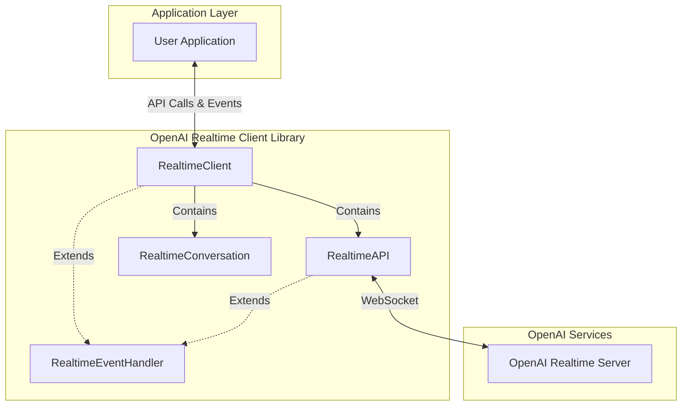
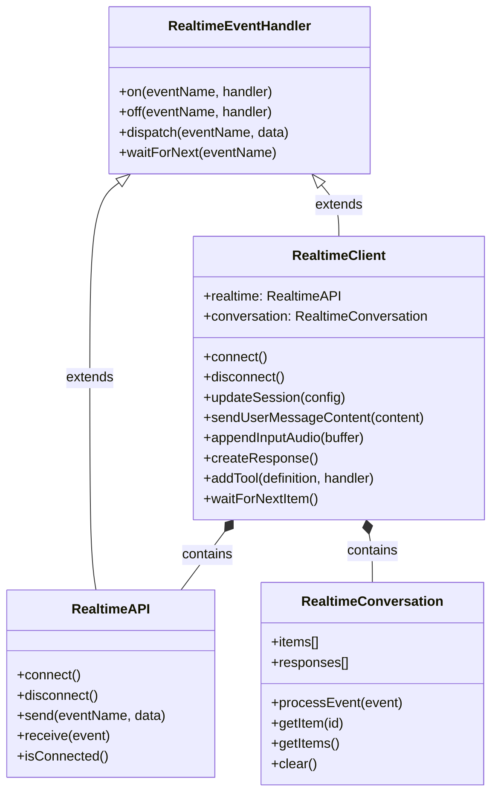
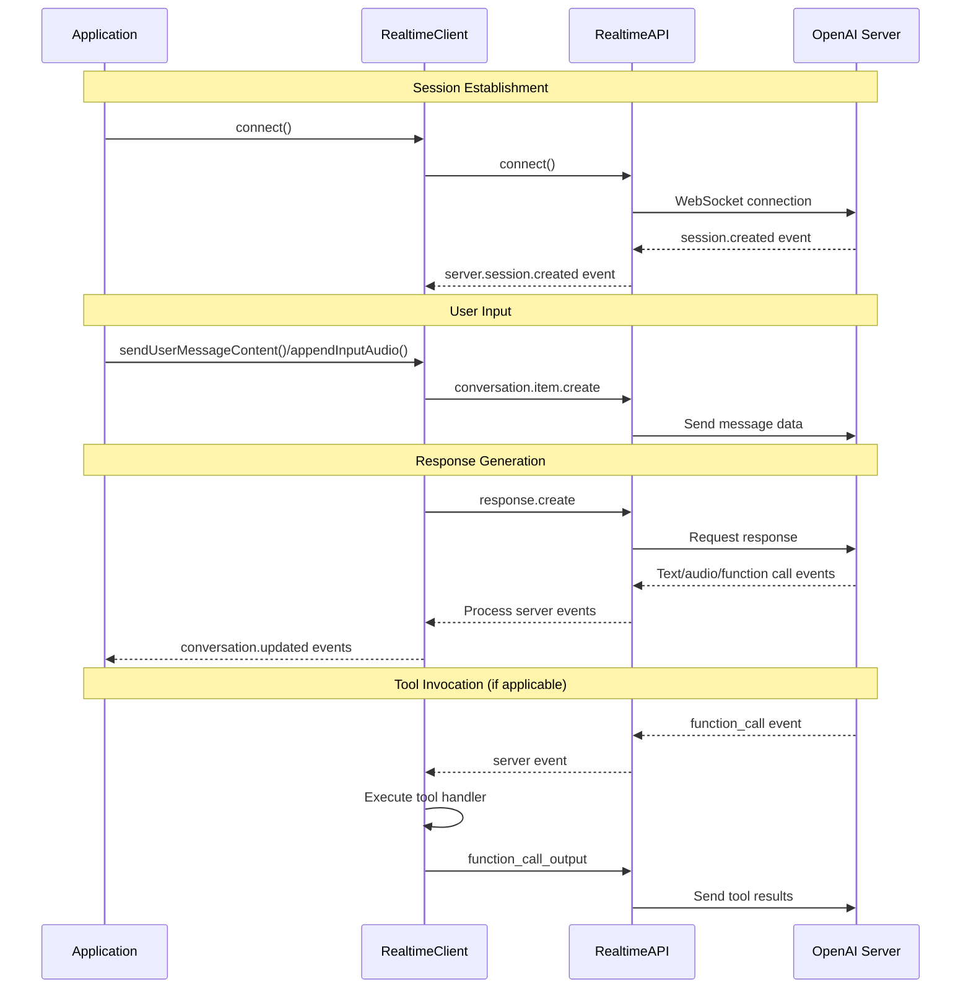

<!-- source: DeepWiki mcp.deepwiki.com · repo openai/openai-realtime-api-beta · page 1 OpenAI Realtime API Client Library · fetched 2026-10-26 -->

# OpenAI Realtime API Client Library

<details>
<summary>Relevant source files</summary>

The following files were used as context for generating this wiki page:

- [README.md](README.md)
- [dist/lib/client.d.ts](dist/lib/client.d.ts)
- [lib/client.js](lib/client.js)

</details>


The OpenAI Realtime API Client Library provides a JavaScript/TypeScript interface for interacting with OpenAI's Realtime API. This library enables developers to build real-time conversational applications with support for text, audio, and function calls through a WebSocket-based connection. For detailed information about the internal architecture, see [System Architecture](#1.1).

## Overview

The Realtime API Client Library allows applications to create interactive, streaming conversations with OpenAI models. Key capabilities include:

- **Bidirectional streaming** of text and audio content
- **Real-time turn-taking** with automatic speech detection
- **Tool/function integration** for extending assistant capabilities
- **Event-driven architecture** for responsive applications

The library is designed to be used in both Node.js and browser environments.



Sources: [lib/client.js:189-663](), [README.md:1-393]()

## Core Components

The library is composed of three primary components, each with a distinct responsibility:

1. **RealtimeClient** - The main interface that applications interact with. It handles session management, conversation flow, and provides a simplified API for common operations.

2. **RealtimeAPI** - A thin wrapper over WebSocket connections that manages communication with OpenAI's servers.

3. **RealtimeConversation** - Maintains the state of the conversation, including message history and response tracking.

4. **RealtimeEventHandler** - Provides event handling capabilities that both RealtimeClient and RealtimeAPI extend.



Sources: [lib/client.js:189-228](), [README.md:92-113]()

## Data Flow

The library processes data bidirectionally, handling both application inputs and server responses through an event-driven system.



Sources: [lib/client.js:244-363](), [README.md:119-267]()

## Key Concepts

### Session Configuration

The session configuration determines how the client interacts with the Realtime API. It includes settings for:

- Modalities (text, audio)
- Instructions for the assistant
- Voice selection
- Audio formats and transcription
- Turn detection settings
- Tool definitions
- Temperature and other model parameters

Sessions are configured using the `updateSession()` method:

```javascript
client.updateSession({
  modalities: ['text', 'audio'],
  instructions: 'You are a helpful assistant.',
  voice: 'alloy',
  turn_detection: { type: 'server_vad' },
  temperature: 0.7
});
```

Sources: [lib/client.js:484-541](), [README.md:28-34]()

### Event System

The library uses an event-driven architecture to handle communication between the application, client, and server. The main events include:

| Event Type | Description |
|------------|-------------|
| `conversation.updated` | Triggered when any conversation item is updated, with the item and delta |
| `conversation.item.appended` | Triggered when a new item is added to the conversation |
| `conversation.item.completed` | Triggered when an item is marked as completed |
| `conversation.interrupted` | Triggered when user speech interrupts an ongoing response |
| `realtime.event` | Raw events from server and client for debugging |

Applications can subscribe to these events using the `on()` method:

```javascript
client.on('conversation.updated', ({ item, delta }) => {
  // Handle updated item
});
```

Sources: [lib/client.js:250-265](), [README.md:292-345]()

### Conversation Items

The conversation is made up of different types of items:

| Item Type | Description |
|-----------|-------------|
| `message` (user) | Content provided by the user (text or audio) |
| `message` (assistant) | Responses from the assistant (text or audio) |
| `message` (system) | System instructions or messages |
| `function_call` | A tool invocation from the assistant |
| `function_call_output` | The result of a tool invocation |

Each item has a unique ID, status (in_progress, completed, incomplete), and content appropriate to its type.

Sources: [lib/client.js:80-152](), [dist/lib/client.d.ts:65-455]()

### Audio Processing

The library supports audio input and output with different modes of turn detection:

1. **Server Voice Activity Detection (VAD)** - Automatically detects when a user starts and stops speaking
2. **Manual** - Application explicitly controls when to process audio and generate responses

Audio is processed through the `appendInputAudio()` method and can be committed using `createResponse()`:

```javascript
// Add audio data to the buffer
client.appendInputAudio(audioData);

// For manual turn detection, explicitly create a response
client.createResponse();
```

Sources: [lib/client.js:574-603](), [README.md:131-150]()

### Tool Integration

The library allows for extending assistant capabilities through tools (functions) that can be called during a conversation:

```javascript
client.addTool(
  {
    name: 'get_weather',
    description: 'Get weather for a location',
    parameters: {
      type: 'object',
      properties: {
        location: { type: 'string' }
      },
      required: ['location']
    }
  },
  async (params) => {
    // Function implementation
    return { temperature: 72, conditions: 'sunny' };
  }
);
```

When the assistant calls a tool, the associated handler is automatically executed, and the result is sent back to continue the conversation.

Sources: [lib/client.js:437-467](), [README.md:154-256]()

## Basic Usage

Here's a simple example of using the Realtime API Client Library:

```javascript
// Initialize client
const client = new RealtimeClient({ apiKey: 'your-api-key' });

// Configure session
client.updateSession({
  instructions: 'You are a helpful assistant.',
  voice: 'alloy'
});

// Set up event handling
client.on('conversation.updated', ({ item, delta }) => {
  console.log('Item updated:', item);
  if (delta?.text) {
    console.log('New text:', delta.text);
  }
  if (delta?.audio) {
    // Process audio...
  }
});

// Connect to Realtime API
await client.connect();

// Send a message
client.sendUserMessageContent([
  { type: 'input_text', text: 'Tell me a short story' }
]);

// Wait for completed response
const { item } = await client.waitForNextCompletedItem();
console.log('Response completed:', item);

// Clean up
client.disconnect();
```

Sources: [lib/client.js:392-422](), [README.md:13-52]()

## Further Reading

For more detailed information about specific components and features of the Realtime API Client Library, refer to:

- [RealtimeClient](#2) - Comprehensive documentation of the main client interface
- [Session Configuration](#2.1) - Details on configuring sessions
- [Tool Integration](#2.2) - In-depth guide on defining and using tools
- [Working with Audio](#6) - Guide on audio input/output features
- [Event System](#8) - Documentation of the events emitted by the library

Sources: [README.md:77-91]()

---

