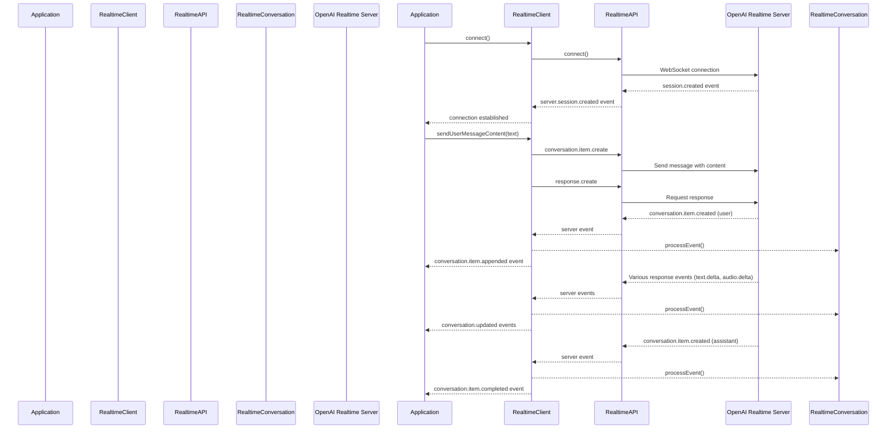
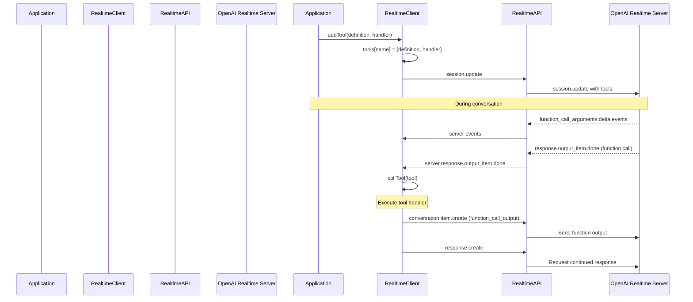
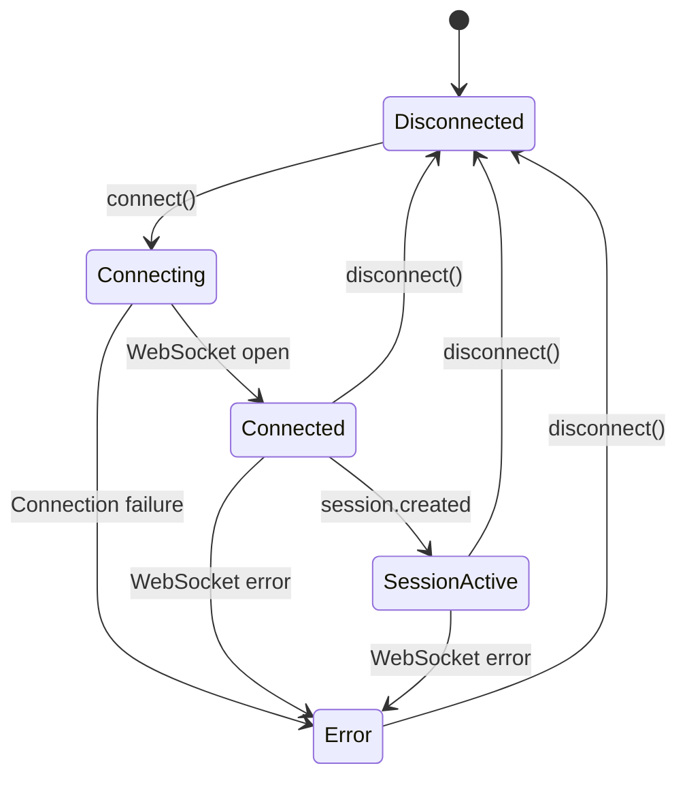

<!-- source: DeepWiki mcp.deepwiki.com · repo openai/openai-realtime-api-beta · page 1.1 System Architecture · fetched 2026-10-26 -->

# System Architecture

<details>
<summary>Relevant source files</summary>

The following files were used as context for generating this wiki page:

- [lib/api.js](lib/api.js)
- [lib/client.js](lib/client.js)
- [lib/conversation.js](lib/conversation.js)
- [lib/event_handler.js](lib/event_handler.js)

</details>


This document provides a detailed overview of the OpenAI Realtime API client library's architecture, explaining how its components interact with each other and with the OpenAI Realtime Server. This page covers the core architectural design, data flow patterns, event systems, and component relationships. For information about using specific features, please refer to the relevant sections of the documentation.

## Core Components

The client library is built around four primary components that work together to provide a complete real-time communication system.

```mermaid
classDiagram
    class "RealtimeEventHandler" {
        +eventHandlers
        +nextEventHandlers
        +on()
        +onNext()
        +off()
        +offNext()
        +dispatch()
        +waitForNext()
        +clearEventHandlers()
    }
    
    class "RealtimeClient" {
        +realtime: RealtimeAPI
        +conversation: RealtimeConversation
        +sessionConfig
        +tools
        +connect()
        +disconnect()
        +updateSession()
        +sendUserMessageContent()
        +appendInputAudio()
        +createResponse()
        +cancelResponse()
        +addTool()
        +waitForNextItem()
    }
    
    class "RealtimeAPI" {
        +url
        +apiKey
        +ws
        +connect()
        +disconnect()
        +send()
        +receive()
        +isConnected()
    }
    
    class "RealtimeConversation" {
        +itemLookup
        +items
        +responseLookup
        +responses
        +queuedSpeechItems
        +clear()
        +queueInputAudio()
        +processEvent()
        +getItem()
        +getItems()
    }
    
    "RealtimeEventHandler" <|-- "RealtimeAPI" : extends
    "RealtimeEventHandler" <|-- "RealtimeClient" : extends
    "RealtimeClient" *-- "RealtimeAPI" : contains
    "RealtimeClient" *-- "RealtimeConversation" : contains
```

Sources: [lib/client.js:189-663](), [lib/api.js:4-208](), [lib/conversation.js:18-314](), [lib/event_handler.js:13-143]()

### Component Responsibilities

1. **RealtimeEventHandler**: Base class that provides event handling capabilities to other components.
   - Manages event subscription and dispatching
   - Provides both persistent (`on`/`off`) and one-time (`onNext`/`offNext`) event handlers
   - Includes utility methods like `waitForNext()` for synchronizing with asynchronous events

2. **RealtimeAPI**: Manages the WebSocket connection to the OpenAI Realtime server.
   - Establishes and maintains the WebSocket connection
   - Serializes outgoing messages and deserializes incoming messages
   - Dispatches server events to the client
   - Handles connection lifecycle (connect, disconnect, error handling)

3. **RealtimeConversation**: Manages conversation state and processes events.
   - Stores conversation items, responses, and related metadata
   - Processes events to update internal state
   - Formats data for consumption by applications
   - Manages audio buffers, transcripts, and other conversation artifacts

4. **RealtimeClient**: The main interface for applications, coordinates between components.
   - Provides high-level methods for interacting with the API
   - Manages session configuration
   - Coordinates audio input/output
   - Handles tool integration
   - Dispatches high-level events to applications

Sources: [lib/client.js:184-664](), [lib/api.js:4-208](), [lib/conversation.js:18-314](), [lib/event_handler.js:13-143]()

## Data and Event Flow

The client library uses an event-driven architecture, with events flowing between the server, API layer, and client components.



Sources: [lib/client.js:229-363](), [lib/api.js:175-207](), [lib/conversation.js:280-296]()

### Server to Application Event Flow

1. Events originate from the OpenAI Realtime Server via WebSocket
2. `RealtimeAPI` receives and parses these events, wrapping them in a consistent format
3. `RealtimeAPI` dispatches these as `server.*` events to `RealtimeClient`
4. `RealtimeClient` processes events via `RealtimeConversation.processEvent()`
5. `RealtimeClient` dispatches higher-level events to the application (e.g., `conversation.updated`)

This multi-stage event handling allows the library to abstract away the complexity of the raw server events, providing applications with a simpler, more consistent event model.

Sources: [lib/client.js:250-267](), [lib/api.js:175-181]()

## Session Configuration and Management

The `RealtimeClient` manages session configuration through its `updateSession()` method, which allows controlling various aspects of the conversation:

```mermaid
classDiagram
    class "SessionConfiguration" {
        +modalities: string[]
        +instructions: string
        +voice: string
        +input_audio_format: AudioFormatType
        +output_audio_format: AudioFormatType
        +input_audio_transcription: AudioTranscriptionType|null
        +turn_detection: TurnDetectionServerVadType|null
        +tools: ToolDefinitionType[]
        +tool_choice: string|object
        +temperature: number
        +max_response_output_tokens: number|"inf"
    }
    
    class "AudioFormatType" {
        "pcm16"|"g711_ulaw"|"g711_alaw"
    }
    
    class "TurnDetectionServerVadType" {
        +type: "server_vad"
        +threshold: number
        +prefix_padding_ms: number
        +silence_duration_ms: number
    }
    
    class "ToolDefinitionType" {
        +type: "function"
        +name: string
        +description: string
        +parameters: object
    }
    
    "SessionConfiguration" --> "AudioFormatType" : uses
    "SessionConfiguration" --> "TurnDetectionServerVadType" : uses
    "SessionConfiguration" --> "ToolDefinitionType" : uses
```

The session configuration controls:
- Input/output modalities (text, audio)
- Voice and audio format settings
- Turn detection behavior
- Tool definitions and preferences
- Model parameters (temperature, token limits)

Sources: [lib/client.js:34-47](), [lib/client.js:484-541]()

## Conversation State Management

The `RealtimeConversation` class manages the state of the conversation, including items (messages, function calls) and responses:

```mermaid
classDiagram
    class "RealtimeConversation" {
        +itemLookup: Object
        +items: Array
        +responseLookup: Object
        +responses: Array
        +queuedSpeechItems: Object
        +queuedTranscriptItems: Object
        +queuedInputAudio: Int16Array|null
        +EventProcessors: Object
        +clear()
        +queueInputAudio()
        +processEvent()
        +getItem()
        +getItems()
    }
    
    class "ItemType" {
        +id: string
        +type: string
        +status: ItemStatusType
        +role: string
        +content: Array
        +formatted: FormattedPropertyType
    }
    
    class "ResponseResourceType" {
        +status: string
        +status_details: Object|null
        +output: Array
        +usage: UsageType|null
    }
    
    "RealtimeConversation" --> "ItemType" : manages
    "RealtimeConversation" --> "ResponseResourceType" : manages
```

The conversation state includes:
- Messages (user and assistant)
- Function calls and their outputs
- Audio content and transcripts
- Status information for items and responses

Each event from the server is processed to update this state, allowing the application to have a consistent view of the conversation.

Sources: [lib/conversation.js:18-314](), [lib/client.js:80-152]()

## Audio Processing

The library includes a sophisticated audio processing pipeline that handles both automatic (server-side VAD) and manual turn detection:

```mermaid
flowchart TD
    "AudioInput"["Audio Input"] --> "Buffer"["Input Audio Buffer"]
    "Buffer" --> "TurnDetection"{"Turn Detection Mode"}
    
    "TurnDetection" -- "Server VAD" --> "VAD"["Voice Activity Detection"]
    "TurnDetection" -- "Manual" --> "Manual"["Manual Commit"]
    
    "VAD" --> "Start"["Speech Started Event"]
    "VAD" --> "Stop"["Speech Stopped Event"]
    "Manual" --> "Commit"["Input Audio Commit"]
    
    "Stop" --> "Transc"["Transcription"]
    "Commit" --> "Transc"
    
    "Transc" --> "UserMsg"["User Message"]
    "UserMsg" --> "Model"["Model Generation"]
    "Model" --> "AssistMsg"["Assistant Message"]
    
    "AssistMsg" --> "TextOut"["Text Output"]
    "AssistMsg" --> "AudioOut"["Audio Output"]
    "AssistMsg" --> "FuncCall"["Function Call"]
```

The audio processing pipeline involves:
1. Audio input collection via `appendInputAudio()`
2. Turn detection (either automatic with server VAD or manual with `createResponse()`)
3. Speech-to-text conversion
4. Model processing
5. Text and audio response generation

Sources: [lib/client.js:569-602](), [lib/conversation.js:121-144]()

## Tool Integration

The library supports integration with external tools through function calling:



Tool integration allows the assistant to:
1. Call external functions during a conversation
2. Receive the results of those function calls
3. Continue the conversation with the new information

Sources: [lib/client.js:433-467](), [lib/client.js:290-315]()

## Event Handling and Synchronization

The event handling system, provided by `RealtimeEventHandler`, enables both synchronous and asynchronous processing of events:

```mermaid
classDiagram
    class "RealtimeEventHandler" {
        +eventHandlers: Object
        +nextEventHandlers: Object
        +on(eventName, callback)
        +onNext(eventName, callback)
        +off(eventName, callback)
        +offNext(eventName, callback)
        +dispatch(eventName, event)
        +waitForNext(eventName, timeout)
        +clearEventHandlers()
    }
    
    class "EventHandlers" {
        +persistent: Map
        +oneTime: Map
    }
    
    "RealtimeEventHandler" --> "EventHandlers" : manages
```

The event system provides:
- Persistent event handlers via `on()`/`off()`
- One-time event handlers via `onNext()`/`offNext()`
- Promise-based event waiting via `waitForNext()`
- Event dispatching to all registered handlers

This system enables both callback-based and Promise-based programming models, allowing developers to choose the approach that best fits their needs.

Sources: [lib/event_handler.js:13-143]()

## Connection Lifecycle



The connection lifecycle involves:
1. Initial connection establishment through `connect()`
2. WebSocket connection to the OpenAI Realtime server
3. Session creation and configuration
4. Active session with bidirectional communication
5. Disconnection through `disconnect()` or error handling

Sources: [lib/client.js:392-421](), [lib/api.js:59-154]()

## Integration Patterns

Applications can interact with the client library using several integration patterns:

### Event-Driven Pattern

```javascript
const client = new RealtimeClient({ apiKey: "your-api-key" });

client.on("conversation.updated", ({ item, delta }) => {
  // Process updates to conversation items
});

client.on("conversation.item.completed", ({ item }) => {
  // Process completed items
});

await client.connect();
client.sendUserMessageContent([{ type: "input_text", text: "Hello" }]);
```

### Promise-Based Pattern

```javascript
const client = new RealtimeClient({ apiKey: "your-api-key" });

await client.connect();
client.sendUserMessageContent([{ type: "input_text", text: "Hello" }]);

// Wait for the next item to be completed
const { item } = await client.waitForNextCompletedItem();
console.log(item.formatted.text);
```

Sources: [lib/client.js:647-662](), [lib/event_handler.js:108-123]()

## Conclusion

The OpenAI Realtime API client library follows a layered, event-driven architecture that effectively abstracts the complexities of WebSocket communication and event handling. This architecture allows applications to easily integrate with OpenAI's real-time capabilities, providing a robust foundation for building applications that require streaming text and audio communication with AI models.

For more details on using specific components, please refer to their respective documentation pages:
- For client usage information, see [RealtimeClient](#2)
- For event system details, see [Event System](#8)
- For audio processing, see [Working with Audio](#6)

---

