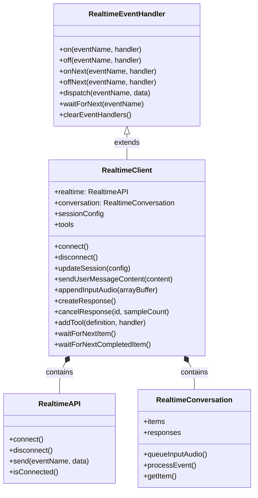
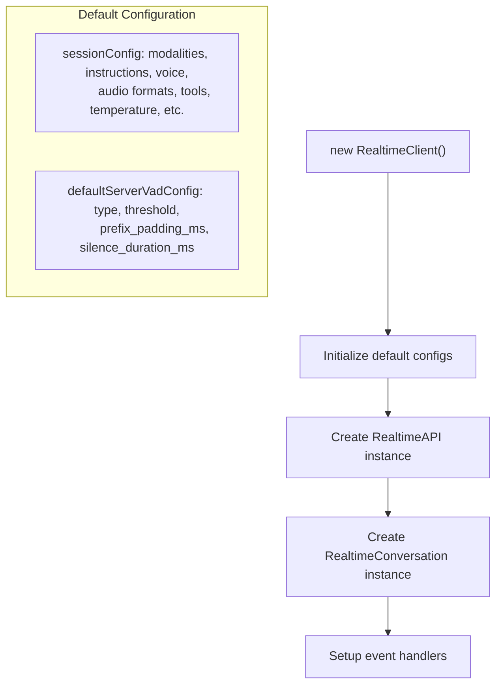
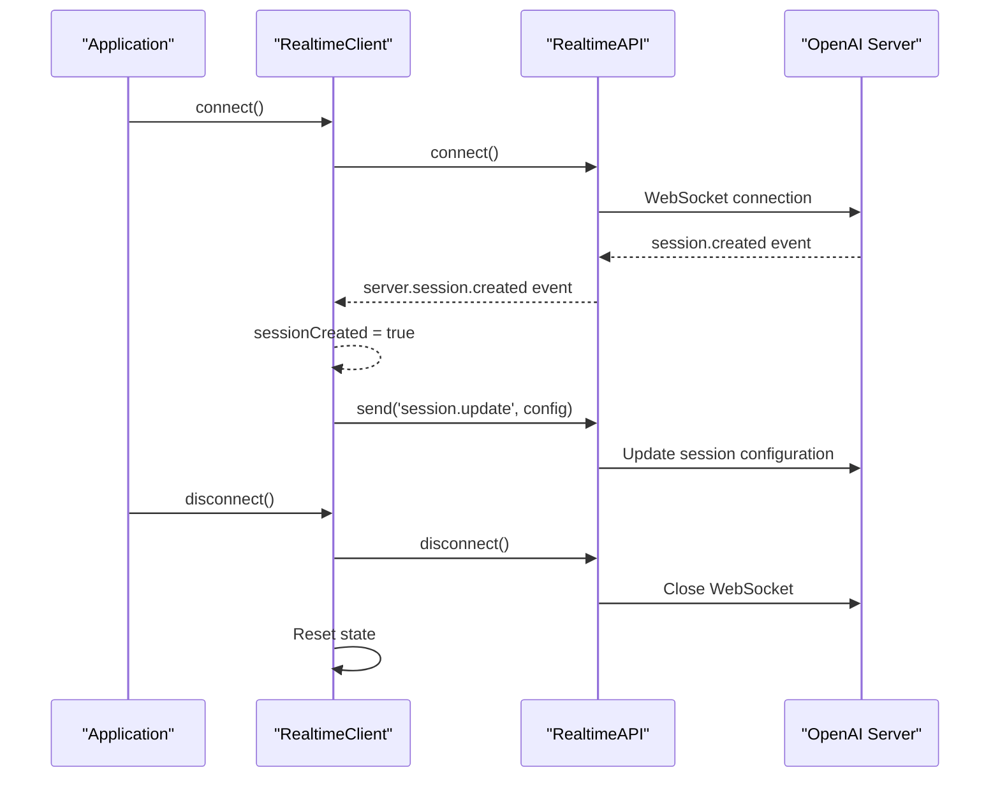
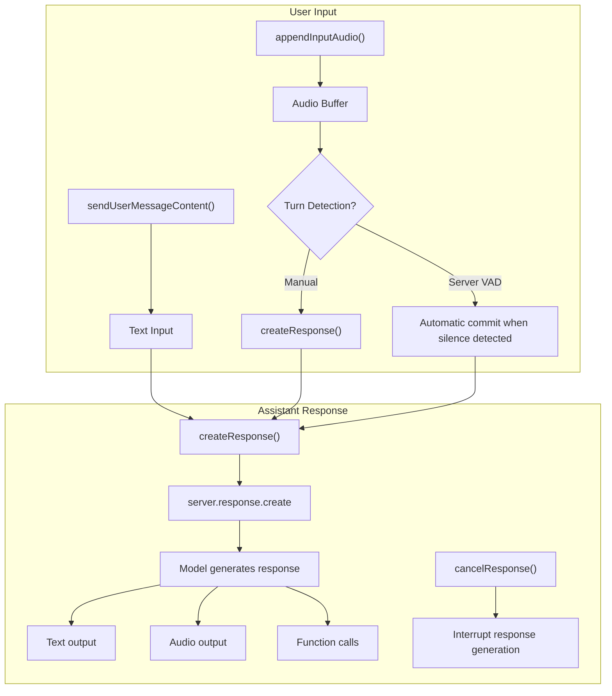
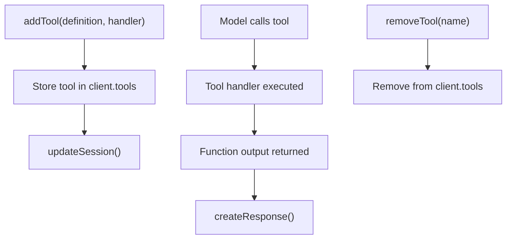
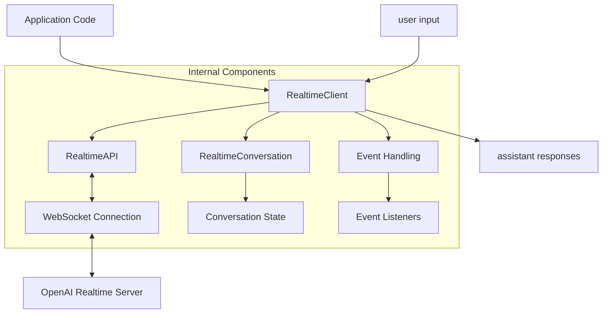

<!-- source: DeepWiki mcp.deepwiki.com · repo openai/openai-realtime-api-beta · page 2 RealtimeClient · fetched 2026-10-26 -->

# RealtimeClient

<details>
<summary>Relevant source files</summary>

The following files were used as context for generating this wiki page:

- [dist/lib/client.d.ts](dist/lib/client.d.ts)
- [lib/client.js](lib/client.js)

</details>


This document provides a comprehensive guide to the `RealtimeClient` class, which serves as the primary interface for applications interacting with the OpenAI Realtime API. The `RealtimeClient` manages communication with the server, handles conversation state, and provides methods for sending user input, receiving assistant responses, and integrating external tools.

For information about the underlying WebSocket communication, see [RealtimeAPI](#3). For details on conversation state management, see [RealtimeConversation](#4).

## 1. Class Overview

`RealtimeClient` extends the `RealtimeEventHandler` class to gain event handling capabilities. It contains instances of both `RealtimeAPI` (for WebSocket communication) and `RealtimeConversation` (for state management).



**Sources: [lib/client.js:189-189]()**

## 2. Initialization and Configuration

### 2.1 Constructor

The `RealtimeClient` constructor accepts an optional configuration object with the following parameters:

| Parameter | Type | Description |
|-----------|------|-------------|
| `url` | `string` | The WebSocket URL to connect to (optional) |
| `apiKey` | `string` | Your OpenAI API key (optional) |
| `dangerouslyAllowAPIKeyInBrowser` | `boolean` | Whether to allow sending the API key in browser environments (not recommended for production) |
| `debug` | `boolean` | Enable debug logging |



**Sources: [lib/client.js:194-229]()**

### 2.2 Session Configuration

The `updateSession()` method is used to configure the session with various parameters:

| Parameter | Type | Description |
|-----------|------|-------------|
| `modalities` | `string[]` | Array of modalities (e.g., 'text', 'audio') |
| `instructions` | `string` | System instructions for the assistant |
| `voice` | `string` | Voice to use for audio responses ('alloy', 'echo', 'verse', etc.) |
| `input_audio_format` | `AudioFormatType` | Format for audio input ('pcm16', 'g711_ulaw', or 'g711_alaw') |
| `output_audio_format` | `AudioFormatType` | Format for audio output |
| `input_audio_transcription` | `AudioTranscriptionType` | Configuration for transcribing audio input |
| `turn_detection` | `TurnDetectionServerVadType` | Configuration for turn detection |
| `tools` | `ToolDefinitionType[]` | Array of tool definitions |
| `tool_choice` | `string` | How tools should be used ('auto', 'none', 'required') |
| `temperature` | `number` | Temperature for response generation (0.0-1.0) |
| `max_response_output_tokens` | `number` or `"inf"` | Maximum number of tokens in the response |

**Sources: [lib/client.js:484-542]()**

## 3. Connection Management



### 3.1 Connecting to the Server

```javascript
// Connect to the server
await client.connect();

// Wait for session to be established (optional)
await client.waitForSessionCreated();
```

**Sources: [lib/client.js:392-413]()**

### 3.2 Disconnecting from the Server

```javascript
// Disconnect from the server and clear conversation history
client.disconnect();
```

**Sources: [lib/client.js:418-422]()**

### 3.3 Checking Connection Status

```javascript
// Check if the client is connected
const isConnected = client.isConnected();
```

**Sources: [lib/client.js:370-372]()**

## 4. Message and Response Handling



### 4.1 Sending User Messages

```javascript
// Send a text message
client.sendUserMessageContent([
  { type: 'input_text', text: 'Hello, how are you?' }
]);

// Send an audio message (with optional transcript)
client.sendUserMessageContent([
  { 
    type: 'input_audio', 
    audio: audioBuffer, // Int16Array or ArrayBuffer
    transcript: 'Hello, how are you?' // Optional
  }
]);
```

**Sources: [lib/client.js:549-568]()**

### 4.2 Handling Audio Input

```javascript
// Append audio chunks to the input buffer
client.appendInputAudio(audioChunk); // Int16Array or ArrayBuffer

// When using manual turn detection, trigger a response after appending audio
client.createResponse();
```

**Sources: [lib/client.js:575-603]()**

### 4.3 Canceling Responses

```javascript
// Cancel the current response generation without specifying an item
client.cancelResponse();

// Cancel a specific assistant message and truncate its audio at a specific point
client.cancelResponse(assistantItemId, sampleCount);
```

**Sources: [lib/client.js:612-642]()**

## 5. Tool Integration



### 5.1 Adding Tools

```javascript
// Define a tool
const weatherTool = {
  name: 'get_weather',
  description: 'Get the current weather in a location',
  parameters: {
    type: 'object',
    properties: {
      location: {
        type: 'string',
        description: 'The city and state, e.g. San Francisco, CA'
      }
    },
    required: ['location']
  }
};

// Add the tool with a handler
client.addTool(weatherTool, async (args) => {
  const { location } = args;
  // Implement weather lookup logic
  return { temperature: 72, conditions: 'sunny' };
});
```

**Sources: [lib/client.js:438-454]()**

### 5.2 Removing Tools

```javascript
// Remove a previously added tool
client.removeTool('get_weather');
```

**Sources: [lib/client.js:461-467]()**

## 6. Event Handling

`RealtimeClient` inherits from `RealtimeEventHandler`, providing event handling capabilities. It also sets up internal event handlers to process server events and update the conversation state.

### 6.1 Event Types

| Event | Description |
|-------|-------------|
| `conversation.updated` | Fired when any part of the conversation is updated |
| `conversation.item.appended` | Fired when a new item is added to the conversation |
| `conversation.item.completed` | Fired when an item is marked as completed |
| `conversation.interrupted` | Fired when user speech interrupts assistant speech |
| `realtime.event` | Low-level event containing all server and client events |

### 6.2 Waiting for Events

```javascript
// Wait for the next item to be appended to the conversation
const { item } = await client.waitForNextItem();

// Wait for the next item to be completed
const { item } = await client.waitForNextCompletedItem();
```

**Sources: [lib/client.js:648-662]()**

## 7. Internal Architecture

The `RealtimeClient` serves as a facade that coordinates the underlying components:



### 7.1 Event Processing Flow

When events are received from the server, `RealtimeClient` processes them through several steps:

1. `RealtimeAPI` receives the raw events from the WebSocket
2. `RealtimeClient` forwards them to `RealtimeConversation` for state updates
3. `RealtimeClient` dispatches higher-level events for the application

This event processing enables real-time updates to the conversation and responses without requiring the application to handle the low-level details.

**Sources: [lib/client.js:250-362]()**

## 8. Usage Example

```javascript
// Create a new client instance
const client = new RealtimeClient({ 
  apiKey: 'your-api-key'
});

// Connect to the server
await client.connect();

// Configure the session
client.updateSession({
  voice: 'echo',
  instructions: 'You are a helpful assistant.',
  turn_detection: {
    type: 'server_vad',
    threshold: 0.6
  }
});

// Listen for conversation updates
client.on('conversation.item.completed', ({ item }) => {
  if (item.role === 'assistant') {
    console.log('Assistant:', item.formatted.text);
    // Play audio if available
    if (item.formatted.audio) {
      playAudio(item.formatted.audio);
    }
  }
});

// Send a message
client.sendUserMessageContent([
  { type: 'input_text', text: 'Tell me a joke.' }
]);

// Wait for the response
const { item } = await client.waitForNextCompletedItem();
console.log('Received response:', item.formatted.text);

// Disconnect when done
client.disconnect();
```

**Sources: [lib/client.js:189-663]()**

---

