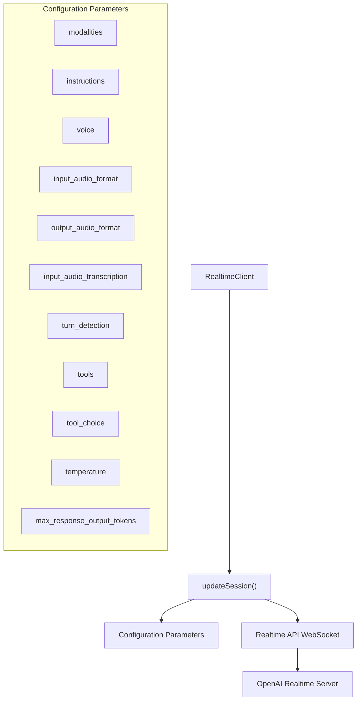
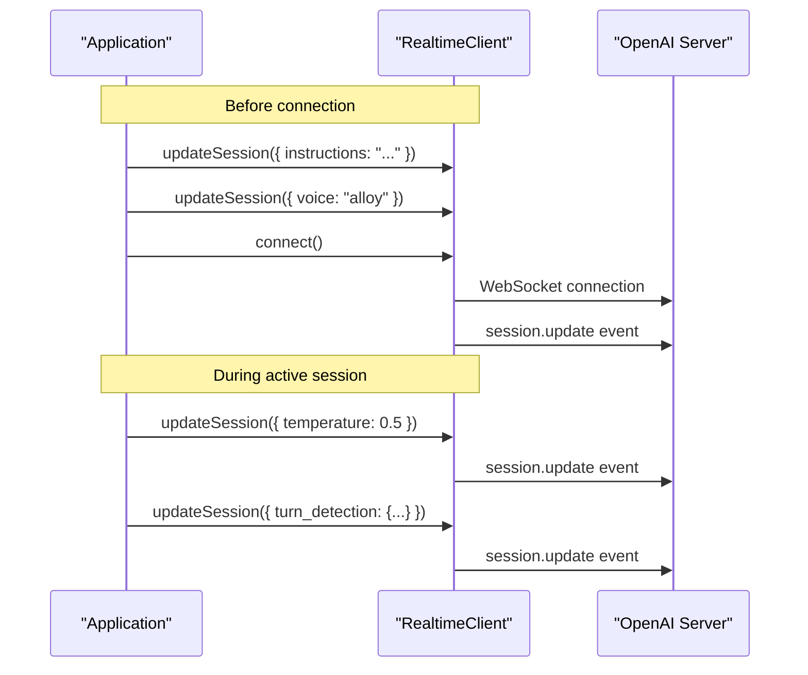
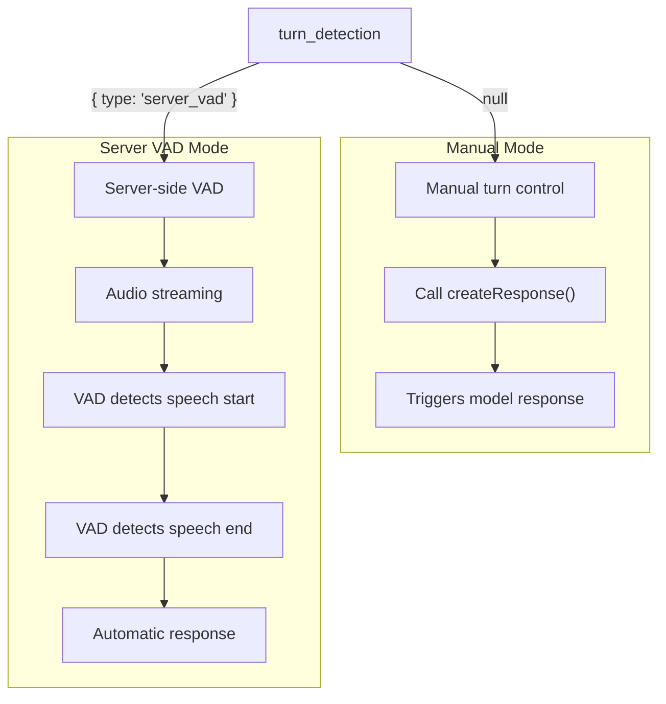
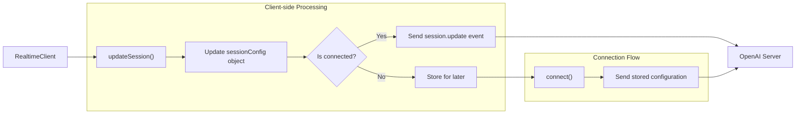

<!-- source: DeepWiki mcp.deepwiki.com · repo openai/openai-realtime-api-beta · page 2.1 Session Configuration · fetched 2026-10-26 -->

# Session Configuration

<details>
<summary>Relevant source files</summary>

The following files were used as context for generating this wiki page:

- [README.md](README.md)
- [dist/lib/client.d.ts](dist/lib/client.d.ts)
- [lib/client.js](lib/client.js)

</details>


This document explains how to configure and update sessions in the OpenAI Realtime API client library. The session configuration controls various aspects of the conversation, including modalities (text and audio), turn detection, model instructions, voice settings, and other parameters. For information about tool integration, see [Tool Integration](#2.2).

## Overview

Session configuration is managed through the `updateSession()` method of the `RealtimeClient` class. This method allows you to set or update various parameters that control how the realtime conversation behaves. Configuration can be done before connecting to the API and can also be updated during an active session.



Sources: [lib/client.js:484-541]()

## Session Configuration Object

The session configuration is defined by the `SessionResourceType` interface, which includes the following parameters:

| Parameter | Type | Default | Description |
|-----------|------|---------|-------------|
| `modalities` | `string[]` | `['text', 'audio']` | The modalities enabled for the conversation |
| `instructions` | `string` | `''` | System instructions for the assistant |
| `voice` | `string` | `'verse'` | Voice for audio responses |
| `input_audio_format` | `AudioFormatType` | `'pcm16'` | Format of input audio |
| `output_audio_format` | `AudioFormatType` | `'pcm16'` | Format of output audio |
| `input_audio_transcription` | `AudioTranscriptionType` \| `null` | `null` | Configuration for audio transcription |
| `turn_detection` | `TurnDetectionServerVadType` \| `null` | `null` | Configuration for turn detection |
| `tools` | `ToolDefinitionType[]` | `[]` | Array of tool definitions |
| `tool_choice` | `string` \| `object` | `'auto'` | How tools should be used |
| `temperature` | `number` | `0.8` | Controls randomness in generation |
| `max_response_output_tokens` | `number` \| `'inf'` | `4096` | Maximum tokens in response |

Sources: [lib/client.js:34-47](), [lib/client.js:196-208]()

## Using `updateSession()`

The `updateSession()` method accepts a partial configuration object and merges it with the existing configuration. This means you can update specific parameters without affecting others.



Sources: [lib/client.js:484-541]()

### Default Configuration

The `RealtimeClient` constructor initializes default values for all session parameters. These defaults are applied when the client is created:

```javascript
this.defaultSessionConfig = {
  modalities: ['text', 'audio'],
  instructions: '',
  voice: 'verse',
  input_audio_format: 'pcm16',
  output_audio_format: 'pcm16',
  input_audio_transcription: null,
  turn_detection: null,
  tools: [],
  tool_choice: 'auto',
  temperature: 0.8,
  max_response_output_tokens: 4096,
};
```

Sources: [lib/client.js:196-208]()

## Configuration Parameters

### Modalities

The `modalities` parameter specifies which communication channels are enabled for the conversation. The available options are:

- `'text'` - Enable text input and output
- `'audio'` - Enable audio input and output

By default, both modalities are enabled. You can restrict to a single modality if needed:

```javascript
client.updateSession({ modalities: ['text'] });  // Text-only conversation
client.updateSession({ modalities: ['audio'] }); // Audio-only conversation
```

Sources: [lib/client.js:34-47](), [lib/client.js:197]()

### Instructions

The `instructions` parameter allows you to provide system instructions to the assistant, similar to system messages in the Chat Completions API. This sets the behavior, persona, and capabilities of the assistant:

```javascript
client.updateSession({ 
  instructions: 'You are a helpful, friendly assistant who speaks concisely and avoids unnecessary explanations.'
});
```

Sources: [lib/client.js:34-47](), [lib/client.js:198]()

### Voice

The `voice` parameter determines which voice is used for audio responses. Available options are:

- `'alloy'`
- `'ash'`
- `'ballad'`
- `'coral'`
- `'echo'`
- `'sage'`
- `'shimmer'`
- `'verse'` (default)

```javascript
client.updateSession({ voice: 'alloy' });
```

Sources: [lib/client.js:34-47](), [lib/client.js:199]()

### Audio Formats

Two parameters control the audio formats used in the conversation:

- `input_audio_format` - Format for audio sent to the API
- `output_audio_format` - Format for audio received from the API

Available formats are:

- `'pcm16'` (default) - 16-bit PCM audio
- `'g711_ulaw'` - G.711 μ-law encoding
- `'g711_alaw'` - G.711 A-law encoding

```javascript
client.updateSession({
  input_audio_format: 'pcm16',
  output_audio_format: 'pcm16'
});
```

Sources: [lib/client.js:7-9](), [lib/client.js:34-47](), [lib/client.js:200-201]()

### Audio Transcription

The `input_audio_transcription` parameter configures how audio input is transcribed. When set to `null`, audio transcription is disabled. When enabled, it requires a model parameter:

```javascript
client.updateSession({
  input_audio_transcription: { model: 'whisper-1' }
});
```

Sources: [lib/client.js:12-14](), [lib/client.js:34-47](), [lib/client.js:202](), [lib/client.js:210-214]()

### Turn Detection

The `turn_detection` parameter configures how the system detects when it's the assistant's turn to respond when using audio input. When set to `null`, manual turn control is used (you must call `createResponse()` to trigger a response).

For server-side Voice Activity Detection (VAD), use:

```javascript
client.updateSession({
  turn_detection: {
    type: 'server_vad',
    threshold: 0.5,              // Sensitivity (0.0 to 1.0)
    prefix_padding_ms: 300,      // Audio to include before speech starts
    silence_duration_ms: 200     // Silence before considering speech stopped
  }
});
```



Sources: [lib/client.js:17-22](), [lib/client.js:34-47](), [lib/client.js:203](), [lib/client.js:215-220]()

### Temperature

The `temperature` parameter controls randomness in the model's responses. Higher values (up to 1.0) make responses more creative and diverse, while lower values make responses more deterministic and focused:

```javascript
client.updateSession({ temperature: 0.3 }); // More deterministic
client.updateSession({ temperature: 0.9 }); // More creative
```

Sources: [lib/client.js:34-47](), [lib/client.js:206]()

### Max Response Output Tokens

The `max_response_output_tokens` parameter limits the length of the model's response. It can be set to a number or `'inf'` for unlimited output:

```javascript
client.updateSession({ max_response_output_tokens: 1000 }); // Limit to 1000 tokens
client.updateSession({ max_response_output_tokens: 'inf' }); // No limit
```

Sources: [lib/client.js:34-47](), [lib/client.js:207]()

## Updating Configuration During a Session

You can update the session configuration at any time, even during an active session. When you call `updateSession()` while connected, the changes are immediately sent to the server using a `session.update` event:

```javascript
// Connect with initial configuration
client.updateSession({ 
  instructions: "You are a helpful assistant."
});
await client.connect();

// Later, update specific settings
client.updateSession({ 
  temperature: 0.4,
  voice: 'alloy'
});
```



Sources: [lib/client.js:484-541](), [lib/client.js:392-399]()

## Tools and Functions

The `tools` parameter allows you to define functions that the assistant can call. This is handled separately in the Tool Integration section ([Tool Integration](#2.2)), but the basic configuration looks like:

```javascript
client.updateSession({
  tools: [
    {
      type: 'function',
      name: 'get_weather',
      description: 'Get the current weather for a location',
      parameters: {
        type: 'object',
        properties: {
          location: {
            type: 'string',
            description: 'City and state, e.g. San Francisco, CA'
          }
        },
        required: ['location']
      }
    }
  ]
});
```

The `tool_choice` parameter controls how tools are used:
- `'auto'` (default) - The model decides when to use tools
- `'none'` - Tools will not be used
- `'required'` - The model must use a tool
- `{ type: 'function', name: 'tool_name' }` - The model must use the specified tool

Sources: [lib/client.js:26-31](), [lib/client.js:34-47](), [lib/client.js:204-205]()

## Putting It All Together

A complete session configuration might look like this:

```javascript
client.updateSession({
  modalities: ['text', 'audio'],
  instructions: 'You are a helpful, concise assistant that specializes in weather information.',
  voice: 'alloy',
  input_audio_format: 'pcm16',
  output_audio_format: 'pcm16',
  input_audio_transcription: { model: 'whisper-1' },
  turn_detection: {
    type: 'server_vad',
    threshold: 0.6,
    prefix_padding_ms: 300,
    silence_duration_ms: 500
  },
  temperature: 0.7,
  max_response_output_tokens: 2048
});

await client.connect();
```

This configuration:
1. Enables both text and audio modalities
2. Sets specific instructions for the assistant
3. Uses the 'alloy' voice
4. Configures PCM16 audio format for both input and output
5. Enables audio transcription with the 'whisper-1' model
6. Sets up server-side VAD for turn detection with custom settings
7. Sets a moderate temperature for balanced creativity and focus
8. Limits response length to 2048 tokens

Sources: [lib/client.js:484-541]()

---

