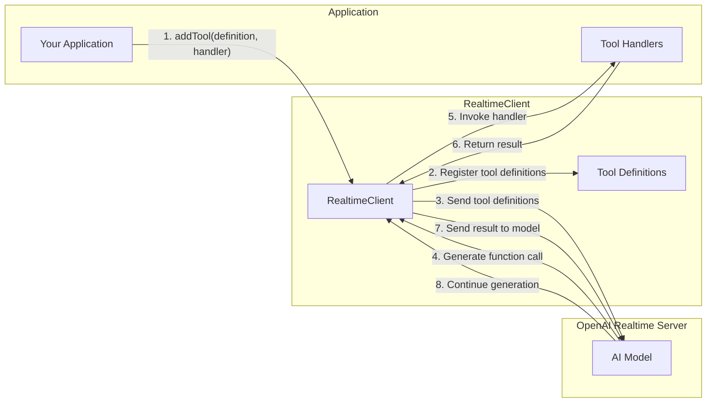
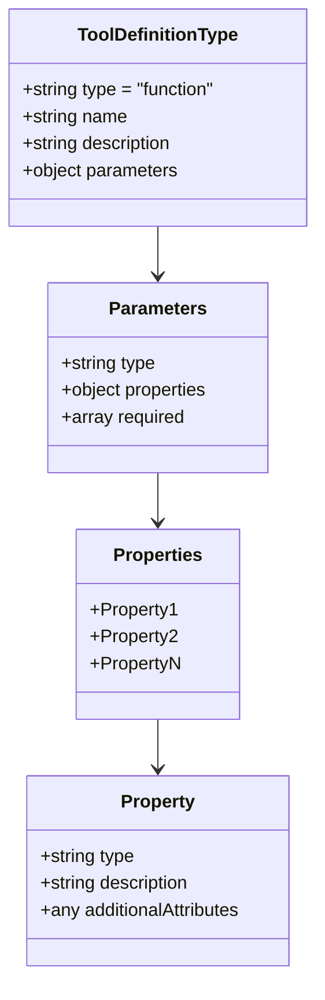
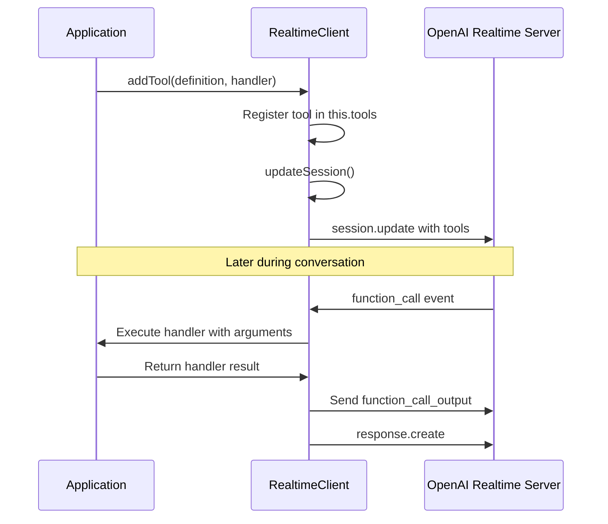
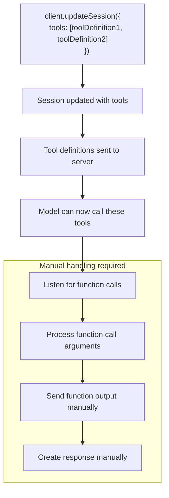
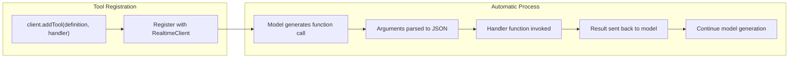
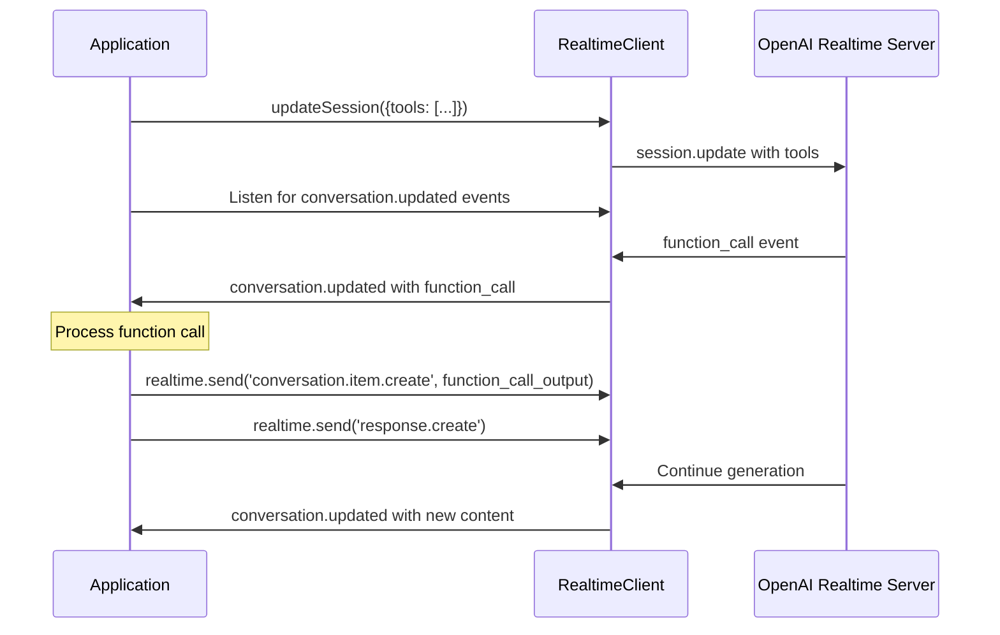
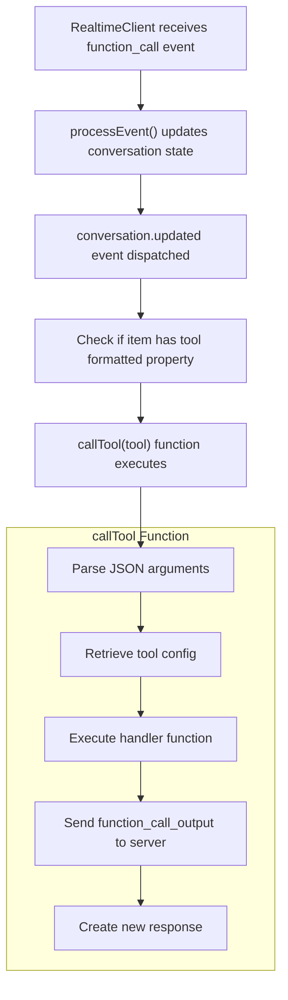
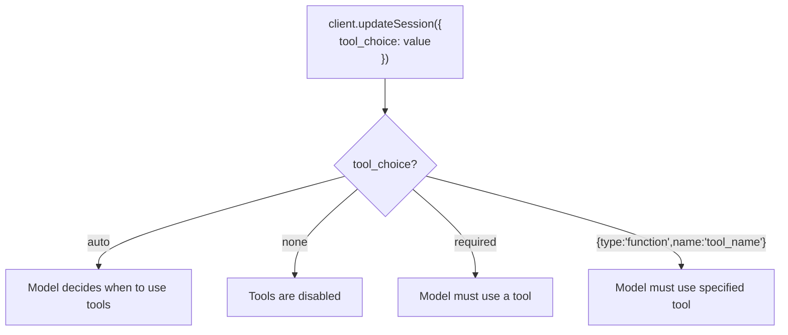

<!-- source: DeepWiki mcp.deepwiki.com · repo openai/openai-realtime-api-beta · page 2.2 Tool Integration · fetched 2026-10-26 -->

# Tool Integration

Relevant source files

The following files were used as context for generating this wiki page:

- [README.md](README.md)
- [lib/client.js](lib/client.js)
- [test/tests/client.js](test/tests/client.js)

This document explains how to define and use tools (functions) that can be called by the assistant during a conversation with the OpenAI Realtime API. Tools enable the assistant to perform actions outside its knowledge base, such as retrieving weather information, querying databases, or interacting with external services. For information about the broader RealtimeClient interface, see [RealtimeClient](#2).

## Overview

The Realtime API allows you to define custom tools that the AI assistant can use during conversations. When properly defined, the assistant can:

1. Determine when a tool should be called
2. Generate the appropriate arguments for the tool
3. Wait for the result of the tool execution
4. Incorporate the tool's response into its subsequent messages

Sources: [lib/client.js:26-31](), [lib/client.js:434-467](), [README.md:152-191]()

## Tool Definition Format

Tools are defined using a standard JSON Schema format. Each tool definition requires:

- `name`: A unique identifier for the tool
- `description`: A clear explanation of what the tool does
- `parameters`: An object describing the expected input parameters

Parameters use JSON Schema to define their structure:

| Field | Description |
|-------|-------------|
| `type` | The data type (object, string, number, etc.) |
| `properties` | Object containing parameter definitions |
| `required` | Array of required property names |

Here's an example of a tool definition structure:

Sources: [lib/client.js:26-31]()

## Adding Tools to the Client

There are two ways to add tools to your RealtimeClient:

### Method 1: Using `addTool()`

The `addTool()` method provides a convenient way to define tools and their handlers in one step:

Sources: [lib/client.js:434-467](), [lib/client.js:290-315]()

The `addTool()` method takes two parameters:
1. `definition`: Object defining the tool
2. `handler`: Function that will be called when the tool is invoked

When the assistant calls this tool, the handler will be invoked automatically with the arguments passed from the model. The handler's result is automatically sent back to the model, and a new response is created.

### Method 2: Using `updateSession()`

You can also define tools using the `updateSession()` method:

Sources: [lib/client.js:484-541](), [README.md:208-236]()

With this approach, you need to manually handle tool calls by listening for appropriate events.

## Automatic Tool Handling

The recommended approach is to use `addTool()` to benefit from automatic tool execution:

Sources: [lib/client.js:290-315](), [README.md:160-191]()

When a tool is called by the assistant:

1. The RealtimeClient receives a function call event
2. The tool arguments are parsed from JSON
3. The registered handler is executed with the parsed arguments
4. The result is automatically sent back to the model
5. A new response is triggered with `createResponse()`

## Manual Tool Handling

For greater control, you can handle tool calls manually:

Sources: [README.md:242-256]()

Manual handling requires:

1. Registering tools via `updateSession()`
2. Listening for `conversation.updated` or `conversation.item.completed` events
3. Checking for items with `type === 'function_call'`
4. Processing the arguments and executing your custom logic
5. Manually sending the function output and creating a new response

## Tool Response Handling

When a tool is called, the client processes it through the following internal flow:

Sources: [lib/client.js:290-315]()

## Example Use Cases

### Weather Information Tool

A typical tool registration for retrieving weather information might look like:

| Component | Description |
|-----------|-------------|
| Tool Name | `get_weather` |
| Description | Retrieves weather data for a location |
| Parameters | `lat` (number), `lng` (number), `location` (string) |
| Handler | Async function that calls a weather API and returns the result |

### Data Query Tool

For retrieving information from a database:

| Component | Description |
|-----------|-------------|
| Tool Name | `query_database` |
| Description | Retrieves specific data from a database |
| Parameters | `query` (string), `filters` (object) |
| Handler | Function that performs a database query and returns results |

### Image Generation Tool

For generating images:

| Component | Description |
|-----------|-------------|
| Tool Name | `generate_image` |
| Description | Creates an image based on a text description |
| Parameters | `prompt` (string), `style` (string), `dimensions` (object) |
| Handler | Function that calls an image generation API and returns URL or base64 image |

Sources: [README.md:160-191](), [README.md:208-236]()

## Tool Choice Configuration

You can control how the model selects tools using the `tool_choice` parameter:

| Value | Description |
|-------|-------------|
| `"auto"` | Default. Model decides when to call tools |
| `"none"` | Model will never call tools |
| `"required"` | Model must call a tool |
| Object | Forces the model to call a specific tool |

Sources: [lib/client.js:44](), [lib/client.js:510]()

## Limitations and Best Practices

When working with tools, consider these best practices:

1. **Clear Descriptions**: Provide clear, concise descriptions of what each tool does
2. **Proper Parameter Definitions**: Use detailed JSON Schema definitions for parameters
3. **Error Handling**: Implement robust error handling in your tool handlers
4. **Asynchronous Processing**: Tool handlers can be asynchronous, allowing for API calls
5. **Tool Registration Timing**: Register tools before sending user messages

Remember that tools added with `addTool()` are not overridden when updating sessions manually with `updateSession()`. Tools defined via `updateSession()` will override previous `updateSession()` configurations.

Sources: [README.md:193-207](), [lib/client.js:516-535]()

---

