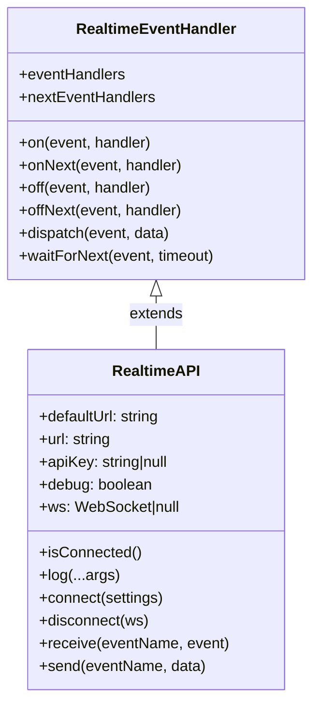
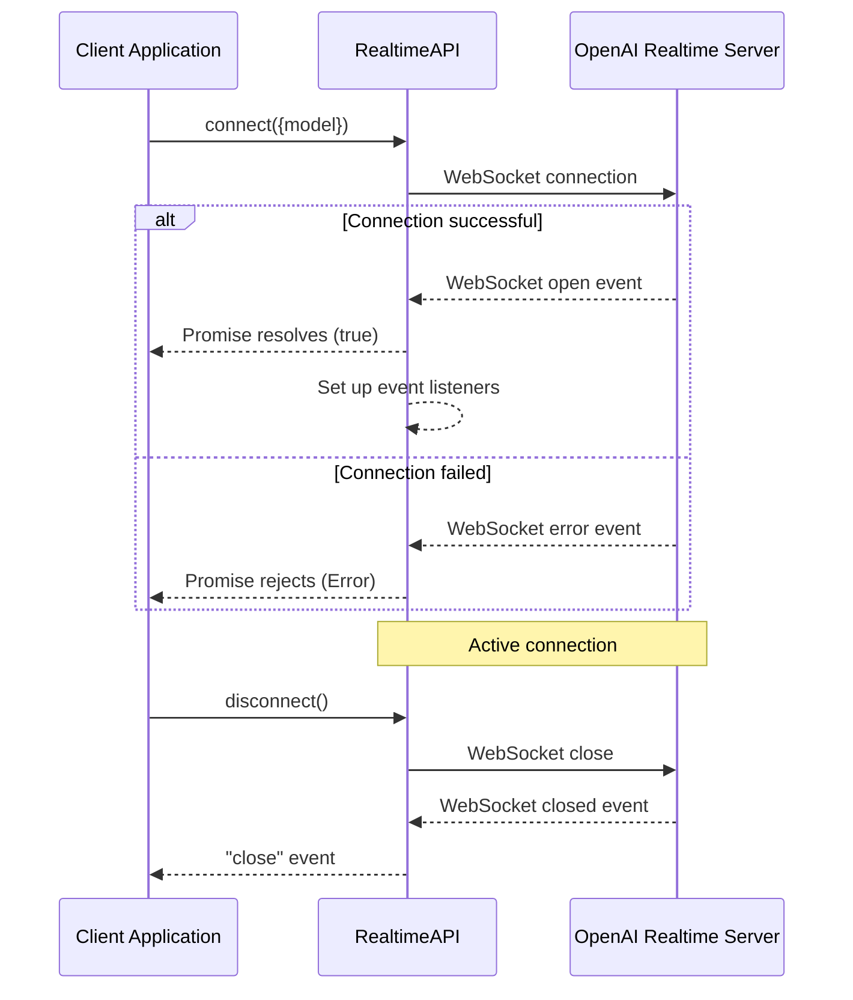
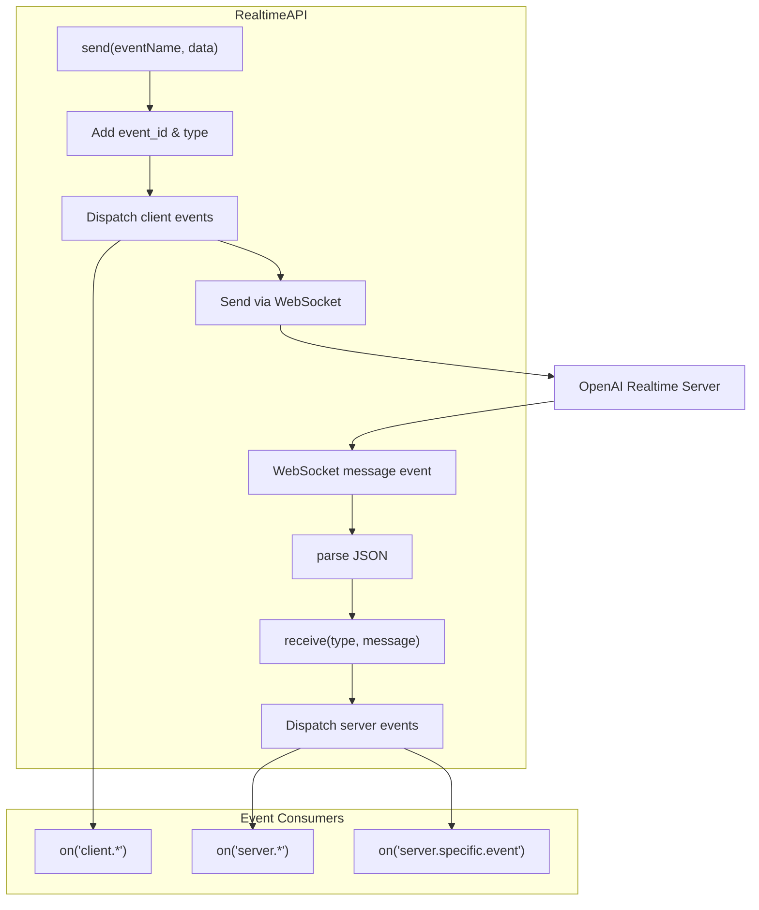
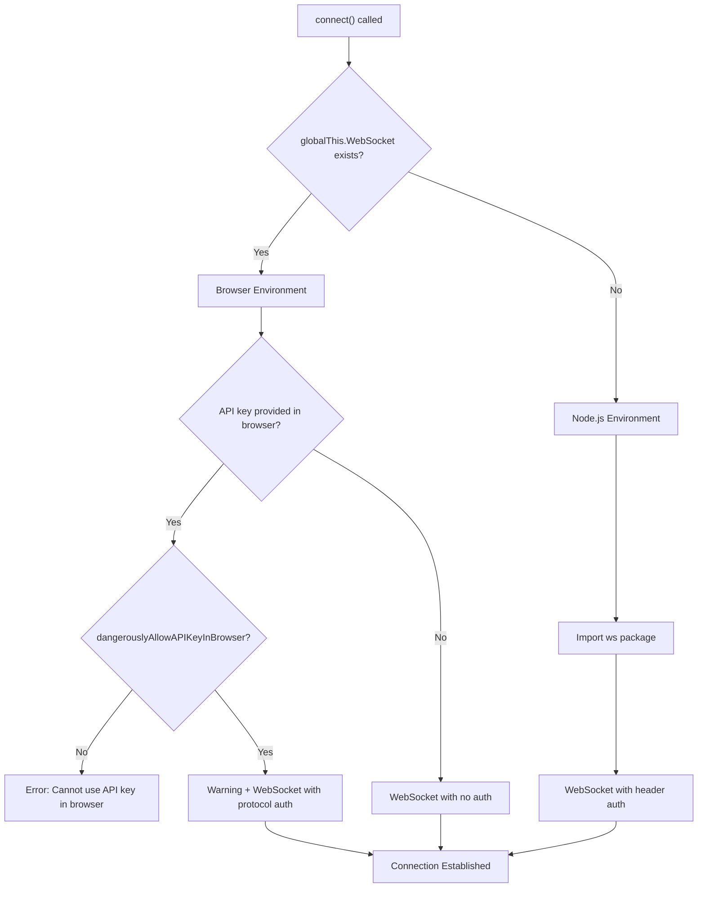
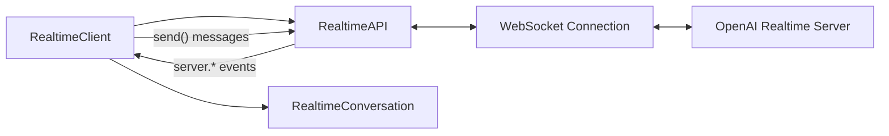

<!-- source: DeepWiki mcp.deepwiki.com · repo openai/openai-realtime-api-beta · page 3 RealtimeAPI · fetched 2026-10-26 -->

# RealtimeAPI

<details>
<summary>Relevant source files</summary>

The following files were used as context for generating this wiki page:

- [dist/lib/api.d.ts.map](dist/lib/api.d.ts.map)
- [lib/api.js](lib/api.js)
- [test/tests/api.js](test/tests/api.js)

</details>


The `RealtimeAPI` class handles WebSocket communication between client applications and OpenAI's Realtime API server. It's responsible for establishing connections, sending and receiving messages, and managing the WebSocket lifecycle. This class serves as the network layer of the Realtime API client library.

For information about the higher-level client interface, see [RealtimeClient](#2).

## Class Overview

`RealtimeAPI` extends the `RealtimeEventHandler` class to inherit event handling capabilities. It provides methods for WebSocket connection management and message transmission, while abstracting away the differences between browser and Node.js environments.



Sources: [lib/api.js:1-4](), [lib/api.js:10-24]()

## Initialization

The `RealtimeAPI` constructor takes a configuration object with the following optional parameters:

| Parameter | Type | Default | Description |
|-----------|------|---------|-------------|
| `url` | string | 'wss://api.openai.com/v1/realtime' | WebSocket server URL |
| `apiKey` | string | null | OpenAI API key for authentication |
| `dangerouslyAllowAPIKeyInBrowser` | boolean | false | Safety flag for browser usage |
| `debug` | boolean | false | Enables detailed logging |

Example initialization:

```javascript
const api = new RealtimeAPI({
  apiKey: 'YOUR_API_KEY',
  debug: true
});
```

Sources: [lib/api.js:5-24]()

## Connection Management

### Connection Flow



Sources: [lib/api.js:58-155](), [lib/api.js:162-168]()

### Connecting to the Server

The `connect()` method establishes a WebSocket connection to the OpenAI Realtime API server:

```javascript
await api.connect({
  model: 'gpt-4o-realtime-preview-2024-10-01'
});
```

The method returns a Promise that resolves to `true` when connected or rejects with an error if the connection fails. It automatically detects whether it's running in a browser or Node.js environment and creates the appropriate WebSocket connection.

Sources: [lib/api.js:58-155]()

### Disconnecting from the Server

The `disconnect()` method closes the WebSocket connection:

```javascript
api.disconnect();
```

This method also emits a 'close' event that can be handled by event listeners.

Sources: [lib/api.js:162-168]()

### Checking Connection Status

The `isConnected()` method returns a boolean indicating whether there's an active WebSocket connection:

```javascript
if (api.isConnected()) {
  // Connection is active
}
```

Sources: [lib/api.js:30-32]()

## Message Handling

### WebSocket Data Flow



Sources: [lib/api.js:176-207]()

### Sending Messages

The `send()` method transmits messages to the server:

```javascript
api.send('conversation.item.create', {
  session_id: 'session_abc123',
  content: {
    type: 'text',
    text: 'Hello, world!'
  }
});
```

The method:
1. Validates that the WebSocket is connected
2. Ensures data is a valid object
3. Adds an `event_id` and `type` to the message
4. Dispatches client-side events (`client.{eventName}` and `client.*`)
5. Sends the JSON-encoded message over the WebSocket

Sources: [lib/api.js:189-207]()

### Receiving Messages

The `receive()` method is called internally when a message is received from the server:

```javascript
// Internal method, not typically called directly
api.receive('session.created', {
  type: 'session.created',
  session_id: 'session_abc123'
});
```

It processes incoming WebSocket messages by:
1. Logging the received message if debug mode is enabled
2. Dispatching server-side events (`server.{eventName}` and `server.*`)

Sources: [lib/api.js:176-181]()

## Event Handling

As a subclass of `RealtimeEventHandler`, the `RealtimeAPI` class provides methods for registering event handlers:

```javascript
// Register a persistent event handler
api.on('server.session.created', (event) => {
  console.log('Session created:', event.session_id);
});

// Register a one-time event handler
api.onNext('server.error', (event) => {
  console.error('Error occurred:', event.error);
});

// Wait for the next occurrence of an event
const event = await api.waitForNext('server.response.created', 5000);
```

The `RealtimeAPI` class emits the following event types:

| Event Type | Description | Example |
|------------|-------------|---------|
| `server.{eventName}` | Specific server event | `server.session.created` |
| `server.*` | Any server event | All incoming messages |
| `client.{eventName}` | Specific client event | `client.conversation.item.create` |
| `client.*` | Any client event | All outgoing messages |
| `close` | Connection closed | `{ error: true/false }` |

Sources: [lib/api.js:176-181](), [lib/api.js:189-207]()

## Environment Detection and Adaptation

The `RealtimeAPI` class automatically adapts to different runtime environments:



Sources: [lib/api.js:58-155]()

### Browser Environment

In browser environments:
- Uses the global `WebSocket` class
- Authenticates using WebSocket subprotocols
- Requires `dangerouslyAllowAPIKeyInBrowser: true` to use API keys
- Emits warnings when API keys are used

Sources: [lib/api.js:66-107]()

### Node.js Environment

In Node.js environments:
- Dynamically imports the `ws` package
- Authenticates using HTTP headers
- Handles Node.js-specific event listeners

Sources: [lib/api.js:108-154]()

## Security Considerations

The `RealtimeAPI` implements security measures to prevent accidental exposure of API keys:

1. In browser environments, it checks if an API key is provided
2. If an API key is used in a browser context, it requires explicit acknowledgment via `dangerouslyAllowAPIKeyInBrowser: true`
3. Even with this option enabled, it emits warning messages

Best practices:
- In browser applications, implement authentication on your backend server and proxy WebSocket connections
- Keep API keys secure and never expose them in client-side code
- For testing purposes only, you can use `dangerouslyAllowAPIKeyInBrowser: true`

Sources: [lib/api.js:15-23](), [lib/api.js:70-74]()

## Debugging

When `debug: true` is set, the `RealtimeAPI` logs detailed information about WebSocket communication:

```javascript
// Example debug output:
// [Websocket/2023-10-25T12:34:56.789Z] Connected to "wss://api.openai.com/v1/realtime"
// [Websocket/2023-10-25T12:34:57.123Z] sent: conversation.item.create {"event_id":"evt_abc123","type":"conversation.item.create",...}
// [Websocket/2023-10-25T12:34:57.456Z] received: conversation.item.created {"type":"conversation.item.created",...}
```

The `log()` method formats and outputs debug information when enabled.

Sources: [lib/api.js:39-52]()

## Integration with RealtimeClient



The `RealtimeAPI` class is typically not used directly by applications. Instead, it's used by the `RealtimeClient` class, which provides a higher-level interface for managing conversations with the OpenAI Realtime API.

Sources: [lib/api.js:4-208]()

---

