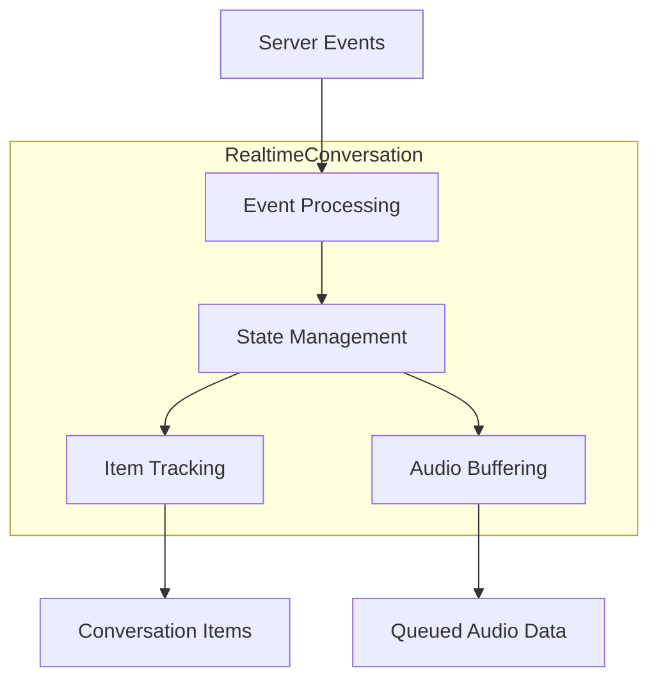
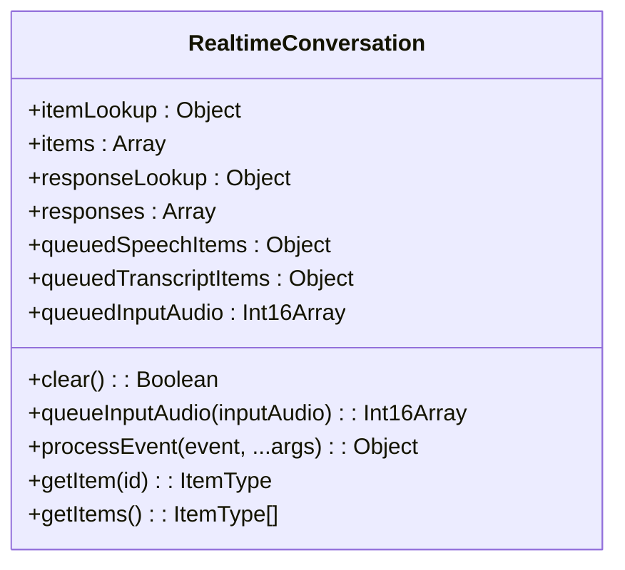
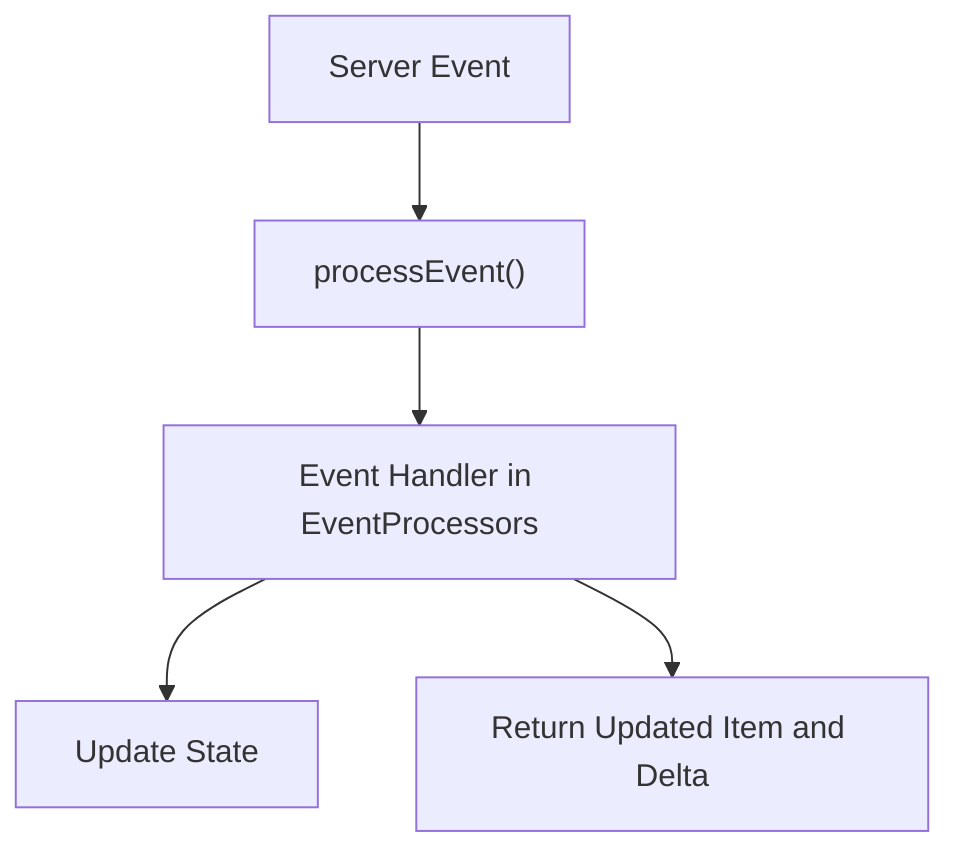
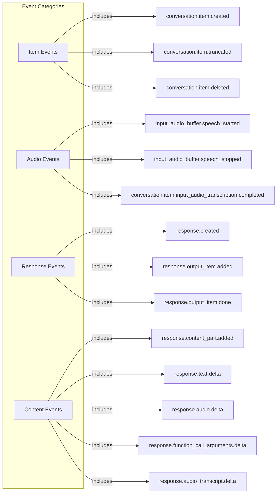
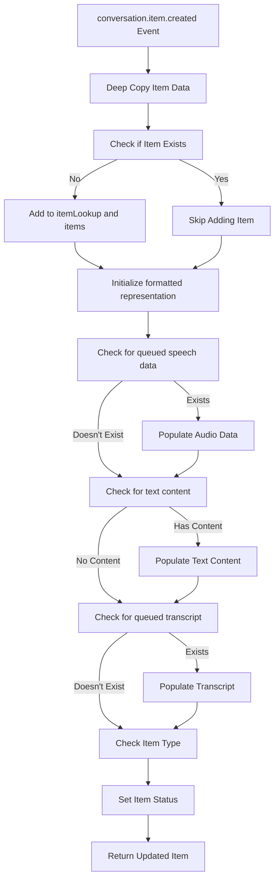
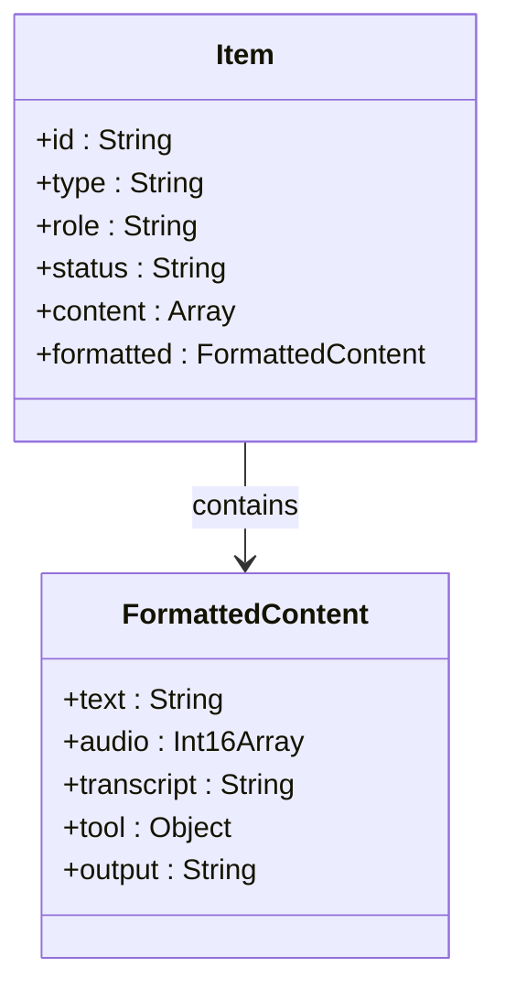
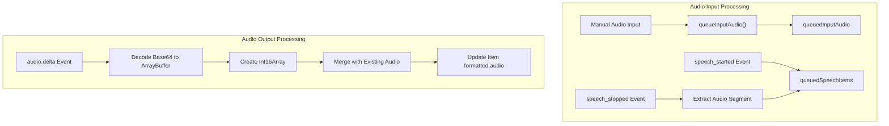
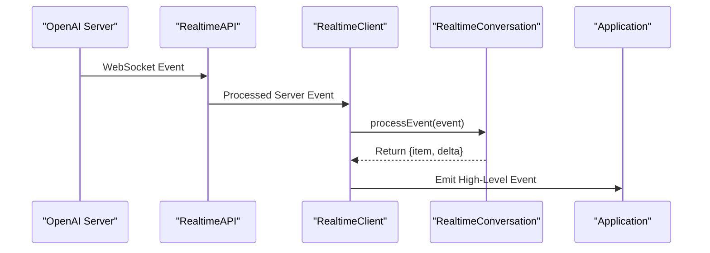

<!-- source: DeepWiki mcp.deepwiki.com · repo openai/openai-realtime-api-beta · page 4 RealtimeConversation · fetched 2026-10-26 -->

# RealtimeConversation

<details>
<summary>Relevant source files</summary>

The following files were used as context for generating this wiki page:

- [dist/lib/conversation.d.ts](dist/lib/conversation.d.ts)
- [dist/lib/conversation.d.ts.map](dist/lib/conversation.d.ts.map)
- [lib/conversation.js](lib/conversation.js)

</details>


RealtimeConversation is a core component of the OpenAI Realtime API client library that manages conversation state and processes events from the WebSocket server. It maintains the history of messages, responses, and audio data exchanged during a conversation session while performing event validation for the RealtimeAPI.

For information about the main client interface, see [RealtimeClient](#2). For details on the underlying WebSocket communication, see [RealtimeAPI](#3).

## Overview

The RealtimeConversation class serves as the state management system for the OpenAI Realtime API client. It processes incoming events from the server, maintains a structured representation of the conversation, and provides methods to access and manipulate conversation items.



Sources: [lib/conversation.js:18-314]()

## Core Data Structures

RealtimeConversation maintains several key data structures to track the state of a conversation:



| Data Structure | Type | Purpose |
|----------------|------|---------|
| `itemLookup` | Object | Maps item IDs to item objects for quick access |
| `items` | Array | Ordered list of all conversation items |
| `responseLookup` | Object | Maps response IDs to response objects |
| `responses` | Array | Ordered list of all responses |
| `queuedSpeechItems` | Object | Temporarily stores speech items that are in progress |
| `queuedTranscriptItems` | Object | Temporarily stores transcript data before item creation |
| `queuedInputAudio` | Int16Array | Stores audio data for manual speech events |

Sources: [lib/conversation.js:254-260](), [lib/conversation.js:90-97]()

## Event Processing System

The central function of RealtimeConversation is to process events from the server and update the conversation state accordingly. This is handled by the `processEvent` method, which delegates to specific event handlers in the `EventProcessors` object.



The `processEvent` method:
1. Validates that the event contains required fields (`event_id` and `type`)
2. Looks up the appropriate handler from `EventProcessors`
3. Calls the handler with the event and any additional arguments
4. Returns an object containing the updated item (if any) and any delta information

Sources: [lib/conversation.js:274-296]()

## Event Handlers

RealtimeConversation has handlers for many different types of events. Here are the main categories:



The handlers update the conversation state by:
- Creating, updating, or deleting conversation items
- Tracking audio data and transcripts
- Managing responses and their relationships to items
- Handling content deltas (incremental updates to text, audio, or function call arguments)

Sources: [lib/conversation.js:21-239]()

## Item Processing

When an item is created (`conversation.item.created` event), the handler performs several key steps:

1. Deep copies the item data
2. Adds the item to `itemLookup` and `items` if it doesn't already exist
3. Initializes the formatted representation of the item
4. Populates audio data from `queuedSpeechItems` if available
5. Populates text content if available
6. Populates transcript data from `queuedTranscriptItems` if available
7. Sets the item status based on its type and role



Sources: [lib/conversation.js:22-75]()

## Item Types and Formatting

RealtimeConversation processes different types of items, each with its own structure and formatting:

| Item Type | Description | Status Handling |
|-----------|-------------|----------------|
| Message (user) | User input in text or audio | Set to `completed` immediately |
| Message (assistant) | AI response in text or audio | Initially `in_progress`, set to `completed` when done |
| Function Call | Request to call an external function | Initially `in_progress`, set to `completed` when done |
| Function Call Output | Result of a function call | Set to `completed` immediately |

Each item includes a `formatted` property that provides easy access to its content:



Sources: [lib/conversation.js:53-74](), [lib/conversation.js:30-34]()

## Audio Processing

RealtimeConversation handles audio data in several ways:

1. **Input Audio Buffering**: Stores audio input until it's associated with a user message
2. **Speech Detection**: Processes `speech_started` and `speech_stopped` events to identify speech segments
3. **Audio Delta Processing**: Handles incremental audio updates for assistant responses
4. **Transcription**: Manages transcripts for both user and assistant audio



Sources: [lib/conversation.js:122-144](), [lib/conversation.js:201-216](), [lib/conversation.js:264-270]()

## Public API Methods

RealtimeConversation provides several public methods for interacting with the conversation state:

### clear()

Resets the conversation state by clearing all data structures.

```javascript
clear() {
  this.itemLookup = {};
  this.items = [];
  this.responseLookup = {};
  this.responses = [];
  this.queuedSpeechItems = {};
  this.queuedTranscriptItems = {};
  this.queuedInputAudio = null;
  return true;
}
```

Sources: [lib/conversation.js:253-262]()

### queueInputAudio(inputAudio)

Stores audio input for later association with a user message.

```javascript
queueInputAudio(inputAudio) {
  this.queuedInputAudio = inputAudio;
  return inputAudio;
}
```

Sources: [lib/conversation.js:269-272]()

### processEvent(event, ...args)

Processes a server event and updates the conversation state.

```javascript
processEvent(event, ...args) {
  if (!event.event_id) {
    console.error(event);
    throw new Error(`Missing "event_id" on event`);
  }
  if (!event.type) {
    console.error(event);
    throw new Error(`Missing "type" on event`);
  }
  const eventProcessor = this.EventProcessors[event.type];
  if (!eventProcessor) {
    throw new Error(
      `Missing conversation event processor for "${event.type}"`,
    );
  }
  return eventProcessor.call(this, event, ...args);
}
```

Sources: [lib/conversation.js:280-296]()

### getItem(id)

Retrieves a specific item by ID.

```javascript
getItem(id) {
  return this.itemLookup[id] || null;
}
```

Sources: [lib/conversation.js:303-305]()

### getItems()

Retrieves all items in the conversation.

```javascript
getItems() {
  return this.items.slice();
}
```

Sources: [lib/conversation.js:311-313]()

## Integration with RealtimeClient

The RealtimeConversation class is instantiated by the RealtimeClient and used to track conversation state. The client passes events from the RealtimeAPI to the conversation's `processEvent` method and uses the resulting information to emit higher-level events to the application.



Sources: [lib/conversation.js:280-296]()

## Summary

The RealtimeConversation class is a critical part of the OpenAI Realtime API client library that:

1. Manages the state of a conversation
2. Processes server events and updates the conversation state
3. Provides methods for accessing and querying conversation items
4. Handles complex audio processing and transcription
5. Maintains a structured representation of the conversation history

It serves as the "memory" of the client, tracking all messages, responses, and their content while providing a clean interface for the rest of the system to interact with this data.

---

