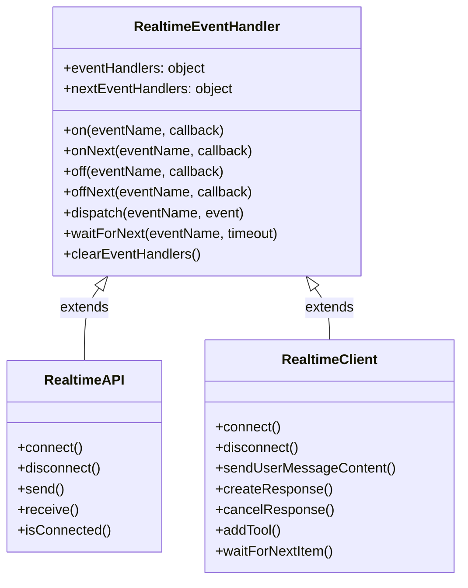
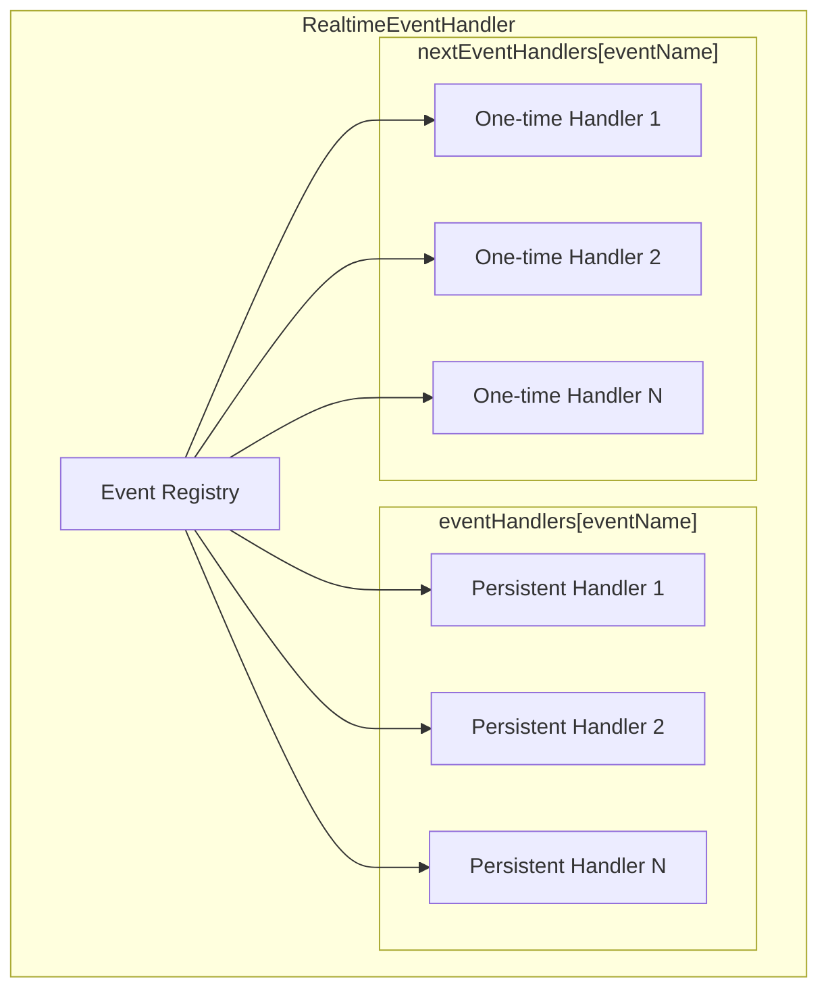
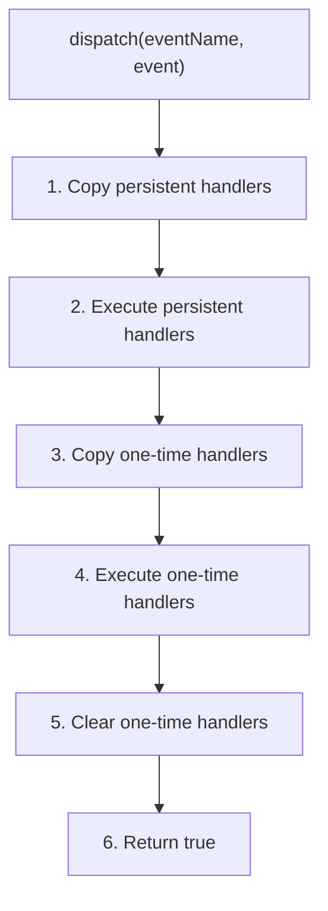
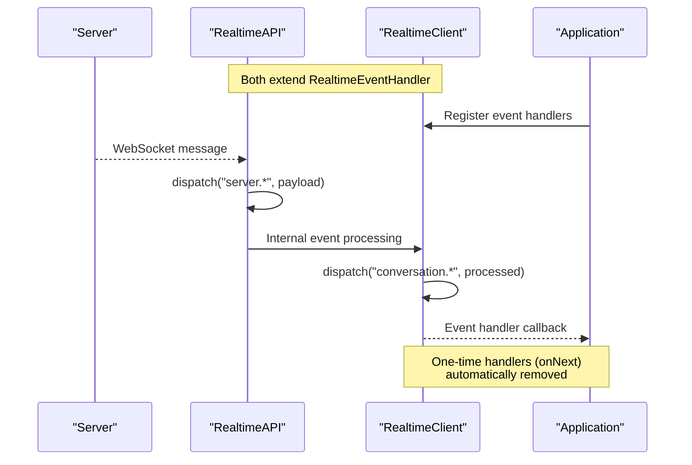

<!-- source: DeepWiki mcp.deepwiki.com · repo openai/openai-realtime-api-beta · page 5 RealtimeEventHandler · fetched 2026-10-26 -->

# RealtimeEventHandler

<details>
<summary>Relevant source files</summary>

The following files were used as context for generating this wiki page:

- [dist/lib/event_handler.d.ts](dist/lib/event_handler.d.ts)
- [dist/lib/event_handler.d.ts.map](dist/lib/event_handler.d.ts.map)
- [lib/event_handler.js](lib/event_handler.js)

</details>


## Purpose and Scope

The `RealtimeEventHandler` class is a foundational component of the OpenAI Realtime API client library that implements the event-driven architecture used throughout the system. It provides mechanisms for subscribing to events, dispatching events, and handling one-time event listeners. This class is extended by both `RealtimeAPI` and `RealtimeClient` to give them event handling capabilities.

For information about the `RealtimeClient` which extends this class, see [RealtimeClient](#2).
For information about the `RealtimeAPI` which also extends this class, see [RealtimeAPI](#3).
For a broader overview of all events emitted by the library, see [Event System](#8).

Sources: [lib/event_handler.js:9-12]()

## Class Architecture

The `RealtimeEventHandler` serves as a base class that provides event handling functionality to other components in the system.



Sources: [lib/event_handler.js:13-143]()

## Event Handler Properties

The `RealtimeEventHandler` class maintains two key internal properties:

| Property | Type | Description |
|----------|------|-------------|
| `eventHandlers` | Object | Maps event names to arrays of persistent handler functions |
| `nextEventHandlers` | Object | Maps event names to arrays of one-time handler functions |

Sources: [lib/event_handler.js:18-20]()

## Event Handler Types

The class supports two types of event handlers:

1. **Persistent Event Handlers** - Registered with the `on()` method, these handlers remain active until explicitly removed with `off()`.
2. **One-time Event Handlers** - Registered with the `onNext()` method, these handlers automatically unregister after handling their next matching event.



Sources: [lib/event_handler.js:27-55]()

## Core Methods

### Registering Event Handlers

#### `on(eventName, callback)`

Registers a persistent event handler that will be called for all matching events.

- **Parameters**:
  - `eventName` (string): The name of the event to listen for
  - `callback` (function): Function to execute when the event occurs
- **Returns**: The callback function (for reference when removing)

Sources: [lib/event_handler.js:39-43]()

#### `onNext(eventName, callback)`

Registers a one-time event handler that will be called only for the next matching event.

- **Parameters**:
  - `eventName` (string): The name of the event to listen for
  - `callback` (function): Function to execute when the event occurs
- **Returns**: The callback function (for reference when removing)

Sources: [lib/event_handler.js:51-55]()

### Removing Event Handlers

#### `off(eventName, callback)`

Removes a specific persistent event handler or all handlers for an event.

- **Parameters**:
  - `eventName` (string): The name of the event
  - `callback` (function, optional): Specific handler to remove. If omitted, all handlers for this event are removed
- **Returns**: `true` if successful
- **Throws**: Error if the specified callback is not found

Sources: [lib/event_handler.js:64-78]()

#### `offNext(eventName, callback)`

Removes a specific one-time event handler or all one-time handlers for an event.

- **Parameters**:
  - `eventName` (string): The name of the event
  - `callback` (function, optional): Specific handler to remove. If omitted, all one-time handlers for this event are removed
- **Returns**: `true` if successful
- **Throws**: Error if the specified callback is not found

Sources: [lib/event_handler.js:87-101]()

#### `clearEventHandlers()`

Removes all event handlers, both persistent and one-time.

- **Returns**: `true`

Sources: [lib/event_handler.js:27-31]()

### Event Dispatch and Waiting

#### `dispatch(eventName, event)`

Executes all registered handlers for a specific event.

- **Parameters**:
  - `eventName` (string): The name of the event to dispatch
  - `event` (object): The event payload to pass to handlers
- **Returns**: `true` after all handlers have executed
- **Behavior**: Executes persistent handlers first, then one-time handlers, and finally removes all one-time handlers

Sources: [lib/event_handler.js:131-142]()

#### `waitForNext(eventName, timeout = null)`

Asynchronously waits for the next occurrence of a specific event.

- **Parameters**:
  - `eventName` (string): The name of the event to wait for
  - `timeout` (number|null, optional): Maximum time to wait in milliseconds
- **Returns**: Promise that resolves to the event payload, or `null` if the timeout is reached
- **Implementation**: Uses a polling approach with a 1ms sleep interval

Sources: [lib/event_handler.js:109-123]()

## Event Dispatching Process

When an event is dispatched, it follows a specific sequence of operations:



Sources: [lib/event_handler.js:131-142]()

## Event Flow in the System

The `RealtimeEventHandler` enables event propagation throughout the library. The typical event flow is:



Sources: [lib/event_handler.js:131-142]()

## Usage Examples

### Registering Persistent Handlers

```javascript
// Listen for connection events
client.on('connection.established', (event) => {
  console.log('Connected with session ID:', event.sessionId);
});

// Listen for new conversation items
client.on('conversation.item.appended', (event) => {
  console.log('New item added:', event.item.content);
});
```

### Using One-time Handlers

```javascript
// Wait for the next response completion only
client.onNext('conversation.item.completed', (event) => {
  if (event.item.role === 'assistant') {
    console.log('Assistant finished responding');
  }
});
```

### Waiting for Events with Promises

```javascript
async function waitForResponse() {
  console.log('Waiting for assistant response...');
  
  // Wait up to 30 seconds for the next assistant message
  const event = await client.waitForNext('conversation.item.completed', 30000);
  
  if (event) {
    console.log('Response received:', event.item.content);
  } else {
    console.log('Timeout waiting for response');
  }
}
```

### Removing Event Handlers

```javascript
// Define handler function so it can be referenced later
const messageHandler = (event) => {
  console.log('Message received:', event.item.content);
};

// Register the handler
client.on('conversation.item.appended', messageHandler);

// Later, remove the specific handler
client.off('conversation.item.appended', messageHandler);

// Or remove all handlers for an event
client.off('conversation.item.appended');
```

### Clearing All Handlers

```javascript
// Remove all event handlers (typically when disconnecting)
client.clearEventHandlers();
```

Sources: [lib/event_handler.js:13-143]()

## Implementation Details

The `RealtimeEventHandler` implements a lightweight event system using JavaScript objects as lookup tables. Event handlers are stored in arrays indexed by event name. The class also includes a simple utility function for implementing the `waitForNext` method with minimal CPU usage:

```javascript
const sleep = (t) => new Promise((r) => setTimeout(() => r(), t));
```

This allows the implementation of asynchronous waiting with a small polling interval.

Sources: [lib/event_handler.js:6](), [lib/event_handler.js:109-123]()

## Summary

The `RealtimeEventHandler` class provides the foundation for the event-driven architecture of the OpenAI Realtime API client library. By extending this class, both `RealtimeAPI` and `RealtimeClient` gain the ability to emit events and respond to them in a consistent way. The class offers flexible options for event handling, including persistent handlers, one-time handlers, and Promise-based waiting, making it suitable for a variety of asynchronous interaction patterns.

Sources: [lib/event_handler.js:13-143]()

---

