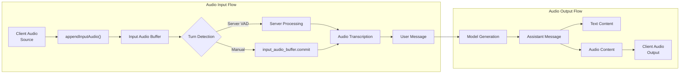
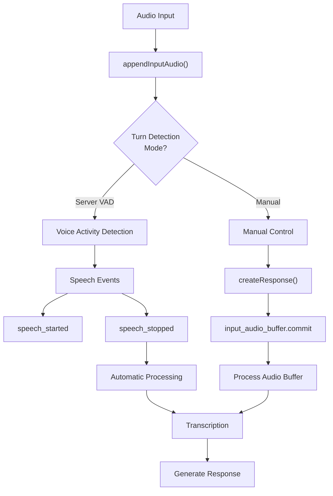
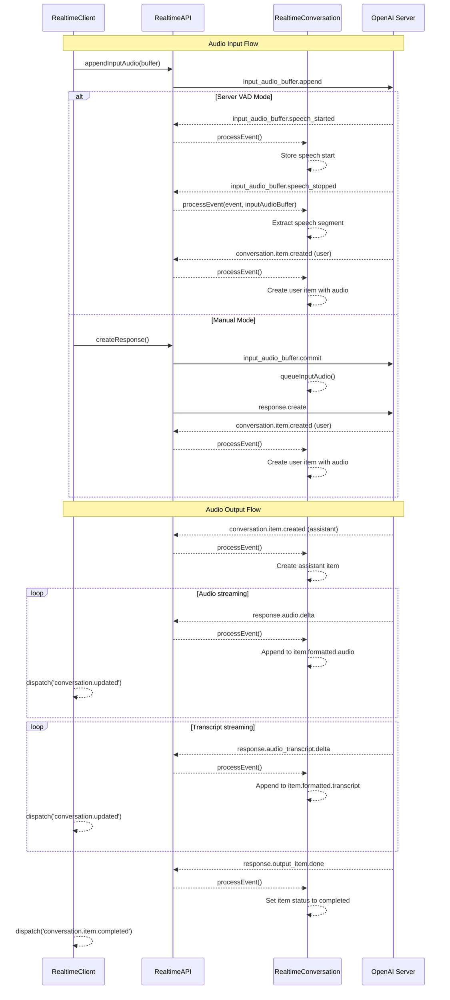

<!-- source: DeepWiki mcp.deepwiki.com · repo openai/openai-realtime-api-beta · page 6 Working with Audio · fetched 2026-10-26 -->

# Working with Audio

<details>
<summary>Relevant source files</summary>

The following files were used as context for generating this wiki page:

- [lib/client.js](lib/client.js)
- [lib/conversation.js](lib/conversation.js)
- [test/tests/audio.js](test/tests/audio.js)

</details>


This document explains how to use audio input and output features in the OpenAI Realtime API client library. It covers audio formats, streaming, turn detection, and transcription configuration. For information about turn detection mechanisms specifically, see [Turn Detection](#6.1).

## Audio Overview

The Realtime API supports bidirectional audio communication, allowing applications to send audio input to the model and receive audio output in response. This enables voice-based conversations with the AI assistant.



Sources: [lib/client.js:6-14](), [lib/client.js:575-586](), [lib/client.js:592-603]()

## Audio Configuration

### Supported Audio Formats

The client library supports the following audio formats:

| Format | Description |
|--------|-------------|
| `pcm16` | 16-bit PCM audio (default) |
| `g711_ulaw` | G.711 μ-law encoding |
| `g711_alaw` | G.711 A-law encoding |

You can configure both input and output audio formats when initializing or updating a session.

### Session Configuration for Audio

Audio-related configuration is set through the `updateSession()` method:

```mermaid
classDiagram
    class "SessionAudioConfig" {
        +modalities: ["text", "audio"]
        +input_audio_format: "pcm16"
        +output_audio_format: "pcm16"
        +input_audio_transcription: AudioTranscriptionType
        +turn_detection: TurnDetectionServerVadType
        +voice: "alloy"|"ash"|"ballad"|"coral"|"echo"|"sage"|"shimmer"|"verse"
    }
    
    class "AudioTranscriptionType" {
        +model: "whisper-1"
    }
    
    class "TurnDetectionServerVadType" {
        +type: "server_vad"
        +threshold: number
        +prefix_padding_ms: number
        +silence_duration_ms: number
    }
    
    "SessionAudioConfig" *-- "AudioTranscriptionType" : configures
    "SessionAudioConfig" *-- "TurnDetectionServerVadType" : configures
```

Sources: [lib/client.js:6-22](), [lib/client.js:35-47](), [lib/client.js:484-514]()

Example configuration:

```javascript
client.updateSession({
  modalities: ['text', 'audio'],  // Include 'audio' to enable audio processing
  input_audio_format: 'pcm16',    // Set input audio format
  output_audio_format: 'pcm16',   // Set output audio format
  voice: 'alloy',                 // Select voice for assistant responses
  input_audio_transcription: {    // Configure transcription
    model: 'whisper-1'
  },
  turn_detection: {               // Configure turn detection
    type: 'server_vad',
    threshold: 0.5,
    prefix_padding_ms: 300,
    silence_duration_ms: 200
  }
});
```

Sources: [lib/client.js:196-208](), [lib/client.js:484-514]()

## Working with Input Audio

### Streaming Audio Data

To send audio input to the model, use the `appendInputAudio()` method. This method accepts audio data as either an `Int16Array` or `ArrayBuffer`:

```javascript
// Append audio data to the input buffer
client.appendInputAudio(audioBuffer);
```

The audio data is converted to base64 and sent to the server, while also being stored in the client's `inputAudioBuffer`.

Sources: [lib/client.js:575-586]()

### Audio Content in Messages

You can also send pre-recorded audio as part of a message using `sendUserMessageContent()`:

```javascript
// Send a pre-recorded audio message
client.sendUserMessageContent([{
  type: 'input_audio',
  audio: audioBase64String // Base64-encoded audio data
}]);
```

The client will automatically convert `Int16Array` or `ArrayBuffer` to base64 if needed.

Sources: [lib/client.js:549-568]()

### Turn Detection Modes

There are two ways to control when audio input is considered complete and ready for processing:

1. **Server VAD (Voice Activity Detection)**: Automatically detects when a user has finished speaking
2. **Manual**: Explicitly trigger processing by calling `createResponse()`



Sources: [lib/client.js:428-430](), [lib/client.js:592-603](), [lib/conversation.js:122-144]()

#### Configuring Server VAD

Server VAD automatically detects when a user has started and stopped speaking:

```javascript
client.updateSession({
  turn_detection: {
    type: 'server_vad',
    threshold: 0.5,             // Sensitivity (0.0 to 1.0)
    prefix_padding_ms: 300,     // Audio to include before speech starts
    silence_duration_ms: 200    // Silence before marking speech as stopped
  }
});
```

Sources: [lib/client.js:17-22](), [lib/client.js:215-221](), [lib/client.js:507-508]()

#### Manual Control

To use manual control, set `turn_detection` to `null` and call `createResponse()` when you want to process the audio:

```javascript
client.updateSession({
  turn_detection: null
});

// Later, when you want to process the audio:
client.createResponse();
```

Sources: [lib/client.js:592-603]()

## Audio Output Handling

### Receiving Audio Output

When the assistant responds with audio, the audio data is streamed as it's generated. The client processes these events and makes the audio available through the conversation item structure.

Audio output events follow this sequence:

1. `server.conversation.item.created` - Initial creation of the assistant message
2. `server.response.audio.delta` - Audio data chunks as they become available
3. `server.response.audio_transcript.delta` - Transcript of the audio (if available)
4. `server.response.output_item.done` - Marks completion of the message

Sources: [lib/conversation.js:189-216]()

### Accessing Audio Output

You can access audio output through event handlers or by querying conversation items:

```javascript
// Using event handlers
client.on('conversation.updated', ({ item, delta }) => {
  if (item.role === 'assistant' && delta && delta.audio) {
    // Handle new audio data chunk
    processAudioChunk(delta.audio);
  }
});

// Or access the full audio data from a completed item
client.on('conversation.item.completed', ({ item }) => {
  if (item.role === 'assistant') {
    // Access complete audio data
    const fullAudio = item.formatted.audio;
    // Access transcript
    const transcript = item.formatted.transcript;
  }
});
```

Sources: [lib/client.js:329-348](), [lib/conversation.js:201-216]()

## Audio Event Processing

The client library processes audio-related events and updates the conversation state accordingly:



Sources: [lib/client.js:251-360](), [lib/conversation.js:122-144](), [lib/conversation.js:189-216]()

## Complete Audio Example

Here's a complete example demonstrating audio input and output handling:

```javascript
// Initialize client
const client = new RealtimeClient({
  apiKey: 'your-api-key'
});

// Configure audio settings
client.updateSession({
  modalities: ['text', 'audio'],
  input_audio_format: 'pcm16',
  output_audio_format: 'pcm16',
  voice: 'alloy',
  input_audio_transcription: {
    model: 'whisper-1'
  },
  turn_detection: {
    type: 'server_vad',
    threshold: 0.5,
    prefix_padding_ms: 300,
    silence_duration_ms: 200
  }
});

// Connect to the API
await client.connect();
await client.waitForSessionCreated();

// Handle received audio
client.on('conversation.updated', ({ item, delta }) => {
  if (item.role === 'assistant' && delta && delta.audio) {
    // Process streaming audio chunks as they arrive
    playAudio(delta.audio);
  }
});

// Stream microphone audio to the API
function processAudioChunk(audioChunk) {
  client.appendInputAudio(audioChunk);
}

// For manual mode: trigger response when user is done speaking
function userFinishedSpeaking() {
  client.createResponse();
}
```

Sources: [test/tests/audio.js:15-149](), [lib/client.js:575-603]()

## Audio Data Structure

Audio data is stored in the conversation items with a specific structure:

```mermaid
classDiagram
    class "UserItemType" {
        +type: "message"
        +role: "user"
        +status: "completed"
        +content: Array<InputTextContentType|InputAudioContentType>
        +formatted: FormattedPropertyType
    }
    
    class "AssistantItemType" {
        +type: "message"
        +role: "assistant"
        +status: "in_progress"|"completed"
        +content: Array<TextContentType|AudioContentType>
        +formatted: FormattedPropertyType
    }
    
    class "InputAudioContentType" {
        +type: "input_audio"
        +audio: string
        +transcript: string|null
    }
    
    class "AudioContentType" {
        +type: "audio"
        +audio: string
        +transcript: string|null
    }
    
    class "FormattedPropertyType" {
        +audio: Int16Array
        +text: string
        +transcript: string
    }
    
    "UserItemType" *-- "InputAudioContentType" : contains
    "AssistantItemType" *-- "AudioContentType" : contains
    "UserItemType" *-- "FormattedPropertyType" : has
    "AssistantItemType" *-- "FormattedPropertyType" : has
```

Sources: [lib/client.js:59-104](), [lib/client.js:131-148]()

The `FormattedPropertyType` provides convenient access to processed audio data as an `Int16Array`, which can be directly played or further processed.

Sources: [lib/conversation.js:201-216]()

---

