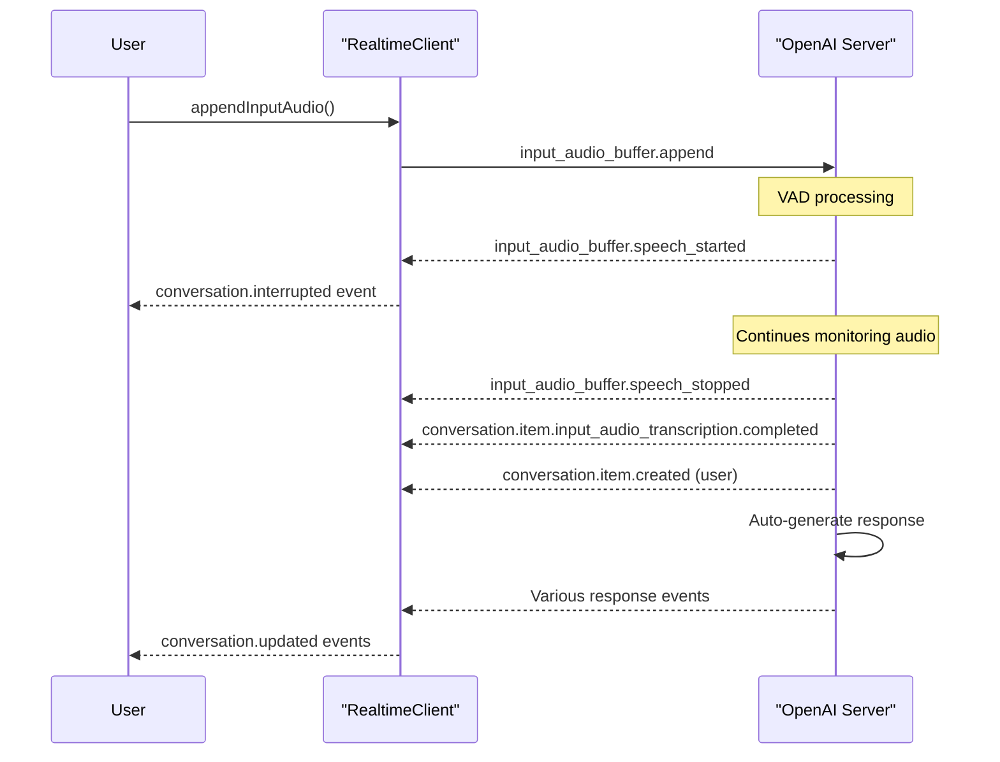
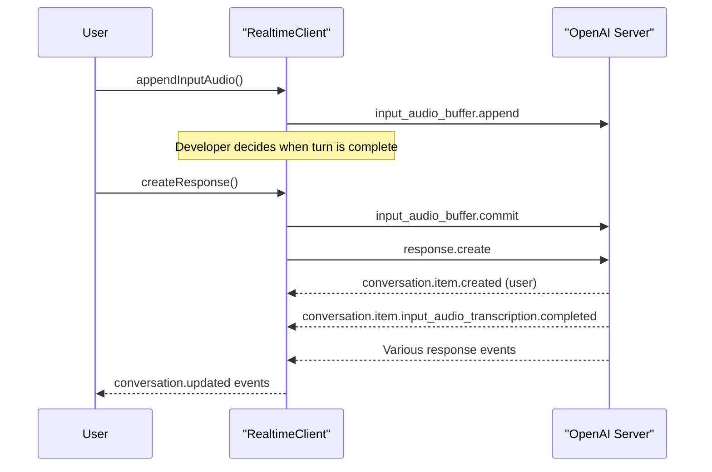
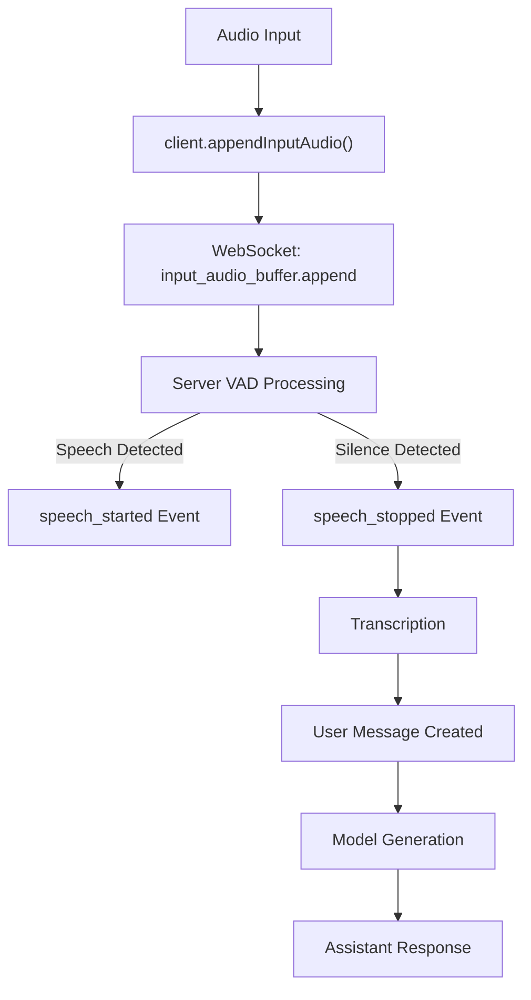
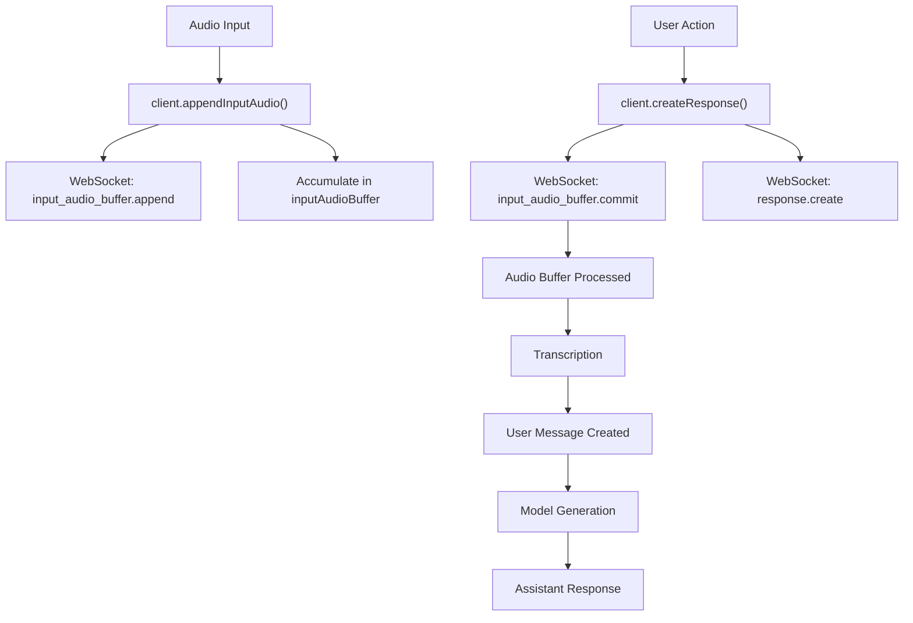

<!-- source: DeepWiki mcp.deepwiki.com · repo openai/openai-realtime-api-beta · page 6.1 Turn Detection · fetched 2026-10-26 -->

# Turn Detection

<details>
<summary>Relevant source files</summary>

The following files were used as context for generating this wiki page:

- [README.md](README.md)
- [lib/client.js](lib/client.js)
- [lib/conversation.js](lib/conversation.js)

</details>


Turn detection is the mechanism by which the OpenAI Realtime API determines when a user has finished speaking and it's the assistant's turn to respond. This is a critical component for building natural, conversational applications with audio input.

This document explains how to configure and use turn detection methods in the client library, the events they trigger, and how they affect conversation flow. For information about general audio processing, see [Working with Audio](#6).

## Turn Detection Modes

The OpenAI Realtime API client library provides two methods for turn detection:

1. **Server-side Voice Activity Detection (VAD)**: Automatically detects when the user has started and stopped speaking
2. **Manual Control**: Gives developers explicit control over when to end a user's turn

### Server-side Voice Activity Detection (VAD)

Server-side VAD automatically detects when speech starts and stops, enabling natural conversational flows without requiring explicit user actions (like pressing a button).



Sources: [lib/client.js:321-327](), [lib/conversation.js:122-144]()

### Manual Turn Detection

With manual turn detection, you explicitly control when to end the user's turn and when the assistant should respond. This is useful for push-to-talk interfaces or when you need precise control over conversation timing.



Sources: [lib/client.js:592-603]()

## Configuring Turn Detection

The turn detection mode is configured using the `updateSession()` method.

### Configuring Server-side VAD

```javascript
client.updateSession({
  turn_detection: {
    type: 'server_vad',
    threshold: 0.5,               // Sensitivity (0.0 to 1.0)
    prefix_padding_ms: 300,       // Audio to include before speech starts
    silence_duration_ms: 200      // Silence before marking speech as stopped
  },
  input_audio_transcription: { model: 'whisper-1' }  // Required for audio input
});
```

The VAD configuration parameters are:

| Parameter | Type | Default | Description |
|-----------|------|---------|-------------|
| threshold | number | 0.5 | Controls the sensitivity of speech detection (0.0 to 1.0) |
| prefix_padding_ms | number | 300 | How much audio to include before speech is detected (milliseconds) |
| silence_duration_ms | number | 200 | How long to wait after silence before considering speech stopped (milliseconds) |

Sources: [lib/client.js:215-220](), [lib/client.js:507-508]()

### Configuring Manual Turn Detection

To use manual turn detection, set `turn_detection` to `null`:

```javascript
client.updateSession({
  turn_detection: null,  // Disables automatic turn detection
  input_audio_transcription: { model: 'whisper-1' }  // Required for audio input
});
```

Sources: [lib/client.js:507-508]()

## How Turn Detection Works

### Server-side VAD Processing Flow



When using server-side VAD:

1. Audio streams to the server through `appendInputAudio()`
2. The server analyzes the audio for voice activity
3. When speech is detected, the server sends an `input_audio_buffer.speech_started` event
4. When silence is detected for the configured duration, it sends an `input_audio_buffer.speech_stopped` event
5. The audio between these points is transcribed and used to create a user message
6. The model automatically generates a response

Sources: [lib/client.js:574-586](), [lib/conversation.js:122-144]()

### Manual Turn Processing Flow



In manual mode:

1. Audio is streamed to the server and accumulated in the `inputAudioBuffer`
2. When you call `createResponse()`:
   - The audio buffer is committed with `input_audio_buffer.commit`
   - A response generation is requested with `response.create`
3. The committed audio is transcribed and used to create a user message
4. The model generates a response

Sources: [lib/client.js:592-603]()

## Implementation Details

### Turn Detection Related Types

The client library defines specific types for turn detection configuration:

```javascript
/**
 * @typedef {Object} TurnDetectionServerVadType
 * @property {"server_vad"} type
 * @property {number} [threshold]
 * @property {number} [prefix_padding_ms]
 * @property {number} [silence_duration_ms]
 */
```

The default server VAD configuration is defined in the `RealtimeClient` constructor:

```javascript
this.defaultServerVadConfig = {
  type: 'server_vad',
  threshold: 0.5,
  prefix_padding_ms: 300,
  silence_duration_ms: 200,
};
```

Sources: [lib/client.js:16-22](), [lib/client.js:215-220]()

### Audio Buffer Management

The client manages audio differently based on the turn detection mode:

```javascript
// Append audio to the buffer
appendInputAudio(arrayBuffer) {
  if (arrayBuffer.byteLength > 0) {
    this.realtime.send('input_audio_buffer.append', {
      audio: RealtimeUtils.arrayBufferToBase64(arrayBuffer),
    });
    this.inputAudioBuffer = RealtimeUtils.mergeInt16Arrays(
      this.inputAudioBuffer,
      arrayBuffer,
    );
  }
  return true;
}

// Force a model response generation
createResponse() {
  // In manual mode, commit the accumulated audio buffer
  if (
    this.getTurnDetectionType() === null &&
    this.inputAudioBuffer.byteLength > 0
  ) {
    this.realtime.send('input_audio_buffer.commit');
    this.conversation.queueInputAudio(this.inputAudioBuffer);
    this.inputAudioBuffer = new Int16Array(0);
  }
  this.realtime.send('response.create');
  return true;
}
```

In server VAD mode, the server manages the audio buffer and extracts speech segments. In manual mode, you explicitly commit the buffer when ready.

Sources: [lib/client.js:574-603]()

## Managing Turn Detection Events

The `RealtimeClient` provides several events related to turn detection:

### Events for Server-side VAD

```javascript
// Triggered when user starts speaking (in VAD mode)
client.on('conversation.interrupted', () => {
  // Useful for stopping playback of previous assistant responses
  audioPlayer.pause();
});

// Speech started/stopped events are processed internally
client.realtime.on('server.input_audio_buffer.speech_started', (event) => {
  handler(event);
  client.dispatch('conversation.interrupted');
});

client.realtime.on('server.input_audio_buffer.speech_stopped', (event) =>
  handler(event, this.inputAudioBuffer),
);
```

The `conversation.interrupted` event is particularly useful for stopping playback of previous responses when the user starts speaking in VAD mode.

Sources: [lib/client.js:321-327]()

### Events for Both Modes

```javascript
// Triggered when transcription is complete
client.on('conversation.updated', ({ item, delta }) => {
  if (delta && delta.transcript) {
    console.log('New transcript:', delta.transcript);
  }
});

// Triggered when a user message is created
client.on('conversation.item.appended', ({ item }) => {
  if (item.role === 'user') {
    console.log('User message:', item.formatted.transcript);
  }
});
```

Sources: [lib/client.js:275-289](), [lib/client.js:330-335]()

## Best Practices

### When to Use Server VAD

Server-side VAD is ideal for:
- Natural conversation interfaces
- Applications where users expect the system to understand when they've finished speaking
- Voice assistants and chatbots that simulate human conversation
- Hands-free applications

### When to Use Manual Turn Detection

Manual turn detection is better for:
- Push-to-talk interfaces
- Applications where you need precise control over when the model responds
- High-noise environments where VAD might be less reliable
- Scenarios where you need to preprocess or validate audio before sending for transcription

### Code Example: Switching Between Modes

```javascript
// Switch to server VAD mode
function enableServerVAD() {
  client.updateSession({
    turn_detection: {
      type: 'server_vad',
      threshold: 0.6,               // More sensitive
      silence_duration_ms: 300,     // Wait longer for silence
    }
  });
}

// Switch to manual mode
function enableManualMode() {
  client.updateSession({
    turn_detection: null
  });
}

// Check current mode
function isSeverVADEnabled() {
  return client.getTurnDetectionType() === 'server_vad';
}
```

Sources: [lib/client.js:427-430](), [lib/client.js:484-514]()

## Troubleshooting

Common issues with turn detection:

| Issue | Possible Cause | Solution |
|-------|---------------|----------|
| VAD not detecting speech | Low threshold | Increase the `threshold` parameter |
| VAD cutting off speech too early | Short silence duration | Increase the `silence_duration_ms` parameter |
| Missing beginning of phrases | Insufficient padding | Increase the `prefix_padding_ms` parameter |
| No speech detection at all | Missing transcription config | Ensure `input_audio_transcription` is configured |
| Response not generating in manual mode | Forgetting to call `createResponse()` | Call `createResponse()` after sending audio |

## Related Topics

For information about working with audio input and output formats, see [Working with Audio](#6).

For details on handling events in the client library, see [Event System](#8).

For information about session configuration, see [Session Configuration](#2.1).

---

