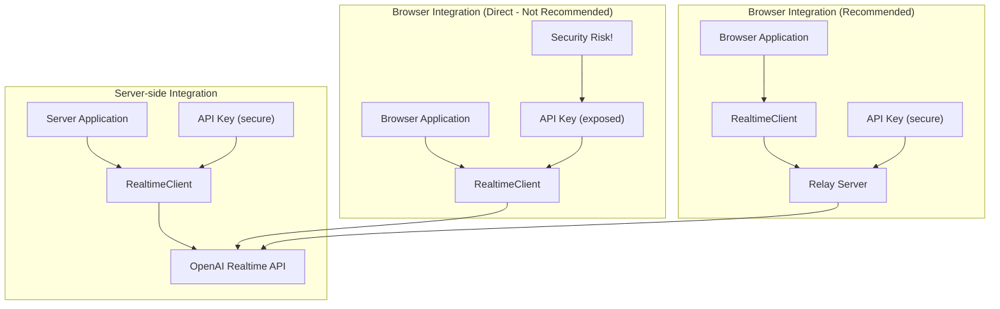
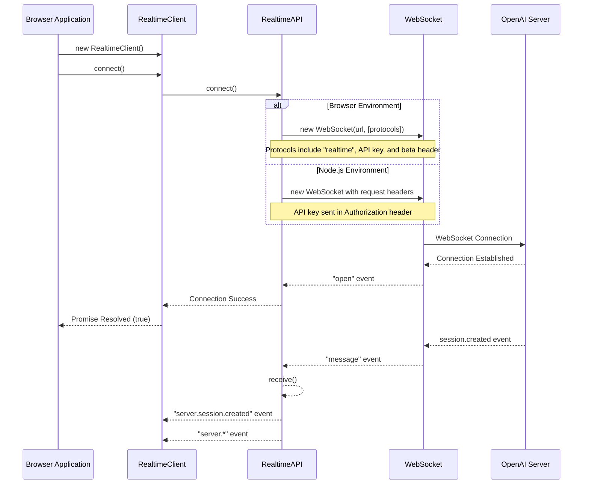
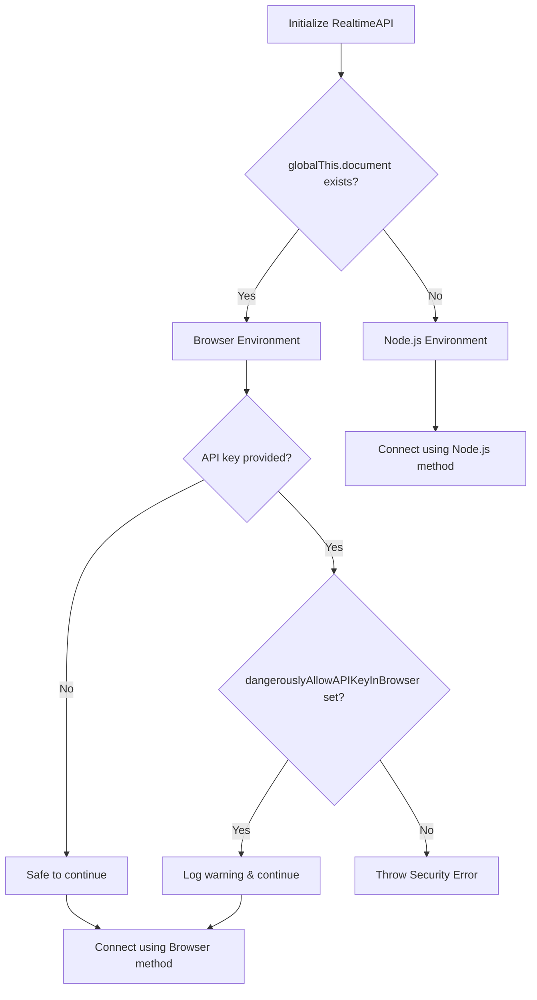

<!-- source: DeepWiki mcp.deepwiki.com · repo openai/openai-realtime-api-beta · page 7 Browser Integration · fetched 2026-10-26 -->

# Browser Integration

<details>
<summary>Relevant source files</summary>

The following files were used as context for generating this wiki page:

- [README.md](README.md)
- [lib/api.js](lib/api.js)
- [test/tests/browser.js](test/tests/browser.js)

</details>


This page documents how to integrate the OpenAI Realtime API client library with browser-based applications. It covers security considerations, connection methods, and best practices when using the library in browser environments. For information about the general client setup and usage, see [RealtimeClient](#2).

## Security Considerations

When integrating the Realtime API in browser environments, the primary security concern is protecting your API key. Unlike server-side applications where credentials can be safely stored, browser-based JavaScript exposes any embedded API keys to users.



The library includes built-in safeguards to prevent accidental API key exposure. When the library detects it's running in a browser environment and an API key is provided, it will throw an error unless explicitly configured to allow this risky behavior.

Sources: [lib/api.js:17-23](), [README.md:54-59]()

## Integration Methods

### Direct Integration (Not Recommended)

For rapid prototyping or development environments only, you can connect directly to the OpenAI Realtime API from the browser by explicitly acknowledging the security risk:

```javascript
const client = new RealtimeClient({
  apiKey: "your-api-key",
  dangerouslyAllowAPIKeyInBrowser: true
});
```

The `dangerouslyAllowAPIKeyInBrowser` flag must be set to `true` to override the built-in safety check. Without this flag, the client will throw an error when detecting a browser environment with an API key.

Sources: [lib/api.js:17-23](), [README.md:63-66]()

### Relay Server Integration (Recommended)

The recommended approach for production applications is to use a relay server that handles the API key securely on the server side:

```javascript
const client = new RealtimeClient({ 
  url: "wss://your-relay-server.com/realtime" 
});
```

When using a relay server, the browser client connects to your server, which then relays messages to and from the OpenAI Realtime API, keeping your API key secure.

Sources: [README.md:69-75]()

## WebSocket Connection Flow

The library uses different connection logic depending on the environment (browser vs. Node.js).



In browser environments, the API key is passed as part of the WebSocket protocols array, while in Node.js it's sent as an Authorization header.

Sources: [lib/api.js:66-107](), [lib/api.js:108-154]()

## Browser Environment Detection

The library detects browser environments by checking for the presence of `globalThis.document`. When detected, additional security checks are enforced.



The constructor checks in [lib/api.js:17-23]() enforce these security measures, with warning logs displayed at [lib/api.js:70-73]() if proceeding with the risky configuration.

Sources: [lib/api.js:17-23](), [lib/api.js:66-75]()

## Testing Browser Integration

The library includes tests specifically for browser environments, which mock the browser environment by setting `globalThis.WebSocket` and `globalThis.document`. These tests verify:

1. That initialization fails without the safety flag
2. That initialization succeeds with the safety flag
3. The proper connection flow and event handling in browser environments

Sources: [test/tests/browser.js:12-15](), [test/tests/browser.js:22-36](), [test/tests/browser.js:38-59]()

## Example Implementation with Relay Server

Below is a recommended browser integration pattern using a relay server:

### Client-side Code

```javascript
// Browser application
const client = new RealtimeClient({ 
  url: "wss://your-relay-server.example.com/realtime" 
});

// Set up event handlers
client.on('conversation.updated', (event) => {
  const { item, delta } = event;
  // Update UI with conversation changes
});

// Connect and send messages
await client.connect();
client.sendUserMessageContent([{ type: 'input_text', text: "How can I help you today?" }]);
```

### Relay Server (Node.js)

```javascript
// Server implementation (example)
import WebSocket from 'ws';
import { createServer } from 'http';
import { RealtimeClient } from '@openai/realtime-api-beta';

const server = createServer();
const wss = new WebSocket.Server({ server });

wss.on('connection', (ws) => {
  // Create a secure server-side client with the API key
  const client = new RealtimeClient({ 
    apiKey: process.env.OPENAI_API_KEY 
  });
  
  // Forward messages between browser client and OpenAI
  ws.on('message', (message) => {
    // Process messages from browser client and relay to OpenAI
  });
  
  client.on('realtime.event', (event) => {
    // Relay events from OpenAI back to browser client
    ws.send(JSON.stringify(event));
  });
  
  // Handle connection/disconnection
});

server.listen(8080);
```

## Security Best Practices

When integrating the Realtime API in browser environments, follow these best practices:

1. **Never include your API key in browser code** unless absolutely necessary for rapid prototyping
2. **Always use a relay server** for production applications
3. **Implement proper authentication** in your relay server
4. **Rate limit requests** to prevent abuse
5. **Monitor usage** to detect unusual patterns

## Technical Implementation Details

The browser connection implementation differs from Node.js in several key aspects:

| Aspect | Browser Implementation | Node.js Implementation |
|--------|------------------------|------------------------|
| Authentication | Via WebSocket protocol array | Via HTTP headers |
| WebSocket Class | Uses global WebSocket | Imports 'ws' module |
| Event Handling | Uses addEventListener | Uses on() method |
| Error Handling | Uses removeEventListener | Uses removeListener |

Sources: [lib/api.js:66-107](), [lib/api.js:108-154]()

## Connection Errors

Browser integrations may encounter various connection errors:

1. **API Key Security Error**: When providing an API key without the safety flag
2. **CORS Errors**: When the relay server doesn't set proper CORS headers
3. **WebSocket Connection Failures**: Network issues or incorrect URLs

The library handles connection errors by rejecting the connect() promise with an appropriate error message.

Sources: [lib/api.js:17-23](), [lib/api.js:86-89]()

---

