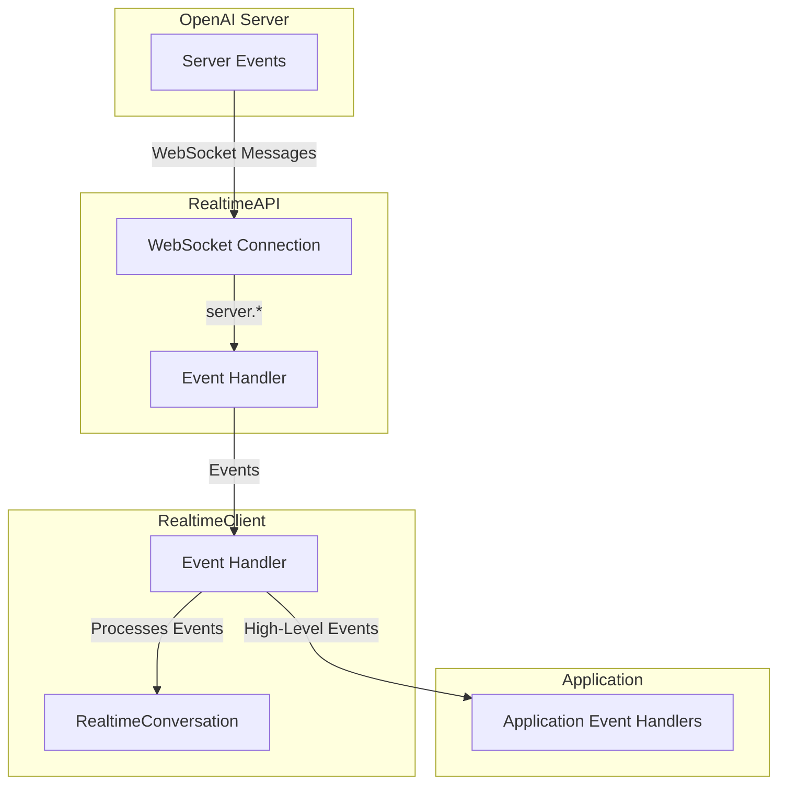
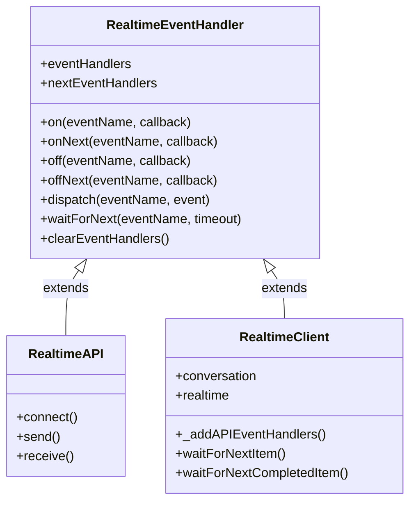
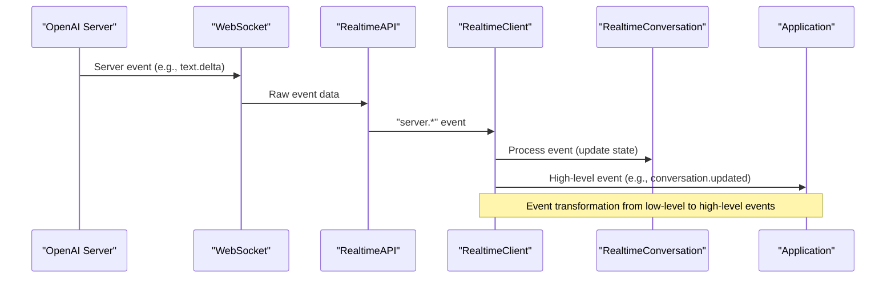
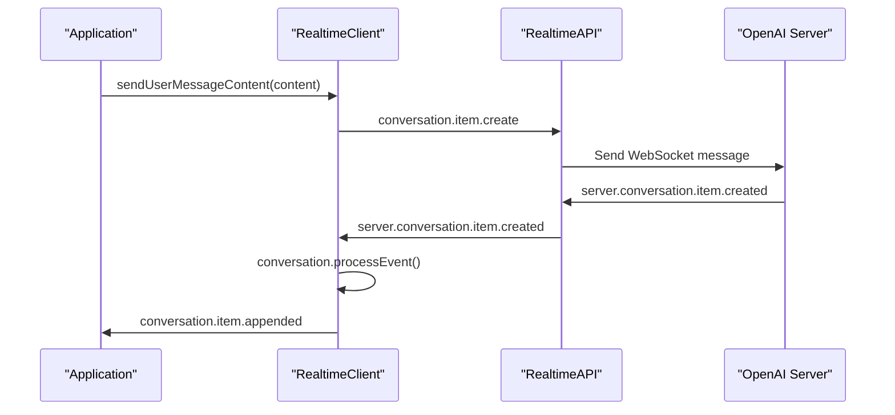
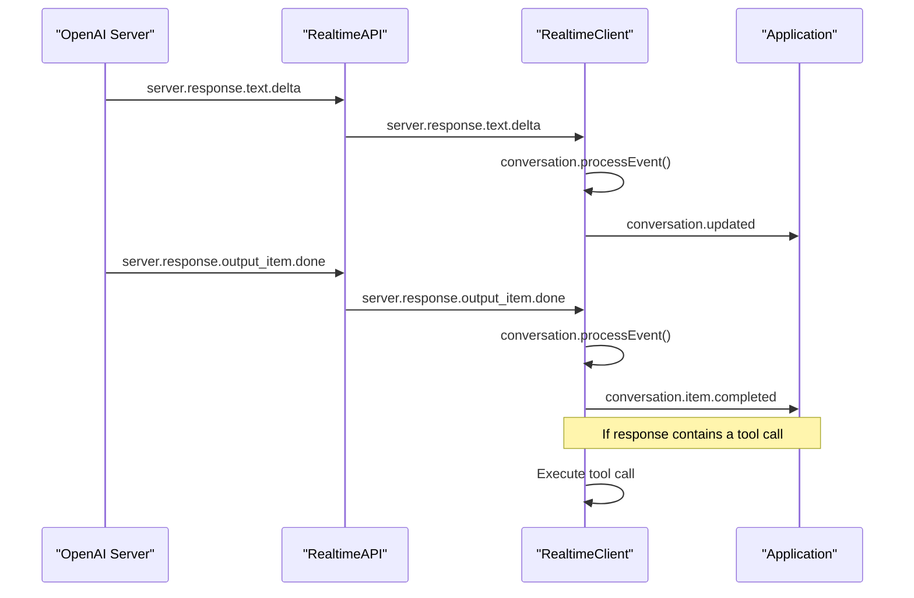

<!-- source: DeepWiki mcp.deepwiki.com · repo openai/openai-realtime-api-beta · page 8 Event System · fetched 2026-10-26 -->

# Event System

<details>
<summary>Relevant source files</summary>

The following files were used as context for generating this wiki page:

- [lib/client.js](lib/client.js)
- [lib/event_handler.js](lib/event_handler.js)
- [test/tests/client.js](test/tests/client.js)

</details>


The Event System is a core component of the OpenAI Realtime API Client Library that enables asynchronous communication between the server, internal components, and your application. This page documents the event-driven architecture, event types, and how to effectively use events in your applications.

For information about the overall architecture of the client library, see [System Architecture](#1.1).

## Overview

The OpenAI Realtime API Client Library uses an event-driven architecture to handle asynchronous communication. The event system allows your application to:

1. Receive real-time updates from the server (such as text deltas, audio chunks, etc.)
2. Track the state of the conversation
3. Respond to user interactions
4. Coordinate tool/function calls



Sources: [lib/client.js:249-362](), [lib/event_handler.js:1-143]()

## Event Handler Architecture

The event system is built on the `RealtimeEventHandler` class, which provides the foundation for event management throughout the library. Both `RealtimeAPI` and `RealtimeClient` extend this class, inheriting its event handling capabilities.



Sources: [lib/event_handler.js:13-143](), [lib/client.js:189-196]()

### Core Event Handler Methods

The `RealtimeEventHandler` provides several key methods for event management:

| Method | Description |
|--------|-------------|
| `on(eventName, callback)` | Register a persistent event listener |
| `onNext(eventName, callback)` | Register a one-time event listener (removed after first trigger) |
| `off(eventName, callback)` | Remove a specific event listener |
| `offNext(eventName, callback)` | Remove a specific one-time event listener |
| `dispatch(eventName, event)` | Trigger all registered handlers for an event |
| `waitForNext(eventName, timeout)` | Returns a Promise that resolves with the next occurrence of an event |
| `clearEventHandlers()` | Remove all event handlers |

Sources: [lib/event_handler.js:27-142]()

## Event Flow

Events in the library follow a specific flow pattern from the server to your application:



Sources: [lib/client.js:252-267](), [lib/client.js:318-362]()

## Event Types

The event system manages several categories of events:

### Server Events (Prefix: `server.`)

These are events received from the OpenAI Realtime API server through the WebSocket connection:

| Event Name | Description |
|------------|-------------|
| `server.session.created` | Session has been established with the server |
| `server.conversation.item.created` | A new conversation item has been created |
| `server.response.text.delta` | New text content has been generated |
| `server.response.audio.delta` | New audio content has been generated |
| `server.response.output_item.done` | An output item has been completed |
| `server.input_audio_buffer.speech_started` | Speech has been detected in audio input |
| `server.input_audio_buffer.speech_stopped` | Speech has ended in audio input |

### Application Events

The `RealtimeClient` transforms low-level server events into higher-level application events:

| Event Name | Description |
|------------|-------------|
| `realtime.event` | Meta-event that logs all client and server events |
| `conversation.updated` | The conversation state has been updated |
| `conversation.item.appended` | A new item has been added to the conversation |
| `conversation.item.completed` | An item has been marked as completed |
| `conversation.interrupted` | Speech has been detected during assistant response |

Sources: [lib/client.js:252-267](), [lib/client.js:318-361]()

## Using the Event System

### Basic Event Handling

To listen for events in your application:

```javascript
const client = new RealtimeClient({ apiKey: 'your-api-key' });

// Listen for all conversation updates
client.on('conversation.updated', ({ item, delta }) => {
  console.log('Conversation updated:', item);
});

// Listen for completed items
client.on('conversation.item.completed', ({ item }) => {
  console.log('Item completed:', item);
});

// Listen for all events (for debugging)
client.on('realtime.event', (event) => {
  console.log('Event:', event);
});
```

Sources: [test/tests/client.js:23-25]()

### Event Utilities

The `RealtimeClient` provides convenience methods for working with events:

```javascript
// Wait for the next item to be added to the conversation
const { item } = await client.waitForNextItem();

// Wait for the next completed item
const { item } = await client.waitForNextCompletedItem();
```

Sources: [lib/client.js:648-662]()

## Event Handling Examples

### Handling User Messages

When a user message is created:



Sources: [lib/client.js:330-336]()

### Handling Assistant Responses

When the assistant generates a response:



Sources: [lib/client.js:345-361]()

## Advanced Event Features

### Wildcards in Event Names

The event system supports wildcard patterns in event names:

```javascript
// Listen to all server events
client.on('server.*', (event) => {
  console.log('Server event:', event);
});

// Listen to all client events
client.on('client.*', (event) => {
  console.log('Client event:', event);
});
```

Sources: [lib/client.js:252-267]()

### Event Transformation

The `RealtimeClient` transforms low-level server events into more application-friendly events. This is done in the `_addAPIEventHandlers` method:

```javascript
const handlerWithDispatch = (event, ...args) => {
  const { item, delta } = handler(event, ...args);
  if (item) {
    this.dispatch('conversation.updated', { item, delta });
  }
  return { item, delta };
};
```

Sources: [lib/client.js:280-289]()

### Tool Calls via Events

When the assistant generates a tool call, it's handled through the event system:

```javascript
this.realtime.on('server.response.output_item.done', async (event) => {
  const { item } = handlerWithDispatch(event);
  if (item.status === 'completed') {
    this.dispatch('conversation.item.completed', { item });
  }
  if (item.formatted.tool) {
    callTool(item.formatted.tool);
  }
});
```

Sources: [lib/client.js:353-361]()

## Synchronizing with Events

The event system provides ways to wait for specific events, which is useful for synchronizing asynchronous operations:

### Using waitForNext

The `waitForNext` method returns a Promise that resolves with the next occurrence of an event:

```javascript
// Wait for the next session.created event (with a timeout)
const sessionEvent = await client.waitForNext('server.session.created', 5000);
if (sessionEvent) {
  console.log('Session created:', sessionEvent);
} else {
  console.error('Session creation timed out');
}
```

Sources: [lib/event_handler.js:109-123]()

### Using Specialized Wait Methods

The `RealtimeClient` provides specialized methods for common waiting patterns:

```javascript
// Wait for the next item to be added
const { item: userMessage } = await client.waitForNextItem();

// Wait for the next completed item
const { item: assistantResponse } = await client.waitForNextCompletedItem();
```

These methods are implemented using the more general `waitForNext` method:

```javascript
async waitForNextItem() {
  const event = await this.waitForNext('conversation.item.appended');
  const { item } = event;
  return { item };
}
```

Sources: [lib/client.js:648-662]()

## Best Practices

1. **Use appropriate event handlers**: For continuous monitoring, use `on()`. For one-time events, use `onNext()` or `waitForNext()`.

2. **Clean up event handlers**: Remove unnecessary event handlers with `off()` or `clearEventHandlers()` to prevent memory leaks.

3. **Use high-level events**: Prefer high-level events like `conversation.updated` rather than low-level `server.*` events when possible.

4. **Handle errors**: Implement error handling for events, especially when using `waitForNext()` which can time out.

5. **Use specialized wait methods**: Use `waitForNextItem()` and `waitForNextCompletedItem()` instead of manually setting up event handlers for common patterns.

---

