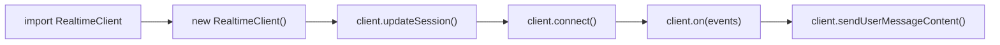
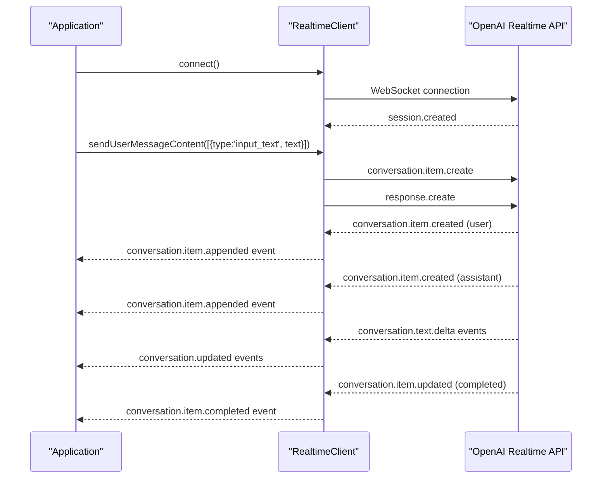
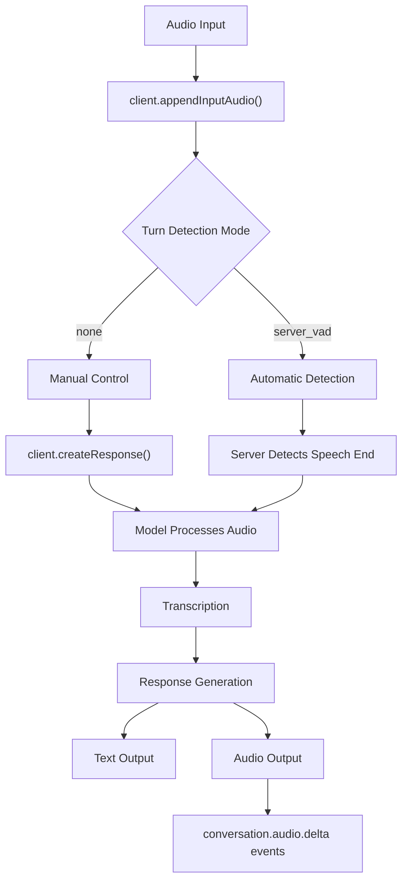
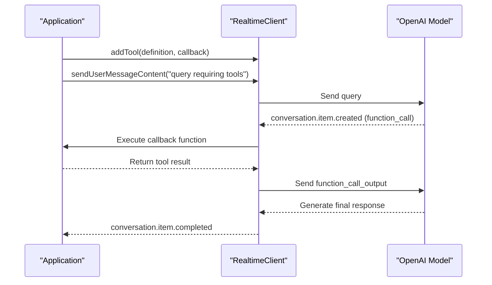
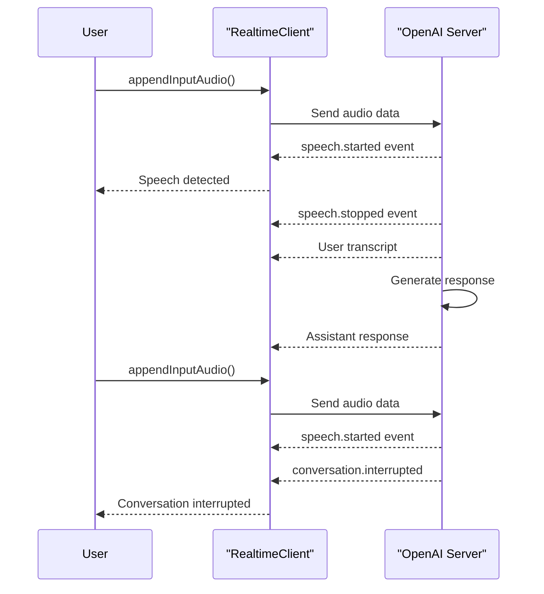
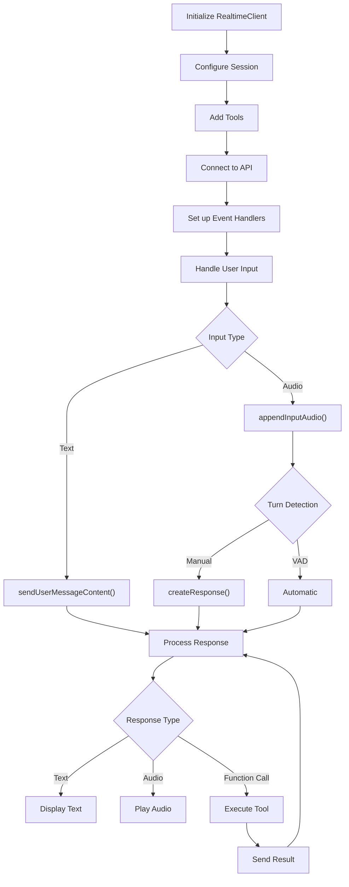

<!-- source: DeepWiki mcp.deepwiki.com · repo openai/openai-realtime-api-beta · page 9 Usage Examples · fetched 2026-10-26 -->

# Usage Examples

<details>
<summary>Relevant source files</summary>

The following files were used as context for generating this wiki page:

- [README.md](README.md)
- [test/tests/audio.js](test/tests/audio.js)
- [test/tests/browser.js](test/tests/browser.js)
- [test/tests/client.js](test/tests/client.js)

</details>


This page provides practical examples for using the OpenAI Realtime API client library. These examples demonstrate common implementation patterns based on test files in the repository and the official documentation. For detailed API reference, see [RealtimeClient](#2) and other component pages.

## Client Initialization

### Node.js Environment



```javascript
import { RealtimeClient } from '@openai/realtime-api-beta';

const client = new RealtimeClient({ apiKey: process.env.OPENAI_API_KEY });

// Configure session parameters
client.updateSession({ instructions: 'You are a helpful assistant.' });
client.updateSession({ voice: 'alloy' });

// Connect to the API
await client.connect();
```

Sources: [test/tests/client.js:11-36](), [README.md:23-48]()

### Browser Environment

For browser environments, additional security considerations are required:

```javascript
// Browser usage requires explicit acknowledgment of security risks
const client = new RealtimeClient({
  apiKey: process.env.OPENAI_API_KEY,
  dangerouslyAllowAPIKeyInBrowser: true
});
```

> ⚠️ **Security Warning**: Exposing your API key in browser code is not recommended for production applications. Consider using a relay server instead.

Sources: [test/tests/browser.js:38-59](), [README.md:54-75]()

## Basic Text Conversations

The following diagram illustrates a basic text conversation flow:



### Example: Sending Text and Waiting for Response

```javascript
// Set up event handling
client.on('conversation.updated', ({ item, delta }) => {
  console.log('Update:', item.type, delta);
});

// Send a text message
client.sendUserMessageContent([{ type: 'input_text', text: 'How are you?' }]);

// Wait for the next item (user message)
const { item: userItem } = await client.waitForNextItem();
// userItem.type === 'message'
// userItem.role === 'user'
// userItem.status === 'completed'

// Wait for the next item (assistant message start)
const { item: assistantItem } = await client.waitForNextItem();
// assistantItem.type === 'message'
// assistantItem.role === 'assistant'
// assistantItem.status === 'in_progress'

// Wait for the assistant to complete its response
const { item: completedItem } = await client.waitForNextCompletedItem();
// completedItem.status === 'completed'
// completedItem.formatted.text contains the full response
```

Sources: [test/tests/client.js:59-114](), [README.md:119-125]()

## Working with Audio

### Audio Input/Output Flow



### Example: Streaming Audio Input

```javascript
// Configure audio settings
client.updateSession({
  turn_detection: { type: 'none' },  // or 'server_vad'
  input_audio_transcription: { model: 'whisper-1' },
  audio_format: { type: 'pcm16', sampling_rate: 24000 }
});

// Stream audio chunks
for (let i = 0; i < 10; i++) {
  const audioChunk = new Int16Array(2400);
  // Fill with audio data...
  client.appendInputAudio(audioChunk);
}

// When using manual turn detection
client.createResponse();
```

### Example: Sending Audio File

```javascript
// Convert audio file to appropriate format
const audioData = /* load audio data */;

// Send as a message
client.sendUserMessageContent([{ 
  type: 'input_audio', 
  audio: audioData  // Base64 string or ArrayBuffer
}]);
```

Sources: [test/tests/audio.js:87-141](), [README.md:133-150]()

## Tool Integration

### Tool Flow Diagram



### Example: Automatic Tool Handling

```javascript
// Add a tool with automatic callback handling
client.addTool(
  {
    name: 'get_weather',
    description: 'Retrieves weather for a location',
    parameters: {
      type: 'object',
      properties: {
        location: {
          type: 'string',
          description: 'Location name'
        }
      },
      required: ['location']
    }
  },
  async ({ location }) => {
    // Tool implementation
    const result = await weatherAPI.getWeather(location);
    return result;
  }
);

// The callback is automatically executed when the model calls this function
```

### Example: Manual Tool Handling

```javascript
// Define tools via session configuration
client.updateSession({
  tools: [
    {
      type: 'function',
      name: 'get_weather',
      description: 'Retrieves weather for a location',
      parameters: {
        // Parameter schema...
      }
    }
  ]
});

// Listen for function calls
client.on('conversation.updated', ({ item, delta }) => {
  if (item.type === 'function_call' && item.status === 'completed') {
    // Parse the arguments
    const args = JSON.parse(item.arguments);
    
    // Execute your function
    const result = myWeatherFunction(args);
    
    // Manually send the result back
    client.realtime.send('conversation.item.create', {
      item: {
        type: 'function_call_output',
        call_id: item.id,
        output: JSON.stringify(result)
      }
    });
    client.realtime.send('response.create');
  }
});
```

Sources: [README.md:160-255]()

## Event Handling

The Realtime client library uses an event-driven architecture. Understanding the event system is crucial for building reactive applications.

### Key Client Events

| Event | Description |
|-------|-------------|
| `conversation.updated` | Fired when any item is updated (new content, status change) |
| `conversation.item.appended` | Fired when a new item is added to the conversation |
| `conversation.item.completed` | Fired when an item changes to 'completed' status |
| `conversation.interrupted` | Fired when the user interrupts the assistant |
| `error` | Fired when an error occurs |
| `realtime.event` | Low-level event containing all raw server and client events |

### Event Flow Architecture

```mermaid
flowchart TD
    A["WebSocket Events"] --> B["RealtimeAPI"]
    B --> C["RealtimeClient"]
    B --> D["RealtimeConversation"]
    C --> E["Application Event Handlers"]
    
    subgraph "High-Level Events"
        F["conversation.updated"]
        G["conversation.item.appended"]
        H["conversation.item.completed"]
    end
    
    subgraph "Raw Events"
        I["realtime.event"]
    end
    
    C --> "High-Level Events"
    C --> "Raw Events"
```

### Example: Event Handler Setup

```javascript
// Monitor all conversation updates
client.on('conversation.updated', ({ item, delta }) => {
  console.log(`Item updated: ${item.id} (${item.type})`);
  
  if (delta) {
    if (delta.text) console.log(`New text: ${delta.text}`);
    if (delta.audio) console.log(`New audio: ${delta.audio.length} bytes`);
    if (delta.transcript) console.log(`New transcript: ${delta.transcript}`);
  }
  
  // Get all conversation items
  const items = client.conversation.getItems();
});

// Only handle completed items
client.on('conversation.item.completed', ({ item }) => {
  console.log(`Item completed: ${item.id} (${item.type})`);
  
  if (item.type === 'message' && item.role === 'assistant') {
    console.log(`Assistant said: ${item.formatted.text}`);
    // Play audio if available
  }
});
```

Sources: [README.md:299-344]()

## Advanced Examples

### Prompting and Handling VAD Turn Detection



```javascript
// Configure VAD turn detection
client.updateSession({
  turn_detection: { type: 'server_vad' }
});

// Add audio interruption handler
client.on('conversation.interrupted', () => {
  console.log('User started speaking, interrupting assistant');
  // Stop playing assistant audio
});

// Stream audio for processing
function handleMicrophoneData(audioChunk) {
  client.appendInputAudio(audioChunk);
}
```

### Model Interruption

```javascript
// Get the current assistant message
const { items } = client.conversation.getItems();
const currentAssistantMessage = items.find(
  item => item.type === 'message' && 
  item.role === 'assistant' && 
  item.status === 'in_progress'
);

if (currentAssistantMessage) {
  // Interrupt at the current audio position
  client.cancelResponse(
    currentAssistantMessage.id, 
    currentPlaybackSamplePosition
  );
}
```

Sources: [README.md:263-273]()

### Complete Example Flow



This diagram represents a complete Realtime API interaction flow, showing how the different components work together in a typical application.

Sources: [README.md:23-273](), [test/tests/client.js:11-120](), [test/tests/audio.js:39-141]()

## Synchronizing with Asynchronous Events

The client provides utility methods to wait for specific events, which is particularly useful in testing or sequential workflows:

| Method | Purpose |
|--------|---------|
| `waitForNextItem()` | Waits for the next item to be added to the conversation |
| `waitForNextCompletedItem()` | Waits for the next item to be completed |
| `waitForSessionCreated()` | Waits for the session to be created after connecting |

```javascript
// Connect and wait for session creation
await client.connect();
await client.waitForSessionCreated();

// Send a message
client.sendUserMessageContent([{ type: 'input_text', text: 'Hello' }]);

// Wait for the user message to be created
const { item: userItem } = await client.waitForNextItem();

// Wait for the assistant to start responding
const { item: assistantInProgress } = await client.waitForNextItem();

// Wait for the assistant to complete its response
const { item: assistantCompleted } = await client.waitForNextCompletedItem();
```

Sources: [test/tests/client.js:78-114](), [test/tests/browser.js:106-142]()