# Page: OpenAI Realtime API Client Library

# OpenAI Realtime API Client Library

<details>
<summary>Relevant source files</summary>

The following files were used as context for generating this wiki page:

- [README.md](README.md)
- [dist/lib/client.d.ts](dist/lib/client.d.ts)
- [lib/client.js](lib/client.js)

</details>


The OpenAI Realtime API Client Library provides a JavaScript/TypeScript interface for interacting with OpenAI's Realtime API. This library enables developers to build real-time conversational applications with support for text, audio, and function calls through a WebSocket-based connection. For detailed information about the internal architecture, see [System Architecture](#1.1).

## Overview

The Realtime API Client Library allows applications to create interactive, streaming conversations with OpenAI models. Key capabilities include:

- **Bidirectional streaming** of text and audio content
- **Real-time turn-taking** with automatic speech detection
- **Tool/function integration** for extending assistant capabilities
- **Event-driven architecture** for responsive applications

The library is designed to be used in both Node.js and browser environments.

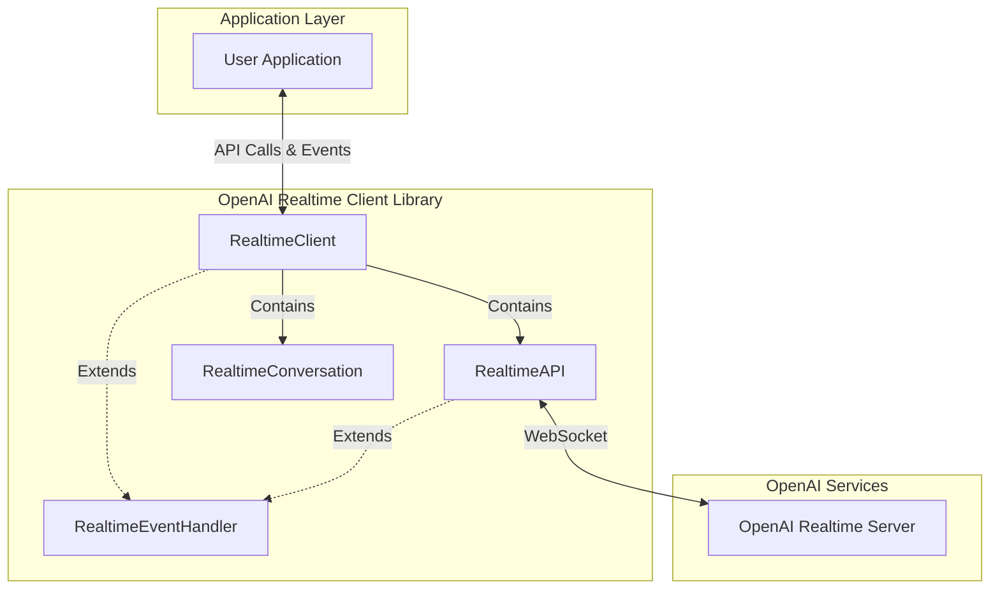

Sources: [lib/client.js:189-663](), [README.md:1-393]()

## Core Components

The library is composed of three primary components, each with a distinct responsibility:

1. **RealtimeClient** - The main interface that applications interact with. It handles session management, conversation flow, and provides a simplified API for common operations.

2. **RealtimeAPI** - A thin wrapper over WebSocket connections that manages communication with OpenAI's servers.

3. **RealtimeConversation** - Maintains the state of the conversation, including message history and response tracking.

4. **RealtimeEventHandler** - Provides event handling capabilities that both RealtimeClient and RealtimeAPI extend.

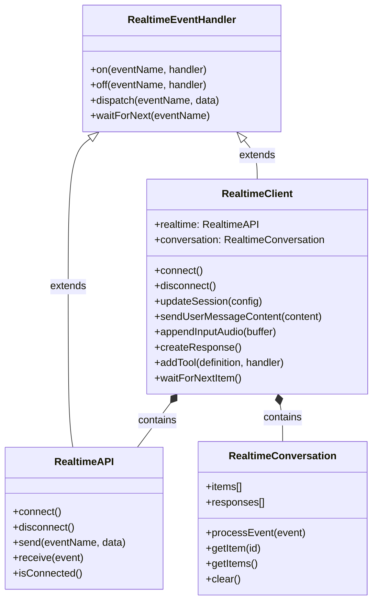

Sources: [lib/client.js:189-228](), [README.md:92-113]()

## Data Flow

The library processes data bidirectionally, handling both application inputs and server responses through an event-driven system.

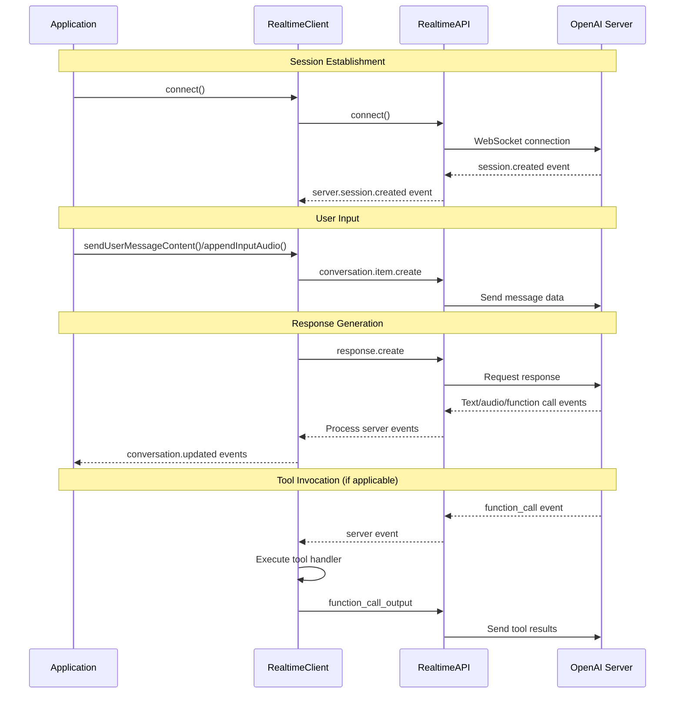

Sources: [lib/client.js:244-363](), [README.md:119-267]()

## Key Concepts

### Session Configuration

The session configuration determines how the client interacts with the Realtime API. It includes settings for:

- Modalities (text, audio)
- Instructions for the assistant
- Voice selection
- Audio formats and transcription
- Turn detection settings
- Tool definitions
- Temperature and other model parameters

Sessions are configured using the `updateSession()` method:

```javascript
client.updateSession({
  modalities: ['text', 'audio'],
  instructions: 'You are a helpful assistant.',
  voice: 'alloy',
  turn_detection: { type: 'server_vad' },
  temperature: 0.7
});
```

Sources: [lib/client.js:484-541](), [README.md:28-34]()

### Event System

The library uses an event-driven architecture to handle communication between the application, client, and server. The main events include:

| Event Type | Description |
|------------|-------------|
| `conversation.updated` | Triggered when any conversation item is updated, with the item and delta |
| `conversation.item.appended` | Triggered when a new item is added to the conversation |
| `conversation.item.completed` | Triggered when an item is marked as completed |
| `conversation.interrupted` | Triggered when user speech interrupts an ongoing response |
| `realtime.event` | Raw events from server and client for debugging |

Applications can subscribe to these events using the `on()` method:

```javascript
client.on('conversation.updated', ({ item, delta }) => {
  // Handle updated item
});
```

Sources: [lib/client.js:250-265](), [README.md:292-345]()

### Conversation Items

The conversation is made up of different types of items:

| Item Type | Description |
|-----------|-------------|
| `message` (user) | Content provided by the user (text or audio) |
| `message` (assistant) | Responses from the assistant (text or audio) |
| `message` (system) | System instructions or messages |
| `function_call` | A tool invocation from the assistant |
| `function_call_output` | The result of a tool invocation |

Each item has a unique ID, status (in_progress, completed, incomplete), and content appropriate to its type.

Sources: [lib/client.js:80-152](), [dist/lib/client.d.ts:65-455]()

### Audio Processing

The library supports audio input and output with different modes of turn detection:

1. **Server Voice Activity Detection (VAD)** - Automatically detects when a user starts and stops speaking
2. **Manual** - Application explicitly controls when to process audio and generate responses

Audio is processed through the `appendInputAudio()` method and can be committed using `createResponse()`:

```javascript
// Add audio data to the buffer
client.appendInputAudio(audioData);

// For manual turn detection, explicitly create a response
client.createResponse();
```

Sources: [lib/client.js:574-603](), [README.md:131-150]()

### Tool Integration

The library allows for extending assistant capabilities through tools (functions) that can be called during a conversation:

```javascript
client.addTool(
  {
    name: 'get_weather',
    description: 'Get weather for a location',
    parameters: {
      type: 'object',
      properties: {
        location: { type: 'string' }
      },
      required: ['location']
    }
  },
  async (params) => {
    // Function implementation
    return { temperature: 72, conditions: 'sunny' };
  }
);
```

When the assistant calls a tool, the associated handler is automatically executed, and the result is sent back to continue the conversation.

Sources: [lib/client.js:437-467](), [README.md:154-256]()

## Basic Usage

Here's a simple example of using the Realtime API Client Library:

```javascript
// Initialize client
const client = new RealtimeClient({ apiKey: 'your-api-key' });

// Configure session
client.updateSession({
  instructions: 'You are a helpful assistant.',
  voice: 'alloy'
});

// Set up event handling
client.on('conversation.updated', ({ item, delta }) => {
  console.log('Item updated:', item);
  if (delta?.text) {
    console.log('New text:', delta.text);
  }
  if (delta?.audio) {
    // Process audio...
  }
});

// Connect to Realtime API
await client.connect();

// Send a message
client.sendUserMessageContent([
  { type: 'input_text', text: 'Tell me a short story' }
]);

// Wait for completed response
const { item } = await client.waitForNextCompletedItem();
console.log('Response completed:', item);

// Clean up
client.disconnect();
```

Sources: [lib/client.js:392-422](), [README.md:13-52]()

## Further Reading

For more detailed information about specific components and features of the Realtime API Client Library, refer to:

- [RealtimeClient](#2) - Comprehensive documentation of the main client interface
- [Session Configuration](#2.1) - Details on configuring sessions
- [Tool Integration](#2.2) - In-depth guide on defining and using tools
- [Working with Audio](#6) - Guide on audio input/output features
- [Event System](#8) - Documentation of the events emitted by the library

Sources: [README.md:77-91]()

---

# Page: System Architecture

# System Architecture

<details>
<summary>Relevant source files</summary>

The following files were used as context for generating this wiki page:

- [lib/api.js](lib/api.js)
- [lib/client.js](lib/client.js)
- [lib/conversation.js](lib/conversation.js)
- [lib/event_handler.js](lib/event_handler.js)

</details>


This document provides a detailed overview of the OpenAI Realtime API client library's architecture, explaining how its components interact with each other and with the OpenAI Realtime Server. This page covers the core architectural design, data flow patterns, event systems, and component relationships. For information about using specific features, please refer to the relevant sections of the documentation.

## Core Components

The client library is built around four primary components that work together to provide a complete real-time communication system.

```mermaid
classDiagram
    class "RealtimeEventHandler" {
        +eventHandlers
        +nextEventHandlers
        +on()
        +onNext()
        +off()
        +offNext()
        +dispatch()
        +waitForNext()
        +clearEventHandlers()
    }
    
    class "RealtimeClient" {
        +realtime: RealtimeAPI
        +conversation: RealtimeConversation
        +sessionConfig
        +tools
        +connect()
        +disconnect()
        +updateSession()
        +sendUserMessageContent()
        +appendInputAudio()
        +createResponse()
        +cancelResponse()
        +addTool()
        +waitForNextItem()
    }
    
    class "RealtimeAPI" {
        +url
        +apiKey
        +ws
        +connect()
        +disconnect()
        +send()
        +receive()
        +isConnected()
    }
    
    class "RealtimeConversation" {
        +itemLookup
        +items
        +responseLookup
        +responses
        +queuedSpeechItems
        +clear()
        +queueInputAudio()
        +processEvent()
        +getItem()
        +getItems()
    }
    
    "RealtimeEventHandler" <|-- "RealtimeAPI" : extends
    "RealtimeEventHandler" <|-- "RealtimeClient" : extends
    "RealtimeClient" *-- "RealtimeAPI" : contains
    "RealtimeClient" *-- "RealtimeConversation" : contains
```

Sources: [lib/client.js:189-663](), [lib/api.js:4-208](), [lib/conversation.js:18-314](), [lib/event_handler.js:13-143]()

### Component Responsibilities

1. **RealtimeEventHandler**: Base class that provides event handling capabilities to other components.
   - Manages event subscription and dispatching
   - Provides both persistent (`on`/`off`) and one-time (`onNext`/`offNext`) event handlers
   - Includes utility methods like `waitForNext()` for synchronizing with asynchronous events

2. **RealtimeAPI**: Manages the WebSocket connection to the OpenAI Realtime server.
   - Establishes and maintains the WebSocket connection
   - Serializes outgoing messages and deserializes incoming messages
   - Dispatches server events to the client
   - Handles connection lifecycle (connect, disconnect, error handling)

3. **RealtimeConversation**: Manages conversation state and processes events.
   - Stores conversation items, responses, and related metadata
   - Processes events to update internal state
   - Formats data for consumption by applications
   - Manages audio buffers, transcripts, and other conversation artifacts

4. **RealtimeClient**: The main interface for applications, coordinates between components.
   - Provides high-level methods for interacting with the API
   - Manages session configuration
   - Coordinates audio input/output
   - Handles tool integration
   - Dispatches high-level events to applications

Sources: [lib/client.js:184-664](), [lib/api.js:4-208](), [lib/conversation.js:18-314](), [lib/event_handler.js:13-143]()

## Data and Event Flow

The client library uses an event-driven architecture, with events flowing between the server, API layer, and client components.

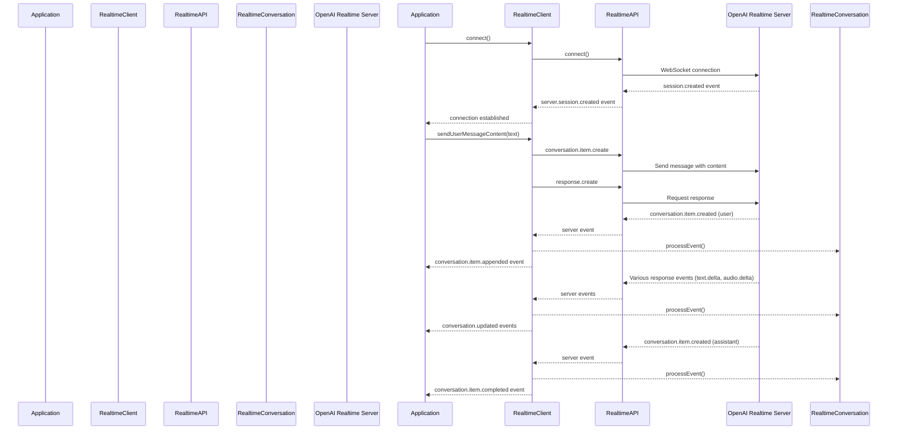

Sources: [lib/client.js:229-363](), [lib/api.js:175-207](), [lib/conversation.js:280-296]()

### Server to Application Event Flow

1. Events originate from the OpenAI Realtime Server via WebSocket
2. `RealtimeAPI` receives and parses these events, wrapping them in a consistent format
3. `RealtimeAPI` dispatches these as `server.*` events to `RealtimeClient`
4. `RealtimeClient` processes events via `RealtimeConversation.processEvent()`
5. `RealtimeClient` dispatches higher-level events to the application (e.g., `conversation.updated`)

This multi-stage event handling allows the library to abstract away the complexity of the raw server events, providing applications with a simpler, more consistent event model.

Sources: [lib/client.js:250-267](), [lib/api.js:175-181]()

## Session Configuration and Management

The `RealtimeClient` manages session configuration through its `updateSession()` method, which allows controlling various aspects of the conversation:

```mermaid
classDiagram
    class "SessionConfiguration" {
        +modalities: string[]
        +instructions: string
        +voice: string
        +input_audio_format: AudioFormatType
        +output_audio_format: AudioFormatType
        +input_audio_transcription: AudioTranscriptionType|null
        +turn_detection: TurnDetectionServerVadType|null
        +tools: ToolDefinitionType[]
        +tool_choice: string|object
        +temperature: number
        +max_response_output_tokens: number|"inf"
    }
    
    class "AudioFormatType" {
        "pcm16"|"g711_ulaw"|"g711_alaw"
    }
    
    class "TurnDetectionServerVadType" {
        +type: "server_vad"
        +threshold: number
        +prefix_padding_ms: number
        +silence_duration_ms: number
    }
    
    class "ToolDefinitionType" {
        +type: "function"
        +name: string
        +description: string
        +parameters: object
    }
    
    "SessionConfiguration" --> "AudioFormatType" : uses
    "SessionConfiguration" --> "TurnDetectionServerVadType" : uses
    "SessionConfiguration" --> "ToolDefinitionType" : uses
```

The session configuration controls:
- Input/output modalities (text, audio)
- Voice and audio format settings
- Turn detection behavior
- Tool definitions and preferences
- Model parameters (temperature, token limits)

Sources: [lib/client.js:34-47](), [lib/client.js:484-541]()

## Conversation State Management

The `RealtimeConversation` class manages the state of the conversation, including items (messages, function calls) and responses:

```mermaid
classDiagram
    class "RealtimeConversation" {
        +itemLookup: Object
        +items: Array
        +responseLookup: Object
        +responses: Array
        +queuedSpeechItems: Object
        +queuedTranscriptItems: Object
        +queuedInputAudio: Int16Array|null
        +EventProcessors: Object
        +clear()
        +queueInputAudio()
        +processEvent()
        +getItem()
        +getItems()
    }
    
    class "ItemType" {
        +id: string
        +type: string
        +status: ItemStatusType
        +role: string
        +content: Array
        +formatted: FormattedPropertyType
    }
    
    class "ResponseResourceType" {
        +status: string
        +status_details: Object|null
        +output: Array
        +usage: UsageType|null
    }
    
    "RealtimeConversation" --> "ItemType" : manages
    "RealtimeConversation" --> "ResponseResourceType" : manages
```

The conversation state includes:
- Messages (user and assistant)
- Function calls and their outputs
- Audio content and transcripts
- Status information for items and responses

Each event from the server is processed to update this state, allowing the application to have a consistent view of the conversation.

Sources: [lib/conversation.js:18-314](), [lib/client.js:80-152]()

## Audio Processing

The library includes a sophisticated audio processing pipeline that handles both automatic (server-side VAD) and manual turn detection:

```mermaid
flowchart TD
    "AudioInput"["Audio Input"] --> "Buffer"["Input Audio Buffer"]
    "Buffer" --> "TurnDetection"{"Turn Detection Mode"}
    
    "TurnDetection" -- "Server VAD" --> "VAD"["Voice Activity Detection"]
    "TurnDetection" -- "Manual" --> "Manual"["Manual Commit"]
    
    "VAD" --> "Start"["Speech Started Event"]
    "VAD" --> "Stop"["Speech Stopped Event"]
    "Manual" --> "Commit"["Input Audio Commit"]
    
    "Stop" --> "Transc"["Transcription"]
    "Commit" --> "Transc"
    
    "Transc" --> "UserMsg"["User Message"]
    "UserMsg" --> "Model"["Model Generation"]
    "Model" --> "AssistMsg"["Assistant Message"]
    
    "AssistMsg" --> "TextOut"["Text Output"]
    "AssistMsg" --> "AudioOut"["Audio Output"]
    "AssistMsg" --> "FuncCall"["Function Call"]
```

The audio processing pipeline involves:
1. Audio input collection via `appendInputAudio()`
2. Turn detection (either automatic with server VAD or manual with `createResponse()`)
3. Speech-to-text conversion
4. Model processing
5. Text and audio response generation

Sources: [lib/client.js:569-602](), [lib/conversation.js:121-144]()

## Tool Integration

The library supports integration with external tools through function calling:

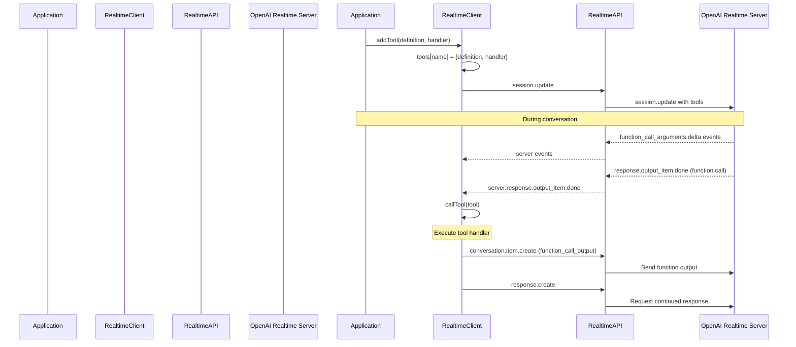

Tool integration allows the assistant to:
1. Call external functions during a conversation
2. Receive the results of those function calls
3. Continue the conversation with the new information

Sources: [lib/client.js:433-467](), [lib/client.js:290-315]()

## Event Handling and Synchronization

The event handling system, provided by `RealtimeEventHandler`, enables both synchronous and asynchronous processing of events:

```mermaid
classDiagram
    class "RealtimeEventHandler" {
        +eventHandlers: Object
        +nextEventHandlers: Object
        +on(eventName, callback)
        +onNext(eventName, callback)
        +off(eventName, callback)
        +offNext(eventName, callback)
        +dispatch(eventName, event)
        +waitForNext(eventName, timeout)
        +clearEventHandlers()
    }
    
    class "EventHandlers" {
        +persistent: Map
        +oneTime: Map
    }
    
    "RealtimeEventHandler" --> "EventHandlers" : manages
```

The event system provides:
- Persistent event handlers via `on()`/`off()`
- One-time event handlers via `onNext()`/`offNext()`
- Promise-based event waiting via `waitForNext()`
- Event dispatching to all registered handlers

This system enables both callback-based and Promise-based programming models, allowing developers to choose the approach that best fits their needs.

Sources: [lib/event_handler.js:13-143]()

## Connection Lifecycle

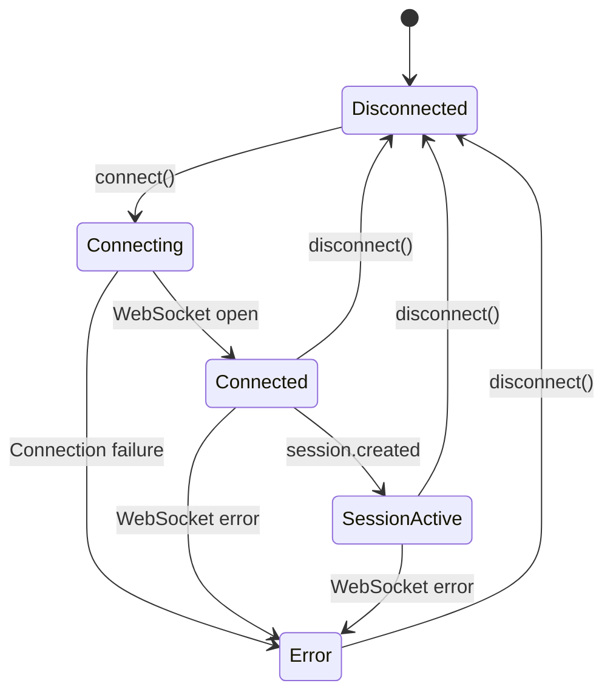

The connection lifecycle involves:
1. Initial connection establishment through `connect()`
2. WebSocket connection to the OpenAI Realtime server
3. Session creation and configuration
4. Active session with bidirectional communication
5. Disconnection through `disconnect()` or error handling

Sources: [lib/client.js:392-421](), [lib/api.js:59-154]()

## Integration Patterns

Applications can interact with the client library using several integration patterns:

### Event-Driven Pattern

```javascript
const client = new RealtimeClient({ apiKey: "your-api-key" });

client.on("conversation.updated", ({ item, delta }) => {
  // Process updates to conversation items
});

client.on("conversation.item.completed", ({ item }) => {
  // Process completed items
});

await client.connect();
client.sendUserMessageContent([{ type: "input_text", text: "Hello" }]);
```

### Promise-Based Pattern

```javascript
const client = new RealtimeClient({ apiKey: "your-api-key" });

await client.connect();
client.sendUserMessageContent([{ type: "input_text", text: "Hello" }]);

// Wait for the next item to be completed
const { item } = await client.waitForNextCompletedItem();
console.log(item.formatted.text);
```

Sources: [lib/client.js:647-662](), [lib/event_handler.js:108-123]()

## Conclusion

The OpenAI Realtime API client library follows a layered, event-driven architecture that effectively abstracts the complexities of WebSocket communication and event handling. This architecture allows applications to easily integrate with OpenAI's real-time capabilities, providing a robust foundation for building applications that require streaming text and audio communication with AI models.

For more details on using specific components, please refer to their respective documentation pages:
- For client usage information, see [RealtimeClient](#2)
- For event system details, see [Event System](#8)
- For audio processing, see [Working with Audio](#6)

---

# Page: RealtimeClient

# RealtimeClient

<details>
<summary>Relevant source files</summary>

The following files were used as context for generating this wiki page:

- [dist/lib/client.d.ts](dist/lib/client.d.ts)
- [lib/client.js](lib/client.js)

</details>


This document provides a comprehensive guide to the `RealtimeClient` class, which serves as the primary interface for applications interacting with the OpenAI Realtime API. The `RealtimeClient` manages communication with the server, handles conversation state, and provides methods for sending user input, receiving assistant responses, and integrating external tools.

For information about the underlying WebSocket communication, see [RealtimeAPI](#3). For details on conversation state management, see [RealtimeConversation](#4).

## 1. Class Overview

`RealtimeClient` extends the `RealtimeEventHandler` class to gain event handling capabilities. It contains instances of both `RealtimeAPI` (for WebSocket communication) and `RealtimeConversation` (for state management).

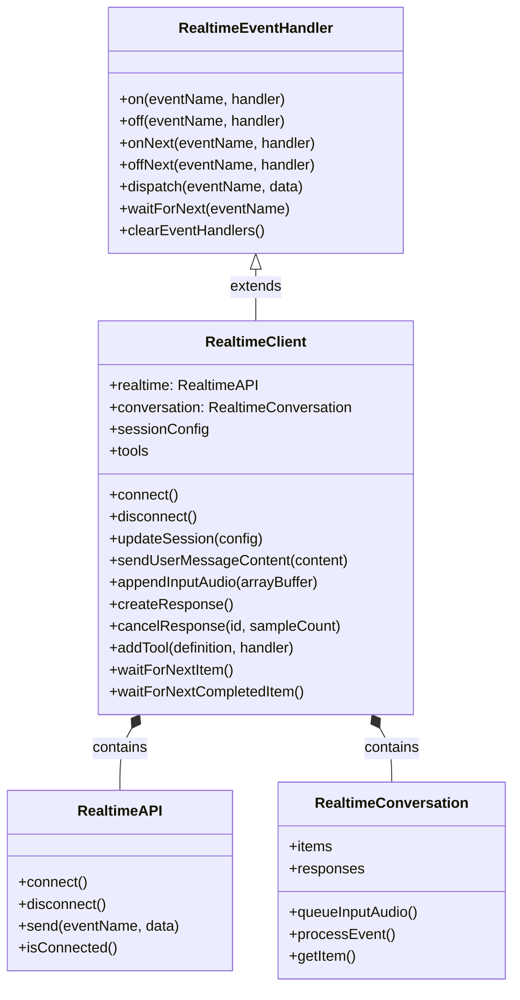

**Sources: [lib/client.js:189-189]()**

## 2. Initialization and Configuration

### 2.1 Constructor

The `RealtimeClient` constructor accepts an optional configuration object with the following parameters:

| Parameter | Type | Description |
|-----------|------|-------------|
| `url` | `string` | The WebSocket URL to connect to (optional) |
| `apiKey` | `string` | Your OpenAI API key (optional) |
| `dangerouslyAllowAPIKeyInBrowser` | `boolean` | Whether to allow sending the API key in browser environments (not recommended for production) |
| `debug` | `boolean` | Enable debug logging |

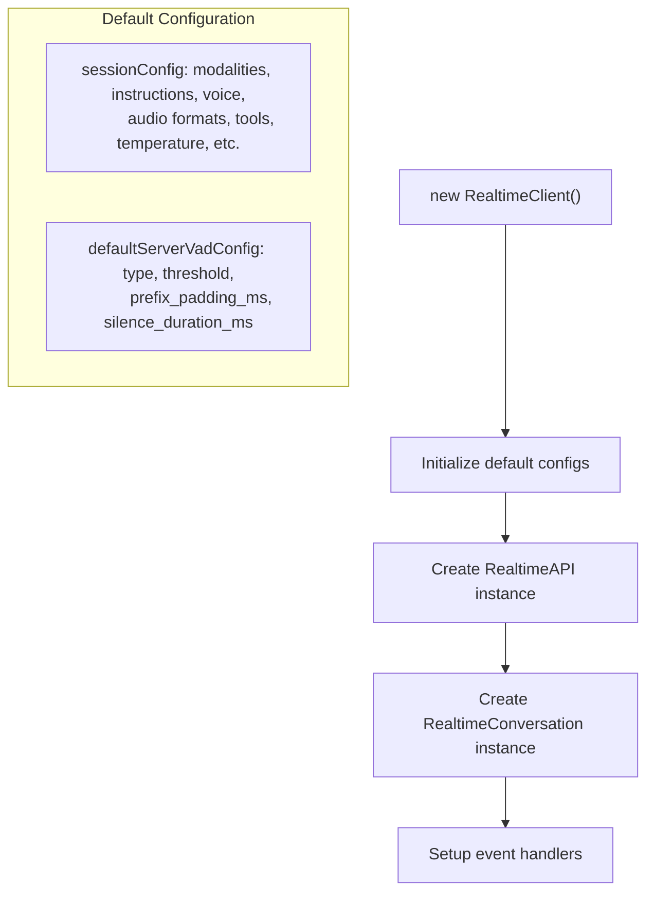

**Sources: [lib/client.js:194-229]()**

### 2.2 Session Configuration

The `updateSession()` method is used to configure the session with various parameters:

| Parameter | Type | Description |
|-----------|------|-------------|
| `modalities` | `string[]` | Array of modalities (e.g., 'text', 'audio') |
| `instructions` | `string` | System instructions for the assistant |
| `voice` | `string` | Voice to use for audio responses ('alloy', 'echo', 'verse', etc.) |
| `input_audio_format` | `AudioFormatType` | Format for audio input ('pcm16', 'g711_ulaw', or 'g711_alaw') |
| `output_audio_format` | `AudioFormatType` | Format for audio output |
| `input_audio_transcription` | `AudioTranscriptionType` | Configuration for transcribing audio input |
| `turn_detection` | `TurnDetectionServerVadType` | Configuration for turn detection |
| `tools` | `ToolDefinitionType[]` | Array of tool definitions |
| `tool_choice` | `string` | How tools should be used ('auto', 'none', 'required') |
| `temperature` | `number` | Temperature for response generation (0.0-1.0) |
| `max_response_output_tokens` | `number` or `"inf"` | Maximum number of tokens in the response |

**Sources: [lib/client.js:484-542]()**

## 3. Connection Management

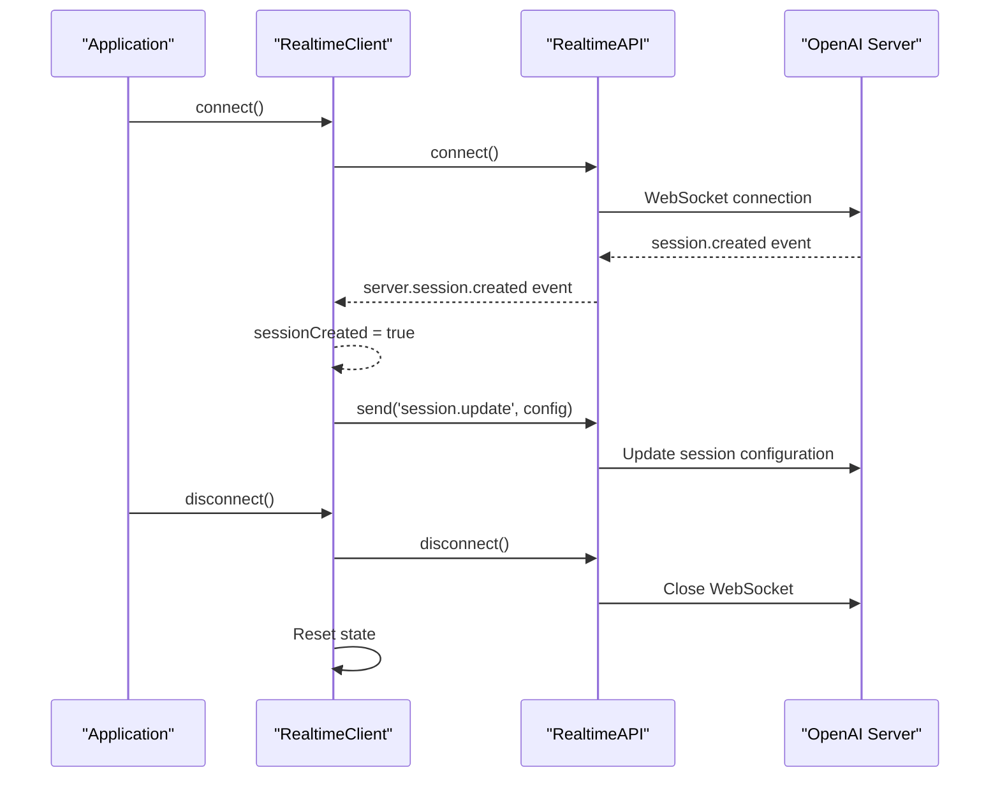

### 3.1 Connecting to the Server

```javascript
// Connect to the server
await client.connect();

// Wait for session to be established (optional)
await client.waitForSessionCreated();
```

**Sources: [lib/client.js:392-413]()**

### 3.2 Disconnecting from the Server

```javascript
// Disconnect from the server and clear conversation history
client.disconnect();
```

**Sources: [lib/client.js:418-422]()**

### 3.3 Checking Connection Status

```javascript
// Check if the client is connected
const isConnected = client.isConnected();
```

**Sources: [lib/client.js:370-372]()**

## 4. Message and Response Handling

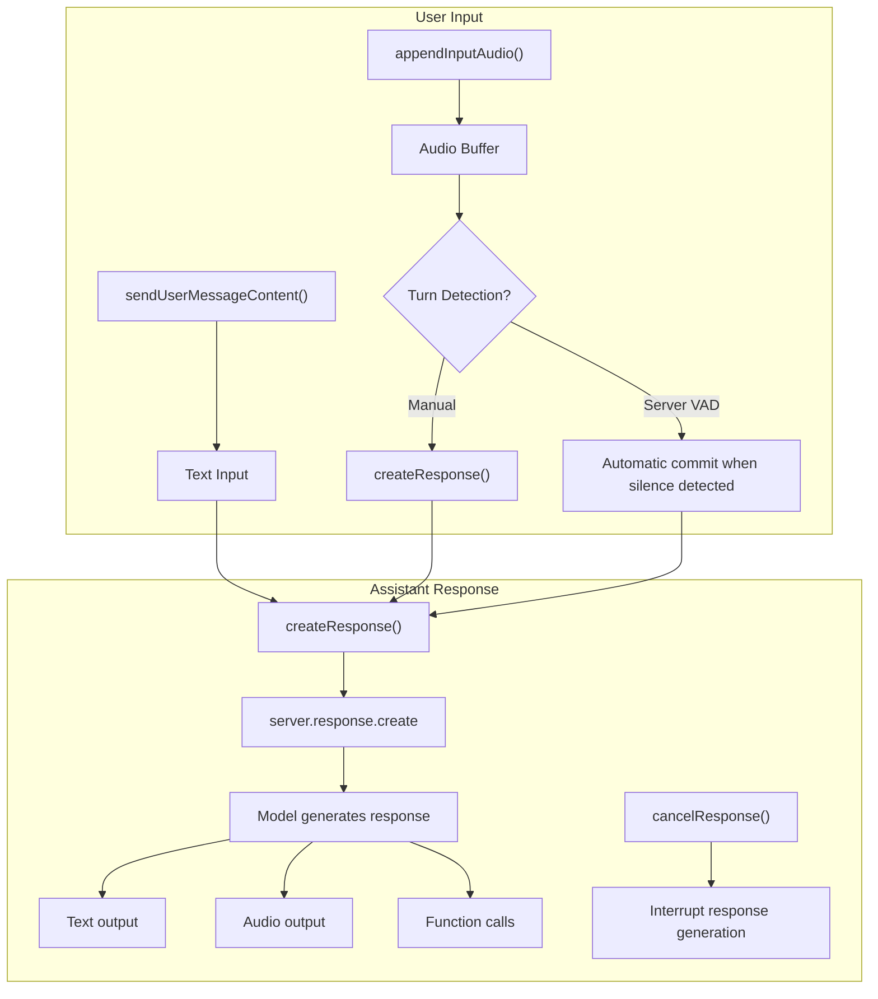

### 4.1 Sending User Messages

```javascript
// Send a text message
client.sendUserMessageContent([
  { type: 'input_text', text: 'Hello, how are you?' }
]);

// Send an audio message (with optional transcript)
client.sendUserMessageContent([
  { 
    type: 'input_audio', 
    audio: audioBuffer, // Int16Array or ArrayBuffer
    transcript: 'Hello, how are you?' // Optional
  }
]);
```

**Sources: [lib/client.js:549-568]()**

### 4.2 Handling Audio Input

```javascript
// Append audio chunks to the input buffer
client.appendInputAudio(audioChunk); // Int16Array or ArrayBuffer

// When using manual turn detection, trigger a response after appending audio
client.createResponse();
```

**Sources: [lib/client.js:575-603]()**

### 4.3 Canceling Responses

```javascript
// Cancel the current response generation without specifying an item
client.cancelResponse();

// Cancel a specific assistant message and truncate its audio at a specific point
client.cancelResponse(assistantItemId, sampleCount);
```

**Sources: [lib/client.js:612-642]()**

## 5. Tool Integration

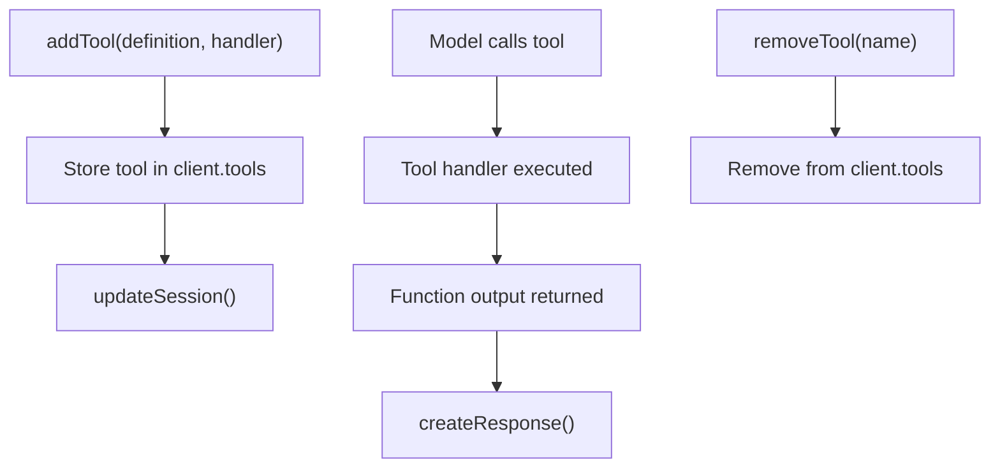

### 5.1 Adding Tools

```javascript
// Define a tool
const weatherTool = {
  name: 'get_weather',
  description: 'Get the current weather in a location',
  parameters: {
    type: 'object',
    properties: {
      location: {
        type: 'string',
        description: 'The city and state, e.g. San Francisco, CA'
      }
    },
    required: ['location']
  }
};

// Add the tool with a handler
client.addTool(weatherTool, async (args) => {
  const { location } = args;
  // Implement weather lookup logic
  return { temperature: 72, conditions: 'sunny' };
});
```

**Sources: [lib/client.js:438-454]()**

### 5.2 Removing Tools

```javascript
// Remove a previously added tool
client.removeTool('get_weather');
```

**Sources: [lib/client.js:461-467]()**

## 6. Event Handling

`RealtimeClient` inherits from `RealtimeEventHandler`, providing event handling capabilities. It also sets up internal event handlers to process server events and update the conversation state.

### 6.1 Event Types

| Event | Description |
|-------|-------------|
| `conversation.updated` | Fired when any part of the conversation is updated |
| `conversation.item.appended` | Fired when a new item is added to the conversation |
| `conversation.item.completed` | Fired when an item is marked as completed |
| `conversation.interrupted` | Fired when user speech interrupts assistant speech |
| `realtime.event` | Low-level event containing all server and client events |

### 6.2 Waiting for Events

```javascript
// Wait for the next item to be appended to the conversation
const { item } = await client.waitForNextItem();

// Wait for the next item to be completed
const { item } = await client.waitForNextCompletedItem();
```

**Sources: [lib/client.js:648-662]()**

## 7. Internal Architecture

The `RealtimeClient` serves as a facade that coordinates the underlying components:

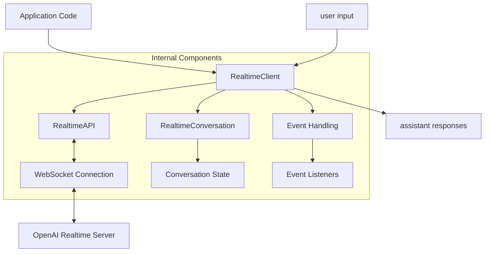

### 7.1 Event Processing Flow

When events are received from the server, `RealtimeClient` processes them through several steps:

1. `RealtimeAPI` receives the raw events from the WebSocket
2. `RealtimeClient` forwards them to `RealtimeConversation` for state updates
3. `RealtimeClient` dispatches higher-level events for the application

This event processing enables real-time updates to the conversation and responses without requiring the application to handle the low-level details.

**Sources: [lib/client.js:250-362]()**

## 8. Usage Example

```javascript
// Create a new client instance
const client = new RealtimeClient({ 
  apiKey: 'your-api-key'
});

// Connect to the server
await client.connect();

// Configure the session
client.updateSession({
  voice: 'echo',
  instructions: 'You are a helpful assistant.',
  turn_detection: {
    type: 'server_vad',
    threshold: 0.6
  }
});

// Listen for conversation updates
client.on('conversation.item.completed', ({ item }) => {
  if (item.role === 'assistant') {
    console.log('Assistant:', item.formatted.text);
    // Play audio if available
    if (item.formatted.audio) {
      playAudio(item.formatted.audio);
    }
  }
});

// Send a message
client.sendUserMessageContent([
  { type: 'input_text', text: 'Tell me a joke.' }
]);

// Wait for the response
const { item } = await client.waitForNextCompletedItem();
console.log('Received response:', item.formatted.text);

// Disconnect when done
client.disconnect();
```

**Sources: [lib/client.js:189-663]()**

---

# Page: Session Configuration

# Session Configuration

<details>
<summary>Relevant source files</summary>

The following files were used as context for generating this wiki page:

- [README.md](README.md)
- [dist/lib/client.d.ts](dist/lib/client.d.ts)
- [lib/client.js](lib/client.js)

</details>


This document explains how to configure and update sessions in the OpenAI Realtime API client library. The session configuration controls various aspects of the conversation, including modalities (text and audio), turn detection, model instructions, voice settings, and other parameters. For information about tool integration, see [Tool Integration](#2.2).

## Overview

Session configuration is managed through the `updateSession()` method of the `RealtimeClient` class. This method allows you to set or update various parameters that control how the realtime conversation behaves. Configuration can be done before connecting to the API and can also be updated during an active session.

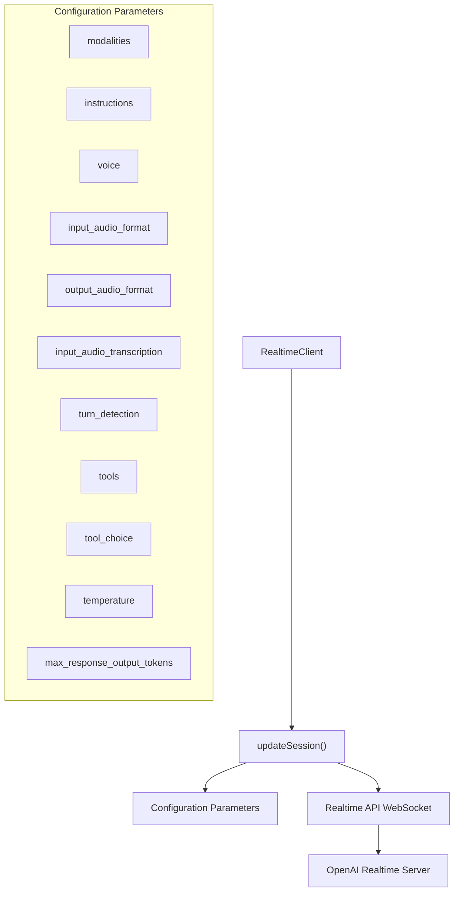

Sources: [lib/client.js:484-541]()

## Session Configuration Object

The session configuration is defined by the `SessionResourceType` interface, which includes the following parameters:

| Parameter | Type | Default | Description |
|-----------|------|---------|-------------|
| `modalities` | `string[]` | `['text', 'audio']` | The modalities enabled for the conversation |
| `instructions` | `string` | `''` | System instructions for the assistant |
| `voice` | `string` | `'verse'` | Voice for audio responses |
| `input_audio_format` | `AudioFormatType` | `'pcm16'` | Format of input audio |
| `output_audio_format` | `AudioFormatType` | `'pcm16'` | Format of output audio |
| `input_audio_transcription` | `AudioTranscriptionType` \| `null` | `null` | Configuration for audio transcription |
| `turn_detection` | `TurnDetectionServerVadType` \| `null` | `null` | Configuration for turn detection |
| `tools` | `ToolDefinitionType[]` | `[]` | Array of tool definitions |
| `tool_choice` | `string` \| `object` | `'auto'` | How tools should be used |
| `temperature` | `number` | `0.8` | Controls randomness in generation |
| `max_response_output_tokens` | `number` \| `'inf'` | `4096` | Maximum tokens in response |

Sources: [lib/client.js:34-47](), [lib/client.js:196-208]()

## Using `updateSession()`

The `updateSession()` method accepts a partial configuration object and merges it with the existing configuration. This means you can update specific parameters without affecting others.

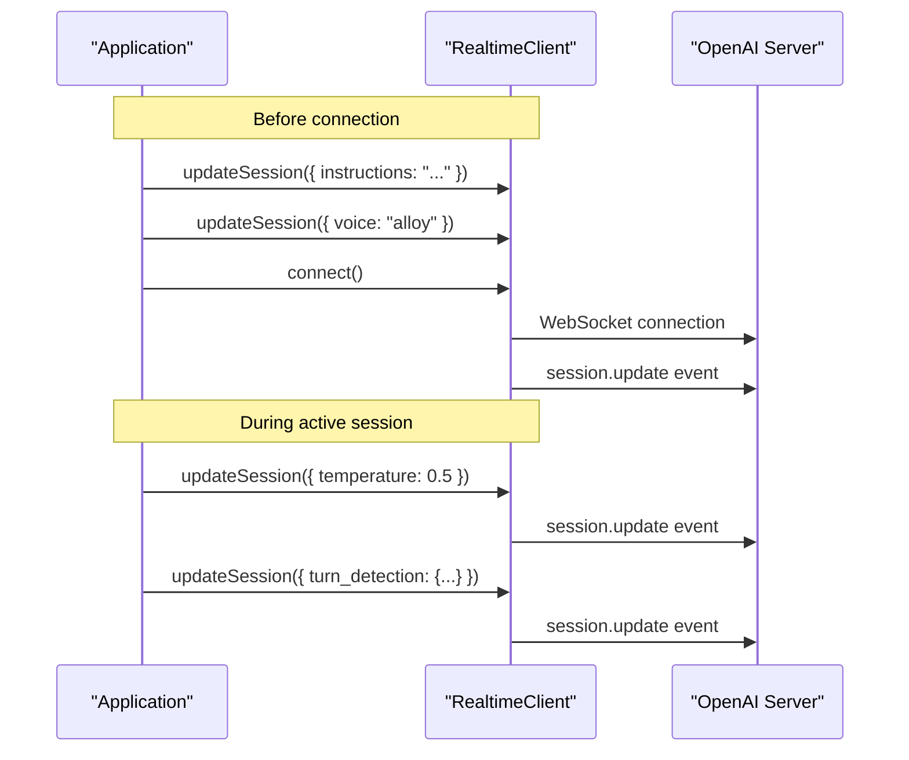

Sources: [lib/client.js:484-541]()

### Default Configuration

The `RealtimeClient` constructor initializes default values for all session parameters. These defaults are applied when the client is created:

```javascript
this.defaultSessionConfig = {
  modalities: ['text', 'audio'],
  instructions: '',
  voice: 'verse',
  input_audio_format: 'pcm16',
  output_audio_format: 'pcm16',
  input_audio_transcription: null,
  turn_detection: null,
  tools: [],
  tool_choice: 'auto',
  temperature: 0.8,
  max_response_output_tokens: 4096,
};
```

Sources: [lib/client.js:196-208]()

## Configuration Parameters

### Modalities

The `modalities` parameter specifies which communication channels are enabled for the conversation. The available options are:

- `'text'` - Enable text input and output
- `'audio'` - Enable audio input and output

By default, both modalities are enabled. You can restrict to a single modality if needed:

```javascript
client.updateSession({ modalities: ['text'] });  // Text-only conversation
client.updateSession({ modalities: ['audio'] }); // Audio-only conversation
```

Sources: [lib/client.js:34-47](), [lib/client.js:197]()

### Instructions

The `instructions` parameter allows you to provide system instructions to the assistant, similar to system messages in the Chat Completions API. This sets the behavior, persona, and capabilities of the assistant:

```javascript
client.updateSession({ 
  instructions: 'You are a helpful, friendly assistant who speaks concisely and avoids unnecessary explanations.'
});
```

Sources: [lib/client.js:34-47](), [lib/client.js:198]()

### Voice

The `voice` parameter determines which voice is used for audio responses. Available options are:

- `'alloy'`
- `'ash'`
- `'ballad'`
- `'coral'`
- `'echo'`
- `'sage'`
- `'shimmer'`
- `'verse'` (default)

```javascript
client.updateSession({ voice: 'alloy' });
```

Sources: [lib/client.js:34-47](), [lib/client.js:199]()

### Audio Formats

Two parameters control the audio formats used in the conversation:

- `input_audio_format` - Format for audio sent to the API
- `output_audio_format` - Format for audio received from the API

Available formats are:

- `'pcm16'` (default) - 16-bit PCM audio
- `'g711_ulaw'` - G.711 μ-law encoding
- `'g711_alaw'` - G.711 A-law encoding

```javascript
client.updateSession({
  input_audio_format: 'pcm16',
  output_audio_format: 'pcm16'
});
```

Sources: [lib/client.js:7-9](), [lib/client.js:34-47](), [lib/client.js:200-201]()

### Audio Transcription

The `input_audio_transcription` parameter configures how audio input is transcribed. When set to `null`, audio transcription is disabled. When enabled, it requires a model parameter:

```javascript
client.updateSession({
  input_audio_transcription: { model: 'whisper-1' }
});
```

Sources: [lib/client.js:12-14](), [lib/client.js:34-47](), [lib/client.js:202](), [lib/client.js:210-214]()

### Turn Detection

The `turn_detection` parameter configures how the system detects when it's the assistant's turn to respond when using audio input. When set to `null`, manual turn control is used (you must call `createResponse()` to trigger a response).

For server-side Voice Activity Detection (VAD), use:

```javascript
client.updateSession({
  turn_detection: {
    type: 'server_vad',
    threshold: 0.5,              // Sensitivity (0.0 to 1.0)
    prefix_padding_ms: 300,      // Audio to include before speech starts
    silence_duration_ms: 200     // Silence before considering speech stopped
  }
});
```

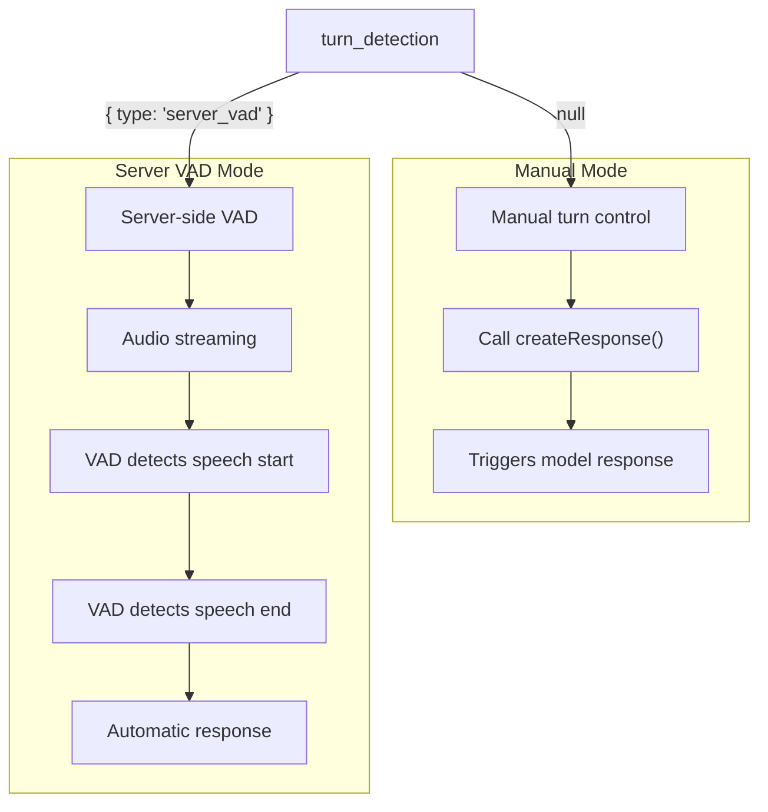

Sources: [lib/client.js:17-22](), [lib/client.js:34-47](), [lib/client.js:203](), [lib/client.js:215-220]()

### Temperature

The `temperature` parameter controls randomness in the model's responses. Higher values (up to 1.0) make responses more creative and diverse, while lower values make responses more deterministic and focused:

```javascript
client.updateSession({ temperature: 0.3 }); // More deterministic
client.updateSession({ temperature: 0.9 }); // More creative
```

Sources: [lib/client.js:34-47](), [lib/client.js:206]()

### Max Response Output Tokens

The `max_response_output_tokens` parameter limits the length of the model's response. It can be set to a number or `'inf'` for unlimited output:

```javascript
client.updateSession({ max_response_output_tokens: 1000 }); // Limit to 1000 tokens
client.updateSession({ max_response_output_tokens: 'inf' }); // No limit
```

Sources: [lib/client.js:34-47](), [lib/client.js:207]()

## Updating Configuration During a Session

You can update the session configuration at any time, even during an active session. When you call `updateSession()` while connected, the changes are immediately sent to the server using a `session.update` event:

```javascript
// Connect with initial configuration
client.updateSession({ 
  instructions: "You are a helpful assistant."
});
await client.connect();

// Later, update specific settings
client.updateSession({ 
  temperature: 0.4,
  voice: 'alloy'
});
```

```mermaid
flowchart LR
    A["RealtimeClient"] --> B["updateSession()"]
    
    subgraph "Client-side Processing"
        B --> C["Update sessionConfig object"]
        C --> D{"Is connected?"}
        D -->|"Yes"| E["Send session.update event"]
        D -->|"No"| F["Store for later"]
    end
    
    E --> G["OpenAI Server"]
    
    subgraph "Connection Flow"
        F --> H["connect()"]
        H --> I["Send stored configuration"]
    end
    
    I --> G
```

Sources: [lib/client.js:484-541](), [lib/client.js:392-399]()

## Tools and Functions

The `tools` parameter allows you to define functions that the assistant can call. This is handled separately in the Tool Integration section ([Tool Integration](#2.2)), but the basic configuration looks like:

```javascript
client.updateSession({
  tools: [
    {
      type: 'function',
      name: 'get_weather',
      description: 'Get the current weather for a location',
      parameters: {
        type: 'object',
        properties: {
          location: {
            type: 'string',
            description: 'City and state, e.g. San Francisco, CA'
          }
        },
        required: ['location']
      }
    }
  ]
});
```

The `tool_choice` parameter controls how tools are used:
- `'auto'` (default) - The model decides when to use tools
- `'none'` - Tools will not be used
- `'required'` - The model must use a tool
- `{ type: 'function', name: 'tool_name' }` - The model must use the specified tool

Sources: [lib/client.js:26-31](), [lib/client.js:34-47](), [lib/client.js:204-205]()

## Putting It All Together

A complete session configuration might look like this:

```javascript
client.updateSession({
  modalities: ['text', 'audio'],
  instructions: 'You are a helpful, concise assistant that specializes in weather information.',
  voice: 'alloy',
  input_audio_format: 'pcm16',
  output_audio_format: 'pcm16',
  input_audio_transcription: { model: 'whisper-1' },
  turn_detection: {
    type: 'server_vad',
    threshold: 0.6,
    prefix_padding_ms: 300,
    silence_duration_ms: 500
  },
  temperature: 0.7,
  max_response_output_tokens: 2048
});

await client.connect();
```

This configuration:
1. Enables both text and audio modalities
2. Sets specific instructions for the assistant
3. Uses the 'alloy' voice
4. Configures PCM16 audio format for both input and output
5. Enables audio transcription with the 'whisper-1' model
6. Sets up server-side VAD for turn detection with custom settings
7. Sets a moderate temperature for balanced creativity and focus
8. Limits response length to 2048 tokens

Sources: [lib/client.js:484-541]()

---

# Page: Tool Integration

# Tool Integration

<details>
<summary>Relevant source files</summary>

The following files were used as context for generating this wiki page:

- [README.md](README.md)
- [lib/client.js](lib/client.js)
- [test/tests/client.js](test/tests/client.js)

</details>


This document explains how to define and use tools (functions) that can be called by the assistant during a conversation with the OpenAI Realtime API. Tools enable the assistant to perform actions outside its knowledge base, such as retrieving weather information, querying databases, or interacting with external services. For information about the broader RealtimeClient interface, see [RealtimeClient](#2).

## Overview

The Realtime API allows you to define custom tools that the AI assistant can use during conversations. When properly defined, the assistant can:

1. Determine when a tool should be called
2. Generate the appropriate arguments for the tool
3. Wait for the result of the tool execution
4. Incorporate the tool's response into its subsequent messages

```mermaid
flowchart LR
    subgraph "Application"
        App["Your Application"]
        ToolHandlers["Tool Handlers"]
    end
    
    subgraph "RealtimeClient"
        Client["RealtimeClient"]
        Tools["Tool Definitions"]
    end
    
    subgraph "OpenAI Realtime Server"
        Model["AI Model"]
    end
    
    App -->|"1. addTool(definition, handler)"| Client
    Client -->|"2. Register tool definitions"| Tools
    Client -->|"3. Send tool definitions"| Model
    Model -->|"4. Generate function call"| Client
    Client -->|"5. Invoke handler"| ToolHandlers
    ToolHandlers -->|"6. Return result"| Client
    Client -->|"7. Send result to model"| Model
    Model -->|"8. Continue generation"| Client
```

Sources: [lib/client.js:26-31](), [lib/client.js:434-467](), [README.md:152-191]()

## Tool Definition Format

Tools are defined using a standard JSON Schema format. Each tool definition requires:

- `name`: A unique identifier for the tool
- `description`: A clear explanation of what the tool does
- `parameters`: An object describing the expected input parameters

Parameters use JSON Schema to define their structure:

| Field | Description |
|-------|-------------|
| `type` | The data type (object, string, number, etc.) |
| `properties` | Object containing parameter definitions |
| `required` | Array of required property names |

Here's an example of a tool definition structure:

```mermaid
classDiagram
    class ToolDefinitionType {
        +string type = "function"
        +string name
        +string description
        +object parameters
    }
    
    class Parameters {
        +string type
        +object properties
        +array required
    }
    
    class Properties {
        +Property1
        +Property2
        +PropertyN
    }
    
    class Property {
        +string type
        +string description
        +any additionalAttributes
    }
    
    ToolDefinitionType --> Parameters
    Parameters --> Properties
    Properties --> Property
```

Sources: [lib/client.js:26-31]()

## Adding Tools to the Client

There are two ways to add tools to your RealtimeClient:

### Method 1: Using `addTool()`

The `addTool()` method provides a convenient way to define tools and their handlers in one step:

```mermaid
sequenceDiagram
    participant App as Application
    participant Client as RealtimeClient
    participant Server as OpenAI Realtime Server
    
    App->>Client: addTool(definition, handler)
    Client->>Client: Register tool in this.tools
    Client->>Client: updateSession()
    Client->>Server: session.update with tools
    
    Note over App,Server: Later during conversation
    Server->>Client: function_call event
    Client->>App: Execute handler with arguments
    App->>Client: Return handler result
    Client->>Server: Send function_call_output
    Client->>Server: response.create
```

Sources: [lib/client.js:434-467](), [lib/client.js:290-315]()

The `addTool()` method takes two parameters:
1. `definition`: Object defining the tool
2. `handler`: Function that will be called when the tool is invoked

When the assistant calls this tool, the handler will be invoked automatically with the arguments passed from the model. The handler's result is automatically sent back to the model, and a new response is created.

### Method 2: Using `updateSession()`

You can also define tools using the `updateSession()` method:

```mermaid
flowchart TD
    A["client.updateSession({
    tools: [toolDefinition1, toolDefinition2]
    })"] --> B["Session updated with tools"]
    B --> C["Tool definitions sent to server"]
    C --> D["Model can now call these tools"]
    
    subgraph "Manual handling required"
        E["Listen for function calls"]
        F["Process function call arguments"]
        G["Send function output manually"]
        H["Create response manually"]
    end
    
    D --> E
    E --> F
    F --> G
    G --> H
```

Sources: [lib/client.js:484-541](), [README.md:208-236]()

With this approach, you need to manually handle tool calls by listening for appropriate events.

## Automatic Tool Handling

The recommended approach is to use `addTool()` to benefit from automatic tool execution:

```mermaid
flowchart LR
    subgraph "Tool Registration"
        AddTool["client.addTool(definition, handler)"]
        Register["Register with RealtimeClient"]
    end
    
    subgraph "Automatic Process"
        ModelCall["Model generates function call"]
        ParseArgs["Arguments parsed to JSON"]
        InvokeHandler["Handler function invoked"]
        SendResult["Result sent back to model"]
        ContinueGen["Continue model generation"]
    end
    
    AddTool --> Register
    Register --> ModelCall
    ModelCall --> ParseArgs
    ParseArgs --> InvokeHandler
    InvokeHandler --> SendResult
    SendResult --> ContinueGen
```

Sources: [lib/client.js:290-315](), [README.md:160-191]()

When a tool is called by the assistant:

1. The RealtimeClient receives a function call event
2. The tool arguments are parsed from JSON
3. The registered handler is executed with the parsed arguments
4. The result is automatically sent back to the model
5. A new response is triggered with `createResponse()`

## Manual Tool Handling

For greater control, you can handle tool calls manually:

```mermaid
sequenceDiagram
    participant App as Application
    participant Client as RealtimeClient
    participant Server as OpenAI Realtime Server
    
    App->>Client: updateSession({tools: [...]})
    Client->>Server: session.update with tools
    
    App->>Client: Listen for conversation.updated events
    
    Server->>Client: function_call event
    Client->>App: conversation.updated with function_call
    
    Note over App: Process function call
    
    App->>Client: realtime.send('conversation.item.create', function_call_output)
    App->>Client: realtime.send('response.create')
    
    Server->>Client: Continue generation
    Client->>App: conversation.updated with new content
```

Sources: [README.md:242-256]()

Manual handling requires:

1. Registering tools via `updateSession()`
2. Listening for `conversation.updated` or `conversation.item.completed` events
3. Checking for items with `type === 'function_call'`
4. Processing the arguments and executing your custom logic
5. Manually sending the function output and creating a new response

## Tool Response Handling

When a tool is called, the client processes it through the following internal flow:

```mermaid
flowchart TD
    EventHandler["RealtimeClient receives function_call event"] --> ProcessEvent["processEvent() updates conversation state"]
    ProcessEvent --> ConvUpdated["conversation.updated event dispatched"]
    ConvUpdated --> CheckTool["Check if item has tool formatted property"]
    CheckTool --> CallTool["callTool(tool) function executes"]
    
    subgraph "callTool Function"
        ParseArgs["Parse JSON arguments"]
        GetConfig["Retrieve tool config"]
        ExecuteHandler["Execute handler function"]
        SendOutput["Send function_call_output to server"]
        CreateResp["Create new response"]
    end
    
    CallTool --> ParseArgs
    ParseArgs --> GetConfig
    GetConfig --> ExecuteHandler
    ExecuteHandler --> SendOutput
    SendOutput --> CreateResp
```

Sources: [lib/client.js:290-315]()

## Example Use Cases

### Weather Information Tool

A typical tool registration for retrieving weather information might look like:

| Component | Description |
|-----------|-------------|
| Tool Name | `get_weather` |
| Description | Retrieves weather data for a location |
| Parameters | `lat` (number), `lng` (number), `location` (string) |
| Handler | Async function that calls a weather API and returns the result |

### Data Query Tool

For retrieving information from a database:

| Component | Description |
|-----------|-------------|
| Tool Name | `query_database` |
| Description | Retrieves specific data from a database |
| Parameters | `query` (string), `filters` (object) |
| Handler | Function that performs a database query and returns results |

### Image Generation Tool

For generating images:

| Component | Description |
|-----------|-------------|
| Tool Name | `generate_image` |
| Description | Creates an image based on a text description |
| Parameters | `prompt` (string), `style` (string), `dimensions` (object) |
| Handler | Function that calls an image generation API and returns URL or base64 image |

Sources: [README.md:160-191](), [README.md:208-236]()

## Tool Choice Configuration

You can control how the model selects tools using the `tool_choice` parameter:

| Value | Description |
|-------|-------------|
| `"auto"` | Default. Model decides when to call tools |
| `"none"` | Model will never call tools |
| `"required"` | Model must call a tool |
| Object | Forces the model to call a specific tool |

```mermaid
flowchart TD
    UpdateSession["client.updateSession({
        tool_choice: value
    })"] --> Choice

    Choice{tool_choice?}
    Choice -->|"auto"| Auto["Model decides when to use tools"]
    Choice -->|"none"| None["Tools are disabled"]
    Choice -->|"required"| Required["Model must use a tool"]
    Choice -->|"{type:'function',name:'tool_name'}"| Forced["Model must use specified tool"]
```

Sources: [lib/client.js:44](), [lib/client.js:510]()

## Limitations and Best Practices

When working with tools, consider these best practices:

1. **Clear Descriptions**: Provide clear, concise descriptions of what each tool does
2. **Proper Parameter Definitions**: Use detailed JSON Schema definitions for parameters
3. **Error Handling**: Implement robust error handling in your tool handlers
4. **Asynchronous Processing**: Tool handlers can be asynchronous, allowing for API calls
5. **Tool Registration Timing**: Register tools before sending user messages

Remember that tools added with `addTool()` are not overridden when updating sessions manually with `updateSession()`. Tools defined via `updateSession()` will override previous `updateSession()` configurations.

Sources: [README.md:193-207](), [lib/client.js:516-535]()

---

# Page: RealtimeAPI

# RealtimeAPI

<details>
<summary>Relevant source files</summary>

The following files were used as context for generating this wiki page:

- [dist/lib/api.d.ts.map](dist/lib/api.d.ts.map)
- [lib/api.js](lib/api.js)
- [test/tests/api.js](test/tests/api.js)

</details>


The `RealtimeAPI` class handles WebSocket communication between client applications and OpenAI's Realtime API server. It's responsible for establishing connections, sending and receiving messages, and managing the WebSocket lifecycle. This class serves as the network layer of the Realtime API client library.

For information about the higher-level client interface, see [RealtimeClient](#2).

## Class Overview

`RealtimeAPI` extends the `RealtimeEventHandler` class to inherit event handling capabilities. It provides methods for WebSocket connection management and message transmission, while abstracting away the differences between browser and Node.js environments.

```mermaid
classDiagram
    class RealtimeEventHandler {
        +eventHandlers
        +nextEventHandlers
        +on(event, handler)
        +onNext(event, handler)
        +off(event, handler)
        +offNext(event, handler)
        +dispatch(event, data)
        +waitForNext(event, timeout)
    }
    
    class RealtimeAPI {
        +defaultUrl: string
        +url: string
        +apiKey: string|null
        +debug: boolean
        +ws: WebSocket|null
        +isConnected()
        +log(...args)
        +connect(settings)
        +disconnect(ws)
        +receive(eventName, event)
        +send(eventName, data)
    }
    
    RealtimeEventHandler <|-- RealtimeAPI : extends
```

Sources: [lib/api.js:1-4](), [lib/api.js:10-24]()

## Initialization

The `RealtimeAPI` constructor takes a configuration object with the following optional parameters:

| Parameter | Type | Default | Description |
|-----------|------|---------|-------------|
| `url` | string | 'wss://api.openai.com/v1/realtime' | WebSocket server URL |
| `apiKey` | string | null | OpenAI API key for authentication |
| `dangerouslyAllowAPIKeyInBrowser` | boolean | false | Safety flag for browser usage |
| `debug` | boolean | false | Enables detailed logging |

Example initialization:

```javascript
const api = new RealtimeAPI({
  apiKey: 'YOUR_API_KEY',
  debug: true
});
```

Sources: [lib/api.js:5-24]()

## Connection Management

### Connection Flow

```mermaid
sequenceDiagram
    participant Client as Client Application
    participant API as RealtimeAPI
    participant Server as OpenAI Realtime Server
    
    Client->>API: connect({model})
    API->>Server: WebSocket connection
    
    alt Connection successful
        Server-->>API: WebSocket open event
        API-->>Client: Promise resolves (true)
        API-->>API: Set up event listeners
    else Connection failed
        Server-->>API: WebSocket error event
        API-->>Client: Promise rejects (Error)
    end
    
    Note over API,Server: Active connection
    
    Client->>API: disconnect()
    API->>Server: WebSocket close
    Server-->>API: WebSocket closed event
    API-->>Client: "close" event
```

Sources: [lib/api.js:58-155](), [lib/api.js:162-168]()

### Connecting to the Server

The `connect()` method establishes a WebSocket connection to the OpenAI Realtime API server:

```javascript
await api.connect({
  model: 'gpt-4o-realtime-preview-2024-10-01'
});
```

The method returns a Promise that resolves to `true` when connected or rejects with an error if the connection fails. It automatically detects whether it's running in a browser or Node.js environment and creates the appropriate WebSocket connection.

Sources: [lib/api.js:58-155]()

### Disconnecting from the Server

The `disconnect()` method closes the WebSocket connection:

```javascript
api.disconnect();
```

This method also emits a 'close' event that can be handled by event listeners.

Sources: [lib/api.js:162-168]()

### Checking Connection Status

The `isConnected()` method returns a boolean indicating whether there's an active WebSocket connection:

```javascript
if (api.isConnected()) {
  // Connection is active
}
```

Sources: [lib/api.js:30-32]()

## Message Handling

### WebSocket Data Flow

```mermaid
flowchart TD
    subgraph "RealtimeAPI"
        A["send(eventName, data)"] --> B["Add event_id & type"]
        B --> C["Dispatch client events"]
        C --> D["Send via WebSocket"]
        
        E["WebSocket message event"] --> F["parse JSON"]
        F --> G["receive(type, message)"]
        G --> H["Dispatch server events"]
    end
    
    D --> I["OpenAI Realtime Server"]
    I --> E
    
    subgraph "Event Consumers"
        J["on('client.*')"]
        K["on('server.*')"]
        L["on('server.specific.event')"]
    end
    
    C --> J
    H --> K
    H --> L
```

Sources: [lib/api.js:176-207]()

### Sending Messages

The `send()` method transmits messages to the server:

```javascript
api.send('conversation.item.create', {
  session_id: 'session_abc123',
  content: {
    type: 'text',
    text: 'Hello, world!'
  }
});
```

The method:
1. Validates that the WebSocket is connected
2. Ensures data is a valid object
3. Adds an `event_id` and `type` to the message
4. Dispatches client-side events (`client.{eventName}` and `client.*`)
5. Sends the JSON-encoded message over the WebSocket

Sources: [lib/api.js:189-207]()

### Receiving Messages

The `receive()` method is called internally when a message is received from the server:

```javascript
// Internal method, not typically called directly
api.receive('session.created', {
  type: 'session.created',
  session_id: 'session_abc123'
});
```

It processes incoming WebSocket messages by:
1. Logging the received message if debug mode is enabled
2. Dispatching server-side events (`server.{eventName}` and `server.*`)

Sources: [lib/api.js:176-181]()

## Event Handling

As a subclass of `RealtimeEventHandler`, the `RealtimeAPI` class provides methods for registering event handlers:

```javascript
// Register a persistent event handler
api.on('server.session.created', (event) => {
  console.log('Session created:', event.session_id);
});

// Register a one-time event handler
api.onNext('server.error', (event) => {
  console.error('Error occurred:', event.error);
});

// Wait for the next occurrence of an event
const event = await api.waitForNext('server.response.created', 5000);
```

The `RealtimeAPI` class emits the following event types:

| Event Type | Description | Example |
|------------|-------------|---------|
| `server.{eventName}` | Specific server event | `server.session.created` |
| `server.*` | Any server event | All incoming messages |
| `client.{eventName}` | Specific client event | `client.conversation.item.create` |
| `client.*` | Any client event | All outgoing messages |
| `close` | Connection closed | `{ error: true/false }` |

Sources: [lib/api.js:176-181](), [lib/api.js:189-207]()

## Environment Detection and Adaptation

The `RealtimeAPI` class automatically adapts to different runtime environments:

```mermaid
flowchart TD
    A["connect() called"] --> B{"globalThis.WebSocket exists?"}
    
    B -->|Yes| C["Browser Environment"]
    B -->|No| D["Node.js Environment"]
    
    C --> E{"API key provided in browser?"}
    E -->|Yes| F{"dangerouslyAllowAPIKeyInBrowser?"}
    F -->|No| G["Error: Cannot use API key in browser"]
    F -->|Yes| H["Warning + WebSocket with protocol auth"]
    E -->|No| I["WebSocket with no auth"]
    
    D --> J["Import ws package"]
    J --> K["WebSocket with header auth"]
    
    H --> L["Connection Established"]
    I --> L
    K --> L
```

Sources: [lib/api.js:58-155]()

### Browser Environment

In browser environments:
- Uses the global `WebSocket` class
- Authenticates using WebSocket subprotocols
- Requires `dangerouslyAllowAPIKeyInBrowser: true` to use API keys
- Emits warnings when API keys are used

Sources: [lib/api.js:66-107]()

### Node.js Environment

In Node.js environments:
- Dynamically imports the `ws` package
- Authenticates using HTTP headers
- Handles Node.js-specific event listeners

Sources: [lib/api.js:108-154]()

## Security Considerations

The `RealtimeAPI` implements security measures to prevent accidental exposure of API keys:

1. In browser environments, it checks if an API key is provided
2. If an API key is used in a browser context, it requires explicit acknowledgment via `dangerouslyAllowAPIKeyInBrowser: true`
3. Even with this option enabled, it emits warning messages

Best practices:
- In browser applications, implement authentication on your backend server and proxy WebSocket connections
- Keep API keys secure and never expose them in client-side code
- For testing purposes only, you can use `dangerouslyAllowAPIKeyInBrowser: true`

Sources: [lib/api.js:15-23](), [lib/api.js:70-74]()

## Debugging

When `debug: true` is set, the `RealtimeAPI` logs detailed information about WebSocket communication:

```javascript
// Example debug output:
// [Websocket/2023-10-25T12:34:56.789Z] Connected to "wss://api.openai.com/v1/realtime"
// [Websocket/2023-10-25T12:34:57.123Z] sent: conversation.item.create {"event_id":"evt_abc123","type":"conversation.item.create",...}
// [Websocket/2023-10-25T12:34:57.456Z] received: conversation.item.created {"type":"conversation.item.created",...}
```

The `log()` method formats and outputs debug information when enabled.

Sources: [lib/api.js:39-52]()

## Integration with RealtimeClient

```mermaid
flowchart LR
    A["RealtimeClient"] --> B["RealtimeAPI"]
    B <--> C["WebSocket Connection"]
    C <--> D["OpenAI Realtime Server"]
    
    A --> E["RealtimeConversation"]
    
    B -- "server.* events" --> A
    A -- "send() messages" --> B
```

The `RealtimeAPI` class is typically not used directly by applications. Instead, it's used by the `RealtimeClient` class, which provides a higher-level interface for managing conversations with the OpenAI Realtime API.

Sources: [lib/api.js:4-208]()

---

# Page: RealtimeConversation

# RealtimeConversation

<details>
<summary>Relevant source files</summary>

The following files were used as context for generating this wiki page:

- [dist/lib/conversation.d.ts](dist/lib/conversation.d.ts)
- [dist/lib/conversation.d.ts.map](dist/lib/conversation.d.ts.map)
- [lib/conversation.js](lib/conversation.js)

</details>


RealtimeConversation is a core component of the OpenAI Realtime API client library that manages conversation state and processes events from the WebSocket server. It maintains the history of messages, responses, and audio data exchanged during a conversation session while performing event validation for the RealtimeAPI.

For information about the main client interface, see [RealtimeClient](#2). For details on the underlying WebSocket communication, see [RealtimeAPI](#3).

## Overview

The RealtimeConversation class serves as the state management system for the OpenAI Realtime API client. It processes incoming events from the server, maintains a structured representation of the conversation, and provides methods to access and manipulate conversation items.

```mermaid
flowchart TD
    subgraph "RealtimeConversation"
        direction TB
        State["State Management"]
        EventProcessing["Event Processing"]
        ItemTracking["Item Tracking"]
        AudioBuffering["Audio Buffering"]
    end

    Event["Server Events"] --> EventProcessing
    EventProcessing --> State
    State --> ItemTracking
    State --> AudioBuffering
    ItemTracking --> Items["Conversation Items"]
    AudioBuffering --> QueuedAudio["Queued Audio Data"]
```

Sources: [lib/conversation.js:18-314]()

## Core Data Structures

RealtimeConversation maintains several key data structures to track the state of a conversation:

```mermaid
classDiagram
    class RealtimeConversation {
        +itemLookup : Object
        +items : Array
        +responseLookup : Object
        +responses : Array
        +queuedSpeechItems : Object
        +queuedTranscriptItems : Object
        +queuedInputAudio : Int16Array
        +clear() : Boolean
        +queueInputAudio(inputAudio) : Int16Array
        +processEvent(event, ...args) : Object
        +getItem(id) : ItemType
        +getItems() : ItemType[]
    }
```

| Data Structure | Type | Purpose |
|----------------|------|---------|
| `itemLookup` | Object | Maps item IDs to item objects for quick access |
| `items` | Array | Ordered list of all conversation items |
| `responseLookup` | Object | Maps response IDs to response objects |
| `responses` | Array | Ordered list of all responses |
| `queuedSpeechItems` | Object | Temporarily stores speech items that are in progress |
| `queuedTranscriptItems` | Object | Temporarily stores transcript data before item creation |
| `queuedInputAudio` | Int16Array | Stores audio data for manual speech events |

Sources: [lib/conversation.js:254-260](), [lib/conversation.js:90-97]()

## Event Processing System

The central function of RealtimeConversation is to process events from the server and update the conversation state accordingly. This is handled by the `processEvent` method, which delegates to specific event handlers in the `EventProcessors` object.

```mermaid
flowchart TD
    Event["Server Event"] --> ProcessEvent["processEvent()"]
    ProcessEvent --> EventHandler["Event Handler in EventProcessors"]
    EventHandler --> UpdateState["Update State"]
    EventHandler --> ReturnResult["Return Updated Item and Delta"]
```

The `processEvent` method:
1. Validates that the event contains required fields (`event_id` and `type`)
2. Looks up the appropriate handler from `EventProcessors`
3. Calls the handler with the event and any additional arguments
4. Returns an object containing the updated item (if any) and any delta information

Sources: [lib/conversation.js:274-296]()

## Event Handlers

RealtimeConversation has handlers for many different types of events. Here are the main categories:

```mermaid
flowchart LR
    subgraph "Event Categories"
        ItemEvents["Item Events"]
        AudioEvents["Audio Events"]
        ResponseEvents["Response Events"]
        ContentEvents["Content Events"]
    end

    ItemEvents --> |"includes"| ItemCreated["conversation.item.created"]
    ItemEvents --> |"includes"| ItemTruncated["conversation.item.truncated"]
    ItemEvents --> |"includes"| ItemDeleted["conversation.item.deleted"]
    
    AudioEvents --> |"includes"| SpeechStarted["input_audio_buffer.speech_started"]
    AudioEvents --> |"includes"| SpeechStopped["input_audio_buffer.speech_stopped"]
    AudioEvents --> |"includes"| TranscriptCompleted["conversation.item.input_audio_transcription.completed"]
    
    ResponseEvents --> |"includes"| ResponseCreated["response.created"]
    ResponseEvents --> |"includes"| OutputItemAdded["response.output_item.added"]
    ResponseEvents --> |"includes"| OutputItemDone["response.output_item.done"]
    
    ContentEvents --> |"includes"| ContentPartAdded["response.content_part.added"]
    ContentEvents --> |"includes"| TextDelta["response.text.delta"]
    ContentEvents --> |"includes"| AudioDelta["response.audio.delta"]
    ContentEvents --> |"includes"| FunctionCallDelta["response.function_call_arguments.delta"]
    ContentEvents --> |"includes"| AudioTranscriptDelta["response.audio_transcript.delta"]
```

The handlers update the conversation state by:
- Creating, updating, or deleting conversation items
- Tracking audio data and transcripts
- Managing responses and their relationships to items
- Handling content deltas (incremental updates to text, audio, or function call arguments)

Sources: [lib/conversation.js:21-239]()

## Item Processing

When an item is created (`conversation.item.created` event), the handler performs several key steps:

1. Deep copies the item data
2. Adds the item to `itemLookup` and `items` if it doesn't already exist
3. Initializes the formatted representation of the item
4. Populates audio data from `queuedSpeechItems` if available
5. Populates text content if available
6. Populates transcript data from `queuedTranscriptItems` if available
7. Sets the item status based on its type and role

```mermaid
flowchart TD
    ItemCreated["conversation.item.created Event"] --> DeepCopy["Deep Copy Item Data"]
    DeepCopy --> CheckExists["Check if Item Exists"]
    CheckExists --> |"No"| AddToLookup["Add to itemLookup and items"]
    CheckExists --> |"Yes"| SkipAdd["Skip Adding Item"]
    AddToLookup --> InitFormatted["Initialize formatted representation"]
    SkipAdd --> InitFormatted
    InitFormatted --> CheckQueuedSpeech["Check for queued speech data"]
    CheckQueuedSpeech --> |"Exists"| PopulateAudio["Populate Audio Data"]
    CheckQueuedSpeech --> |"Doesn't Exist"| CheckTextContent["Check for text content"]
    PopulateAudio --> CheckTextContent
    CheckTextContent --> |"Has Content"| PopulateText["Populate Text Content"]
    CheckTextContent --> |"No Content"| CheckQueuedTranscript["Check for queued transcript"]
    PopulateText --> CheckQueuedTranscript
    CheckQueuedTranscript --> |"Exists"| PopulateTranscript["Populate Transcript"]
    CheckQueuedTranscript --> |"Doesn't Exist"| CheckItemType["Check Item Type"]
    PopulateTranscript --> CheckItemType
    CheckItemType --> SetStatus["Set Item Status"]
    SetStatus --> ReturnResult["Return Updated Item"]
```

Sources: [lib/conversation.js:22-75]()

## Item Types and Formatting

RealtimeConversation processes different types of items, each with its own structure and formatting:

| Item Type | Description | Status Handling |
|-----------|-------------|----------------|
| Message (user) | User input in text or audio | Set to `completed` immediately |
| Message (assistant) | AI response in text or audio | Initially `in_progress`, set to `completed` when done |
| Function Call | Request to call an external function | Initially `in_progress`, set to `completed` when done |
| Function Call Output | Result of a function call | Set to `completed` immediately |

Each item includes a `formatted` property that provides easy access to its content:

```mermaid
classDiagram
    class Item {
        +id : String
        +type : String
        +role : String
        +status : String
        +content : Array
        +formatted : FormattedContent
    }

    class FormattedContent {
        +text : String
        +audio : Int16Array
        +transcript : String
        +tool : Object
        +output : String
    }

    Item --> FormattedContent : contains
```

Sources: [lib/conversation.js:53-74](), [lib/conversation.js:30-34]()

## Audio Processing

RealtimeConversation handles audio data in several ways:

1. **Input Audio Buffering**: Stores audio input until it's associated with a user message
2. **Speech Detection**: Processes `speech_started` and `speech_stopped` events to identify speech segments
3. **Audio Delta Processing**: Handles incremental audio updates for assistant responses
4. **Transcription**: Manages transcripts for both user and assistant audio

```mermaid
flowchart TD
    subgraph "Audio Input Processing"
        ManualAudio["Manual Audio Input"] --> QueueInputAudio["queueInputAudio()"]
        QueueInputAudio --> StoredAudio["queuedInputAudio"]
        SpeechStart["speech_started Event"] --> QueuedSpeech["queuedSpeechItems"]
        SpeechStop["speech_stopped Event"] --> ExtractSegment["Extract Audio Segment"]
        ExtractSegment --> QueuedSpeech
    end

    subgraph "Audio Output Processing"
        AudioDelta["audio.delta Event"] --> DecodeBase64["Decode Base64 to ArrayBuffer"]
        DecodeBase64 --> CreateInt16Array["Create Int16Array"]
        CreateInt16Array --> MergeAudio["Merge with Existing Audio"]
        MergeAudio --> UpdateItem["Update Item formatted.audio"]
    end
```

Sources: [lib/conversation.js:122-144](), [lib/conversation.js:201-216](), [lib/conversation.js:264-270]()

## Public API Methods

RealtimeConversation provides several public methods for interacting with the conversation state:

### clear()

Resets the conversation state by clearing all data structures.

```javascript
clear() {
  this.itemLookup = {};
  this.items = [];
  this.responseLookup = {};
  this.responses = [];
  this.queuedSpeechItems = {};
  this.queuedTranscriptItems = {};
  this.queuedInputAudio = null;
  return true;
}
```

Sources: [lib/conversation.js:253-262]()

### queueInputAudio(inputAudio)

Stores audio input for later association with a user message.

```javascript
queueInputAudio(inputAudio) {
  this.queuedInputAudio = inputAudio;
  return inputAudio;
}
```

Sources: [lib/conversation.js:269-272]()

### processEvent(event, ...args)

Processes a server event and updates the conversation state.

```javascript
processEvent(event, ...args) {
  if (!event.event_id) {
    console.error(event);
    throw new Error(`Missing "event_id" on event`);
  }
  if (!event.type) {
    console.error(event);
    throw new Error(`Missing "type" on event`);
  }
  const eventProcessor = this.EventProcessors[event.type];
  if (!eventProcessor) {
    throw new Error(
      `Missing conversation event processor for "${event.type}"`,
    );
  }
  return eventProcessor.call(this, event, ...args);
}
```

Sources: [lib/conversation.js:280-296]()

### getItem(id)

Retrieves a specific item by ID.

```javascript
getItem(id) {
  return this.itemLookup[id] || null;
}
```

Sources: [lib/conversation.js:303-305]()

### getItems()

Retrieves all items in the conversation.

```javascript
getItems() {
  return this.items.slice();
}
```

Sources: [lib/conversation.js:311-313]()

## Integration with RealtimeClient

The RealtimeConversation class is instantiated by the RealtimeClient and used to track conversation state. The client passes events from the RealtimeAPI to the conversation's `processEvent` method and uses the resulting information to emit higher-level events to the application.

```mermaid
sequenceDiagram
    participant Server as "OpenAI Server"
    participant API as "RealtimeAPI"
    participant Client as "RealtimeClient"
    participant Conversation as "RealtimeConversation"
    participant App as "Application"
    
    Server->>API: WebSocket Event
    API->>Client: Processed Server Event
    Client->>Conversation: processEvent(event)
    Conversation-->>Client: Return {item, delta}
    Client->>App: Emit High-Level Event
```

Sources: [lib/conversation.js:280-296]()

## Summary

The RealtimeConversation class is a critical part of the OpenAI Realtime API client library that:

1. Manages the state of a conversation
2. Processes server events and updates the conversation state
3. Provides methods for accessing and querying conversation items
4. Handles complex audio processing and transcription
5. Maintains a structured representation of the conversation history

It serves as the "memory" of the client, tracking all messages, responses, and their content while providing a clean interface for the rest of the system to interact with this data.

---

# Page: RealtimeEventHandler

# RealtimeEventHandler

<details>
<summary>Relevant source files</summary>

The following files were used as context for generating this wiki page:

- [dist/lib/event_handler.d.ts](dist/lib/event_handler.d.ts)
- [dist/lib/event_handler.d.ts.map](dist/lib/event_handler.d.ts.map)
- [lib/event_handler.js](lib/event_handler.js)

</details>


## Purpose and Scope

The `RealtimeEventHandler` class is a foundational component of the OpenAI Realtime API client library that implements the event-driven architecture used throughout the system. It provides mechanisms for subscribing to events, dispatching events, and handling one-time event listeners. This class is extended by both `RealtimeAPI` and `RealtimeClient` to give them event handling capabilities.

For information about the `RealtimeClient` which extends this class, see [RealtimeClient](#2).
For information about the `RealtimeAPI` which also extends this class, see [RealtimeAPI](#3).
For a broader overview of all events emitted by the library, see [Event System](#8).

Sources: [lib/event_handler.js:9-12]()

## Class Architecture

The `RealtimeEventHandler` serves as a base class that provides event handling functionality to other components in the system.

```mermaid
classDiagram
    class RealtimeEventHandler {
        +eventHandlers: object
        +nextEventHandlers: object
        +on(eventName, callback)
        +onNext(eventName, callback)
        +off(eventName, callback)
        +offNext(eventName, callback)
        +dispatch(eventName, event)
        +waitForNext(eventName, timeout)
        +clearEventHandlers()
    }
    
    class RealtimeAPI {
        +connect()
        +disconnect()
        +send()
        +receive()
        +isConnected()
    }
    
    class RealtimeClient {
        +connect()
        +disconnect()
        +sendUserMessageContent()
        +createResponse()
        +cancelResponse()
        +addTool()
        +waitForNextItem()
    }
    
    RealtimeEventHandler <|-- RealtimeAPI : extends
    RealtimeEventHandler <|-- RealtimeClient : extends
```

Sources: [lib/event_handler.js:13-143]()

## Event Handler Properties

The `RealtimeEventHandler` class maintains two key internal properties:

| Property | Type | Description |
|----------|------|-------------|
| `eventHandlers` | Object | Maps event names to arrays of persistent handler functions |
| `nextEventHandlers` | Object | Maps event names to arrays of one-time handler functions |

Sources: [lib/event_handler.js:18-20]()

## Event Handler Types

The class supports two types of event handlers:

1. **Persistent Event Handlers** - Registered with the `on()` method, these handlers remain active until explicitly removed with `off()`.
2. **One-time Event Handlers** - Registered with the `onNext()` method, these handlers automatically unregister after handling their next matching event.

```mermaid
flowchart TD
    subgraph "RealtimeEventHandler"
        E["Event Registry"]
        
        subgraph "eventHandlers[eventName]"
            PH1["Persistent Handler 1"]
            PH2["Persistent Handler 2"]
            PHN["Persistent Handler N"]
        end
        
        subgraph "nextEventHandlers[eventName]"
            OT1["One-time Handler 1"]
            OT2["One-time Handler 2"]
            OTN["One-time Handler N"]
        end
        
        E --> PH1
        E --> PH2
        E --> PHN
        E --> OT1
        E --> OT2
        E --> OTN
    end
```

Sources: [lib/event_handler.js:27-55]()

## Core Methods

### Registering Event Handlers

#### `on(eventName, callback)`

Registers a persistent event handler that will be called for all matching events.

- **Parameters**:
  - `eventName` (string): The name of the event to listen for
  - `callback` (function): Function to execute when the event occurs
- **Returns**: The callback function (for reference when removing)

Sources: [lib/event_handler.js:39-43]()

#### `onNext(eventName, callback)`

Registers a one-time event handler that will be called only for the next matching event.

- **Parameters**:
  - `eventName` (string): The name of the event to listen for
  - `callback` (function): Function to execute when the event occurs
- **Returns**: The callback function (for reference when removing)

Sources: [lib/event_handler.js:51-55]()

### Removing Event Handlers

#### `off(eventName, callback)`

Removes a specific persistent event handler or all handlers for an event.

- **Parameters**:
  - `eventName` (string): The name of the event
  - `callback` (function, optional): Specific handler to remove. If omitted, all handlers for this event are removed
- **Returns**: `true` if successful
- **Throws**: Error if the specified callback is not found

Sources: [lib/event_handler.js:64-78]()

#### `offNext(eventName, callback)`

Removes a specific one-time event handler or all one-time handlers for an event.

- **Parameters**:
  - `eventName` (string): The name of the event
  - `callback` (function, optional): Specific handler to remove. If omitted, all one-time handlers for this event are removed
- **Returns**: `true` if successful
- **Throws**: Error if the specified callback is not found

Sources: [lib/event_handler.js:87-101]()

#### `clearEventHandlers()`

Removes all event handlers, both persistent and one-time.

- **Returns**: `true`

Sources: [lib/event_handler.js:27-31]()

### Event Dispatch and Waiting

#### `dispatch(eventName, event)`

Executes all registered handlers for a specific event.

- **Parameters**:
  - `eventName` (string): The name of the event to dispatch
  - `event` (object): The event payload to pass to handlers
- **Returns**: `true` after all handlers have executed
- **Behavior**: Executes persistent handlers first, then one-time handlers, and finally removes all one-time handlers

Sources: [lib/event_handler.js:131-142]()

#### `waitForNext(eventName, timeout = null)`

Asynchronously waits for the next occurrence of a specific event.

- **Parameters**:
  - `eventName` (string): The name of the event to wait for
  - `timeout` (number|null, optional): Maximum time to wait in milliseconds
- **Returns**: Promise that resolves to the event payload, or `null` if the timeout is reached
- **Implementation**: Uses a polling approach with a 1ms sleep interval

Sources: [lib/event_handler.js:109-123]()

## Event Dispatching Process

When an event is dispatched, it follows a specific sequence of operations:

```mermaid
flowchart TB
    Start["dispatch(eventName, event)"] --> PH["1. Copy persistent handlers"]
    PH --> EPH["2. Execute persistent handlers"]
    EPH --> OTH["3. Copy one-time handlers"]
    OTH --> EOTH["4. Execute one-time handlers"]
    EOTH --> COT["5. Clear one-time handlers"]
    COT --> End["6. Return true"]
```

Sources: [lib/event_handler.js:131-142]()

## Event Flow in the System

The `RealtimeEventHandler` enables event propagation throughout the library. The typical event flow is:

```mermaid
sequenceDiagram
    participant S as "Server"
    participant A as "RealtimeAPI"
    participant C as "RealtimeClient"
    participant App as "Application"
    
    Note over A,C: Both extend RealtimeEventHandler
    
    App->>C: Register event handlers
    S-->>A: WebSocket message
    A->>A: dispatch("server.*", payload)
    A->>C: Internal event processing
    C->>C: dispatch("conversation.*", processed)
    C-->>App: Event handler callback
    
    Note over C,App: One-time handlers (onNext)<br>automatically removed
```

Sources: [lib/event_handler.js:131-142]()

## Usage Examples

### Registering Persistent Handlers

```javascript
// Listen for connection events
client.on('connection.established', (event) => {
  console.log('Connected with session ID:', event.sessionId);
});

// Listen for new conversation items
client.on('conversation.item.appended', (event) => {
  console.log('New item added:', event.item.content);
});
```

### Using One-time Handlers

```javascript
// Wait for the next response completion only
client.onNext('conversation.item.completed', (event) => {
  if (event.item.role === 'assistant') {
    console.log('Assistant finished responding');
  }
});
```

### Waiting for Events with Promises

```javascript
async function waitForResponse() {
  console.log('Waiting for assistant response...');
  
  // Wait up to 30 seconds for the next assistant message
  const event = await client.waitForNext('conversation.item.completed', 30000);
  
  if (event) {
    console.log('Response received:', event.item.content);
  } else {
    console.log('Timeout waiting for response');
  }
}
```

### Removing Event Handlers

```javascript
// Define handler function so it can be referenced later
const messageHandler = (event) => {
  console.log('Message received:', event.item.content);
};

// Register the handler
client.on('conversation.item.appended', messageHandler);

// Later, remove the specific handler
client.off('conversation.item.appended', messageHandler);

// Or remove all handlers for an event
client.off('conversation.item.appended');
```

### Clearing All Handlers

```javascript
// Remove all event handlers (typically when disconnecting)
client.clearEventHandlers();
```

Sources: [lib/event_handler.js:13-143]()

## Implementation Details

The `RealtimeEventHandler` implements a lightweight event system using JavaScript objects as lookup tables. Event handlers are stored in arrays indexed by event name. The class also includes a simple utility function for implementing the `waitForNext` method with minimal CPU usage:

```javascript
const sleep = (t) => new Promise((r) => setTimeout(() => r(), t));
```

This allows the implementation of asynchronous waiting with a small polling interval.

Sources: [lib/event_handler.js:6](), [lib/event_handler.js:109-123]()

## Summary

The `RealtimeEventHandler` class provides the foundation for the event-driven architecture of the OpenAI Realtime API client library. By extending this class, both `RealtimeAPI` and `RealtimeClient` gain the ability to emit events and respond to them in a consistent way. The class offers flexible options for event handling, including persistent handlers, one-time handlers, and Promise-based waiting, making it suitable for a variety of asynchronous interaction patterns.

Sources: [lib/event_handler.js:13-143]()

---

# Page: Working with Audio

# Working with Audio

<details>
<summary>Relevant source files</summary>

The following files were used as context for generating this wiki page:

- [lib/client.js](lib/client.js)
- [lib/conversation.js](lib/conversation.js)
- [test/tests/audio.js](test/tests/audio.js)

</details>


This document explains how to use audio input and output features in the OpenAI Realtime API client library. It covers audio formats, streaming, turn detection, and transcription configuration. For information about turn detection mechanisms specifically, see [Turn Detection](#6.1).

## Audio Overview

The Realtime API supports bidirectional audio communication, allowing applications to send audio input to the model and receive audio output in response. This enables voice-based conversations with the AI assistant.

```mermaid
flowchart LR
    subgraph "Audio Input Flow"
        ClientAudio["Client Audio\nSource"] --> AppendInput["appendInputAudio()"]
        AppendInput --> Buffer["Input Audio Buffer"]
        Buffer --> TurnDetection{"Turn Detection"}
        TurnDetection -->|"Server VAD"| ServerProcess["Server Processing"]
        TurnDetection -->|"Manual"| Commit["input_audio_buffer.commit"]
        ServerProcess --> Transcription
        Commit --> Transcription["Audio Transcription"]
        Transcription --> UserMessage["User Message"]
    end
    
    subgraph "Audio Output Flow"
        ModelResponse["Model Generation"] --> AssistantMessage["Assistant Message"]
        AssistantMessage --> TextContent["Text Content"]
        AssistantMessage --> AudioContent["Audio Content"]
        AudioContent --> ClientSpeaker["Client Audio\nOutput"]
    end
    
    UserMessage --> ModelResponse
```

Sources: [lib/client.js:6-14](), [lib/client.js:575-586](), [lib/client.js:592-603]()

## Audio Configuration

### Supported Audio Formats

The client library supports the following audio formats:

| Format | Description |
|--------|-------------|
| `pcm16` | 16-bit PCM audio (default) |
| `g711_ulaw` | G.711 μ-law encoding |
| `g711_alaw` | G.711 A-law encoding |

You can configure both input and output audio formats when initializing or updating a session.

### Session Configuration for Audio

Audio-related configuration is set through the `updateSession()` method:

```mermaid
classDiagram
    class "SessionAudioConfig" {
        +modalities: ["text", "audio"]
        +input_audio_format: "pcm16"
        +output_audio_format: "pcm16"
        +input_audio_transcription: AudioTranscriptionType
        +turn_detection: TurnDetectionServerVadType
        +voice: "alloy"|"ash"|"ballad"|"coral"|"echo"|"sage"|"shimmer"|"verse"
    }
    
    class "AudioTranscriptionType" {
        +model: "whisper-1"
    }
    
    class "TurnDetectionServerVadType" {
        +type: "server_vad"
        +threshold: number
        +prefix_padding_ms: number
        +silence_duration_ms: number
    }
    
    "SessionAudioConfig" *-- "AudioTranscriptionType" : configures
    "SessionAudioConfig" *-- "TurnDetectionServerVadType" : configures
```

Sources: [lib/client.js:6-22](), [lib/client.js:35-47](), [lib/client.js:484-514]()

Example configuration:

```javascript
client.updateSession({
  modalities: ['text', 'audio'],  // Include 'audio' to enable audio processing
  input_audio_format: 'pcm16',    // Set input audio format
  output_audio_format: 'pcm16',   // Set output audio format
  voice: 'alloy',                 // Select voice for assistant responses
  input_audio_transcription: {    // Configure transcription
    model: 'whisper-1'
  },
  turn_detection: {               // Configure turn detection
    type: 'server_vad',
    threshold: 0.5,
    prefix_padding_ms: 300,
    silence_duration_ms: 200
  }
});
```

Sources: [lib/client.js:196-208](), [lib/client.js:484-514]()

## Working with Input Audio

### Streaming Audio Data

To send audio input to the model, use the `appendInputAudio()` method. This method accepts audio data as either an `Int16Array` or `ArrayBuffer`:

```javascript
// Append audio data to the input buffer
client.appendInputAudio(audioBuffer);
```

The audio data is converted to base64 and sent to the server, while also being stored in the client's `inputAudioBuffer`.

Sources: [lib/client.js:575-586]()

### Audio Content in Messages

You can also send pre-recorded audio as part of a message using `sendUserMessageContent()`:

```javascript
// Send a pre-recorded audio message
client.sendUserMessageContent([{
  type: 'input_audio',
  audio: audioBase64String // Base64-encoded audio data
}]);
```

The client will automatically convert `Int16Array` or `ArrayBuffer` to base64 if needed.

Sources: [lib/client.js:549-568]()

### Turn Detection Modes

There are two ways to control when audio input is considered complete and ready for processing:

1. **Server VAD (Voice Activity Detection)**: Automatically detects when a user has finished speaking
2. **Manual**: Explicitly trigger processing by calling `createResponse()`

```mermaid
flowchart TD
    AudioInput["Audio Input"] --> AppendInput["appendInputAudio()"]
    AppendInput --> TurnMode{"Turn Detection\nMode?"}
    
    TurnMode -->|"Server VAD"| VAD["Voice Activity Detection"]
    TurnMode -->|"Manual"| Manual["Manual Control"]
    
    VAD --> SpeechEvents["Speech Events"]
    SpeechEvents --> SpeechStart["speech_started"]
    SpeechEvents --> SpeechEnd["speech_stopped"]
    SpeechEnd --> AutoProcess["Automatic Processing"]
    
    Manual --> CreateResponse["createResponse()"]
    CreateResponse --> CommitAudio["input_audio_buffer.commit"]
    CommitAudio --> ProcessAudio["Process Audio Buffer"]
    
    AutoProcess --> Transcription["Transcription"]
    ProcessAudio --> Transcription
    Transcription --> Response["Generate Response"]
```

Sources: [lib/client.js:428-430](), [lib/client.js:592-603](), [lib/conversation.js:122-144]()

#### Configuring Server VAD

Server VAD automatically detects when a user has started and stopped speaking:

```javascript
client.updateSession({
  turn_detection: {
    type: 'server_vad',
    threshold: 0.5,             // Sensitivity (0.0 to 1.0)
    prefix_padding_ms: 300,     // Audio to include before speech starts
    silence_duration_ms: 200    // Silence before marking speech as stopped
  }
});
```

Sources: [lib/client.js:17-22](), [lib/client.js:215-221](), [lib/client.js:507-508]()

#### Manual Control

To use manual control, set `turn_detection` to `null` and call `createResponse()` when you want to process the audio:

```javascript
client.updateSession({
  turn_detection: null
});

// Later, when you want to process the audio:
client.createResponse();
```

Sources: [lib/client.js:592-603]()

## Audio Output Handling

### Receiving Audio Output

When the assistant responds with audio, the audio data is streamed as it's generated. The client processes these events and makes the audio available through the conversation item structure.

Audio output events follow this sequence:

1. `server.conversation.item.created` - Initial creation of the assistant message
2. `server.response.audio.delta` - Audio data chunks as they become available
3. `server.response.audio_transcript.delta` - Transcript of the audio (if available)
4. `server.response.output_item.done` - Marks completion of the message

Sources: [lib/conversation.js:189-216]()

### Accessing Audio Output

You can access audio output through event handlers or by querying conversation items:

```javascript
// Using event handlers
client.on('conversation.updated', ({ item, delta }) => {
  if (item.role === 'assistant' && delta && delta.audio) {
    // Handle new audio data chunk
    processAudioChunk(delta.audio);
  }
});

// Or access the full audio data from a completed item
client.on('conversation.item.completed', ({ item }) => {
  if (item.role === 'assistant') {
    // Access complete audio data
    const fullAudio = item.formatted.audio;
    // Access transcript
    const transcript = item.formatted.transcript;
  }
});
```

Sources: [lib/client.js:329-348](), [lib/conversation.js:201-216]()

## Audio Event Processing

The client library processes audio-related events and updates the conversation state accordingly:

```mermaid
sequenceDiagram
    participant Client as RealtimeClient
    participant API as RealtimeAPI
    participant Conversation as RealtimeConversation
    participant Server as OpenAI Server
    
    Note over Client, Server: Audio Input Flow
    Client->>API: appendInputAudio(buffer)
    API->>Server: input_audio_buffer.append
    
    alt Server VAD Mode
        Server-->>API: input_audio_buffer.speech_started
        API-->>Conversation: processEvent()
        Conversation-->>Conversation: Store speech start
        Server-->>API: input_audio_buffer.speech_stopped
        API-->>Conversation: processEvent(event, inputAudioBuffer)
        Conversation-->>Conversation: Extract speech segment
        Server-->>API: conversation.item.created (user)
        API-->>Conversation: processEvent()
        Conversation-->>Conversation: Create user item with audio
    else Manual Mode
        Client->>API: createResponse()
        API->>Server: input_audio_buffer.commit
        Conversation-->>Conversation: queueInputAudio()
        API->>Server: response.create
        Server-->>API: conversation.item.created (user)
        API-->>Conversation: processEvent()
        Conversation-->>Conversation: Create user item with audio
    end
    
    Note over Client, Server: Audio Output Flow
    Server-->>API: conversation.item.created (assistant)
    API-->>Conversation: processEvent()
    Conversation-->>Conversation: Create assistant item
    
    loop Audio streaming
        Server-->>API: response.audio.delta
        API-->>Conversation: processEvent()
        Conversation-->>Conversation: Append to item.formatted.audio
        Client-->>Client: dispatch('conversation.updated')
    end
    
    loop Transcript streaming
        Server-->>API: response.audio_transcript.delta
        API-->>Conversation: processEvent()
        Conversation-->>Conversation: Append to item.formatted.transcript
        Client-->>Client: dispatch('conversation.updated')
    end
    
    Server-->>API: response.output_item.done
    API-->>Conversation: processEvent()
    Conversation-->>Conversation: Set item status to completed
    Client-->>Client: dispatch('conversation.item.completed')
```

Sources: [lib/client.js:251-360](), [lib/conversation.js:122-144](), [lib/conversation.js:189-216]()

## Complete Audio Example

Here's a complete example demonstrating audio input and output handling:

```javascript
// Initialize client
const client = new RealtimeClient({
  apiKey: 'your-api-key'
});

// Configure audio settings
client.updateSession({
  modalities: ['text', 'audio'],
  input_audio_format: 'pcm16',
  output_audio_format: 'pcm16',
  voice: 'alloy',
  input_audio_transcription: {
    model: 'whisper-1'
  },
  turn_detection: {
    type: 'server_vad',
    threshold: 0.5,
    prefix_padding_ms: 300,
    silence_duration_ms: 200
  }
});

// Connect to the API
await client.connect();
await client.waitForSessionCreated();

// Handle received audio
client.on('conversation.updated', ({ item, delta }) => {
  if (item.role === 'assistant' && delta && delta.audio) {
    // Process streaming audio chunks as they arrive
    playAudio(delta.audio);
  }
});

// Stream microphone audio to the API
function processAudioChunk(audioChunk) {
  client.appendInputAudio(audioChunk);
}

// For manual mode: trigger response when user is done speaking
function userFinishedSpeaking() {
  client.createResponse();
}
```

Sources: [test/tests/audio.js:15-149](), [lib/client.js:575-603]()

## Audio Data Structure

Audio data is stored in the conversation items with a specific structure:

```mermaid
classDiagram
    class "UserItemType" {
        +type: "message"
        +role: "user"
        +status: "completed"
        +content: Array<InputTextContentType|InputAudioContentType>
        +formatted: FormattedPropertyType
    }
    
    class "AssistantItemType" {
        +type: "message"
        +role: "assistant"
        +status: "in_progress"|"completed"
        +content: Array<TextContentType|AudioContentType>
        +formatted: FormattedPropertyType
    }
    
    class "InputAudioContentType" {
        +type: "input_audio"
        +audio: string
        +transcript: string|null
    }
    
    class "AudioContentType" {
        +type: "audio"
        +audio: string
        +transcript: string|null
    }
    
    class "FormattedPropertyType" {
        +audio: Int16Array
        +text: string
        +transcript: string
    }
    
    "UserItemType" *-- "InputAudioContentType" : contains
    "AssistantItemType" *-- "AudioContentType" : contains
    "UserItemType" *-- "FormattedPropertyType" : has
    "AssistantItemType" *-- "FormattedPropertyType" : has
```

Sources: [lib/client.js:59-104](), [lib/client.js:131-148]()

The `FormattedPropertyType` provides convenient access to processed audio data as an `Int16Array`, which can be directly played or further processed.

Sources: [lib/conversation.js:201-216]()

---

# Page: Turn Detection

# Turn Detection

<details>
<summary>Relevant source files</summary>

The following files were used as context for generating this wiki page:

- [README.md](README.md)
- [lib/client.js](lib/client.js)
- [lib/conversation.js](lib/conversation.js)

</details>


Turn detection is the mechanism by which the OpenAI Realtime API determines when a user has finished speaking and it's the assistant's turn to respond. This is a critical component for building natural, conversational applications with audio input.

This document explains how to configure and use turn detection methods in the client library, the events they trigger, and how they affect conversation flow. For information about general audio processing, see [Working with Audio](#6).

## Turn Detection Modes

The OpenAI Realtime API client library provides two methods for turn detection:

1. **Server-side Voice Activity Detection (VAD)**: Automatically detects when the user has started and stopped speaking
2. **Manual Control**: Gives developers explicit control over when to end a user's turn

### Server-side Voice Activity Detection (VAD)

Server-side VAD automatically detects when speech starts and stops, enabling natural conversational flows without requiring explicit user actions (like pressing a button).

```mermaid
sequenceDiagram
    participant User
    participant Client as "RealtimeClient"
    participant Server as "OpenAI Server"
    
    User->>Client: appendInputAudio()
    Client->>Server: input_audio_buffer.append
    Note over Server: VAD processing
    Server-->>Client: input_audio_buffer.speech_started
    Client-->>User: conversation.interrupted event
    Note over Server: Continues monitoring audio
    Server-->>Client: input_audio_buffer.speech_stopped
    Server-->>Client: conversation.item.input_audio_transcription.completed
    Server-->>Client: conversation.item.created (user)
    Server->>Server: Auto-generate response
    Server-->>Client: Various response events
    Client-->>User: conversation.updated events
```

Sources: [lib/client.js:321-327](), [lib/conversation.js:122-144]()

### Manual Turn Detection

With manual turn detection, you explicitly control when to end the user's turn and when the assistant should respond. This is useful for push-to-talk interfaces or when you need precise control over conversation timing.

```mermaid
sequenceDiagram
    participant User
    participant Client as "RealtimeClient"
    participant Server as "OpenAI Server"
    
    User->>Client: appendInputAudio()
    Client->>Server: input_audio_buffer.append
    Note over Client: Developer decides when turn is complete
    User->>Client: createResponse()
    Client->>Server: input_audio_buffer.commit
    Client->>Server: response.create
    Server-->>Client: conversation.item.created (user)
    Server-->>Client: conversation.item.input_audio_transcription.completed
    Server-->>Client: Various response events
    Client-->>User: conversation.updated events
```

Sources: [lib/client.js:592-603]()

## Configuring Turn Detection

The turn detection mode is configured using the `updateSession()` method.

### Configuring Server-side VAD

```javascript
client.updateSession({
  turn_detection: {
    type: 'server_vad',
    threshold: 0.5,               // Sensitivity (0.0 to 1.0)
    prefix_padding_ms: 300,       // Audio to include before speech starts
    silence_duration_ms: 200      // Silence before marking speech as stopped
  },
  input_audio_transcription: { model: 'whisper-1' }  // Required for audio input
});
```

The VAD configuration parameters are:

| Parameter | Type | Default | Description |
|-----------|------|---------|-------------|
| threshold | number | 0.5 | Controls the sensitivity of speech detection (0.0 to 1.0) |
| prefix_padding_ms | number | 300 | How much audio to include before speech is detected (milliseconds) |
| silence_duration_ms | number | 200 | How long to wait after silence before considering speech stopped (milliseconds) |

Sources: [lib/client.js:215-220](), [lib/client.js:507-508]()

### Configuring Manual Turn Detection

To use manual turn detection, set `turn_detection` to `null`:

```javascript
client.updateSession({
  turn_detection: null,  // Disables automatic turn detection
  input_audio_transcription: { model: 'whisper-1' }  // Required for audio input
});
```

Sources: [lib/client.js:507-508]()

## How Turn Detection Works

### Server-side VAD Processing Flow

```mermaid
flowchart TD
    A["Audio Input"] --> B["client.appendInputAudio()"]
    B --> C["WebSocket: input_audio_buffer.append"]
    C --> D["Server VAD Processing"]
    D -->|"Speech Detected"| E["speech_started Event"]
    D -->|"Silence Detected"| F["speech_stopped Event"]
    F --> G["Transcription"]
    G --> H["User Message Created"]
    H --> I["Model Generation"]
    I --> J["Assistant Response"]
```

When using server-side VAD:

1. Audio streams to the server through `appendInputAudio()`
2. The server analyzes the audio for voice activity
3. When speech is detected, the server sends an `input_audio_buffer.speech_started` event
4. When silence is detected for the configured duration, it sends an `input_audio_buffer.speech_stopped` event
5. The audio between these points is transcribed and used to create a user message
6. The model automatically generates a response

Sources: [lib/client.js:574-586](), [lib/conversation.js:122-144]()

### Manual Turn Processing Flow

```mermaid
flowchart TD
    A["Audio Input"] --> B["client.appendInputAudio()"]
    B --> C["WebSocket: input_audio_buffer.append"]
    B --> D["Accumulate in inputAudioBuffer"]
    E["User Action"] --> F["client.createResponse()"]
    F --> G["WebSocket: input_audio_buffer.commit"]
    F --> H["WebSocket: response.create"]
    G --> I["Audio Buffer Processed"]
    I --> J["Transcription"]
    J --> K["User Message Created"]
    K --> L["Model Generation"]
    L --> M["Assistant Response"]
```

In manual mode:

1. Audio is streamed to the server and accumulated in the `inputAudioBuffer`
2. When you call `createResponse()`:
   - The audio buffer is committed with `input_audio_buffer.commit`
   - A response generation is requested with `response.create`
3. The committed audio is transcribed and used to create a user message
4. The model generates a response

Sources: [lib/client.js:592-603]()

## Implementation Details

### Turn Detection Related Types

The client library defines specific types for turn detection configuration:

```javascript
/**
 * @typedef {Object} TurnDetectionServerVadType
 * @property {"server_vad"} type
 * @property {number} [threshold]
 * @property {number} [prefix_padding_ms]
 * @property {number} [silence_duration_ms]
 */
```

The default server VAD configuration is defined in the `RealtimeClient` constructor:

```javascript
this.defaultServerVadConfig = {
  type: 'server_vad',
  threshold: 0.5,
  prefix_padding_ms: 300,
  silence_duration_ms: 200,
};
```

Sources: [lib/client.js:16-22](), [lib/client.js:215-220]()

### Audio Buffer Management

The client manages audio differently based on the turn detection mode:

```javascript
// Append audio to the buffer
appendInputAudio(arrayBuffer) {
  if (arrayBuffer.byteLength > 0) {
    this.realtime.send('input_audio_buffer.append', {
      audio: RealtimeUtils.arrayBufferToBase64(arrayBuffer),
    });
    this.inputAudioBuffer = RealtimeUtils.mergeInt16Arrays(
      this.inputAudioBuffer,
      arrayBuffer,
    );
  }
  return true;
}

// Force a model response generation
createResponse() {
  // In manual mode, commit the accumulated audio buffer
  if (
    this.getTurnDetectionType() === null &&
    this.inputAudioBuffer.byteLength > 0
  ) {
    this.realtime.send('input_audio_buffer.commit');
    this.conversation.queueInputAudio(this.inputAudioBuffer);
    this.inputAudioBuffer = new Int16Array(0);
  }
  this.realtime.send('response.create');
  return true;
}
```

In server VAD mode, the server manages the audio buffer and extracts speech segments. In manual mode, you explicitly commit the buffer when ready.

Sources: [lib/client.js:574-603]()

## Managing Turn Detection Events

The `RealtimeClient` provides several events related to turn detection:

### Events for Server-side VAD

```javascript
// Triggered when user starts speaking (in VAD mode)
client.on('conversation.interrupted', () => {
  // Useful for stopping playback of previous assistant responses
  audioPlayer.pause();
});

// Speech started/stopped events are processed internally
client.realtime.on('server.input_audio_buffer.speech_started', (event) => {
  handler(event);
  client.dispatch('conversation.interrupted');
});

client.realtime.on('server.input_audio_buffer.speech_stopped', (event) =>
  handler(event, this.inputAudioBuffer),
);
```

The `conversation.interrupted` event is particularly useful for stopping playback of previous responses when the user starts speaking in VAD mode.

Sources: [lib/client.js:321-327]()

### Events for Both Modes

```javascript
// Triggered when transcription is complete
client.on('conversation.updated', ({ item, delta }) => {
  if (delta && delta.transcript) {
    console.log('New transcript:', delta.transcript);
  }
});

// Triggered when a user message is created
client.on('conversation.item.appended', ({ item }) => {
  if (item.role === 'user') {
    console.log('User message:', item.formatted.transcript);
  }
});
```

Sources: [lib/client.js:275-289](), [lib/client.js:330-335]()

## Best Practices

### When to Use Server VAD

Server-side VAD is ideal for:
- Natural conversation interfaces
- Applications where users expect the system to understand when they've finished speaking
- Voice assistants and chatbots that simulate human conversation
- Hands-free applications

### When to Use Manual Turn Detection

Manual turn detection is better for:
- Push-to-talk interfaces
- Applications where you need precise control over when the model responds
- High-noise environments where VAD might be less reliable
- Scenarios where you need to preprocess or validate audio before sending for transcription

### Code Example: Switching Between Modes

```javascript
// Switch to server VAD mode
function enableServerVAD() {
  client.updateSession({
    turn_detection: {
      type: 'server_vad',
      threshold: 0.6,               // More sensitive
      silence_duration_ms: 300,     // Wait longer for silence
    }
  });
}

// Switch to manual mode
function enableManualMode() {
  client.updateSession({
    turn_detection: null
  });
}

// Check current mode
function isSeverVADEnabled() {
  return client.getTurnDetectionType() === 'server_vad';
}
```

Sources: [lib/client.js:427-430](), [lib/client.js:484-514]()

## Troubleshooting

Common issues with turn detection:

| Issue | Possible Cause | Solution |
|-------|---------------|----------|
| VAD not detecting speech | Low threshold | Increase the `threshold` parameter |
| VAD cutting off speech too early | Short silence duration | Increase the `silence_duration_ms` parameter |
| Missing beginning of phrases | Insufficient padding | Increase the `prefix_padding_ms` parameter |
| No speech detection at all | Missing transcription config | Ensure `input_audio_transcription` is configured |
| Response not generating in manual mode | Forgetting to call `createResponse()` | Call `createResponse()` after sending audio |

## Related Topics

For information about working with audio input and output formats, see [Working with Audio](#6).

For details on handling events in the client library, see [Event System](#8).

For information about session configuration, see [Session Configuration](#2.1).

---

# Page: Browser Integration

# Browser Integration

<details>
<summary>Relevant source files</summary>

The following files were used as context for generating this wiki page:

- [README.md](README.md)
- [lib/api.js](lib/api.js)
- [test/tests/browser.js](test/tests/browser.js)

</details>


This page documents how to integrate the OpenAI Realtime API client library with browser-based applications. It covers security considerations, connection methods, and best practices when using the library in browser environments. For information about the general client setup and usage, see [RealtimeClient](#2).

## Security Considerations

When integrating the Realtime API in browser environments, the primary security concern is protecting your API key. Unlike server-side applications where credentials can be safely stored, browser-based JavaScript exposes any embedded API keys to users.

```mermaid
flowchart TD
    subgraph "Server-side Integration"
        ServerApp["Server Application"] --> ServerClient["RealtimeClient"]
        ServerClient --> API["OpenAI Realtime API"]
        APIKey["API Key (secure)"] --> ServerClient
    end

    subgraph "Browser Integration (Direct - Not Recommended)"
        BrowserApp["Browser Application"] --> BrowserClient["RealtimeClient"]
        BrowserClient --> API
        APIKey2["API Key (exposed)"] --> BrowserClient
        Risk["Security Risk!"] --> APIKey2
    end

    subgraph "Browser Integration (Recommended)"
        BrowserApp2["Browser Application"] --> BrowserClient2["RealtimeClient"]
        BrowserClient2 --> RelayServer["Relay Server"]
        RelayServer --> API
        APIKey3["API Key (secure)"] --> RelayServer
    end
```

The library includes built-in safeguards to prevent accidental API key exposure. When the library detects it's running in a browser environment and an API key is provided, it will throw an error unless explicitly configured to allow this risky behavior.

Sources: [lib/api.js:17-23](), [README.md:54-59]()

## Integration Methods

### Direct Integration (Not Recommended)

For rapid prototyping or development environments only, you can connect directly to the OpenAI Realtime API from the browser by explicitly acknowledging the security risk:

```javascript
const client = new RealtimeClient({
  apiKey: "your-api-key",
  dangerouslyAllowAPIKeyInBrowser: true
});
```

The `dangerouslyAllowAPIKeyInBrowser` flag must be set to `true` to override the built-in safety check. Without this flag, the client will throw an error when detecting a browser environment with an API key.

Sources: [lib/api.js:17-23](), [README.md:63-66]()

### Relay Server Integration (Recommended)

The recommended approach for production applications is to use a relay server that handles the API key securely on the server side:

```javascript
const client = new RealtimeClient({ 
  url: "wss://your-relay-server.com/realtime" 
});
```

When using a relay server, the browser client connects to your server, which then relays messages to and from the OpenAI Realtime API, keeping your API key secure.

Sources: [README.md:69-75]()

## WebSocket Connection Flow

The library uses different connection logic depending on the environment (browser vs. Node.js).

```mermaid
sequenceDiagram
    participant App as Browser Application
    participant Client as RealtimeClient
    participant API as RealtimeAPI
    participant WS as WebSocket
    participant Server as OpenAI Server

    App->>Client: new RealtimeClient()
    App->>Client: connect()
    Client->>API: connect()
    
    alt Browser Environment
        API->>WS: new WebSocket(url, [protocols])
        Note over API,WS: Protocols include "realtime", API key, and beta header
    else Node.js Environment
        API->>WS: new WebSocket with request headers
        Note over API,WS: API key sent in Authorization header
    end
    
    WS->>Server: WebSocket Connection
    Server-->>WS: Connection Established
    WS-->>API: "open" event
    API-->>Client: Connection Success
    Client-->>App: Promise Resolved (true)
    
    Server-->>WS: session.created event
    WS-->>API: "message" event
    API-->>API: receive()
    API-->>Client: "server.session.created" event
    API-->>Client: "server.*" event
```

In browser environments, the API key is passed as part of the WebSocket protocols array, while in Node.js it's sent as an Authorization header.

Sources: [lib/api.js:66-107](), [lib/api.js:108-154]()

## Browser Environment Detection

The library detects browser environments by checking for the presence of `globalThis.document`. When detected, additional security checks are enforced.

```mermaid
flowchart TD
    Start["Initialize RealtimeAPI"] --> Check{"globalThis.document exists?"}
    Check -->|Yes| Browser["Browser Environment"]
    Check -->|No| NodeJS["Node.js Environment"]
    
    Browser --> APIKeyCheck{"API key provided?"}
    APIKeyCheck -->|Yes| FlagCheck{"dangerouslyAllowAPIKeyInBrowser set?"}
    APIKeyCheck -->|No| Safe["Safe to continue"]
    
    FlagCheck -->|Yes| Warning["Log warning & continue"]
    FlagCheck -->|No| Error["Throw Security Error"]
    
    NodeJS --> Connect["Connect using Node.js method"]
    Safe --> Connect2["Connect using Browser method"]
    Warning --> Connect2
```

The constructor checks in [lib/api.js:17-23]() enforce these security measures, with warning logs displayed at [lib/api.js:70-73]() if proceeding with the risky configuration.

Sources: [lib/api.js:17-23](), [lib/api.js:66-75]()

## Testing Browser Integration

The library includes tests specifically for browser environments, which mock the browser environment by setting `globalThis.WebSocket` and `globalThis.document`. These tests verify:

1. That initialization fails without the safety flag
2. That initialization succeeds with the safety flag
3. The proper connection flow and event handling in browser environments

Sources: [test/tests/browser.js:12-15](), [test/tests/browser.js:22-36](), [test/tests/browser.js:38-59]()

## Example Implementation with Relay Server

Below is a recommended browser integration pattern using a relay server:

### Client-side Code

```javascript
// Browser application
const client = new RealtimeClient({ 
  url: "wss://your-relay-server.example.com/realtime" 
});

// Set up event handlers
client.on('conversation.updated', (event) => {
  const { item, delta } = event;
  // Update UI with conversation changes
});

// Connect and send messages
await client.connect();
client.sendUserMessageContent([{ type: 'input_text', text: "How can I help you today?" }]);
```

### Relay Server (Node.js)

```javascript
// Server implementation (example)
import WebSocket from 'ws';
import { createServer } from 'http';
import { RealtimeClient } from '@openai/realtime-api-beta';

const server = createServer();
const wss = new WebSocket.Server({ server });

wss.on('connection', (ws) => {
  // Create a secure server-side client with the API key
  const client = new RealtimeClient({ 
    apiKey: process.env.OPENAI_API_KEY 
  });
  
  // Forward messages between browser client and OpenAI
  ws.on('message', (message) => {
    // Process messages from browser client and relay to OpenAI
  });
  
  client.on('realtime.event', (event) => {
    // Relay events from OpenAI back to browser client
    ws.send(JSON.stringify(event));
  });
  
  // Handle connection/disconnection
});

server.listen(8080);
```

## Security Best Practices

When integrating the Realtime API in browser environments, follow these best practices:

1. **Never include your API key in browser code** unless absolutely necessary for rapid prototyping
2. **Always use a relay server** for production applications
3. **Implement proper authentication** in your relay server
4. **Rate limit requests** to prevent abuse
5. **Monitor usage** to detect unusual patterns

## Technical Implementation Details

The browser connection implementation differs from Node.js in several key aspects:

| Aspect | Browser Implementation | Node.js Implementation |
|--------|------------------------|------------------------|
| Authentication | Via WebSocket protocol array | Via HTTP headers |
| WebSocket Class | Uses global WebSocket | Imports 'ws' module |
| Event Handling | Uses addEventListener | Uses on() method |
| Error Handling | Uses removeEventListener | Uses removeListener |

Sources: [lib/api.js:66-107](), [lib/api.js:108-154]()

## Connection Errors

Browser integrations may encounter various connection errors:

1. **API Key Security Error**: When providing an API key without the safety flag
2. **CORS Errors**: When the relay server doesn't set proper CORS headers
3. **WebSocket Connection Failures**: Network issues or incorrect URLs

The library handles connection errors by rejecting the connect() promise with an appropriate error message.

Sources: [lib/api.js:17-23](), [lib/api.js:86-89]()

---

# Page: Event System

# Event System

<details>
<summary>Relevant source files</summary>

The following files were used as context for generating this wiki page:

- [lib/client.js](lib/client.js)
- [lib/event_handler.js](lib/event_handler.js)
- [test/tests/client.js](test/tests/client.js)

</details>


The Event System is a core component of the OpenAI Realtime API Client Library that enables asynchronous communication between the server, internal components, and your application. This page documents the event-driven architecture, event types, and how to effectively use events in your applications.

For information about the overall architecture of the client library, see [System Architecture](#1.1).

## Overview

The OpenAI Realtime API Client Library uses an event-driven architecture to handle asynchronous communication. The event system allows your application to:

1. Receive real-time updates from the server (such as text deltas, audio chunks, etc.)
2. Track the state of the conversation
3. Respond to user interactions
4. Coordinate tool/function calls

```mermaid
flowchart TD
    subgraph "OpenAI Server"
        ServerEvents["Server Events"]
    end
    
    subgraph "RealtimeAPI"
        WebSocket["WebSocket Connection"]
        APIEventHandler["Event Handler"]
    end
    
    subgraph "RealtimeClient"
        ClientEventHandler["Event Handler"]
        Conversation["RealtimeConversation"]
    end
    
    subgraph "Application"
        AppEventHandlers["Application Event Handlers"]
    end
    
    ServerEvents --"WebSocket Messages"--> WebSocket
    WebSocket --"server.*"--> APIEventHandler
    APIEventHandler --"Events"--> ClientEventHandler
    ClientEventHandler --"Processes Events"--> Conversation
    ClientEventHandler --"High-Level Events"--> AppEventHandlers
```

Sources: [lib/client.js:249-362](), [lib/event_handler.js:1-143]()

## Event Handler Architecture

The event system is built on the `RealtimeEventHandler` class, which provides the foundation for event management throughout the library. Both `RealtimeAPI` and `RealtimeClient` extend this class, inheriting its event handling capabilities.

```mermaid
classDiagram
    class RealtimeEventHandler {
        +eventHandlers
        +nextEventHandlers
        +on(eventName, callback)
        +onNext(eventName, callback)
        +off(eventName, callback)
        +offNext(eventName, callback)
        +dispatch(eventName, event)
        +waitForNext(eventName, timeout)
        +clearEventHandlers()
    }
    
    RealtimeEventHandler <|-- RealtimeAPI : extends
    RealtimeEventHandler <|-- RealtimeClient : extends
    
    class RealtimeAPI {
        +connect()
        +send()
        +receive()
    }
    
    class RealtimeClient {
        +conversation
        +realtime
        +_addAPIEventHandlers()
        +waitForNextItem()
        +waitForNextCompletedItem()
    }
```

Sources: [lib/event_handler.js:13-143](), [lib/client.js:189-196]()

### Core Event Handler Methods

The `RealtimeEventHandler` provides several key methods for event management:

| Method | Description |
|--------|-------------|
| `on(eventName, callback)` | Register a persistent event listener |
| `onNext(eventName, callback)` | Register a one-time event listener (removed after first trigger) |
| `off(eventName, callback)` | Remove a specific event listener |
| `offNext(eventName, callback)` | Remove a specific one-time event listener |
| `dispatch(eventName, event)` | Trigger all registered handlers for an event |
| `waitForNext(eventName, timeout)` | Returns a Promise that resolves with the next occurrence of an event |
| `clearEventHandlers()` | Remove all event handlers |

Sources: [lib/event_handler.js:27-142]()

## Event Flow

Events in the library follow a specific flow pattern from the server to your application:

```mermaid
sequenceDiagram
    participant OpenAI as "OpenAI Server"
    participant WebSocket as "WebSocket"
    participant RealtimeAPI as "RealtimeAPI"
    participant RealtimeClient as "RealtimeClient"
    participant Conversation as "RealtimeConversation"
    participant App as "Application"
    
    OpenAI->>WebSocket: Server event (e.g., text.delta)
    WebSocket->>RealtimeAPI: Raw event data
    RealtimeAPI->>RealtimeClient: "server.*" event
    
    RealtimeClient->>Conversation: Process event (update state)
    RealtimeClient->>App: High-level event (e.g., conversation.updated)
    
    Note over RealtimeClient,App: Event transformation from low-level to high-level events
```

Sources: [lib/client.js:252-267](), [lib/client.js:318-362]()

## Event Types

The event system manages several categories of events:

### Server Events (Prefix: `server.`)

These are events received from the OpenAI Realtime API server through the WebSocket connection:

| Event Name | Description |
|------------|-------------|
| `server.session.created` | Session has been established with the server |
| `server.conversation.item.created` | A new conversation item has been created |
| `server.response.text.delta` | New text content has been generated |
| `server.response.audio.delta` | New audio content has been generated |
| `server.response.output_item.done` | An output item has been completed |
| `server.input_audio_buffer.speech_started` | Speech has been detected in audio input |
| `server.input_audio_buffer.speech_stopped` | Speech has ended in audio input |

### Application Events

The `RealtimeClient` transforms low-level server events into higher-level application events:

| Event Name | Description |
|------------|-------------|
| `realtime.event` | Meta-event that logs all client and server events |
| `conversation.updated` | The conversation state has been updated |
| `conversation.item.appended` | A new item has been added to the conversation |
| `conversation.item.completed` | An item has been marked as completed |
| `conversation.interrupted` | Speech has been detected during assistant response |

Sources: [lib/client.js:252-267](), [lib/client.js:318-361]()

## Using the Event System

### Basic Event Handling

To listen for events in your application:

```javascript
const client = new RealtimeClient({ apiKey: 'your-api-key' });

// Listen for all conversation updates
client.on('conversation.updated', ({ item, delta }) => {
  console.log('Conversation updated:', item);
});

// Listen for completed items
client.on('conversation.item.completed', ({ item }) => {
  console.log('Item completed:', item);
});

// Listen for all events (for debugging)
client.on('realtime.event', (event) => {
  console.log('Event:', event);
});
```

Sources: [test/tests/client.js:23-25]()

### Event Utilities

The `RealtimeClient` provides convenience methods for working with events:

```javascript
// Wait for the next item to be added to the conversation
const { item } = await client.waitForNextItem();

// Wait for the next completed item
const { item } = await client.waitForNextCompletedItem();
```

Sources: [lib/client.js:648-662]()

## Event Handling Examples

### Handling User Messages

When a user message is created:

```mermaid
sequenceDiagram
    participant App as "Application"
    participant Client as "RealtimeClient"
    participant API as "RealtimeAPI"
    participant Server as "OpenAI Server"
    
    App->>Client: sendUserMessageContent(content)
    Client->>API: conversation.item.create
    API->>Server: Send WebSocket message
    Server->>API: server.conversation.item.created
    API->>Client: server.conversation.item.created
    Client->>Client: conversation.processEvent()
    Client->>App: conversation.item.appended
```

Sources: [lib/client.js:330-336]()

### Handling Assistant Responses

When the assistant generates a response:

```mermaid
sequenceDiagram
    participant Server as "OpenAI Server"
    participant API as "RealtimeAPI"
    participant Client as "RealtimeClient"
    participant App as "Application"
    
    Server->>API: server.response.text.delta
    API->>Client: server.response.text.delta
    Client->>Client: conversation.processEvent()
    Client->>App: conversation.updated
    
    Server->>API: server.response.output_item.done
    API->>Client: server.response.output_item.done
    Client->>Client: conversation.processEvent()
    Client->>App: conversation.item.completed
    
    Note over Client,App: If response contains a tool call
    Client->>Client: Execute tool call
```

Sources: [lib/client.js:345-361]()

## Advanced Event Features

### Wildcards in Event Names

The event system supports wildcard patterns in event names:

```javascript
// Listen to all server events
client.on('server.*', (event) => {
  console.log('Server event:', event);
});

// Listen to all client events
client.on('client.*', (event) => {
  console.log('Client event:', event);
});
```

Sources: [lib/client.js:252-267]()

### Event Transformation

The `RealtimeClient` transforms low-level server events into more application-friendly events. This is done in the `_addAPIEventHandlers` method:

```javascript
const handlerWithDispatch = (event, ...args) => {
  const { item, delta } = handler(event, ...args);
  if (item) {
    this.dispatch('conversation.updated', { item, delta });
  }
  return { item, delta };
};
```

Sources: [lib/client.js:280-289]()

### Tool Calls via Events

When the assistant generates a tool call, it's handled through the event system:

```javascript
this.realtime.on('server.response.output_item.done', async (event) => {
  const { item } = handlerWithDispatch(event);
  if (item.status === 'completed') {
    this.dispatch('conversation.item.completed', { item });
  }
  if (item.formatted.tool) {
    callTool(item.formatted.tool);
  }
});
```

Sources: [lib/client.js:353-361]()

## Synchronizing with Events

The event system provides ways to wait for specific events, which is useful for synchronizing asynchronous operations:

### Using waitForNext

The `waitForNext` method returns a Promise that resolves with the next occurrence of an event:

```javascript
// Wait for the next session.created event (with a timeout)
const sessionEvent = await client.waitForNext('server.session.created', 5000);
if (sessionEvent) {
  console.log('Session created:', sessionEvent);
} else {
  console.error('Session creation timed out');
}
```

Sources: [lib/event_handler.js:109-123]()

### Using Specialized Wait Methods

The `RealtimeClient` provides specialized methods for common waiting patterns:

```javascript
// Wait for the next item to be added
const { item: userMessage } = await client.waitForNextItem();

// Wait for the next completed item
const { item: assistantResponse } = await client.waitForNextCompletedItem();
```

These methods are implemented using the more general `waitForNext` method:

```javascript
async waitForNextItem() {
  const event = await this.waitForNext('conversation.item.appended');
  const { item } = event;
  return { item };
}
```

Sources: [lib/client.js:648-662]()

## Best Practices

1. **Use appropriate event handlers**: For continuous monitoring, use `on()`. For one-time events, use `onNext()` or `waitForNext()`.

2. **Clean up event handlers**: Remove unnecessary event handlers with `off()` or `clearEventHandlers()` to prevent memory leaks.

3. **Use high-level events**: Prefer high-level events like `conversation.updated` rather than low-level `server.*` events when possible.

4. **Handle errors**: Implement error handling for events, especially when using `waitForNext()` which can time out.

5. **Use specialized wait methods**: Use `waitForNextItem()` and `waitForNextCompletedItem()` instead of manually setting up event handlers for common patterns.

---

# Page: Usage Examples

# Usage Examples

<details>
<summary>Relevant source files</summary>

The following files were used as context for generating this wiki page:

- [README.md](README.md)
- [test/tests/audio.js](test/tests/audio.js)
- [test/tests/browser.js](test/tests/browser.js)
- [test/tests/client.js](test/tests/client.js)

</details>


This page provides practical examples for using the OpenAI Realtime API client library. These examples demonstrate common implementation patterns based on test files in the repository and the official documentation. For detailed API reference, see [RealtimeClient](#2) and other component pages.

## Client Initialization

### Node.js Environment

```mermaid
flowchart LR
    A["import RealtimeClient"] --> B["new RealtimeClient()"]
    B --> C["client.updateSession()"]
    C --> D["client.connect()"]
    D --> E["client.on(events)"]
    E --> F["client.sendUserMessageContent()"]
```

```javascript
import { RealtimeClient } from '@openai/realtime-api-beta';

const client = new RealtimeClient({ apiKey: process.env.OPENAI_API_KEY });

// Configure session parameters
client.updateSession({ instructions: 'You are a helpful assistant.' });
client.updateSession({ voice: 'alloy' });

// Connect to the API
await client.connect();
```

Sources: [test/tests/client.js:11-36](), [README.md:23-48]()

### Browser Environment

For browser environments, additional security considerations are required:

```javascript
// Browser usage requires explicit acknowledgment of security risks
const client = new RealtimeClient({
  apiKey: process.env.OPENAI_API_KEY,
  dangerouslyAllowAPIKeyInBrowser: true
});
```

> ⚠️ **Security Warning**: Exposing your API key in browser code is not recommended for production applications. Consider using a relay server instead.

Sources: [test/tests/browser.js:38-59](), [README.md:54-75]()

## Basic Text Conversations

The following diagram illustrates a basic text conversation flow:

```mermaid
sequenceDiagram
    participant App as "Application"
    participant Client as "RealtimeClient"
    participant API as "OpenAI Realtime API"
    
    App->>Client: connect()
    Client->>API: WebSocket connection
    API-->>Client: session.created
    App->>Client: sendUserMessageContent([{type:'input_text', text}])
    Client->>API: conversation.item.create
    Client->>API: response.create
    API-->>Client: conversation.item.created (user)
    Client-->>App: conversation.item.appended event
    API-->>Client: conversation.item.created (assistant)
    Client-->>App: conversation.item.appended event
    API-->>Client: conversation.text.delta events
    Client-->>App: conversation.updated events
    API-->>Client: conversation.item.updated (completed)
    Client-->>App: conversation.item.completed event
```

### Example: Sending Text and Waiting for Response

```javascript
// Set up event handling
client.on('conversation.updated', ({ item, delta }) => {
  console.log('Update:', item.type, delta);
});

// Send a text message
client.sendUserMessageContent([{ type: 'input_text', text: 'How are you?' }]);

// Wait for the next item (user message)
const { item: userItem } = await client.waitForNextItem();
// userItem.type === 'message'
// userItem.role === 'user'
// userItem.status === 'completed'

// Wait for the next item (assistant message start)
const { item: assistantItem } = await client.waitForNextItem();
// assistantItem.type === 'message'
// assistantItem.role === 'assistant'
// assistantItem.status === 'in_progress'

// Wait for the assistant to complete its response
const { item: completedItem } = await client.waitForNextCompletedItem();
// completedItem.status === 'completed'
// completedItem.formatted.text contains the full response
```

Sources: [test/tests/client.js:59-114](), [README.md:119-125]()

## Working with Audio

### Audio Input/Output Flow

```mermaid
flowchart TD
    A["Audio Input"] --> B["client.appendInputAudio()"]
    B --> C{"Turn Detection Mode"}
    C -->|"server_vad"| D["Automatic Detection"]
    C -->|"none"| E["Manual Control"]
    E --> F["client.createResponse()"]
    D --> G["Server Detects Speech End"]
    F --> H["Model Processes Audio"]
    G --> H
    H --> I["Transcription"]
    I --> J["Response Generation"]
    J --> K["Text Output"]
    J --> L["Audio Output"]
    L --> M["conversation.audio.delta events"]
```

### Example: Streaming Audio Input

```javascript
// Configure audio settings
client.updateSession({
  turn_detection: { type: 'none' },  // or 'server_vad'
  input_audio_transcription: { model: 'whisper-1' },
  audio_format: { type: 'pcm16', sampling_rate: 24000 }
});

// Stream audio chunks
for (let i = 0; i < 10; i++) {
  const audioChunk = new Int16Array(2400);
  // Fill with audio data...
  client.appendInputAudio(audioChunk);
}

// When using manual turn detection
client.createResponse();
```

### Example: Sending Audio File

```javascript
// Convert audio file to appropriate format
const audioData = /* load audio data */;

// Send as a message
client.sendUserMessageContent([{ 
  type: 'input_audio', 
  audio: audioData  // Base64 string or ArrayBuffer
}]);
```

Sources: [test/tests/audio.js:87-141](), [README.md:133-150]()

## Tool Integration

### Tool Flow Diagram

```mermaid
sequenceDiagram
    participant App as "Application"
    participant Client as "RealtimeClient"
    participant Model as "OpenAI Model"
    
    App->>Client: addTool(definition, callback)
    App->>Client: sendUserMessageContent("query requiring tools")
    Client->>Model: Send query
    Model-->>Client: conversation.item.created (function_call)
    Client->>App: Execute callback function
    App-->>Client: Return tool result
    Client->>Model: Send function_call_output
    Model-->>Client: Generate final response
    Client-->>App: conversation.item.completed
```

### Example: Automatic Tool Handling

```javascript
// Add a tool with automatic callback handling
client.addTool(
  {
    name: 'get_weather',
    description: 'Retrieves weather for a location',
    parameters: {
      type: 'object',
      properties: {
        location: {
          type: 'string',
          description: 'Location name'
        }
      },
      required: ['location']
    }
  },
  async ({ location }) => {
    // Tool implementation
    const result = await weatherAPI.getWeather(location);
    return result;
  }
);

// The callback is automatically executed when the model calls this function
```

### Example: Manual Tool Handling

```javascript
// Define tools via session configuration
client.updateSession({
  tools: [
    {
      type: 'function',
      name: 'get_weather',
      description: 'Retrieves weather for a location',
      parameters: {
        // Parameter schema...
      }
    }
  ]
});

// Listen for function calls
client.on('conversation.updated', ({ item, delta }) => {
  if (item.type === 'function_call' && item.status === 'completed') {
    // Parse the arguments
    const args = JSON.parse(item.arguments);
    
    // Execute your function
    const result = myWeatherFunction(args);
    
    // Manually send the result back
    client.realtime.send('conversation.item.create', {
      item: {
        type: 'function_call_output',
        call_id: item.id,
        output: JSON.stringify(result)
      }
    });
    client.realtime.send('response.create');
  }
});
```

Sources: [README.md:160-255]()

## Event Handling

The Realtime client library uses an event-driven architecture. Understanding the event system is crucial for building reactive applications.

### Key Client Events

| Event | Description |
|-------|-------------|
| `conversation.updated` | Fired when any item is updated (new content, status change) |
| `conversation.item.appended` | Fired when a new item is added to the conversation |
| `conversation.item.completed` | Fired when an item changes to 'completed' status |
| `conversation.interrupted` | Fired when the user interrupts the assistant |
| `error` | Fired when an error occurs |
| `realtime.event` | Low-level event containing all raw server and client events |

### Event Flow Architecture

```mermaid
flowchart TD
    A["WebSocket Events"] --> B["RealtimeAPI"]
    B --> C["RealtimeClient"]
    B --> D["RealtimeConversation"]
    C --> E["Application Event Handlers"]
    
    subgraph "High-Level Events"
        F["conversation.updated"]
        G["conversation.item.appended"]
        H["conversation.item.completed"]
    end
    
    subgraph "Raw Events"
        I["realtime.event"]
    end
    
    C --> "High-Level Events"
    C --> "Raw Events"
```

### Example: Event Handler Setup

```javascript
// Monitor all conversation updates
client.on('conversation.updated', ({ item, delta }) => {
  console.log(`Item updated: ${item.id} (${item.type})`);
  
  if (delta) {
    if (delta.text) console.log(`New text: ${delta.text}`);
    if (delta.audio) console.log(`New audio: ${delta.audio.length} bytes`);
    if (delta.transcript) console.log(`New transcript: ${delta.transcript}`);
  }
  
  // Get all conversation items
  const items = client.conversation.getItems();
});

// Only handle completed items
client.on('conversation.item.completed', ({ item }) => {
  console.log(`Item completed: ${item.id} (${item.type})`);
  
  if (item.type === 'message' && item.role === 'assistant') {
    console.log(`Assistant said: ${item.formatted.text}`);
    // Play audio if available
  }
});
```

Sources: [README.md:299-344]()

## Advanced Examples

### Prompting and Handling VAD Turn Detection

```mermaid
sequenceDiagram
    participant User
    participant Client as "RealtimeClient"
    participant Server as "OpenAI Server"
    
    User->>Client: appendInputAudio()
    Client->>Server: Send audio data
    Server-->>Client: speech.started event
    Client-->>User: Speech detected
    Server-->>Client: speech.stopped event
    Server-->>Client: User transcript
    Server->>Server: Generate response
    Server-->>Client: Assistant response
    User->>Client: appendInputAudio()
    Client->>Server: Send audio data
    Server-->>Client: speech.started event
    Server-->>Client: conversation.interrupted
    Client-->>User: Conversation interrupted
```

```javascript
// Configure VAD turn detection
client.updateSession({
  turn_detection: { type: 'server_vad' }
});

// Add audio interruption handler
client.on('conversation.interrupted', () => {
  console.log('User started speaking, interrupting assistant');
  // Stop playing assistant audio
});

// Stream audio for processing
function handleMicrophoneData(audioChunk) {
  client.appendInputAudio(audioChunk);
}
```

### Model Interruption

```javascript
// Get the current assistant message
const { items } = client.conversation.getItems();
const currentAssistantMessage = items.find(
  item => item.type === 'message' && 
  item.role === 'assistant' && 
  item.status === 'in_progress'
);

if (currentAssistantMessage) {
  // Interrupt at the current audio position
  client.cancelResponse(
    currentAssistantMessage.id, 
    currentPlaybackSamplePosition
  );
}
```

Sources: [README.md:263-273]()

### Complete Example Flow

```mermaid
flowchart TD
    A["Initialize RealtimeClient"] --> B["Configure Session"]
    B --> C["Add Tools"]
    C --> D["Connect to API"]
    D --> E["Set up Event Handlers"]
    E --> F["Handle User Input"]
    
    F --> G{"Input Type"}
    G -->|"Text"| H["sendUserMessageContent()"]
    G -->|"Audio"| I["appendInputAudio()"]
    I --> J{"Turn Detection"}
    J -->|"Manual"| K["createResponse()"]
    J -->|"VAD"| L["Automatic"]
    
    H --> M["Process Response"]
    K --> M
    L --> M
    
    M --> N{"Response Type"}
    N -->|"Text"| O["Display Text"]
    N -->|"Audio"| P["Play Audio"]
    N -->|"Function Call"| Q["Execute Tool"]
    Q --> R["Send Result"]
    R --> M
```

This diagram represents a complete Realtime API interaction flow, showing how the different components work together in a typical application.

Sources: [README.md:23-273](), [test/tests/client.js:11-120](), [test/tests/audio.js:39-141]()

## Synchronizing with Asynchronous Events

The client provides utility methods to wait for specific events, which is particularly useful in testing or sequential workflows:

| Method | Purpose |
|--------|---------|
| `waitForNextItem()` | Waits for the next item to be added to the conversation |
| `waitForNextCompletedItem()` | Waits for the next item to be completed |
| `waitForSessionCreated()` | Waits for the session to be created after connecting |

```javascript
// Connect and wait for session creation
await client.connect();
await client.waitForSessionCreated();

// Send a message
client.sendUserMessageContent([{ type: 'input_text', text: 'Hello' }]);

// Wait for the user message to be created
const { item: userItem } = await client.waitForNextItem();

// Wait for the assistant to start responding
const { item: assistantInProgress } = await client.waitForNextItem();

// Wait for the assistant to complete its response
const { item: assistantCompleted } = await client.waitForNextCompletedItem();
```

Sources: [test/tests/client.js:78-114](), [test/tests/browser.js:106-142]()