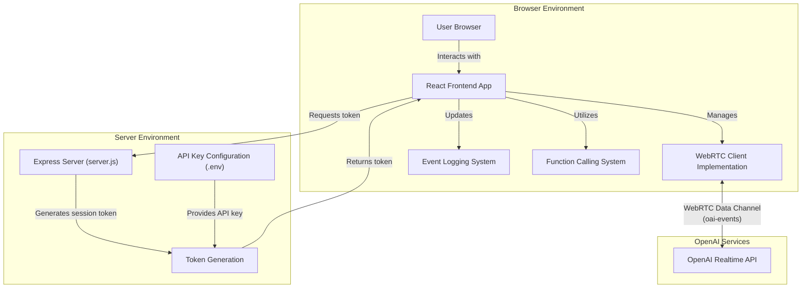
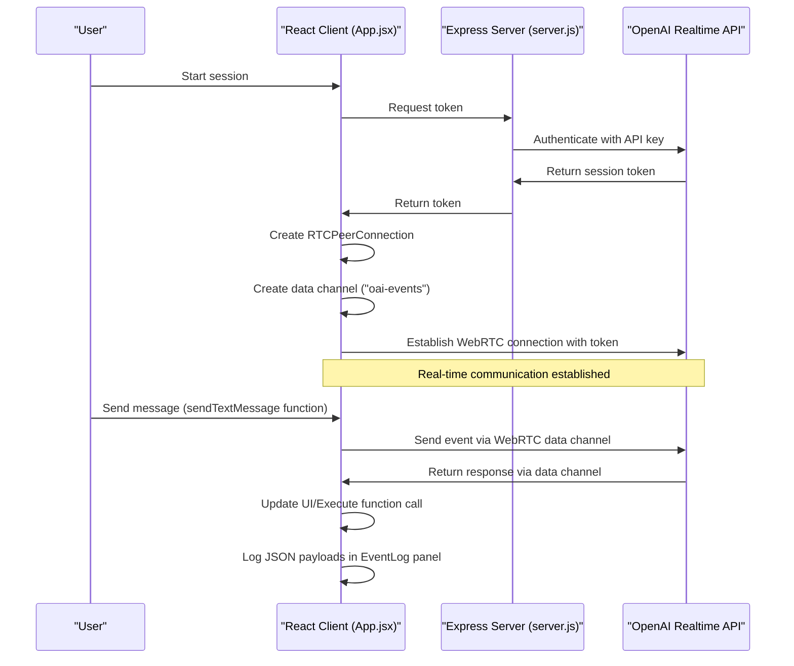

<!-- source: DeepWiki mcp.deepwiki.com · repo openai/openai-realtime-console · page 1 Overview · fetched 2026-10-26 -->

# Overview

Relevant source files

The following files were used as context for generating this wiki page:

- [README.md](README.md)
- [package.json](package.json)

This document provides an introduction to the OpenAI Realtime Console application, a reference implementation demonstrating how to use the OpenAI Realtime API with WebRTC for browser-based applications. The application showcases real-time communication with OpenAI's models using WebRTC data channels, client-side function calling, and event logging capabilities.

For project setup instructions, see [Project Setup](#1.1). For more detailed information about the system architecture, see [System Architecture](#1.2).

## Purpose and Key Features

The OpenAI Realtime Console serves as a minimal template to help developers understand and implement applications that leverage OpenAI's Realtime API. Key features include:

- WebRTC-based communication with the OpenAI Realtime API
- Token-based authentication for secure API access
- Client-side function calling capabilities
- Event logging for debugging and transparency
- Modern React frontend with Express backend

Sources: [README.md:1-31]()

## System Architecture

The application follows a client-server architecture with WebRTC communication to the OpenAI Realtime API.

The system consists of three main parts:
1. **React Frontend**: Manages user interaction, WebRTC connections, and event display
2. **Express Server**: Handles token generation and authentication with the OpenAI API
3. **OpenAI Realtime API**: Processes requests and provides real-time responses via WebRTC

Sources: [README.md:26-29](), [package.json:12-20]()

## Communication Flow

The following diagram illustrates the communication flow between system components:

This sequence shows how the application establishes and maintains communication with the OpenAI Realtime API using WebRTC technology.

Sources: [README.md:29]()

## Key Technical Concepts

### WebRTC Communication

The application uses WebRTC, specifically data channels, for real-time communication with the OpenAI API. This provides low-latency, peer-to-peer communication without requiring constant server intermediation after the initial connection is established.

### Token-based Authentication

To maintain security, the server generates temporary tokens for authenticating with the OpenAI Realtime API. This approach keeps the API key secure on the server side while allowing the client to establish direct WebRTC connections.

### Function Calling

The application implements function calling capabilities that allow the OpenAI Realtime API to trigger actions in the client application. This enables the creation of interactive applications where AI can request specific operations be performed on the client side.

### Event-Driven Architecture

The system uses an event-driven architecture where JSON events flow between the client and OpenAI through the WebRTC data channel. A logging panel displays these events for debugging and transparency.

Sources: [README.md:29]()

## Repository Structure

The repository is organized into client and server components:

| Component | Description | Key Files |
|-----------|-------------|-----------|
| Server | Express server that handles token generation and serves the React frontend | server.js |
| Client | React application with WebRTC communication and UI components | /client folder |
| Configuration | Environment configuration for API keys | .env, .env.example |
| Build System | Vite-based build system for the React frontend | package.json |

The client-side React application contains several key components:
- Main App component that manages the WebRTC connection and state
- EventLog component that displays sent and received events
- SessionControls component for managing the session
- ToolPanel component that handles function calling

Sources: [README.md:27-29](), [package.json:2-29]()

## Comparison with Other Implementations

This console application provides a minimal implementation focused on demonstrating core Realtime API concepts. For more comprehensive examples:

- The [OpenAI Realtime Agents](https://github.com/openai/openai-realtime-agents) demo provides a more advanced implementation built with Next.js and an agentic architecture.
- A previous version of this application used WebSockets instead of WebRTC, which is no longer recommended for browser implementations.

Sources: [README.md:31-35]()

---

